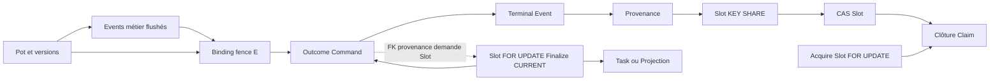

# Audit de conception — protocole transactionnel générique Consumption

Date : 2026-10-16. Sources : HEAD `78e861abc737f81283b35f91887824137f55ca24`, branche `feat/runtime-monolith`.

## A. Synthèse et périmètre de preuve

**CONDITIONAL GO pour un protocole commun aux huit familles présentes.** Aucun effet métier concret inspecté n'exige une finalisation pessimiste propre à une famille. Le moteur peut imposer : effets SQL et validations d'autorités selon leurs ordres locaux, provenance flushée, CAS d'ownership du slot, clôture contrôlée du claim, commit commun ; toute perte d'autorité annule la transaction. SUCCESS, REJECTED, FAILED et recovery doivent converger vers cette mécanique. Retry est la même discipline de transition conditionnelle et de clôture, sans publication terminale.

L'unification porte sur une **relation d'ordre partielle et un seul contrat de commit**, pas sur un ordre total User/Binding/Pot/Projection ni sur une instruction SQL universelle. Le fence Binding reste après les effets Pot et les Events métier, avant outcome/provenance/slot. Le CAS Pot reste avant les mutations temporelles qu'il autorise. Acquisition/takeover conserve sa transaction courte `slot → claims` ; elle ne publie aucun effet métier et ne peut attendre un outcome en tenant le slot.

Le TARGET supprime structurellement l'arête de D17 `slot FOR UPDATE → outcome`. Sa validation PostgreSQL reste à faire. Un CAS final seul ne prouve ni l'absence générale de deadlock, ni la fairness, ni la progression bornée. Le moteur ne peut garantir un ordre sûr à des callbacks SQL arbitraires : ils doivent respecter le contrat explicite de §F.

Différence avec [l'étude précédente][study] : aucune destination durable limitée à Command, aucune exemption Event/Projection fondée sur des tests d'invocation. Tous les callers de Finalize, de failure terminale et la recovery sont inclus dans le même chantier générique. Les variantes de décision fonctionnelle restent présentes.

### Statuts utilisés

| Statut | Sens dans ce rapport |
|---|---|
| PROVEN | Caractérisation PostgreSQL effectivement exécutée dans la campagne historique citée, pour son scénario précis. Aucun nouveau PASS ici. |
| SUPPORTED BY CODE | Chemin et SQL inspectés au HEAD ; inclut les déductions statiques bornées. |
| HYPOTHESIS | Propriété attendue du TARGET non implémenté/non exécuté. |
| REFUTED | Proposition précise contredite ; ne signifie pas absence universelle de cycles. |
| INCONCLUSIVE | Données insuffisantes, notamment trace SQL totale d'un déploiement ou callbacks futurs. |

Audit principalement read-only : seul ce rapport est créé. Pas de code production, DDL, test, statut officiel de dette ou configuration modifié. La [politique de vérification][policy] a été lue avant l'analyse sous `app/`. Slices d'analyse : Consumption partagé et COMMAND, EVENT, PROJECTION, BINDING, LKV, plus Registration et les deux Results. **Slices de vérification exécutées : NONE**, document uniquement ; gate global NOT REQUIRED ; full reactor NOT REQUIRED. Les incertitudes TARGET nécessitent ses vrais composants modifiés : fabriquer un runtime alternatif dans ce rapport donnerait une preuve de portée différente.

## B. CURRENT : inventaire exhaustif et frontières

### B.1 Entrées et assemblages effectifs

Recherche des implémentations `ConsumptionLocator`, des instanciations de `ExecuteConsumptionService`, `FinalizeConsumptionService`, `HandleConsumptionFailureService` et des orchestrateurs dans les sources Java de production. Huit familles trouvées, six via Sequential et deux via AcquireThenFinalize. `graft/` et les chemins historiques ne sont pas des runtimes supplémentaires. Les admissions HTTP, Attach/Detach Binding, publication outbox et lectures ne sont pas de nouvelles familles Consumption. `ABANDONED` existe dans le modèle/schéma ; aucun chemin runtime de publication correspondant n'est identifié dans les services inspectés.

| Famille | Entrée / callbacks / ports / adaptateurs | Assemblage et moteur |
|---|---|---|
| Command | `CommandConsumptionLocator` → `CommandConsumptionExecution` → `ExecuteRecordedCommandService` → decoder/dispatcher/handlers Pot ; `EventAppendPort`, `ExternalIdentityBindingPort`, `CommandOutcomePublicationPort` → JPA Pot, `JpaPotCommandEventAppendAdapter`, `JpaExternalIdentityBindingAdapter`, `JdbcCommandOutcomeAdapter` | `CommandConsumptionRuntimeConfiguration` ; Sequential ; Execute transactionnel entouré par `BindingFenceRecoveryExecuteUseCase` ; failure spécialisé |
| Registration | `RegistrationConsumptionLocator` → `ExecuteRegistrationService` ; request/outcome, UserAuthority, Binding, UserCreatedFact → stores JDBC, UserJdbcRepository, adapter Binding | `RegistrationRuntimeConfiguration` ; Sequential, Execute/Failure partagés |
| Binding | `BindingFactConsumptionLocator` → `MaterializeCurrentBindingService` → `CurrentBindingWritePort` → `JdbcCurrentBindingAdapter` | `BindingRuntimeConfiguration` ; Sequential ; le worker matérialise des faits immuables, il n'attache/détache pas l'autorité WRITE |
| Event | `ProjectionMaterializationConsumptionSource` → `ProjectionMaterializationConsumptionService` → `ProduceProjectionTaskService` → `ProjectionTaskStorePort` → `JdbcProjectionTaskStoreAdapter.ensure` | `EventConsumptionRuntimeConfiguration` ; AcquireThenFinalize ; Finalize partagé ; pas de HandleFailure câblé |
| Projection Task | `ProjectionTaskConsumptionOrchestrator` → `ProjectionTaskConsumptionService` → `ProjectionEngineService`, loaders/projectors/validator puis `ProjectionWritePort` → `JdbcProjectionStoreAdapter` | `CanonicalProjectionTaskRuntimeConfiguration` ; AcquireThenFinalize ; Finalize et HandleFailure partagés |
| Command Result | `CommandResultConsumptionLocator` → `MaterializeCommandResultService` → `CommandResultStore.ensureResult` → `JdbcCommandResultStore` | `CommandResultRuntimeConfiguration` ; Sequential, Execute/Failure partagés |
| Registration Result | `RegistrationResultConsumptionLocator` → `MaterializeRegistrationResultService` → `RegistrationResultStore.ensureResult` → `JdbcRegistrationResultStore` | `RegistrationResultRuntimeConfiguration` ; Sequential, Execute/Failure partagés |
| Latest Known Version | `LatestKnownVersionConsumptionLocator` → `AdvanceLatestKnownVersionService` via décorateur métrique → `LatestKnownVersionPersistencePort` → `JdbcLatestKnownVersionAdapter` | `LatestKnownVersionRuntimeConfiguration` ; Sequential, Execute/Failure partagés |

Les noms sont des repères de méthodes/classes ; les chemins de lecture sont regroupés en §K. Les classes `Transactional*UseCase` de `engine-consumption` entourent les services par `TransactionRunner`. Les supras déterminent les sources, effets et classifications ; les runtimes construisent les mêmes services mais n'ajoutent pas de SQL de finalisation.

### B.2 Transactions, propagation et ORM

`SpringTransactionRunner.runInTransaction` utilise `TransactionTemplate.execute` sans absorber l'exception. Les configurations ci-dessus construisent `new TransactionTemplate(manager)` : REQUIRED, isolation DEFAULT. Avec la datasource/manager communs du wiring inspecté, JDBC et JPA participent au même commit local. Schémas READ et primaire distincts ne signifient pas transactions distinctes. Les preuves historiques ont constaté READ COMMITTED sur PostgreSQL 17.11 ; l'isolation d'un déploiement externe reste INCONCLUSIVE.

Acquisition committe avant Execute/Finalize. Sequential n'est pas transactionnel ; après exception d'Execute, il classe l'erreur et appelle HandleFailure après sortie de son wrapper, donc après rollback. La recovery Binding est extérieure au wrapper Execute : elle commence après ce rollback, puis l'Execute imbriqué REQUIRED rejoint sa transaction. Aucun REQUIRES_NEW rencontré sur ces chemins. Un appelant qui envelopperait l'orchestrateur dans une transaction casserait cette séparation : REQUIRED ne signifie pas « toujours nouvelle transaction ».

Lifecycle, provenance, outcome Command et Binding imposent MANDATORY. Certains stores Registration/Results n'ont pas cette garde et nécessitent la transaction de l'appelant. Task.ensure est REQUIRED. Projection.publish/recordFailure utilise un template interne REQUIRED, construit avec le manager injecté dans `ProjectionStoreAutoConfiguration` : il rejoint Finalize. Les loaders historiques lisent ; leur annotation REPEATABLE_READ ne transforme pas une transaction existante en transaction indépendante.

Ordre Java ≠ ordre complet des locks :

- Le CAS Pot `updateIfActive` flush automatiquement avant l'UPDATE ; création Pot utilise `saveAndFlush`, puis insertion des métadonnées immuables. Les fermetures temporelles sont des UPDATE conditionnels, les nouvelles versions peuvent rester en attente ORM.
- `JpaPotCommandEventAppendAdapter.appendAll` utilise **saveAllAndFlush** : avec Events, les écritures Pot en attente et les Events sont flushés avant le fence Binding JDBC. Sans Events, un flush de certains inserts Pot peut être plus tardif.
- Le fence Binding et l'outcome sont JDBC : ne supposer aucun flush JPA automatique à cette seule frontière. `appendInputs/appendResults` appelle saveAll ; le CAS slot natif est `@Modifying(flushAutomatically=true, clearAutomatically=true)`. La provenance est donc flushée **avant** l'UPDATE slot, et ses FK prennent leurs locks avant lui. Un flush antérieur peut intervenir sur une requête ORM.
- `saveAndFlush` du nouveau claim force son INSERT avant `installClaim`. Les UPDATE de claims flushent aussi automatiquement. `clearAutomatically` détache les entités : ne pas en déduire une libération des locks SQL.

Il n'existe pas une trace totale de chaque flush possible dans cette étude. Les séquences ci-dessous distinguent les barrières SQL garanties des inserts ORM susceptibles d'être avancés. Tous les locks acquis restent jusqu'au commit/rollback physique, hors rollback de sous-transaction ; aucun savepoint n'est utilisé pour poursuivre une finalisation ayant perdu son autorité.

### B.3 Acquisition commune, takeover, perte du claim

```text
BEGIN Acquire
  precondition.lockAndCheck() -- extension du port ; defaults toujours vrais dans les locators inspectés
  INSERT slot ON CONFLICT(clé logique) DO NOTHING -- peut déjà attendre l'unicité
  SELECT slot par clé FOR UPDATE
  DONE / next_claim_at futur / lease active : retour sans nouveau claim
  takeover si expiré : UPDATE ancien claim invalidated_at/TAKEN_OVER
  INSERT nouveau claim (FK slot ; UNIQUE(slot,attempt), PK claim), saveAndFlush
  UPDATE slot installer claim, incrémenter attempt et revision (FK composite slot/claim)
COMMIT
```

Acquire ne lit ni n'écrit outcome, projection ou Pot. Même S : tous les acquéreurs passent par son verrou. L'extension precondition pourrait ajouter des locks avant S ; aucun callback métier durable n'est fourni par les locators actuels. Un futur usage doit déclarer son ordre, sans prendre un effet de finalisation après S dans Acquire.

Le lease sert à autoriser le takeover ; **un claim expiré encore courant peut terminer**. CAS et clôture ne testent pas `lease_until > now`. Un ClaimId généré est un token non réutilisé, associé au slot par FK composite. La `revision` est incrémentée mais n'est pas le token d'ownership.

Execute perdant lève `LostClaimException` au CAS et rollbacke. Sequential l'ignore comme perte d'autorité, sans classification technique. Finalize courant vérifie au lock initial et peut retourner LOST_CLAIM sans callback. Retry peut retourner LOST_CLAIM sans écritures nouvelles avant son CAS. Le refus de clôture après un CAS gagnant lève une exception : rollback obligatoire.

### B.4 Séquences normales et rejets, par famille

Notation : `P` = Pot global et versions ; `E` = stream Binding WRITE ; `Oq/Or` = outcome Command/Registration ; `Tq` = terminal event Command ; `I/R` = inputs/results de provenance ; `Sᵏ` = FK KEY SHARE du slot ; `Sᶠ` = SELECT FOR UPDATE ; `Sᶜ` = CAS UPDATE ; `C` = claim. Une flèche indique « peut être acquis après et dans la même transaction », pas forcément une attente. Les lectures MVCC sont précisées lorsqu'elles contrôlent une branche.

| Famille / branche | Ordre physique utile jusqu'à commit ; toutes les écritures restent provisoires |
|---|---|
| Command SUCCESS avec Events | reload Q, observation Binding sans lock → CAS/INSERT P → métadonnées, DML temporel, flush Pot+Events outbox → fence UPDATE E `(E,U,B,R)` → INSERT Oq strict → INSERT Tq (FK Oq, UNIQUE Q) → flush I/R et FK Sᵏ → Sᶜ → C.end(SUCCESS) |
| Command SUCCESS sans Events | CAS/INSERT P → métadonnées et DML temporel ; nouveaux inserts éventuellement différés → fence E → Oq → Tq → flush restant Pot et I/R avant Sᶜ → C.end. Les verrous de versions Pot sont déjà sous l'autorité globale P. |
| Command REJECTED | Binding absent : pas de métier/fence positif, Oq → Tq → I/R éventuels → Sᶜ → C.end(REJECTED). Binding observé et autorisation expirée ou rejet métier : contrôles/lectures métier, fence E puis même suffixe. Aucun ProcessingFailure fabriqué pour un rejet métier. |
| Registration REGISTERED | reload request/outcome ; si absent : bootstrap stream E puis E FOR UPDATE → initializer INSERT User puis UserCreatedFact → réserver occurrence B → INSERT actif(E,U,B) → UPDATE E révision → INSERT fact Attached → INSERT Or (FK request/User/occurrence) → I(request), flush/Sᵏ → Sᶜ → C.end(SUCCESS) |
| Registration REJECTED | même E FOR UPDATE, actif déjà présent : pas d'initializer/User/fait nouveau ; INSERT Or rejet → I → Sᵏ → Sᶜ → C.end(REJECTED). Si Or existant au reload : réutilisation de la décision, pas de nouveau lock E, puis suffixe provenance/CAS. |
| Binding SUCCESS | reload fait immuable → UPSERT READ current_external_identity_binding(E), monotonie de révision/comparaison à égalité → I(fact,version=1) / Sᵏ → Sᶜ du fait → C.end(SUCCESS). Aucun lock E WRITE ni mutation du Binding actif. STALE/DUPLICATE READ reste succès Consumption. |
| Event SUCCESS | hors transaction finale : découverte/routage candidat ; Finalize : Sᶠ → callback ensure Task ON CONFLICT(ProjectionKey) DO NOTHING → Sᶜ du couple Event/route → C.end. Pas de provenance ajoutée par ce chemin. |
| Projection SUCCESS | hors transaction : load historique/production/validation ; Finalize : Sᶠ → INSERT projection_root ON CONFLICT(ProjectionKey) DO NOTHING → si nouveau root, INSERT artifacts (FK root) → Sᶜ du task → C.end. ALREADY_EXISTS reste succès, first published wins. |
| Command Result SUCCESS | reload terminal event/outcome/recorded command et contrôle cohérence → INSERT command_results ON CONFLICT(Q) DO NOTHING (FK recorded Q), relecture/comparaison immutable → I(terminal event) / Sᵏ → Sᶜ du résultat → C.end |
| Registration Result SUCCESS | reload request/outcome et contrôle cohérence → INSERT registration_results ON CONFLICT(request) DO NOTHING (FK request), relecture/comparaison immutable → I(outcome) / Sᵏ → Sᶜ du résultat → C.end |
| LKV SUCCESS | reload Event → UPSERT READ source_version_watermarks(PotId), candidat supérieur seulement ; même une branche sans avancement peut verrouiller le conflit → I(Event) / Sᵏ → Sᶜ → C.end ; métriques de succès après commit |

Les slots source et résultat sont **différents**. Lire l'outcome d'une source ne verrouille pas son slot. Les résultats matérialisés peuvent représenter un rejet/FAILED de Command alors que leur propre Consumption termine SUCCESS. Les types READ_POT, BALANCES, AUTH et les types historiques/configurables de projection ne sont pas des protocoles Consumption différents ; le writer final est commun. Le résultat Command direct est distinct du chemin historique Event→Task.

### B.5 Erreurs, retry, terminal et recovery : chemins réellement présents

| Famille | Retry après rollback / classification | FAILED terminal | Recovery et chemins absents |
|---|---|---|---|
| Command | classifier spécialisé, transitoires dont 40P01 ; policy générique 1 s, 5 s, 30 s puis terminal dès tentative 4 ; erreur inconnue terminale | HandleFailure → Finalize Sᶠ → outcome FAILED + Tq → Sᶜ FAILED → C.fail ; code public outcome distinct du code ProcessingFailure slot/claim | seule recovery métier explicite : perte fence Binding, détaillée ci-dessous |
| Registration | invariant IllegalState/IllegalArgument terminal ; autres retry 5 s | Finalize Sᶠ → effet vide → Sᶜ FAILED → C.fail ; **pas d'outcome Registration FAILED** | pas de recovery dédiée ; ni nouvelle création User après rollback dans la transaction failure |
| Binding | `BindingFactFailureClassifier/Policy` : catégorie terminale Fail, autres 5 s | même suffixe avec effet vide | pas de rejet métier Consumption ni recovery dédiée |
| Event | aucun HandleFailure/policy câblé ; exception ensure → rollback Finalize → RuntimeFailure ; claim déjà acquis reste ouvert, Busy jusqu'à expiration puis takeover/rejeu | absent du wiring courant | pas de rejet métier, retry planifié ou recovery dédiée ; rejeu après lease n'est pas un scheduleRetry |
| Projection Task | `Temporary` de préparation → HandleFailure → RetryAfter ; `ProjectionTaskRetryPolicy` ne terminalise jamais par épuisement ; délai opérationnel | `Terminal` de préparation → Finalize Sᶠ → INSERT projection_failure ON CONFLICT(failure_id), comparaison si conflit → Sᶜ FAILED → C.fail | exception imprévue de préparation/publication → RuntimeFailure et reprise après lease ; pas de REJECTED ni recovery dédiée |
| Command Result | invariant de matérialisation terminal ; technique retry 5 s | effet vide sous Finalize Sᶠ, Sᶜ FAILED, C.fail | pas de rejet de sa propre Consumption ni recovery dédiée |
| Registration Result | même séparation invariant/technique | même effet vide | idem |
| LKV | input absent terminal ; autres default retries bornés | effet vide sous Finalize Sᶠ, Sᶜ FAILED, C.fail | pas de rejet métier ni recovery dédiée |

Retry commun, dans une transaction distincte de l'Execute rollbacké : lecture claim (sans verrou ligne) et vérification slot, policy, `UPDATE S SET current_claim_id=NULL,next_claim_at=... WHERE S,PENDING,C`, puis `UPDATE C.fail WHERE C,S,ended_at IS NULL,invalidated_at IS NULL` exigé à une ligne. Slot reste PENDING ; aucun outcome, événement terminal ou provenance de l'Execute échoué. Si CAS zéro, aucun nouvel effet à annuler dans ce chemin actuel.

Recovery Command actuelle : fence Binding zéro → exception → rollback complet Pot/Events ; nouvelle transaction → **Sᶠ** et contrôle token → lecture exacte `(E,B)` ; si encore présent, `BindingFenceConflictException`, rollback puis classifier transitoire/retry ou FAILED au budget ; si absent, Execute imbriqué REQUIRED publie REJECTED(CALLER_IDENTITY_NOT_CURRENT), Tq, provenance vide, Sᶜ, C.end. Ne pas transformer le conflit positif en rejet. La lecture négative s'appuie sur l'occurrence B permanente/non réutilisable : réattacher même E/User crée un autre B ; elle n'est pas un fence positif du nouveau Binding.

Pour chaque famille, un takeover utilise B.3 et un callback terminal perdant doit rollbacker selon son wrapper. Aucun commit partiel de métier n'est permis. Une erreur au flush, à la clôture ou au commit peut encore annuler une tentative dont le CAS a réussi. L'acquisition antérieure reste committée : « rollback intégral » désigne la transaction d'effets/finalisation, pas l'effacement rétroactif de l'historique Acquire.

## C. Graphe des acquisitions et incompatibilités

### C.1 Classes de ressources et modes

Le mode d'attente doit accompagner l'arête : lectures ordinaires MVCC ne sont pas des acquisitions de ligne exclusives. DML prend aussi ROW EXCLUSIVE sur ses tables, SELECT FOR UPDATE ROW SHARE ; ces modes table ne bloquent pas les DML ordinaires entre eux. DDL concurrent est hors de la preuve runtime. Référence : [verrous PostgreSQL 17](https://www.postgresql.org/docs/17/explicit-locking.html).

| Ressource | Acquisitions / attentes significatives |
|---|---|
| Pot global/version et temporel | UPDATE conditionnel de version, insert PK/metadata unique(Pot,version), UPDATE de fermeture et inserts temporels ; concurrence même Pot sérialisée en amont par sa version ; pas de SELECT FOR UPDATE Pot |
| Binding WRITE | bootstrap unique(E), FOR UPDATE stream pour acquire/detach, UPDATE R=R pour fence exact ; INSERT actif uniques/FK User et occurrence, DELETE actif verrou exclusif ; occurrence/facts FK stream/User/occurrence et unique(E,R) |
| Outcomes/events | INSERT strict outcome Q ou request ; unicité attend transaction concurrente ; terminal event UNIQUE Q et FK outcome ; outbox Event PK et index ; ne pas confondre outbox Event et terminal event Command |
| READ Binding / LKV | UPSERT unique E / PotId ; UPDATE même clé conserve verrou même si WHERE monotone refuse de changer la valeur ; ne verrouille pas l'autorité WRITE homonyme |
| Task / Projection | ensure unique ProjectionKey ; root unique ProjectionKey puis artifacts uniques/root FK ; failure PK failure_id ; publication peut attendre un concurrent avant CAS |
| Provenance | inputs PK et UNIQUE(S,subject...), results PK ; deux FK immédiates vers slot, KEY SHARE S ; « Provenance → Slot » n'est pas un lock sur toute table |
| Slot | bootstrap unique clé logique ; FOR UPDATE Acquire/Finalize ; CAS UPDATE non-clé (clés uniques stables), normalement NO KEY UPDATE ; acquisition physique seulement si ligne candidate/verrou nécessaire, distincte du test logique du token |
| Claim | PK et uniques(S,attempt)/(S,C), FK S ; UPDATE invalidation/end/fail non-clé ; install slot vérifie FK composite vers claim ; clôture ne consulte pas la lease |
| Parents immuables | FK request/recorded command/User/occurrence/root ; KEY SHARE possibles ; absence de DELETE/UPDATE clé runtime en face limite les inversions ; pas une preuve sur DDL/admin externes |

Une unicité non committée peut faire attendre le XID de son propriétaire ; ce n'est pas nécessairement un verrou de ligne SQL explicite. Voir [contrôles d'unicité PostgreSQL](https://www.postgresql.org/docs/17/index-unique-checks.html). À READ COMMITTED, l'UPDATE réévalue sa condition après un conflit concurrent ; un token stale peut aussi donner zéro immédiatement : [isolation PostgreSQL](https://www.postgresql.org/docs/17/transaction-iso.html).

### C.2 Arêtes CURRENT et inverses atteignables

| Arête dans une transaction | Origine / caractère | Attente incompatible et inverse |
|---|---|---|
| P → E | Command ayant Binding courant et mutation Pot ; conditionnel | UPDATE E contre FOR UPDATE mutation Binding. Aucun writer E courant ne demande P : inverse absent des handlers inspectés. |
| E → User → occurrence → actif → fact | Registration libre ; E avant actif aussi en Detach (DELETE) | mutations même E incompatibles mais toutes prennent E d'abord ; KEY SHARE parents User compatibles, pas de writer User exclusif inverse identifié |
| E → Or → provenance → S | Registration nouvelle décision | S du request ; Command après E demande un autre outcome/slot. Le nom de classe S ne suffit pas à conclure un cycle. |
| P/Events → E → Oq → Tq → provenance → Sᵏ → Sᶜ | Command Execute ; préfixes et provenance conditionnels | Oq unique et Sᶠ peuvent bloquer ; inverse **Sᶠ → Oq** de failure/recovery, D17 atteint avec input |
| Sᶠ → Task / root/artifacts / failure | Finalize Event/Projection | unicité partageable entre slots distincts ; inverse effet → même S absent des finalizers courants de ces familles ; devient relation à tester en TARGET |
| READ E / LKV / result → I → Sᵏ → Sᶜ | Execute matérialiseurs | effet avant S ; failure courante Sᶠ → effet **vide**, donc pas d'inverse vers leur ligne READ/result |
| S → C | acquire, takeover, CAS/end/fail/retry ; obligatoire si mutation gagnante | S et C peuvent attendre ; aucune clôture/invalidation C→demande S dans une autre transaction : slot est toujours premier verrou de mutation |
| I/R → Sᵏ | FK ; conditionnel à provenance | KEY SHARE incompatible avec FOR UPDATE ; compatible avec NO KEY UPDATE du CAS non-clé ; point décisif D17 |
| slot.install → FK C | acquisition sous S, après INSERT claim | ne crée pas un ordre inverse claim exclusif→S entre transactions : nouveau claim privé, pas réutilisé |



Le graphe regroupe les classes ; seule l'analyse des **mêmes clés** et des modes permet de transformer un cycle de classes en cycle d'attente. La flèche pointillée résume l'attente D17, pas une FK directe outcome→slot.

### C.3 Cycles et portée des réfutations

- **D17 PROVEN historique** : même Q et même S, ancien Execute tient Oq, nouveau failure tient Sᶠ ; unicité Oq et FK KEY SHARE S incompatibles ferment le cycle. §G donne l'entrelacement.
- **D16/D18 REFUTED pour les témoins historiques** : sans provenance, CAS ancien token déjà remplacé donne zéro sans attendre S ; ancien rollbacke et libère Oq. Ce résultat ne s'étend pas à une branche avec FK.
- **Binding stream/actif REFUTED pour les writers inspectés** : mutations partent du stream ; fence prend stream et observe actif sans verrou exclusif. Registration n'attend ni Pot ni le slot Command. Deux Commands sur Pots distincts et même E ne demandent pas le Pot de l'autre ; même Pot, version globale acquise avant E. Aucun ordre total E avant P à introduire.
- **Execute/takeover seul SUPPORTED BY CODE** : takeover peut bloquer la FK, mais ne demande jamais l'effet détenu par Execute ; pas de retour d'attente vers Pot/outcome/projection. Les claims non-clés ne créent pas l'inverse C→S. Files d'attente et upgrades avec troisième transaction nécessitent néanmoins la caractérisation T07.
- **Deux matérialisations READ(E)/LKV sur slots différents SUPPORTED BY CODE** : même ligne READ acquise avant leurs slots propres ; le détenteur de READ ne demande pas le slot de l'autre. Aucune FK READ→autorité WRITE à ajouter par supposition.
- **INCONCLUSIVE** : batch futurs multi-Pot/multi-E, callbacks arbitraires, DDL/admin, configurations multi-datasource, traces complètes de tous les flushs. Deux ressources métier acquises en sens opposé pourraient deadlocker même avec CAS final ; aucun tel couple runtime opposé n'a été démontré ici. Ne pas inventer un défaut courant à partir de l'expressivité des ports.

## D. TARGET : un protocole canonique minimal

### D.1 Discipline commune, positions exactes

```text
Acquisition / takeover dans une transaction distincte (conserver son ordre)
Préparation pure / lecture historique éventuelle hors transaction d'effets

BEGIN transaction d'effets d'une tentative ou d'une décision terminale
  exécuter l'effet transactionnel propre à la décision :
    acquisitions et écritures métier dans l'ordre local déclaré
    validations d'autorités à leurs positions nécessaires
    publications outcome/events/task/projection/failure éventuellement vides
  valider les slotIds de la provenance ; append inputs/results éventuels
  FLUSH avant le CAS de toutes les écritures ORM de cette transaction
  UPDATE slot WHERE slot_id=S AND status=PENDING AND current_claim_id=C
      terminal : DONE, résultat/raison/date, current_claim_id=NULL
      retry : PENDING, next_claim_at, current_claim_id=NULL, sans résultat terminal
  exiger exactement une ligne ; zéro -> exception de perte d'autorité
  UPDATE claim WHERE claim_id=C AND slot_id=S
      AND ended_at IS NULL AND invalidated_at IS NULL
  exiger exactement une ligne, raison et détails cohérents
COMMIT

Toute exception, perte d'autorité, clôture refusée ou commit refusé : ROLLBACK
Après rollback physique seulement : exposer LOST_CLAIM si perte d'ownership établie
```

Le retry démarre après rollback de l'Execute, avec **effet vide**, sans provenance terminale. Ce n'est pas un nouvel Execute ni une publication FAILED. Les policies et budgets de B.5 restent inchangés.

L'effet transactionnel est le callback existant, pas une nouvelle série de hooks. Le moteur possède le suffixe provenance/flush/CAS/clôture. La famille possède son préfixe métier et ses autorités. Publier des SQL avant CAS signifie les préparer dans la transaction, pas les rendre visibles à un lecteur externe. La seule publication durable est le commit.

Ordres locaux à conserver :

1. Command : acquisition/version P, DML temporel et Events métier, **fence E à sa position actuelle**, outcome et terminal event, provenance, CAS S, clôture C. Les inserts temporels différés restent protégés par P ; leur flush doit précéder S. Ne pas avancer E au début par uniformité.
2. Registration/Attach/Detach : stream E avant initializer ou mutation actif/occurrence/fact ; publication Or avant provenance/S. Une observation Binding n'est pas un lock ; une mutation du stream constitue la sérialisation effective.
3. Matérialiseurs : READ/upsert/result/task/root/failure avant provenance éventuelle et S. Pour root, artifacts après root ; conserver comparaison immutable et monotonie.
4. Après CAS S, **seule clôture du claim**, pas de callback supplémentaire, nouvelle requête métier verrouillante, publication unique, nouvel insert ORM retardé ou nouveau slot Acquire. Le commit peut encore refuser et doit rester dans le wrapper.
5. Si un callback touche plusieurs clés partageables, imposer un ordre stable à ces clés dans tous les writers concurrents concernés ; pas d'ordre total entre familles qui ne les acquièrent jamais ensemble. Les chemins présents mono-Pot/mono-E et root privé n'exigent pas de locks préventifs supplémentaires.

C'est une discipline globale commune composée d'ordres locaux cohérents. L'hypothèse « toutes les autorités d'abord, tous les effets ensuite, tous les fences à la fin » est **REFUTED comme description CURRENT et non nécessaire au TARGET**. Le fence Pot est une acquisition précoce, le fence Binding une acquisition tardive ; ils restent tous deux détenus au commit. Le protocole ne cherche pas à faire passer chaque callback par un registry de phases.

### D.2 Composition des autorités et CAS

| Autorité | Validation nécessaire et position | Lock conservé / justification |
|---|---|---|
| Pot actif | CAS version attendue avant mutation temporelle | UPDATE global/version ; empêche un concurrent d'autoriser la même version et protège les écritures temporelles. Consumption ne peut remplacer la concurrence de deux Commands distinctes sur le même Pot. |
| Binding positif Command | UPDATE stream R=R avec E,R et EXISTS actif exact E,U,B, après métier/Events et avant outcome | verrou stream jusqu'à commit ; les writers attach/detach prennent ce stream avant mutation. Nécessaire même si le claim Command est courant : le token Consumption ne valide pas l'identité. |
| Binding négatif/recovery | observation exacte B absent, après rollback du fence perdu | pas de verrou négatif/gap ; sûreté fondée sur permanence/non-réutilisation B et writer actuel. Si B encore présent : conflit technique, jamais rejet négatif. |
| Consumption | CAS commun S/PENDING/C après tous les effets SQL/flush | UPDATE slot, puis clôture C ; bloque takeover gagnant jusqu'à fin de transaction ; token identifie la tentative courante, pas sa validité temporelle |
| READ monotonie / immutable publication | upsert ou comparaison au point de publication | sérialisation/convergence du store ; ne pas les remplacer par le CAS slot de l'un des multiples consommateurs |

Pas de condition lease/next_claim_at/revision supplémentaire au CAS recommandée. Vérifier l'identité S, PENDING et C suffit pour l'ownership dans le schéma courant, **avec** FK claim/slot, tokens non réutilisés, cardinalité de clôture et contraintes des métadonnées. SUCCESS sans raison ; REJECTED avec code métier ; FAILED avec ProcessingFailure, code public spécifique éventuel distinct ; done_at cohérent. Un contrôle Java préliminaire non verrouillant est une optimisation éventuelle, jamais le fence.

Deux validations successives composent correctement leurs garanties si les verrous des autorités restent détenus jusqu'au même commit et si les validations sans lock ont un argument de stabilité (B négatif). Aucun besoin d'une instruction SQL unique validant toutes les autorités. Une perte E rollbacke même si tous les SQL métier ont réussi ; une perte C rollbacke même si le fence E a réussi.

### D.3 Rollback avant traduction externe et erreurs pré-CAS

`FinalizeConsumptionService` ne peut plus rendre normalement LOST_CLAIM après avoir exécuté l'effet : `TransactionTemplate` pourrait committer cet effet. Faire lever la même exception de perte d'autorité que Execute ; traduire au niveau **extérieur à l'owner de la transaction physique**, après retour exceptionnel du runner. Le wrapper de finalisation peut conserver son résultat APPLIED/LOST_CLAIM en attrapant après `runInTransaction`, sous contrat d'absence de transaction ambiante. La recovery, qui est elle-même owner, doit laisser remonter la perte jusqu'à son rollback avant toute traduction. Ne pas attraper dans le delegate REQUIRED imbriqué pour continuer à écrire.

Si un callback stale rencontre un outcome déjà committé, un INSERT strict peut lever 23505 **avant** CAS. Rollback d'abord, puis contrôle frais du slot/token si l'on veut normaliser en LOST_CLAIM. Si le token est réellement supplanté ou le slot terminé, abandon sans réexécuter l'effet. Si l'ownership demeure, conserver la classification technique/invariant du conflit ; ne jamais convertir un contenu divergent en succès. Même règle pour 40P01/40001 : ne pas transformer toute erreur SQL en perte de claim. Après incident réseau au commit, l'état peut être incertain : relecture nécessaire, pas affirmation automatique d'un rollback effectivement confirmé.

La clôture zéro après CAS gagnant est une anomalie d'intégrité ou de composition et doit rollbacker. La perdre ne doit ni laisser DONE committé, ni lancer une transaction REQUIRES_NEW de réparation. Sous REPEATABLE READ/SERIALIZABLE, des erreurs de sérialisation peuvent remplacer le zéro attendu ; cette étude conserve l'isolation actuelle et exige rollback/classification adaptée.

## E. Matrice de compatibilité de toutes les familles

« Compatible » porte sur la conception, pas sur une exécution TARGET validée. Les verdicts sous contrat rendent explicites les obligations transverses ; aucune incompatibilité métier démontrée.

| Famille | Verdict | Motif / plus petite adaptation au protocole | Niveau |
|---|---|---|---|
| Command | COMPATIBLE UNDER CONTRACT | Execute déjà effet→CAS ; enlever prélock des branches failure/recovery, rollback avant traduction, gérer conflit pré-CAS sans masquer invariant ; conserver fences Pot/Binding | SUPPORTED BY CODE ; progression TARGET HYPOTHESIS |
| Registration | COMPATIBLE | effets SQL courants déjà dans Execute ; FAILED vide passe au finalizer commun ; conserver stream et initializer SQL, décision Or réutilisable | SUPPORTED BY CODE |
| Binding | COMPATIBLE | matérialisation READ transactionnelle, monotonie inchangée ; failure vide ; pas d'autorité WRITE à prendre artificiellement | SUPPORTED BY CODE |
| Event | COMPATIBLE UNDER CONTRACT | Task.ensure SQL REQUIRED rollbackable ; migrer garantie d'invocation et traduction LOST_CLAIM ; garder absence de policy terminale actuelle | SUPPORTED BY CODE ; courses TARGET HYPOTHESIS |
| Projection Task | COMPATIBLE UNDER CONTRACT | root/artifacts/failure SQL rejoignent Finalize ; loaders/projectors hors transaction d'effets, garde de leur pureté ; changer tests stale ; conserver first wins et retries temporaires non bornés | SUPPORTED BY CODE ; courses TARGET HYPOTHESIS |
| Command Result | COMPATIBLE | INSERT/compare immutable dans Execute ; aucune publication externe, FAILED propre vide | SUPPORTED BY CODE |
| Registration Result | COMPATIBLE | idem request/outcome ; pas de fence Binding courant nécessaire à la lecture d'une décision immutable | SUPPORTED BY CODE |
| LKV | COMPATIBLE UNDER CONTRACT | UPSERT transactionnel déjà avant CAS ; télémétrie afterCommit et erreurs de tentative doivent rester distinctes des effets métier | SUPPORTED BY CODE |

**Aucune famille INCOMPATIBLE identifiée.** Il n'existe donc pas de contre-exemple concret autorisant un protocole spécial durable pour Event/Projection. L'impossibilité de garantir zéro invocation stale avec un callback placé avant le CAS est, elle, directe : C2 prend le claim, C1 entre dans l'effet avant de faire son CAS. La différence minimale de contrat est « aucun effet métier stale committé ». Aucun effet runtime inspecté n'exige une promesse plus forte.

## F. Contrat du moteur et audit des callbacks

### F.1 Invariants canoniques

- Un seul owner transactionnel local des effets requis, des validations, du slot et de son claim ; aucun effet métier committé par un token qui a perdu le CAS. Pas de transaction ambiante englobant acquisition, exécution et failure.
- Un callback peut être invoqué stale et effectuer des SQL provisoires. Il ne peut pas s'appuyer sur une élection gagnante préalable ; son résultat n'est autorisé qu'au commit commun.
- Aucun effet métier externe irréversible, commit indépendant ou mutation de cache métier partagé avant ce commit. Utiliser l'outbox SQL existante pour les Events requis ; la livraison éventuelle est un autre workflow. Un afterCommit ne rend pas atomique une livraison réseau requise.
- Les callbacks ne mutent ni leur propre lifecycle ni celui d'un autre slot ; toutes leurs acquisitions partageables précèdent le suffixe CAS/clôture. Ils respectent leurs ordres locaux y compris contraintes/FK et flushs. Les entités managées ne doivent pas programmer de nouveaux effets après le flush final.
- Le moteur garantit validation des slotIds de provenance, outcome/raison cohérents, cardinalités, rollback, traduction après fin physique. Les adapters garantissent SQL conditionnel, participation au manager commun et contrat de publication spécifique ; les policies décident retries/rejets/échecs.
- Les métriques de tentative, logs et calculs locaux ne sont pas une autorité métier. Ne pas promettre leur rollback. Les effets de succès afterCommit sont conditionnés au commit effectif.

### F.2 Tous les callbacks durables trouvés

| Callback concret | Effets et transactions | Hors SQL / invocation stale |
|---|---|---|
| Command forCommand et terminalFailureEffect | handlers Pot, Event append **outbox SQL saveAllAndFlush**, fence Binding, outcome et terminal event JDBC MANDATORY ; même transaction | decode/permissions/trace/horloge/UUID locaux ; `PotCommandInvocation` accumule inputs/Events dans des listes privées à une invocation, sans publication mémoire partagée ; aucun envoi réseau, REQUIRES_NEW, publication Spring hors transaction ou mutation métier mémoire partagée trouvé sur cette chaîne |
| Registration execution ; initializer Binding | users.create puis userFacts.append JDBC ; occurrence/actif/revision/fait et outcome SQL dans transaction Execute | générateurs UUID/horloge ; initializer runtime n'appelle pas un service externe. Le port Runnable est plus permissif que ce caller : contrat à formaliser. |
| Binding materializer | upsert READ MANDATORY et comparaison ; callback retourne Success | pas d'écriture WRITE Binding, pas d'outbox/network |
| Event durableEffect | producer.ensure → Task.ensure JDBC REQUIRED ; pas d'événement réseau, pas d'afterCommit métier | `CountingStore` des tests compte les invocations ; compteur de test n'est pas un invariant de production. Le stale peut tenter ensure, puis rollbacker. |
| Projection Prepared / Terminal | publish root/artifacts ou recordFailure, template REQUIRED même manager ; failure_id comparé en conflit ; first wins pour root | préparation historique, projectors et validation en dehors du callback durable ; pas d'outbox/publication externe dans `JdbcProjectionStoreAdapter`. Les root/artifacts sont des publications SQL. |
| Command Result / Registration Result | reload sources immuables, ensureResult SQL et comparaison | pas de notification externe ni cache métier partagé repéré |
| LKV | upsert MANDATORY ; `MeteredAdvanceLatestKnownVersionUseCase` enregistre une `TransactionSynchronization.afterCommit` pour compteur/log advanced ou unchanged | **exception concrète à “tout effet est rollbackable”** : `errors.increment()` et log warn immédiats lors d'une erreur ; ils mesurent la tentative. Succès métrique afterCommit ne s'exécute pas si CAS perdu. Compatible sans changement métier. |
| failure générique sans effet spécialisé | callback vide (constructeurs par défaut de LocatedConsumption/HandleFailureInput) | ne fabrique pas de résultat métier terminal supplémentaire |

Recherche de `REQUIRES_NEW`, `runAfterCommit`, `afterCommit`, `TransactionSynchronization`, publication d'événement et clients réseau dans les chaînes inspectées ; inspection des adapters et configurations. L'existence de `SpringTransactionRunner.runAfterCommit` n'est pas un usage métier de ces callbacks. L'usage direct de synchronisation LKV est bien pris en compte. Les métriques/orchestrateurs et curseurs locaux vivent hors atomicité métier. Aucun cache métier partagé modifié par ces callbacks trouvé. L'absence de tels effets dans les implémentations présentes ne prouve pas la pureté de toute implémentation future d'un port ou d'un projector enregistré par extension.

Contre-exemple de **contrat**, pas famille existante : un futur callback envoie un email, puis perd C au CAS. PostgreSQL rollbacke ses SQL, pas l'email ; le contrat commun serait violé. L'alternative minimale est une intention SQL/outbox dans la transaction, pas un finalizer spécial pessimiste : même un prélock n'annule pas un email après une panne au commit. Aucun tel chemin n'est démontré dans les huit familles.

## G. D17 et autres risques de progression

### G.1 Preuve CURRENT conservée

Source : [audit locks][audit], commit `306963fce402e7d5176412fdb16deccec8436ff8`, [diagnostics archivés][verification], méthode `CommandConsumptionPostgresTest.terminalFailureAndStaleProvenanceFormARealPostgresDeadlock` et helper `characterizeOutcomeSlotWait` relus.

1. C2 est installé après expiration/takeover de C1 et l'acquisition committe.
2. C1 commence/continue Execute ; son outcome Q est inséré mais non committé. Le helper arrête C1 après outcome avec une latch.
3. Execute C2 échoue et rollbacke ; nouvelle transaction failure, S FOR UPDATE puis INSERT outcome FAILED attend l'unicité Q détenue par C1. L'observateur vérifie vraie attente Lock, `pg_blocking_pids`, deux PIDs/XIDs.
4. Libérer C1 : flush input demande KEY SHARE S, bloqué par FOR UPDATE de C2. C1 attend C2 et C2 attend C1. PostgreSQL choisit une victime, exactement un `40P01` observé. La campagne vérifie rollback stale et cohérence restante.

PROVEN pour cet entrelacement historique ; pas une nouvelle exécution. Les témoins `bindingRecoveryWaitingOnStaleOutcomeDoesNotDeadlock` et `terminalFailureWaitingOnStaleOutcomeDoesNotDeadlock` sans provenance ne ferment pas le cycle : CAS stale zéro puis rollback.

### G.2 TARGET candidat : pourquoi l'arête disparaît

```text
C1 ancien Execute : Oq → Tq → I/R → FK KEY SHARE S → CAS(S,C1)=0 → ROLLBACK
C2 terminal FAILED : INSERT Oq FAILED (attend C1, sans posséder S)
                    → Tq → CAS(S,C2)=1 → clôture C2 → COMMIT
```

C2 ne peut tenir S en attendant Q : l'INSERT est avant son CAS et il n'y a plus de prélock. C1 peut achever son flush puisque C2 n'a aucun lock S, puis son CAS constate C2 installé, et son rollback libère Q. C2 reprend, publie et termine. Les FK et l'unicité restent intactes. **SUPPORTED BY CODE pour la suppression de l'arête proposée ; HYPOTHESIS pour son résultat expérimental TARGET.** La recovery négative prend le même ordre outcome→CAS, sans son ancien S FOR UPDATE ; la relecture exacte Binding après rollback demeure.

Si C2 publie d'abord et committe, C1 peut échouer 23505 avant CAS : il rollbacke et se traduit après relecture, pas de faux succès. Si le takeover n'est pas encore committé, C1 peut attendre son S ; Acquire ne demande pas Q, donc ce seul couple n'a pas de retour d'attente. Si C1 gagne le CAS avant takeover, Acquire attend puis voit DONE. Ne pas exiger que le nouveau worker gagne systématiquement : c'est l'ordre effectif d'arbitrage qui détermine le gagnant.

### G.3 Nouveaux cycles à contrôler

| Risque | Conclusion bornée / action |
|---|---|
| Deux finalizers même slot/claim et même effet unique | publication commune avant S sérialise l'effet ; le perdant rollbacke ou rencontre conflit avant CAS. Pas de preuve d'idempotence strict outcome ; tester les deux ordres. |
| Deux FK KEY SHARE S puis upgrades CAS | CAS non-clé normalement NO KEY UPDATE, compatible avec KEY SHARE ; les CAS se sérialisent. Pas équivalent à deux upgrades FOR UPDATE. Tester avec uniques de provenance et un takeover en troisième backend, sans promettre le comportement d'une file d'attente à partir des seuls modes. |
| Deux slots Event produisent la même Task / deux publications même projection | ensure/root avant leur slot respectif ; pas de demande du slot adverse. Test requis avec holder qui rollbacke et holder qui committe. |
| FAILED projection et SUCCESS projection | failure_id distinct et root peuvent coexister selon canon ; slot commun tranche l'autorité, pas l'existence exclusive universelle entre toutes les tables. Vérifier que le perdant ne laisse aucun nouveau failure/root/artifact committé. |
| Effet ou flush après CAS | pourrait créer S→unicité/autorité contre effet→S ailleurs ; interdit par contrat et à injecter en test de régression. Le suffixe doit être réellement le dernier DML hors claim. |
| Callback multi-clés acquis à l'envers | CAS final n'élimine pas un cycle entièrement dans les effets ; ordre local stable requis ; pas de callback opposé concret actuel démontré. |
| Postcommit/commit incertain | pas de rollback rétroactif possible après commit ; éviter reclassement automatique en failure d'un succès déjà durable ; vérifier wrapper et métriques |

Garanties visées : sécurité des commits, élimination du cycle D17, attente sans retour dans les graphes bornés. **Aucune garantie de fairness, de nombre borné de takeovers ou de temps de terminaison** sous surcharge, arrêt de worker ou contention permanente. Une tentative courante peut calculer/écrire puis perdre et gaspiller davantage de travail qu'avec prélock ; cela n'est pas une incompatibilité. Un timeout/deadlock reste une erreur transactionnelle à classifier, jamais un mécanisme destiné à cacher un ordre incorrect.

## H. Plus petite architecture générique cohérente

Conserver les ports et wrappers transactionnels actuels, Acquire et les policies. Faire de `FinalizeConsumptionService` le propriétaire du **suffixe commun** terminal : il exécute l'effet, ajoute/valide la provenance si présente, exige CAS puis clôture, lève sur perte. `ExecuteConsumptionService` adapte le résultat du callback métier à cette finalisation et délègue le suffixe au lieu de le réimplémenter. Il peut appeler le callback avant délégation dans **la même** transaction pour obtenir outcome/provenance ; aucune obligation de reconfigurer tous les effets métier en étapes artificielles.

Étendre sobrement le contrat terminal existant pour représenter aussi REJECTED avec sa raison et la provenance optionnelle ; conserver SUCCESS et TerminalFailure avec les métadonnées ProcessingFailure. L'effet vide doit être naturel. Pas besoin de hiérarchie de huit stratégies ni de hooks prepare/acquire/fence/publish. Un petit helper interne pour CAS+clôture suffit si déplacer l'API Finalize apporterait plus de surface que nécessaire : l'invariant est **un seul propriétaire du suffixe**, pas le nom de la classe.

Dans l'adapter lifecycle, factoriser les invariants communs de transition et clôture actuellement dupliqués dans `tryTerminalize` et `handleFailure(Fail)`, sans perdre leurs validations sémantiques. Une opération terminale commune peut accepter décision/raison/détails et utiliser les SQL déjà présents ; la représentation exacte doit rester locale au contrat Consumption. Retry garde sa mutation dédiée mais partage l'exigence d'une clôture atomique et le traitement de perte. Le code métier ne choisit pas le SQL slot.

`HandleConsumptionFailureService` continue de lire l'attempt, demander la décision et déléguer Fail au finalizer ; il ne reconstruit pas une mécanique pessimiste. Le `new FinalizeConsumptionService` actuel peut devenir délégation injectée ou helper commun ; ne pas créer une seconde implémentation du protocole. La recovery Binding conserve la décision spécialisée après rollback et utilise la finalisation générique pour son rejet, **sans lock Consumption préalable**. Elle n'a pas à revenir dans les handlers métier rollbackés.

Les orchestrateurs restent distincts pour scan/budget/préparation et policies fonctionnelles. Ils n'ont pas à fusionner pour partager la finalisation. Les runtimes assemblent le finalizer et les runners ; aucune variante Command-only finale. Après migration de **tous** les callers, supprimer `lockCurrentClaim` du port/adapter et `findByIdForUpdate` s'il n'a plus de caller. **Conserver** `findByKeyForUpdate` Acquire/takeover et le lock stream Binding ; ils ne sont pas redondants. Conserver les stores, contraintes FK/uniques, first wins, comparaisons et monotonie.

## I. Preuves existantes et preuves manquantes

### I.1 Évidence réutilisée, sans nouveau PASS

- [Audit locks][audit] et [archive][verification] : PostgreSQL 17.11, D17 40P01, témoins sans provenance, lifecycle/atomicité/Binding. Bilan historique annoncé : 77 tests PostgreSQL PASS, 5 erreurs d'injection `BindingRuntimePostgresTest` (ambiguïté TransactionRunner) ; ne pas présenter la slice Binding complète comme verte.
- [Étude de finalisation][study] : lecture des transactions, CAS, risques d'erreurs pré-CAS et variantes ; aucun TARGET exécuté.
- Sources relues : [CommandConsumptionPostgresTest][commandtest] (D17 et assertions de victime/rollback), [ProjectionMaterializationConsumptionPostgresTest][eventtest] (stale callback, atomicité ensure, erreur et takeover), [CanonicalProjectionTaskRuntimePostgresTest][tasktest] (publication et failure dans commit local, rollback après write). Les classes `TransactionalConsumptionExecutionPostgresTest`, `JpaConsumptionLifecycleAdapterPostgresTest`, `JpaConsumptionSlotRepositoryFencingQueryTest` et les courses [CommandResult takeover][takeover] apportent les preuves historiques déjà référencées, pas une validation TARGET.
- `FinalizeConsumptionServiceTest` et mocks d'ordre : preuves du contrat Java courant seulement. Un test qui vérifie zéro appel stale doit évoluer, sans prétendre qu'il prouvait une nécessité de lock physique.

### I.2 Matrice requise pour passer à GO

Chaque ligne requiert des connexions/transactions distinctes et une lecture d'observateur avant/après résolution ; aucune FK retirée, aucun retry masquant un deadlock. Prouver que les effets provisoires ne sont pas visibles puis qu'aucun effet perdant ne subsiste, avec slot/claim/métadonnées cohérents. « Tous » signifie les huit familles pour les chemins qui existent, pas l'invention de FAILED Event.

| ID | Caractérisation TARGET nécessaire | Acceptation | Slices / complément |
|---|---|---|---|
| T01 | D17 exact, inputs seuls, results seuls, les deux, sans provenance ; failure et recovery négative | aucun 40P01, C1 rollback, C2 terminal complet, FK/unique actives | COMMAND |
| T02 | takeover avant effet, pendant SQL provisoire, avant CAS, après CAS ; takeover commit et rollback ; lease expirée sans takeover | seul C courant committe ; lease expirée courante accepte ; pas de publication orpheline | toutes, selon leurs effets |
| T03 | SUCCESS/REJECTED/FAILED concurrents sur même slot, deux invocations même claim ; ordre de publications inversé | exactement une transition autorisée, aucun contenu divergent masqué ; pas d'assertion d'idempotence non prévue | COMMAND, Registration complément ; PROJECTION success/failure |
| T04 | vrai CAS gagnant puis clôture refusée, contrainte tardive ou exception avant commit ; erreur au flush provenance/effets | rollback effet+slot+claim ; pas d'APPLIED avant commit ; trigger/fixture de test permis | adapter commun + représentants de chaque type de store |
| T05 | stale qui rencontre 23505 avant CAS, immutable divergence encore courante, 40001/40P01 distincts | rollback physique avant LOST_CLAIM ; ownership courant garde l'erreur ; aucune reprise métier silencieuse | COMMAND + Results complémentaires |
| T06 | Event stale ensure ; deux slots produisant même Task ; Projection stale publish/failure, ALREADY_EXISTS, holder commit/rollback | callback stale permis mais zéro nouveau durable perdant ; first wins/comparaison failure_id conservés | EVENT, PROJECTION |
| T07 | provenance KEY SHARE, CAS NO KEY UPDATE, takeover FOR UPDATE en troisième transaction ; capture vraie attente et modes | progression de l'entrelacement, pas de cycle de conversion/file ; clôture/end/invalidate cohérentes | COMMAND et lifecycle partagé |
| T08 | Pot + Binding : detach pendant métier, après fence, même E/Pots distincts, même Pot/E distinctes ; rollback fence | autorité positive stable au commit ; recovery négative exacte ; aucun ordre inverse introduit par refactor/flush | COMMAND, BINDING si contrat modifié |
| T09 | Registration initializer, Binding READ monotonie, Results immutable, LKV upsert : perte C après SQL | tout write perdant annulé ; bonnes policies/délais/budgets ; aucun nouveau FAILED métier fabriqué | BINDING, LKV et trois runtimes complémentaires |
| T10 | wiring réel unique manager/JDBC/JPA/projection ; pas de transaction ambiante ; LKV synchronization commit/rollback | même XID pour effets/S/C ; aucune métrique succès après rollback ; erreurs de tentative permises | runtimes impactés |
| T11 | préparation Projection qui échoue/Temporary/Terminal, erreur SQL Event, erreur postcommit d'observation | policies B.5 conservées ; claim ouvert Event après erreur ; aucun succès durable reclassifié en échec métier | EVENT, PROJECTION, LKV |

Synchronisation : latches/barrières et horloge contrôlée ; observateur `pg_stat_activity`, `pg_locks`, `pg_blocking_pids`, PID/XID et SQLSTATE. Attendre une **vraie** attente SQL pour les variantes bloquantes. Pas de sleep pour créer une race. Timeout borné signifie test échoué si phase non atteinte. Adapter les barrières au TARGET : C2 attend l'outcome avant S, donc ne pas attendre un événement « S détenu par finalizer » supprimé. Pour absence d'attente, barrière avant commit et vérification observateur. Les vérifications de contenu ne remplacent pas l'observation d'attente.

Aucune nouvelle caractérisation indépendante n'est ajoutée : les incertitudes décisives concernent précisément le TARGET runtime absent. Les propriétés SQL indépendantes (modes, unicité) ont leur documentation officielle et D17 exécuté comme témoin ; cela ne permet pas de qualifier le TARGET de PROVEN. Pas de schéma déployé, benchmark ou scénario de panne distribué prouvé ici.

## J. Plan incrémental jusqu'au moteur générique

1. **Fixer le contrat unique**, avant runtime : zéro effet métier stale committé, ordre partiel, frontière physique, traduction après rollback, traitement des erreurs pré-CAS. Adapter les tests de contrat qui figent zéro invocation. Critère : chaque callback de F.2 a un propriétaire transactionnel et un ordre déclaré ; aucune exception de famille laissée implicite.
2. **Créer le suffixe commun dans le moteur partagé**, en conservant les SQL conditionnels et l'adapter : terminal SUCCESS/REJECTED/FAILED et clôture contrôlée, provenance avant CAS. Execute et Finalize délèguent au même suffixe ; HandleFailure Fail le réutilise. Retry ne publie rien et conserve sa policy. Critères : T04/T05/T10 et tests de contrat ; aucun retour normal après écritures sur CAS perdu.
3. **Migrer ensemble tous les callers de Finalize et la recovery**, y compris Event et Projection. Aucun feature flag pérenne ni branche « legacy pessimistic par famille ». Une coexistence de commits de développement est admise uniquement entre étapes 2 et 3 sur branche non livrée ; **fin obligatoire avant étape 4 et avant toute livraison du chantier**. Command normale garde Pot/Events/fence Binding. Critères : inventaire B.1 exhaustivement relié au suffixe commun ; tous prélocks de finalisation supprimés.
4. **Prouver les courses réelles PostgreSQL** T01–T11 sur le schéma courant ; utiliser une baseline uniquement si elle est certifiée de confiance, sinon le bootstrap existant reste autoritatif (la politique consultée indique Trusted baseline: NONE) ; les scénarios TARGET sont tests de non-deadlock/atomicité, le témoin CURRENT D17 reste dans l'historique documentaire. Aucun retry destiné à rendre vert un cycle. Critères : assertions de progrès et de rollback, politiques préservées, wrappers réels pour chaque famille ; erreurs d'injection Binding historiques résolues pour exécuter ses preuves quand concernées.
5. **Retirer la surface redondante**, `lockCurrentClaim`, requête id FOR UPDATE et duplications sans callers ; mettre à jour les canons Consumption/Projection et tests d'ordre. Critères : plus aucun protocole pessimiste terminal dans le code, Acquire et stream inchangés, review des flushs et absence de DML effet après CAS. Mesurer le coût des rollbacks séparément si une revendication de performance est souhaitée.

### Vérification future déclarée par impact

Aucune de ces commandes n'a été exécutée dans cet audit. Depuis `app/`, la migration des composants partagés affecte les consommateurs, pas seulement `engine-consumption`. Commandes canoniques de la politique :

```sh
./mvnw -pl runtime-command-consumption-worker -am test
./mvnw -pl runtime-event-consumption-worker -am test
./mvnw -pl runtime-task-consumption-worker -am test
./mvnw -pl runtime-binding-consumption-worker -am test
./mvnw -pl runtime-latest-known-version-consumption-worker -am test
```

Elles peuvent être composées avec les mêmes anchors, sans `-amd`. La politique ne donne pas de slices autonomes Registration/Results ; ajouter explicitement leurs preuves runtime complémentaires, sans prétendre que compilation des adapters les couvre :

```sh
./mvnw -pl runtime-registration-consumption-worker,runtime-command-result-consumption-worker,runtime-registration-result-consumption-worker -am test
```

Pas de WEB requis si admission/HTTP inchangés. Gate architecture global seulement si dépendances/frontières/modules changent selon la politique, pas pour un refactor à l'intérieur des frontières actuelles. Aucun full reactor à ce stade ; une intégration future dans main relève de son gate propre, distinct de cet audit. Pas d'install SNAPSHOT, pas de migrations historiques si baseline fiable disponible. Déclarer avant chaque édition runtime les slices réellement impactées et toute extension nécessaire.

### Conditions exactes CONDITIONAL GO → GO

- Contrat F adopté pour **tous** les callbacks de l'inventaire ; pureté des extensions/producers enregistrés assurée, télémétrie explicitement hors atomicité métier.
- Une seule implémentation du suffixe et aucun prélock terminal/recovery restant ; callbacks d'effets et flushs avant S, clôture seule ensuite ; pas de transaction ambiante ou manager indépendant.
- T01–T11 exécutés avec les composants TARGET réels, cas applicables dans chaque famille, y compris Event/Projection et compléments Registration/Results ; aucun échec/skipping de scénario pris pour PASS.
- Erreurs pré-CAS et postcommit ne fabriquent ni succès idempotent mensonger ni failure d'un commit déjà acquis ; perte du claim exposée après rollback confirmé.
- Aucune nouvelle arête inverse partageant des clés concrètes détectée lors de l'implémentation. Si trouvée, la résoudre par un ordre local minimal ou produire le contre-exemple complet demandé avant de conserver une exception.

GO signifiera protocole validé pour ces chemins et hypothèses, pas théorème de l'absence de tout deadlock avec du code futur arbitraire.

## K. Sources précises et traçabilité

Chemins relatifs à la racine `app/`, méthodes désignées dans les tableaux ; liens vers les propriétaires du protocole :

- [ExecuteConsumptionService][execute], [FinalizeConsumptionService][finalize], [HandleConsumptionFailureService][failure], [AcquireConsumptionService][acquire], [port lifecycle][port], [adapter lifecycle][lifecycle], [SQL slots][slots], [SQL claims][claims], [provenance][provenance], [wrappers][wrappers], [runner Spring][runner].
- [Command execution][recorded], [Command callback][command], [recovery][recovery], [outcomes][outcomes], [CAS Pot][pot], [Events SQL][events], [Binding writer][binding], [stream SQL][stream].
- [Registration execution][registration], [locators Registration][reglocator], [Binding][bindinglocator], [Command Result][crlocator], [Registration Result][rrlocator], [LKV][lkvlocator].
- [Event callback][eventservice], [Projection callback][taskservice], [Projection preparation][preparation], [orchestrateur Sequential][sequential], [AcquireThenFinalize][acqfinal], [store Task][tasks], [store Projection][projections], [configuration Projection][projectionconfig].
- [READ Binding][readbinding], [READ LKV][readlkv], [métriques LKV][metrics], [store CommandResult][crstore], [store RegistrationResult][rrstore].
- Schéma primaire : V4 Consumption, V6/V7 raisons/failure ; V17 outcomes/terminal events ; V18/V20/V21 Binding, V22 réparation historique/contrat Binding et V23 clôture des types de faits ; V25 immutable CommandResult ; V27–V29 Registration. READ : V7 projection root/artifacts/failure, V4 watermarks, V9–V13 CURRENT_BINDING, V14 result gate. Les triggers d'immutabilité rejettent UPDATE/DELETE, ils ne constituent pas une publication asynchrone. Migration V24 LOCK TABLE n'est pas un lock runtime supplémentaire.

### Git et vérification réellement effectuée

- Branche conservée `feat/runtime-monolith`. HEAD de départ et upstream local `78e861abc737f81283b35f91887824137f55ca24`, divergence 0/0. Remote fetch/push `origin`, `https://github.com/kartaguez/pocoma.git`. `git ls-remote` confirme ce SHA sur le serveur avant rédaction ; premier essai DNS bloqué dans le sandbox, lecture réseau autorisée ensuite réussie.
- Modifications préexistantes préservées : `docker/keycloak/pocoma-realm.json` ; Bruno `01 Create Pot.bru` supprimé, `02` à `07` et `folder.bru` modifiés ; nouveaux `001 Registrations.bru`, `002 RegistrationResult.bru`, `003 Me-Binding.bru`, `004 Create Pot.bru`. Aucun de ces fichiers n'appartient au commit documentaire.
- Commandes réellement exécutées : `pwd`, `git status --short/-sb`, `git branch --show-current`, `git rev-parse HEAD`, `git remote -v`, `git rev-list --left-right --count HEAD...@{upstream}`, `git ls-remote origin refs/heads/feat/runtime-monolith` ; recherches `rg`/`rg --files`, lectures `cat`/`sed`/`head`/`tail` ; consultation des trois pages PostgreSQL officielles citées ; création de ce Markdown, contrôle Python des liens et clôtures de code, `git diff --check` global (signale des espaces préexistants dans Keycloak/Bruno, laissés intacts), contrôle ciblé du rapport via `git diff --cached --check`, examen du diff ; puis staging **de ce seul rapport**, commit et push normal sur cette branche si l'état distant le permet. SHA de livraison et résultat final de push rendus dans la restitution, sans autoréférence impossible au commit contenant ce document.
- Tests réellement exécutés : **aucun**, y compris Maven/PostgreSQL ; aucun nouveau test ajouté. Contrôle documentaire seulement. Slices Maven NONE ; aucun franchissement inattendu ; aucun gate global requis/exécuté ; aucun full reactor exécuté (audit documentaire) ; aucun install, migration, merge, force push, changement de branche ou statut de dette.

## L. Verdict demandé, point par point

| Question | Réponse |
|---|---|
| 1. Unifier l'ordre des acquisitions ? | **Oui, ordre partiel commun et ordres locaux explicités** ; pas de total arbitraire. Effets/autorités/uniques avant CAS du slot ; claim ensuite. SUPPORTED BY CODE, validation dynamique TARGET manquante. |
| 2. Unifier les fencings Consumption ? | **Oui**, même token S/PENDING/C, clôture atomique et rollback avant résultat externe ; lease actuelle conservée. |
| 3. Unifier les finalisations terminales ? | **Oui**, un suffixe moteur SUCCESS/REJECTED/FAILED, métadonnées et effets spécialisés ; recovery y converge. |
| 4. Appliquer à Event et Projection ? | **Oui sous contrat**, callbacks SQL rollbackables dans wiring présent ; aucune incompatibilité concrète trouvée ; revoir promesse d'invocation et tester courses. |
| 5. Éliminer FOR UPDATE préalables redondants ? | **Oui pour Finalize/recovery**, après migration intégrale du contrat ; **conserver Acquire/takeover et stream Binding**, qui assurent d'autres arbitrages. |
| 6. TARGET devrait supprimer D17 ? | **Oui, HYPOTHESIS expérimentale** : suppression de S→Oq ; FK et unique conservées ; pas de prétention d'absence générale de deadlock. |
| 7. Garanties à prouver expérimentalement ? | T01–T11 : progression D17, files/upgrades, atomicité des huit familles, perte après effets, clôture/flush/commit refusés, coexistence d'autorités, wrappers et traduction externe. |
| 8. Plus petite architecture cohérente ? | Finalizer/suffixe terminal commun, Execute adaptateur du métier, Failure policy/délégation, lifecycle adapter CAS+clôture, callbacks transactionnels existants ; aucun nouveau framework, aucun protocole Command-only durable. |

**Verdict final : CONDITIONAL GO.** Conception générique cohérente ; passage à GO conditionné aux engagements de contrat et preuves TARGET énumérés en §J, sans exception permanente pour une famille.

[policy]: ../testing/Reactor_Verification_Policy.md
[audit]: ../debts/BINDING_LOCK_ORDER_GUARD/Audit_2026-10-16.md
[verification]: ../debts/BINDING_LOCK_ORDER_GUARD/Verification_2026-10-16.txt
[study]: Consumption_Finalization_Unification_Study_2026-10-16.md
[takeover]: ../debts/TAKEOVER_TEST_FLAKINESS/Concurrent_Takeover_2026-10-15.md
[execute]: ../../app/engine-consumption/src/main/java/com/kartaguez/pocoma/engine/service/consumption/ExecuteConsumptionService.java
[finalize]: ../../app/engine-consumption/src/main/java/com/kartaguez/pocoma/engine/service/consumption/FinalizeConsumptionService.java
[failure]: ../../app/engine-consumption/src/main/java/com/kartaguez/pocoma/engine/service/consumption/HandleConsumptionFailureService.java
[acquire]: ../../app/engine-consumption/src/main/java/com/kartaguez/pocoma/engine/service/consumption/AcquireConsumptionService.java
[port]: ../../app/engine-consumption/src/main/java/com/kartaguez/pocoma/engine/port/out/consumption/ConsumptionLifecyclePersistencePort.java
[lifecycle]: ../../app/infra-persistence-primary-jpa/src/main/java/com/kartaguez/pocoma/infra/persistence/primary/jpa/adapter/consumption/JpaConsumptionLifecycleAdapter.java
[slots]: ../../app/infra-persistence-primary-jpa/src/main/java/com/kartaguez/pocoma/infra/persistence/primary/jpa/repository/consumption/JpaConsumptionSlotRepository.java
[claims]: ../../app/infra-persistence-primary-jpa/src/main/java/com/kartaguez/pocoma/infra/persistence/primary/jpa/repository/consumption/JpaConsumptionClaimRepository.java
[provenance]: ../../app/infra-persistence-primary-jpa/src/main/java/com/kartaguez/pocoma/infra/persistence/primary/jpa/adapter/consumption/JpaConsumptionProvenanceAdapter.java
[wrappers]: ../../app/engine-consumption/src/main/java/com/kartaguez/pocoma/engine/service/transaction/consumption
[runner]: ../../app/infra-tx-spring/src/main/java/com/kartaguez/pocoma/infra/tx/spring/SpringTransactionRunner.java
[recorded]: ../../app/engine-consume-command/src/main/java/com/kartaguez/pocoma/engine/consume/command/execution/ExecuteRecordedCommandService.java
[command]: ../../app/engine-consume-command/src/main/java/com/kartaguez/pocoma/engine/consume/command/consumption/CommandConsumptionExecution.java
[recovery]: ../../app/engine-consume-command/src/main/java/com/kartaguez/pocoma/engine/consume/command/consumption/BindingFenceRecoveryExecuteUseCase.java
[outcomes]: ../../app/infra-persistence-primary-jpa/src/main/java/com/kartaguez/pocoma/infra/persistence/primary/jpa/adapter/command/JdbcCommandOutcomeAdapter.java
[pot]: ../../app/infra-persistence-primary-jpa/src/main/java/com/kartaguez/pocoma/infra/persistence/primary/jpa/repository/JpaPotGlobalVersionRepository.java
[events]: ../../app/infra-persistence-primary-jpa/src/main/java/com/kartaguez/pocoma/infra/persistence/primary/jpa/adapter/outbox/JpaPotCommandEventAppendAdapter.java
[binding]: ../../app/infra-persistence-primary-jpa/src/main/java/com/kartaguez/pocoma/infra/persistence/primary/jpa/adapter/identity/JpaExternalIdentityBindingAdapter.java
[stream]: ../../app/infra-persistence-primary-jpa/src/main/java/com/kartaguez/pocoma/infra/persistence/primary/jpa/repository/identity/ExternalIdentityBindingStreamJdbcRepository.java
[registration]: ../../app/engine-consume-registration/src/main/java/com/kartaguez/pocoma/engine/consume/registration/ExecuteRegistrationService.java
[reglocator]: ../../app/supra-consume-registration/src/main/java/com/kartaguez/pocoma/supra/consume/registration/RegistrationConsumptionLocator.java
[bindinglocator]: ../../app/supra-consume-binding/src/main/java/com/kartaguez/pocoma/supra/consume/binding/BindingFactConsumptionLocator.java
[crlocator]: ../../app/supra-consume-command-result/src/main/java/com/kartaguez/pocoma/supra/consume/commandresult/CommandResultConsumptionLocator.java
[rrlocator]: ../../app/supra-consume-registration-result/src/main/java/com/kartaguez/pocoma/supra/consume/registrationresult/RegistrationResultConsumptionLocator.java
[lkvlocator]: ../../app/supra-consume-lkv/src/main/java/com/kartaguez/pocoma/supra/consume/lkv/LatestKnownVersionConsumptionLocator.java
[eventservice]: ../../app/supra-consume-event/src/main/java/com/kartaguez/pocoma/supra/consume/event/materialization/ProjectionMaterializationConsumptionService.java
[taskservice]: ../../app/engine-consume-projection-task/src/main/java/com/kartaguez/pocoma/engine/consume/projectiontask/ProjectionTaskConsumptionService.java
[preparation]: ../../app/engine-consume-projection-task/src/main/java/com/kartaguez/pocoma/engine/consume/projectiontask/engine/ProjectionEngineService.java
[sequential]: ../../app/orchestrator-consumption/src/main/java/com/kartaguez/pocoma/orchestrator/consumption/SequentialConsumptionOrchestrator.java
[acqfinal]: ../../app/orchestrator-consumption/src/main/java/com/kartaguez/pocoma/orchestrator/consumption/AcquireThenFinalizeConsumptionOrchestrator.java
[tasks]: ../../app/infra-persistence-primary-jpa/src/main/java/com/kartaguez/pocoma/infra/persistence/primary/jpa/adapter/projection/JdbcProjectionTaskStoreAdapter.java
[projections]: ../../app/infra-persistence-projection-jdbc/src/main/java/com/kartaguez/pocoma/infra/persistence/projection/jdbc/JdbcProjectionStoreAdapter.java
[projectionconfig]: ../../app/infra-persistence-projection-jdbc/src/main/java/com/kartaguez/pocoma/infra/persistence/projection/jdbc/ProjectionStoreAutoConfiguration.java
[readbinding]: ../../app/infra-persistence-read-jdbc/src/main/java/com/kartaguez/pocoma/infra/persistence/read/jdbc/JdbcCurrentBindingAdapter.java
[readlkv]: ../../app/infra-persistence-read-jdbc/src/main/java/com/kartaguez/pocoma/infra/persistence/read/jdbc/JdbcLatestKnownVersionAdapter.java
[metrics]: ../../app/runtime-latest-known-version-consumption-worker/src/main/java/com/kartaguez/pocoma/runtime/latestknownversion/MeteredAdvanceLatestKnownVersionUseCase.java
[crstore]: ../../app/infra-persistence-primary-jpa/src/main/java/com/kartaguez/pocoma/infra/persistence/primary/jpa/adapter/command/JdbcCommandResultStore.java
[rrstore]: ../../app/infra-persistence-primary-jpa/src/main/java/com/kartaguez/pocoma/infra/persistence/primary/jpa/adapter/registration/JdbcRegistrationResultStore.java

[commandtest]: ../../app/infra-persistence-primary-jpa/src/test/java/com/kartaguez/pocoma/infra/persistence/primary/jpa/adapter/command/CommandConsumptionPostgresTest.java
[eventtest]: ../../app/runtime-event-consumption-worker/src/test/java/com/kartaguez/pocoma/runtime/event/consumption/ProjectionMaterializationConsumptionPostgresTest.java
[tasktest]: ../../app/runtime-task-consumption-worker/src/test/java/com/kartaguez/pocoma/runtime/task/consumption/CanonicalProjectionTaskRuntimePostgresTest.java
