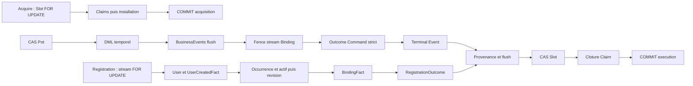

# Publication Event à verrouillage tardif — audit de viabilité

Date : 18 octobre 2026. Statut : **AUDIT STATIQUE POUR REVUE ARCHITECTURALE**.

Verdict de conception : **VIABLE_WITH_MINIMAL_ADJUSTMENTS**. Ce verdict ne certifie ni une implémentation du compteur, absente, ni le checkout courant comme prêt à intégrer : R03 n'y est pas corrigé. Aucune exécution PostgreSQL nouvelle n'étaye ce rapport.

## 1. Synthèse et portée du verdict

Le protocole proposé conserve un arbitre métier optimiste Pot et un arbitre Consumption tardif, dans une transaction physique unique. Un compteur PostgreSQL transactionnel verrouillé jusqu'à la résolution de cette transaction peut ordonner les publications **par famille**. L'insertion après allocation est viable ; il n'est pas nécessaire d'insérer des Events provisoires ni d'introduire un mécanisme SQL différé pour l'admettre.

Les compléments nécessaires sont : cohérence réelle des lectures à V ; séparation de la préparation et de l'écriture définitive de toutes les familles ; fence Binding et arbitrage `command_outcomes` avant les compteurs ; provenance préparée avec des IDs stables, écrite et flushée avant les compteurs ; ensemble des Events fermé, comptage exact et contrôlé ; ordre total commun des compteurs ; rollback intégral de toute erreur, même après clôture du claim. Aucun producteur ne doit conserver un compteur puis poursuivre du métier.

L'ordre proposé `compteur → Events → CAS Slot → clôture Claim` est **fonctionnellement admissible** sous ces conditions. Il conserve cependant les attentes Slot/Claim dans la section critique globale d'une famille. L'ordre alternatif `CAS Slot → clôture Claim → compteurs → Events` retire ces deux écritures de cette section et supprime les arcs compteur→Slot/Claim. Il est recommandé **conditionnellement**, avec le même préfixe d'autorités et la même discipline pour tous les producteurs ; avancer Slot avant Outcome ou provenance recréerait un risque connu. Sa contrepartie est une détention plus longue de Slot/Claim pendant l'attente compteur. Le gain structurel ne constitue pas une mesure de performance.

La complétude est aujourd'hui une garantie applicative bornée aux chemins composés inspectés. Un buffer vide par erreur peut toujours accompagner un commit métier : `NOT NULL` sur Event ne voit pas l'Event jamais inséré. Il faut fermer ce contrat applicatif avant d'implémenter, sans prétendre obtenir une preuve SQL exhaustive contre des writers arbitraires. Si cette dernière était exigée, le dossier resterait **INCONCLUSIVE pour cette exigence renforcée** ; elle n'est pas une raison pour substituer ici l'architecture de l'étude A/B.

Niveaux de preuve : **C** constat des sources locales ; **H** preuve historique documentée, non rejouée ; **R** raisonnement transactionnel sous conditions explicites ; **P** preuve PostgreSQL ciblée restant à obtenir ; **U** inconnu sans mesure/configuration réelle.

## 2. Référentiel, état Git et vérification déclarée

Politique normative lue avant analyse de `app/` : [Reactor_Verification_Policy](../testing/Reactor_Verification_Policy.md). Impact production attendu/observé : **NONE**. Slices d'implémentation déclarées : **NONE** ; COMMAND, BINDING et Registration sont des périmètres lus, pas modifiés. Aucun franchissement inattendu. Gate global : **NOT REQUIRED, non exécuté**. Full reactor : **NOT REQUIRED, non exécuté**. Vérification DB : **NONE** ; aucun bootstrap, migration, test, benchmark ou démarrage. Aucun commit, push, staging, fetch, merge, rebase, nettoyage ni déplacement de worktree.

Branche et HEAD analysés : `feat/runtime-monolith`, `90926a5ec37d1ca841e3de017bec0d1f705d8839`. L'état local indique deux commits de retard sur la référence distante déjà disponible ; aucun rafraîchissement réseau Git n'a été effectué.

| Worktree préexistant | HEAD / branche observés |
|---|---|
| `/Users/julien.guezennec/Dev/projects/pocoma` | `90926a5e`, `feat/runtime-monolith` |
| `/private/tmp/pocoma-binding-lock-order-guard` | `2eef3ab9`, `fix/binding-lock-order-guard` |
| `/private/tmp/pocoma-expense-context` | `116f4e4a`, `fix/expense-context-version-coherence` |
| `/Users/julien.guezennec/.codex/worktrees/debt-wa6-integration/pocoma` | `2eef3ab9`, détaché |

Références principales : [audit transversal local](Transactional_Authorities_Fencing_Locks_Audit_2026-10-18.md), [étude comparative Event locale](Event_Late_Transactional_Numbering_Study_2026-10-18.md), [protocole Consumption](consumption-transactional-execution.md), [audit générique](Consumption_Generic_Transactional_Protocol_Audit_2026-10-16.md), [D17](../debts/BINDING_LOCK_ORDER_GUARD/Resolution_D17_2026-10-16.md), [WP4](../plans/2026-10-16-consumption-generic-transactional-protocol-wp4-concurrency.md), [WP6](../plans/2026-10-16-consumption-generic-transactional-protocol-wp6-closure.md), audits takeover sous `docs/debts/TAKEOVER_TEST_FLAKINESS/`.

L'étude A/B proposait des exigences DB supplémentaires et préférait une insertion avant numérotation. Ce choix n'est pas repris comme contrainte : la mission présente fixe l'insertion après allocation et exclut la finalisation différée. Les propositions de schéma de ces documents ne sont pas du SQL runtime existant.

### R03 : distinction impérative entre branches

**C** `JpaExpenseContextAdapter.loadExpenseContextData` local lit `findCurrentActive(Expense)` puis Pot V, et réutilise le premier `deleted`. Ce n'est pas un contexte entièrement à V. `UpdateExpenseSharesService` ne recharge pas ce statut : le CAS Pot réussi ne répare pas une précondition déjà évaluée sur un état antérieur. Le scénario local documenté est Expense active@5 → suppression concurrente committée@6 → contexte associant `deleted=false@5` à Pot6 → CAS6→7 possible.

Lecture par `git diff HEAD 116f4e4a -- <JpaExpenseContextAdapter>` et `git show 116f4e4a:docs/testing/evidence/Expense_Context_Integration_Report_2026-10-18.md` : le correctif existe ailleurs. Il conserve d'abord seulement le PotId de découverte, lit V, puis recharge Expense avec `findActiveAtVersion(V)` et vérifie la stabilité du propriétaire. Le rapport d'intégration annonce 91 tests sélectionnés PASS sur cette autre branche ; ils ne sont pas une preuve exécutée à ce HEAD. Aucun report de ce correctif ici.

**R** Avec R03 et des writers temporels disciplinés, toutes les données influentes sont relues à V. Un writer ultérieur ferme des intervalles à une version supérieure et ajoute de nouvelles lignes ; la représentation de V reste lisible. Le CAS refuse ensuite un plan si Pot a avancé. Cela construit une cohérence logique versionnée malgré plusieurs snapshots READ COMMITTED ; cela n'autorise ni réécriture rétroactive de V, ni donnée d'autorisation non versionnée sans son propre fence. CreatePot utilise une création/PK initiale plutôt qu'un CAS sur une version préexistante. Aucun verrou pessimiste de préparation Pot n'est nécessaire pour corriger R03.

## 3. Frontières transactionnelles réelles

`CommandConsumptionRuntimeConfiguration` et `RegistrationRuntimeConfiguration` composent un `ConsumptionOwnerTransactionRunner`, déléguant à `SpringTransactionRunner(new TransactionTemplate(manager))`. Le guard refuse transaction **et synchronisation** ambiantes à l'entrée propriétaire. Le template REQUIRED ouvre donc la transaction physique prévue. Les participants et adapters REQUIRED/MANDATORY la rejoignent ; une annotation MANDATORY ne crée pas une seconde transaction. Le runner Spring seul n'interdit pas une composition imbriquée.

Les ports/repositories appelés sous ces propriétaires utilisent le gestionnaire primaire JPA/JDBC composé ; l'atomicité suppose que JDBC et EntityManager participent à cette même ressource. Pas de transaction indépendante de publication observée. Les services Pot sont sans framework, les adapters métier REQUIRED ne constituent pas chacun un commit dans la chaîne Command. Certains ports disponibles hors chaîne pourraient ouvrir leur propre transaction : leur composition doit être contrainte séparément.

**Recovery :** `BindingFenceRecoveryExecuteUseCase.execute` appelle d'abord le propriétaire Execute. Il n'intercepte `BindingFenceLostException` qu'après sortie et rollback de cette transaction. Il ouvre ensuite une **nouvelle** transaction propriétaire, relit l'occurrence Binding exacte, puis appelle `ExecuteConsumptionService` participant. Ce n'est pas un owner imbriqué. Binding encore présent : conflit technique ; absent : outcome REJECTED `CALLER_IDENTITY_NOT_CURRENT`, aucune mutation Pot rejouée, provenance vide, CAS/claim communs. La non-réutilisation du BindingId rend l'absence exacte stable ; une réattribution future casserait ce raisonnement.

**Failure :** une exception technique Execute annule d'abord ses effets. HandleFailure démarre ensuite sa transaction courte. RETRY ferme le claim et réarme le slot, sans terminal Event Command ; FAIL applique l'effet `CommandOutcome.Failed` et son terminal Event puis le suffixe commun. Une perte de claim n'est pas une failure métier. Les wrappers distinguent rollback confirmé, commit confirmé et résolution UNKNOWN : UNKNOWN n'autorise pas un second traitement terminal automatique.

## 4. Chronologies actuelles, sans compteur

Notations : **P** ligne de version Pot ; **D** tuples métier temporels ; **B** stream Binding `(issuer,subject)` ; **A** identité active / occurrence ; **Q** PK CommandOutcome ; **Rₒ** RegistrationOutcome ; **I** provenance ; **S** Slot ; **Cₗ** Claim ; **Eₓ** insertions Event et contraintes. Les verrous acquis restent détenus jusqu'à la résolution, sauf simple verrou de page temporaire. « Reste » désigne du travail, pas un délai garanti.

### 4.1 Acquisition / takeover — transaction 1

| Étape | SQL ou opération réelle | Autorité acquise | Déjà détenu | Reste avant commit |
|---|---|---|---|---|
| A1 | `INSERT consumption_slots ... ON CONFLICT DO NOTHING` | PK / UNIQUE clé structurelle, nouveau S éventuel | — | lecture verrouillée, décision, claims, installation |
| A2 | `SELECT ... WHERE clé FOR UPDATE` | S exclusif explicite | éventuel S créé | vérifier DONE/nextClaimAt/lease ; transition |
| A3 | lecture Claim ; si expiré, `UPDATE ... invalidated_at ... lease_until<=now` | ancien Cₗ, sous S | S | insérer nouveau claim, installer, commit |
| A4 | `saveAndFlush(new Claim)` | nouveau Cₗ ; UNIQUE `(slot,attempt)` ; FK S | S, ancien Cₗ éventuel | installation, commit |
| A5 | `UPDATE S SET current_claim_id,...` | ownership S et FK claim | S, Cₗ | commit seulement |

La génération du ClaimId précède l'appel persistence ; **la ligne claim est insérée après le verrou Slot**. Le pseudo-code « créer claim puis acquérir slot » ne doit pas devenir une inversion SQL Cₗ→S. Busy/NotReady/AlreadyDone terminent sans nouveau claim. Une lease expirée permet un takeover ; elle ne retire pas seule l'autorité du claim courant.

### 4.2 Command Pot APPLIED — transaction 2

| Étape | SQL ou opération réelle | Autorité acquise | Déjà détenu | Reste avant commit |
|---|---|---|---|---|
| C1 | reload RecordedCommand ; observation B/A exacte, sans lock de ligne | aucune autorité exclusive | relations lues | decode, contexte, validations |
| C2 | lecture contexte/agrégats à V, validation expectedVersion et permissions, mutations en mémoire | aucune autorité exclusive | relations lues | CAS et toute persistance ; réserve R03 |
| C3 | `UPDATE pot_global_versions SET version=V+1 WHERE pot_id=? AND version=V` | P implicite par UPDATE | — | metadata, D, Events, Binding, Q, I, S/Cₗ |
| C4 | `INSERT pot_version_metadata`; close temporal + insert nouvelle représentation | D, PK/contraintes ; P conservé | P | publication et suffixe |
| C5 | capture mémoire puis `JpaPotCommandEventAppendAdapter.appendAll` : mapping, UUID, JSON, `saveAllAndFlush` | E Business ; flush de tout le contexte | P,D | fence B, outcome/terminal, I, S/Cₗ |
| C6 | `UPDATE streams SET current_revision=current_revision WHERE E,R AND EXISTS(A E/U/BindingId)` | B par no-op UPDATE ; vérification exacte | P,D,E | Q/terminal, I, S/Cₗ |
| C7 | INSERT strict `command_outcomes`, puis INSERT `command_terminal_events` | Q ; terminal UNIQUE CommandId et FK Q | P,D,E,B | I, flush, S/Cₗ |
| C8 | `appendInputs/appendResults` via `saveAll` | I au flush ; FK KEY SHARE S ; UNIQUE inputs | précédents | flush puis CAS/clôture |
| C9 | flush automatique, `UPDATE S ... WHERE status='PENDING' AND current_claim_id=?` | S par CAS non-clé | précédents + I/FK | clôture Cₗ puis commit |
| C10 | `UPDATE claims ... WHERE slot/claim AND ended_at IS NULL AND invalidated_at IS NULL` | Cₗ conditionnel | tous précédents | commit |
| C11 | résolution transaction physique | durabilité commune si commit | tous | libération, réponse après confirmation |

CAS P doit affecter une ligne sinon VersionConflict. CAS S zéro lève LostClaim ; clôture Cₗ différente de un ou exception lève ConsumptionClaimClosureException. Toute la transaction rollbacke, y compris un CAS S déjà réussi. L'`EXISTS` du fence n'est pas un verrou explicite de la ligne A ; la protection dépend de la discipline de tous les writers Binding prenant B.

### 4.3 Les dix producteurs métier Pot et leurs DML après P

Tous suivent C1–C11 sur succès et capturent un Event ; les remplacements temporels peuvent encore faire des SELECT techniques après P. Le protocole cible ne doit pas présumer que tout le SQL est déjà préparé par le domaine.

| Service `engine-write-pot/.../service/` | Arbitrage initial, puis écritures métier | Event |
|---|---|---|
| CreatePotService | INSERT version initiale + metadata ; INSERT header | PotCreated |
| UpdatePotDetailsService | CAS P + metadata ; fermeture/INSERT header | PotDetailsUpdated |
| DeletePotService | CAS P + metadata ; nouvelle version header deleted | PotDeleted |
| AddPotShareholdersService | CAS P + metadata ; insertions shareholders | PotShareholdersAdded |
| UpdatePotShareholdersDetailsService | CAS P + metadata ; fermeture/INSERT shareholders | PotShareholdersDetailsUpdated |
| UpdatePotShareholdersWeightsService | CAS P + metadata ; fermeture/INSERT shareholders | PotShareholdersWeightsUpdated |
| CreateExpenseService | CAS P + metadata ; INSERT header Expense et shares | ExpenseCreated |
| UpdateExpenseDetailsService | CAS P + metadata ; fermeture/INSERT header Expense | ExpenseDetailsUpdated |
| UpdateExpenseSharesService | CAS P + metadata ; SELECT shares actives, fermeture en masse, saveAll nouvelles shares | ExpenseSharesUpdated |
| DeleteExpenseService | CAS P + metadata ; nouvelle version header Expense deleted | ExpenseDeleted |

Les bulk UPDATE prennent leurs verrous sur les tuples ciblés ; l'ordre interne n'est pas une garantie de l'ordre d'un Set Java. P sérialise les writers disciplinés d'un même Pot avant D. Pas de verrou explicite enfant `FOR UPDATE` découvert dans ces services. Ne pas inventer de FK Pot sur toutes les tables temporelles : V1 n'en définit pas systématiquement.

### 4.4 Command REJECTED / FAIL / recovery

| Parcours | Chronologie et SQL | Autorités, ordre | Reste après dernier arbitrage |
|---|---|---|---|
| identité exacte absente à l'observation | lecture → rejet → INSERT Q → terminal → I éventuelle → S → Cₗ | Q→E terminal→I→S→Cₗ ; pas de P/B fence positif | commit |
| expiration, autorisation ou rejet métier après observation | validations → fence B → Q → terminal → I → S → Cₗ | B→Q→E terminal→I→S→Cₗ ; pas de BusinessEvent ajouté ; P peut avoir été tenté pour un conflit de version | commit si transaction encore committable |
| terminalFailureEffect | Execute rollbacké ; nouvelle Tx policy FAIL → Q → terminal → I éventuelle → S → `claims.fail` | Q→E terminal→I→S→Cₗ ; aucun P/D de l'échec initial | commit |
| recovery Binding | Execute rollbacké ; nouvelle Tx lecture B exact → Q REJECTED → terminal → S → Cₗ | Q→E terminal→S→Cₗ ; ni P ni prélock S | commit |
| RETRY technique | nouvelle Tx → CAS scheduleRetry → `claims.fail` | S→Cₗ ; aucune des quatre familles Event publiée | commit |

L'absence de BusinessEvent sur rejet n'implique pas absence d'Event : le terminal Command doit être numéroté. Succès sans Events métier est accepté explicitement par ExecuteRecordedCommandService ; aucun contrat générique n'impose « un succès = un BusinessEvent ».

`AbstractPotCommandUseCaseAdapter` traduit BusinessRuleViolation, VersionConflict et BusinessEntityNotFound en rejet, mais refuse un rejet après capture d'un Event. Un rejet n'atteste donc pas à lui seul qu'aucun SQL n'a été tenté : le CAS peut perdre, ou une persistence peut lever après un premier DML. Une exception runtime traversant l'adapter Spring transactionnel peut marquer la transaction rollback-only ; sa traduction en objet REJECTED n'annule pas cette marque. Un tel chemin ne peut être compté comme un rejet committé sans observer la résolution du propriétaire. Le protocole tardif doit préserver cette distinction et ne jamais valider un rejet avec des mutations partielles.

### 4.5 Registration et BindingFact

| Étape | SQL ou opération | Autorité acquise | Déjà détenu | Reste avant commit |
|---|---|---|---|---|
| R1 | lire request, chercher outcome existant | aucune exclusive | relations | si existant, retour idempotent puis suffixe Consumption ; sinon Binding |
| R2 | INSERT stream ON CONFLICT ; SELECT stream FOR UPDATE ; vérifier actif | B explicite ; arbitrage identité | — | initializer si libre, occurrence/actif/révision/fact, outcome, I/S/Cₗ |
| R3 | initializer `users.create` + INSERT UserCreatedFact | User/fact PK et UNIQUE request/user | B | mutation Binding et publications |
| R4 | réserver BindingId (8 essais maximum) ; INSERT actif ; UPDATE révision | A/occurrence/UNIQUE et FK | B,User | BindingFact, outcome, suffixe |
| R5 | INSERT BindingFact ATTACHED JDBC immédiat | E fact, UNIQUE identité/révision et FK | précédents | RegistrationOutcome, I/S/Cₗ |
| R6 | INSERT RegistrationOutcome JDBC immédiat | Rₒ PK request et FK Request/User/Occurrence | précédents | input request, flush, S/Cₗ, commit |
| R7 | input REGISTRATION_REQUEST@1 ; aucun result ; flush/CAS/clôture | I→S→Cₗ | précédents | commit |

Identité occupée : R2 garde B jusqu'au commit, saute initializer et fact, insère seulement REJECTED RegistrationOutcome, puis R7. Outcome préexistant : aucun nouvel Event/outcome à numéroter. Une failure Registration technique ne crée pas un outcome FAILED inexistant dans le modèle.

`ExternalIdentityBindingPort.acquire` délègue au même acquireWithInitializer sans initializer ; MANDATORY, propriétaire extérieur requis. `detach` : lecture stream → B FOR UPDATE → recherche exact actif → DELETE exact actif → avance révision → INSERT fact DETACHED → commit du propriétaire. Absent/non courant : aucun fact. Aucun appelant métier runtime actuel supplémentaire trouvé pour ces deux capacités, mais leurs écritures restent des producteurs possibles hors Command/Consumption.

`JpaExternalIdentityBindingFactAdapter.append` est une entrée MANDATORY indépendante : INSERT fact seul, sans prise automatique de l'autorité B. Le repository Fact est aussi instancié directement par l'adapter d'autorité Binding ; décorer seulement le port Fact ne couvre pas R5/detach.

### 4.6 Autres entrées et producteurs non Command

| Entrée | Frontière actuelle | Exigence du protocole cible |
|---|---|---|
| JpaBusinessEventOutboxAdapter.append / BusinessEventAppendPort | REQUIRED ; `repository.save`, flush différé ; peut être owner seul ou participant | suffixe explicite dans la vraie transaction ; pas un compteur pris puis retour au métier extérieur |
| Fact append indépendant | MANDATORY, JDBC immédiat, PK/UNIQUE/FK | contrat d'autorité et suffixe du propriétaire ; sinon couverture incomplète |
| JdbcRegistrationOutcomeStore.insert | pas d'annotation transactionnelle locale ; transaction fournie par Registration composée | contraindre les usages directs ; un autocommit contournerait l'atomicité annoncée |
| JdbcCommandOutcomeAdapter.publish | MANDATORY ; Q puis terminal dans le même appel | séparer Q précoce et préparation du terminal ; couvrir succès, rejet, FAIL et recovery |
| V22 repair Binding history | INSERT historiques baselines et réparations | hors flux runtime, plan de baseline/cutover ultérieur ; aucune migration rejouée |
| EntityManager/repositories/SQL de fixtures | capacités techniques de writer | pas des producteurs métier supplémentaires ; ni leur absence en recherche ni des annotations ne prouvent l'absence d'accès SQL externe |

`JpaEventPort` recharge pour LKV ; les matérialiseurs Binding/Results et les consumers Event ne sont pas des writers supplémentaires de ces quatre tables. UserCreatedFact est une cinquième sortie rencontrée dans Registration : sa création reste atomique et doit précéder le compteur ; son inclusion future dans la numérotation élargirait l'ensemble de familles et de compteurs, sans être implicite ici.

## 5. Matrice des verrous et attentes

| Ressource | Lock explicite ou implicite significatif | Attente possible | Détention après acquisition |
|---|---|---|---|
| P | UPDATE CAS non-clé, normalement NO KEY UPDATE ; CreatePot PK initiale | autre writer même Pot, collision PK création | tous DML, autres fences, publication, finalisation, commit |
| D temporels | UPDATE fermeture, INSERT/PK/index ; pas de prélock de préparation | writer contournant P, multiclés/contraintes, I/O | toute la fin de transaction |
| B | Registration/detach FOR UPDATE ; Command no-op UPDATE non-clé | autre Command même identité, Registration/detach | Q/I/S/Cₗ/publication restant selon ordre |
| A/occurrence/User | INSERT/DELETE/UNIQUE/FK ; réserve BindingId permanente | collision clé, suppression concurrente de parent | commit commun |
| Q | INSERT strict PK CommandId ; FK RecordedCommand | tentative stale ayant Q non résolu | provenance/finalisation et publication différée éventuelle |
| Rₒ | INSERT PK RequestId ; FK Request/User/Occurrence ; trigger immutable UPDATE/DELETE | doublon request ou parent concurrent | actuellement I/S/Cₗ ; cible INSERT après compteur |
| I | INSERT PK, UNIQUE input `(slot,type,id,version)` ; FK S | input concurrent non résolu ; takeover S FOR UPDATE | CAS/Cₗ/commit ; si anticipé, attente compteur aussi |
| S | Acquire FOR UPDATE ; terminal UPDATE CAS non-clé | Acquire/takeover ; autre CAS ; certaines files de locks | Cₗ puis commit dans courant ; compteur/Events en plus si alternative |
| Cₗ | invalidation takeover / clôture conditionnelle UPDATE | transition concurrente du claim | fin de transaction ; perdant ne committe pas |
| K famille, proposé | UPDATE transactionnel compteur non-clé, conservé | autre publisher de cette famille | autres K, INSERT Events, suffixe restant et résolution |
| Events | PK/UNIQUE, FK spécifiques, nouveaux index position ; INSERT définitif | doublon Event/source, FK parent concurrent, index/I/O/DDL | résolution ; aucune libération par flush |

Les SELECT ordinaires prennent ACCESS SHARE de relation, sans verrou exclusif de tuple. DML prend ROW EXCLUSIVE de relation ; ce n'est pas une exclusion entre writers ordinaires. KEY SHARE des FK est compatible avec un UPDATE non-clé mais pas avec FOR UPDATE ; les index UNIQUE peuvent faire attendre une transaction en conflit. Les verrous de page courts ne sont pas des autorités métier conservées. Référence de sémantique : [PostgreSQL 17 — verrouillage](https://www.postgresql.org/docs/17/explicit-locking.html). Les modes exacts dépendent du SQL et des index réellement déployés ; WP4 a sondé KEY SHARE après CAS S, sans certifier les futures contraintes Event.

**Attendre ≠ détenir.** Une transaction bloquée sur K ne détient pas encore K mais garde P/D/B/Q/I et éventuellement S/Cₗ. Le détenteur K peut lui-même attendre S, une contrainte Event ou le commit. Le temps « appel allocation → retour » mélange attente et statement ; le temps « retour allocation → résolution » est une borne observable de détention, pas sa mesure serveur exacte.

## 6. Graphe global et cycles

Graphe actuel, relations partielles ; aucune arête ne traverse un commit Acquire→Execute :



Rejets et recoveries entrent en B ou Q, sans traverser P. Append autonome ajoute ses propres contraintes Event→commit ; une composition multiclés arbitraire n'a pas de hiérarchie totale prouvée.

Graphe cible commun avant compteurs : `P→D→B→Q→I`, ou `B→User/A`, avec validations/flush et préparation complète des sorties. Pour Registration, Rₒ est **lui-même l'Event différé**, pas un arbitrage SQL anticipé. Tous les K non vides suivent un rang global fixe, par exemple `BusinessEvent < BindingFact < RegistrationOutcome < CommandTerminalEvent` ; le choix des rangs importe moins que son unicité et son application partout.

| Ordre | Arcs ajoutés / fin |
|---|---|
| proposé complété | préfixe→K1→…→Km→INSERT Events→S→Cₗ→commit |
| alternatif complété | préfixe→S→Cₗ→K1→…→Km→INSERT Events→commit |
| hors Consumption | préfixe propre→K1→…→Km→INSERT Events→commit |

### Cycles et degré de faisabilité

1. **D17 historique, H :** C1 détient Q ; après takeover C2 prélocke S puis attend Q ; C1 demande FK KEY SHARE S. Cycle Q→S→Q observé historiquement, corrigé par suppression du prélock. Le code courant attend Q avant S, y compris failure/recovery. Avancer le CAS **après Q et I** n'est pas restaurer ce prélock. Avancer S avant Q le serait.
2. **Kf↔Kg, R/P :** deux transactions mult familles prennent F/G dans des ordres opposés. Réalisable dès qu'une composition autorise ces deux ordres ; pas observable actuellement, aucun K n'existe. Trier tous les compteurs et figer les familles avant le premier élimine ce cycle d'ordre.
3. **Q↔Kterminal, R/P :** un FAIL/recovery conserve Q puis attend Kterminal ; un autre producteur prend Kterminal avant d'essayer Q du même Command. Le cycle devient possible si le refactoring conserve des positions différentes de Q selon les chemins. Exiger Q avant tout K partout, et séparer Q du terminal, l'évite sans changer le fence.
4. **B/P↔K, R/P :** un propriétaire prend B ou P puis attend K ; un autre tient K puis poursuit une mutation demandant ce B/P. Interdit par le suffixe fermé ; possible avec append autonome numérotant trop tôt puis retour au métier. Aucun parcours courant standard ne prouve cette inversion puisqu'il n'a pas de K.
5. **S↔K, R/P :** mélanger proposé K→S et alternatif S→K fournit deux ordres inverses. Une course sur les mêmes ressources peut cycler si les préfixes n'ont pas déjà sérialisé les tentatives. Q pour Command et B pour Registration empêchent certains exemples naïfs sur le même slot ; le graphe seul ne prouve pas un deadlock runtime de ces chemins. Le moteur générique n'exclut pas toute composition future ; ne pas homologuer un déploiement mixte sans preuve.
6. **Contraintes Event↔K, R/P :** un INSERT après K peut attendre une clé/parent détenu par une transaction qui attend K. Pour les writers disciplinés : Q anticipé protège UNIQUE terminal Command ; B anticipé protège les révisions fact et sérialise les décisions Registration d'une même identité ; UUID nouveaux rendent la collision Event exceptionnelle. Le port fact direct ou le store Registration direct n'ont pas ces protections intrinsèques. Le suffixe tardif ne prouve pas seul l'absence de cycle.
7. **FK I / takeover, H/P :** WP4 a exercé deux détenteurs FK, takeover FOR UPDATE en attente et CAS non-clé, avec commit/rollback. Aucun deadlock dans ces cas ; cela ne prouve ni fairness ni toutes les files futures.

Le risque de contention sur B entre Commands de Pots différents est préexistant. Un K par famille étend la sérialisation à des identités et Pots indépendants. Les verrous métier détenus pendant l'attente K transmettent cette congestion à l'amont.

## 7. Protocole proposé complété, sans substitution d'architecture

Transaction 1 reste celle de §4.1 : S avant les écritures de claims. Transaction 2, ordre proposé conservé :

```text
BEGIN physique propriétaire
  Reload source ; observer Binding si Command
  Lire V ; charger et vérifier tous les faits métier à V (R03 requis)
  Préparer mutations, sorties attendues, IDs, payloads et ordres en mémoire
  CAS Pot V→V+1 (ou création initiale)
  Persister toutes les mutations et contraintes métier nécessaires
  Fence Binding exact ; INSERT CommandOutcome strict si Command
  Pour Registration : autorité stream / user / occurrence / actif / revision
  Préparer chaque Event définitif, y compris terminal/outcome/fact
  Écrire provenance avec IDs stables ; flush complet non-Event
  Sceller ensemble des familles, cardinalités et ordinaux
  Pour chaque famille non vide, dans l'ordre global :
    incrémenter son compteur de n et récupérer la borne finale
  Attribuer les blocs ; INSERT de tous les Events avec positions définitives
  Vérifier les insertions et correspondances exactes
  CAS terminal S avec claimId ; clôture conditionnelle Cₗ
COMMIT physique commun ; annoncer succès seulement si confirmé
```

Le fence ne doit pas forcément précéder P : conserver P→D→B respecte l'ordre existant. Il doit précéder K pour éviter d'attendre Binding en tenant le compteur. Q peut être écrit avant le terminal car sa PK est déjà CommandId et la FK va terminal→outcome. La provenance peut précéder les Events : ses IDs objets sont des chaînes, sans FK vers ces tables Event ; IDs et timestamps peuvent être préparés sans INSERT. Elle ne doit jamais inventer des résultats dont le suffixe autoriserait ensuite l'omission.

Pour Registration, déplacer INSERT Rₒ avant K contredirait l'insertion après allocation. Seule sa **préparation** peut être anticipée, et la sérialisation B doit rester. Même distinction pour BindingFact : mutation de révision/actif avant K, fact définitif après K ; pour CommandTerminal : Q avant K, terminal après K. Le trigger immutable RegistrationOutcome reste compatible avec une seule insertion définitive, sans UPDATE de numérotation.

Une allocation atomique `UPDATE ... SET valeur=valeur+n ... RETURNING valeur` peut acquérir et incrémenter en **un statement** par famille existante, sans SELECT FOR UPDATE séparé. C'est une forme de contrat proposée, pas du SQL livré ni exécuté. Préinitialiser les compteurs hors flux normal évite bootstrap/UNIQUE sous charge. Exiger une ligne, n>0, capacité du type numérique, bloc `[fin-n+1,fin]` et affectation bijective. Ne pas réserver pour n=0. Aucune allocation indépendante, `nextval` ou réutilisation d'un bloc committé.

## 8. Focus : contenu de la section critique compteur

### 8.1 Dépendances par famille

| Famille / chemin | Impérativement avant K ou à anticiper pour le raccourcir | Impérativement après K | Attentes encore possibles après K |
|---|---|---|---|
| BusinessEvent Command | V cohérent, CAS P, DML/flush, B, Q, I, UUID/JSON/trace préparés ; autres familles connues | affectation positions puis INSERT BusinessEvent ; terminal associé ; S/Cₗ si proposé | PK/index Event ; terminal FK/UNIQUE ; S/Cₗ ; commit |
| BusinessEvent append autonome | vrai owner et toutes mutations terminées, payload/ID préparés, ensemble scellé | INSERT définitif ; commit propriétaire | contraintes Event, flush tardif si save au lieu de SQL explicite, autres callbacks propriétaires |
| BindingFact acquire/detach | B, initializer, réservation occurrence, actif/delete, révision ; fact préparé ; I/S/Cₗ selon propriétaire | INSERT définitif fact et éventuels outcomes | UNIQUE identité/révision, FK stream/User/Occurrence ; Rₒ si Registration ; fin propriétaire |
| BindingFact append indépendant | préconditions et autorité d'appelant à spécifier ; MANDATORY seul insuffisant | INSERT fact | conflit UNIQUE et parents non protégés ; couverture inconnue pour appelant arbitraire |
| RegistrationOutcome | request/replay, B et décision, User/fact/occurrence/actif/révision si succès ; préparation outcome et I | INSERT Rₒ définitif ; fact associé si succès | PK request ; FK Request/User/Occurrence ; S/Cₗ si proposé ; commit |
| CommandTerminalEvent APPLIED/REJECTED | Q strict et shape outcome ; B si nécessaire ; I ; UUID/trace préparés ; métier fini | INSERT terminal avec position | UNIQUE CommandId et FK Q ; S/Cₗ si proposé ; commit |
| CommandTerminalEvent FAIL/recovery | rollback initial confirmé ; nouvelle décision ; Q strict ; recovery relecture exacte ; I éventuelle | INSERT terminal ; aucun BusinessEvent initial survivant | mêmes contraintes terminal ; S/Cₗ si proposé ; commit |

Le comptage est **par transaction et par famille**, pas par appel à append. Plusieurs Events d'une famille réservent un bloc en une acquisition. Une Command APPLIED ordinaire publie deux familles ; une Registration réussie en publie deux parmi les quatre étudiées. Le premier K reste tenu pendant l'attente des K suivants ; trier prévient le cycle, pas cette contention couplée.

### 8.2 Ce qui peut être sorti du verrou

La validation des payloads, JSON, hashing, UUID, trace et mapping peut précéder K. Les INSERT Q, fence B, contrôles de membership, SELECT techniques de remplacement, metadata et toutes écritures métier doivent être terminés/flushés avant K. Inputs/results peuvent être persistés avant K avec les IDs définitifs préparés. Pour le protocole proposé, S/Cₗ restent délibérément après K ; les déplacer est précisément l'alternative étudiée, pas une omission fonctionnelle.

En revanche PK/UNIQUE/FK et CHECK des INSERT Event définitifs sont **incompressibles après allocation** dans le modèle imposé. Une validation Java ou SELECT préalable n'acquiert pas automatiquement la même protection et ne remplace pas ces contrôles. Un batch réduit des échanges, sans supprimer lignes, index, FK, WAL ou erreurs possibles.

### 8.3 Flush et SQL caché

`JpaPotCommandEventAppendAdapter.saveAllAndFlush` actuel force tout le contexte, pas seulement les Events. Le déplacer tel quel déplacerait également des DML métier encore pendants sous K. `JpaExpenseSharesAdapter.saveAll` et la provenance utilisent un flush différé ; leurs méthodes appelées ne prouvent donc pas que les INSERT sont déjà partis.

Les CAS Pot, fermetures temporelles, CAS Slot et clôtures Claim déclarent des barrières de flush ; certains font aussi `clearAutomatically`. Clear détache, sans commit ni libération des locks. Un suffixe après CAS ne doit pas compter sur la dirty checking d'anciennes instances. Avec IDs assignés, `save/saveAll` peut passer par merge et provoquer des SELECT avant INSERT selon le mapping/newness Spring Data ; ne pas assimiler un appel Java à un statement SQL unique. Un suffixe d'INSERT explicites ou un chemin JPA dont le SQL est caractérisé permet de borner cela, sans le présumer acquis.

Le commit peut encore flusher des entités oubliées, exécuter des synchronizations et rencontrer un refus de contrainte. Le contrat doit interdire nouvelle émission ou callback métier après le gel, et tout catch permettant de committer un bloc partiel. Aucun rollback partiel/savepoint ne doit conserver l'incrément en abandonnant ses Events. Réessayer toute la transaction après erreur de sérialisation ou deadlock.

### 8.4 Estimation structurelle, sans durées inventées

Soit m familles non vides, n Events au total, b statements INSERT Event (minimum théorique m, courant typiquement n sans bulk multi-values). Compteurs déjà présents, un UPDATE RETURNING par famille, tout le préfixe flushé, vérifications rowcount en mémoire. Le comptage commence **avec** le statement qui obtient le premier K ; le temps d'attente précédent n'est pas du temps de détention de ce K.

| Publication | Ordre proposé : minimum statements incluant COMMIT | Alternative : minimum | Autorités exclusives supplémentaires après premier K |
|---|---|---|---|
| BusinessEvent seul hors Consumption | 1 K + 1 INSERT + 1 COMMIT = 3 | identique | pas de S/Cₗ ; contraintes Event |
| fact seul hors Consumption | 1 + 1 + 1 = 3 | identique | pas de S/Cₗ ; UNIQUE/FK fact |
| terminal seul avec Consumption | 1 K + 1 INSERT + 1 CAS + 1 clôture + 1 COMMIT = 5 | 1+1+1 = 3 | proposé : S et Cₗ ; alternative : aucune nouvelle autorité métier |
| Registration rejetée | 1+1+1+1+1 = 5 | 1+1+1 = 3 | même différence ; Rₒ UNIQUE/FK reste sous K |
| Command APPLIED, 1 Business + 1 terminal | 2 K + 2 INSERT + CAS + clôture + COMMIT = 7 | 2+2+1 = 5 | proposé : autre K, S/Cₗ ; alternative : autre K ; contraintes Event dans les deux |
| Registration réussie, 1 fact + 1 outcome | 2+2+1+1+1 = 7 | 2+2+1 = 5 | idem ; UserCreatedFact écrit avant K |
| général avec Consumption | m+b+3 ; idéal bulk : 2m+3 | m+b+1 ; idéal bulk : 2m+1 | m−1 autres compteurs, plus S/Cₗ seulement si proposé |

SELECT FOR UPDATE puis UPDATE séparés ajouteraient m statements. Des SELECT merge, flushs résiduels, bootstrap compteur ou contrôles SQL supplémentaires s'ajouteraient également ; ces chiffres sont des **bornes de conception**, pas une trace Hibernate mesurée. Les vérifications en mémoire doivent toujours rester après chaque opération concernée, même sans statement additionnel.

Portion incompressible : allocation et affectation exacte, écriture de toutes les lignes/index Event, contraintes d'insertion, résolution transactionnelle. Après le premier compteur s'ajoute éventuellement l'attente d'autres compteurs. WAL/I/O et paramètres de durabilité peuvent peser sur la résolution ; callbacks précommit et flush prolongent aussi la détention. Le placement exact de la libération vis-à-vis des phases WAL/réplication n'a pas été mesuré : une attente de réponse COMMIT côté client ne prouve pas à elle seule que le tuple K est encore verrouillé. Le délai réseau après libération n'est pas de la détention serveur. Configuration commit effective : U.

## 9. Comparaison des deux positions du CAS terminal

Cette comparaison conserve **le même préfixe** métier/B/Q/I et les INSERT Event après positions. Elle ne propose ni prélock Slot avant le métier ni troisième transaction.

| Critère | Mutation → K → Events → S → Cₗ → COMMIT | Mutation → S → Cₗ → K → Events → COMMIT |
|---|---|---|
| Claim perdu avant CAS | peut attendre K et insérer avant de perdre S ; tout rollbacke | échoue avant K, aucune allocation nécessaire |
| Takeover avant CAS | s'il committe, CAS stale échoue ; lease seule sans effet | identique ; fenêtre de takeover ouverte jusqu'au CAS, puis bloquée |
| Takeover après CAS gagné | attend S jusqu'à résolution ; voit DONE si commit | attend S pendant attente K + insertion ; DONE si commit ; s'il y a rollback, il peut acquérir ensuite |
| Clôture refusée | rollback mutations, Events, compteurs et S | rollback avant allocation ; aucune clôture durable isolée |
| Échec INSERT/commit après clôture | pas de commit partiel possible | clôture/S sont provisoires et rollbackent aussi ; APPLIED ne peut sortir avant commit confirmé |
| Fence Binding | avant K, tenu jusqu'à résolution | identique ; aucune libération anticipée de B |
| Recovery Binding | Q avant K ; S après terminal | Q avant S ; suffixe après participant recovery mais à l'intérieur de son owner |
| Outcome Command | Q doit précéder K/S ; terminal différé | Q doit précéder S ; déplacer tout publish après S serait dangereux |
| Provenance | I avant K ; FK/UNIQUE hors section critique K | I avant S ; IDs Event préparés ; flush complet ; pas de FK Event existante |
| Attentes sous K | contraintes Events, S, Cₗ, autres K, résolution | contraintes Events, autres K, résolution |
| Arcs d'autorité | K→S→Cₗ | S→Cₗ→K ; supprime K→S/Cₗ si homogène |
| Coût déplacé | S acquis après attente compteur et Events | S/Cₗ conservés pendant attente compteur ; Acquire/takeover du slot plus longtemps bloqués |

**Recommandation conditionnelle R/P :** l'alternative améliore effectivement le suffixe d'acquisition compteur en retirant deux autorités mutables pouvant attendre. Les autres publishers de la famille ne subissent plus l'attente S/Cₗ du détenteur K. Les takeovers ne publient pas sous S et ne prennent pas K : avancer S après Q/I ne crée pas à lui seul l'inverse K→S. Avec tous les producteurs alignés, pas de Q/B/P après K et contraintes Event couvertes, le graphe des autorités métier se termine avant K.

Ce raisonnement justifie une préférence, pas une preuve générale de deadlock absent. L'alternative change le contrat documentaire actuel « seule clôture suit CAS, aucun callback métier ensuite ». Il faut autoriser uniquement un suffixe technique fermé de publication rollbackable, dans la composition spécialisée, et prouver qu'il est dans le callback du véritable propriétaire. Décorer le wrapper transactionnel **à l'extérieur** ou appeler afterCommit arriverait après le commit. Ne pas modifier le moteur générique pour y injecter les types Event. Le holder `ConsumptionTerminalParticipant` n'est pas déjà une extension publication prête à l'emploi.

Les deux ordres restent admissibles si le coût de détention S supplémentaire invalide la préférence après mesure. La recommandation ne porte pas sur une promesse de latence totale plus faible ; elle porte sur le retrait vérifiable de S/Cₗ des dépendances du compteur.

## 10. Démonstration des garanties de publication

Hypothèses nécessaires : même base/transaction pour compteur et Events ; compteur unique et stable par famille ; writers exclusifs par ce protocole ; n exact et ordinaux stables ; commit de n lignes ou rollback entier ; positions positives et uniques ; baseline initiale cohérente ; ni suppression ni renumérotation des publications committées. Le schéma courant ne possède pas ces nouvelles garanties de position.

| Invariant | Raisonnement R / limite |
|---|---|
| Unicité par famille | l'UPDATE sérialise les allocations ; chaque bloc succède à la borne committée précédente ; UNIQUE position dans la famille fournit un garde contre un writer erroné |
| Ordre de visibilité | tant que T1 détient K, T2 ne peut obtenir un bloc supérieur ; si T2 committe, T1 a déjà résolu ; après commit T1, ses lignes sont visibles aux snapshots primaires assez récents pour voir T2 |
| Pas de trou après rollback | compteur et n INSERT s'annulent ensemble ; le suivant reprend la borne précédente ; aucun numéro n'est brûlé par la transaction annulée |
| Densité globale | plus forte que rollback : exige baseline dense, réservation exacte et aucun abandon volontaire dans le bloc ; NOT NULL/UNIQUE seuls ne la prouvent pas |
| Plusieurs Events | une allocation de n par famille ; ordinal explicite conservé depuis la préparation ; toutes les lignes deviennent visibles atomiquement, sans ordre de commit interne au bloc |
| Plusieurs familles | allocations en ordre fixe, un commit commun ; unicité/ordre démontrés séparément dans chaque famille ; pas d'ordre total inter-familles déduit de compteurs indépendants |
| Crash avant commit | récupération de transaction non committée : ni incrément ni Events durables ; perte du process ne publie pas un demi-bloc |
| Crash après commit durable | borne et Events restent ensemble ; redémarrage ne réinitialise pas le compteur ; ambiguïté de réponse doit se résoudre par relecture/idempotence |

L'ordre garantit l'absence de publication supérieure visible pendant qu'une inférieure est encore indécise. Il ne force ni l'ordre des BEGIN, ni le temps métier, ni l'ordre de traitement par plusieurs consumers. Un snapshot ancien continue à voir son ancien état ; comparer des lectures sur répliques distinctes ou serveurs en retard n'est pas cette garantie. PostgreSQL décrit les snapshots dans [Transaction isolation](https://www.postgresql.org/docs/17/transaction-iso.html). Les conditions de conservation d'un commit acquitté après crash dépendent de la durabilité configurée ; voir [Asynchronous commit](https://www.postgresql.org/docs/17/wal-async-commit.html). Ni l'isolation ni les paramètres WAL/réplication déployés n'ont été interrogés.

Les positions ne remplacent pas PotVersion, BindingRevision, ClaimId ou le statut de Consumption. Les colonnes legacy de l'outbox ne doivent pas devenir un statut de consommation porté par Event. Aucun worker de publication ou déclencheur différé n'est nécessaire à ce raisonnement.

## 11. Complétude : garanties présentes et travail restant

**C** Les dix services Pot publient explicitement un Event sur leur branche de mutation réussie ; PotCommandInvocation en conserve l'ordre. ExecuteRecordedCommandService contrôle nulls et cardinalité des artifacts renvoyés par appendAll ; l'adapter actuel insère/flush la liste dans la transaction. Q et terminal sont aujourd'hui deux INSERT dans le même appel, sans catch d'omission. Binding acquire/detach construisent leur fact après mutation de révision sous B. Registration insère son outcome après la décision ; tous ces effets rollbackent si S/Cₗ refuse.

Ces propriétés prouvent la chaîne applicative inspectée, pas une obligation SQL universelle. Un succès à liste vide reste admis au niveau Command ; ConsumptionResult ne couvre ni le terminal Command ni les sorties Registration (results vides). Un registre déduit des seuls artifacts manquerait donc des Events. La séparation en préparation/INSERT doit préserver les lectures « own writes » des ports directs : `findByEventId` du Fact ou `find(requestId)` d'un outcome dans la même transaction ne retrouverait plus automatiquement un objet seulement en mémoire. Les chemins standards n'en ont pas besoin après émission ; tout usage direct/répété doit être défini, résolu depuis le plan ou refusé.

Ajustement minimal : plan transactionnel typé de mutations et de sorties obligatoires ; IDs et cardinalités connus ; enregistrement à chaque point producteur réel, y compris JDBC direct dans Binding ; scellement avant compteur ; vérification bijective sorties attendues/préparées/insérées, doublons et rowcounts ; exception si oubli ou émission tardive. Une mutation Pot de chacun des dix types doit avoir son Event attendu ; Q doit avoir son terminal ; révision Binding mutée doit avoir son fact ; une nouvelle décision Registration doit avoir son outcome. La préparation doit échouer si elle ne peut pas construire cette correspondance. Les retries/threads ne partagent pas le registre et le rollback le détruit.

Cela renforce une **garantie applicative**. Une omission simultanée dans « mutation » et « sorties attendues », ou un INSERT SQL externe qui contourne le propriétaire, reste hors de cette preuve. Aucun trigger différé, témoin SQL supplémentaire ou mécanisme post-traitement n'est imposé ici. La revue doit accepter explicitement ce périmètre, puis vérifier la couverture des producteurs avant toute implémentation. Les contraintes futures sur une ligne Event garantissent sa forme/position si elle existe, jamais sa création attendue à elles seules.

## 12. Contention et métriques à prévoir

Un compteur par famille sérialise tous ses publishers, y compris des Pots indépendants. Le goulot est la résolution de la section critique du détenteur précédent ; une transaction lente après K bloque toute cette famille, alors que les transactions sans Event de cette famille ne demandent pas K. Plusieurs Events amortissent l'allocation mais augmentent le volume des INSERT/index/WAL du bloc. Plusieurs familles couplent leurs files : le premier K attend avec la transaction les suivants.

Aucune durée, capacité ou débit ne peut être déduit du nombre de statements. Les attentes P/B/Q et le coût JSON/flush anticipés restent dans la durée transactionnelle globale ; les sortir de K réduit la contagion aux autres publishers, sans les supprimer. Le CAS Pot reste détenu jusqu'au commit et s'allonge avec les attentes compteur. Le fencing peut provoquer un rollback tardif coûteux, particulièrement dans l'ordre proposé.

| Mesure ultérieure | Définition / précaution |
|---|---|
| Attente compteur par famille | backend bloqué et blockers via pg_stat_activity/pg_locks ; corréler avec début/retour du statement d'allocation ; séparer durée SQL et attente |
| Détention estimée compteur | acquisition serveur si observable, sinon retour allocation→fin transaction comme estimation ; distinguer phases serveur et réponse client |
| Premier verrou métier→commit/rollback | premier CAS P, stream B ou autre DML réel selon chemin ; inclure attentes des autres autorités |
| CAS terminal→résolution | mesurer les deux ordres ; rendre visible l'allongement Slot de l'alternative |
| Deadlocks | SQLSTATE 40P01 et graphe serveur ; pg_stat_database.deadlocks, famille/chemin sans données sensibles |
| Conflits | CAS P perdus, CAS S zéro, refus clôture, fence B perdu ; distinguer erreurs UNIQUE et sérialisation 40001 |
| Débit publiant par famille | transactions committées publiant F, et Events/transaction ; ne pas compter seulement les tentatives/allocations rollbackées |
| Taille et suffixe | familles par transaction, Events par bloc, statements réels, flushs résiduels et latence de résolution |

Pas de benchmark engagé. La durée acceptable de blocage takeover et la charge cible par famille sont U, à définir avant validation de capacité.

## 13. Risques classés

| ID | Criticité | Preuve | Risque et disposition minimale |
|---|---|---|---|
| V01 | Haute | C/H | R03 absent du checkout ; précondition de cohérence non satisfaite. Revue sur branche corrigée requise avant implementation |
| V02 | Haute | C/R/P | producteur oublié ou plan vidé : commit métier sans Event. Fermer contrat et couverture applicative, sans revendiquer garde SQL universelle |
| V03 | Haute | R/P | Q/B/P après K, ou Q après S : inversion d'autorités et deadlocks possibles. Préfixe uniforme, Q séparé du terminal |
| V04 | Haute | R/P | ordre de compteurs variable ou nouvelle famille tardive : cycle F/G. Familles scellées et ordre total commun |
| V05 | Haute | C/R/P | suffixe placé après owner/afterCommit, ou JDBC hors transaction : atomicité perdue. Intérieur du vrai callback propriétaire, toutes branches couvertes |
| V06 | Moyenne à haute selon charge | R/U | blocage global d'une famille, et convoyage mult familles ; aucune capacité mesurée |
| V07 | Moyenne | C/R/P | contraintes Event et SQL/flush JPA après K ; attente imprévue. Préflush non-Event, caractérisation de SQL définitif |
| V08 | Moyenne | R/P | mélange ordres S/K ou accès direct non discipliné. Contrat homogène ; stratégie d'alignement à revoir hors audit |
| V09 | Moyenne | R/U | Slot/Claim plus longtemps tenus dans l'alternative. Mesurer CAS→résolution et attente Acquire |
| V10 | Haute pour durabilité acquittée | U | crash/commit UNKNOWN/configuration durable ou failover non examinés. Relecture et preuve de configuration, pas de republication aveugle |
| V11 | Moyenne | C/R/P | contrats de lecture own-writes changés par buffering. Couvrir usages directs et répétitions intra-transaction |

La criticité est celle d'une future implémentation naïve, pas la déclaration de onze défauts actuels. D17 reste historiquement corrigé dans son périmètre, aucun deadlock compteur actuel n'est revendiqué.

## 14. Ajustements minimaux recommandés et preuves restantes

1. Utiliser R03 corrigé comme précondition du chantier, sans verrou pessimiste pendant la préparation ; conserver CAS Pot et writers temporels.
2. Introduire une préparation complète des sorties dans chaque vraie transaction productrice. Différer uniquement leurs INSERT définitifs ; conserver avant K les mutations métier, B, Q et I. Ne pas compter sur un seul port Event pour couvrir les quatre familles.
3. Sceller le plan, contrôler cardinalités/IDs/ordres et absence d'émission tardive ; réserver une fois par famille dans un ordre global fixe. Toute erreur annule toute la transaction.
4. Préférer conditionnellement S/Cₗ avant K, **après** les autorités et provenance, pour retirer deux écritures et leurs attentes du détenteur compteur ; préserver une seule transaction physique et le statut public après commit confirmé. Documenter ce suffixe technique limité.
5. Garder les contraintes Event après allocation et en reconnaître le coût ; ne pas promettre qu'elles n'attendent jamais. Contraindre les owners hors Consumption et les ports directs avant de les homologuer.

Preuves minimales PostgreSQL à concevoir **dans un chantier séparé, après revue** ; aucune créée ni rejouée ici :

| Preuve ciblée | Propriété à établir | Réutilisation documentaire, sans relancer |
|---|---|---|
| deux publishers F, blocage réel K, snapshots avant/après résolution | ordre de visibilité, bloc multi-Events, réemploi après rollback | tests existants ne possèdent aucun compteur |
| deux familles, rang identique et attente du second | absence de cycle d'ordre, atomicité des deux blocs | aucune preuve actuelle de mult compteurs |
| exception après allocation, INSERT partiel, CAS gagné, claim clos, refus de commit | rollback compteur/Events/P/Q/I/S/Cₗ entier ; pas de résultat public prématuré | TransactionalConsumptionExecutionPostgresTest : clôture refusée et contrainte différée de fixture ; le trigger de fixture n'est pas proposé pour le protocole |
| takeover avant CAS puis après CAS, commit et rollback, pour les deux ordres | fencing et coût déplacé S ; aucun prélock avant Q | mêmes tests, méthodes takeoverAfterWinningCas* et staleWorker* |
| stale Q contre terminal failure et recovery, avec I inputs/results | absence de régression D17 avec publication tardive | CommandConsumptionPostgresTest et preuves WP4/WP6 |
| fence B perdu puis recovery, Binding encore présent vs absent exact | rollback intégral initial ; terminal numéroté dans la nouvelle Tx | tests Command/Binding existants, non preuve du compteur |
| Registration succès/rejet/replay et acquire/detach/fact direct | couverture fact/outcome ; contraintes PK/FK après K, lectures own-writes | RegistrationAuthorityPostgresTest et Binding lifecycle tests |
| vrai EntityManager/JDBC/runner avec plan scellé | aucun DML métier résiduel sous K ; clear/merge/flush caractérisés ; aucun suffixe hors Tx | tests adapters append et owner runner à lire comme contrats existants |
| crash et réponse commit perdue | conservation borne/Events et stratégie de résolution UNKNOWN | pas de preuve de crash réel dans les campagnes lues |

`BindingOptimisticCasSemanticsPostgresTest.negativeFenceDoesNotRecheckActiveBindingAfterWaitingForConcurrentInsert` réfute le remplacement naïf du fence par NOT EXISTS ; rien ici ne remplace cette autorité. `RegistrationAuthorityPostgresTest` couvre notamment succès atomique, concurrence entre requests, attach/detach et rollback technique. Le test R03 local non suivi et rouge documenté est préservé ; le rapport de correction de l'autre branche est une source historique distincte. Aucun résultat de test n'est revendiqué comme nouveau.

## 15. Traçabilité des sources de code

Les références ci-dessous désignent les fichiers réellement lus du checkout ; les noms de méthodes dans le rapport précisent les sites concernés.

- [CommandConsumptionRuntimeConfiguration.java](../../app/composition-runtime-spring/src/main/java/com/kartaguez/pocoma/runtime/command/consumption/CommandConsumptionRuntimeConfiguration.java)
- [RegistrationRuntimeConfiguration.java](../../app/composition-runtime-spring/src/main/java/com/kartaguez/pocoma/runtime/registration/RegistrationRuntimeConfiguration.java)
- [ConsumptionOwnerTransactionRunner.java](../../app/composition-runtime-spring/src/main/java/com/kartaguez/pocoma/runtime/consumption/ConsumptionOwnerTransactionRunner.java)
- [SpringTransactionRunner.java](../../app/infra-tx-spring/src/main/java/com/kartaguez/pocoma/infra/tx/spring/SpringTransactionRunner.java)
- [TransactionalExecuteConsumptionUseCase.java](../../app/engine-consumption/src/main/java/com/kartaguez/pocoma/engine/service/transaction/consumption/TransactionalExecuteConsumptionUseCase.java)
- [ExecuteConsumptionService.java](../../app/engine-consumption/src/main/java/com/kartaguez/pocoma/engine/service/consumption/ExecuteConsumptionService.java)
- [FinalizeConsumptionService.java](../../app/engine-consumption/src/main/java/com/kartaguez/pocoma/engine/service/consumption/FinalizeConsumptionService.java)
- [JpaConsumptionLifecycleAdapter.java](../../app/infra-persistence-primary-jpa/src/main/java/com/kartaguez/pocoma/infra/persistence/primary/jpa/adapter/consumption/JpaConsumptionLifecycleAdapter.java)
- [JpaConsumptionSlotRepository.java](../../app/infra-persistence-primary-jpa/src/main/java/com/kartaguez/pocoma/infra/persistence/primary/jpa/repository/consumption/JpaConsumptionSlotRepository.java)
- [JpaConsumptionClaimRepository.java](../../app/infra-persistence-primary-jpa/src/main/java/com/kartaguez/pocoma/infra/persistence/primary/jpa/repository/consumption/JpaConsumptionClaimRepository.java)
- [JpaConsumptionProvenanceAdapter.java](../../app/infra-persistence-primary-jpa/src/main/java/com/kartaguez/pocoma/infra/persistence/primary/jpa/adapter/consumption/JpaConsumptionProvenanceAdapter.java)
- [ExecuteRecordedCommandService.java](../../app/engine-consume-command/src/main/java/com/kartaguez/pocoma/engine/consume/command/execution/ExecuteRecordedCommandService.java)
- [CommandConsumptionExecution.java](../../app/engine-consume-command/src/main/java/com/kartaguez/pocoma/engine/consume/command/consumption/CommandConsumptionExecution.java)
- [BindingFenceRecoveryExecuteUseCase.java](../../app/engine-consume-command/src/main/java/com/kartaguez/pocoma/engine/consume/command/consumption/BindingFenceRecoveryExecuteUseCase.java)
- [AbstractPotCommandUseCaseAdapter.java](../../app/engine-consume-command/src/main/java/com/kartaguez/pocoma/engine/consume/command/pot/dispatch/AbstractPotCommandUseCaseAdapter.java)
- [PotCommandInvocation.java](../../app/engine-consume-command/src/main/java/com/kartaguez/pocoma/engine/consume/command/pot/dispatch/PotCommandInvocation.java)
- [JpaExpenseContextAdapter.java](../../app/infra-persistence-primary-jpa/src/main/java/com/kartaguez/pocoma/infra/persistence/primary/jpa/adapter/context/JpaExpenseContextAdapter.java)
- [UpdateExpenseSharesService.java](../../app/engine-write-pot/src/main/java/com/kartaguez/pocoma/engine/write/pot/service/UpdateExpenseSharesService.java)
- [JpaExpenseSharesAdapter.java](../../app/infra-persistence-primary-jpa/src/main/java/com/kartaguez/pocoma/infra/persistence/primary/jpa/adapter/core/JpaExpenseSharesAdapter.java)
- [JpaPotGlobalVersionAdapter.java](../../app/infra-persistence-primary-jpa/src/main/java/com/kartaguez/pocoma/infra/persistence/primary/jpa/adapter/JpaPotGlobalVersionAdapter.java)
- [JpaPotGlobalVersionRepository.java](../../app/infra-persistence-primary-jpa/src/main/java/com/kartaguez/pocoma/infra/persistence/primary/jpa/repository/JpaPotGlobalVersionRepository.java)
- [JpaPotCommandEventAppendAdapter.java](../../app/infra-persistence-primary-jpa/src/main/java/com/kartaguez/pocoma/infra/persistence/primary/jpa/adapter/outbox/JpaPotCommandEventAppendAdapter.java)
- [JpaBusinessEventOutboxAdapter.java](../../app/infra-persistence-primary-jpa/src/main/java/com/kartaguez/pocoma/infra/persistence/primary/jpa/adapter/outbox/JpaBusinessEventOutboxAdapter.java)
- [JpaExternalIdentityBindingAdapter.java](../../app/infra-persistence-primary-jpa/src/main/java/com/kartaguez/pocoma/infra/persistence/primary/jpa/adapter/identity/JpaExternalIdentityBindingAdapter.java)
- [JpaExternalIdentityBindingFactAdapter.java](../../app/infra-persistence-primary-jpa/src/main/java/com/kartaguez/pocoma/infra/persistence/primary/jpa/adapter/identity/JpaExternalIdentityBindingFactAdapter.java)
- [ExternalIdentityBindingStreamJdbcRepository.java](../../app/infra-persistence-primary-jpa/src/main/java/com/kartaguez/pocoma/infra/persistence/primary/jpa/repository/identity/ExternalIdentityBindingStreamJdbcRepository.java)
- [ExternalIdentityBindingFactJdbcRepository.java](../../app/infra-persistence-primary-jpa/src/main/java/com/kartaguez/pocoma/infra/persistence/primary/jpa/repository/identity/ExternalIdentityBindingFactJdbcRepository.java)
- [ExecuteRegistrationService.java](../../app/engine-consume-registration/src/main/java/com/kartaguez/pocoma/engine/consume/registration/ExecuteRegistrationService.java)
- [JdbcRegistrationOutcomeStore.java](../../app/infra-persistence-primary-jpa/src/main/java/com/kartaguez/pocoma/infra/persistence/primary/jpa/adapter/registration/JdbcRegistrationOutcomeStore.java)
- [JdbcCommandOutcomeAdapter.java](../../app/infra-persistence-primary-jpa/src/main/java/com/kartaguez/pocoma/infra/persistence/primary/jpa/adapter/command/JdbcCommandOutcomeAdapter.java)
- [V1__init_schema.sql](../../app/infra-persistence-primary-jpa/src/main/resources/db/migration/V1__init_schema.sql)
- [V2__projection_outbox_tasks.sql](../../app/infra-persistence-primary-jpa/src/main/resources/db/migration/V2__projection_outbox_tasks.sql)
- [V4__consumption_engine.sql](../../app/infra-persistence-primary-jpa/src/main/resources/db/migration/V4__consumption_engine.sql)
- [V17__command_outcomes_and_terminal_events.sql](../../app/infra-persistence-primary-jpa/src/main/resources/db/migration/V17__command_outcomes_and_terminal_events.sql)
- [V20__external_identity_binding_lifecycle.sql](../../app/infra-persistence-primary-jpa/src/main/resources/db/migration/V20__external_identity_binding_lifecycle.sql)
- [V21__binding_occurrences_and_fact_expand.sql](../../app/infra-persistence-primary-jpa/src/main/resources/db/migration/V21__binding_occurrences_and_fact_expand.sql)
- [V22__repair_binding_history_and_contract.sql](../../app/infra-persistence-primary-jpa/src/main/resources/db/migration/V22__repair_binding_history_and_contract.sql)
- [V28__registration_outcomes.sql](../../app/infra-persistence-primary-jpa/src/main/resources/db/migration/V28__registration_outcomes.sql)
- [TransactionalConsumptionExecutionPostgresTest.java](../../app/infra-persistence-primary-jpa/src/test/java/com/kartaguez/pocoma/infra/persistence/primary/jpa/adapter/consumption/TransactionalConsumptionExecutionPostgresTest.java)
- [CommandConsumptionPostgresTest.java](../../app/infra-persistence-primary-jpa/src/test/java/com/kartaguez/pocoma/infra/persistence/primary/jpa/adapter/command/CommandConsumptionPostgresTest.java)
- [RegistrationAuthorityPostgresTest.java](../../app/infra-persistence-primary-jpa/src/test/java/com/kartaguez/pocoma/infra/persistence/primary/jpa/adapter/registration/RegistrationAuthorityPostgresTest.java)
- [BindingOptimisticCasSemanticsPostgresTest.java](../../app/infra-persistence-primary-jpa/src/test/java/com/kartaguez/pocoma/infra/persistence/primary/jpa/adapter/identity/BindingOptimisticCasSemanticsPostgresTest.java)
- [UpdateExpenseSharesConcurrencyPostgresTest.java](../../app/infra-persistence-primary-jpa/src/test/java/com/kartaguez/pocoma/infra/persistence/primary/jpa/adapter/context/UpdateExpenseSharesConcurrencyPostgresTest.java)

## 16. Livraison, commandes et arrêt

Commandes de vérification exécutées : **aucun Maven, aucun test, aucun SQL, aucune migration, aucun benchmark**. Vérifications documentaires/Git : `git status --short --branch`, `git status --porcelain=v1 --untracked-files=all`, `git rev-parse HEAD`, `git worktree list`, lectures `git show 116f4e4a --stat`, `git show --format= --name-only 116f4e4a`, `git diff HEAD 116f4e4a -- app/infra-persistence-primary-jpa/src/main/java/com/kartaguez/pocoma/infra/persistence/primary/jpa/adapter/context/JpaExpenseContextAdapter.java`, `git show 116f4e4a:docs/testing/evidence/Expense_Context_Integration_Report_2026-10-18.md`. Recherche/lecture statique via `rg`, `cat`, `sed`, et inventaire/comparaison Python SHA-256 des chemins préexistants et des références locales du rapport. Documentation PostgreSQL officielle consultée en lecture seule. Ces opérations ne vérifient pas expérimentalement le futur protocole.

`git diff --check` global a signalé uniquement des espaces finaux préexistants dans `docker/keycloak/pocoma-realm.json` et `scripts/bruno/00 Pot E2E/folder.bru` ; aucun nettoyage effectué. Le contrôle ciblé `git diff --no-index --check /dev/null docs/architecture/Event_Late_Locking_Protocol_Viability_Audit_2026-10-18.md` n'a émis aucun diagnostic d'espace ; son code 1 indique la différence avec le fichier vide.

État Git initial, 18 fichiers individuels (10 suivis et 8 non suivis ; `git status` compact regroupe evidence en répertoire) :

```text
 M docker/keycloak/pocoma-realm.json
 M docs/README.md
 D scripts/bruno/00 Pot E2E/01 Create Pot.bru
 M scripts/bruno/00 Pot E2E/02 Get Create Command Result.bru
 M scripts/bruno/00 Pot E2E/03 Read Pot V1.bru
 M scripts/bruno/00 Pot E2E/04 Update Pot Details.bru
 M scripts/bruno/00 Pot E2E/05 Get Update Command Result.bru
 M scripts/bruno/00 Pot E2E/06 Read Pot V2.bru
 M scripts/bruno/00 Pot E2E/07 Re-read Pot V1.bru
 M scripts/bruno/00 Pot E2E/folder.bru
?? app/infra-persistence-primary-jpa/src/test/java/com/kartaguez/pocoma/infra/persistence/primary/jpa/adapter/context/UpdateExpenseSharesConcurrencyPostgresTest.java
?? docs/architecture/Event_Late_Transactional_Numbering_Study_2026-10-18.md
?? docs/architecture/Transactional_Authorities_Fencing_Locks_Audit_2026-10-18.md
?? docs/testing/evidence/UpdateExpenseShares_R03_2026-10-18.txt
?? scripts/bruno/00 Pot E2E/001 Registrations.bru
?? scripts/bruno/00 Pot E2E/002 RegistrationResult.bru
?? scripts/bruno/00 Pot E2E/003 Me-Binding.bru
?? scripts/bruno/00 Pot E2E/004 Create Pot.bru
```

État final contrôlé à la livraison : mêmes 18 chemins, comparaison SHA-256 sans différence de contenu et absence du fichier supprimé préservée ; seul ajout `?? docs/architecture/Event_Late_Locking_Protocol_Viability_Audit_2026-10-18.md`. Branche, HEAD et worktrees inchangés. Les références locales du rapport ont été contrôlées : aucun lien de fichier absent. Liste exacte des fichiers créés par la mission dans le dépôt : **ce rapport uniquement**. Fichiers préexistants modifiés par la mission : **NONE**. Index documentaire laissé intact car déjà modifié avant mission.

Conclusion : **VIABLE_WITH_MINIMAL_ADJUSTMENTS** pour la conception, avec garanties applicatives de complétude explicitement bornées. Sont établis statiquement le protocole Consumption actuel, les sites de fencing et les producteurs recensés ; sont démontrables sous conditions le compteur transactionnel et le retrait de S/Cₗ du suffixe compteur ; restent à prouver l'assemblage réel, les contraintes après allocation, les entrelacements nouveaux et la capacité. Le checkout local ne satisfait pas encore la précondition R03.

Prochaine étape minimale : revue architecturale de ce rapport pour fixer le périmètre de complétude et l'ordre S/Cₗ/K sur la référence corrigée. Ensuite seulement, autoriser une preuve PostgreSQL isolée des deux suffixes. **Arrêt après analyse pour revue ; aucune implémentation engagée.**
