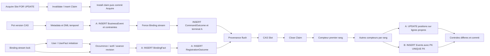

# Numérotation transactionnelle tardive des Events — étude A/B

Date : 18 octobre 2026. Statut : **PROPOSITION POUR REVUE**, aucune décision TARGET ni garantie runtime nouvelle. Verdict : **A_PREFERRED**, sous conditions de preuve explicites. Étude statique du checkout `feat/runtime-monolith`, HEAD `90926a5ec37d1ca841e3de017bec0d1f705d8839`.

## 1. Executive summary

Un compteur PostgreSQL transactionnel par famille peut fournir un ordre de publication compatible avec la visibilité des commits. Il faut allouer des blocs sous verrou de ligne conservé jusqu’à la résolution de la transaction qui écrit les Events. Ni `nextval`, ni les timestamps, ni les UUID, ni un numéro alloué dans une transaction indépendante ne suffisent. La garantie est **par famille** ; elle ne définit pas d’ordre global entre familles et ne change pas la version métier du Pot.

**A est préférée pour une première preuve de concept** : les producteurs insèrent déjà leurs lignes dans la transaction métier ; conserver ces insertions préserve les points d’arbitrage UNIQUE/FK avant la finalisation Consumption. Un suffixe spécialisé peut ensuite numéroter ces lignes. Le coût est un UPDATE par Event, une version de tuple supplémentaire, et une exception contrôlée à l’immutabilité physique, particulièrement visible pour RegistrationOutcome. Un constraint trigger différé peut refuser un commit contenant une position absente, y compris pour une insertion SQL directe qui aurait contourné le registre applicatif. Ce mécanisme doit relire la ligne finale ; tester seulement `NEW.position` serait incorrect.

**B réduit les mutations des lignes Event**, mais déplace leurs contraintes après CAS/claim et exige une garantie supplémentaire : PostgreSQL ne voit pas les Events restés en mémoire. Un buffer seul et `publication_position NOT NULL` ne peuvent empêcher un commit métier privé de ses Events. B devient admissible avec des obligations SQL transactionnelles indélébiles, reliées aux autorités métier, dont le commit impose l’existence des Events attendus. Cela ajoute du schéma, des écritures, des règles de couverture et un graphe de verrous plus difficile à fermer. B n’est pas intrinsèquement impossible ; sa version « buffer puis INSERT » sans témoin SQL est insuffisante.

Aucune des deux variantes n’est aujourd’hui livrée ou prouvée sous PostgreSQL dans ce dépôt. La préférence est architecturale, pas une autorisation de migration. La prochaine étape minimale est une preuve A sur tables de fixture, dans un chantier séparé, avant tout choix de déploiement ou changement de Discovery.

## 2. État Git, périmètre et méthode

La politique [Reactor_Verification_Policy](../testing/Reactor_Verification_Policy.md) a été lue avant l’étude des fichiers `app/`. Périmètre déclaré : **documentation seule** ; slices d’implémentation : **NONE** ; impact production interdit dans toutes les slices ; gate architecture global : **NOT REQUIRED** ; reactor complet : **NOT REQUIRED / NON EXÉCUTÉ** ; vérification DB : **NONE**. Pas de test, benchmark, migration, compilation ou démarrage de runtime. Aucun franchissement de slice. Les slices COMMAND/BINDING/EVENT/LKV décrivent ici des capacités inspectées, pas des changements réalisés.

Constat initial et après `git fetch origin` réussi : branche `feat/runtime-monolith`, HEAD `90926a5e`, `origin/feat/runtime-monolith` = `2eef3ab9785c524c2fab86f586fc12580c8b1c2e`, divergence **0 local / 2 distants** (`git rev-list --left-right --count HEAD...origin/feat/runtime-monolith`). Le premier fetch a été refusé par le sandbox sur `.git/FETCH_HEAD` ; le fetch autorisé a ensuite réussi. Aucune synchronisation du checkout.

Worktrees préexistants : checkout courant à `90926a5e` ; `/private/tmp/pocoma-binding-lock-order-guard` sur `fix/binding-lock-order-guard` à `2eef3ab9` ; `/private/tmp/pocoma-expense-context` sur `fix/expense-context-version-coherence` à `116f4e4a` ; `~/.codex/worktrees/debt-wa6-integration/pocoma` détaché à `2eef3ab9`. Aucun worktree créé ou modifié par cette étude. Le commit d’intégration connu `116f4e4a` n’est donc pas le HEAD étudié. Les 91 tests annoncés et la clôture R03 ne sont pas revendiqués comme vérification de ce checkout : l’audit local préexistant décrit encore R03 comme défaut confirmé, avec son test rouge. L’étude ne tranche pas l’état d’une autre branche et ne corrige pas R03.

État initial : **17 chemins** modifiés/supprimés/non suivis (10 suivis et 7 non suivis). Leur contenu est préservé ; `docs/README.md`, l’audit transversal, son test R03 et ses preuves préexistaient. Un seul nouveau document est livré ; aucun index documentaire préexistant n’est modifié. Aucun commit, staging, push, merge, rebase ou reset.

Méthode : recherche des types, ports, implémentations, appels d’append, créations d’entités et SQL INSERT dans `app/`, `scripts/` et `docs/operations/`, exclusion des `target/` et séparation des fixtures de test. Lecture des compositions réelles, repositories, migrations V1–V29 et tests cités. Les fichiers `graft/` sont des miroirs documentaires historiques, pas des producteurs exécutés. Réutilisation de l’[audit transversal](Transactional_Authorities_Fencing_Locks_Audit_2026-10-18.md), surtout B–D et F, avec recoupement du code. Les références en annexe pointent les fichiers réellement présents ; les méthodes sont nommées dans le corps.

Niveaux de preuve : **C** = constat statique du code actuel ; **S** = raisonnement SQL sous hypothèses déclarées ; **V** = validation PostgreSQL encore nécessaire ; **D** = décision architecturale à prendre. Un test cité est une preuve disponible à examiner, jamais un test réexécuté ici.

## 3. Inventaire des producteurs

### 3.1 BusinessEvent : dix producteurs métier et deux entrées de persistance

Les dix services de `engine-write-pot/.../service/` publient chacun un Event typé après leurs mutations. Leurs méthodes `createPot`, `updatePotDetails`, `deletePot`, `addPotShareholders`, `updatePotShareholdersDetails`, `updatePotShareholdersWeights`, `createExpense`, `updateExpenseDetails`, `updateExpenseShares`, `deleteExpense` sont les points métier. La factory [PotBusinessUseCaseFactory][PotBusinessUseCaseFactory] injecte les ports ; les adapters `*CommandUseCaseAdapter` construisent une invocation locale [PotCommandInvocation][PotCommandInvocation].

| Use case / service | Event produit sur succès | Autorité et persistence avant publication |
|---|---|---|
| [CreatePotService][CreatePotService] | `PotCreatedEvent` | INSERT version Pot initiale, metadata et header |
| [UpdatePotDetailsService][UpdatePotDetailsService] | `PotDetailsUpdatedEvent` | CAS Pot, metadata, fermeture/insertion header |
| [DeletePotService][DeletePotService] | `PotDeletedEvent` | CAS Pot, metadata, version deleted du header |
| [AddPotShareholdersService][AddPotShareholdersService] | `PotShareholdersAddedEvent` | CAS Pot, metadata, shareholders temporels |
| [UpdatePotShareholdersDetailsService][UpdatePotShareholdersDetailsService] | `PotShareholdersDetailsUpdatedEvent` | CAS Pot, metadata, remplacement temporel details |
| [UpdatePotShareholdersWeightsService][UpdatePotShareholdersWeightsService] | `PotShareholdersWeightsUpdatedEvent` | CAS Pot, metadata, remplacement temporel weights |
| [CreateExpenseService][CreateExpenseService] | `ExpenseCreatedEvent` | CAS Pot, metadata, Expense header et shares |
| [UpdateExpenseDetailsService][UpdateExpenseDetailsService] | `ExpenseDetailsUpdatedEvent` | CAS Pot, metadata, remplacement header Expense |
| [UpdateExpenseSharesService][UpdateExpenseSharesService] | `ExpenseSharesUpdatedEvent` | CAS Pot, metadata, remplacement shares |
| [DeleteExpenseService][DeleteExpenseService] | `ExpenseDeletedEvent` | CAS Pot, metadata, version deleted Expense |

**C — chemin Command composé.** [AbstractPotCommandUseCaseAdapter][AbstractPotCommandUseCaseAdapter] capture les Events via `PotCommandInvocation` (`ArrayList`, ordre d’émission conservé), sans les insérer à cet instant. [ExecuteRecordedCommandService.execute] appelle ensuite `EventAppendPort.appendAll`, puis fence le Binding observé. [JpaPotCommandEventAppendAdapter.appendAll] crée un UUID par Event, fixe recordedAt/trace, sérialise avec [BusinessEventRecordMapper][BusinessEventRecordMapper], appelle [JpaBusinessEventOutboxRepository][JpaBusinessEventOutboxRepository].`saveAllAndFlush`, puis rend les artifacts ordonnés. Table : `business_event_outbox` (V2, évolution V15 pour les types). Le flush a donc lieu **avant** fence Binding, outcome, provenance et CAS Consumption. Ce n’est pas un commit.

Cardinalité actuelle : un Event par succès de chacune des dix mutations ; les branches de rejet n’en publient pas. Le contrat `appendAll(List)` accepte plusieurs Events, et un appelant propriétaire pourrait grouper plusieurs mutations : pas de borne SQL globale à un par transaction. Une réussite Command produit aussi **un CommandTerminalEvent** via son outcome. `ExecuteRecordedCommandService` admet explicitement un succès à liste vide ; ne pas baser un invariant universel sur « tout succès produit exactement un Event » sans fermer ce contrat.

Les UUID des Events sont utilisés avant commit pour `CommandExecutionArtifact` puis `ConsumptionResult` ([CommandConsumptionExecution][CommandConsumptionExecution]). Ils sont générés côté Java, pas par une identité SQL. Les services métier n’utilisent pas ces UUID pour leurs mutations. Les artifacts ne portent pas de position (`OptionalLong.empty()` pour leur version propre). Pas de lecture de la ligne Event fraîchement insérée trouvée dans cette chaîne après append ; les consommateurs la rechargent dans une transaction ultérieure. Le test [JpaPotCommandEventAppendAdapterTest][JpaPotCommandEventAppendAdapterTest].`appendsOneBatchAndReturnsOrderedEventArtifacts` vérifie cependant le contrat actuel d’append/flush et son ordre : B changerait sa signification.

**C — entrée hors Command à couvrir.** [JpaBusinessEventOutboxAdapter.append], implémentation de [BusinessEventAppendPort][BusinessEventAppendPort], crée un UUID et appelle `repository.save` sans flush explicite sous `@Transactional` REQUIRED. Aucun appelant métier de ce port retrouvé dans le runtime actuel : les dix services utilisent `EventPublisherPort`, capturé par l’invocation Command. L’adapter reste une capacité disponible ; il peut posséder seul sa transaction ou rejoindre celle de l’appelant. Il doit être couvert, désactivé ou contraint par une future solution ; l’annoter transactionnel ne branche aucun finaliseur.

[JpaEventPort][JpaEventPort] n’est **pas** un troisième writer : il recharge un Event par ID pour LKV. [JpaBusinessEventOutboxEntity][JpaBusinessEventOutboxEntity] est une autre entrée technique possible via repository/EntityManager : `updatable=false` sur le payload n’interdit pas une insertion SQL directe ni une mutation SQL native. Aucun autre writer runtime d’entité retrouvé. Les constructions/INSERT des tests sont des fixtures, à adapter lors d’une future preuve, pas des chaînes métier supplémentaires.

### 3.2 BindingFact : mutations d’autorité et port d’append indépendant

| Producteur / méthode | Adapter / repository / table | Transaction, moment et cardinalité | Familles associées / exceptions |
|---|---|---|---|
| [ExecuteRegistrationService.execute] → `acquireWithInitializer` | [JpaExternalIdentityBindingAdapter][JpaExternalIdentityBindingAdapter] → [ExternalIdentityBindingFactJdbcRepository][ExternalIdentityBindingFactJdbcRepository].`append` → `external_identity_binding_facts` | MANDATORY ; verrou stream `(issuer,subject)`, initializer user/UserCreatedFact, réserve occurrence, crée actif, avance révision, INSERT fact ATTACHED immédiat ; 1 si acquisition gagnante | RegistrationOutcome ensuite ; UserCreatedFact hors des quatre familles étudiées. Conflit actif : 0 fact, outcome rejeté ; collisions BindingId : jusqu’à 8 essais de réservation, puis exception et rollback |
| `ExternalIdentityBindingPort.acquire` | Même adapter, délégation `acquireWithInitializer(..., () -> {})` | MANDATORY ; 0 ou 1 ATTACHED ; propriétaire extérieur requis | Capacité hors Consumption ; aucun autre caller métier actuel trouvé |
| `ExternalIdentityBindingPort.detach` | Même adapter/repository | MANDATORY ; stream lock, delete exact actif, avance révision, 1 DETACHED | Stream absent ou occurrence non courante : 0 ; aucun caller métier runtime actuel trouvé, capacité exercée par tests |
| [JpaExternalIdentityBindingFactAdapter.append] / `ExternalIdentityBindingFactPort` | Même repository JDBC | MANDATORY ; INSERT direct du fact fourni ; nombre fixé par l’appelant | Aucun appelant métier de cet append indépendant trouvé ; ne passe pas par l’adapter d’autorité |
| Bootstrap historique V22 | INSERT SQL dans [V22__repair_binding_history_and_contract.sql][V22__repair_binding_history_and_contract.sql] | Transaction de migration Flyway ; 0…n baselines ATTACHED R0, plus réparation historique DETACHED | Hors Consumption ; preuves cutover exigées, pas à rejouer pour cette étude |

Le code d’autorité construit directement le repository JDBC dans son constructeur : décorer **seulement** `ExternalIdentityBindingFactPort` manquerait acquire/detach. Les UUID fact sont produits dans l’adapter ; le résultat d’acquire est un BindingId, pas l’EventId. Les contraintes `(issuer,subject,binding_revision)` et les FK stream/user interviennent dès l’INSERT actuel ; les occurrences ont leurs propres contraintes (V20–23). Les baselines R0 ne doivent pas être confondues avec la position de publication. V20 crée le stream et les structures ; V21 étend le contrat ; V22 est le writer de baselines retrouvé ; V23 ferme types/origin. Aucun trigger append-only générique sur BindingFact dans ces migrations.

Aucune relecture du nouveau fact requise par acquire/detach après append. Le port indépendant permet toutefois `findByEventId` dans la même transaction : B doit spécifier si un read préparé est interdit ou résolu depuis son buffer, sans changer silencieusement un contrat de lecture durable. Un caller peut grouper plusieurs mutations sous une même transaction ; les APIs MANDATORY ne bornent pas leur nombre et ne garantissent pas un ordre entre plusieurs identités.

### 3.3 RegistrationOutcome

[ExecuteRegistrationService.execute] recharge request et outcome ; si un outcome existe, il le rend sans insertion. Sinon il acquiert Binding avec initializer puis construit `Registered(requestId,userId,bindingId)` ou `Rejected(requestId)` et appelle [JdbcRegistrationOutcomeStore.insert]. SQL immédiat via JdbcTemplate ; **pas d’annotation MANDATORY sur ce store**, sa participation dépend du propriétaire. Table `registration_outcomes`, PK `request_id`, FK Request/User/BindingOccurrence, trigger `registration_outcome_immutable` refusant UPDATE et DELETE ([V28__registration_outcomes.sql][V28__registration_outcomes.sql]).

Frontière composée : [RegistrationRuntimeConfiguration][RegistrationRuntimeConfiguration].`registrationExecute` → TransactionalExecute → ExecuteConsumptionService → callback [RegistrationConsumptionLocator][RegistrationConsumptionLocator] → service ; puis provenance et CAS/claim, un commit commun. Nombre : 0 sur replay existant, 1 sur nouvelle décision ; pas de borne pour des appels directs multiples. Acquisition gagnante : BindingFact + RegistrationOutcome (+ UserCreatedFact) dans la même transaction. Rejet « identité déjà utilisée » : outcome seul, pas de nouveau user/fact. Exceptions techniques : rollback, puis politique de failure ; ne pas inventer un RegistrationOutcome FAILED absent du modèle.

L’identifiant source est **requestId**, déjà connu ; aucun nouvel UUID Event requis. La provenance Registration contient seulement un input `REGISTRATION_REQUEST(requestId,1)` et une liste de results vide ; elle ne référence ni l’outcome comme résultat ni l’EventId Binding. Le `find` préalable est une dépendance à la persistence des outcomes existants ; plusieurs appels du même request dans une transaction verraient actuellement le premier INSERT. B devrait préserver la déduplication dans sa préparation ou interdire ce scénario explicitement. V28 impose à A une adaptation ciblée du trigger immutable pour autoriser la seule finalisation de position ; B conserve ce trigger sur la ligne Event définitive.

### 3.4 CommandTerminalEvent : trois chemins, quatre issues de publication

[JdbcCommandOutcomeAdapter.publish] (MANDATORY) insère **d’abord** `command_outcomes` PK CommandId, puis `command_terminal_events` (UUID Java, UNIQUE CommandId, FK outcome), SQL immédiat. Il implémente à la fois publication et query d’outcome. Pas de repository supplémentaire. Schéma [V17__command_outcomes_and_terminal_events.sql][V17__command_outcomes_and_terminal_events.sql].

| Appelant | Issue | Frontière réelle et Events associés |
|---|---|---|
| [CommandConsumptionExecution][CommandConsumptionExecution].`forCommand` / `execute` | APPLIED | Execute propriétaire ; après Pot/BusinessEvents et fence Binding ; BusinessEvent(s) + terminal |
| Même méthode | REJECTED métier, autorisation expirée, identité non courante | Même Execute ; généralement terminal seul ; fence si Binding observé, retour direct si absent |
| [CommandConsumptionExecution.terminalFailureEffect] | FAILED (`COMMAND_PROCESSING_FAILED`) | Nouvelle transaction HandleFailure après rollback Execute ; effet du FinalizeConsumptionService avant provenance/CAS/claim ; retry ne publie pas FAILED |
| [BindingFenceRecoveryExecuteUseCase.execute] | REJECTED `CALLER_IDENTITY_NOT_CURRENT` | Nouvelle transaction après rollback du fence perdu ; relecture Binding exact, puis participant Execute ; aucun BusinessEvent de la tentative initiale ne survit |

Nombre : un terminal par appel `publish`, un terminal par Command committée grâce à UNIQUE CommandId ; une transaction arbitraire peut publier plusieurs commandes. `ConsumptionExecutionResult.results()` ne liste **pas** ce terminal, y compris APPLIED ; recovery rend inputs/results vides. Sa position ne peut donc être déduite des artifacts. Le UUID terminal n’est pas retourné au moteur. L’outcome SQL est disponible pour `findByCommandId` dès publish ; si B reporte uniquement le terminal et conserve l’outcome tôt, cette lecture reste possible et l’arbitrage Q demeure avant S. Différer aussi l’outcome changerait le protocole et doit être étudié séparément.

### 3.5 Limites de couverture et absence de statut Event

Les recherches n’ont trouvé aucun autre INSERT runtime de ces quatre tables, ni writer opérationnel additionnel dans `scripts/` ou `docs/operations/`. Les écritures historiques de réparation et les fixtures restent distinctes. Cela ne prouve pas l’absence d’un client SQL externe au dépôt : droits SQL et garde DB sont nécessaires.

UserCreatedFact est découvert dans Registration mais n’est pas une des quatre familles demandées ; son éventuelle numérotation est un arbitrage distinct qui changerait l’ensemble des compteurs. Les colonnes physiques legacy `status/attempt_count/claim/...` de BusinessEvent existent encore ; ni A ni B ne doivent en faire un statut consumed/burned/processed. La position proposée est structurelle et indépendante de tous les consommateurs.

## 4. Frontières transactionnelles et insertion du suffixe

**C.** [SpringTransactionRunner.runInTransaction] délègue à TransactionTemplate ; propagation par défaut REQUIRED. Un template imbriqué peut rejoindre une transaction existante. Les adapters MANDATORY exigent un propriétaire, sans le créer. [ConsumptionOwnerTransactionRunner][ConsumptionOwnerTransactionRunner] refuse transaction **ou synchronisation** ambiante avant délégation ; vérifie `afterCompletion` et n’annonce un succès qu’après commit confirmé. Les configurations Command et Registration utilisent explicitement ce runner. [ConsumptionOwnerOrchestrator][ConsumptionOwnerOrchestrator] ajoute le guard à l’entrée orchestration. Le mono-runtime compose ces mêmes capacités, sans constituer une nouvelle transaction métier englobante.

Acquire est une transaction préalable séparée (S verrouillé, invalidation/INSERT claim, installation du claim). Execute est une autre transaction ; HandleFailure ou recovery sont encore d’autres propriétaires. Ne pas tracer un arc de verrou à travers ces commits. Les simples annotations REQUIRED de l’ancien append BusinessEvent ne donnent pas ce guard propriétaire.

[ExecuteConsumptionService][ExecuteConsumptionService] exécute le callback métier puis appelle [FinalizeConsumptionService.finalizeConsumption] : durableEffect, append inputs/results, [JpaConsumptionLifecycleAdapter.terminalize], CAS S `PENDING/current_claim_id`, clôture conditionnelle C. [JpaConsumptionSlotRepository][JpaConsumptionSlotRepository] utilise `flushAutomatically=true` et `clearAutomatically=true` sur les mutations concernées. Le flush fait sortir la provenance JPA avant CAS ; le clear peut détacher les entités Event. Le finaliseur Event ne peut donc compter sur la dirty checking d’instances conservées depuis append.

**D — emplacement admissible sans changer le moteur générique :** dans la composition spécialisée productrice, envelopper le participant dans le callback du **vrai propriétaire**, puis appeler le suffixe Event après retour du participant et avant retour au runner. Pour Command, couvrir l’Execute normal **et** le participant de recovery **et** HandleFailure terminal. Pour Registration, couvrir Execute. Pour les append/acquire/detach hors Consumption, fournir une enveloppe propriétaire équivalente ou un hook de transaction physique contraint et vérifié. Décorer `TransactionalExecuteConsumptionUseCase` à l’extérieur arrive après commit ; `afterCommit` arrive également trop tard. Un finaliseur dans `JpaPotCommandEventAppendAdapter` serait trop tôt et manquerait les autres familles.

Le holder actuel [ConsumptionTerminalParticipant][ConsumptionTerminalParticipant] contient un `FinalizeConsumptionService` concret : il n’offre pas un slot d’extension Event déjà branché. L’assemblage devra évoluer, sans ajouter de notion Event au moteur générique. Décorer les use cases participants côté composition ou le callback d’un runner spécialisé sont des possibilités, pas du code existant. Un wrapper de runner ne doit pas créer un deuxième owner guard imbriqué ; son hook doit être exécuté **à l’intérieur** du callback du delegate propriétaire. Un callback Spring `beforeCommit` est possible en principe, mais exige de prouver l’ordre des synchronizations/flushs et l’absence d’Events produits après son gel. Préférer un suffixe explicite et un registre scellé ; garder la garde DB comme filet de complétude.

La documentation [consumption-transactional-execution](consumption-transactional-execution.md) et l’audit du protocole décrivent une fin CAS/claim fermée. Autoriser un suffixe technique rollbackable après cette fin est un arbitrage de contrat à documenter, même si aucun algorithme générique ne change. L’étude n’applique pas cet arbitrage.

## 5. Variante A — insérer, puis finaliser

### 5.1 Registre et protocole explicite

**D.** À l’entrée du propriétaire, ouvrir un registre lié à la transaction physique : `(famille, clé stable, ordinal d’append)`. Chaque insertion enregistrée conserve l’ID existant : BusinessEvent `id`, BindingFact/terminal `event_id`, RegistrationOutcome `request_id`. Le registre ne doit pas être une liste de `ConsumptionResult`, un singleton, ni un ThreadLocal sans cycle de vie transactionnel. Il doit supporter plusieurs producteurs dans une transaction, suspendre/reprendre correctement les ressources REQUIRES_NEW, être nettoyé après completion et annuler les entrées rollbackées sur savepoint si ce mode est autorisé. Une alternative est un registre SQL alimenté par trigger d’insertion ; elle coûte des écritures mais couvre les INSERT directs.

Séquence : exécution métier/INSERT sans position → fence → outcome(s) → provenance/flush → CAS S → close C → flush explicite des insertions Event restantes → geler le registre → acquérir **tous** les compteurs non vides en ordre global → réserver exactement les blocs → UPDATE des lignes par ID en ordre explicite → vérifier rowcounts et complétude → commit. Pour les owners hors Consumption, omettre S/C et conserver la même fin de transaction. Toute insertion après gel doit être rejetée ou imposer un rollback, pas obtenir un compteur hors ordre.

Pas de scan par `created_at`, `txid` approximatif, PotId ou ClaimId : ils ne désignent pas exactement tous les Events de la transaction. `xmin` n’est pas un contrat de registre métier durable ; le couplage aux XID, savepoints et gel rend cette solution inutilement fragile. Une clé de batch transactionnelle, si retenue, doit être contrôlée en DB et ne pas permettre de finaliser des lignes d’une autre transaction. Le registre applicatif aide à numéroter ; le garde DB détecte les omissions qu’il ne voit pas.

### 5.2 Garantie PostgreSQL de complétude

**S/V.** PostgreSQL ne permet pas de différer NOT NULL ni CHECK. Une colonne temporairement nullable est donc nécessaire dans A si la position est portée sur l’Event. `CHECK(position > 0)` laisse passer NULL ; l’unicité non différée peut porter sur les positions finales non nulles. Ni ce CHECK ni UNIQUE ne garantissent à eux seuls la complétude. Voir [CREATE TABLE PostgreSQL 17](https://www.postgresql.org/docs/17/sql-createtable.html).

Proposition : constraint trigger **AFTER INSERT OR UPDATE, FOR EACH ROW, DEFERRABLE INITIALLY DEFERRED** sur chaque table Event. À l’exécution différée, relire la ligne par sa PK et exiger sa position actuelle non nulle et positive. Le `NEW` mis en file lors de l’INSERT conserve l’état de cet INSERT : il peut être NULL alors que l’UPDATE final a réussi. Tester seulement cette image refuserait à tort le bon protocole. Un `WHEN` est évalué immédiatement et les transition tables ne sont pas disponibles pour un constraint trigger : ne pas en déduire une vue de toute la transaction. Voir [CREATE TRIGGER PostgreSQL 17](https://www.postgresql.org/docs/17/sql-createtrigger.html).

L’absence de la ligne à la relecture ne doit pas être acceptée pour un Event attendu : interdire DELETE/TRUNCATE au rôle runtime, protéger les suppressions dans le schéma, et définir explicitement le traitement des insertions volontairement abandonnées (préférence : rollback de leur transaction, pas suppression opportuniste). `SET CONSTRAINTS ... IMMEDIATE` trop tôt doit échouer, ce qui est sûr ; il ne doit pas désactiver la vérification. Chaque INSERT SQL direct sans position doit ainsi faire échouer **le commit entier**, même sans registre Java. Les triggers doivent couvrir toutes les tables/partitions accessibles ; les utilisateurs runtime ne doivent pouvoir ni les désactiver ni changer `session_replication_role` ni contourner le schéma par des droits de propriétaire. Les rôles de migration privilégiés ont un protocole de cutover séparé.

Cette garde prouve « aucun Event inséré ne committe incomplet ». Elle ne détecte pas un use case qui omettrait entièrement de produire son Event ; cette obligation métier est distincte, déjà présente aujourd’hui. Exiger aussi une preuve DB de cette obligation pour A nécessiterait des liens autorités→Events comme pour B. La comparaison ne prétend pas que le trigger nullable résout cette question plus forte.

### 5.3 Position temporairement mutable, ORM et coûts

**D.** Autoriser uniquement la transition NULL→valeur allouée, payload identique, et interdire tout changement de position finale. L’insertion avec position arbitraire doit être refusée au rôle ordinaire ou passer par l’allocateur contrôlé. Une simple contrainte UNIQUE positive ne certifie pas qu’un client a respecté le compteur. Le compteur doit être modifiable uniquement par le protocole autorisé, idéalement encapsulé avec vérification des plages et des rowcounts ; ne pas offrir un UPDATE libre de la position aux autres writers.

V28 exige de remplacer sa protection aveugle contre tout UPDATE par une exception très étroite pour cette transition ; BusinessEvent et BindingFact/terminal n’ont pas une protection SQL équivalente uniforme. Le payload conserve son immutabilité logique ; la structure physique ne devient définitive qu’au commit. Si l’architecture impose l’immutabilité physique dès INSERT sans exception, **A telle que définie est exclue**. Une table de publication séparée serait une troisième variante, pas une manière de cacher cette différence.

Utiliser du JDBC/SQL ciblé après flush, avec prédicat de position absente, rowcount exact et protection DB, évite de dépendre d’entités détachées par le CAS. Si la position est mappée en JPA, éviter une valeur obsolète qui réécrase la finalisation : mapping en lecture ou refresh/invalidation adaptés à prouver. JDBC et JPA doivent partager le même DataSource/manager/connexion transactionnelle ; une deuxième connexion autonome rendrait le protocole faux.

**S.** Pour n Events sur f familles non vides : n INSERT existants + n mutations de ligne UPDATE et f UPDATE de compteur, éventuellement groupés en moins de statements. L’UPDATE crée une nouvelle version MVCC et du WAL, augmente la pression vacuum et modifie l’index de position. Puisque la colonne changeante est indexée, ne pas compter sur HOT pour cette mutation ; le détail des autres index, du TOAST et du WAL doit être mesuré. Un index partiel `WHERE position IS NOT NULL` évite d’indexer les NULL provisoires, pas le coût de l’UPDATE. Le trigger différé ajoute des invocations/relectures par ligne et peut être déclenché plusieurs fois. Le coût du registre SQL éventuel s’ajoute ; le registre mémoire seul ne produit pas de WAL. Pas de chiffrage de latence ou débit disponible.

Un rollback supprime les INSERT et UPDATE, annule le compteur et la provenance/CAS/claim ; les UUID jetés ne sont pas des positions consommées. Les Events incomplets ne sont visibles que dans leur propre transaction. L’état temporaire doit être exclu de toute notification externe avant commit.

## 6. Variante B — préparer, puis insérer

### 6.1 Préparation explicite et propagation

**D.** Préparer une enveloppe immuable contenant ID, famille, ordinal, payload sérialisé, trace et temps de création avant les compteurs. Conserver l’ensemble dans une session de publication explicite appartenant au propriétaire, passer cette session ou un port de préparation spécialisé aux adapters, puis sceller/insérer dans son suffixe. Le domaine Pot capture déjà ses Events ; cela ne couvre ni les BindingFacts construits dans l’adapter d’autorité, ni les outcomes/terminal Events, ni les producteurs directs.

`EventAppendPort.appendAll` devrait devenir une préparation qui rend des références à futurs Events (mêmes UUID), ou être remplacé par des ports explicites prepare/finalize. `BusinessEventAppendPort`, `ExternalIdentityBindingFactPort`, le chemin interne de `JpaExternalIdentityBindingAdapter`, `RegistrationOutcomeRepository.insert` et `CommandOutcomePublicationPort.publish` doivent être adaptés ou branchés à cette session. Un changement caché de `append` qui rendrait « durable » un simple objet mémoire serait trompeur. L’assemblage doit rendre l’obligation de finalisation vérifiable, sans faire passer un buffer Event dans les contrats génériques Consumption.

Les artifacts et la provenance peuvent référencer des UUID préalloués : les tables génériques portent des références structurelles et n’exigent pas une FK polymorphe vers les Events (V4, [JpaConsumptionProvenanceAdapter][JpaConsumptionProvenanceAdapter]). La possibilité ne prouve pas que la cible sera insérée. Conserver `createdAt` de préparation, plutôt que le temps de l’INSERT tardif, évite un changement silencieux des traces ; pour Registration `decided_at=now()` est actuellement un timestamp de transaction, pas une horloge de commit. La position est indépendante de ces temps.

Rendre explicites les lectures dans la même transaction : `RegistrationOutcomeRepository.find` doit voir un outcome déjà préparé lors d’un replay local ; `CommandOutcomeQueryPort` peut rester SQL si l’outcome est inséré tôt ; `BindingFactReadPort` ne doit pas oublier un fact préparé. Aucun besoin actuel de lecture post-append Event dans la chaîne Pot n’a été trouvé. Les erreurs de sérialisation doivent être détectées pendant la préparation quand possible ; les erreurs FK/UNIQUE d’INSERT seront encore possibles tard.

Le registre est une ressource transactionnelle : cycle de vie, suspension, nouvelle transaction recovery et rollback de savepoint sont les mêmes problèmes que A, avec ici le payload complet et la responsabilité de l’existence de l’Event. Une Map statique ou un ThreadLocal d’invocation seul est insuffisant. Un suffixe explicite avec vérification du nombre attendu est préférable à un état transactionnel implicite ; aucune vérification Java seule ne couvre un commit par un autre chemin SQL.

### 6.2 Complétude : impossibilité du buffer seul, solution avec obligations SQL

**S.** Si deux transactions produisent le même état SQL métier, l’une contenant un Event dans son buffer Java et l’autre non, PostgreSQL les observe identiquement avant le suffixe. Il ne peut refuser uniquement la première qui oublie de vider son buffer. NOT NULL/UNIQUE sur la table Event ne sont jamais évalués pour une ligne non insérée. Ni `ConsumptionResult` incomplet, ni CAS DONE, ni le nettoyage du ThreadLocal ne résolvent cette indiscernabilité.

**D/S/V — B renforcée possible :** persister avant CAS une obligation par Event attendu, avec famille, ID, cause, ordinal et identité/payload ou empreinte à vérifier. L’obligation ne peut être supprimée pour contourner la garde. À commit, une FK différée **par famille** vers la PK Event, complétée de contrôles de correspondance, ou un constraint trigger différé, impose la présence de la cible numérotée. Le finaliseur insère les Events avec position NOT NULL et valide la bijection attentes/cibles. Un lien polymorphe texte/UUID générique ne fournit pas une FK SQL native vers quatre tables : prévoir quatre relations ou une garde spécialisée. Une empreinte seule ne prouve pas une égalité sans définir sérialisation et collisions ; la correspondance canonique reste à décider.

Le témoin doit lui-même être obligatoire. Un simple `prepare()` qui écrit une obligation peut encore être oublié. Pour garantir « les effets métier ne committent pas sans les Events attendus », attacher l’obligation à l’autorité durable : metadata de mutation Pot→BusinessEvent(s), nouvelle révision Binding→fact exact, nouvelle décision outcome→terminal, décision Registration→son outcome numéroté. Des triggers d’autorité, des FK inverses différées ou des procédures de mutation fermées aux écritures directes doivent créer/exiger ce témoin. Le contrat doit traiter les succès vides, les rejets, la Registration sans nouvelle identité, la recovery et les appels hors Consumption ; tous les UPDATE SQL arbitraires ne décrivent pas une décision métier que PostgreSQL pourrait deviner. Aucun de ces liens complets n’existe aujourd’hui.

La relation `command_outcomes` précoce peut fournir une partie du témoin terminal : UNIQUE CommandId + vérification différée « exactement un terminal cohérent » ; sa FK actuelle va du terminal vers l’outcome et n’impose pas la réciproque. Pour Binding, l’avance de révision peut exiger le fact correspondant, sous réserve des baselines R0 et des mutations groupées. Pour Pot, les metadata immuables V11 fournissent une cause, mais ne définissent pas à elles seules tous les types/cardinalités d’Events : cela exige un contrat nouveau. Pour Registration, la request admise ne doit pas exiger immédiatement un outcome, car l’admission committe avant le traitement ; le témoin doit naître à la décision, pas à l’admission.

Ces obligations sont écrites et vérifiées dans la transaction propriétaire, sans worker de publication ni état de Consumption dans l’Event. Une staging SQL contenant le payload complet ferait en pratique une première insertion durable puis une insertion définitive : la variante reste possible, mais son avantage d’écritures sur A n’est plus acquis. Une suppression des obligations après insertion nécessite une preuve de décharge qui ne puisse être contournée ; conserver des témoins immuables évite cette faille mais conserve leurs coûts de stockage.

### 6.3 Rejets, recovery et coûts

Un rejet métier prépare le seul terminal requis ; il n’est pas autorisé à jeter cette préparation sous prétexte de `results()` vide. `BindingFenceLostException` doit faire rollbacker métier, buffer et témoins de la première tentative. La recovery ouvre une session neuve : si Binding exact toujours présent, conflit technique sans terminal ; sinon nouvelle préparation de rejet puis même suffixe final dans son owner. HandleFailure terminal prépare FAILED ; RetryAfter ne prépare aucun terminal. Une transaction marquée rollback-only ne doit jamais produire un résultat présenté comme commit confirmé.

Pour n Events/f familles : n INSERT définitifs + f mutations de compteur, sans UPDATE de position Event. Ajouter les obligations : au moins leurs écritures nécessaires, éventuellement décharges, index et vérifications différées. Le buffer coûte mémoire et rétention de payloads jusqu’au suffixe. L’INSERT tardif effectue sous compteur l’ensemble des vérifications PK/UNIQUE/FK et de l’indexation Event. Pré-sérialiser réduit le travail applicatif sous compteur, pas le travail SQL. Une obligation précoce peut réserver certaines clés, mais pas dispenser de démontrer l’ordre des dernières attentes.

## 7. Garanties d’ordre : hypothèses et preuve commune

**S — hypothèses cumulatives.** Une seule base PostgreSQL faisant autorité pour la famille, compteur en table ordinaire journalisée et précréé, incrément exact en bigint contrôlé contre overflow, aucune séquence ni bloc autonome ; toutes les publications passent par l’allocateur ; incrément et Event dans la même transaction physique ; verrou du compteur jamais libéré avant commit/rollback ; aucune réécriture de position finale ni suppression d’Event ; réservation de n positions et insertion/finalisation d’exactement n lignes. Les erreurs entraînent rollback complet, pas un catch qui conserverait compteur ou obligations invalides. Si des savepoints sont permis, aucun rollback partiel ne peut laisser l’incrément sans ses Events ni libérer le compteur puis continuer à publier son bloc. Exclure ce mode au départ est plus simple. En REPEATABLE READ/SERIALIZABLE, accepter les erreurs de sérialisation et réessayer toute la transaction. Ne pas recycler des positions après un commit réussi.

| Propriété | Démonstration conceptuelle / limite |
|---|---|
| 1. Unicité dans F | UPDATE sérialisé du compteur F, bloc `[c+1,c+n]` disjoint du précédent ; UNIQUE sur position dans la table de F fournit le garde supplémentaire. Unicité d’ID Event ne suffit pas |
| 2. Positions committées croissantes | Chaque transaction de F reçoit son bloc après résolution du détenteur précédent. L’ordre des transactions publiantes de F est celui de ces résolutions réussies, pas celui de BEGIN, UUID ou temps métier |
| 3. Rollback sans consommation définitive | UPDATE du compteur et écritures Event rollbackent ensemble ; le suivant reprend c. Un UUID abandonné est sans effet. Le WAL de tentative existe mais n’est pas une position publiée |
| 4. Pas de supérieur visible avant inférieur indécis | Tant que T1 détient F, T2 ne peut allouer son bloc supérieur. Après commit T1, ses Events sont visibles aux nouveaux snapshots qui peuvent voir T2 ; après rollback T1, T2 réemploie le bloc. Même transaction multi-Events : visibilité atomique, pas d’obligation de distinguer leurs instants de commit |
| 5. Densité | Par induction depuis une baseline dense : réserver exactement n puis publier n ; rollback de tout le bloc n’avance pas c. Interdire les trous volontaires, suppression/renumérotation et incréments orphelins. UNIQUE/non-null seuls ne démontrent pas la densité |
| 6. Ordre intratransaction | Ordinal explicite stable par famille ; pour Pot, ordre capturé de la liste ; ne pas dépendre de l’ordre d’un UPDATE `IN (...)`, d’un Set ni du batching Hibernate. Déterministe pour une préparation donnée ; entre deux retries, de nouveaux UUID ne garantissent pas le même tri |
| 7. Aucun Event sans position valide | A : contrôle différé de l’état final + transition contrôlée + allocation vérifiée. B : NOT NULL/positive/UNIQUE pour les INSERT, obligations SQL pour l’existence attendue. Ces protections sont proposées, absentes du code actuel |

Pour plusieurs familles : figer l’ensemble puis ordre total stable proposé `BusinessEvent < BindingFact < RegistrationOutcome < CommandTerminalEvent` (noms/rangs à ratifier). Prendre tous les compteurs avant de numéroter/insérer, garder les verrous jusqu’au même commit. Chaque famille garde sa preuve ; aucune valeur 12 de F n’est comparable à 12 de G. Aucune nécessité de fusionner les familles en une séquence globale.

Un snapshot ancien peut ne voir ni T1 ni T2 ; un snapshot qui voit T2 committée sur cette même base ne peut omettre T1 déjà committée du seul fait de leur concurrence. Éviter un curseur durable avancé depuis une autre base ou une réplique plus récente puis réutilisé sur une réplique en retard. Le failover/backup doit conserver compteur et Events du même historique ; une restauration qui perd des commits exige une gestion de génération du curseur, pas une simple réutilisation aveugle.

Crash avant commit : recovery PostgreSQL annule les effets non committés ; après commit durable : conserve compteur/Events ensemble. Perte réseau au commit : issue inconnue côté application, ne pas conclure rollback ni republier sans relecture des clés d’autorité/issue ; le runner actuel distingue la résolution inconnue. Redémarrage applicatif : reconstruire uniquement depuis SQL ; aucun Event préparé ne peut rester seul en RAM après un commit admis. Les notifications/observations de succès restent post-commit, sans écritures de publication post-commit. Un éventuel 2PC conserverait le verrou pendant PREPARED : ordre préservé mais blocage possible ; ce n’est pas le mécanisme courant.

La densité n’est **pas nécessaire** au keyset Discovery `position > cursor ORDER BY position` si la propriété de préfixe stable est garantie. Ne pas arrêter sur un trou supposé provisoire et ne pas inventer un numéro attendu. Pour un parcours filtré par partition/route, des trous apparents sont normaux même si la famille entière est dense. La garde de bijection compteur/bloc reste utile pour détecter des omissions, indépendamment du besoin de Discovery.

## 8. Autorités et graphe comparé des verrous

Réutilisation de l’audit transversal C/D : P = version Pot ; M = metadata/DML enfants ; E = stream Binding ; Q = outcome Command UNIQUE ; R = outcome Registration UNIQUE ; S = ConsumptionSlot ; C = ConsumptionClaim ; F = compteur. Les arcs signifient une acquisition possible dans la même transaction ; les nœuds de type identique peuvent désigner des lignes différentes. Les FK vers parents et les UNIQUE font partie du graphe, pas seulement les verrous explicites.

Dans B, remplacer les INSERT Event précoces par préparation/témoins ; le squelette métier reste P→M→fence E→Q et E→U/O→décision Registration. **Conserver Q tôt** préserve son arbitrage ; les obligations SQL B doivent elles aussi prendre leurs clés/FK avant F. HandleFailure et recovery commencent à Q puis provenance→S→C→F ; pas de prélock S avant Q. Producteurs directs : leurs autorités propres puis registre/témoins et F, sans S/C s’ils ne consomment rien. Les writers dérivés LKV/CurrentBinding/Results/Tasks ne publient pas ces quatre familles dans le code observé ; ils terminent sur S/C sans F. Aucun arc n’est ajouté de leur transaction au compteur d’un autre owner.

### 8.1 Attentes après le premier compteur

| Variante | Travail et verrous résiduels | Conditions pour fermer le graphe |
|---|---|---|
| A | Autres F, UPDATE lignes Event créées par soi, UNIQUE position nouvelle, éventuels checks/triggers, WAL/commit | INSERT/contraintes métier déjà flushés ; aucune FK nouvelle de la position vers une autorité externe ; aucun trigger ne repart vers P/E/Q/S d’une autre transaction ; registres scellés ; compteur précréé |
| B | Autres F, INSERT payload/index, PK/UNIQUE CommandId ou `(E,R)`, FK parents, témoins/guards et commit | Prouver que chaque conflit tardif est protégé/réservé avant F ou ne peut être détenu par un writer attendant F ; vérifier toutes les insertions directes et obligations |

Un index de position contient de nouvelles valeurs allouées exclusivement ; si tous les writers suivent le protocole, il ne doit pas attendre une publication hors allocateur. Un index UNIQUE autre que position peut attendre une transaction antérieure. Les FK peuvent prendre KEY SHARE sur un parent ; une suppression concurrente peut les bloquer. Des parents créés par soi ne bloquent pas sur une autre transaction, mais un UUID préalloué ne prouve pas que tous les parents/contraintes sont propres. V17 : terminal→outcome ; V20–23 : fact→stream/user ; V28 : outcome→request/user/occurrence. DDL concurrent ACCESS EXCLUSIVE, contrôles différés inattendus, triggers et saturation I/O peuvent encore prolonger la fin de transaction. Ne pas promettre « plus aucune attente » après F.

### 8.2 Absence de cycle : preuve conditionnelle, pas certification actuelle

**S.** Si toutes les ressources partagées susceptibles de bloquer sont acquises avant F, si les compteurs suivent un ordre total, et si le suffixe ne demande ensuite que ses propres lignes ou des ressources non conflictuelles, l’ajout des F ne crée pas de cycle : un détenteur F n’attend pas une autorité antérieure tenue par un waiter F, et les arcs entre F ne remontent pas leur rang. Cela ne prouve pas l’acyclicité universelle du graphe préexistant ; l’audit n’a pas trouvé de chemin actuel Binding→Pot opposé au Pot→Binding. Acquire S→C ne demande pas P/E/Q dans sa transaction.

**V.** A se rapproche de ces conditions parce que les clés métier Event sont prises tôt ; B doit les démontrer après déplacement des INSERT. L’ancienne inversion Q→S→Q de D17 ne doit pas être réintroduite par des prélocks ou témoins. Un cycle `T1 tient F puis attend UNIQUE k de T2 ; T2 tient k puis attend F` est réalisable **si** un writer garde une insertion/réservation k précoce tandis qu’un autre prend F avant de demander k. Aucun tel entrelacement nouveau n’a été exécuté ici ; ce n’est pas un deadlock démontré du runtime actuel. Le mélange des variantes pendant un déploiement peut justement produire cette opposition ; il doit faire partie du cutover à prouver. De même, prendre F1/F2 en ordre opposé dessine un cycle conceptuel, pas un incident observé.

Les appels directs multi-Pot/multi-Binding doivent aussi imposer leur ordre d’autorités initiales ; trier seulement les F ne répare pas une inversion antérieure. La durée d’un verrou F est : attentes des compteurs suivants + DML final + contraintes différées + résolution commit. La durée des P/E/S déjà pris **augmente** de l’attente de F et du suffixe, même si F est tardif. Chaque famille devient un point de sérialisation transversal à des Pots indépendants. Un bloc de n Events amortit l’UPDATE compteur, mais augmente le DML sous verrou ; l’absence de cycle ne donne aucune garantie de débit, fairness ou temps maximal.

## 9. Compatibilité Consumption et échecs

| Situation | A | B | Invariant commun |
|---|---|---|---|
| CAS slot perdu (`LostClaimException`) | INSERT provisoires annulés ; suffixe non atteint | Préparations/témoins annulés ; INSERT non exécutés | Aucun effet métier de la tentative stale ne committe |
| Close claim refuse après CAS gagné | Rollback des Events et CAS | Rollback métier/témoins/CAS | CAS gagné ne signifie pas commit acquis |
| Numérotation/INSERT final échoue après close | Rollback complet jusque P/E/outcomes/provenance/S/C | Idem, y compris obligations | Ne jamais capturer l’erreur pour annoncer succès |
| Rejet métier | Numéroter terminal déjà inséré | Insérer terminal préparé | results vide ne signifie pas absence d’Event |
| Binding fence perdu | Première transaction rollbackée ; nouvelle recovery avec finaliseur | Session jetée ; session recovery neuve | Si Binding reste courant : conflit technique ; sinon rejet atomique |
| Échec technique terminal | Finaliseur du HandleFailure nécessaire | Idem avec préparation FAILED | Retry ne publie pas de terminal |
| Échec au commit différé / issue inconnue | Exception du propriétaire, pas succès d’exécution | Même chose | Préserver la classification du runner ; ne pas traiter comme simple rejet métier |

Les tests existants [TransactionalConsumptionExecutionPostgresTest][TransactionalConsumptionExecutionPostgresTest] distinguent visibilité commune, takeover avant/après CAS, refus de clôture et refus différé au commit (`successfulExecutionBecomesVisibleAsOneCommit`, `winningCasAndEffectsRollBackWhenClaimClosureRefuses`, `deferredConstraintRefusesCommitAfterWinningCasAndRollsBackEverything`, scénarios `twoFkHolders...` et `takeoverAfterWinningCas...`). [ConsumptionOwnerTransactionRunnerTest][ConsumptionOwnerTransactionRunnerTest] vérifie l’absence de succès sur commit non confirmé. Ils montrent les points de preuve disponibles ; ils ne démontrent pas un finaliseur Event absent du code.

Les tests runtime Command, Registration, Binding et CommandResult référencés en annexe couvrent les chaînes concernées ; aucun résultat nouvellement PASS n’est annoncé. L’audit D17/WP4 reste la référence historique pour le cycle supprimé. Une politique future qui interdit toute instruction après close doit être amendée avant branchement ; une implémentation ne doit pas dissimuler ce suffixe dans le moteur générique.

## 10. Conséquences pour Discovery, sans changement actuel

Les deux variantes complètes rendraient disponibles la même clé de parcours stable `position > c ORDER BY position LIMIT k`, l’accès à une plage supérieure committée et le rejeu depuis le début. Elles n’optimisent **rien à elles seules** : le Discovery actuel reste inchangé. Exemples inspectés : [JdbcProjectionMaterializationDiscoveryAdapter][JdbcProjectionMaterializationDiscoveryAdapter], [JpaLatestKnownVersionEventDiscoveryRepository][JpaLatestKnownVersionEventDiscoveryRepository], [JdbcBindingFactDiscoveryAdapter][JdbcBindingFactDiscoveryAdapter], [JdbcRegistrationResultDiscovery][JdbcRegistrationResultDiscovery], [JdbcCommandResultSource][JdbcCommandResultSource]. Leurs filtres/jointures slots/claims et JSONB ne sont pas retirés par l’étude.

Une future preuve de découverte sans perte doit ajouter un curseur durable par **famille et identité de consommateur**, incluant route/projection et génération de partitionnement si nécessaire. Pour chaque plage `[c+1,h]`, créer idempotemment les slots requis puis avancer le curseur dans la **même transaction**. Si un Event n’intéresse pas un consommateur, son exclusion doit être décidée sous la configuration de routes applicable avant d’avancer. Plusieurs Discoverers d’un même curseur nécessitent une autorité de progression (verrou ou CAS du curseur) et les contraintes uniques de slots.

Ne jamais avancer vers h après n’avoir créé qu’une partie des slots de la plage ; rollback de création doit rollbacker le curseur. Ne pas déterminer h via le compteur lu avec une sémantique différente de celle de la plage ; un high-watermark committé cohérent, puis parcours borné, est plus facile à prouver. Une requête filtrée qui n’émet aucun résultat ne permet pas de deviner la borne globale balayée. Avec segmentation, utiliser curseurs par segment ou prouver le balayage complet de tous les segments avant une progression partagée.

Les Events déjà découverts et non terminés doivent continuer via un parcours des **slots** PENDING/retry/lease, indépendant du curseur de nouveaux Events. Avancer le curseur de découverte n’est pas constater la consommation. Les claims, fencing, terminal CAS et rollback atomique restent ceux du moteur courant. Les erreurs de prise en charge n’exigent pas de réexaminer toutes les anciennes sources si leur slot existe durablement.

Un consommateur ajouté ensuite initialise son propre curseur au début de famille (par exemple 0 pour des positions commençant à 1), même si d’autres ont fini ; les Events sont conservés et n’ont aucun statut partagé consumed/burned. Une nouvelle route portant sur des anciens types peut exiger une nouvelle génération de consommateur ou un backfill explicite. Aucun worker de publication nouveau n’est introduit.

La réduction attendue est qualitative : lecture des nouvelles plages + backlog de slots au lieu de rescanner l’histoire pour retrouver les sources non découvertes. Des anti-jointures JSONB historiques peuvent devenir évitables pour ce premier rôle ; les jointures de cohérence Event/outcome/owner et la gestion des slots déjà existants ne disparaissent pas automatiquement. Ni gain chiffré ni plan EXPLAIN nouveau ici. **Publication ordonnée ≠ slots exhaustifs ≠ traitement terminé** : ce sont trois preuves séparées.

## 11. Comparaison quantitative et qualitative

Notation : n Events publiés, f familles non vides, hors DML métier déjà existant. Les comptes sont des mutations logiques de lignes, pas des allers-retours réseau ni des octets WAL mesurés.

| Critère | Variante A | Variante B renforcée |
|---|---|---|
| Modifications runtime | Registre exhaustif, suffixes propriétaires Execute/failure/recovery/directs, flush/SQL de finalisation | Session payloads + ports prepare/finalize, lectures locales, témoins d’obligation et mêmes suffixes |
| Modifications SQL | Compteurs, position nullable, index unique/positif, trigger différé final, garde de transition ; exception V28 | Compteurs, position NOT NULL/index, obligations et contrôles différés d’existence/mapping, fermeture des écritures métier |
| Écritures SQL supplémentaires | n UPDATE positions + f UPDATE compteurs ; registre SQL éventuel en plus | f UPDATE compteurs ; obligations obligatoires pour preuve DB (nombre selon schéma), décharges éventuelles ; pas d’UPDATE position |
| Coût WAL et index | Version MVCC Event supplémentaire, index de position et vacuum ; coût exact à mesurer | Indexation définitive une fois sur Event, mais WAL/index/stockage des obligations ; aucun gain total acquis |
| Durée des verrous | DML Event final généralement plus restreint ; mêmes attentes des autres compteurs et commit | INSERT et contraintes Event sous F ; témoins et réservations précoces peuvent réduire certaines attentes |
| Garantie de complétude | Commit d’Event incomplet refusé par contrôle final ; obligation métier de produire reste distincte | NOT NULL insuffisant ; témoins incontournables liés aux autorités requis pour empêcher perte du buffer |
| Couverture des producteurs | Garde par table couvre INSERT directs ; registre doit inclure wrappers directs et migration | Tous les prepare et effets métier doivent créer/forcer témoin ; interne Binding contourne déjà le port indépendant |
| Compatibilité Consumption | Artifacts et provenance actuels conservés ; suffixe de composition à introduire | UUID compatibles ; sémantique append/durable/read à revoir ; ne pas enrichir moteur générique |
| Compatibilité immutabilité | Logique conservée, mutabilité physique NULL→position ; V28 à adapter | Ligne Event définitive immuable dès INSERT ; obligations sont un journal supplémentaire |
| Complexité de test | Trigger différé/ORM/registre/direct SQL/multi-familles | Même socle + omission de buffer/témoin, reads avant insertion, correspondance exhaustive et verrous tardifs |
| Risques de régression | Garde immutable trop large, trigger testant image ancienne, registre incomplet, UPDATE natif obsolète | Effets sans Event, confusion préparé/persisté, contraintes tardives, couverture partielle des obligations |

B simple sans obligations aurait moins d’écritures, mais ne satisfait pas la mission de complétude. Comparer ce B incomplet à A durcie donnerait un résultat trompeur. Une table de staging contenant tous les payloads peut avoir plus d’écritures que A ; seule une expérience bornée permettrait de comparer octets, durée et débit.

## 12. Recommandation et questions non résolues

**A_PREFERRED.** Raisons : conserve les insertions et arbitrages existants avant S/C ; couvre les producteurs SQL oubliés via une garde finale par table ; conserve les références UUID et l’append réel du chemin Command ; demande moins de changements sémantiques aux ports. Les coûts UPDATE/WAL et l’exception de mutabilité structurelle sont explicites et bornables. Ce choix ne prétend pas démontrer une supériorité de débit.

| Statut | Ce qui est établi / reste à faire |
|---|---|
| C — code actuel | Producteurs et frontières décrits ; UUID préallouables ; provenance non exhaustive ; recovery/failure propriétaires distincts ; trigger immutable Registration ; aucun compteur/position/finaliseur actuel |
| S — raisonnement SQL | Allocation sous verrou conservé jusqu’au commit donne ordre par famille et rollback du compteur ; A nécessite garde différée relisant l’état final ; B mémoire seule ne prouve pas l’existence |
| V — PostgreSQL requis | Trigger A réel, restrictions de transition/droits, ordre JPA/JDBC après clear, rowcounts, rollback après close et au commit, concurrence multi-familles, absence de nouvelles attentes cycliques |
| D — arbitrages | Mutabilité physique provisoire acceptable ? Contrat du suffixe après close ? Registre mémoire avec garde DB ou registre SQL ? Niveau de preuve obligations métier aussi exigé pour A ? Rangs des familles, granularité BusinessEvent, stratégie historique/cutover |

Autres questions : taille maximale d’un bloc, politique d’overflow, owners directs autorisés, interdiction ou support des savepoints/REQUIRES_NEW, durée et timeouts de F, autorité des rôles SQL externes, coût du trigger différé par gros batch, conservation/numérotation éventuelle de UserCreatedFact, réplication/failover et génération des curseurs. Le déploiement doit numéroter l’historique et initialiser les compteurs sans writers concurrents non conformes ; l’ordre ancien de commit n’est pas reconstructible par simple tri `created_at/UUID`. Un ordre de baseline déterministe peut suffire au replay à condition de le déclarer comme tel. Aucun backfill/migration n’est proposé à exécuter ici.

Si l’immuabilité physique dès INSERT est une exigence non négociable, A cesse d’être admissible : réévaluer B renforcée, sans valider son buffer seul. Si les deux contrats SQL et de composition sont refusés, les deux variantes restent inacceptables. Le verdict présent privilégie une piste à prouver, pas une certification des garanties futures.

## 13. Plan minimal de preuve de concept — non exécuté

1. Ratifier la mutabilité structurelle A et le suffixe après close ; définir les quatre familles/rangs et les droits runtime. Formaliser le registre et la fin scellée. Ne modifier ni Discovery ni engine-consumption.
2. Dans un chantier séparé, créer des tables **de fixture** et un suffixe spécialisé utilisant le vrai manager JPA/JDBC propriétaire. Déclarer alors les slices selon la politique, a priori COMMAND pour la première intégration et BINDING si son comportement est modifié ; ne pas ajouter automatiquement le reactor ou architecture-tests. La commande canonique COMMAND serait `./mvnw -pl runtime-command-consumption-worker -am test` depuis `app/` ; elle n’a pas été exécutée pour cette étude. L’extension BINDING utiliserait `./mvnw -pl runtime-command-consumption-worker,runtime-binding-consumption-worker -am test`. Un changement réel de frontière ou de dépendance imposerait un gate architecture distinct selon la politique.
3. Prouver avec deux connexions : bloc T1 non committé empêche allocation T2 ; commit et rollback ; n>1 et familles en ordre opposé d’émission mais même ordre d’acquisition ; densité et déterminisme du bloc. Injecter erreurs après F1, après UPDATE partiel et après close. Crash/connexion interrompue : distinguer avant commit et issue de commit inconnue, puis relire.
4. Prouver les gardes négatives : INSERT SQL direct sans position sans registre Java → commit refusé ; finaliseur volontairement sauté → refus ; mauvaise taille de bloc, position arbitraire, changement après finalisation, DELETE/TRUNCATE et contournement des droits refusés. Relecture finale du trigger après INSERT NULL puis UPDATE doit **réussir** ; `SET CONSTRAINTS IMMEDIATE` prématuré doit échouer sans commit partiel. Vérifier savepoints ou leur interdiction.
5. Exercicer vrai saveAllAndFlush, provenance JPA, flush/clear CAS, UPDATE JDBC et commit différé. Reprendre les points de [TransactionalConsumptionExecutionPostgresTest][TransactionalConsumptionExecutionPostgresTest] : LostClaim, close refusé, erreur différée, holders FK et takeover. Couvrir normal APPLIED/REJECTED, FAILED terminal, retry, recovery Binding, Registration gagnante/rejet/replay et append/acquire/detach directs. Ajouter des contrôles structurels de tous les writers, sans croire qu’ils remplacent la garde DB.
6. Pour une comparaison B ultérieure, exiger d’abord le modèle de témoins : oublier prepare, oublier finalize, perdre buffer, mismatch payload/ID et suppression de témoin doivent refuser le commit métier. Vérifier que l’outcome précoce reste un arbitre et inspecter chaque attente PK/UNIQUE/FK sous F. Capturer des wait-for graphs pour qualifier les risques ; ne pas appeler deadlock un simple graphe de types.
7. Mesurer seulement après preuve fonctionnelle : attente et détention F/P/E/S, temps F1→commit, lignes/batch, WAL et taille index, vacuum et latence ; distributions mono/multi-familles réalistes. Aucun objectif numérique inventé. La preuve Discovery slots+curseur est un chantier ultérieur distinct.

## 14. Références précises et vérification de la livraison

Les chemins ci-dessous sont relatifs à ce document. Les méthodes et objets SQL utiles sont indiqués dans le corps ; le code actuel est la référence pour le comportement, les migrations pour les contraintes. Les tests cités n’ont pas été lancés. Les documents préexistants restent des preuves datées, notamment l’[audit Consumption](Consumption_Generic_Transactional_Protocol_Audit_2026-10-16.md) et la [résolution D17](../debts/BINDING_LOCK_ORDER_GUARD/Resolution_D17_2026-10-16.md).

- [AbstractPotCommandUseCaseAdapter](../../app/engine-consume-command/src/main/java/com/kartaguez/pocoma/engine/consume/command/pot/dispatch/AbstractPotCommandUseCaseAdapter.java).
- [AddPotShareholdersService](../../app/engine-write-pot/src/main/java/com/kartaguez/pocoma/engine/write/pot/service/AddPotShareholdersService.java).
- [BusinessEventAppendPort](../../app/engine-write-pot/src/main/java/com/kartaguez/pocoma/engine/write/pot/port/event/BusinessEventAppendPort.java).
- [BusinessEventRecordMapper](../../app/infra-persistence-primary-jpa/src/main/java/com/kartaguez/pocoma/infra/persistence/primary/jpa/adapter/outbox/BusinessEventRecordMapper.java).
- [CommandConsumptionExecution](../../app/engine-consume-command/src/main/java/com/kartaguez/pocoma/engine/consume/command/consumption/CommandConsumptionExecution.java).
- [ConsumptionOwnerOrchestrator](../../app/composition-runtime-spring/src/main/java/com/kartaguez/pocoma/runtime/consumption/ConsumptionOwnerOrchestrator.java).
- [ConsumptionOwnerTransactionRunner](../../app/composition-runtime-spring/src/main/java/com/kartaguez/pocoma/runtime/consumption/ConsumptionOwnerTransactionRunner.java).
- [ConsumptionOwnerTransactionRunnerTest](../../app/runtime-command-consumption-worker/src/test/java/com/kartaguez/pocoma/runtime/command/consumption/ConsumptionOwnerTransactionRunnerTest.java).
- [ConsumptionTerminalParticipant](../../app/composition-runtime-spring/src/main/java/com/kartaguez/pocoma/runtime/consumption/ConsumptionTerminalParticipant.java).
- [CreateExpenseService](../../app/engine-write-pot/src/main/java/com/kartaguez/pocoma/engine/write/pot/service/CreateExpenseService.java).
- [CreatePotService](../../app/engine-write-pot/src/main/java/com/kartaguez/pocoma/engine/write/pot/service/CreatePotService.java).
- [DeleteExpenseService](../../app/engine-write-pot/src/main/java/com/kartaguez/pocoma/engine/write/pot/service/DeleteExpenseService.java).
- [DeletePotService](../../app/engine-write-pot/src/main/java/com/kartaguez/pocoma/engine/write/pot/service/DeletePotService.java).
- [ExecuteConsumptionService](../../app/engine-consumption/src/main/java/com/kartaguez/pocoma/engine/service/consumption/ExecuteConsumptionService.java).
- [ExternalIdentityBindingFactJdbcRepository](../../app/infra-persistence-primary-jpa/src/main/java/com/kartaguez/pocoma/infra/persistence/primary/jpa/repository/identity/ExternalIdentityBindingFactJdbcRepository.java).
- [JdbcBindingFactDiscoveryAdapter](../../app/infra-persistence-primary-jpa/src/main/java/com/kartaguez/pocoma/infra/persistence/primary/jpa/adapter/identity/JdbcBindingFactDiscoveryAdapter.java).
- [JdbcCommandResultSource](../../app/infra-persistence-primary-jpa/src/main/java/com/kartaguez/pocoma/infra/persistence/primary/jpa/adapter/command/JdbcCommandResultSource.java).
- [JdbcProjectionMaterializationDiscoveryAdapter](../../app/infra-persistence-primary-jpa/src/main/java/com/kartaguez/pocoma/infra/persistence/primary/jpa/adapter/processing/event/JdbcProjectionMaterializationDiscoveryAdapter.java).
- [JdbcRegistrationResultDiscovery](../../app/infra-persistence-primary-jpa/src/main/java/com/kartaguez/pocoma/infra/persistence/primary/jpa/adapter/registration/JdbcRegistrationResultDiscovery.java).
- [JpaBusinessEventOutboxEntity](../../app/infra-persistence-primary-jpa/src/main/java/com/kartaguez/pocoma/infra/persistence/primary/jpa/entity/outbox/JpaBusinessEventOutboxEntity.java).
- [JpaBusinessEventOutboxRepository](../../app/infra-persistence-primary-jpa/src/main/java/com/kartaguez/pocoma/infra/persistence/primary/jpa/repository/outbox/JpaBusinessEventOutboxRepository.java).
- [JpaConsumptionProvenanceAdapter](../../app/infra-persistence-primary-jpa/src/main/java/com/kartaguez/pocoma/infra/persistence/primary/jpa/adapter/consumption/JpaConsumptionProvenanceAdapter.java).
- [JpaConsumptionSlotRepository](../../app/infra-persistence-primary-jpa/src/main/java/com/kartaguez/pocoma/infra/persistence/primary/jpa/repository/consumption/JpaConsumptionSlotRepository.java).
- [JpaEventPort](../../app/infra-persistence-primary-jpa/src/main/java/com/kartaguez/pocoma/infra/persistence/primary/jpa/adapter/processing/event/JpaEventPort.java).
- [JpaExternalIdentityBindingAdapter](../../app/infra-persistence-primary-jpa/src/main/java/com/kartaguez/pocoma/infra/persistence/primary/jpa/adapter/identity/JpaExternalIdentityBindingAdapter.java).
- [JpaLatestKnownVersionEventDiscoveryRepository](../../app/infra-persistence-primary-jpa/src/main/java/com/kartaguez/pocoma/infra/persistence/primary/jpa/repository/consumption/JpaLatestKnownVersionEventDiscoveryRepository.java).
- [JpaPotCommandEventAppendAdapterTest](../../app/infra-persistence-primary-jpa/src/test/java/com/kartaguez/pocoma/infra/persistence/primary/jpa/adapter/outbox/JpaPotCommandEventAppendAdapterTest.java).
- [PotBusinessUseCaseFactory](../../app/engine-write-pot/src/main/java/com/kartaguez/pocoma/engine/write/pot/service/PotBusinessUseCaseFactory.java).
- [PotCommandInvocation](../../app/engine-consume-command/src/main/java/com/kartaguez/pocoma/engine/consume/command/pot/dispatch/PotCommandInvocation.java).
- [RegistrationConsumptionLocator](../../app/supra-consume-registration/src/main/java/com/kartaguez/pocoma/supra/consume/registration/RegistrationConsumptionLocator.java).
- [RegistrationRuntimeConfiguration](../../app/composition-runtime-spring/src/main/java/com/kartaguez/pocoma/runtime/registration/RegistrationRuntimeConfiguration.java).
- [TransactionalConsumptionExecutionPostgresTest](../../app/infra-persistence-primary-jpa/src/test/java/com/kartaguez/pocoma/infra/persistence/primary/jpa/adapter/consumption/TransactionalConsumptionExecutionPostgresTest.java).
- [UpdateExpenseDetailsService](../../app/engine-write-pot/src/main/java/com/kartaguez/pocoma/engine/write/pot/service/UpdateExpenseDetailsService.java).
- [UpdateExpenseSharesService](../../app/engine-write-pot/src/main/java/com/kartaguez/pocoma/engine/write/pot/service/UpdateExpenseSharesService.java).
- [UpdatePotDetailsService](../../app/engine-write-pot/src/main/java/com/kartaguez/pocoma/engine/write/pot/service/UpdatePotDetailsService.java).
- [UpdatePotShareholdersDetailsService](../../app/engine-write-pot/src/main/java/com/kartaguez/pocoma/engine/write/pot/service/UpdatePotShareholdersDetailsService.java).
- [UpdatePotShareholdersWeightsService](../../app/engine-write-pot/src/main/java/com/kartaguez/pocoma/engine/write/pot/service/UpdatePotShareholdersWeightsService.java).
- [V17__command_outcomes_and_terminal_events.sql](../../app/infra-persistence-primary-jpa/src/main/resources/db/migration/V17__command_outcomes_and_terminal_events.sql).
- [V22__repair_binding_history_and_contract.sql](../../app/infra-persistence-primary-jpa/src/main/resources/db/migration/V22__repair_binding_history_and_contract.sql).
- [V28__registration_outcomes.sql](../../app/infra-persistence-primary-jpa/src/main/resources/db/migration/V28__registration_outcomes.sql).

### 14.1 Schéma et tests complémentaires existants

| Source précise | Objet ou scénario à réutiliser, sans exécution ici |
|---|---|
| [V2__projection_outbox_tasks.sql](../../app/infra-persistence-primary-jpa/src/main/resources/db/migration/V2__projection_outbox_tasks.sql) et [V15__canonical_business_event_types.sql](../../app/infra-persistence-primary-jpa/src/main/resources/db/migration/V15__canonical_business_event_types.sql) | Table `business_event_outbox`, index et adaptation historique des types |
| [V4__consumption_engine.sql](../../app/infra-persistence-primary-jpa/src/main/resources/db/migration/V4__consumption_engine.sql) | FK inputs/results vers slot ; aucune FK polymorphe results→Event ; lifecycle et unicités slots/claims |
| [V11__pot_version_metadata.sql](../../app/infra-persistence-primary-jpa/src/main/resources/db/migration/V11__pot_version_metadata.sql) | Metadata Pot immuables et lien à la mutation/version ; témoin potentiel, sans contrat exhaustif d’Events |
| [V20__external_identity_binding_lifecycle.sql](../../app/infra-persistence-primary-jpa/src/main/resources/db/migration/V20__external_identity_binding_lifecycle.sql), [V21__binding_occurrences_and_fact_expand.sql](../../app/infra-persistence-primary-jpa/src/main/resources/db/migration/V21__binding_occurrences_and_fact_expand.sql), [V23__close_binding_fact_type_contract.sql](../../app/infra-persistence-primary-jpa/src/main/resources/db/migration/V23__close_binding_fact_type_contract.sql) | Streams, UNIQUE révision, FK fact stream/user, occurrences et types/origin ; à combiner avec les INSERT historiques V22 |
| [CommandConsumptionRuntimePostgresTest](../../app/runtime-command-consumption-worker/src/test/java/com/kartaguez/pocoma/runtime/command/consumption/CommandConsumptionRuntimePostgresTest.java) | Chaîne Command, issues, provenance et atomisme ; ne couvre pas un compteur futur |
| [RegistrationRuntimePostgresTest](../../app/runtime-registration-consumption-worker/src/test/java/com/kartaguez/pocoma/runtime/registration/RegistrationRuntimePostgresTest.java) et [RegistrationAuthorityPostgresTest](../../app/infra-persistence-primary-jpa/src/test/java/com/kartaguez/pocoma/infra/persistence/primary/jpa/adapter/registration/RegistrationAuthorityPostgresTest.java) | Registration, acquisition Binding et décision outcome |
| [JpaExternalIdentityBindingLifecycleAdapterPostgresTest](../../app/infra-persistence-primary-jpa/src/test/java/com/kartaguez/pocoma/infra/persistence/primary/jpa/adapter/identity/JpaExternalIdentityBindingLifecycleAdapterPostgresTest.java) et [BindingRuntimePostgresTest](../../app/runtime-binding-consumption-worker/src/test/java/com/kartaguez/pocoma/runtime/binding/BindingRuntimePostgresTest.java) | Mutations Binding et matérialisation de facts ; cette dernière est un consommateur, pas un writer de facts |
| [CommandResultRuntimePostgresTest](../../app/runtime-command-result-consumption-worker/src/test/java/com/kartaguez/pocoma/runtime/result/CommandResultRuntimePostgresTest.java) | Lecture terminal/outcome/RecordedCommand et matérialisation immuable |
| [ProjectionMaterializationConsumptionPostgresTest](../../app/runtime-event-consumption-worker/src/test/java/com/kartaguez/pocoma/runtime/event/consumption/ProjectionMaterializationConsumptionPostgresTest.java) et [LatestKnownVersionRuntimePostgresTest](../../app/runtime-latest-known-version-consumption-worker/src/test/java/com/kartaguez/pocoma/runtime/latestknownversion/LatestKnownVersionRuntimePostgresTest.java) | Consommateurs BusinessEvent indépendants ; à conserver lors d’une future évolution de Discovery |
| [ExternalIdentityBindingCanonicalMigrationPostgresTest](../../app/infra-persistence-primary-jpa/src/test/java/com/kartaguez/pocoma/infra/persistence/primary/jpa/migration/ExternalIdentityBindingCanonicalMigrationPostgresTest.java) | Contrat historique R0/occurrences/types ; ne justifie pas de rejouer les migrations pour l’étude |

Commandes réellement utilisées : `git status --short`, `git branch --show-current`, `git rev-parse HEAD`, `git worktree list`, `git rev-parse origin/feat/runtime-monolith`, `git fetch origin` (refus sandbox puis succès autorisé), `git rev-list --left-right --count HEAD...origin/feat/runtime-monolith`, `rg`/`rg --files`, lectures `cat`/`sed`, scripts Python d’empreintes et contrôle des liens/espaces, vérification d’espacement du nouveau fichier. Consultation des pages officielles PostgreSQL 17 citées (CREATE TABLE, CREATE TRIGGER) ainsi que [verrous](https://www.postgresql.org/docs/17/explicit-locking.html) et [isolation](https://www.postgresql.org/docs/17/transaction-iso.html) pour recouper les hypothèses de sérialisation. Aucune commande Maven, aucun SQL, aucun test ni benchmark exécuté.

Contrôle final documentaire : liens locaux vérifiés, empreintes des 17 chemins préexistants identiques et absence du fichier préalablement supprimé conservée ; HEAD et divergence inchangés ; seul ajout de cette étude. Commit final : aucun. Push : aucun. Franchissement inattendu : aucun. Gate global : non requis. Reactor complet : non exécuté, interdit dans cette mission statique. Arrêt à la livraison pour revue architecturale.

**Verdict final : A_PREFERRED.** Garanties restant à démontrer : garde PostgreSQL complète, allocation/transition non contournable, intégration au vrai commit de tous les owners, fin sans nouvelles attentes cycliques. Prochaine étape minimale : preuve A sur fixtures PostgreSQL avec oubli du finaliseur et concurrence commit/rollback, après validation du contrat de mutabilité structurelle.

[AbstractPotCommandUseCaseAdapter]: ../../app/engine-consume-command/src/main/java/com/kartaguez/pocoma/engine/consume/command/pot/dispatch/AbstractPotCommandUseCaseAdapter.java

[AddPotShareholdersService]: ../../app/engine-write-pot/src/main/java/com/kartaguez/pocoma/engine/write/pot/service/AddPotShareholdersService.java

[BusinessEventAppendPort]: ../../app/engine-write-pot/src/main/java/com/kartaguez/pocoma/engine/write/pot/port/event/BusinessEventAppendPort.java

[BusinessEventRecordMapper]: ../../app/infra-persistence-primary-jpa/src/main/java/com/kartaguez/pocoma/infra/persistence/primary/jpa/adapter/outbox/BusinessEventRecordMapper.java

[CommandConsumptionExecution]: ../../app/engine-consume-command/src/main/java/com/kartaguez/pocoma/engine/consume/command/consumption/CommandConsumptionExecution.java

[ConsumptionOwnerOrchestrator]: ../../app/composition-runtime-spring/src/main/java/com/kartaguez/pocoma/runtime/consumption/ConsumptionOwnerOrchestrator.java

[ConsumptionOwnerTransactionRunner]: ../../app/composition-runtime-spring/src/main/java/com/kartaguez/pocoma/runtime/consumption/ConsumptionOwnerTransactionRunner.java

[ConsumptionOwnerTransactionRunnerTest]: ../../app/runtime-command-consumption-worker/src/test/java/com/kartaguez/pocoma/runtime/command/consumption/ConsumptionOwnerTransactionRunnerTest.java

[ConsumptionTerminalParticipant]: ../../app/composition-runtime-spring/src/main/java/com/kartaguez/pocoma/runtime/consumption/ConsumptionTerminalParticipant.java

[CreateExpenseService]: ../../app/engine-write-pot/src/main/java/com/kartaguez/pocoma/engine/write/pot/service/CreateExpenseService.java

[CreatePotService]: ../../app/engine-write-pot/src/main/java/com/kartaguez/pocoma/engine/write/pot/service/CreatePotService.java

[DeleteExpenseService]: ../../app/engine-write-pot/src/main/java/com/kartaguez/pocoma/engine/write/pot/service/DeleteExpenseService.java

[DeletePotService]: ../../app/engine-write-pot/src/main/java/com/kartaguez/pocoma/engine/write/pot/service/DeletePotService.java

[ExecuteConsumptionService]: ../../app/engine-consumption/src/main/java/com/kartaguez/pocoma/engine/service/consumption/ExecuteConsumptionService.java

[ExternalIdentityBindingFactJdbcRepository]: ../../app/infra-persistence-primary-jpa/src/main/java/com/kartaguez/pocoma/infra/persistence/primary/jpa/repository/identity/ExternalIdentityBindingFactJdbcRepository.java

[JdbcBindingFactDiscoveryAdapter]: ../../app/infra-persistence-primary-jpa/src/main/java/com/kartaguez/pocoma/infra/persistence/primary/jpa/adapter/identity/JdbcBindingFactDiscoveryAdapter.java

[JdbcCommandResultSource]: ../../app/infra-persistence-primary-jpa/src/main/java/com/kartaguez/pocoma/infra/persistence/primary/jpa/adapter/command/JdbcCommandResultSource.java

[JdbcProjectionMaterializationDiscoveryAdapter]: ../../app/infra-persistence-primary-jpa/src/main/java/com/kartaguez/pocoma/infra/persistence/primary/jpa/adapter/processing/event/JdbcProjectionMaterializationDiscoveryAdapter.java

[JdbcRegistrationResultDiscovery]: ../../app/infra-persistence-primary-jpa/src/main/java/com/kartaguez/pocoma/infra/persistence/primary/jpa/adapter/registration/JdbcRegistrationResultDiscovery.java

[JpaBusinessEventOutboxEntity]: ../../app/infra-persistence-primary-jpa/src/main/java/com/kartaguez/pocoma/infra/persistence/primary/jpa/entity/outbox/JpaBusinessEventOutboxEntity.java

[JpaBusinessEventOutboxRepository]: ../../app/infra-persistence-primary-jpa/src/main/java/com/kartaguez/pocoma/infra/persistence/primary/jpa/repository/outbox/JpaBusinessEventOutboxRepository.java

[JpaConsumptionProvenanceAdapter]: ../../app/infra-persistence-primary-jpa/src/main/java/com/kartaguez/pocoma/infra/persistence/primary/jpa/adapter/consumption/JpaConsumptionProvenanceAdapter.java

[JpaConsumptionSlotRepository]: ../../app/infra-persistence-primary-jpa/src/main/java/com/kartaguez/pocoma/infra/persistence/primary/jpa/repository/consumption/JpaConsumptionSlotRepository.java

[JpaEventPort]: ../../app/infra-persistence-primary-jpa/src/main/java/com/kartaguez/pocoma/infra/persistence/primary/jpa/adapter/processing/event/JpaEventPort.java

[JpaExternalIdentityBindingAdapter]: ../../app/infra-persistence-primary-jpa/src/main/java/com/kartaguez/pocoma/infra/persistence/primary/jpa/adapter/identity/JpaExternalIdentityBindingAdapter.java

[JpaLatestKnownVersionEventDiscoveryRepository]: ../../app/infra-persistence-primary-jpa/src/main/java/com/kartaguez/pocoma/infra/persistence/primary/jpa/repository/consumption/JpaLatestKnownVersionEventDiscoveryRepository.java

[JpaPotCommandEventAppendAdapterTest]: ../../app/infra-persistence-primary-jpa/src/test/java/com/kartaguez/pocoma/infra/persistence/primary/jpa/adapter/outbox/JpaPotCommandEventAppendAdapterTest.java

[PotBusinessUseCaseFactory]: ../../app/engine-write-pot/src/main/java/com/kartaguez/pocoma/engine/write/pot/service/PotBusinessUseCaseFactory.java

[PotCommandInvocation]: ../../app/engine-consume-command/src/main/java/com/kartaguez/pocoma/engine/consume/command/pot/dispatch/PotCommandInvocation.java

[RegistrationConsumptionLocator]: ../../app/supra-consume-registration/src/main/java/com/kartaguez/pocoma/supra/consume/registration/RegistrationConsumptionLocator.java

[RegistrationRuntimeConfiguration]: ../../app/composition-runtime-spring/src/main/java/com/kartaguez/pocoma/runtime/registration/RegistrationRuntimeConfiguration.java

[TransactionalConsumptionExecutionPostgresTest]: ../../app/infra-persistence-primary-jpa/src/test/java/com/kartaguez/pocoma/infra/persistence/primary/jpa/adapter/consumption/TransactionalConsumptionExecutionPostgresTest.java

[UpdateExpenseDetailsService]: ../../app/engine-write-pot/src/main/java/com/kartaguez/pocoma/engine/write/pot/service/UpdateExpenseDetailsService.java

[UpdateExpenseSharesService]: ../../app/engine-write-pot/src/main/java/com/kartaguez/pocoma/engine/write/pot/service/UpdateExpenseSharesService.java

[UpdatePotDetailsService]: ../../app/engine-write-pot/src/main/java/com/kartaguez/pocoma/engine/write/pot/service/UpdatePotDetailsService.java

[UpdatePotShareholdersDetailsService]: ../../app/engine-write-pot/src/main/java/com/kartaguez/pocoma/engine/write/pot/service/UpdatePotShareholdersDetailsService.java

[UpdatePotShareholdersWeightsService]: ../../app/engine-write-pot/src/main/java/com/kartaguez/pocoma/engine/write/pot/service/UpdatePotShareholdersWeightsService.java

[V17__command_outcomes_and_terminal_events.sql]: ../../app/infra-persistence-primary-jpa/src/main/resources/db/migration/V17__command_outcomes_and_terminal_events.sql

[V22__repair_binding_history_and_contract.sql]: ../../app/infra-persistence-primary-jpa/src/main/resources/db/migration/V22__repair_binding_history_and_contract.sql

[V28__registration_outcomes.sql]: ../../app/infra-persistence-primary-jpa/src/main/resources/db/migration/V28__registration_outcomes.sql
