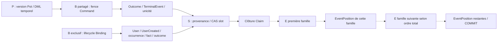

# Étape 3A — Audit du séquencement terminal des Events

Date : 2026-10-19. **AUDIT DOCUMENTAIRE de CURRENT ; modèle E / EventPosition TARGET, NON IMPLÉMENTÉ.**
Baseline exclusive : `4c57e060370912adb8bd615c29f3f0643850549d`, branche `feat/consumption-transaction-protocol`.

## 1. Verdict et statut des conclusions

**FEASIBLE WITH CONDITIONS.** Une autorité transactionnelle E par famille peut, par déduction du code actuel, être acquise après les effets métier, la provenance, le CAS Consumption S et la clôture conditionnelle du Claim, avant le commit physique du même propriétaire. Un échec du suffixe doit faire rollback de toute cette transaction. La finalisation Consumption n'est pas un commit : `FinalizeConsumptionService.finalizeConsumption`, `JpaConsumptionLifecycleAdapter.terminalize`, `ConsumptionOwnerTransactionRunner.runInTransaction` et `SpringTransactionRunner.runInTransaction` établissent cette distinction [C5–C8, C11–C12].

Cette conclusion **ne certifie ni le débit acceptable, ni l'absence générale de deadlock**. E sérialise tous les producteurs d'une même famille ; les transactions en attente de E gardent notamment leurs verrous P/B/S. Les insertions EventPosition et le commit restent dans la section critique. Un suffixe SQL strict et une discipline commune à tous les producteurs, y compris FAILED, recovery et ports auxiliaires, sont nécessaires [C1–C12]. Les preuves PostgreSQL manquantes sont énumérées en §9 ; aucune n'a été exécutée ici.

Convention utilisée partout : **F** = fait lu dans le code ou les migrations de cette baseline ; **D** = déduction statique conditionnelle ; **H** = hypothèse/contrat TARGET à décider ou prouver. Les migrations décrivent le schéma attendu du dépôt, pas un inventaire d'une base déployée. Les références C renvoient en §11 aux fichiers réels et méthodes ; les anciens audits servent de contexte et ne remplacent pas ces sources.

### Sécurité Git et vérification déclarée

**F.** Le checkout de départ n'est pas la baseline : `/Users/julien.guezennec/Dev/projects/pocoma`, `feat/runtime-monolith`, HEAD `90926a5ec37d1ca841e3de017bec0d1f705d8839`, derrière son tracking de deux commits, avec modifications Keycloak/docs/Bruno, un test Expense non suivi, quatre études et des preuves non suivies. Aucun changement n'y est effectué. Le worktree déjà dédié à la branche cible est propre et à la baseline exacte ; c'est exclusivement là que le rapport est écrit. Origin fetch/push : `https://github.com/kartaguez/pocoma.git`. Tracking local cible : divergence `0 0` ; `git ls-remote origin refs/heads/feat/consumption-transaction-protocol` confirme le même SHA distant. Premier accès réseau refusé par résolution DNS dans la sandbox ; seconde lecture autorisée réussie. Aucun fetch, reset, stash, merge, rebase ou checkout.

| Autre worktree inventorié avant écriture | HEAD initial | État préservé |
|---|---|---|
| checkout principal ci-dessus | `90926a5e` | travail local préexistant, non touché |
| `/private/tmp/pocoma-2c-differential-baseline` | `8a79f06d` | détaché, propre |
| `/private/tmp/pocoma-binding-lock-order-guard` | `2eef3ab9` | `fix/binding-lock-order-guard`, propre |
| `/private/tmp/pocoma-expense-context` | `116f4e4a` | `fix/expense-context-version-coherence`, propre |
| `/Users/julien.guezennec/.codex/worktrees/debt-wa6-integration/pocoma` | `2eef3ab9` | détaché, propre |

Règles lues : [AGENTS.md](../../AGENTS.md), [politique normative de vérification](../testing/Reactor_Verification_Policy.md), [index documentaire](../README.md), [gouvernance documentaire](../Documentation_Rationalization_Audit.md#15-gouvernance-documentaire), [validation documentaire](../Documentation_Truth_Validation.md), [Architecture CURRENT](Architecture.md), [garanties CURRENT](../guarantees/System_Guarantees.md), [protocole Consumption](consumption-transactional-execution.md), [index des études](transactional-protocol-studies.md). Ce rapport est une étude explicitement TARGET, pas une modification des garanties CURRENT.

Périmètre déclaré avant écriture : **documentaire uniquement**, impact production/test/migration **NONE**. Surfaces analysées : COMMAND, Registration/Binding et Discovery EVENT/LKV/Results ; **slices de vérification exécutées : NONE**. Gate architecture global **NOT REQUIRED**, reactor complet **NOT REQUIRED et non exécuté**, vérification DB **NONE**, aucun test ni benchmark. Aucun franchissement inattendu de slice. `ARCH-GATE-DATASOURCE` et `ARCH-GATE-AMBIENT-OWNER` restent inchangées, ainsi que P → B → S, les retries et TA/TE/TR/TH.

## 2. Inventaire des producteurs durables

### 2.1 Familles, insertions et identités

Le terme « famille » désigne ici un flux de stockage/identité, pas chaque `event_type`. **H :** le découpage définitif des autorités E reste à décider ; Pot et Expense partagent aujourd'hui l'outbox et sont traités comme une famille BusinessEvent dans cet audit.

| Famille / stockage | Producteur et insertion effective | Identifiant stable et cardinalité | Propriétaire / couverture des chemins |
|---|---|---|---|
| BusinessEvents Pot et Expense / `business_event_outbox` | Services métier §2.2 → `PotCommandInvocation.publish` collecte en mémoire → `ExecuteRecordedCommandService.execute` → `JpaPotCommandEventAppendAdapter.appendAll` → `saveAllAndFlush`, mapping `JpaBusinessEventOutboxEntity` [C1,C2,C20] | UUID `RecordedEvent.eventId`, colonne `id`, généré avant save. Stable pour la ligne committée ; une tentative rollbackée peut générer d'autres UUID. Liste arbitraire au port ; les dix services actuels publient chacun un Event par succès [C1,C21] | TE Command ; succès : append ; rejet : pas d'append ; erreur/CAS perdu : rollback ; retry rejoue une nouvelle TE ; recovery Binding ne rejoue pas Pot [C2,C3,C4] |
| BusinessEvent, port auxiliaire / même table | `JpaBusinessEventOutboxAdapter.append` → `repository.save` [C22] | UUID aléatoire `RecordedEvent.eventId` ; un Event par appel, plusieurs appels possibles | `@Transactional` REQUIRED : rejoint un appelant ou peut ouvrir sa propre transaction. **Aucun appel de production trouvé vers BusinessEventAppendPort.append** à cette baseline ; bean présent, donc surface d'écriture à ne pas oublier, pas un deuxième parcours Command démontré |
| TerminalEvents Command / `command_terminal_events` | `CommandConsumptionExecution.execute` ou `terminalFailureEffect`, recovery → `JdbcCommandOutcomeAdapter.publish` : INSERT strict `command_outcomes` puis INSERT strict terminal Event [C3,C4,C9] | UUID `event_id` généré dans publish ; unique `command_id` limite à un terminal Event par Command. `COMMAND_APPLIED`, `COMMAND_REJECTED`, `COMMAND_FAILED` [C9,M17] | APPLIED/REJECTED dans TE ; FAILED dans TH après rollback TE ; recovery rejet dans TR séparée ; retry non terminal : aucun terminal Event. Même TE réussie : un BusinessEvent courant + un TerminalEvent, donc **deux familles E** |
| Faits Binding / `external_identity_binding_facts` | `JpaExternalIdentityBindingAdapter.acquireWithInitializer` / `detach` → `ExternalIdentityBindingFactJdbcRepository.append` JDBC ; également port explicite `JpaExternalIdentityBindingFactAdapter.append` [C13–C16] | UUID `event_id` ; unique `(issuer,subject,binding_revision)` ; `ATTACHED` / `DETACHED`. Un fait par transition réussie ; pas de fait en conflit / NOT_CURRENT [M20–M23] | MANDATORY, transaction de l'appelant. Registration est l'appelant de production trouvé pour acquireWithInitializer. Aucun appelant de production trouvé pour detach, acquire simple ou le port fact append ; ils restent des producteurs disponibles, sans owner autonome garanti |
| Fait UserCreated / `user_created_facts` | `ExecuteRegistrationService.execute`, initializer sous verrou Binding → `users.create` puis `JdbcUserCreatedFactAdapter.append` INSERT JDBC [C17,C18] | UUID `event_id` ; `request_id` et `user_id` uniques ; un fait sur nouvelle Registration gagnante [M28] | TE Registration ; même transaction que ATTACHED et outcome. Conflit : pas d'initializer, donc aucun UserCreated ni ATTACHED. Outcome déjà présent : retour sans nouvelle émission. Erreur : rollback ; failure/retry ne publie pas de fait [C17,C19] |
| Faits Binding historiques / même table | INSERT SELECT de V22 depuis autorité active ou preuve de cutover [M22] | UUID déterministe MD5 préfixé `pocoma-binding-baseline:` ; révision 0, origine `MIGRATION_BASELINE` | Transaction de migration, sans Consumption. Flux historique à traiter lors d'un cutover E ; aucune migration exécutée ici |

**F. Exhaustivité bornée au dépôt :** recherche dans tous les `app/*/src/main/java` des noms des quatre tables, des ports append/publish, de leurs implémentations et appelants ; recherche des INSERT dans les migrations. Les autres écritures durables identifiées sont les admissions `recorded_commands` / `registration_requests`, autorités User/Binding/versions temporelles, Outcomes, Results, provenance/Slots/Claims, ProjectionTasks, roots/artifacts et index LKV/CURRENT_BINDING. Ce sont intentions, états, travaux ou matérialisations, **pas d'autres familles Event/fact émises par les producteurs actuels** [C23–C27, Architecture CURRENT]. RegistrationOutcome sert directement de source au Result Registration ; il n'existe pas de RegistrationTerminalEvent à cette baseline [C17,C26,M28–M29]. `user_created_facts` n'a pas de Discovery de production trouvé ; sa durabilité suffit à l'inclure dans l'inventaire.

**D.** Le suffixe ne peut s'appuyer exclusivement sur `ConsumptionResult` : Command ne déclare comme résultats que ses BusinessEvents, son TerminalEvent est inséré par un port `void`, et Registration renvoie une liste de résultats vide malgré deux faits. Il faudra connaître tous les UUID effectivement insérés dans la transaction, sans générer une nouvelle identité lors de l'association [C1,C3,C9,C17–C19].

### 2.2 Catalogue exhaustif des événements métier

**F.** Le catalogue `PocomaEventTypes.all` et le switch `BusinessEventRecordMapper.eventFrom` couvrent ces dix types. Tous aboutissent au même point SQL C1 ; les variantes Shareholders produisent un Event contenant l'ensemble des IDs, pas un Event par shareholder. Les services collectent un Event après mutation réussie [C20,C21].

| Type | Service / méthode productrice | Écritures métier avant collecte |
|---|---|---|
| POT_CREATED | `CreatePotService.createPot` | nouvelle version globale, metadata, header initial |
| POT_DELETED | `DeletePotService.deletePot` | CAS P, metadata, remplacement header |
| POT_DETAILS_UPDATED | `UpdatePotDetailsService.updatePotDetails` | CAS P, metadata, remplacement header |
| POT_SHAREHOLDERS_ADDED | `AddPotShareholdersService.addPotShareholders` | CAS P, metadata, nouvelles relations |
| POT_SHAREHOLDERS_DETAILS_UPDATED | `UpdatePotShareholdersDetailsService.updatePotShareholdersDetails` | CAS P, metadata, fermeture/remplacement relations |
| POT_SHAREHOLDERS_WEIGHTS_UPDATED | `UpdatePotShareholdersWeightsService.updatePotShareholdersWeights` | CAS P, metadata, fermeture/remplacement relations |
| EXPENSE_CREATED | `CreateExpenseService.createExpense` | CAS P, metadata, header Expense, shares initiales |
| EXPENSE_DELETED | `DeleteExpenseService.deleteExpense` | CAS P, metadata, remplacement header Expense |
| EXPENSE_DETAILS_UPDATED | `UpdateExpenseDetailsService.updateExpenseDetails` | CAS P, metadata, remplacement header Expense |
| EXPENSE_SHARES_UPDATED | `UpdateExpenseSharesService.updateExpenseShares` | CAS P, metadata, fermeture/remplacement shares |

La liste est une cardinalité du code courant, pas une limite contractuelle : `appendAll` et `PotCommandInvocation` autorisent plusieurs Events de même famille. Une transaction appelant plusieurs ports Binding peut aussi produire plusieurs faits ; aucun worker courant ne boucle sur plusieurs transitions d'autorité Binding dans une même TE [C1,C13,C20].

## 3. Transactions et points de commit

| Frontière | Ordre Java et barrières SQL établies | Commit physique / effet sur E TARGET |
|---|---|---|
| TA Acquire/Takeover | insert slot si absent → `findByKeyForUpdate` S → invalidation Claim expiré → `saveAndFlush` nouveau Claim → installClaim ; clôture d'acquisition [C6–C8] | Retour du TransactionTemplate propriétaire après commit confirmé. Aucun Event produit ; aucune E nécessaire |
| TE Command succès | reload commande → observation Binding sans lock → decode/dispatch/validations → P → DML temporel → collecte → appendAll/flush → B partagé + revalidation → outcome/terminal JDBC → provenance JPA → flush/CAS S → clôture Claim [C1–C3,C5–C10,C14,C28–C30] | TransactionalExecuteConsumptionUseCase via owner ; E pourrait suivre la clôture, toujours dans TE |
| TE Command rejet | pas de BusinessEvent ; B si observation valide et chemin exigeant fence ; outcome REJECTED + terminal JDBC → provenance éventuelle → S → Claim [C2,C3] | Même propriétaire ; E TerminalEvent seulement. Identité déjà absente : ni P ni B acquis |
| TE erreur / CAS Pot perdu / fence perdu | exception remonte ; effets déjà SQL et état ORM annulés [C2,C28,C31] | Rollback TE avant classification/recovery ; aucun Event/position durable ni avancement E |
| TR recovery Binding | après rollback TE : relire Binding exact ; encore présent → conflit technique ; absent → exécution participante qui publie REJECTED/terminal, puis suffixe commun S/Claim [C4,C23] | Nouveau `transactions.runInTransaction` propriétaire ; E TerminalEvent devrait couvrir cette transaction aussi, sans rejouer P |
| TH failure terminale | policy FAIL → finalizer : terminalFailureEffect publie FAILED/outcome/terminal → provenance éventuelle → S/Claim [C3,C5,C10,C23] | Nouvelle transaction après rollback TE. E TerminalEvent après clôture uniquement |
| TH retry | policy RETRY_AFTER → CAS scheduleRetry S → fail/close Claim [C6,C10] | Nouveau commit, sans Event ; aucune réservation E. Retry Consumption existant inchangé |
| TE Registration | requête + outcome existant → B exclusif → initializer User/UserCreated → occurrence → actif Binding → advance révision → ATTACHED → outcome JDBC → provenance → S/Claim [C13,C17–C19,C24] | Owner Registration ; deux familles fact à associer après S/Claim. Rejet/existing outcome n'ajoutent aucun fait |
| Ports auxiliaires BusinessEvent / Binding | save JPA REQUIRED / DML JDBC MANDATORY [C13,C15,C22] | Fin de la transaction appelante ; pour BusinessEvent autonome fin proxy. Pas de point universel après Consumption quand il n'y a pas de Consumption ; couverture à définir explicitement |
| Discovery / matérialisation aval | lit Events committés, produit Task/Result/vue dans d'autres transactions Consumption [C25–C27,C32] | Ne partage pas le commit du producteur ; la future découverte doit conserver cette indépendance |

**F.** `SpringTransactionRunner.runInTransaction` appelle `TransactionTemplate.execute`; l'action participante retourne avant la résolution physique. L'owner interdit une transaction/synchronisation ambiante et observe `afterCompletion`. APPLIED participant n'est pas un acquittement public durable. COMMITTED/UNKNOWN/ROLLED_BACK restent distingués ; ajouter E ne permet pas de rejouer automatiquement après un commit inconnu [C11,C12,C23,C31].

### Java ≠ SQL

**F.** Le CAS P (`JpaPotGlobalVersionRepository.updateIfActive`) et les fermetures temporelles utilisent `@Modifying(flushAutomatically=true)` ; certaines opérations nettoient aussi le contexte JPA. `save` / `saveAll` des nouveaux headers/shares/provenance ne prouvent pas un INSERT immédiat. `JpaPotCommandEventAppendAdapter.appendAll` utilise `saveAllAndFlush` : le flush porte sur le contexte de persistance et constitue une barrière avant B pour les écritures métier en attente, pas une promesse d'ordre des INSERT de chaque entité. P nouveau utilise `saveAndFlush` puis INSERT metadata [C1,C28–C30].

**F.** Les publications outcome/terminal, UserCreated et Binding sont des appels JDBC synchrones, dans leur ordre d'appel. Leur exécution ne prouve pas qu'un `save` JPA antérieur a été flushé. Ici User est lui-même inséré par JDBC avant son fait. La provenance JPA `saveAll` est flushée par le CAS S `@Modifying(flushAutomatically=true,clearAutomatically=true)` ; la clôture Claim applique la même barrière. `clearAutomatically` détache les entités, sans commit ni libération des verrous [C7–C9,C13,C17,C18,C33].

**D.** Une barrière finale `flush` après clôture et avant E est réalisable, mais doit surtout prouver l'absence d'écritures résiduelles. Elle ne remplace pas les barrières avant P/B/S, et ne permet pas de reporter outcome, provenance ou clôture après E. Le flush au commit existe toujours ; il doit alors être vide de métier, ou ne contenir que les associations explicitement attendues. Aucun listener JPA ni callback `beforeCommit` métier trouvé par recherche de `PrePersist/PostPersist/EntityListeners/beforeCommit/beforeCompletion`. Les synchronisations observées concernent la résolution transactionnelle et la métrique LKV, pas un producteur caché d'Events [C11,C12,C34]. Cela reste un contrat à protéger lors d'une évolution.

### Contraintes, validations et verrous implicites

| Ressource | Faits du schéma/code et effet sur le suffixe |
|---|---|
| P / temporalité | CAS version globale exactement un ; metadata PK `(pot_id,version)` et trigger empêchant sa mutation ; fermeture de header exactement un, shares exactement le nombre lu ; validations de versions/préconditions et autorisation avant émission [C28–C30,M1,M11]. Verrous DML conservés au commit |
| BusinessEvent | PK UUID ; CHECK du type canonique V15 ; V2 n'ajoute pas de FK de l'outbox vers Pot, ni unicité par version. Les colonnes status ne sont pas l'autorité de Consumption actuelle [C1,M2,M15,C25] |
| Command | outcome PK/FK recorded command ; terminal PK UUID, unique command_id, FK outcome ; INSERT strict sans ON CONFLICT. Une tentative stale peut donc attendre l'unicité avant d'atteindre S [C9,M17] |
| Binding | PK stream `(issuer,subject)` ; occurrence PK binding_id et unicités `(issuer,subject,attached_revision)` / composite ; FK occurrence → stream/User ; actif et fait → occurrence composite ; fait unique révision et FK stream/User ; contraintes type/origine V23. Réservation occurrence ON CONFLICT avec jusqu'à huit UUID ; sous B et avant E [C13–C16,M20–M23] |
| Registration | UserCreated PK event_id, request et user uniques/FK ; outcome PK request et FK User/occurrence ; triggers immutables avant UPDATE/DELETE [C17,C18,M28] |
| S / Claim / provenance | unicité clé structurelle JSONB du slot ; FK Claim → slot, slot → Claim courant composite ; unique tentative par slot ; FK Input/Result → slot et unicité Input ; CAS status PENDING/currentClaim puis clôture conditionnelle exactement un [C5–C8,C33,M4] |

**D.** FK et unicité peuvent provoquer des attentes avant les locks explicitement nommés. Une FK provenance peut prendre une protection du slot avant le CAS terminal ; elle n'élit pas le gagnant. Les tests existants `CommandConsumptionPostgresTest.characterizeOutcomeSlotWait` et `TransactionalConsumptionExecutionPostgresTest` examinent certaines files, mais ne connaissent pas E [C35,C36].

**F.** Aucune contrainte `DEFERRABLE` trouvée dans les migrations PRIMARY auditées. Le store READ possède une FK `deferrable initially deferred` entre root/artifact (migration READ V5) : cela ne justifie pas de la transposer aux producteurs PRIMARY [MRead5]. **H.** Une future FK EventPosition différée déplacerait sa validation sous E/au commit ; il faut éviter de la présumer sans coût. Flush réussi, CAS réussi et clôture réussie ne garantissent jamais seuls que le commit physique réussira.

## 4. Suffixe terminal E : faisabilité et conditions

Suffixe logique TARGET, **pas un chemin existant** :

```text
BEGIN TE / TR / TH propriétaire existante
  P éventuel → mutations / BusinessEvents flushés
  B éventuel → Outcome / TerminalEvent ou facts
  provenance → flush → CAS S → clôture Claim
  flush final complet, aucune nouvelle décision métier
  pour chaque famille émettrice dans un ordre total commun :
    E transactionnelle : avancer de n et obtenir [ancienne+1, ancienne+n]
    insérer n EventPosition référençant les Events déjà insérés
  COMMIT physique ; acquittement uniquement après confirmation
```

**D.** La frontière physique actuelle permet ce suffixe sans déplacer P/B/S ni changer TA/TE/TR/TH. Il ne peut pas être branché dans le callback métier actuel, qui s'exécute avant S ; ni dans `runAfterCommit`, qui serait trop tard ; ni seulement après retour du wrapper transactionnel, qui a déjà committé. Une future intégration devrait être intérieure au propriétaire physique, après le finalizer participant, avec couverture identique Execute/Failure/recovery [C4–C6,C10–C12,C23,C24]. Ce constat n'autorise aucune implémentation.

Conditions minimales **H** :

1. Même connexion/base/transaction pour Event, E, EventPosition et finalisation ; aucune transaction autonome ni `REQUIRES_NEW` ; les dettes de wiring ne sont pas corrigées par cet audit.
2. Ensemble complet des Events effectivement insérés connu avant E, stable après la barrière ; familles vides ignorées. Les UUID TerminalEvent et facts doivent rester accessibles à l'association, malgré les ports `void` et le clear JPA [C9,C13,C18].
3. Aucune relecture métier, validation d'autorisation, CAS P/B/S, clôture Claim ou publication annexe après la première E. Préparer en mémoire les associations avant acquisition ; aucun accès externe sous E.
4. Toutes les E prises dans **un ordre total commun**, y compris celles qui ne sont pas émises ensemble aujourd'hui. Regrouper n positions par famille ; ordre interne des Events explicite, sans déduire un ordre des flushs ORM.
5. Échec/timeout/unicité/FK/commit dans ce suffixe ⇒ rollback intégral. Préserver la classification et la reprise Consumption existantes ; COMMITTED/UNKNOWN n'autorisent pas une nouvelle émission aveugle [C11,C31].
6. Couverture des ports auxiliaires et migration/cutover explicite ; ne jamais annoncer « tous Events séquencés » tant qu'un writer peut insérer sans association.

**D. Preuve logique de continuité conditionnelle.** Pour une famille, supposons E=q et les positions committées exactement 1…q. Une transaction exclusive réserve n, insère exactement q+1…q+n et garde E jusqu'à résolution. Si rollback, ni ces positions ni q+n ne sont durables ; le suivant repart de q. Si commit, le suivant ne peut attribuer au-delà qu'après résolution du détenteur. Par induction les positions committées restent consécutives ; une transaction plus lente ayant commencé avant peut recevoir une position plus haute. Cet ordre est un ordre de sérialisation à E, **pas l'heure de création, l'ordre de début TE, ni un ordre global entre familles**. Il suppose zéro writer hors protocole, zéro suppression et zéro réservation non transactionnelle. Aucune séquence/identity PostgreSQL ne doit être supposée remplir ce contrat de rollback ; la preuve attendue porte sur une ligne d'autorité transactionnelle, sans choisir ici son implémentation SQL.

## 5. Graphe des verrous et interleavings

Arêtes : « détenir la ressource de gauche puis demander celle de droite ». Graphe partiel établi par les méthodes citées, complété en pointillé pour TARGET :



TA possède séparément `S FOR UPDATE → Claim` puis commit sans P/B/E. TH FAILED et TR possèdent `Outcome/TerminalEvent → provenance/S → Claim`, sans P. B partagé et exclusif sont des modes sur la même autorité stream ; Command `fenceExact` fait **FOR SHARE puis un SELECT distinct**, pas l'ancien UPDATE no-op [C14]. Une version historique d'un audit peut donc décrire un graphe dépassé.

| Interleaving | Qualification / conclusion |
|---|---|
| E puis P/B/S par les producteurs CURRENT | **Impossible actuellement : E n'existe pas.** Dans la cible stricte §4, interdit par construction ; un callback métier ou flush sale sous E réintroduirait l'arête inverse. Pas de preuve runtime aujourd'hui |
| Appender BusinessEvent prend E dans appendAll, puis Command demande B/S | **Risque démontré par l'ordre des appels si cette intégration naïve était choisie** : C1 retourne avant fence B et C3/C5 ; un autre producteur tenant B/S et attendant E fermerait un cycle. Donc E ne doit pas vivre dans l'append immédiat [C1–C3,C13] |
| Registration prend E UserCreated dans initializer, puis occurrence/actif/Binding fact/S | **Risque structurel démontré pour ce placement hypothétique** : l'initializer n'est pas terminal ; il précède encore plusieurs DML. Une future autre transaction pourrait apporter l'arête inverse [C13,C17]. Reporter toutes E après finalisation |
| Command T1 tient P/B/S, attend E tenue par Command T2 | **Attente certaine possible dans la cible**, même pour Pots/slots distincts. Si T2 n'attend plus aucune ressource de T1, pas de cycle entre ces seuls producteurs ; propagation de contention réelle vers P/B/S |
| T1 tient E_business et attend E_terminal ; T2 tient E_terminal et attend E_business | **Deadlock théorique certain pour cet ordre inversé** ; aucune E CURRENT. Command réussie demande deux familles ; ordre total obligatoire. Registration demande E_user et E_binding : même exigence [C1,C3,C17] |
| E puis FK EventPosition vers Event créé par la même transaction | **D :** parent déjà inséré/flushé par cette transaction, pas de parent concurrent à attendre dans le parcours normal. La forme SQL/FK reste H et doit être éprouvée. Ne pas ajouter sous E des FK vers des parents non stabilisés ou un registre partagé mutable |
| E puis conflit unique d'association / parent d'une autre transaction | **Risque théorique** pour replay incohérent, writer contournant E, mauvais UUID ou migration simultanée. L'unicité doit échouer et rollback ; ne pas la masquer en consommant quand même une position. Aucun cas démontré sans schéma EventPosition |
| E puis lock table/DDL, validation différée ou commit lent | **Risque résiduel** même avec suffixe applicatif strict. L'ordre P/B/S/E ne borne pas ces attentes. À prouver sur PostgreSQL ; pas d'affirmation d'absence générale de deadlock |
| Worker stale bloqué sur outcome/unicité avant S | **F :** chemin existant [C9,C35]. Avec E terminale il attend avant E ; il peut perdre S ensuite et rollback sans attribuer. Prendre E avant outcome transformerait cette attente en rétention globale E |
| Takeover TA attend S tenu par TE qui attend E | **D :** chaîne de blocage supplémentaire possible ; TA n'acquiert aucune E et ne crée pas seul le retour de cycle [C6–C8]. L'expiration de lease ne libère pas les verrous TE |
| Command partagé B face à Registration/lifecycle exclusif B | **F :** sérialisation sur stream avant E. Aucun appelant runtime Binding lifecycle ne prend P après B dans le code trouvé ; ne pas inventer un cycle B→P courant. Extensions futures multi-B/multi-P restent hors preuve [C13,C14,C17] |

**D.** Avec tous les verrous applicatifs potentiellement conflictuels acquis avant la première E et un ordre commun entre E, on élimine les cycles applicatifs **ajoutés par E** entre ces producteurs. On ne prouve ni que le préfixe actuel est universellement sans deadlock, ni que FK/index/DDL/commit sont sans attente. Les preuves 2C et tests existants sont bornés aux scénarios sans E [C35,C36].

## 6. Contention et coût résiduel

**D, sans chiffre de performance :**

- Pour n Events d'une famille : n INSERT EventPosition supplémentaires et une mise à jour de l'autorité E pour le lot ; acquisition/lecture/RETURNING dépend de l'option SQL non choisie. Chaque association alimente au moins les index de position et d'identité Event ; coût WAL, FK et contraintes en plus. Une ligne E précréée évite un bootstrap concurrent dans le chemin chaud ; ce choix reste H.
- Sous E restent obligatoires les associations, leurs vérifications FK/unicité, les index, l'éventuelle acquisition d'autres E et la résolution du commit physique. Une JPA `saveAll` sans flush explicite peut repousser les associations au commit et ne réduit pas la section critique.
- Les n positions d'une transaction peuvent être attribuées en un bloc contigu ; cela amortit l'autorité, mais augmente le travail d'insertion sous verrou et la taille du rollback. Le protocole doit refuser le lot entier si une association échoue.
- Une transaction ralentie après E bloque tous les producteurs de cette famille, même sans Pot ou Binding commun. Si elle détient plusieurs E, elle propage le blocage à plusieurs familles. Les transactions qui attendent E gardent P/B/S : retarder E minimise sa rétention propre, **pas la rétention des autres autorités** [C6,C13,C28].
- La sérialisation globale par famille est compatible avec un suffixe court ; son acceptabilité sous la charge réelle est **INCONNUE**. Aucun débit, percentile ni seuil de contention n'est déduit du code. Le suffixe retire les décisions métier et les principales attentes applicatives de la section E, pas le coût incompressible du commit.

## 7. Contraintes minimales du modèle EventPosition

Ce sont des **H nécessaires à la garantie**, pas une migration proposée :

| Contrat minimal | Justification |
|---|---|
| Identité de famille non ambiguë ; position entière positive avec politique d'overflow | Une E et un espace de positions par famille ; incrément borné/exact ; ne pas confondre avec PotVersion ou BindingRevision [C20,C28,C14] |
| unicité `(famille,position)` et `(famille,event_id)` ; non-null ; association immuable | Une place par Event, un Event par place ; retries ne changent pas la position d'un Event déjà committé |
| Référence vérifiable vers l'Event existant ; insertion atomique et complète | Les tables sont hétérogènes. Une simple paire polymorphe famille/UUID n'est pas une FK SQL vers quatre tables. Forme relationnelle à décider ; ne pas prétendre qu'une FK générique existe |
| E=q ⇔ associations committées du périmètre = préfixe complet jusqu'à q | Unicités et FK seules ne prouvent ni continuité ni couverture Event→Position ; obligation de protocole pour tous les writers, y compris rollback partiel/savepoint et port auxiliaire |
| Lot exact de n nouvelles identités ; erreur de doublon ⇒ rollback complet | ON CONFLICT DO NOTHING après réservation laisserait une position sans association. Même exigence sur savepoint : ne pas conserver l'avance E si l'association est annulée |
| Association→Event immuable / suppression contrôlée | Un purge/cascade peut transformer une continuité logique en trou historique. Aucune rétention/purge n'est décidée ici |
| Pas d'obligation nouvelle Event→Position différée qui attendrait un autre producteur | Préférer le parent déjà inséré dans la transaction ; effets de la forme définitive à prouver |
| Cutover des données préexistantes et des migrations explicite | V22 crée déjà des faits historiques ; leur position ne peut être déduite rétroactivement d'un ordre de commits inconnu. Définir périmètre initial/curseur et unicité des writers pendant bascule [M22] |

Le DurableEvent n'a pas besoin de porter la position. **D :** les UUID relationnels existants suffisent comme identités d'association, une fois capturés dans le contexte transactionnel ; modifier le payload JSON ou remplacer les identités des événements serait inutile à ce contrat [C1,C9,C16,C18].

## 8. Contrat de Discovery et limites

**F. CURRENT :** Event→Projection découvre les métadonnées relationnelles de l'outbox, route par type, exclut les slots DONE via JSONB et ordonne `(recorded_at,event_id,projection_type)`. LKV joint slots/claims et ordonne `(version,created_at,id)` ; Command Result fait de même depuis les TerminalEvents et ordonne `(recorded_at,event_id)` ; Binding ordonne `(issuer,subject,revision)` et déclare ses curseurs locaux à l'invocation. `ProjectionMaterializationConsumptionSource.openSearch` redémarre avec curseur vide [C25–C27,C32,C37]. Ces curseurs ne sont pas des positions de commit et ne peuvent être rendus durables tels quels sans preuve contre les commits tardifs.

**H/D. Lecture ciblée possible :** avec index B-tree `(famille,position)`, lire une plage `famille=f AND position>curseur ORDER BY position LIMIT lot` donne une découverte ordonnée et bornée des nouvelles associations, indépendante du statut Consumption. Aucun scan de tous les Events passés n'est nécessaire **pour trouver de nouvelles positions après initialisation**. Le plan réel, les filtres et la sélectivité restent à vérifier : LIMIT borne les lignes retournées, pas automatiquement le travail de filtrage.

**D. Absence de trou invisible conditionnelle :** un lecteur ne peut voir q+2 committé tandis que q+1 serait encore non résolu si les deux attributions passent par la même E tenue jusqu'au commit. En rollback le numéro est réutilisable par la prochaine transaction. Une lecture sur primaire avec snapshot cohérent voit un préfixe éventuellement ancien, pas une promesse d'instantanéité. E seule ne rend pas atomiques plusieurs requêtes Discovery dans différents snapshots ni les curseurs de familles différentes.

**Point déterminant : EventPosition ne suffit pas seule à une Discovery durable indépendante de Consumption.** Un curseur sauvegardé après simple lecture puis crash perdrait le travail non enregistré. Deux possibilités contractuelles, sans choisir une matérialisation supplémentaire : conserver le curseur tant que les conséquences ne sont pas durablement prises en charge, ou atomiser progression du curseur avec enregistrement durable de tous les travaux/identités de consommation découverts. Dans les deux cas, après crash avant commit de découverte on relit le lot ; après commit on retrouve le travail à exécuter. Les clés Consumption/idempotence existantes doivent absorber la relecture [C6–C8,C32,M4]. Si la seule prise en charge durable reste la réussite du consommateur, la progression reste couplée à cette réussite : ce n'est pas la garantie demandée.

**H.** Les retries/backlogs antérieurs au curseur doivent rester sélectionnables indépendamment du parcours des nouvelles positions ; ne pas supprimer les joins d'éligibilité actuels sans remplacement démontré. La découverte peut avancer malgré un échec de Consumption seulement si cette tentative et ses reprises ne deviennent pas inaccessibles. Le mécanisme précis reste une question d'architecture, pas une recommandation de matérialisation.

### Informations relationnelles minimales

- **Strict minimum d'association :** famille, position, UUID Event. Un accès ponctuel à la table Event fournit ses métadonnées sans scan historique.
- **Pour Discovery sans jointure au parent :** type/routage et segmentation nécessaires au consommateur ; BusinessEvent : type, PotId/target, version, hash de partition ; TerminalEvent : CommandId, hash et éventuellement type ; Binding : identité stream, révision et partition ; UserCreated : request/user si une route est définie. Ces informations existent déjà relationnellement dans les tables parentes [C1,C9,C16,C18,C25–C27]. Les copier est optionnel, avec obligation de cohérence, pas une nécessité d'EventPosition.
- **Pour éviter JSONB :** une position ne remplace pas la clé structurelle Consumption ni son éligibilité/retry. Une réduction des joins slots/claims et `jsonb_build_array` exige un contrat de prise en charge Discovery. Elle n'est pas obtenue automatiquement en ajoutant l'association.
- **Fan-out et évolution :** un Event peut router vers plusieurs ProjectionTypes ; n'avancer qu'après prise en charge de toutes les routes concernées, ou conserver un sous-curseur déterministe. Un nouveau consommateur/une nouvelle route peut nécessiter un replay dédié depuis un curseur antérieur ; « pas de scan historique » ne supprime pas cette exigence fonctionnelle [C25,C32]. Une modification de segmentation nécessite aussi une stratégie explicite de curseur/reprise.

**F/D.** La discovery actuelle lit déjà des métadonnées sans décoder le payload JSON BusinessEvent ; `payload_json` est un TEXT en V2. EventPosition ne doit donc pas être crédité d'une réduction de lectures JSONB métier inexistantes dans ces requêtes. Le gain potentiel concerne la pagination par position et les jointures JSONB d'éligibilité, selon le futur contrat ; le reload métier/Outcome nécessaire à la consommation reste distinct [C25–C27,M2].

## 9. Preuves expérimentales PostgreSQL restant nécessaires

Aucune de ces expériences n'est exécutée ni implémentée dans cette étape. Les scénarios portent sur la forme SQL définitive, pas sur une simulation Java de E.

| Preuve à obtenir | Propriété / observation attendue |
|---|---|
| Deux producteurs même famille, commits et rollbacks alternés, transaction commencée tôt mais arrivée tard à E | Préfixe consécutif visible, aucune avance E durable sans associations, blocage du second jusqu'à résolution du premier |
| Succès Command, rejet, FAILED TH, recovery TR ; claim perdu et refus de clôture | Tous UUID couverts ; aucune E avant clôture ; rollback commun Events/provenance/S/Claim/E/positions ; budget retry et états de résolution conservés |
| Deux Command sur Pots distincts/Binding commun ou distinct, Command face à Registration/lifecycle | Capturer SQL réel et `pg_locks`/bloqueurs ; prouver absence de nouveau DML métier après E et qualifier propagation P/B/S pendant attente E |
| Deux familles par transaction, ordres d'arrivée opposés, lot de plusieurs Events | Ordre total effectif des E ; absence du cycle E1/E2 ; intervalle exact du lot ; échec d'une association annule tout |
| FK/unicité EventPosition : parent propre, parent concurrent, doublon, savepoint et DDL concurrent | Identifier attentes sous E, locks de ligne/table/index et rollback ; ne pas assimiler FK vers parent propre à tous les cas |
| Échec après CAS S/Claim, pendant E, associations et commit ; résolution inconnue | Aucun état partiellement durable ; aucune réémission automatique sur UNKNOWN/COMMITTED |
| Crash Discovery avant/après prise en charge durable et curseur, route multiple, échec Consumption puis reprise | Ni perte au-delà du curseur ni dépendance à la réussite Consumption ; replay idempotent et backlog toujours accessible |
| EXPLAIN du parcours position avec lots et filtres/segmentation représentatifs | Parcours indexé ; distinguer lignes retournées et lignes parcourues ; pas de scan historique pour l'incrémental |

Ces preuves de correction et de plans ne constituent pas un benchmark requis ici. Une mesure de contention peut être décidée ultérieurement pour qualifier l'acceptabilité opérationnelle ; le code seul ne la fournit pas. Les tests existants C35/C36 et les rapports 2B/2C ne contiennent pas E et ne prouvent donc pas ces propriétés futures.

## 10. Vérification de livraison et questions ouvertes

Commandes réellement utilisées pour cet audit : `pwd`, `git status --short --branch` (worktrees), `git rev-parse HEAD`, `git remote -v`, `git branch -vv`, `git worktree list --porcelain`, `git rev-list --left-right --count HEAD...origin/feat/consumption-transaction-protocol`, `git ls-remote origin refs/heads/feat/consumption-transaction-protocol` ; recherches `rg --files` / `rg -n`, lectures `cat` / `sed`, tri de l'inventaire avec `cut` / `sort`. Contrôle documentaire de livraison : validation Python des liens locaux et des marqueurs de références, `git diff --check`, contrôle de la liste des fichiers, puis ajout explicite du seul rapport, commit documentaire et push non forcé `git push origin HEAD:refs/heads/feat/consumption-transaction-protocol`. Le SHA de livraison et le résultat du push sont communiqués avec la livraison ; ils ne sont pas utilisés comme baseline d'analyse.

Impact attendu/observé : ce seul rapport sous `docs/architecture/`. Slices exécutées **NONE** ; franchissement inattendu **NONE** ; gate global **NOT REQUIRED**, non exécuté ; full reactor **non exécuté**, car audit documentaire sans code, test ou dépendance modifié ; DB/migrations **NONE**. La vérification statique ne revendique aucun nouveau PASS PostgreSQL. Le périmètre de commit est contrôlé avant push ; aucun index/README ni ancien rapport n'est modifié.

**Verdict final : FEASIBLE WITH CONDITIONS**, pour l'atomicité et le placement terminal dans les propriétaires existants ; acceptabilité de contention encore non démontrée. La continuité est conditionnée à l'exhaustivité des writers et du lot, au rollback intégral, à l'ordre total des E et à une section après E ne contenant que associations/contraintes/commit. Discovery incrémentale est rendue possible, mais sa reprise indépendante de Consumption nécessite un contrat supplémentaire de prise en charge durable ; EventPosition seule ne le fournit pas.

Questions architecturales à trancher, **sans déclencher d'implémentation** :

1. Quelles familles exactes partageront une E (notamment Pot/Expense), et quel ordre total s'appliquera aux transactions multi-familles ?
2. Où sera garanti le suffixe commun aux TE/TH/TR et aux ports auxiliaires sans changer leurs frontières physiques ni déplacer P/B/S ? Quels writers seront autorisés ?
3. Comment capturer exhaustivement les UUID insérés, y compris TerminalEvent et facts non présents dans ConsumptionResult, et fixer l'ordre interne d'un lot ?
4. Quelle intégrité relationnelle EventPosition→Event choisir entre tables hétérogènes, et comment garantir aussi la couverture Event→Position sans DML conflictuel différé sous E ?
5. Quel périmètre initial/cutover pour les Events historiques, quels droits de suppression/rétention et quelle politique d'overflow ?
6. Quelle opération rend la découverte durable avant progression du curseur, indépendamment du résultat Consumption, et comment préserver retries, fan-out, nouvelles routes et resegmentation ?
7. Quelles métadonnées relationnelles sont réellement nécessaires sans jointure parent, et quelle preuve de contention sera jugée suffisante avant une décision d'implémentation ?

## 11. Sources de code à la baseline

Chaque référence ci-dessous désigne le fichier à la baseline indiquée en tête, avec la méthode ou l'objet SQL effectivement examiné. Les liens relatifs sont navigables dans le dépôt. Aucun résultat d'exécution n'est déduit de la seule présence d'un test.

- <a id="c1"></a>**C1** — [JpaPotCommandEventAppendAdapter.java](../../app/infra-persistence-primary-jpa/src/main/java/com/kartaguez/pocoma/infra/persistence/primary/jpa/adapter/outbox/JpaPotCommandEventAppendAdapter.java) — `appendAll / artifact : UUID, saveAllAndFlush, MANDATORY`.
- <a id="c2"></a>**C2** — [ExecuteRecordedCommandService.java](../../app/engine-consume-command/src/main/java/com/kartaguez/pocoma/engine/consume/command/execution/ExecuteRecordedCommandService.java) — `execute / fence : ordre append puis Binding`.
- <a id="c3"></a>**C3** — [CommandConsumptionExecution.java](../../app/engine-consume-command/src/main/java/com/kartaguez/pocoma/engine/consume/command/consumption/CommandConsumptionExecution.java) — `execute / terminalFailureEffect : APPLIED, REJECTED, FAILED`.
- <a id="c4"></a>**C4** — [BindingFenceRecoveryExecuteUseCase.java](../../app/engine-consume-command/src/main/java/com/kartaguez/pocoma/engine/consume/command/consumption/BindingFenceRecoveryExecuteUseCase.java) — `execute : rollback TE avant recovery propriétaire`.
- <a id="c5"></a>**C5** — [FinalizeConsumptionService.java](../../app/engine-consumption/src/main/java/com/kartaguez/pocoma/engine/service/consumption/FinalizeConsumptionService.java) — `finalizeConsumption : effet, provenance, terminalize`.
- <a id="c6"></a>**C6** — [JpaConsumptionLifecycleAdapter.java](../../app/infra-persistence-primary-jpa/src/main/java/com/kartaguez/pocoma/infra/persistence/primary/jpa/adapter/consumption/JpaConsumptionLifecycleAdapter.java) — `acquire / terminalize / scheduleRetry / closeClaim`.
- <a id="c7"></a>**C7** — [JpaConsumptionSlotRepository.java](../../app/infra-persistence-primary-jpa/src/main/java/com/kartaguez/pocoma/infra/persistence/primary/jpa/repository/consumption/JpaConsumptionSlotRepository.java) — `findByKeyForUpdate / terminalize / scheduleRetry / installClaim`.
- <a id="c8"></a>**C8** — [JpaConsumptionClaimRepository.java](../../app/infra-persistence-primary-jpa/src/main/java/com/kartaguez/pocoma/infra/persistence/primary/jpa/repository/consumption/JpaConsumptionClaimRepository.java) — `invalidateForTakeover / end / fail`.
- <a id="c9"></a>**C9** — [JdbcCommandOutcomeAdapter.java](../../app/infra-persistence-primary-jpa/src/main/java/com/kartaguez/pocoma/infra/persistence/primary/jpa/adapter/command/JdbcCommandOutcomeAdapter.java) — `publish : INSERT outcome puis terminal Event`.
- <a id="c10"></a>**C10** — [HandleConsumptionFailureService.java](../../app/engine-consumption/src/main/java/com/kartaguez/pocoma/engine/service/consumption/HandleConsumptionFailureService.java) — `handle : FAIL vs RETRY_AFTER`.
- <a id="c11"></a>**C11** — [ConsumptionOwnerTransactionRunner.java](../../app/composition-runtime-spring/src/main/java/com/kartaguez/pocoma/runtime/consumption/ConsumptionOwnerTransactionRunner.java) — `runInTransaction : guard et afterCompletion`.
- <a id="c12"></a>**C12** — [SpringTransactionRunner.java](../../app/infra-tx-spring/src/main/java/com/kartaguez/pocoma/infra/tx/spring/SpringTransactionRunner.java) — `runInTransaction / runAfterCommit`.
- <a id="c13"></a>**C13** — [JpaExternalIdentityBindingAdapter.java](../../app/infra-persistence-primary-jpa/src/main/java/com/kartaguez/pocoma/infra/persistence/primary/jpa/adapter/identity/JpaExternalIdentityBindingAdapter.java) — `acquireWithInitializer / detach / fenceObservedBinding`.
- <a id="c14"></a>**C14** — [ExternalIdentityBindingStreamJdbcRepository.java](../../app/infra-persistence-primary-jpa/src/main/java/com/kartaguez/pocoma/infra/persistence/primary/jpa/repository/identity/ExternalIdentityBindingStreamJdbcRepository.java) — `lock / fenceExact / advance`.
- <a id="c15"></a>**C15** — [JpaExternalIdentityBindingFactAdapter.java](../../app/infra-persistence-primary-jpa/src/main/java/com/kartaguez/pocoma/infra/persistence/primary/jpa/adapter/identity/JpaExternalIdentityBindingFactAdapter.java) — `append : port fact participant`.
- <a id="c16"></a>**C16** — [ExternalIdentityBindingFactJdbcRepository.java](../../app/infra-persistence-primary-jpa/src/main/java/com/kartaguez/pocoma/infra/persistence/primary/jpa/repository/identity/ExternalIdentityBindingFactJdbcRepository.java) — `append : SQL APPEND`.
- <a id="c17"></a>**C17** — [ExecuteRegistrationService.java](../../app/engine-consume-registration/src/main/java/com/kartaguez/pocoma/engine/consume/registration/ExecuteRegistrationService.java) — `execute : initializer et outcome existant`.
- <a id="c18"></a>**C18** — [JdbcUserCreatedFactAdapter.java](../../app/infra-persistence-primary-jpa/src/main/java/com/kartaguez/pocoma/infra/persistence/primary/jpa/adapter/registration/JdbcUserCreatedFactAdapter.java) — `append : UUID et INSERT fact`.
- <a id="c19"></a>**C19** — [RegistrationConsumptionLocator.java](../../app/supra-consume-registration/src/main/java/com/kartaguez/pocoma/supra/consume/registration/RegistrationConsumptionLocator.java) — `openSearch / failurePolicy : provenance, absence de terminal effect`.
- <a id="c20"></a>**C20** — [PotCommandInvocation.java](../../app/engine-consume-command/src/main/java/com/kartaguez/pocoma/engine/consume/command/pot/dispatch/PotCommandInvocation.java) — `publish / record / capture : collecte en mémoire`.
- <a id="c21"></a>**C21** — [PocomaEventTypes.java](../../app/domain-pot/src/main/java/com/kartaguez/pocoma/domain/pot/event/PocomaEventTypes.java) — `all : catalogue des dix types ; services détaillés ci-dessous`.
- <a id="c22"></a>**C22** — [JpaBusinessEventOutboxAdapter.java](../../app/infra-persistence-primary-jpa/src/main/java/com/kartaguez/pocoma/infra/persistence/primary/jpa/adapter/outbox/JpaBusinessEventOutboxAdapter.java) — `append : REQUIRED et save sans flush explicite`.
- <a id="c23"></a>**C23** — [CommandConsumptionRuntimeConfiguration.java](../../app/composition-runtime-spring/src/main/java/com/kartaguez/pocoma/runtime/command/consumption/CommandConsumptionRuntimeConfiguration.java) — `commandConsumptionExecute / commandConsumptionHandleFailure : owners et participants`.
- <a id="c24"></a>**C24** — [RegistrationRuntimeConfiguration.java](../../app/composition-runtime-spring/src/main/java/com/kartaguez/pocoma/runtime/registration/RegistrationRuntimeConfiguration.java) — `registrationTransactionRunner / registrationExecute / registrationFailure`.
- <a id="c25"></a>**C25** — [JdbcProjectionMaterializationDiscoveryAdapter.java](../../app/infra-persistence-primary-jpa/src/main/java/com/kartaguez/pocoma/infra/persistence/primary/jpa/adapter/processing/event/JdbcProjectionMaterializationDiscoveryAdapter.java) — `findCandidates : routes, NOT EXISTS JSONB, ordre et LIMIT`.
- <a id="c26"></a>**C26** — [JdbcRegistrationResultSource.java](../../app/infra-persistence-primary-jpa/src/main/java/com/kartaguez/pocoma/infra/persistence/primary/jpa/adapter/registration/JdbcRegistrationResultSource.java) — `source de Result depuis RegistrationOutcome`.
- <a id="c27"></a>**C27** — [JdbcCommandResultSource.java](../../app/infra-persistence-primary-jpa/src/main/java/com/kartaguez/pocoma/infra/persistence/primary/jpa/adapter/command/JdbcCommandResultSource.java) — `next / reload : découverte puis rechargement`.
- <a id="c28"></a>**C28** — [JpaPotGlobalVersionAdapter.java](../../app/infra-persistence-primary-jpa/src/main/java/com/kartaguez/pocoma/infra/persistence/primary/jpa/adapter/JpaPotGlobalVersionAdapter.java) — `save / updateIfActive : CAS, metadata et conflit technique`.
- <a id="c29"></a>**C29** — [JpaPotGlobalVersionRepository.java](../../app/infra-persistence-primary-jpa/src/main/java/com/kartaguez/pocoma/infra/persistence/primary/jpa/repository/JpaPotGlobalVersionRepository.java) — `updateIfActive / insertVersionMetadata : barrières flush`.
- <a id="c30"></a>**C30** — [JpaExpenseSharesAdapter.java](../../app/infra-persistence-primary-jpa/src/main/java/com/kartaguez/pocoma/infra/persistence/primary/jpa/adapter/core/JpaExpenseSharesAdapter.java) — `save / saveEntities : fermeture puis saveAll`.
- <a id="c31"></a>**C31** — [SequentialConsumptionOrchestrator.java](../../app/orchestrator-consumption/src/main/java/com/kartaguez/pocoma/orchestrator/consumption/SequentialConsumptionOrchestrator.java) — `scan / handleExecution : résolution, failure et reprise`.
- <a id="c32"></a>**C32** — [ProjectionMaterializationConsumptionSource.java](../../app/supra-consume-event/src/main/java/com/kartaguez/pocoma/supra/consume/event/materialization/ProjectionMaterializationConsumptionSource.java) — `openSearch / nextPage : curseur de recherche local`.
- <a id="c33"></a>**C33** — [JpaConsumptionProvenanceAdapter.java](../../app/infra-persistence-primary-jpa/src/main/java/com/kartaguez/pocoma/infra/persistence/primary/jpa/adapter/consumption/JpaConsumptionProvenanceAdapter.java) — `appendInputs / appendResults : saveAll`.
- <a id="c34"></a>**C34** — [MeteredAdvanceLatestKnownVersionUseCase.java](../../app/runtime-latest-known-version-consumption-worker/src/main/java/com/kartaguez/pocoma/runtime/latestknownversion/MeteredAdvanceLatestKnownVersionUseCase.java) — `synchronisation de métrique après résolution`.
- <a id="c35"></a>**C35** — [CommandConsumptionPostgresTest.java](../../app/infra-persistence-primary-jpa/src/test/java/com/kartaguez/pocoma/infra/persistence/primary/jpa/adapter/command/CommandConsumptionPostgresTest.java) — `characterizeOutcomeSlotWait / characterizePotBindingTopology : tests existants non relancés`.
- <a id="c36"></a>**C36** — [TransactionalConsumptionExecutionPostgresTest.java](../../app/infra-persistence-primary-jpa/src/test/java/com/kartaguez/pocoma/infra/persistence/primary/jpa/adapter/consumption/TransactionalConsumptionExecutionPostgresTest.java) — `preuves transactionnelles existantes sans E, non relancées`.
- <a id="c37"></a>**C37** — [JpaLatestKnownVersionEventDiscoveryRepository.java](../../app/infra-persistence-primary-jpa/src/main/java/com/kartaguez/pocoma/infra/persistence/primary/jpa/repository/consumption/JpaLatestKnownVersionEventDiscoveryRepository.java) — `findNextEligible : slots/claims et ordre par version`.
- <a id="m1"></a>**M1** — [V1__init_schema.sql](../../app/infra-persistence-primary-jpa/src/main/resources/db/migration/V1__init_schema.sql) — `tables temporelles initiales`.
- <a id="m2"></a>**M2** — [V2__projection_outbox_tasks.sql](../../app/infra-persistence-primary-jpa/src/main/resources/db/migration/V2__projection_outbox_tasks.sql) — `business_event_outbox`.
- <a id="m4"></a>**M4** — [V4__consumption_engine.sql](../../app/infra-persistence-primary-jpa/src/main/resources/db/migration/V4__consumption_engine.sql) — `slots, claims, provenance et FK`.
- <a id="m11"></a>**M11** — [V11__pot_version_metadata.sql](../../app/infra-persistence-primary-jpa/src/main/resources/db/migration/V11__pot_version_metadata.sql) — `PK et trigger metadata`.
- <a id="m15"></a>**M15** — [V15__canonical_business_event_types.sql](../../app/infra-persistence-primary-jpa/src/main/resources/db/migration/V15__canonical_business_event_types.sql) — `CHECK types et payload`.
- <a id="m17"></a>**M17** — [V17__command_outcomes_and_terminal_events.sql](../../app/infra-persistence-primary-jpa/src/main/resources/db/migration/V17__command_outcomes_and_terminal_events.sql) — `PK, unique command_id, FK`.
- <a id="m20"></a>**M20** — [V20__external_identity_binding_lifecycle.sql](../../app/infra-persistence-primary-jpa/src/main/resources/db/migration/V20__external_identity_binding_lifecycle.sql) — `stream et faits`.
- <a id="m21"></a>**M21** — [V21__binding_occurrences_and_fact_expand.sql](../../app/infra-persistence-primary-jpa/src/main/resources/db/migration/V21__binding_occurrences_and_fact_expand.sql) — `occurrences et provenance migration`.
- <a id="m22"></a>**M22** — [V22__repair_binding_history_and_contract.sql](../../app/infra-persistence-primary-jpa/src/main/resources/db/migration/V22__repair_binding_history_and_contract.sql) — `faits R0 et FK composites`.
- <a id="m23"></a>**M23** — [V23__close_binding_fact_type_contract.sql](../../app/infra-persistence-primary-jpa/src/main/resources/db/migration/V23__close_binding_fact_type_contract.sql) — `types/origines`.
- <a id="m28"></a>**M28** — [V28__registration_outcomes.sql](../../app/infra-persistence-primary-jpa/src/main/resources/db/migration/V28__registration_outcomes.sql) — `outcomes et user_created_facts`.
- <a id="m29"></a>**M29** — [V29__registration_results.sql](../../app/infra-persistence-primary-jpa/src/main/resources/db/migration/V29__registration_results.sql) — `Results et immutabilité`.
- <a id="mread5"></a>**MRead5** — [V5__canonical_pot_projection.sql](../../app/infra-persistence-read-jdbc/src/main/resources/db/read-store/migration/V5__canonical_pot_projection.sql) — `FK READ différée root/artifact`.

Services métier du tableau §2.2 (méthode indiquée dans le tableau) :

- [CreatePotService](../../app/engine-write-pot/src/main/java/com/kartaguez/pocoma/engine/write/pot/service/CreatePotService.java).
- [DeletePotService](../../app/engine-write-pot/src/main/java/com/kartaguez/pocoma/engine/write/pot/service/DeletePotService.java).
- [UpdatePotDetailsService](../../app/engine-write-pot/src/main/java/com/kartaguez/pocoma/engine/write/pot/service/UpdatePotDetailsService.java).
- [AddPotShareholdersService](../../app/engine-write-pot/src/main/java/com/kartaguez/pocoma/engine/write/pot/service/AddPotShareholdersService.java).
- [UpdatePotShareholdersDetailsService](../../app/engine-write-pot/src/main/java/com/kartaguez/pocoma/engine/write/pot/service/UpdatePotShareholdersDetailsService.java).
- [UpdatePotShareholdersWeightsService](../../app/engine-write-pot/src/main/java/com/kartaguez/pocoma/engine/write/pot/service/UpdatePotShareholdersWeightsService.java).
- [CreateExpenseService](../../app/engine-write-pot/src/main/java/com/kartaguez/pocoma/engine/write/pot/service/CreateExpenseService.java).
- [DeleteExpenseService](../../app/engine-write-pot/src/main/java/com/kartaguez/pocoma/engine/write/pot/service/DeleteExpenseService.java).
- [UpdateExpenseDetailsService](../../app/engine-write-pot/src/main/java/com/kartaguez/pocoma/engine/write/pot/service/UpdateExpenseDetailsService.java).
- [UpdateExpenseSharesService](../../app/engine-write-pot/src/main/java/com/kartaguez/pocoma/engine/write/pot/service/UpdateExpenseSharesService.java).
- [BusinessEventRecordMapper](../../app/infra-persistence-primary-jpa/src/main/java/com/kartaguez/pocoma/infra/persistence/primary/jpa/adapter/outbox/BusinessEventRecordMapper.java).
- [JpaPotHeaderAdapter](../../app/infra-persistence-primary-jpa/src/main/java/com/kartaguez/pocoma/infra/persistence/primary/jpa/adapter/core/JpaPotHeaderAdapter.java).
- [JpaExpenseShareRepository](../../app/infra-persistence-primary-jpa/src/main/java/com/kartaguez/pocoma/infra/persistence/primary/jpa/repository/core/JpaExpenseShareRepository.java).
- [ExternalIdentityBindingOccurrenceJdbcRepository](../../app/infra-persistence-primary-jpa/src/main/java/com/kartaguez/pocoma/infra/persistence/primary/jpa/repository/identity/ExternalIdentityBindingOccurrenceJdbcRepository.java).
- [UserJdbcRepository](../../app/infra-persistence-primary-jpa/src/main/java/com/kartaguez/pocoma/infra/persistence/primary/jpa/repository/identity/UserJdbcRepository.java).
- [JdbcBindingFactDiscoveryAdapter](../../app/infra-persistence-primary-jpa/src/main/java/com/kartaguez/pocoma/infra/persistence/primary/jpa/adapter/identity/JdbcBindingFactDiscoveryAdapter.java).
- [JdbcRegistrationOutcomeStore](../../app/infra-persistence-primary-jpa/src/main/java/com/kartaguez/pocoma/infra/persistence/primary/jpa/adapter/registration/JdbcRegistrationOutcomeStore.java).
- [TransactionalExecuteConsumptionUseCase](../../app/engine-consumption/src/main/java/com/kartaguez/pocoma/engine/service/transaction/consumption/TransactionalExecuteConsumptionUseCase.java).
