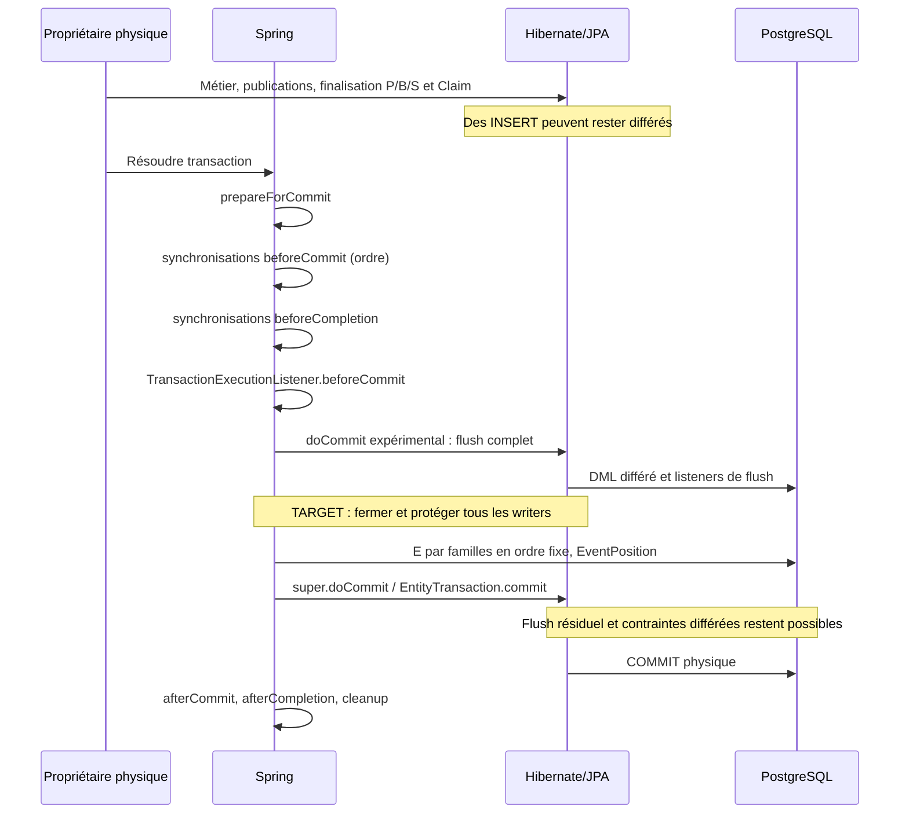

# Étape 3C — intégration transactionnelle réelle du suffixe E

2026-10-19. Baseline `e3bd16028db542d58163b2a5d8236679a6485367`, branche `feat/consumption-transaction-protocol`.
**Étude TARGET et expérimentation isolée ; aucune intégration runtime.**

## 1. Verdict et limites de preuve

**FEASIBLE WITH CONDITIONS.** Le point le plus sûr étudié est une extension du gestionnaire physique JPA, dans `doCommit`, avant délégation au commit JPA et après les synchronisations et listeners Spring pré-commit. Les preuves montrent une insertion par le véritable adaptateur JPA, un flush terminal, la réservation E et l'association EventPosition dans le même PID/xid PostgreSQL. REQUIRED et MANDATORY partagent le collecteur ; un propriétaire `@Transactional` autonome est également couvert. Une vraie Command termine S et ferme son Claim avant le suffixe expérimental.

**La garantie universelle n'est pas acquise.** La fixture collecte automatiquement uniquement les INSERT Hibernate de BusinessEvents. Elle ne collecte pas les trois familles JDBC ; la vraie Command du test émet bien un TerminalEvent qui reste sans association expérimentale. C'est une limite explicite du prototype, pas un mécanisme utilisable en production. Sans modification des frontières ou restriction effective des writers, un simple collecteur mémoire ne peut empêcher tout Event committé sans position. Le refus Spring de NESTED ne ferme pas les savepoints JDBC bruts. Un flush explicite n'interdit pas un nouveau flush au commit : un contre-exemple exécuté montre un UPDATE après E.

L'intégration reste donc interdite à l'issue de 3C. Les conditions §8 doivent faire l'objet d'une décision et de preuves supplémentaires avant une implémentation. Ce verdict ne certifie aucun débit, aucune absence universelle de deadlock et aucune modification de Discovery.

Conventions : **CURRENT** = code livré à la baseline ; **EXP** = comportement de la fixture exécutée ; **TARGET** = proposition non implémentée ; une déduction est désignée comme telle. Les résultats 3A/3B sont acquis mais ne valent pas preuve Spring/JPA. Références historiques lues : [3A](Event_Terminal_Sequencing_Step_3A_Audit_2026-10-19.md), [3B](Event_Terminal_Sequencing_Step_3B_PostgreSQL_Proof_2026-10-19.md), [2A](Pot_Command_Transaction_Boundaries_Audit_Step_2A_2026-10-18.md), [2B](Pot_Command_Cas_Consumption_Step_2B_2026-10-18.md), [2C intégré](Pot_Command_Binding_Shared_Fence_Integration_Step_2C_2026-10-18.md), [2C PostgreSQL](Pot_Command_Binding_Shared_Fence_PostgreSQL_Proof_Step_2C_2026-10-18.md), [protocole CURRENT](consumption-transactional-execution.md).

## 2. Baseline, sécurité et périmètre déclaré

Le checkout initial `/Users/julien.guezennec/Dev/projects/pocoma` est sur `feat/runtime-monolith`, `90926a5e`, avec changements Keycloak, docs, Bruno et fichiers non suivis préexistants. Il n'a pas été modifié. Le worktree existant `/private/tmp/pocoma-consumption-transaction-protocol` était propre au SHA attendu ; HEAD et tracking identiques, divergence 0/0. `git ls-remote origin refs/heads/feat/consumption-transaction-protocol` a confirmé le SHA distant après reprise de l'accès réseau hors sandbox. Aucun reset, stash, merge, rebase ou checkout.

Autres worktrees inventoriés, sans écriture de cette étude : `/private/tmp/pocoma-2c-differential-baseline` (`8a79f06d`, détaché), `/private/tmp/pocoma-binding-lock-order-guard` (`2eef3ab9`), `/private/tmp/pocoma-expense-context` (`116f4e4a`), `/Users/julien.guezennec/.codex/worktrees/debt-wa6-integration/pocoma` (`2eef3ab9`, détaché). Aucun worktree ajouté ou supprimé.

Règles lues : [AGENTS](../../AGENTS.md), [politique normative](../testing/Reactor_Verification_Policy.md), [index documentaire](../README.md), [gouvernance et taxonomie](../Documentation_Rationalization_Audit.md), [validation documentaire](../Documentation_Truth_Validation.md). Cette note ne change pas les garanties CURRENT.

Périmètre annoncé avant création des tests : impact production **NONE** ; primaire **COMMAND**, secondaire **NONE**, preuves locales de transactions Spring/JPA dans le module de tests du worker Command. Interdits : production, migrations, dépendances, moteur Consumption, P → B → S, TA/TE/TR/TH, retry, Discovery. Gate architecture global **NOT REQUIRED** : aucune dépendance ou frontière modifiée. Reactor complet **interdit, non exécuté**. DB expérimentale dédiée ; contexte représentatif démarré avec le bootstrap courant existant. La politique annonce `Trusted baseline: NONE` : bootstrap Flyway existant conservé ; aucun nouveau test d'histoire de migration ajouté. Aucun franchissement inattendu de slice ; les modules amont exécutés sont la fermeture Maven de COMMAND, pas de nouveaux runtimes vérifiés.

## 3. Cartographie CURRENT des propriétaires

### 3.1 Gestionnaire, datasource et connexion

Le [POM parent](../../app/pom.xml) fixe Boot 4.0.5. Le contexte Command non modifié est vérifié par `CurrentTransactionManagerPostgresTest.effectiveManagerAndSharedJdbcConnection` : un seul `PlatformTransactionManager`, bean `transactionManager`, classe exacte `JpaTransactionManager`, `nestedTransactionAllowed=false`, même PID/xid entre l'EntityManager transactionnel et `JdbcTemplate` sur la datasource injectée. Les versions observées sont Spring 7.0.6, Hibernate 7.2.7.Final et PostgreSQL 17.11 ; voir preuves §6.

La recherche dans tous les `src/main` ne trouve aucune construction de `JpaTransactionManager` ni de `DataSourceTransactionManager`, aucun `REQUIRES_NEW`, `NESTED`, `setSavepoint` ou configuration de nested transaction. Le gestionnaire JPA est fourni par l'autoconfiguration Boot ; son identité effective est prouvée pour Command, déduite de la configuration partagée pour les autres runtimes, **pas démarrée individuellement en 3C**. Une configuration externe différente reste hors preuve.

La mention de `DataSourceTransactionManagerAutoConfiguration` dans [ReadStoreAccessAutoConfiguration](../../app/infra-persistence-read-jdbc/src/main/java/com/kartaguez/pocoma/infra/persistence/read/jdbc/ReadStoreAccessAutoConfiguration.java) et [ProjectionStoreAutoConfiguration](../../app/infra-persistence-projection-jdbc/src/main/java/com/kartaguez/pocoma/infra/persistence/projection/jdbc/ProjectionStoreAutoConfiguration.java) ordonne l'autoconfiguration ; elle ne construit pas un second gestionnaire. Ces beans réutilisent la datasource et le `PlatformTransactionManager` injectés. Le store projection construit son propre `TransactionTemplate` REQUIRED : contourne une décoration des seuls runners, pas un gestionnaire commun.

### 3.2 Propriétaires et participants

| Frontière CURRENT | Propriétaire / participation | Source et conséquence pour E |
|---|---|---|
| Command TA/TE/TH et TR recovery | `commandConsumptionTransactionRunner`, `ConsumptionOwnerTransactionRunner(SpringTransactionRunner(TransactionTemplate(manager)),true)` ; refuse tout ambient | [configuration Command](../../app/composition-runtime-spring/src/main/java/com/kartaguez/pocoma/runtime/command/consumption/CommandConsumptionRuntimeConfiguration.java), [guard propriétaire](../../app/composition-runtime-spring/src/main/java/com/kartaguez/pocoma/runtime/consumption/ConsumptionOwnerTransactionRunner.java), [recovery](../../app/engine-consume-command/src/main/java/com/kartaguez/pocoma/engine/consume/command/consumption/BindingFenceRecoveryExecuteUseCase.java). Une résolution physique par appel ; TR/TH après rollback TE, jamais le même collecteur |
| Registration, Binding, Event, CommandResult, RegistrationResult, ProjectionTask | configurations sous `composition-runtime-spring/.../runtime/` : runners propriétaires gardés, templates REQUIRED | [Registration](../../app/composition-runtime-spring/src/main/java/com/kartaguez/pocoma/runtime/registration/RegistrationRuntimeConfiguration.java), [Binding](../../app/composition-runtime-spring/src/main/java/com/kartaguez/pocoma/runtime/binding/BindingRuntimeConfiguration.java), [Event](../../app/composition-runtime-spring/src/main/java/com/kartaguez/pocoma/runtime/event/consumption/EventConsumptionRuntimeConfiguration.java), [Task](../../app/composition-runtime-spring/src/main/java/com/kartaguez/pocoma/runtime/task/consumption/CanonicalProjectionTaskRuntimeConfiguration.java), [CommandResult](../../app/composition-runtime-spring/src/main/java/com/kartaguez/pocoma/runtime/result/CommandResultRuntimeConfiguration.java), [RegistrationResult](../../app/composition-runtime-spring/src/main/java/com/kartaguez/pocoma/runtime/registrationresult/RegistrationResultRuntimeConfiguration.java). Cartographie statique ; tous ne produisent pas d'Events |
| LKV | wrapper propriétaire spécialisé, template injecté | [configuration LKV](../../app/runtime-latest-known-version-consumption-worker/src/main/java/com/kartaguez/pocoma/runtime/latestknownversion/LatestKnownVersionRuntimeConfiguration.java). Aucune autorité E si aucun Event |
| Admission Command / Registration | runner générique ou runner construit directement ; REQUIRED peut être physique ou participant | [Command admission](../../app/composition-runtime-spring/src/main/java/com/kartaguez/pocoma/CommandAdmissionConfiguration.java), [Registration admission](../../app/composition-runtime-spring/src/main/java/com/kartaguez/pocoma/RegistrationAdmissionConfiguration.java), [runner générique](../../app/infra-tx-spring/src/main/java/com/kartaguez/pocoma/infra/tx/spring/SpringTransactionRunnerConfiguration.java). Décorer un seul bean runner ne couvre pas les constructions directes |
| Adaptateurs `@Transactional` REQUIRED et repositories Spring Data | peuvent ouvrir une transaction sans runner ; rejoignent sinon | [append auxiliaire](../../app/infra-persistence-primary-jpa/src/main/java/com/kartaguez/pocoma/infra/persistence/primary/jpa/adapter/outbox/JpaBusinessEventOutboxAdapter.java) et [repository](../../app/infra-persistence-primary-jpa/src/main/java/com/kartaguez/pocoma/infra/persistence/primary/jpa/repository/outbox/JpaBusinessEventOutboxRepository.java). Chemin propriétaire autonome pertinent |
| Adaptateurs MANDATORY | aucune transaction autonome ; échec sans propriétaire | append Command, Outcome, Binding authority/facts ; matrice §5 |
| JDBC UserCreated | pas d'annotation transactionnelle sur `append` | l'appel courant est sous TE Registration, mais le port seul n'impose pas une transaction : trou de garantie universelle |

[SpringTransactionRunner](../../app/infra-tx-spring/src/main/java/com/kartaguez/pocoma/infra/tx/spring/SpringTransactionRunner.java) délègue à `TransactionTemplate.execute` et enregistre des `afterCommit`. La recherche CURRENT trouve aussi un callback métrique dans `MeteredAdvanceLatestKnownVersionUseCase`, sans suffixe E existant. Une API `runAfterCommit(Runnable)` arbitraire demeure une surface future à restreindre : après commit, une exception n'annule pas un commit acquis.

## 4. Cycle Spring/JPA et comparaison des options

Le [bytecode des versions installées](../testing/evidence/Event_Terminal_Sequencing_Step_3C_Spring_Lifecycle_2026-10-19.txt), inspecté avec `javap -c -p`, confirme `AbstractPlatformTransactionManager.processCommit` et `JpaTransactionManager.doCommit`. Il évite de présumer l'ordre à partir de 3B. La trace expérimentale montre aussi que `prepareForCommit` peut être appelé lors de retours de **participants** ; sans garde physique, il ne signifie pas « fin de transaction ».



| Option | Couverture et emplacement | Risques / complexité | Conclusion |
|---|---|---|---|
| A — extension du gestionnaire physique | tous les templates et proxies utilisant ce manager ; `doCommit` seulement pour une nouvelle transaction physique ; après les callbacks Spring pré-commit | gérer begin/rollback/cleanup/suspension, exception de suffixe, compatibilité provider/version ; connexion et writers à verrouiller ; commit JPA peut encore flusher | **préférée sous conditions**. `prepareForCommit` seul est trop tôt ; un décorateur externe de `commit` entre trop tôt et peut voir des participants |
| B — décoration des TransactionRunner | fin du Supplier accessible, mais participants et constructions multiples ; ne couvre pas les frontières annotées autonomes ni templates directs | suffixe prématuré à un retour participant ; synchronisations encore à venir ; instrumentation de tous les runners insuffisante pour les annotations | **insuffisante comme autorité universelle**, utile uniquement comme contrôle local complémentaire |
| C — `TransactionSynchronization.beforeCommit` | accessible depuis toute transaction Spring ayant installé le collecteur ; ordre Spring réglable | même `LOWEST_PRECEDENCE` n'interdit pas un callback de même ordre plus tard ; `beforeCompletion` et TransactionExecutionListener restent après ; exceptions de beforeCompletion peuvent être journalisées et ignorées par Spring | **insuffisante seule**. La preuve d publie dans beforeCompletion après beforeCommit. Une simple priorité ne ferme pas les writers |

Le flush complet est celui de l'EntityManager transactionnel, pas `flush()` d'un repository isolé. Il vide l'action queue visible et déclenche dirty checking, cascades et listeners correspondants. Il ne ferme pas le persistence context. `EntityTransaction.commit()` peut refaire le dirty checking. EXP g salit `attemptCount` après E et observe réellement l'UPDATE au commit. Même A doit donc ajouter une protection des écritures JPA/JDBC après fermeture ; le prototype n'en possède qu'une partielle pour les INSERT Event JPA.

Le commit peut encore attendre WAL/I/O, contraintes différées, triggers et validations de commit ; « suffixe terminal » ne peut signifier « aucun travail PostgreSQL après E ». L'objectif TARGET doit distinguer les INSERT EventPosition et le commit autorisés du DML métier interdit. Les FK et contraintes d'EventPosition peuvent elles-mêmes attendre après E : un ordre total entre E ne supprime pas ces attentes.

## 5. Matrice des producteurs : identifiants et couverture

| Famille / chemin CURRENT | Point d'enregistrement TARGET exact | Couverture exécutée 3C | Limite |
|---|---|---|---|
| BusinessEvents, TE succès Pot/Expense | [JpaPotCommandEventAppendAdapter.appendAll](../../app/infra-persistence-primary-jpa/src/main/java/com/kartaguez/pocoma/infra/persistence/primary/jpa/adapter/outbox/JpaPotCommandEventAppendAdapter.java), UUID d'enveloppe avant `saveAllAndFlush` ; confirmation d'INSERT Hibernate | h : vraie TE CreatePot, adaptateur et flush réels, suffixe après S et Claim | autres commandes/Expense auditées et tests CURRENT de slice ; pas une preuve E de tous les succès |
| BusinessEvents, append auxiliaire | [JpaBusinessEventOutboxAdapter.append](../../app/infra-persistence-primary-jpa/src/main/java/com/kartaguez/pocoma/infra/persistence/primary/jpa/adapter/outbox/JpaBusinessEventOutboxAdapter.java), UUID RecordedEvent, `save` différé | a–g/i/j : véritable bean, INSERT collecté par listener Hibernate ; propriétaire autonome/participant | aucun appelant de production trouvé à la baseline (3A + recherche des ports) ; bean demeure exposé |
| CommandTerminalEvents, TE APPLIED / REJECTED | [JdbcCommandOutcomeAdapter.publish](../../app/infra-persistence-primary-jpa/src/main/java/com/kartaguez/pocoma/infra/persistence/primary/jpa/adapter/command/JdbcCommandOutcomeAdapter.java) : extraire UUID actuellement inline, enregistrer seulement après INSERT strict réussi | h observe le terminal APPLIED déjà présent avant E Business | **aucune collecte JDBC expérimentale**, aucun EventPosition terminal ; REJECTED non testé avec E |
| CommandTerminalEvents, TH FAILED | même `publish`, appelé par `CommandConsumptionExecution.terminalFailureEffect` après rollback TE | audit statique ; tests CURRENT de slice seulement | pas de suffixe TH instrumenté en 3C |
| CommandTerminalEvents, TR recovery Binding | même `publish`, recovery physique distincte via `BindingFenceRecoveryExecuteUseCase` | audit statique ; tests CURRENT de slice seulement | pas de preuve E/TR |
| BindingFacts, Registration / lifecycle attach et detach | [ExternalIdentityBindingFactJdbcRepository.append](../../app/infra-persistence-primary-jpa/src/main/java/com/kartaguez/pocoma/infra/persistence/primary/jpa/repository/identity/ExternalIdentityBindingFactJdbcRepository.java), `row.eventId()` exact après INSERT réussi ; commun à l'autorité et au port auxiliaire | audit statique des [autorités Binding](../../app/infra-persistence-primary-jpa/src/main/java/com/kartaguez/pocoma/infra/persistence/primary/jpa/adapter/identity/JpaExternalIdentityBindingAdapter.java) et [port fact](../../app/infra-persistence-primary-jpa/src/main/java/com/kartaguez/pocoma/infra/persistence/primary/jpa/adapter/identity/JpaExternalIdentityBindingFactAdapter.java) | aucune position Binding exécutée ; detach/port auxiliaire n'ont pas d'appelant métier courant trouvé ; pas d'owner autonome fourni par MANDATORY |
| UserCreatedFacts, nouvelle Registration gagnante | [JdbcUserCreatedFactAdapter.append](../../app/infra-persistence-primary-jpa/src/main/java/com/kartaguez/pocoma/infra/persistence/primary/jpa/adapter/registration/JdbcUserCreatedFactAdapter.java), UUID actuellement inline | audit de [ExecuteRegistrationService](../../app/engine-consume-registration/src/main/java/com/kartaguez/pocoma/engine/consume/registration/ExecuteRegistrationService.java) : initializer Binding puis UserCreated dans TE | aucune preuve E Registration ; absence de garde transactionnelle sur le port lui-même |
| Imports / migrations / SQL direct | hors listener Hibernate, hors interception des seuls ports | audit migrations et inventaire 3A | prévoir cutover et permissions ; aucune migration exécutée pour intégrer E |

L'insertion réelle JPA est observée automatiquement dans EXP par `PostInsertEventListener` sur `JpaBusinessEventOutboxEntity`, y compris lors du flush final. Ce mécanisme n'observe ni JDBC, ni SQL natif, ni bulk INSERT. Un aspect sur un retour de port n'est pas une garantie de couverture de ces voies. **Aucune des quatre familles n'est déclarée entièrement couverte universellement.** La détection d'un oubli par un test n'est pas une prévention au commit.

## 6. Preuves PostgreSQL exécutées

Source : [fixture et scénarios](../../app/runtime-command-consumption-worker/src/test/java/com/kartaguez/pocoma/runtime/command/consumption/sequencing/JpaTerminalSequencingPostgresTest.java). Un contexte vérifie le manager CURRENT ; un autre substitue seulement dans le test un `JpaTransactionManager` dérivé, un listener Hibernate et le schéma `experiment_3c`. La table position expérimentale référence la vraie outbox ; aucun EventPosition n'est introduit dans le modèle de production. Les triggers d'audit sont créés uniquement dans la base Testcontainers éphémère et enregistrent l'ordre des DML, PID et xid.

L'autorité expérimentale est **une seule famille BusinessEvent**, compteur transactionnel UPDATE ; plusieurs Events entraînent plusieurs incréments sous le verrou de la même ligne. Ce n'est pas le protocole multifamille final ; la preuve d'ordre total et de contention de 3B reste distincte. Le compteur du suffixe prouve une entrée terminale par transaction, pas un seul statement par lot.

| Demande | Scénario exécuté / résultat | Borne |
|---|---|---|
| A — vrai commit JPA | a : adaptateur de production, Event INSERT → E UPDATE → position INSERT, un unique couple PID/xid dans l'audit serveur, association visible après commit | insertion outbox réelle ; pas de mutation métier Pot dans a, couverte par h |
| B — écritures différées | a : aucune notification post-insert avant retour du writer ; flush terminal matérialise l'INSERT avant E. g : UPDATE supplémentaire committé après E | PASS de flush, **contre-exemple** à l'hypothèse « flush = fermeture » |
| C — REQUIRED/MANDATORY | b : proxies transactionnels Spring, même instance de collecteur, zéro suffixe chez les participants, un seul suffixe propriétaire ; MANDATORY sans transaction refusé ; REQUIRED autonome committé | proxies réels et adaptateur réel, pas invocation directe simulant l'annotation |
| D — sans Event | c : aucun verrou sur l'autorité pendant le corps ; zéro suffixe et aucune position après commit ; branche du code n'accède pas à E si IDs vides | flush peut quand même être effectué ; pas d'acquisition E |
| E — erreur après E | c : exception après association, propagée à TransactionTemplate ; Event, position et incrément E annulés. i : publication tardive lors du flush de commit refusée, rollback intégral | pas de panne réseau ni UNKNOWN injecté en 3C ; pas de SQL métier Pot rollbacké dans c |
| F — callbacks | d : beforeCommit et beforeCompletion publient encore ; tous trois Events collectés avant doCommit. g : UPDATE au commit après E. Bytecode Spring conservé | ne prouve pas tous les listeners Hibernate/JTA externes ; montre les limites suffisantes pour rejeter C seul |
| G — savepoints/suspension | e : NESTED et savepoint via TransactionStatus refusés ; **savepoint JDBC brut accepté**, rollback serveur sans restauration du collecteur. f : REQUIRES_NEW suspend/reprend le collecteur, commit interne conservé après rollback externe | l'interdiction universelle des savepoints n'est pas effective CURRENT ; aucune convention n'est présentée comme garde |
| H — producteurs | listener automatique sur vraie outbox ; j : nettoyage lors de deux transactions successives sur un thread réutilisé ; matrice §5 | trois familles JDBC uniquement auditées pour l'enregistrement, pas collectées |
| I — vrai P/B/S | h : vraie CreatePot via RecordedCommandInsertionPort, lifecycle.acquire, commandConsumptionExecute et exécution Command de production ; avant E, S DONE, Claim ended_at et terminal Event vérifiés dans la transaction | pas de réorganisation P/B/S ; suffixe Business seulement ; pas de trace exhaustive de tous les SELECT ni de preuve concurrente P/B/S nouvelle |

Pour I, le [repository S](../../app/infra-persistence-primary-jpa/src/main/java/com/kartaguez/pocoma/infra/persistence/primary/jpa/repository/consumption/JpaConsumptionSlotRepository.java) impose `flushAutomatically=true, clearAutomatically=true` sur les mutations natives. Le [lifecycle](../../app/infra-persistence-primary-jpa/src/main/java/com/kartaguez/pocoma/infra/persistence/primary/jpa/adapter/consumption/JpaConsumptionLifecycleAdapter.java) exige CAS et clôture unitaires. Le suffixe dans `doCommit` est structurellement après le retour de ces appels ; h confirme leurs effets avant E. Le compteur expérimental ne remplace ni P, ni B, ni S. L'audit de tables outbox/E/position n'est **pas** un enregistrement JDBC exhaustif : du SQL potentiellement bloquant résiduel reste possible au flush de commit, dans les contraintes et triggers ; g le démontre pour un UPDATE.

## 7. Contrat minimal du collecteur TARGET

Une instance doit être liée à la transaction **physique**, créée au begin ou à la première insertion avec preuve d'appartenance ; jamais un singleton ni un ThreadLocal non suspendable. Les participants ne ferment rien. Le prototype utilise une ressource Spring liée au thread, nettoyage dans `doCleanupAfterCompletion` et transport explicite de cette ressource dans `doSuspend/doResume`. f et j vérifient suspension et réutilisation ; c/i vérifient nettoyage sur exception et rollback. Il ne transmet aucun état à un autre thread. Une transaction enfant REQUIRES_NEW a un autre collecteur, un autre commit ; REQUIRED partage le parent.

Les IDs sont `(famille, UUID)` exacts des INSERT effectivement réalisés ; pas les IDs de commande, ni une relecture non bornée de toute l'outbox. Un doublon de notification du même INSERT peut être dédupliqué ; un doublon d'insertion doit garder les contraintes SQL et échouer. Le prototype utilise LinkedHashSet pour les notifications JPA ; il ne prouve pas le traitement des INSERT JDBC idempotents ni des suppressions après insertion. Fixer un ordre versionné des familles, par exemple BusinessEvents → CommandTerminalEvents → BindingFacts → UserCreatedFacts, et un ordre stable intra-famille. Aucune E pour un ensemble vide. Ordre de familles proposé, **pas nouvel ordre métier P/B/S**.

La fermeture vient **après** le dernier flush et ses cascades, avant E. Tout Event ajouté ensuite doit entraîner rollback, même si une couche intercepte l'exception ; un état empoisonné et un garde au commit sont nécessaires. Le listener post-insert de la fixture refuse le SQL JPA tardif mais n'interdit pas tous les DML tardifs : g reste volontairement un contre-exemple. La protection TARGET doit couvrir native SQL, JDBC, EntityManager, callbacks, triggers et accès non Spring retenus dans le périmètre.

Les savepoints doivent être refusés effectivement sur `Connection.setSavepoint`, `rollback(Savepoint)`, `releaseSavepoint`, les APIs Spring et les instructions SQL SAVEPOINT/ROLLBACK TO, avec restriction de l'accès aux connexions natives/unwrap. Un proxy partiel de datasource sans contrôle des voies d'accès ne suffit pas. Une alternative est un collecteur transactionnel en base qui suit naturellement les savepoints, à concevoir séparément ; elle ne rend pas le persistence context Hibernate automatiquement cohérent après rollback partiel. La suspension doit soit être intégralement gérée comme dans f, soit être interdite par une garde vérifiable, jamais seulement absente du code actuel.

Pour **empêcher** un commit sans position, deux lignes de défense sont à décider : instrumentation centralisée de tous les INSERT autorisés et contrainte de complétude au commit côté base (ou writers SQL restreints derrière une API contrôlée avec preuve de fermeture). Une FK position → Event ne prouve pas Event → position ; la FK du prototype est donc insuffisante. Une contrainte différée/trigger de contrôle pourrait empêcher une omission, mais ajoute du travail au commit après E et doit être étudiée pour ses verrous. Aucun DDL de ce type n'est proposé comme migration livrée en 3C. Tant qu'un writer brut peut autocommitter un Event, l'universalité est impossible avec les seules frontières applicatives actuelles.

## 8. Conditions avant intégration runtime

1. Choisir un unique gestionnaire instrumenté par datasource productrice et prouver sa présence dans chaque runtime producteur ; contrôler l'absence de gestionnaires alternatifs et de commits directs. Décider le traitement du JDBC seul, sans introduire une seconde transaction E.
2. Couvrir automatiquement les quatre tables et tous leurs writers, dont ports auxiliaires et JDBC ; imposer une transaction au UserCreated writer ; prouver l'impossibilité d'un Event committé sans position et pas seulement l'absence d'omission dans une fixture.
3. Fermer effectivement les publications et le DML métier après E ; rejouer g sous la future garde et exiger rollback. Auditer les listeners Hibernate, TransactionExecutionListeners, synchronisations, contraintes et triggers. Ne pas désactiver aveuglément le flush de commit : cela pourrait perdre des écritures.
4. Interdire techniquement les savepoints incompatibles, y compris raw JDBC/SQL et unwrap, ou substituer une conception transactionnelle en base avec preuve Hibernate adaptée. Décider et tester REQUIRES_NEW/suspension ; conserver le refus d'ambient des owners Consumption.
5. Prouver E multifamille sous Spring/JPA : TE succès/rejet, TH FAILED, TR recovery, Registration avec Binding/UserCreated, lifecycle et ports auxiliaires ; injecter rollback après réservation de chaque famille et erreur de clôture. h ne ferme pas cette matrice.
6. Valider les contraintes EventPosition et le cutover historique, l'ordre fixe de toutes les E, les permissions SQL, puis les attentes et cycles P/B/S/E avec les vrais chemins concurrents. Décider la sémantique d'un Event inséré puis supprimé dans la même transaction.
7. Maintenir la classification de résolution physique et le budget de retry actuel. Prouver le traitement du suffixe en erreur et du commit inconnu dans chaque wrapper, sans retry local additionnel.

## 9. Coûts, erreurs et risques résiduels

E reste détenue jusqu'à résolution physique : insertion des positions, flush résiduel éventuel, contraintes et commit. Une transaction attendant E conserve ses verrous métier, notamment P/B/S ; le suffixe rallonge leur rétention indirectement. Un flush terminal ajoute dirty checking et éventuellement un round trip ; le commit JPA conserve ses propres callbacks. Aucun temps de production ni percentile n'est déduit de ces fixtures.

L'ordre total de E empêche seulement les cycles dus à un ordre opposé **entre ces autorités**. Les FK, index uniques, triggers et tout DML tardif peuvent réintroduire une arête vers des ressources métier. Une REQUIRES_NEW interne qui attend E détenue par son parent serait un auto-blocage logique ; l'absence de E avant la fin du parent en réduit une cause mais ne certifie pas les autres verrous du parent. Aucun nouveau retry n'est introduit.

Le [ConsumptionOwnerTransactionRunner](../../app/composition-runtime-spring/src/main/java/com/kartaguez/pocoma/runtime/consumption/ConsumptionOwnerTransactionRunner.java) mesure la résolution via afterCompletion. Une erreur de suffixe avant le commit avec rollback confirmé relève de ROLLED_BACK ; le corps peut déjà avoir retourné, donc le wrapper peut l'encapsuler comme erreur de phase COMMIT plutôt que comme erreur métier initiale. c vérifie la propagation brute par TransactionTemplate, h utilise le vrai owner ; la classification de toutes les erreurs E/TH/TR n'est pas testée ici.

Une erreur du commit/transport sans confirmation demeure **UNKNOWN** ; une erreur après commit confirmé demeure **COMMITTED**. Ni UNKNOWN ni COMMITTED ne justifie le rejeu automatique d'une mutation ni un nouvel événement FAILED. Le wrapper conserve ses causes selon ses règles actuelles ; une intégration devra garantir que la nouvelle erreur technique E est classée seulement après résolution physique. Les fixtures ne simulent pas un commit PostgreSQL acquis dont l'accusé réseau serait perdu. Les résultats 2B/2C restent la référence CURRENT ; aucun changement de retry ou de TA/TE/TR/TH.

## 10. Vérification et livraison

Voir [preuve d'exécution](../testing/evidence/Event_Terminal_Sequencing_Step_3C_2026-10-19.txt) et [cycle Spring/JPA](../testing/evidence/Event_Terminal_Sequencing_Step_3C_Spring_Lifecycle_2026-10-19.txt).

Commandes Maven depuis `app/` :

```sh
./mvnw -pl runtime-command-consumption-worker -am test -Dtest=JpaTerminalSequencingPostgresTest -Dsurefire.failIfNoSpecifiedTests=false
./mvnw -pl runtime-command-consumption-worker -am test -Dtest=JpaTerminalSequencingPostgresTest,CurrentTransactionManagerPostgresTest -Dsurefire.failIfNoSpecifiedTests=false
./mvnw -pl runtime-command-consumption-worker -am test
```

Les essais initiaux ont rencontré successivement la sandbox Docker, l'initialisation du container avec le cycle PER_CLASS (retiré), puis le refus correct du savepoint Spring ; la preuve a été corrigée pour tester la voie JDBC brute. Aucun échec n'a motivé un élargissement de slice. Les résultats finaux et comptes exacts sont consignés dans la preuve d'exécution ; seuls ces résultats valent PASS final. Pas de reactor complet, pas de gate architecture global ; aucun changement sous `src/main`, aucun POM ni migration modifiés. Prochain gate global seulement lors d'une future intégration/Wave applicable, distincte de cette étude.

Résultat final : **11 nouveaux tests 3C PASS**, zéro échec/erreur/skip ; slice COMMAND **BUILD SUCCESS**, 1006 tests déclarés au total, dont 1 test optionnel 3B skipped (1005 exécutés). Un diagnostic Surefire de terminaison forcée de JVM après 30 s est conservé dans la preuve ; Maven termine avec code 0 et aucune assertion en échec. Cette étude ne corrige pas les dettes de fermeture des tests existants.
