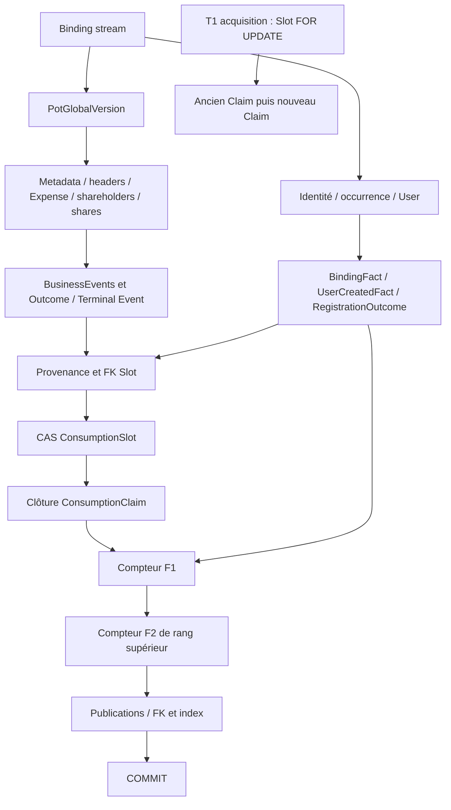

# Pocoma — Protocole de mutation, autorités transactionnelles et publication ordonnée

Étude architecturale consolidée — 18 octobre 2026. Audit documentaire et statique exclusivement. **Verdict global : VIABLE_WITH_ADJUSTMENTS.** Aucun changement runtime, SQL ou test ; aucun test exécuté. Le protocole cible décrit ici est une proposition pour revue, pas une garantie déjà livrée.

## A. Synthèse et référence de preuve

### A.1 Verdict et décisions proposées

La préparation optimiste à une version V, le CAS Pot tardif, le fencing Binding et la finalisation Consumption possèdent déjà les points d'appui nécessaires. Une association de publication insérée après la clôture du claim peut encore participer au même commit et au même rollback. R03 est effectivement inclus dans la référence examinée ; l'ancien diagnostic sur des contextes Expense mixtes ne doit plus être appliqué à ce code. [S01] [S02] [S03] [S04]

**CONDITIONALLY_VIABLE — protocole principal recommandé :** lectures et préparation cohérentes à V → fence exact Binding → CAS Pot V→V+1 et metadata → mutations et Events persistés → Outcome et éventuel terminal Event → provenance et flush → CAS Slot puis clôture Claim → allocation transactionnelle par famille dans un ordre total → insertion des publications → commit physique confirmé. Les parcours sans mutation Pot omettent l'autorité Pot ; les producteurs sans Consumption omettent Slot/Claim. Aucun worker de publication ni seconde transaction de publication n'est nécessaire.

Les ajustements indispensables sont :

1. Distinguer `observedVersion` de la version de travail choisie une seule fois. Remplacer le rejet systématique `expectedVersion != V` par une politique explicite fondée sur les BusinessEvents de `(observedVersion,V]`, puis les validations métier à V.
2. Séparer effectivement préparation et application dans les services Pot. Aujourd'hui leurs méthodes font les deux ; déplacer seulement un appel dans l'orchestrateur ne permet pas de placer le fence entre les deux. Aucun DML Pot, même déclenché par un flush implicite, ne doit précéder le fence cible.
3. Distinguer obsolescence terminale et perte concurrente du CAS Pot. Cette dernière doit sortir du chemin de rejet métier, annuler l'essai et être explicitement classée transitoire pour permettre une nouvelle préparation.
4. Conserver le fence exact existant, mais le placer immédiatement avant la première écriture Pot, après préparation et sérialisation anticipable. Harmoniser les writers concernés avant activation ; ne pas maintenir des chemins Pot→Binding et Binding→Pot mutateurs concurrents.
5. Introduire un registre de publications transactionnel couvrant JPA **et** JDBC, un suffixe dans chaque propriétaire producteur, et un contrôle de clôture sans accès SQL supplémentaire après les compteurs. Inclure recovery et traitement des échecs terminaux.
6. Traiter RegistrationOutcome comme une source durable à identité `request_id`, et non supposer un `event_id` qui n'existe pas. Garder le concept commun de publication avec des références typées.
7. Concevoir séparément le checkpoint Discovery : positions publiées et slots en attente ne sont pas la même progression.

**NOT_VIABLE :** allouer avec une séquence non rollbackable en exigeant zéro trou de rollback ; publier après le commit métier ; remplacer l'autorité claim par la seule lease ; réutiliser des validations préparées à une autre V ; garantir toutes les écritures SQL arbitraires par la seule FK Publication→Event. Ces incompatibilités ne condamnent pas le protocole ajusté.

**POTENTIAL_RISK :** propagation de contention par les compteurs et par le Binding partagé entre Pots, deadlocks si des chemins gardent un ordre inverse, flushs tardifs, contraintes uniques sur des identités réutilisées. Aucun débit, temps d'attente ni deadlock nouveau n'est mesuré ou reproduit ici.

### A.2 Référence Git réellement analysée et R03

Référence analysée : **`116f4e4ab2c45b44d418f8b54cab960e3c51c2d2`**, branche `fix/expense-context-version-coherence`, worktree préexistant `/private/tmp/pocoma-expense-context`, propre à l'entrée. Aucune création de worktree nécessaire : lecture de ce worktree isolé, aucun déplacement du checkout initial.

Ascendance constatée par `git log --graph` et contrôle `git merge-base --is-ancestor 675533e7 116f4e4a` (succès) :

```text
90926a5e ── 675533e7 (correctif R03) ──┐
     └───── 4158de69 ── 2eef3ab9 ──────┤ 322042de (intégration locale)
                                    └─ 116f4e4a (clôture documentaire)
```

**PROVEN — présence R03 :** l'adapter relit le header Expense par `findActiveAtVersion(expenseId,V)` après la lecture de l'autorité Pot ; la lecture courante initiale sert uniquement à identifier le Pot. Le contrat ExpenseContextPort est explicite. Le diff production `675533e7..116f4e4a` est vide sur engine-write-pot et infra-persistence-primary-jpa. Le correctif n'a ajouté ni verrou pessimiste ni changement des use cases/CAS. [S01] [S05]

Le rapport d'intégration archivé indique **91 tests ciblés PASS, dont 34 PostgreSQL**, incluant le test R03 et quatre gardes structurels Binding. **PROVEN comme résultat historique documenté**, pas comme campagne exécutée ici, pas comme preuve du futur protocole ou d'une suite complète. La classe R03 contient notamment le rejet après suppression entre ownership et lecture V, conservation des contextes historiques, CAS perdu et rollback après flush Event. [S02] [S06]

Checkout initial : `/Users/julien.guezennec/Dev/projects/pocoma`, branche `feat/runtime-monolith`, HEAD `90926a5ec37d1ca841e3de017bec0d1f705d8839`. La référence locale `origin/feat/runtime-monolith` vaut `2eef3ab9`, soit deux commits devant ce checkout. Aucun fetch : état du serveur distant non réévalué.

Worktrees disponibles, tous laissés à leur place :

| Worktree | Branche / mode | HEAD | État à l'entrée |
|---|---|---|---|
| checkout initial | feat/runtime-monolith | 90926a5e | modifications préexistantes ci-dessous |
| /private/tmp/pocoma-expense-context | fix/expense-context-version-coherence | 116f4e4a | propre |
| /private/tmp/pocoma-binding-lock-order-guard | fix/binding-lock-order-guard | 2eef3ab9 | propre |
| /Users/julien.guezennec/.codex/worktrees/debt-wa6-integration/pocoma | détaché | 2eef3ab9 | propre |

Autres branches locales inventoriées : `audit/takeover-flakiness=eef30128`, `main=cf18d766`, `split-runtimes=f8328c4b`, `test/takeover-fencing=4a07b111`, `test/takeover-races=e0bd47a4`, `v2-make-it-pull=ec88ecb5`. Ce sont des références disponibles, pas des bases alternatives utilisées pour l'étude.

### A.3 Échelle et limites

- **PROVEN** : démontré par les sources/SQL ou un scénario existant précisément identifié ; la nature statique ou historique de la preuve est indiquée.
- **CONDITIONALLY_VIABLE** : conception viable sous conditions nommées, encore à prouver par les futurs tests.
- **POTENTIAL_RISK** : entrelacement ou coût plausible, sans reproduction nouvelle.
- **GAP** : garantie absente ou non démontrée.
- **NOT_VIABLE** : incompatibilité avec une exigence identifiée.

L'audit raisonne avec les writers conformes au protocole actuel et un unique propriétaire PostgreSQL local des effets. Il ne démontre pas l'isolation effective d'un déploiement, la sûreté d'outils administratifs ni le comportement d'un futur writer contournant les ports. Aucun accès réseau, PostgreSQL ou benchmark. Les liens Sxx visent les fichiers réellement lus dans le worktree R03 ; leur contenu est rattaché au hash ci-dessus, indépendamment du HEAD du checkout recevant ce rapport.

## B. Code actuel et protocole transactionnel recommandé

### B.1 Ce qui existe déjà

**PROVEN — acquisition réelle :** transaction indépendante `TransactionalAcquireConsumptionUseCase` ; `acquire` insère idempotemment le Slot, le lit `FOR UPDATE`, décide AlreadyDone/NotReady/Busy, invalide éventuellement le claim expiré, insère et flush le nouveau Claim, installe ce Claim dans le Slot, puis commit. Le pseudo-code « créer Claim puis acquérir Slot » exprime une intention, pas l'ordre SQL actuel. La FK Claim→Slot impose que le Slot existe. Conserver cet ordre Slot→ancien Claim→nouveau Claim ; aucune raison de le réécrire pour l'étude. [S07] [S08] [S09]

**PROVEN — exécution actuelle Command :** `ExecuteRecordedCommandService` relit RecordedCommand, observe sans verrou le Binding exact, traduit les autorités externes de l'enveloppe en permissions, contrôle la validité temporelle, décode et dispatch. Les services Pot chargent le contexte, valident `expectedVersion == V`, autorisent à V, préparent, font CAS/metadata et persistance. `PotCommandInvocation` collecte les Events en mémoire et enregistre V en input. L'orchestrateur append les Events avec `saveAllAndFlush`, puis effectue le fence Binding. `CommandConsumptionExecution` écrit Outcome et terminal Event ; `FinalizeConsumptionService` écrit provenance puis terminalise. [S10] [S11] [S12] [S13] [S14]

**PROVEN — finalisation actuelle :** `terminalize` flush le contexte JPA avant son UPDATE conditionné par `slot_id`, `PENDING`, `current_claim_id=C`, puis le clear. Exactement une ligne attendue ; sinon LostClaimException. Ensuite clôture du Claim exact ouvert et non invalidé, exactement une ligne ; tout échec doit annuler le CAS et les effets. Clear ne libère aucun verrou SQL. Le runner propriétaire ne confirme le retour qu'après commit physique ; une résolution UNKNOWN ou déjà COMMITTED ne déclenche pas une réexécution métier aveugle. [S03] [S04] [S08] [S15]

**GAP — classification Pot :** `AbstractPotCommandUseCaseAdapter` attrape la même VersionConflictException pour la précondition de version et pour un CAS/une fermeture historique perdus ; il la transforme en résultat Rejected si aucun Event collecté. Cela est prouvé au niveau du contrôle de flux, et testé au niveau adapter. Ce constat ne prouve pas qu'un CAS perdu committe effectivement un rejet dans le wiring Spring : un adapter `@Transactional` ayant levé peut déjà avoir marqué la transaction rollback-only. Ne pas confondre résultat Java et commit. Le protocole cible doit supprimer cette ambiguïté et posséder un type technique explicitement retryable. Le classifier actuel ne reconnaît pas un conflit Pot dédié ; ajouter seulement une exception sans sa classification ne suffirait pas. [S11] [S16] [S17]

### B.2 Séquence commune cible de succès

**CONDITIONALLY_VIABLE — cible**, aucune de ces évolutions n'est implémentée ici :

```text
T1 acquisition (inchangée)
BEGIN
  ensure Slot ; verrou Slot ; vérifier état/lease ; takeover éventuel
  insérer Claim ; installer currentClaimId
COMMIT

T2 exécution propriétaire
BEGIN
  relire Command ; observer Binding exact (sans verrou exclusif)
  lire observedVersion O ; fixer workingVersion V une seule fois
  lire BusinessEvents du Pot dans (O,V] ; vérifier complétude/contrats connus
  vérifier obsolescence ; charger tous les faits métier et autorisations à V
  préparer candidat V+1, Events typés, UUID, représentations sérialisables
  vérifier les préconditions ; figer liste des effets attendus

  fenceExact Binding(identity,user,bindingId,revision) ; exiger 1 ligne
  CAS Pot V→V+1 ; exiger 1 ligne ; insérer pot_version_metadata
  fermer/insérer les lignes métier à V+1
  insérer tous les BusinessEvents préparés ; enregistrer leurs identités
  persister CommandOutcome APPLIED et CommandTerminalEvent ; enregistrer ce dernier
  persister ConsumptionInputs(V) et Results(UUID Event, subjectVersion=V+1)
  flush complet des effets avant la section de publication
  CAS terminal Slot(PENDING,C)→DONE/SUCCESS ; exiger 1 ligne
  clôturer Claim C ; exiger 1 ligne

  figer le registre ; plus aucun callback ni effet métier à exécuter
  pour chaque famille F non vide, selon ordre total :
      UPDATE compteur F += nombre exact d'objets RETURNING dernier
      insérer en batch les publications du bloc attribué
  contrôler en mémoire que tous les objets attendus sont associés une fois
COMMIT physique, résultat confirmé par le runner
```

Le fence est acquis au dernier moment **avant le premier DML Pot**, après les lectures et calculs longs. Les UUID Event peuvent être alloués avant le CAS et abandonnés au rollback ; ils ne sont pas les positions de publication. L'Outcome APPLIED n'est persistant qu'après réussite des écritures ; il n'a pas besoin de la position de publication. La validation finale du registre ne doit ni refaire des lectures métier ni provoquer un flush de mutations oubliées.

Le suffixe de publication reste **dans le supplier du TransactionRunner**, après retour du participant générique et avant retour au runner. Une décoration extérieure de `TransactionalExecuteConsumptionUseCase` agirait après commit : **NOT_VIABLE**. Composer ce suffixe aux propriétaires producteurs, sans introduire EventPublication dans le moteur générique Consumption. Adapter explicitement le contrat documentaire de « dernier suffixe CAS/Claim », car il sera suivi d'écritures techniques rollbackables. [S18] [S19]

### B.3 Chronologies de tous les parcours

Dans cette table, « publication » signifie allocation + associations dans T2, jamais émission externe. Toute ligne terminant par commit suppose succès du CAS Slot et de la clôture Claim. Chaque échec SQL ou échec du suffixe annule **tous** les effets de cette transaction.

| Parcours | Chronologie cible complète après T1 | Décision et effets durables |
|---|---|---|
| 1. Command Pot réussie | BEGIN → observation Binding → O/V et Events → contexte/permissions/candidat à V → fence Binding → CAS Pot/metadata → états et BusinessEvents → Outcome APPLIED + terminal Event → provenance/flush → CAS Slot SUCCESS → clôture Claim → publications → COMMIT | V+1, données, Events, Outcome, provenance et terminal Consumption atomiques |
| 2. Obsolescence métier | BEGIN → observation Binding → O/V + Events → incompatibilité déterminée sans mutation → fence si Binding observé → Outcome REJECTED/OBSOLETE + terminal Event → inputs disponibles à V/flush → CAS Slot REJECTED → Claim → publication terminale → COMMIT | aucun incrément Pot, aucun BusinessEvent de mutation ; résultat terminal requis |
| 3. Règle métier/autorisation métier violée | BEGIN → contexte cohérent V + contrôles → décision de rejet avant tout DML Pot → fence Binding observé → Outcome REJECTED/code précis + terminal Event → provenance/flush → Slot REJECTED → Claim → publication → COMMIT | pas de mutation ; refus métier, pas processing failure |
| 4. CAS Pot perdu | BEGIN → préparation V → fence Binding → UPDATE Pot=0 → exception technique dédiée → ROLLBACK confirmé ; ensuite transaction de handling : CAS retry Slot/C → clôture Claim processing failure → COMMIT | aucun Outcome APPLIED/REJECTED ni Event de l'essai perdu ; nouvelle acquisition future, nouvelle lecture V et nouvelles validations ; après budget épuisé, éventuel FAILED technique terminal dans transaction distincte |
| 5. Autorité Binding perdue au fence | BEGIN → préparation → fence=0 → BindingFenceLostException → ROLLBACK confirmé | aucun succès, aucune mutation ou publication durable ; passage au parcours 6 |
| 6. Recovery Binding | nouveau BEGIN après rollback → `findUserId(identity,exactBindingId)` sans prélock → si encore présent : BindingFenceConflictException → ROLLBACK puis politique retry ; sinon participant de rejet → Outcome NOT_CURRENT + terminal Event → provenance vide actuelle → flush → CAS Slot REJECTED → Claim → publication terminale → COMMIT | réutilise uniquement slotId/claimId comme candidats au CAS, jamais l'autorité supposée acquise ; perdre le claim annule aussi ce rejet |
| 7. Claim perdu | BEGIN → effets provisoires selon parcours → provenance/flush → CAS Slot=0 (ou clôture Claim incorrecte) → exception → ROLLBACK | données, version, Outcomes, Events et publications annulés ; aucun handling qui remplacerait le gagnant ; lease expirée seule ne suffit pas à perdre C |
| 8. Plusieurs BusinessEvents | séquence 1 ; N UUID et N insertions d'Events ; V+1 unique pour une mutation logique ; un bloc de N pour la famille BusinessEvent ; terminal Event traité dans sa famille | aucune hypothèse un Event=une version ; ordre interne déterministe explicite, pas tri accidentel d'un Set |
| 9. Plusieurs familles | terminer tous les effets et Claim ; figer ensemble complet des familles ; compteurs dans ordre total commun ; blocs et batches ; COMMIT | atomicité inter-familles, ordre séparé dans chaque famille ; pas d'ordre scalaire commun entre familles |
| 10a. BindingFact | BEGIN propriétaire attach/detach → ensure/lock Stream → autorités identité/occurrence/utilisateur requises → advance révision + append Fact → provenance éventuelle → Slot/Claim si parcours Consumption → publications → COMMIT | un éventuel propriétaire hors Consumption omet Slot/Claim ; pas d'autorité Pot ; voir inventaire D.2 pour la distinction capacités/callers actifs |
| 10b. RegistrationOutcome REGISTERED | BEGIN → Request/Outcome existant → lock Stream → initializer User + UserCreatedFact → occurrence/identité → révision + BindingFact → RegistrationOutcome → finalisation Consumption/flush → publications des trois familles → COMMIT | UserCreatedFact et BindingFact ont UUID ; Outcome utilise requestId ; aucune publication nouvelle si simple relecture d'un Outcome existant |
| 10c. RegistrationOutcome REJECTED | BEGIN → lock Stream et constat identité occupée → Outcome rejeté → finalisation Consumption → publication RegistrationOutcome → COMMIT | pas de UserCreatedFact ni nouveau BindingFact pour ce rejet |
| 10d. CommandTerminalEvent FAILED | rollback confirmé de l'essai technique → nouveau BEGIN handling → calcul politique → effet durable Outcome FAILED + terminal Event → provenance définie par handling → flush → CAS Slot FAILED → clôture Claim en échec → publication terminale → COMMIT | jamais APPLIED pour une perte d'autorité ; sur décision retry, pas de terminal Event ni position |

Absence initiale de Binding : le code retourne NOT_CURRENT sans observation à fencer. Expiration des preuves d'authentification : rejet AUTHORIZATION_EXPIRED avec fence de l'observation présente. Conserver ces différences ; ne pas fabriquer un UPDATE réussi sur une autorité inexistante. [S10] [S20] [S21]

Les rejets sont des décisions sur le contexte cohérent V observé pendant T2, **pas une promesse que V sera encore la dernière version au commit du rejet**. Ils n'avancent pas Pot et ne font pas de CAS V→V+1. Pour les mutations acceptées, tout progrès concurrent après fixation de V fait perdre le CAS. Exiger aussi un arbitrage à la dernière version au commit de tout rejet demanderait une autre validation d'autorité Pot et davantage de sérialisation ; ce n'est pas nécessaire au contrat proposé. Un rejet après DML Pot partiel est interdit : rollback technique, aucune conversion locale en rejet terminal dans cette transaction.

### B.4 Recovery et résolution physique

**PROVEN — recovery actuelle :** la recovery capture BindingFenceLostException en dehors de la transaction d'exécution ; elle relit l'exact Binding, et appelle le participant brut dans une nouvelle transaction. Même Binding encore actif signifie conflit technique, non preuve de révocation ; disparition signifie NOT_CURRENT. Les BindingId d'occurrence ne sont pas réutilisés par le writer canonique, ce qui rend la disparition de l'occurrence active irréversible pour cet identifiant. La recovery ne verrouille pas Slot puis Binding ; ne pas réintroduire ce prélock historique. [S20] [S22]

**CONDITIONALLY_VIABLE — déplacement du fence :** après réussite, le stream reste verrouillé jusqu'à la résolution et interdit attach/detach conforme pendant les mutations ; la même révision et le même BindingId protègent donc les mêmes faits jusqu'au commit. Après échec, recovery et CAS Consumption restent inchangés. Elle doit recevoir le suffixe de publication **dans sa propre transaction**, même quand elle contourne le wrapper normal. Le handling FAILED a le même besoin. Un seul hook sur le succès normal est **NOT_VIABLE** pour la couverture demandée.

Les erreurs après CAS/Claim, y compris refus de commit, ne permettent pas de retourner un succès anticipé. Le runner existant distingue rollback confirmé, commit confirmé et résultat inconnu. L'extension doit préserver cette distinction ; sur UNKNOWN, réconciliation/idempotence avant toute nouvelle exécution, pas reprise arbitraire depuis le registre précédent. [S04]

### B.5 Outcomes : calcul, persistance et publication

**PROVEN — CommandOutcome :** APPLIED contient commandId, potId, resultingVersion et resolvedAt ; REJECTED contient un code ; FAILED un code public technique. Il ne référence **aucun UUID de BusinessEvent et aucune position de publication**. JdbcCommandOutcomeAdapter insère d'abord `command_outcomes`, puis `command_terminal_events` avec UUID nouveau. La FK du terminal Event référence l'Outcome par commandId ; l'Outcome référence RecordedCommand ; UNIQUE commandId impose un seul terminal Event. Il n'y a pas de FK Outcome→Pot ni Outcome→Event dans V17. Ces écritures peuvent donc finir avant le compteur. [S44] [S45]

L'Outcome est calculable dès que la décision est prise : candidat de succès avec N avant application, ou rejet avec son motif avant DML Pot. Son caractère APPLIED ne doit être persisté que dans le chemin dont tous les effets vont rester atomiques, puis certifié par le CAS Consumption et le commit. L'absence de FK vers les BusinessEvents ne supprime pas l'obligation de les produire. Le terminal Event informe les consumers du résultat ; il n'est pas un marqueur de Consumption de l'Event métier.

Producteurs recensés : CommandConsumptionExecution pour succès/rejet normal ; terminalFailureEffect pour le handling technique terminal ; BindingFenceRecoveryExecuteUseCase pour NOT_CURRENT après rollback. Le rejet initial NOT_CURRENT et AUTHORIZATION_EXPIRED rejoignent le producteur normal. Le handler générique appelle l'effet spécialisé seulement sur Fail, avant provenance/Slot/Claim ; RetryAfter n'écrit aucun Outcome terminal. Le suffixe de publication doit donc être composé sur Execute, recovery **et** HandleFailure, pas exclusivement sur EventAppendPort. [S14] [S20] [S46]

**PROVEN — RegistrationOutcome :** ExecuteRegistrationService produit REGISTERED ou REJECTED ; un Outcome déjà présent est retourné. Sur REGISTERED, les FK portent sur Request, User et occurrence Binding ; ces parents sont disponibles avant insertion. Aucun FK vers une position de publication. UserCreatedFact est distinct et seulement présent sur création effective de User. Le locator transforme le rejet Registration en Consumption REJECTED, et enregistre un ConsumptionInput de type REGISTRATION_REQUEST/version 1, sans ConsumptionResult courant ; il ne faut pas lui inventer une provenance Event identique à celle de Command. [S53] La publication des trois sources créées peut être ajoutée après cette finalisation sans changer les identités.

Outcomes de Consumption (`SUCCESS/REJECTED/FAILED`, motifs et échecs de Claim) sont des données du moteur, **pas automatiquement des Events de publication supplémentaires**. Les résultats immuables Command/Registration matérialisés par leurs consumers sont également distincts des Outcomes producteurs. Un résultat terminal publié demeure disponible indépendamment de son traitement par un ou plusieurs consumers ; aucune notion de « brûler » l'Outcome ou l'Event n'est nécessaire.

### B.6 Provenance : références, contraintes et flush

**PROVEN — modèle réel :** ConsumptionInput porte slotId et subjectType/id/version ; ConsumptionResult porte slotId, space, objectType/id, objectVersion optionnelle, subject optionnel et createdAt. Les deux tables possèdent une FK vers **Slot**, aucune FK directe vers Claim ou vers les tables Event ; objectId et subjectId sont des références logiques typées en chaînes. L'historique des claims est relié au même Slot, mais une ligne de provenance n'enregistre pas directement claimId. Le CAS courant certifie la tentative qui committe la provenance. Unicité Input = `(slotId,subjectType,subjectId,subjectVersion)` ; Result ne possède pas une unicité identique sur son objet. [S09] [S43]

Les UUID des BusinessEvents sont déjà connus lors du retour de l'append et leurs lignes flushées ; la construction des Results n'a donc pas à attendre un ordre de publication. Les artifacts existants ont `objectVersion` vide pour EVENT et le Pot N en `subjectVersion`. Remplir objectVersion avec publicationPosition changerait le sens du contrat et n'est pas proposé. Les inputs capturent le V de contexte, y compris sur certains rejets ; une recovery sans contexte renvoie aujourd'hui des listes vides. [S13] [S14]

**CONDITIONALLY_VIABLE — les trois placements demandés sont compatibles :** provenance après mutations métier, avant CAS terminal Slot, avant compteurs. C'est déjà l'ordre applicatif du finalizer pour les deux premiers ; le troisième est possible parce que ni UUID ni FK n'ont besoin des publications. L'insertion ultérieure d'associations référencera les sources, pas les lignes de provenance, et ne les invalidera pas. Aucun nouveau FK provenance→publication nécessaire.

`saveAll` de provenance n'implique pas un INSERT immédiat pour chaque appel. Le flush préalable au CAS Slot matérialise les lignes et leurs FK/uniques ; un `saveAllAndFlush` Event antérieur peut aussi flusher d'autres entités en attente. Le CAS Pot et certains repositories portent eux aussi `flushAutomatically`. Il faut donc documenter le **SQL exécuté**, pas seulement l'ordre des ports. Avant le premier compteur, il faut avoir fini les clôtures temporelles, toutes insertions Event/Outcome/provenance et toute clôture Claim, même si elles ont été programmées plus tôt. Le clear du CAS Slot interdit une publication reposant sur un dirty checking d'Event détaché ; des INSERT explicites par identités dans les tables Publication évitent cette dépendance. [S15] [S16] [S47] [S48] [S49]

La FK provenance→Slot peut prendre une protection de ligne avant le terminal CAS et peut attendre une transaction d'acquisition/takeover. Le code ne promet donc pas un Slot entièrement dépourvu de protections avant la finalisation. Les uniques Input peuvent également faire attendre deux tentatives avant le CAS gagnant. Ces attentes appartiennent à la section pré-compteur et sont couvertes par les scénarios PostgreSQL existants de FK/unique ; leur simple existence ne démontre pas un deadlock avec le nouvel ordre. [S37]

## C. Versions, cohérence R03 et obsolescence

### C.1 Contrat cible

**CONDITIONALLY_VIABLE :** pour une mutation d'un Pot existant, O=`observedVersion` est une donnée immuable de la commande, V=`workingVersion` est l'autorité courante lue au primaire pendant l'essai, et N=`nextVersion=V+1` est la version candidate. Le CAS compare V, jamais O. O<V ne vaut pas rejet automatique. O=V donne un intervalle vide ; les règles métier/permissions restent nécessaires. O>V est une version observée impossible dans ce contexte : rejet explicite de version future, sans se rabattre sur O comme version de travail. O doit être positive et référer au bon Pot ; la version seule n'authentifie pas ce que l'émetteur a réellement lu.

CreatePot est l'exception actuelle : pas de Pot existant, pas de version observée à comparer ; nouvelle identité, version initiale 1, insertion de l'autorité et metadata. Ne pas lui imposer artificiellement O/V d'un autre agrégat. [S23]

L'enveloppe RecordedCommand et les décodeurs utilisent aujourd'hui `expectedVersion`. L'évolution doit versionner ou rendre explicitement compatible ce contrat d'admission/décodage ; renommer un champ sans régler les commandes historiques en attente est insuffisant. Conserver O d'origine lors de tous les retries. ConsumptionInput décrit V réellement utilisé ; les artifacts référencent N comme version du sujet Pot ; la position de publication n'est ni O, ni V, ni objectVersion de l'Event. [S12] [S14] [S24]

### C.2 Cohérence des lectures

**PROVEN dans les writers examinés — R03 :** première lecture Expense pour ownership seulement ; lecture V ; header Expense historique à V, y compris tombstone ; PotHeader et relations shareholders à V ; chargement du header/shares à V par le service. Pour les commandes ciblant directement Pot, JpaPotContextAdapter lit également V avant header/relations à V. L'intervalle est `started_at_version <= V AND (ended_at_version IS NULL OR V < ended_at_version)`. « active à V » ne signifie pas `deleted=false`. [S01] [S25] [S26]

Les writers ferment à W>V et insèrent des lignes à W ; leur commit atomique rend V et ses effets visibles ensemble. Sous ce protocole, des statements READ COMMITTED séparés lisant explicitement V restent cohérents même après un commit concurrent. Les BusinessEvents immuables de versions ≤V sont déjà committés quand V est visible ; filtrer strictement ≤V exclut les nouveaux Events W. Une lecture unique de V et un intervalle Event borné à ce V évitent le mélange `(O,V2]`/contexte V1. [S13] [S16] [S27]

**GAP — contraintes historiques :** pas de preuve SQL universelle empêchant les payloads historiques réécrits, les intervalles chevauchants, une purge ou un writer qui avance Pot sans Event. Les conventions des writers sont essentielles. Le correctif R03 ne transforme pas tous les historiques en journaux physiquement immuables. Une future préparation doit recevoir/passer explicitement V : ne pas lire V dans un service puis laisser le loader choisir V2 indépendamment. L'option minimale consiste à prendre le V du contexte cohérent actuel comme unique version de travail, puis charger les Events de cet intervalle ; cela inverse deux lectures du pseudo-code sans changer la garantie ni ajouter de snapshots intermédiaires.

Aucune lecture de snapshot historique entre O et V, aucun rejeu du Pot n'est requis pour l'obsolescence. Seul le contexte métier final V est chargé. En cas de CAS perdu, jeter candidat, objets mutables, Events préparés et registre ; repartir dans un nouvel essai transactionnel avec nouvelles validations.

### C.3 Ce que contiennent réellement les BusinessEvents

**PROVEN :** dix types Pot. Tous portent potId/version ; quatre types Expense portent expenseId ; Added/DetailsUpdated/WeightsUpdated des shareholders portent un ensemble de shareholderIds. Le mapper persiste potId, aggregateId, version, type en colonnes, duplique certaines métadonnées dans `payload_json` **text**, et sérialise les IDs shareholders en JSON. Aucun avant/après, aucune liste de champs modifiés, pas de payer ni de composition de shares dans les Events Expense. [S27] [S28]

| Famille de faits | Information exploitable existante | Limite pour une décision plus fine |
|---|---|---|
| POT_CREATED / DETAILS_UPDATED / DELETED | Pot + version + type | Details ne précise pas un delta de champ ; aujourd'hui le service ne change que label |
| EXPENSE_CREATED / DELETED / DETAILS_UPDATED / SHARES_UPDATED | Expense cible + Pot + version + type | Details regroupe payer, montant, label et date ; Shares ne liste pas les bénéficiaires changés |
| POT_SHAREHOLDERS_ADDED / DETAILS_UPDATED / WEIGHTS_UPDATED | ensemble exact d'IDs touchés + Pot + version | Details regroupe nom et userId ; pas d'anciennes/nouvelles associations ; ajout ne donne pas les valeurs |

Pas de commande actuelle de suppression Shareholder, de transfert de Pot ou de changement creator ; ne pas inventer leurs Events comme existants. Des fixtures R03 modifient certaines relations pour tester le loader, sans créer une commande de production correspondante. Un futur type de mutation doit enrichir le catalogue/politique avant d'être accepté en présence d'un intervalle historique.

### C.4 Matrice d'obsolescence proposée pour les dix commandes

Toutes les règles ci-dessous sont **CONDITIONALLY_VIABLE, décisions métier proposées pour revue**. Elles privilégient la conservation d'intention sans comparer des valeurs absentes des Events. Les validations/permissions à V s'ajoutent toujours à la matrice. Un Event connu mais hors dépendance n'est pas un conflit ; un Event inconnu, incohérent, historique indisponible ou payload requis manquant interdit de conclure à la compatibilité.

Notation : X=Expense cible ; T=IDs de shareholders explicitement modifiés ; R=payeur/bénéficiaires explicitement demandés par la commande ; `D(S)`=ShareholdersDetailsUpdated touchant S ; `W(S)`=WeightsUpdated touchant S. PotDeleted rend toutes les mutations de ce Pot impossibles. Toute cible existante créée seulement après O est refusée comme non observée ; Added touchant R ou T et ExpenseCreated(X) dans l'intervalle suffisent à détecter ce cas.

| Commande | Events intermédiaires pertinents / IDs | Compatibles | Incompatibles et rejet | Informations minimales nécessaires |
|---|---|---|---|---|
| CreatePot | aucun intervalle d'un Pot préexistant | créations d'autres Pots | règles de création/permissions ; collision technique d'identité ne vaut pas obsolescence | aucun Event historique |
| UpdatePotDetails | PotDetailsUpdated, PotDeleted sur ce Pot | tout changement Expense ou Shareholder | autre écriture du label depuis O ; Pot supprimé ; autorisation creator invalide à V | type/Pot/version suffisent pour le label actuel |
| DeletePot | **tous** les BusinessEvents du Pot après O | intervalle vide seulement | toute mutation intermédiaire : refus conservateur d'effacer un Pot qui a changé ; déjà supprimé : règle lifecycle | type/Pot/version ; choix volontaire plus strict car opération destructive |
| AddPotShareholders | PotDeleted ; catalogue de types connus | ajouts concurrents, détails/poids d'autres ou mêmes membres, Expenses, label Pot ; candidats ajoutés avec IDs nouveaux | Pot supprimé ; règles actuelles/permission creator invalide | type/Pot/version ; pas de contrainte d'unicité de nom à inventer dans le domaine actuel |
| UpdatePotShareholdersDetails | D(T), Added(T), PotDeleted | détails sur IDs disjoints ; W(T) car poids préservés à V ; autres mutations sans dépendance | D(T) écrase nom/userId observés ; cible absente/supprimée ou ajoutée après O ; refus si self/creator non autorisé à V | ensemble exact T modifié dans l'Event ; existant |
| UpdatePotShareholdersWeights | W(T), Added(T), PotDeleted | W disjoint ; D(T) car nom/userId préservés à V sous permission creator ; Expenses/label | W(T) écrase poids observés ; cible inexistante/supprimée/non observée | IDs modifiés ; existant ; poids avant/après inutiles pour ce refus conservateur |
| CreateExpense | PotDeleted ; Added(R), D(R) | autres Expenses ; nouveaux membres hors R ; W(R) (les poids Expense sont explicites), label Pot | R ajouté après O ou réassocié/renommé depuis O : refus conservateur d'une intention portant sur ces personnes ; payeur/bénéficiaire absent à V ; autorisation actuelle invalide | IDs R de commande + IDs shareholders des Events ; pas de besoin de payload Expense historique |
| UpdateExpenseDetails | ExpenseCreated/Deleted/DetailsUpdated/SharesUpdated sur X ; Added(payer demandé), D(payer demandé), PotDeleted | événements d'une autre Expense ; shareholders hors payeur demandé ; poids globaux ; label Pot | suppression X ; autre Details(X) ; Shares(X) par prudence sur montant/répartition ; payeur non observé/réassocié ; validations membership/autorisation V | ExpenseId ; IDs de shareholders touchés ; existant pour cette règle prudente |
| UpdateExpenseShares | ExpenseCreated/Deleted/DetailsUpdated/SharesUpdated sur X ; Added(R), D(R), PotDeleted | autre Expense ; shareholders hors R ; W(R) si les fractions demandées sont explicites ; label Pot | Shares(X) ; Details(X), car payer/montant peuvent changer le sens de la répartition ; suppression X ; R non observé/réassocié ; membership V invalide | ExpenseId et IDs shareholders ; existant ; pas seulement le type d'Event |
| DeleteExpense | ExpenseCreated/Deleted/DetailsUpdated/SharesUpdated sur X ; PotDeleted | toute mutation d'une autre Expense ; label/membres/poids si autorisation V satisfaite | toute édition X depuis O : ne pas supprimer un objet révisé sans nouvel accord ; déjà supprimé/non observé | ExpenseId/type/version ; existant |

Justifications et limites métier :

- Les setters actuels ExpenseDetails remplacent ensemble payer/montant/label/date ; Shares remplace l'ensemble de répartition. Une politique autorisant deux edits « disjoints » dans ces ensembles est **GAP** sans champs modifiés. La politique principale refuse les croisements sur X ; autoriser Details↔Shares serait une décision métier supplémentaire, pas une conséquence automatique de tables différentes.
- Les updates Shareholder changent une composante du membre chargé à V et conservent les autres ; des listes d'IDs disjointes peuvent donc coexister, même si l'adapter ferme/réinsère plus de lignes que le delta logique. Le CAS global Pot arbitre la sauvegarde physique. Ne pas confondre empreinte SQL et conflit d'intention. [S29] [S30]
- Les poids des shares Expense proviennent explicitement de la commande ; le code ne les redérive pas automatiquement des poids globaux des shareholders. W(R) n'est donc pas un conflit automatique. Aucun recalcul caché n'est supposé. [S13] [S31]
- L'autorisation est évaluée à V, sur creator/relations actuelles et permissions issues de l'enveloppe authentifiée. L'Event ne suffit pas à autoriser ; une association userId peut changer dans DetailsUpdated. La politique prudente D(R) refuse même un simple renommage, faute de delta ; ce faux positif est explicite. Pour les mutations sans référence R, un changement de relation ne condamne pas l'intention si l'acteur reste autorisé à V.
- Les noms ne sont pas des identifiants ; un filtrage par type seul ferait rejeter des Expenses indépendantes ou manquer un changement de la cible. Le test doit intersecter les IDs, et parfois une dépendance entre familles (R et ShareholderDetails).
- Un objet absent à V provoque un rejet métier actuel ; absence d'un Event attendu ou incohérence du journal constitue un problème d'intégrité, pas preuve de compatibilité. Distinguer ce défaut technique d'OBSOLETE.

**Évolutions Event minimales :** aucune donnée nouvelle obligatoire pour cette matrice prudente sur les dix commandes et le catalogue actuel, à condition que les IDs shareholders soient présents et complets dans tout l'historique consulté. Le mapper accepte un tableau absent comme ensemble vide : l'utiliser aveuglément serait **NOT_VIABLE** pour une politique qui exige ces IDs. Détecter les anciens payloads incomplets et les refuser/traiter explicitement ; ne pas réécrire leur sens métier. Pour réduire les faux rejets : ajouter `changedFields` et les IDs bénéficiaires réellement touchés pour Shares ; pour distinguer nom/userId et identité humaine avant/après, ajouter l'ancien/nouveau userId par shareholder concerné. Pour une comparaison de valeurs ou une annulation sémantique, ajouter les valeurs nécessaires avant/après. Pas besoin de snapshots intermédiaires. Pour de futures suppressions/réassociations, introduire les types et cibles/dependances correspondants avant leur writer.

### C.5 Coût des Events historiques

**PROVEN — index exploitable :** V2 crée `idx_business_event_outbox_pot_version(pot_id,version)`, sans unicité une ligne/version. Les métadonnées Expense sont en colonnes ; les IDs shareholders nécessitent le petit payload JSON text actuel. Pas d'index dédié Pot/version/type/target couvrant toute la politique ni de port actuel spécialisé d'obsolescence. [S28] [S32]

Requête conceptuelle, non exécutée : `WHERE pot_id=:P AND version>:O AND version<=:V ORDER BY version,id`, projection de type/aggregateId/version et, seulement pour les trois types shareholders, les IDs requis. Coût structurel : recherche indexée puis O(E) Events dans l'intervalle et O(I) IDs examinés, mémoire bornable par pages ; E n'est pas nécessairement V−O. Détecter une première incompatibilité peut arrêter tôt. Un filtre de type sûr doit être dérivé de la matrice et préserver la détection de types inconnus/évolutions du catalogue ; filtrer trop tôt ne doit pas masquer un type non géré. Ne pas conclure à la complétude avec la seule requête des types « qui nous intéressent ».

Le contrôle du catalogue et de la couverture historique peut commencer par une lecture légère de toutes les métadonnées de l'intervalle ; pas de join avec les snapshots. Un index couvrant supplémentaire reste une optimisation à mesurer. Le journal actuel ne certifie pas en SQL une correspondance exhaustive entre chaque version et ses Events ; les writers actuels en produisent, mais le lecteur ne doit pas supposer qu'un intervalle vide prouve l'absence de changements si les données sont purgées ou ont des gaps connus.

Commandes très anciennes : coût sans borne pratique si O lointaine. Pagination sur borne V fixe, court-circuit, limite explicite de travail et politique publique « historique indisponible / commande trop ancienne » sont possibles. Ne jamais tronquer et accepter silencieusement. Une borne d'âge est une restriction fonctionnelle à approuver, pas une garantie déjà décidée. L'allongement concerne T2 avant les verrous exclusifs : davantage de temps de transaction et de probabilité de CAS perdu, sans détention prolongée du compteur. Garder la rétention des BusinessEvents nécessaires aux commandes encore acceptables et aux nouveaux consumers.

## D. EventPublication : modèle et intégration

### D.1 Modèle principal proposé

**CONDITIONALLY_VIABLE :** publication append-only distincte du fait métier. Ni état consommé, ni brûlé, ni traité sur l'Event. Identité Event et payload gardés inchangés ; la position définitive n'est affectée qu'une fois.

```text
PublicationFamilyCounter(family PK, lastPosition >= 0)
EventPublication[F](publicationPosition > 0 PK, sourceId UNIQUE NOT NULL,
                    FK sourceId -> source durable de F)
```

C'est une représentation conceptuelle commune avec **associations typées par famille physique**, plutôt qu'une FK polymorphe fictive. Exemples : BusinessEventPublication→business_event_outbox.id ; CommandTerminalPublication→command_terminal_events.event_id ; BindingFactPublication→external_identity_binding_facts.event_id ; UserCreatedPublication→user_created_facts.event_id ; RegistrationOutcomePublication→registration_outcomes.request_id. Une vue logique commune peut exposer `(family,publicationPosition,sourceId)` ; pour les familles Event, sourceId est exactement eventId. Le choix des associations typées est le seul ajustement physique au modèle commun : une FK `(family,eventId)` vers plusieurs tables hétérogènes ne serait pas une FK SQL simple valide. Dans chaque table, la famille est implicite et fixe ; l'unicité position est propre à F. Ce choix préserve des FK simples vers les tables existantes sans exiger une nouvelle enveloppe Event universelle.

**PROVEN — adaptation nécessaire :** RegistrationOutcome ne possède pas d'UUID Event autonome ; son identité source est requestId et le Discovery consomme déjà `REGISTRATION_OUTCOME`. Une publication d'Outcome ne transforme pas cet objet en statut Consumption. CommandOutcome, à l'inverse, dispose d'un terminal Event dédié : publier ce terminal Event, pas également CommandOutcome dans une famille redondante. [S21] [S33]

Ordre total proposé, convention partagée par tous les producteurs : `BUSINESS_EVENT < COMMAND_TERMINAL_EVENT < BINDING_FACT < USER_CREATED_FACT < REGISTRATION_OUTCOME`. Cet ordre est arbitraire mais fixe ; le numéro de rang n'est pas la priorité métier. Initialiser les lignes compteur hors du suffixe chaud ; ne pas faire de création concurrente opportuniste après le premier compteur. Tout batch connaît son effectif exact avant allocation. Utiliser un UPDATE rollbackable par famille et un bloc contigu ; ne pas utiliser `nextval`. Détecter overflow bigint et erreurs d'effectif en amont autant que possible.

### D.2 Identités, adapters et couverture

**PROVEN — inventaire des callers :** la recherche dans les sources production trouve Registration comme caller de `acquireWithInitializer`. Aucun autre caller production de `acquire` simple ou `detach` du port Binding n'a été identifié à cette référence. Le runtime BINDING consomme les Facts pour CurrentBinding ; il ne faut pas le présenter comme un worker supplémentaire créant ces Facts. Les séquences attach/detach exposées par l'adapter restent à couvrir si elles sont appelées, mais un parcours WEB direct de détachement n'est pas démontré ici. De même, JpaBusinessEventOutboxAdapter est une capacité d'append présente et annotée, sans caller production de BusinessEventAppendPort trouvé hors de sa déclaration/implémentation ; le chemin Command actif utilise EventAppendPort. Sa couverture est une obligation avant toute activation future, pas la preuve d'un second chemin métier actif aujourd'hui.

**PROVEN — UUID disponibles :** JpaPotCommandEventAppendAdapter crée les RecordedEvent avec UUID avant `saveAllAndFlush` et retourne leurs IDs ; leur objectVersion est vide, subjectVersion est la version Pot. L'Outcome adapter génère le terminal UUID localement ; il doit désormais l'enregistrer dans le registre ou le retourner, sans attendre de compteur. BindingFact et UserCreatedFact génèrent également l'identité avant insertion. Aucun ID n'exige la position pour exister. [S13] [S14] [S22] [S34]

| Producteur réel | Persistance actuelle | Adaptation conceptuelle pour la complétude |
|---|---|---|
| succès Command Pot | EventAppendPort → JpaPotCommandEventAppendAdapter | enregistrer N identités réellement insérées, même si aucun Event dans un résultat futur |
| append Pot direct | BusinessEventAppendPort → JpaBusinessEventOutboxAdapter (`REQUIRED`, save sans flush forcé) | couvrir son propriétaire transactionnel réel, flush avant compteur ; le rendre participant d'une transaction complète ; ne pas prétendre qu'un hook Command couvre cet adapter |
| APPLIED / REJECTED / FAILED | JdbcCommandOutcomeAdapter, deux INSERT | enregistrer le terminal Event produit et l'associer dans chaque propriétaire normal, recovery et failure |
| attach/detach Binding | JpaExternalIdentityBindingAdapter → FactJdbcRepository | enregistrer les Facts internes ; ne pas finaliser le compteur dans l'adapter imbriqué avant que son appelant Registration ait fini |
| Registration REGISTERED | ExecuteRegistrationService + initializer UserCreatedFact | enregistrer BindingFact, UserCreatedFact et Outcome ; un seul suffixe au propriétaire externe |
| Registration REJECTED | JdbcRegistrationOutcomeStore | enregistrer requestId comme source, y compris rejet ; aucune identité fictive nécessaire |
| simple relecture d'un Outcome existant | early return existant | ne pas réallouer ; aucune publication nouvelle pour un objet non créé |

L'inventaire vise les sites d'append/insert repérés dans les sources à cette référence. Les consommateurs actuels (LKV, projecteurs, résultats, CurrentBinding) produisent des tâches, watermark ou résultats de lecture, pas de nouveau BusinessEvent Pot à publier automatiquement. RecordedCommand et RegistrationRequest sont des admissions durables distinctes ; les inclure ultérieurement dans le catalogue de publications serait une extension explicite. Les colonnes legacy de lifecycle outbox existent physiquement ; elles ne doivent pas devenir le mécanisme de Discovery du protocole cible. [S35]

### D.3 Garantie de complétude et ses limites

Quatre propriétés différentes :

| Propriété | Support actuel / cible | Statut |
|---|---|---|
| le use case génère les faits requis | dix services + collecte typée ; tests métier ; append vérifie cardinalité d'artifacts | PROVEN pour chemins examinés ; pas garantie contre toute future omission |
| les faits et mutations sont persistés atomiquement | transaction propriétaire / flush / CAS Consumption | PROVEN sous wiring actuel ; extension à conserver |
| tous les objets durables concernés ont une publication | registre transactionnel + suffixe obligatoire de chaque propriétaire + assertions de cardinalité/identité + tests structurels et rollback | GAP actuel ; CONDITIONALLY_VIABLE cible applicative |
| ces publications sont découvertes ultérieurement | futur checkpoint + création atomique des slots + reprise pending | GAP actuel pour ce nouveau protocole ; ne découle pas de l'unicité |

Le registre suit les **insertions réelles** et leur famille, pas uniquement la liste métier du dispatch. Il est attaché à la transaction, isolé par tentative et nettoyé au rollback ; ni singleton mutable ni simple variable de thread survivant à une recovery. Un propriétaire ouvre/ferme le scope ; un producteur exige sa présence et y déclare l'ID au même endroit que l'insertion. Aucun effet qui publie ne peut s'ouvrir une transaction indépendante au milieu de ce scope. Avant compteur : scope figé, tous les effets anticipés générés et persistés, toutes contraintes préalables flushées. Après : allouer/insérer exactement l'ensemble figé ; échec quelconque → rollback.

Les contraintes FK/UNIQUE garantissent « publication valide et au plus une par source ». Elles **ne garantissent pas** le sens inverse « toute source possède une publication ». Le guard applicatif doit empêcher qu'un owner retourne sans suffixe, et les tests structurels doivent repérer les appels directs aux repositories/stores et les nouvelles compositions qui l'omettraient. Le guard Binding existant fournit un modèle de contrôle d'ownership, **pas déjà un guard EventPublication**. [S36]

**GAP résiduel explicite :** un INSERT SQL administratif, un nouveau writer JDBC hors scope, ou un bug qui oublie à la fois déclaration et finalisation peut committer un Event sans association ; les contraintes simples proposées ne l'interdisent pas universellement. On peut faire échouer un commit applicatif contrôlé si le registre déclaré reste incomplet ; on ne peut promettre ce comportement pour tout SQL arbitraire. C'est la limite acceptée du protocole principal sans trigger différé, avec ownership et tests de structure. Si le contrat exige plus tard une interdiction en base absolue, cette exigence devra être traitée séparément ; elle ne justifie pas par défaut un trigger ici.

L'ancienne reprise d'étude demandait une protection DB refusant tout Event sans position. Cette exigence n'était pas implémentée ; elle est remplacée ici, conformément à la mission, par une garantie applicative bornée et une limite formulée. Ne pas annoncer que FK/UNIQUE ont démontré l'ancienne exigence.

### D.4 SQL supplémentaire, batch et ordre visible

Pour N sources nouvelles réparties sur k familles non vides : **N lignes Publication supplémentaires**, k mises à jour compteur ; les Events ne subissent aucun UPDATE de numérotation. Un batch peut insérer les N lignes en quelques statements, mais ne supprime ni les N lignes ni leurs index/FK. Aucune nouvelle publication pour une transaction de retry pur.

La FK cible un Event/source déjà inséré par **la même transaction** ; pas de dépendance normale à un autre producteur non committé pour l'existence de cette source. Le nouvel index UNIQUE sourceId peut toutefois attendre un autre writer réutilisant la même source ; ce cas doit être éliminé/idempotemment résolu avant les compteurs autant que possible. Ne pas faire `ON CONFLICT DO NOTHING` après avoir alloué un bloc : cela pourrait laisser des positions allouées sans lignes. Sur conflit inattendu, rollback complet.

**CONDITIONALLY_VIABLE — absence de trous d'allocation :** compteur initial correct, UPDATE transactionnel, allocation de N positions exactement couvertes par N insertions, rollback commun, pas de suppression ni réallocation. Une transaction qui détient F empêche la suivante d'attribuer un bloc F avant sa résolution. Après rollback, le compteur retrouve sa valeur ; après commit, tous les objets et positions du bloc sont visibles ensemble. Une position supérieure committée ne masque donc pas une position inférieure encore indécise **dans F**. Cela prouve un ordre de publication par famille, pas un ordre `created_at`, pas un ordre de fin de traitement, pas un ordre total inter-familles.

Conservation append-only exigée pour les publications et leurs sources. Les mappings JPA updatable=false ne sont pas une protection SQL universelle. Les triggers Registration existants protègent certaines sources, mais pas uniformément BusinessEvent/terminal Event. Une absence de trous physiques ne prouve pas l'exhaustivité des faits générés : un Event oublié avant enregistrement n'aura aucune position à « trouer ».

Historique : backfill et bootstrap à définir avant mise en service ; snapshot de coupe maîtrisé, positions déterministes pour l'historique puis bascule de tous les writers sous ce protocole. On ne peut reconstruire l'ancien ordre de commit à partir des timestamps/UUID. Les nouveaux consumers exigent la conservation de tout l'historique promis. Pas de migration écrite ici.

## E. Autorités, ordre des verrous et contention

### E.1 Matrice des autorités effectives

Les durées ci-dessous sont des intervalles structurels, aucune mesure. Les verrous de lignes sont gardés jusqu'au commit/rollback ; des verrous de relation, index et FK s'y ajoutent. « Local » décrit une clé SQL, pas une contention faible garantie.

| Autorité / SQL | Granularité et concurrents | Invariant | Prise cible / opérations restantes jusqu'au commit |
|---|---|---|---|
| Binding stream : UPDATE no-op fenceExact ; attach/detach FOR UPDATE | `(issuer,subject)`, toutes commandes de cette identité sur tous Pots et lifecycle Binding ; plusieurs identités d'un utilisateur peuvent avoir plusieurs streams | exact userId/BindingId/révision observés restent courants | après préparation ; Pot + effets + Consumption + attente compteurs + publication + commit |
| external_identities + occurrences + users | clé identité, UUID Binding, UUID user ; attach/detach/registration, FK des Facts/Outcome | exclusivité identité et non-réutilisation occurrence | sous Stream avant Facts/Outcome ; reste Consumption éventuel puis suffixe |
| pot_global_versions : UPDATE WHERE pot_id/version | une ligne par Pot, toutes commandes sur ce Pot quel que soit l'Expense | exclusion des mutations de versions concurrentes | après fence ; metadata/états/Events/Outcome/provenance/Slot/Claim/publication/commit |
| pot_version_metadata : INSERT PK Pot/version | version du Pot ; contraintes d'immutabilité spécifiques | date/identité de version | immédiatement après CAS ; reste tout le suffixe métier/technique |
| headers, shareholders, shares : UPDATE fermeture + INSERT | lignes temporelles d'une cible ; l'autorité globale Pot sérialise déjà les writers conformes du même Pot | état à V+1 et conservation historique à V | après CAS ; certains adapters relisent et ferment plusieurs lignes ; ne pas compter un save comme un statement |
| Outcome Command : INSERT PK command_id ; terminal Event UNIQUE command_id/FK Outcome | essais/recovery de la même Command, doublons sous claims différents | un résultat terminal unique, terminal Event lié au résultat | avant provenance/Slot ; reste leur attente puis publication/commit |
| provenance inputs/results : INSERT + FK slot_id ; UNIQUE input | un Slot et ses sujets ; ancien/nouveau claimant peuvent se croiser | trace des versions utilisées/objets créés | avant CAS terminal ; FK prend déjà une protection référentielle sur Slot, même sans prélock applicatif ; reste CAS/Claim/publication |
| consumption_slots : terminal UPDATE conditionnel ; acquisition FOR UPDATE | couple consumable/consumer ; execute, takeover, retry, discovery créateur | seul currentClaim gagne ; DONE cohérent | après effets/provenance flush ; Claim et publications restent ; takeover attend ou a déjà gagné |
| consumption_claims : clôture conditionnelle / invalidation takeover | claim exact et slot/attempt uniques | pas de clôture d'un claim invalidé ; tentative historique | après CAS Slot ; uniquement suffixe publication et commit restent |
| PublicationCounter[F] : UPDATE +N RETURNING | tous producteurs F, Pots/identités indépendants compris | ordre dense transactionnel de F | dernier groupe d'autorités ; autres compteurs de rang supérieur, insertions Publication et commit |
| Publication[F] : INSERT PK position, UNIQUE source, FK source | chaque position/source ; potentiel concurrent réutilisant source | at most once par source et ordre unique | sous compteur ; contrôles FK/UNIQUE/index, WAL/commit restent |
| projection_tasks, watermark, résultats immuables/current binding | clés cible/version/projection, selon consumer | convergence/idempotence des conséquences | autres chemins : effet dérivé puis Slot/Claim ; pas d'autorité Pot WRITE à leur attribuer |
| futur Discovery checkpoint | famille/consumer, éventuellement segment stable | aucun Event dépassé sans Slot durable pour ce consumer | transaction courte checkpoint→insert Slots triés→checkpoint→commit ; aucun claim/exécution métier imbriqué |

Le fence no-op modifie la révision à elle-même : ce n'est pas une simple lecture ni un lock partagé entre commandes. Le SQL vise une seule ligne Stream et la garde jusqu'au commit. [S42] Le mode fin dépend des colonnes/index modifiés ; ne pas le décrire universellement comme le même `FOR UPDATE` que l'acquisition attach/detach. Le CAS Slot non-clé évite le prélock exclusif qui avait participé à D17 ; les protections FK ne doivent pas être confondues avec ce prélock supprimé. Les tests existants caractérisent notamment KEY SHARE et takeover en file d'attente. [S08] [S09] [S15] [S22] [S37]

### E.2 Position précise du fence Binding et sérialisation

**CONDITIONALLY_VIABLE — inversion correcte** si tous les changements de l'identité passent par l'owner canonique Stream, le fence protège exactement la même observation et aucun DML Pot ne précède. Cela conserve la garantie, permet un échec avant mutations et supprime l'arête Pot→Binding du chemin cible. Il ne faut pas refencer après les écritures : le verrou est toujours détenu.

**POTENTIAL_RISK — durée :** actuellement le fence vient après persistance des Events ; la cible le conserve en plus pendant CAS Pot, metadata et écritures métier. Placer le fence avant les lectures serait un allongement inutile ; le placer entre préparation et application réduit ce surcoût au suffixe nécessaire. Si Pot est occupé, Binding sera détenu en attendant Pot ; d'autres commandes de cette identité peuvent être bloquées même vers d'autres Pots. Les lectures historiques ne doivent donc pas être faites sous ce verrou.

Binding n'est **pas toujours plus local que Pot** : un utilisateur très actif via une identité partage un Stream à travers tous ses Pots ; un Pot partagé par de nombreux utilisateurs concentre plusieurs Streams sur une seule autorité Pot. La cardinalité est indépendante. Même utilisateur via des identités distinctes n'est pas automatiquement sérialisé par un unique userId. Le déplacement n'améliore pas la contention par définition ; l'objectif est un ordre cohérent et une fenêtre contrôlée. La recovery conserve ses garanties sous les conditions de B.4.

### E.3 Graphe des acquisitions



L'arête F→K1 représente les producteurs sans Consumption. Le graphe est un **ordre partiel cible**, pas la description d'un ordre SQL unique universel. Les FK de provenance peuvent protéger Slot avant le CAS terminal ; il n'y a pas de promesse « aucun verrou Slot avant cette ligne ». Pour plusieurs objets/Slots dans une même transaction, ordonner les clés stables ; les parcours actuels exécutent normalement une Consumption à la fois.

| Croisement | Analyse et qualification |
|---|---|
| code actuel Pot→Binding versus cible Binding→Pot | **POTENTIAL_RISK, cycle effectivement réalisable en coexistence** : T_old garde P et attend B ; T_new garde B et attend P sur même Pot/identité. Aucun test nouveau, donc pas deadlock avéré. Ne pas activer simultanément les deux ordres pour les writers concernés. |
| deux Command cibles | même B : sérialisation au fence ; B différents même P : attente P, sans retour vers l'autre B dans les dix commandes mono-Pot. Aucun cycle métier démontré dans ce sous-graphe. |
| T1 takeover Slot→Claim versus T2 métier→Slot→Claim | T1 ne demande ni Pot ni Binding ni compteur ; l'inversion complète manque. Provenance/FK peut le faire attendre, pas preuve d'un deadlock universel. Préserver le CAS tardif et les tests D17. |
| recovery Binding | relecture sans lock exclusif, puis Outcome→Slot→Claim ; ne réacquiert pas Pot. Pas de cycle B/P/S démontré dans la recovery actuelle. Un nouveau prélock Slot puis fence Binding recréerait une inversion potentielle. |
| producteurs Binding/Registration | Stream avant identité/occurrence/Facts ; puis Slot/Claim éventuels et compteurs. Ils ne demandent pas Pot dans les sources examinées ; ne prouvent pas un cycle B↔P actuel. |
| deux compteurs F/G en ordre inverse | **POTENTIAL_RISK théorique** avant implémentation ; deviendrait réalisable si deux producteurs prennent F→G et G→F. Ordre total identique élimine cette inversion spécifique. |
| compteur puis mutation/Outcome/provenance tardifs | T1 garde autorité A et attend F ; T2 garde F et demande A : cycle possible. Interdire le retour métier et flushs imprévus après le premier compteur ; tous les effets avant. |
| Publication FK vers source nouvelle du même owner | pas d'autre transaction propriétaire de cette nouvelle ligne ; pas de cycle FK normal démontré. Réemploi d'une source existante ou suppression concurrente est un autre contrat, à refuser/traiter avant F. |
| autres consumers Events/Task/LKV/results | écritures dérivées puis provenance/Slot/Claim ; pas de compteur producteur à ajouter s'ils ne produisent aucune source publiée. Ils peuvent attendre leurs uniques/keys, mais ne referment pas à eux seuls une boucle vers les compteurs. |
| futur Discovery checkpoint→Slots | acquisition/exécution ne doit jamais attendre checkpoint en gardant ces Slots. Le checkpoint ne doit pas englober le callback métier ; sinon une nouvelle boucle est possible. |

**PROVEN — guard ownership Binding présent dans 116f4e4a**, et quatre tests structurels archivés PASS. Il contraint les dépendances vers les repositories d'autorité ; il ne démontre ni le futur placement du fence Command, ni tous les flushs Hibernate, ni l'absence de deadlock. [S36]

Le CAS Pot doit précéder les écritures des objets de ce Pot et la finalisation Slot sur un succès. Il n'a aucune raison de précéder un rejet sans mutation, une recovery ou un producteur Binding. Le CAS terminal Slot **peut précéder les positions** : DONE n'est pas visible hors transaction avant commit ; rollback du compteur/association annule aussi Slot/Claim. La lease peut expirer pendant l'attente compteur ; un takeover attend Slot puis voit DONE au commit ou reprend après rollback. Cette durée doit être mesurée.

Aucun ordre global plus sûr à coût comparable n'est démontré. Slot en premier retiendrait l'autorité pendant lectures et métier et réintroduirait des attentes indésirables ; compteur plus tôt allongerait la section la plus partagée. Le principal ordre retenu est donc celui proposé, précisé comme ordre des **autorités d'écriture**, avec les FK anticipées et exceptions de parcours exposées.

### E.4 Chronologie de détention des verrous : Command réussie

| Étape | Opération | Nouveau verrou/protection | Déjà détenus | Opérations restantes |
|---|---|---|---|---|
| 0 | T1 Slot/Claim | Slot FOR UPDATE, Claim(s) et FK | aucun de T2 | installation puis commit T1 ; tout est relâché avant T2 |
| 1 | lectures O/V/Events/contexte, préparation | pas de verrou exclusif métier ; locks de lecture de relation usuels | aucun verrou de ligne d'écriture cible | tout le suffixe |
| 2 | fenceExact | ligne Stream | locks transactionnels de lecture | Pot et tout le suffixe technique |
| 3 | CAS Pot + metadata | ligne version + unique metadata | B | états, Events, Outcome, provenance, S/C, compteurs |
| 4 | fermer/insérer objets + Events | lignes temporelles et index d'INSERT | B/P | Outcome/provenance/S/C/publication |
| 5 | Outcome + terminal Event | uniques Command et FK Outcome | B/P/objets | provenance/S/C/publication |
| 6 | provenance + flush | index et FK Slot | précédents | CAS S, C, compteurs/publications/commit |
| 7 | CAS Slot | UPDATE conditionnel Slot | précédents dont FK Slot | clôture Claim + publication |
| 8 | clôture Claim | UPDATE Claim exact | B/P/objets/S | uniquement publication et commit |
| 9 | compteur première famille | ligne compteur F1 | toutes autorités antérieures | batch F1 ; autres compteurs/batches ; commit |
| 10 | autres compteurs + associations | lignes compteurs F2…Fk + PK/UNIQUE/FK Publication | tous précédents | insertions restantes, contrôles finaux en mémoire, commit |
| 11 | commit confirmé | résolution WAL/contraintes | tous jusqu'à résolution | retour applicatif seulement ensuite |

Les locks ne sont pas transférés de l'Event à sa publication ; ce sont des insertions supplémentaires. Attendre un compteur en tenant B/P/S peut propager une attente globale vers des transactions qui n'atteignent même pas encore leur compteur.

### E.5 Section critique par famille productrice

Convention : compter les statements **après réussite du premier UPDATE compteur**, en supposant batch JDBC explicite d'un INSERT par famille et absence de flush métier résiduel. Le commit est indiqué séparément ; les contraintes/index sont des opérations internes additionnelles, pas des allers-retours applicatifs dénombrés comme connus.

| Transaction productrice | Sources nouvelles usuelles | Familles k / lignes publication N | Minimum structurel après premier compteur | Attentes restantes |
|---|---|---|---|---|
| Command APPLIED actuelle | 1 BusinessEvent + 1 terminal Event | k=2, N=2 | INSERT batch F1 + UPDATE F2 + INSERT batch F2 = 3 statements, puis COMMIT | second compteur ; FK/uniques/index/WAL |
| Command N BusinessEvents | N BusinessEvents + 1 terminal | k=2, N+1 lignes | mêmes 3 statements minimum si batch réel ; coût lignes augmente | idem ; taille batch/WAL |
| Command REJECTED/FAILED/recovery | 1 terminal | k=1, N=1 | 1 INSERT publication puis COMMIT | FK/unique/index et commit |
| Binding attach/detach seul | 1 BindingFact | k=1, N=1 | 1 INSERT puis COMMIT | FK/unique/index/commit ; stream reste tenu |
| Registration REGISTERED | BindingFact + UserCreatedFact + Outcome | k=3, N=3 | INSERT F1 + UPDATE F2 + INSERT F2 + UPDATE F3 + INSERT F3 = 5, puis COMMIT | deux compteurs plus tardifs ; FK/unique/commit |
| Registration REJECTED | Outcome seul | k=1, N=1 | 1 INSERT puis COMMIT | FK/unique/commit |
| append BusinessEvent direct | 1 ou N faits selon propriétaire | k=1 | 1 batch puis COMMIT si propriétaire finit réellement ici | un save JPA non flushé avant compteur invaliderait cette borne |

Formule conditionnelle générale : `k−1` UPDATE restants + `k` batches INSERT = `2k−1` statements après le premier UPDATE, puis commit. Ce n'est pas une mesure ni une promesse du driver/Hibernate ; un batch JDBC peut produire davantage de statements réseau, et un finalizer qui insère ligne par ligne augmente le nombre. `saveAllAndFlush` ne prouve pas une insertion SQL unique.

**Durée incompressible :** émission des insertions Publication, vérifications PK/UNIQUE/FK, éventuel accès aux pages/index, WAL et résolution physique du commit. Pour plusieurs familles, attente et acquisition des suivantes. Aucune politique applicative ne supprime une attente IO/commit ; un autre writer de la même famille doit attendre cette résolution pour préserver l'ordre dense. Aucun flush JPA ne doit encore révéler des mutations/Events/Outcomes après le compteur ; un flush final vide ou exclusivement Publication reste à prouver.

Mesures ultérieures proposées : `EXPLAIN (ANALYZE,BUFFERS)` borné des lectures historiques et Discovery sur jeu représentatif ; nombre de statements/flushs ; temps jusqu'au fence et CAS ; attente et détention de chaque compteur séparément ; WAL/commit ; taux de CAS perdus/retries/takeovers ; répartition par identité, Pot, famille et âge O ; amplification des attentes sur B/P/S. Observer `pg_locks`/`pg_blocking_pids`, latences médianes et queues longues, sans annoncer de valeurs avant mesure.

## F. Discovery par curseur et garanties

### F.1 Code actuel

**PROVEN :** ProjectionMaterializationDiscovery lit déjà des métadonnées Pot/Event et routes sans charger payload ; son ordre est `(recorded_at,event_id,projection_type)` et il élimine les slots DONE par anti-jointure JSONB. BindingFactDiscovery utilise une lecture courte et un curseur invocation-local non persistant, joint Slot et Claim pour l'éligibilité et rescanne lors de la prochaine invocation. RegistrationOutcomeDiscovery joint également Slot/Claim et trie date/requestId. Il n'existe pas encore de checkpoint durable de publication par famille/consumer. [S38] [S39] [S40]

Le curseur éphémère actuel peut retrouver un commit tardif lors du scan suivant ; le remplacer naïvement par un checkpoint durable sur date/UUID perdrait cette propriété. Les compteurs transactionnels par famille résolvent le problème d'un producteur bas dans l'ordre encore non committé, sous les conditions D.4 ; ils ne gèrent pas les retries des slots.

### F.2 Protocole Discovery cible, sans modification actuelle

**CONDITIONALLY_VIABLE :** checkpoint durable `(family,consumer[,segment stable]) → lastEnrolledPosition`. Une transaction courte verrouille le checkpoint, parcourt les publications `position > last LIMIT batch` avec ordre croissant, détermine les conséquences/routages, crée idempotemment **tous** les Slots de chaque source pour ce consumer, avance le checkpoint jusqu'à la dernière position entièrement enrôlée, puis committe ensemble. Un crash avant commit annule slots et checkpoint ; un crash après commit laisse le travail durable en Slot. Le Claim est acquis plus tard par T1 ; Discovery n'acquiert pas un Claim en exécutant le métier dans cette transaction.

Les slots existants PENDING/acquis/non terminés ne bloquent pas l'enrôlement des positions suivantes : le checkpoint mesure la création du travail, pas sa terminaison. Un chercheur de Slots pending/due/reclaimable continue à visiter **tous les slots en retard**, y compris sous le checkpoint. Sauter un Event parce que son claim est occupé puis ne consulter que les nouvelles publications serait **NOT_VIABLE**. Les retries utilisent `nextClaimAt`, les leases et le takeover existants.

Un Event avec plusieurs routes exige tous les slots `(Event,consumer/route)` avant de dépasser sa position, ou un checkpoint distinct par consumer/route. Changement de catalogue de routes : nouveau consumer/version de consumer ou backfill explicite, sinon le checkpoint ancien masque les nouvelles conséquences. Segmentation : checkpoint par partition stable ou enrôlement sans filtre avant partage des slots ; ne pas changer `segmentCount` en réutilisant sans précaution les checkpoints filtrés précédents.

Nouveau consumer : démarrer à zéro et parcourir tout l'historique retenu. Les Publications et Events ne sont pas effacés selon la progression d'un consumer. Le même Event peut servir à plusieurs consumers indépendants sans état consumed dans sa ligne. Les Slots restent uniques par consumable/consumer. Un filtre d'éligibilité purement temporelle/business peut évoluer : seul un non-routage définitif pour cette version de consumer permet de dépasser sans Slot ; l'inéligibilité temporaire doit être représentée durablement.

### F.3 Comparaison de lectures

| Approche | Travail structurel / avantage | Limite |
|---|---|---|
| Events indexés directement | accès direct metadata, pas de table additionnelle ; parcours historique Pot/version efficace | absence d'ordre durable de commit actuel ; scans/anti-jointures d'éligibilité répétés |
| Publication puis Event | seek index famille/position ; batch borné ; join PK uniquement pour les positions sélectionnées | une table et un join supplémentaires ; si tout est éligible, plus d'accès qu'une table Event bien ordonnée |
| Publication avec métadonnées de routage minimales | filtrer famille/position, puis type/partition sans payload ; source chargée seulement à l'exécution | duplication à maintenir atomiquement ; modèle minimal à trois champs n'offre pas tout seul ces filtres |
| enrôlement puis Slots pending | évite de joindre en JSONB tout l'historique Event à chaque scan ; reprend via index d'état/calendrier Slot | les clés JSONB de Consumption subsistent pour l'insertion idempotente ; il faut le nouveau checkpoint et accès pending, pas seulement EventPublication |

**CONDITIONALLY_VIABLE — réduction possible** du nombre de lignes historiques jointes en JSONB grâce à un checkpoint d'enrôlement. **GAP de performance :** aucun plan exécuté ; le Discovery Pot actuel est déjà metadata-only. EventPublication ne supprime pas magiquement toutes les jointures ni le coût du JSONB existant. La lecture d'obsolescence utilise directement Events par Pot/version ; elle ne doit pas être routée via le compteur global. Aucun Discovery actuel modifié.

### F.4 Matrice des garanties finales

| Garantie | Code actuel | Protocole cible / conditions |
|---|---|---|
| atomicité métier, Events, Outcome, provenance, S/C | PROVEN sur wiring propriétaire et tests existants de rollback | CONDITIONALLY_VIABLE étendue aux compteurs/publications dans la même transaction |
| contexte à V et lifecycle Expense | PROVEN R03 pour les writers et contexts examinés | conserver le V unique, lectures historiques et CAS ; pas de réutilisation après conflit |
| acceptation d'une commande O<V compatible | GAP : égalité attendue aujourd'hui | matrice C.4 + historique complet et types connus + validation V + CAS V→V+1 |
| fencing Binding | PROVEN : exact tuple/révision, verrou Stream | déplacement conditionnel juste avant DML, même owner canonique |
| fencing Consumption | PROVEN : currentClaim CAS + clôture exacte ; lease seule insuffisante | inchangé ; publication après S/C reste rollbackable |
| rollback après compteur/commit refusé | GAP spécifique publication ; mécanisme général rollback déjà testé | tests nécessaires ; aucun succès rendu avant confirmation physique |
| ordre de publication | GAP actuel pour ce modèle | compteur rollbackable et exclusion par famille ; pas d'ordre inter-familles |
| absence de trous | aucune position actuelle | CONDITIONALLY_VIABLE pour allocation dense conservée ; pas pour disparition administrative ou omission d'Events |
| absence de perte d'Events | atomicité append existante, génération par services examinés | registre/owners et tests ; GAP résiduel pour writers hors protocole ; discovery checkpoint doit enrôler avant avancer |
| immutabilité physique universelle | GAP : protections inégales selon tables | convention append-only + contraintes/protections à définir ; ne pas attribuer ce rôle à Consumption |
| absence de deadlock / gain de débit | aucune preuve générale | POTENTIAL_RISK ; ordre cible supprime certaines inversions, tests et mesures restent nécessaires |

## G. Écarts conceptuels et chantier minimal

| Existe à 116f4e4a | Évolution nécessaire, non réalisée |
|---|---|
| lecture contextes V et R03 | rendre V unique dans toute préparation O/V/Events ; conserver la relecture lifecycle |
| `expectedVersion == V` | contrat observedVersion, compatibilité des anciennes commandes, lecteur d'Events et politique par commande |
| services préparent puis appliquent dans une même méthode | point explicite candidat validé / appliquer, permettant fence après préparation avant SQL Pot |
| fence tardif après Event append | déplacer à ce point précis ; éliminer coexistence d'ordres inverses |
| VersionConflictException attrapée comme rejet | types séparés obsolescence/conflit CAS, propagation rollback et classification retry dédiée |
| Outcome et terminal Event dans un adapter | conserver atomicité ; exposer/enregistrer identité terminale sans position immédiate |
| provenance références UUID et version Pot | aucune dépendance publication à ajouter ; rester avant Slot/compteur |
| CAS Slot/Claim dernier suffixe générique | composition productrice prolonge la transaction avec publications ; contrat documentaire à ajuster, moteur générique non refondu |
| UUID indépendants + tables hétérogènes | associations de publication typées, compteurs par famille, ordre total, registre transactionnel et owners couverts |
| guard repositories Binding | futur guard ownership producteurs/finalizers/publication et tests d'oubli ; pas confondre test existant et couverture future |
| Discovery éphémère sur sources + JSONB | futur checkpoint d'enrôlement, scan pending et bootstrap historique ; chantier distinct |

**Prochain chantier minimal recommandé, après revue de cette étude :** figer le contrat O/V et la matrice prudente, puis un prototype borné COMMAND sur une mutation Expense et ses deux familles (BusinessEvent + terminal Event), avec succès, rejet, CAS perdu, claim perdu, recovery et rollback après allocation. Il doit garder tous les producteurs hors prototype explicitement hors activation de la nouvelle garantie ; ne pas activer un Discovery par checkpoint durable tant que couverture de tous les writers d'une famille et bootstrap ne sont pas assurés. L'extension Binding/Registration suit l'inventaire complet ; aucune refonte générique ni worker additionnel.

Il faut décider en revue : acceptation des faux rejets conservateurs C.4 ; contrat de rejet observé à V ; borne éventuelle d'âge historique ; acceptation de la complétude applicative bornée D.3 ; convention de familles et bootstrap. Ce sont des décisions explicites, pas des permissions demandées pour poursuivre une implémentation : cette mission s'arrête au rapport.

## H. Plan de validation minimal proposé — non exécuté

### H.1 Tests métier purs

1. Matrice paramétrée pour les dix commandes : O=V, O<V compatible, conflit même cible, autre cible, cible créée depuis O, PotDeleted et type inconnu. Au moins un test montre qu'un même type sur deux ExpenseId conduit à deux décisions différentes.
2. Dépendances Shareholder : intersection R/T, reassociation Details, poids explicites Expense, Details/Weights disjoints, autorisation actuelle perdue ; payload sans shareholderIds refuse la preuve de compatibilité.
3. Versions : O future/invalide, O inchangée sur retry, nouveau V et nouveau candidat après conflit ; nextVersion=V+1 et inputs/results respectivement V/V+1.
4. Sérialisation/contrats : commandes historiques `expectedVersion` et nouveau contrat, Events inconnus ou incomplets ; pas de snapshot intermédiaire/rejeu invoqué.

### H.2 PostgreSQL, vraie composition et barrières déterministes

| Preuve bornée | Entrelacement / assertions minimales |
|---|---|
| conservation R03 | réutiliser les 15 scénarios existants, en particulier ownership avant suppression/V puis relecture tombstone ; ajouter O<V sur la nouvelle entrée ; aucun contexte mixte |
| compatibilité puis CAS | B modifie une autre Expense avant fixation V ; A O ancienne est compatible et écrit V+1 ; B progresse après fixation V : A perd CAS, aucun effet/Outcome terminal de cet essai, retry repart avec nouveau contexte |
| fence déplacé | pause avant fence : detach committé provoque rollback ; pause après fence : detach attend commit/rollback ; même identité/deux Pots documente sérialisation réelle, pas gain présumé |
| claim perdu / lease seule | takeover committé avant CAS : tous effets et publications absents ; lease expirée sans takeover : finalisation autorisée ; claim closure=0 : rollback y compris compteur |
| rollback après allocation | exception après UPDATE compteur, après premier batch et avant commit, refus de commit : comparer version, données, Events, Outcomes, provenance, Slot/Claim, compteur et publications après résolution physique |
| transaction longue/courte | deux producteurs même famille sur Pots distincts ; vérifier attente compteur, visibilité du préfixe, réutilisation du bloc après rollback, aucun dépassement durable d'une transaction indécise |
| multi-Events/multi-familles | N Events, un terminal, puis registration trois familles ; ordre total de locks, blocs exacts, aucune position allouée sans ligne ; erreur deuxième famille annule première et métier |
| rejets/FAILED/recovery | OBSOLETE, règle métier, AUTHORIZATION_EXPIRED, NOT_CURRENT recovery, Binding encore exact donc retry, technical FAILED ; chaque terminal attendu publié exactement une fois ; retry pur n'en crée pas |
| complétude applicative | owner omet suffixe avec registre non vide : rollback ; producteur sans scope refuse ; nouvel accès direct repository détecté structurellement ; documenter qu'un INSERT SQL hors protocole n'est pas bloqué par FK inverse inexistante |
| provenance/flush | UUID utilisables avant publication ; zéro DML métier/Outcome/provenance après compteur ; CAS clear JPA ne perd aucune association ; injecter erreur provenance avant compteur |
| Discovery futur | crash avant/après commit d'enrôlement ; slot déjà Busy sous checkpoint puis expiration/reprise ; Event multi-routes ; nouveau consumer depuis zéro ; changement route/segment explicite |

Conserver les tests existants D17/FK/takeover, rollback fermeture Claim et commit refusé, ainsi que les gardes ownership Binding ; pas de nouvelle campagne exhaustive pour « rassurer ». Les tests d'un prototype doivent utiliser les vrais adapters et owners, pas seulement une liste mockée d'Events. Les preuves historiques 91 PASS ne démontrent aucune des nouvelles publications. [S02] [S06] [S37]

### H.3 Périmètres futurs selon la politique normative

Pour l'étude : **slices exécutées NONE**, périmètre documentaire uniquement ; aucun franchissement de production. Gate global **NOT REQUIRED**, non exécuté ; full reactor **NOT REQUIRED**, non exécuté ; DB **NONE**. La politique a été lue avant l'analyse. [S41]

Pour un futur lot COMMAND borné, ancre canonique (proposition, **non exécutée**) : `./mvnw -pl runtime-command-consumption-worker -am test`. Sélectionner les classes PostgreSQL pertinentes dans cette ancre si la preuve est explicitement bornée. BINDING devient secondaire lorsque son comportement producteur change : `./mvnw -pl runtime-command-consumption-worker,runtime-binding-consumption-worker -am test`. WEB est concerné si les contrats d'admission changent ; EVENT lorsque le Discovery change ; PROJECTION/LKV seulement si leurs consommateurs/contrats sont réellement affectés.

Registration possède un runtime propre hors des six ancres canoniques listées dans la politique : inclure ses tests de producteur avec l'ancre réelle `runtime-registration-consumption-worker` dans une déclaration de lot adaptée, sans prétendre que c'est une nouvelle slice canonique déjà normative. Les résultats Registration peuvent nécessiter leur runtime distinct si leur Discovery change. Aucun test de ces runtimes n'a été lancé ici.

Un gate structurel global futur sera requis si dépendances/modules/frontières sont changés, selon la politique ; pas automatiquement pour chaque changement d'adapter. Aucune restructuration ni gate exécuté dans cette mission. Full reactor à réserver au gate d'intégration significatif / clôture applicable, pas au prototype par défaut. Baseline trusted à vérifier au démarrage du futur lot ; aucune migration historique ni baseline exécutée ici. Les mesures de E.5 constituent une étape ultérieure, aucune métrique inventée.

## I. Traçabilité des commandes et préservation Git

### I.1 Commandes effectivement exécutées

Uniquement inspection locale et production documentaire : `pwd`, `git status --short/--porcelain=v1 -z --untracked-files=all`, `git branch -avv`, `git worktree list --porcelain`, `git rev-parse HEAD`, `git show -s --format=...` des trois références, `git log --oneline --graph -12 116f4e4a`, `git merge-base --is-ancestor 675533e7 116f4e4a`, `git diff --stat 90926a5e 116f4e4a`, `git diff 675533e7 116f4e4a -- <deux périmètres production>`, `git diff-tree --no-commit-id --name-only -r 675533e7`, inspections status des autres worktrees, recherches `rg/rg --files`, lectures `cat/sed/head`, scripts Python d'empreintes SHA-256, rédaction et contrôle de références du seul rapport, comparaison finale de préservation.

Des lectures initiales ont rencontré deux noms de classes/repositories inexistants, puis les vrais fichiers ont été identifiés avec rg ; aucune conclusion ne repose sur ces chemins absents. Des sorties de lectures volumineuses ont été tronquées ; les points de décision ont été relus dans les fichiers ciblés. Aucun appel Maven, Docker, PostgreSQL, benchmark, gate global, reactor, commit, push, fetch, merge/rebase, stash, reset, déplacement ou nettoyage.

### I.2 Travaux préexistants inventoriés

19 fichiers/absences inventoriés avec empreinte SHA-256 avant la création du rapport : 9 fichiers suivis modifiés, 1 suppression suivie et 9 fichiers non suivis (l'énumération avec `--untracked-files=all` inclut les preuves sous evidence).

| Chemin préexistant | SHA-256 initial / absence |
|---|---|
| `docker/keycloak/pocoma-realm.json` | `51e75e9e7b97690ada5e678951c6380a603579b3f5f7b2b35210bca946a2f38a` |
| `docs/README.md` | `ee36d36ac556056853118c706173ab8912cc9546c0b229d8258167b4498e8a9d` |
| `scripts/bruno/00 Pot E2E/01 Create Pot.bru` | `ABSENT (suppression préexistante)` |
| `scripts/bruno/00 Pot E2E/02 Get Create Command Result.bru` | `7e59cd1d281598e77792f943d0d96e6af28744b392a862e1916000b0e69d9a89` |
| `scripts/bruno/00 Pot E2E/03 Read Pot V1.bru` | `5790e19705bdd035c6b1c3a8a0a8aad98f540034d67ce7a2bff8a3bf3be9277f` |
| `scripts/bruno/00 Pot E2E/04 Update Pot Details.bru` | `187debad8129f66c1a9f07af071b0467c1efdd8dc14733f952db655b6897df62` |
| `scripts/bruno/00 Pot E2E/05 Get Update Command Result.bru` | `895023d87d932cd834fd17f32a87dd1f666e2346cb35db0bbbee9d3cd0371fd2` |
| `scripts/bruno/00 Pot E2E/06 Read Pot V2.bru` | `a17a51b1b654c849e647b166b272c8bd849335f48f070874c34708cc2f26b776` |
| `scripts/bruno/00 Pot E2E/07 Re-read Pot V1.bru` | `7462f34388ab840c906b4b428766b916942a62198e5313aecdf7d7d2de0dba78` |
| `scripts/bruno/00 Pot E2E/folder.bru` | `130da57df3deb8b4eb3dcddae82a2e1ca2b83c3b49a365dce6bd35d79492a95a` |
| `app/infra-persistence-primary-jpa/src/test/java/com/kartaguez/pocoma/infra/persistence/primary/jpa/adapter/context/UpdateExpenseSharesConcurrencyPostgresTest.java` | `13ccfca8dbdfe2a51a7469c6d9ed3b7670c25e0073d189cdbb1ef8b4c9f96069` |
| `docs/architecture/Event_Late_Locking_Protocol_Viability_Audit_2026-10-18.md` | `eb561a0eaf2139dc8d95555dd56b2604d5226e875c888d0b117a9c51ffd72fa4` |
| `docs/architecture/Event_Late_Transactional_Numbering_Study_2026-10-18.md` | `a23bd31776aefacb4f36f1c7fa567403fede327c4c7f4c3a6f05c61d228e676d` |
| `docs/architecture/Transactional_Authorities_Fencing_Locks_Audit_2026-10-18.md` | `9946491d247f55a255d6b319974ab5e3efaeecc4daef4d7ce6c253c8254409ec` |
| `docs/testing/evidence/UpdateExpenseShares_R03_2026-10-18.txt` | `81ce198fa5c655f8bc0bae3809796c0c0dcdc0123afc2c9a7c844565b937d839` |
| `scripts/bruno/00 Pot E2E/001 Registrations.bru` | `63cb115432d281f96e474c8a047964a29d203a30be1f426631cfcabd09be3259` |
| `scripts/bruno/00 Pot E2E/002 RegistrationResult.bru` | `e3216851c28e753e42f7a35dedaff63b53fa2ee81e26bf77d330432be9c97888` |
| `scripts/bruno/00 Pot E2E/003 Me-Binding.bru` | `1f059624b2376d460245ca4af6436c8ff42add2bae3aa2915009662fc2e9373a` |
| `scripts/bruno/00 Pot E2E/004 Create Pot.bru` | `6a240e9744ece37f35bf67fec954600b9e8d8e96c48cfbddb1000140f8e60935` |

### I.3 État final de livraison

Contrôle final : les **19 chemins préexistants sont identiques** à l'inventaire initial, par SHA-256 pour les fichiers présents et maintien de l'absence du fichier supprimé. Le seul chemin ajouté à l'état Git est ce rapport non suivi. Aucun fichier de l'index n'a été ajouté/modifié par la mission. HEAD et branche du checkout initial demeurent `90926a5e` / `feat/runtime-monolith` ; le worktree analysé demeure propre à `116f4e4a`, et les deux autres worktrees demeurent propres à `2eef3ab9`. Pas de commit final créé, aucune divergence modifiée.

Rapport livré dans le checkout initial : `docs/architecture/Mutation_Authorities_Ordered_Publication_Consolidated_Study_2026-10-18.md`. La documentation préexistante, y compris les anciens audits non suivis, n'a pas été réécrite. La différence entre HEAD de dépôt du rapport et référence analysée est volontaire et explicitement tracée.

Contrôles documentaires seulement : références S01–S53 résolues vers des fichiers existants et numéros de ligne valides ; toutes sections et catégories de verdict présentes ; `git diff --no-index --check /dev/null <rapport>` sans anomalie d'espacement. Ces contrôles ne sont ni des tests métier ni des gates de build.

## J. Index de preuves primaires

Les références suivantes sont des sources locales lues à **116f4e4a**. Les symboles permettent de retrouver la preuve avec `git show 116f4e4a:<chemin>` même si le worktree est ultérieurement archivé. Les tests cités attestent la présence d'un scénario dans le code ; seul S02 rapporte leurs résultats historiques d'intégration, sans nouvelle exécution.

[S01]: /private/tmp/pocoma-expense-context/app/infra-persistence-primary-jpa/src/main/java/com/kartaguez/pocoma/infra/persistence/primary/jpa/adapter/context/JpaExpenseContextAdapter.java:56
- **S01** — [JpaExpenseContextAdapter.java](../../app/infra-persistence-primary-jpa/src/main/java/com/kartaguez/pocoma/infra/persistence/primary/jpa/adapter/context/JpaExpenseContextAdapter.java#L56), `loadExpenseContextData` ; `app/infra-persistence-primary-jpa/src/main/java/com/kartaguez/pocoma/infra/persistence/primary/jpa/adapter/context/JpaExpenseContextAdapter.java`.
[S02]: /private/tmp/pocoma-expense-context/docs/testing/evidence/Expense_Context_Integration_Report_2026-10-18.md:46
- **S02** — [Expense_Context_Integration_Report_2026-10-18.md](../../docs/testing/evidence/Expense_Context_Integration_Report_2026-10-18.md#L46), `91 tests` ; `docs/testing/evidence/Expense_Context_Integration_Report_2026-10-18.md`.
[S03]: /private/tmp/pocoma-expense-context/app/engine-consumption/src/main/java/com/kartaguez/pocoma/engine/service/consumption/FinalizeConsumptionService.java:43
- **S03** — [FinalizeConsumptionService.java](../../app/engine-consumption/src/main/java/com/kartaguez/pocoma/engine/service/consumption/FinalizeConsumptionService.java#L43), `finalizeConsumption` ; `app/engine-consumption/src/main/java/com/kartaguez/pocoma/engine/service/consumption/FinalizeConsumptionService.java`.
[S04]: /private/tmp/pocoma-expense-context/app/composition-runtime-spring/src/main/java/com/kartaguez/pocoma/runtime/consumption/ConsumptionOwnerTransactionRunner.java:21
- **S04** — [ConsumptionOwnerTransactionRunner.java](../../app/composition-runtime-spring/src/main/java/com/kartaguez/pocoma/runtime/consumption/ConsumptionOwnerTransactionRunner.java#L21), `runInTransaction` ; `app/composition-runtime-spring/src/main/java/com/kartaguez/pocoma/runtime/consumption/ConsumptionOwnerTransactionRunner.java`.
[S05]: /private/tmp/pocoma-expense-context/app/engine-write-pot/src/main/java/com/kartaguez/pocoma/engine/write/pot/port/persistence/ExpenseContextPort.java:22
- **S05** — [ExpenseContextPort.java](../../app/engine-write-pot/src/main/java/com/kartaguez/pocoma/engine/write/pot/port/persistence/ExpenseContextPort.java#L22), `interface ExpenseContextPort` ; `app/engine-write-pot/src/main/java/com/kartaguez/pocoma/engine/write/pot/port/persistence/ExpenseContextPort.java`.
[S06]: /private/tmp/pocoma-expense-context/app/infra-persistence-primary-jpa/src/test/java/com/kartaguez/pocoma/infra/persistence/primary/jpa/adapter/context/UpdateExpenseSharesConcurrencyPostgresTest.java:122
- **S06** — [UpdateExpenseSharesConcurrencyPostgresTest.java](../../app/infra-persistence-primary-jpa/src/test/java/com/kartaguez/pocoma/infra/persistence/primary/jpa/adapter/context/UpdateExpenseSharesConcurrencyPostgresTest.java#L122), `deletedExpenseMustNotAcceptSharesFromMixedContext` ; `app/infra-persistence-primary-jpa/src/test/java/com/kartaguez/pocoma/infra/persistence/primary/jpa/adapter/context/UpdateExpenseSharesConcurrencyPostgresTest.java`.
[S07]: /private/tmp/pocoma-expense-context/app/engine-consumption/src/main/java/com/kartaguez/pocoma/engine/service/transaction/consumption/TransactionalAcquireConsumptionUseCase.java:22
- **S07** — [TransactionalAcquireConsumptionUseCase.java](../../app/engine-consumption/src/main/java/com/kartaguez/pocoma/engine/service/transaction/consumption/TransactionalAcquireConsumptionUseCase.java#L22), `acquire(` ; `app/engine-consumption/src/main/java/com/kartaguez/pocoma/engine/service/transaction/consumption/TransactionalAcquireConsumptionUseCase.java`.
[S08]: /private/tmp/pocoma-expense-context/app/infra-persistence-primary-jpa/src/main/java/com/kartaguez/pocoma/infra/persistence/primary/jpa/adapter/consumption/JpaConsumptionLifecycleAdapter.java:63
- **S08** — [JpaConsumptionLifecycleAdapter.java](../../app/infra-persistence-primary-jpa/src/main/java/com/kartaguez/pocoma/infra/persistence/primary/jpa/adapter/consumption/JpaConsumptionLifecycleAdapter.java#L63), `AcquireResult acquire` ; `app/infra-persistence-primary-jpa/src/main/java/com/kartaguez/pocoma/infra/persistence/primary/jpa/adapter/consumption/JpaConsumptionLifecycleAdapter.java`.
[S09]: /private/tmp/pocoma-expense-context/app/infra-persistence-primary-jpa/src/main/resources/db/migration/V4__consumption_engine.sql:1
- **S09** — [V4__consumption_engine.sql](../../app/infra-persistence-primary-jpa/src/main/resources/db/migration/V4__consumption_engine.sql#L1), `create table consumption_slots` ; `app/infra-persistence-primary-jpa/src/main/resources/db/migration/V4__consumption_engine.sql`.
[S10]: /private/tmp/pocoma-expense-context/app/engine-consume-command/src/main/java/com/kartaguez/pocoma/engine/consume/command/execution/ExecuteRecordedCommandService.java:58
- **S10** — [ExecuteRecordedCommandService.java](../../app/engine-consume-command/src/main/java/com/kartaguez/pocoma/engine/consume/command/execution/ExecuteRecordedCommandService.java#L58), `RecordedCommandExecutionResult execute` ; `app/engine-consume-command/src/main/java/com/kartaguez/pocoma/engine/consume/command/execution/ExecuteRecordedCommandService.java`.
[S11]: /private/tmp/pocoma-expense-context/app/engine-consume-command/src/main/java/com/kartaguez/pocoma/engine/consume/command/pot/dispatch/AbstractPotCommandUseCaseAdapter.java:24
- **S11** — [AbstractPotCommandUseCaseAdapter.java](../../app/engine-consume-command/src/main/java/com/kartaguez/pocoma/engine/consume/command/pot/dispatch/AbstractPotCommandUseCaseAdapter.java#L24), `executeAdapted` ; `app/engine-consume-command/src/main/java/com/kartaguez/pocoma/engine/consume/command/pot/dispatch/AbstractPotCommandUseCaseAdapter.java`.
[S12]: /private/tmp/pocoma-expense-context/app/engine-consume-command/src/main/java/com/kartaguez/pocoma/engine/consume/command/pot/dispatch/PotCommandInvocation.java:35
- **S12** — [PotCommandInvocation.java](../../app/engine-consume-command/src/main/java/com/kartaguez/pocoma/engine/consume/command/pot/dispatch/PotCommandInvocation.java#L35), `class PotCommandInvocation` ; `app/engine-consume-command/src/main/java/com/kartaguez/pocoma/engine/consume/command/pot/dispatch/PotCommandInvocation.java`.
[S13]: /private/tmp/pocoma-expense-context/app/infra-persistence-primary-jpa/src/main/java/com/kartaguez/pocoma/infra/persistence/primary/jpa/adapter/outbox/JpaPotCommandEventAppendAdapter.java:57
- **S13** — [JpaPotCommandEventAppendAdapter.java](../../app/infra-persistence-primary-jpa/src/main/java/com/kartaguez/pocoma/infra/persistence/primary/jpa/adapter/outbox/JpaPotCommandEventAppendAdapter.java#L57), `appendAll` ; `app/infra-persistence-primary-jpa/src/main/java/com/kartaguez/pocoma/infra/persistence/primary/jpa/adapter/outbox/JpaPotCommandEventAppendAdapter.java`.
[S14]: /private/tmp/pocoma-expense-context/app/engine-consume-command/src/main/java/com/kartaguez/pocoma/engine/consume/command/consumption/CommandConsumptionExecution.java:44
- **S14** — [CommandConsumptionExecution.java](../../app/engine-consume-command/src/main/java/com/kartaguez/pocoma/engine/consume/command/consumption/CommandConsumptionExecution.java#L44), `ConsumptionExecutionResult execute` ; `app/engine-consume-command/src/main/java/com/kartaguez/pocoma/engine/consume/command/consumption/CommandConsumptionExecution.java`.
[S15]: /private/tmp/pocoma-expense-context/app/infra-persistence-primary-jpa/src/main/java/com/kartaguez/pocoma/infra/persistence/primary/jpa/repository/consumption/JpaConsumptionSlotRepository.java:84
- **S15** — [JpaConsumptionSlotRepository.java](../../app/infra-persistence-primary-jpa/src/main/java/com/kartaguez/pocoma/infra/persistence/primary/jpa/repository/consumption/JpaConsumptionSlotRepository.java#L84), `int terminalize` ; `app/infra-persistence-primary-jpa/src/main/java/com/kartaguez/pocoma/infra/persistence/primary/jpa/repository/consumption/JpaConsumptionSlotRepository.java`.
[S16]: /private/tmp/pocoma-expense-context/app/infra-persistence-primary-jpa/src/main/java/com/kartaguez/pocoma/infra/persistence/primary/jpa/adapter/JpaPotGlobalVersionAdapter.java:33
- **S16** — [JpaPotGlobalVersionAdapter.java](../../app/infra-persistence-primary-jpa/src/main/java/com/kartaguez/pocoma/infra/persistence/primary/jpa/adapter/JpaPotGlobalVersionAdapter.java#L33), `updateIfActive` ; `app/infra-persistence-primary-jpa/src/main/java/com/kartaguez/pocoma/infra/persistence/primary/jpa/adapter/JpaPotGlobalVersionAdapter.java`.
[S17]: /private/tmp/pocoma-expense-context/app/supra-consume-command/src/main/java/com/kartaguez/pocoma/supra/consume/command/failure/CommandConsumptionTechnicalFailureClassifier.java:40
- **S17** — [CommandConsumptionTechnicalFailureClassifier.java](../../app/supra-consume-command/src/main/java/com/kartaguez/pocoma/supra/consume/command/failure/CommandConsumptionTechnicalFailureClassifier.java#L40), `classificationFor` ; `app/supra-consume-command/src/main/java/com/kartaguez/pocoma/supra/consume/command/failure/CommandConsumptionTechnicalFailureClassifier.java`.
[S18]: /private/tmp/pocoma-expense-context/app/engine-consumption/src/main/java/com/kartaguez/pocoma/engine/service/transaction/consumption/TransactionalExecuteConsumptionUseCase.java:23
- **S18** — [TransactionalExecuteConsumptionUseCase.java](../../app/engine-consumption/src/main/java/com/kartaguez/pocoma/engine/service/transaction/consumption/TransactionalExecuteConsumptionUseCase.java#L23), `execute(` ; `app/engine-consumption/src/main/java/com/kartaguez/pocoma/engine/service/transaction/consumption/TransactionalExecuteConsumptionUseCase.java`.
[S19]: /private/tmp/pocoma-expense-context/app/composition-runtime-spring/src/main/java/com/kartaguez/pocoma/runtime/command/consumption/CommandConsumptionRuntimeConfiguration.java:95
- **S19** — [CommandConsumptionRuntimeConfiguration.java](../../app/composition-runtime-spring/src/main/java/com/kartaguez/pocoma/runtime/command/consumption/CommandConsumptionRuntimeConfiguration.java#L95), `commandConsumptionExecute` ; `app/composition-runtime-spring/src/main/java/com/kartaguez/pocoma/runtime/command/consumption/CommandConsumptionRuntimeConfiguration.java`.
[S20]: /private/tmp/pocoma-expense-context/app/engine-consume-command/src/main/java/com/kartaguez/pocoma/engine/consume/command/consumption/BindingFenceRecoveryExecuteUseCase.java:41
- **S20** — [BindingFenceRecoveryExecuteUseCase.java](../../app/engine-consume-command/src/main/java/com/kartaguez/pocoma/engine/consume/command/consumption/BindingFenceRecoveryExecuteUseCase.java#L41), `ConsumptionExecutionResult execute` ; `app/engine-consume-command/src/main/java/com/kartaguez/pocoma/engine/consume/command/consumption/BindingFenceRecoveryExecuteUseCase.java`.
[S21]: /private/tmp/pocoma-expense-context/app/engine-consume-registration/src/main/java/com/kartaguez/pocoma/engine/consume/registration/ExecuteRegistrationService.java:32
- **S21** — [ExecuteRegistrationService.java](../../app/engine-consume-registration/src/main/java/com/kartaguez/pocoma/engine/consume/registration/ExecuteRegistrationService.java#L32), `RegistrationOutcome execute` ; `app/engine-consume-registration/src/main/java/com/kartaguez/pocoma/engine/consume/registration/ExecuteRegistrationService.java`.
[S22]: /private/tmp/pocoma-expense-context/app/infra-persistence-primary-jpa/src/main/java/com/kartaguez/pocoma/infra/persistence/primary/jpa/adapter/identity/JpaExternalIdentityBindingAdapter.java:87
- **S22** — [JpaExternalIdentityBindingAdapter.java](../../app/infra-persistence-primary-jpa/src/main/java/com/kartaguez/pocoma/infra/persistence/primary/jpa/adapter/identity/JpaExternalIdentityBindingAdapter.java#L87), `acquireWithInitializer` ; `app/infra-persistence-primary-jpa/src/main/java/com/kartaguez/pocoma/infra/persistence/primary/jpa/adapter/identity/JpaExternalIdentityBindingAdapter.java`.
[S23]: /private/tmp/pocoma-expense-context/app/engine-write-pot/src/main/java/com/kartaguez/pocoma/engine/write/pot/service/CreatePotService.java:48
- **S23** — [CreatePotService.java](../../app/engine-write-pot/src/main/java/com/kartaguez/pocoma/engine/write/pot/service/CreatePotService.java#L48), `createPot(` ; `app/engine-write-pot/src/main/java/com/kartaguez/pocoma/engine/write/pot/service/CreatePotService.java`.
[S24]: /private/tmp/pocoma-expense-context/app/engine-consume-command/src/main/java/com/kartaguez/pocoma/engine/consume/command/pot/decode/PotCommandPayloadDecoders.java:16
- **S24** — [PotCommandPayloadDecoders.java](../../app/engine-consume-command/src/main/java/com/kartaguez/pocoma/engine/consume/command/pot/decode/PotCommandPayloadDecoders.java#L16), `all(ObjectMapper` ; `app/engine-consume-command/src/main/java/com/kartaguez/pocoma/engine/consume/command/pot/decode/PotCommandPayloadDecoders.java`.
[S25]: /private/tmp/pocoma-expense-context/app/infra-persistence-primary-jpa/src/main/java/com/kartaguez/pocoma/infra/persistence/primary/jpa/adapter/context/JpaPotContextAdapter.java:51
- **S25** — [JpaPotContextAdapter.java](../../app/infra-persistence-primary-jpa/src/main/java/com/kartaguez/pocoma/infra/persistence/primary/jpa/adapter/context/JpaPotContextAdapter.java#L51), `loadPotContextData` ; `app/infra-persistence-primary-jpa/src/main/java/com/kartaguez/pocoma/infra/persistence/primary/jpa/adapter/context/JpaPotContextAdapter.java`.
[S26]: /private/tmp/pocoma-expense-context/app/infra-persistence-primary-jpa/src/main/java/com/kartaguez/pocoma/infra/persistence/primary/jpa/repository/core/JpaExpenseHeaderRepository.java:23
- **S26** — [JpaExpenseHeaderRepository.java](../../app/infra-persistence-primary-jpa/src/main/java/com/kartaguez/pocoma/infra/persistence/primary/jpa/repository/core/JpaExpenseHeaderRepository.java#L23), `findActiveAtVersion` ; `app/infra-persistence-primary-jpa/src/main/java/com/kartaguez/pocoma/infra/persistence/primary/jpa/repository/core/JpaExpenseHeaderRepository.java`.
[S27]: /private/tmp/pocoma-expense-context/app/infra-persistence-primary-jpa/src/main/java/com/kartaguez/pocoma/infra/persistence/primary/jpa/adapter/outbox/BusinessEventRecordMapper.java:61
- **S27** — [BusinessEventRecordMapper.java](../../app/infra-persistence-primary-jpa/src/main/java/com/kartaguez/pocoma/infra/persistence/primary/jpa/adapter/outbox/BusinessEventRecordMapper.java#L61), `writePayload` ; `app/infra-persistence-primary-jpa/src/main/java/com/kartaguez/pocoma/infra/persistence/primary/jpa/adapter/outbox/BusinessEventRecordMapper.java`.
[S28]: /private/tmp/pocoma-expense-context/app/infra-persistence-primary-jpa/src/main/resources/db/migration/V2__projection_outbox_tasks.sql:60
- **S28** — [V2__projection_outbox_tasks.sql](../../app/infra-persistence-primary-jpa/src/main/resources/db/migration/V2__projection_outbox_tasks.sql#L60), `idx_business_event_outbox_pot_version` ; `app/infra-persistence-primary-jpa/src/main/resources/db/migration/V2__projection_outbox_tasks.sql`.
[S29]: /private/tmp/pocoma-expense-context/app/domain-pot/src/main/java/com/kartaguez/pocoma/domain/pot/aggregate/PotShareholders.java:52
- **S29** — [PotShareholders.java](../../app/domain-pot/src/main/java/com/kartaguez/pocoma/domain/pot/aggregate/PotShareholders.java#L52), `updateShareholderDetails` ; `app/domain-pot/src/main/java/com/kartaguez/pocoma/domain/pot/aggregate/PotShareholders.java`.
[S30]: /private/tmp/pocoma-expense-context/app/infra-persistence-primary-jpa/src/main/java/com/kartaguez/pocoma/infra/persistence/primary/jpa/adapter/core/JpaPotShareholdersAdapter.java:44
- **S30** — [JpaPotShareholdersAdapter.java](../../app/infra-persistence-primary-jpa/src/main/java/com/kartaguez/pocoma/infra/persistence/primary/jpa/adapter/core/JpaPotShareholdersAdapter.java#L44), `void save(` ; `app/infra-persistence-primary-jpa/src/main/java/com/kartaguez/pocoma/infra/persistence/primary/jpa/adapter/core/JpaPotShareholdersAdapter.java`.
[S31]: /private/tmp/pocoma-expense-context/app/engine-write-pot/src/main/java/com/kartaguez/pocoma/engine/write/pot/service/UpdateExpenseSharesService.java:64
- **S31** — [UpdateExpenseSharesService.java](../../app/engine-write-pot/src/main/java/com/kartaguez/pocoma/engine/write/pot/service/UpdateExpenseSharesService.java#L64), `updateExpenseShares(` ; `app/engine-write-pot/src/main/java/com/kartaguez/pocoma/engine/write/pot/service/UpdateExpenseSharesService.java`.
[S32]: /private/tmp/pocoma-expense-context/app/infra-persistence-primary-jpa/src/main/java/com/kartaguez/pocoma/infra/persistence/primary/jpa/repository/outbox/JpaBusinessEventOutboxRepository.java:9
- **S32** — [JpaBusinessEventOutboxRepository.java](../../app/infra-persistence-primary-jpa/src/main/java/com/kartaguez/pocoma/infra/persistence/primary/jpa/repository/outbox/JpaBusinessEventOutboxRepository.java#L9), `interface` ; `app/infra-persistence-primary-jpa/src/main/java/com/kartaguez/pocoma/infra/persistence/primary/jpa/repository/outbox/JpaBusinessEventOutboxRepository.java`.
[S33]: /private/tmp/pocoma-expense-context/app/infra-persistence-primary-jpa/src/main/resources/db/migration/V28__registration_outcomes.sql:1
- **S33** — [V28__registration_outcomes.sql](../../app/infra-persistence-primary-jpa/src/main/resources/db/migration/V28__registration_outcomes.sql#L1), `create table registration_outcomes` ; `app/infra-persistence-primary-jpa/src/main/resources/db/migration/V28__registration_outcomes.sql`.
[S34]: /private/tmp/pocoma-expense-context/app/infra-persistence-primary-jpa/src/main/java/com/kartaguez/pocoma/infra/persistence/primary/jpa/adapter/registration/JdbcUserCreatedFactAdapter.java:15
- **S34** — [JdbcUserCreatedFactAdapter.java](../../app/infra-persistence-primary-jpa/src/main/java/com/kartaguez/pocoma/infra/persistence/primary/jpa/adapter/registration/JdbcUserCreatedFactAdapter.java#L15), `append(` ; `app/infra-persistence-primary-jpa/src/main/java/com/kartaguez/pocoma/infra/persistence/primary/jpa/adapter/registration/JdbcUserCreatedFactAdapter.java`.
[S35]: /private/tmp/pocoma-expense-context/app/infra-persistence-primary-jpa/src/main/java/com/kartaguez/pocoma/infra/persistence/primary/jpa/adapter/outbox/JpaBusinessEventOutboxAdapter.java:35
- **S35** — [JpaBusinessEventOutboxAdapter.java](../../app/infra-persistence-primary-jpa/src/main/java/com/kartaguez/pocoma/infra/persistence/primary/jpa/adapter/outbox/JpaBusinessEventOutboxAdapter.java#L35), `void append` ; `app/infra-persistence-primary-jpa/src/main/java/com/kartaguez/pocoma/infra/persistence/primary/jpa/adapter/outbox/JpaBusinessEventOutboxAdapter.java`.
[S36]: /private/tmp/pocoma-expense-context/app/architecture-tests/src/test/java/com/kartaguez/pocoma/architecture/BindingLockOwnershipTest.java:77
- **S36** — [BindingLockOwnershipTest.java](../../app/architecture-tests/src/test/java/com/kartaguez/pocoma/architecture/BindingLockOwnershipTest.java#L77), `repositoriesCannotEscape` ; `app/architecture-tests/src/test/java/com/kartaguez/pocoma/architecture/BindingLockOwnershipTest.java`.
[S37]: /private/tmp/pocoma-expense-context/app/infra-persistence-primary-jpa/src/test/java/com/kartaguez/pocoma/infra/persistence/primary/jpa/adapter/consumption/TransactionalConsumptionExecutionPostgresTest.java:484
- **S37** — [TransactionalConsumptionExecutionPostgresTest.java](../../app/infra-persistence-primary-jpa/src/test/java/com/kartaguez/pocoma/infra/persistence/primary/jpa/adapter/consumption/TransactionalConsumptionExecutionPostgresTest.java#L484), `twoFkHoldersAndQueuedTakeover` ; `app/infra-persistence-primary-jpa/src/test/java/com/kartaguez/pocoma/infra/persistence/primary/jpa/adapter/consumption/TransactionalConsumptionExecutionPostgresTest.java`.
[S38]: /private/tmp/pocoma-expense-context/app/infra-persistence-primary-jpa/src/main/java/com/kartaguez/pocoma/infra/persistence/primary/jpa/adapter/processing/event/JdbcProjectionMaterializationDiscoveryAdapter.java:40
- **S38** — [JdbcProjectionMaterializationDiscoveryAdapter.java](../../app/infra-persistence-primary-jpa/src/main/java/com/kartaguez/pocoma/infra/persistence/primary/jpa/adapter/processing/event/JdbcProjectionMaterializationDiscoveryAdapter.java#L40), `findCandidates` ; `app/infra-persistence-primary-jpa/src/main/java/com/kartaguez/pocoma/infra/persistence/primary/jpa/adapter/processing/event/JdbcProjectionMaterializationDiscoveryAdapter.java`.
[S39]: /private/tmp/pocoma-expense-context/app/infra-persistence-primary-jpa/src/main/java/com/kartaguez/pocoma/infra/persistence/primary/jpa/adapter/identity/JdbcBindingFactDiscoveryAdapter.java:25
- **S39** — [JdbcBindingFactDiscoveryAdapter.java](../../app/infra-persistence-primary-jpa/src/main/java/com/kartaguez/pocoma/infra/persistence/primary/jpa/adapter/identity/JdbcBindingFactDiscoveryAdapter.java#L25), `findNextEligible` ; `app/infra-persistence-primary-jpa/src/main/java/com/kartaguez/pocoma/infra/persistence/primary/jpa/adapter/identity/JdbcBindingFactDiscoveryAdapter.java`.
[S40]: /private/tmp/pocoma-expense-context/app/infra-persistence-primary-jpa/src/main/java/com/kartaguez/pocoma/infra/persistence/primary/jpa/adapter/registration/JdbcRegistrationResultDiscovery.java:20
- **S40** — [JdbcRegistrationResultDiscovery.java](../../app/infra-persistence-primary-jpa/src/main/java/com/kartaguez/pocoma/infra/persistence/primary/jpa/adapter/registration/JdbcRegistrationResultDiscovery.java#L20), `Optional<Candidate> next` ; `app/infra-persistence-primary-jpa/src/main/java/com/kartaguez/pocoma/infra/persistence/primary/jpa/adapter/registration/JdbcRegistrationResultDiscovery.java`.
[S41]: /private/tmp/pocoma-expense-context/docs/testing/Reactor_Verification_Policy.md:1
- **S41** — [Reactor_Verification_Policy.md](../../docs/testing/Reactor_Verification_Policy.md#L1), `Pocoma Reactor Verification Policy` ; `docs/testing/Reactor_Verification_Policy.md`.
[S42]: /private/tmp/pocoma-expense-context/app/infra-persistence-primary-jpa/src/main/java/com/kartaguez/pocoma/infra/persistence/primary/jpa/repository/identity/ExternalIdentityBindingStreamJdbcRepository.java:33
- **S42** — [ExternalIdentityBindingStreamJdbcRepository.java](../../app/infra-persistence-primary-jpa/src/main/java/com/kartaguez/pocoma/infra/persistence/primary/jpa/repository/identity/ExternalIdentityBindingStreamJdbcRepository.java#L33), `FENCE_EXACT` ; `app/infra-persistence-primary-jpa/src/main/java/com/kartaguez/pocoma/infra/persistence/primary/jpa/repository/identity/ExternalIdentityBindingStreamJdbcRepository.java`.
[S43]: /private/tmp/pocoma-expense-context/app/infra-persistence-primary-jpa/src/main/java/com/kartaguez/pocoma/infra/persistence/primary/jpa/adapter/consumption/JpaConsumptionProvenanceAdapter.java:34
- **S43** — [JpaConsumptionProvenanceAdapter.java](../../app/infra-persistence-primary-jpa/src/main/java/com/kartaguez/pocoma/infra/persistence/primary/jpa/adapter/consumption/JpaConsumptionProvenanceAdapter.java#L34), `appendInputs` ; `app/infra-persistence-primary-jpa/src/main/java/com/kartaguez/pocoma/infra/persistence/primary/jpa/adapter/consumption/JpaConsumptionProvenanceAdapter.java`.
[S44]: /private/tmp/pocoma-expense-context/app/infra-persistence-primary-jpa/src/main/java/com/kartaguez/pocoma/infra/persistence/primary/jpa/adapter/command/JdbcCommandOutcomeAdapter.java:32
- **S44** — [JdbcCommandOutcomeAdapter.java](../../app/infra-persistence-primary-jpa/src/main/java/com/kartaguez/pocoma/infra/persistence/primary/jpa/adapter/command/JdbcCommandOutcomeAdapter.java#L32), `void publish` ; `app/infra-persistence-primary-jpa/src/main/java/com/kartaguez/pocoma/infra/persistence/primary/jpa/adapter/command/JdbcCommandOutcomeAdapter.java`.
[S45]: /private/tmp/pocoma-expense-context/app/infra-persistence-primary-jpa/src/main/resources/db/migration/V17__command_outcomes_and_terminal_events.sql:1
- **S45** — [V17__command_outcomes_and_terminal_events.sql](../../app/infra-persistence-primary-jpa/src/main/resources/db/migration/V17__command_outcomes_and_terminal_events.sql#L1), `create table command_outcomes` ; `app/infra-persistence-primary-jpa/src/main/resources/db/migration/V17__command_outcomes_and_terminal_events.sql`.
[S46]: /private/tmp/pocoma-expense-context/app/engine-consumption/src/main/java/com/kartaguez/pocoma/engine/service/consumption/HandleConsumptionFailureService.java:46
- **S46** — [HandleConsumptionFailureService.java](../../app/engine-consumption/src/main/java/com/kartaguez/pocoma/engine/service/consumption/HandleConsumptionFailureService.java#L46), `FencedMutationResult handle` ; `app/engine-consumption/src/main/java/com/kartaguez/pocoma/engine/service/consumption/HandleConsumptionFailureService.java`.
[S47]: /private/tmp/pocoma-expense-context/app/infra-persistence-primary-jpa/src/main/java/com/kartaguez/pocoma/infra/persistence/primary/jpa/repository/consumption/JpaConsumptionClaimRepository.java:35
- **S47** — [JpaConsumptionClaimRepository.java](../../app/infra-persistence-primary-jpa/src/main/java/com/kartaguez/pocoma/infra/persistence/primary/jpa/repository/consumption/JpaConsumptionClaimRepository.java#L35), `int end` ; `app/infra-persistence-primary-jpa/src/main/java/com/kartaguez/pocoma/infra/persistence/primary/jpa/repository/consumption/JpaConsumptionClaimRepository.java`.
[S48]: /private/tmp/pocoma-expense-context/app/infra-persistence-primary-jpa/src/main/java/com/kartaguez/pocoma/infra/persistence/primary/jpa/adapter/core/JpaExpenseSharesAdapter.java:68
- **S48** — [JpaExpenseSharesAdapter.java](../../app/infra-persistence-primary-jpa/src/main/java/com/kartaguez/pocoma/infra/persistence/primary/jpa/adapter/core/JpaExpenseSharesAdapter.java#L68), `void save(` ; `app/infra-persistence-primary-jpa/src/main/java/com/kartaguez/pocoma/infra/persistence/primary/jpa/adapter/core/JpaExpenseSharesAdapter.java`.
[S49]: /private/tmp/pocoma-expense-context/app/infra-persistence-primary-jpa/src/main/java/com/kartaguez/pocoma/infra/persistence/primary/jpa/adapter/core/JpaExpenseHeaderAdapter.java:46
- **S49** — [JpaExpenseHeaderAdapter.java](../../app/infra-persistence-primary-jpa/src/main/java/com/kartaguez/pocoma/infra/persistence/primary/jpa/adapter/core/JpaExpenseHeaderAdapter.java#L46), `void save(` ; `app/infra-persistence-primary-jpa/src/main/java/com/kartaguez/pocoma/infra/persistence/primary/jpa/adapter/core/JpaExpenseHeaderAdapter.java`.
[S50]: /private/tmp/pocoma-expense-context/app/engine-write-pot/src/main/java/com/kartaguez/pocoma/engine/write/pot/service/CreateExpenseService.java:70
- **S50** — [CreateExpenseService.java](../../app/engine-write-pot/src/main/java/com/kartaguez/pocoma/engine/write/pot/service/CreateExpenseService.java#L70), `createExpense(` ; `app/engine-write-pot/src/main/java/com/kartaguez/pocoma/engine/write/pot/service/CreateExpenseService.java`.
[S51]: /private/tmp/pocoma-expense-context/app/engine-write-pot/src/main/java/com/kartaguez/pocoma/engine/write/pot/service/UpdatePotShareholdersDetailsService.java:62
- **S51** — [UpdatePotShareholdersDetailsService.java](../../app/engine-write-pot/src/main/java/com/kartaguez/pocoma/engine/write/pot/service/UpdatePotShareholdersDetailsService.java#L62), `updatePotShareholdersDetails(` ; `app/engine-write-pot/src/main/java/com/kartaguez/pocoma/engine/write/pot/service/UpdatePotShareholdersDetailsService.java`.
[S52]: /private/tmp/pocoma-expense-context/app/infra-persistence-primary-jpa/src/main/java/com/kartaguez/pocoma/infra/persistence/primary/jpa/entity/outbox/JpaBusinessEventOutboxEntity.java:20
- **S52** — [JpaBusinessEventOutboxEntity.java](../../app/infra-persistence-primary-jpa/src/main/java/com/kartaguez/pocoma/infra/persistence/primary/jpa/entity/outbox/JpaBusinessEventOutboxEntity.java#L20), `class JpaBusinessEventOutboxEntity` ; `app/infra-persistence-primary-jpa/src/main/java/com/kartaguez/pocoma/infra/persistence/primary/jpa/entity/outbox/JpaBusinessEventOutboxEntity.java`.

[S53]: /private/tmp/pocoma-expense-context/app/supra-consume-registration/src/main/java/com/kartaguez/pocoma/supra/consume/registration/RegistrationConsumptionLocator.java:48
- **S53** — [RegistrationConsumptionLocator.java](../../app/supra-consume-registration/src/main/java/com/kartaguez/pocoma/supra/consume/registration/RegistrationConsumptionLocator.java#L48), mapping Outcome / Consumption et provenance ; `app/supra-consume-registration/src/main/java/com/kartaguez/pocoma/supra/consume/registration/RegistrationConsumptionLocator.java`.
