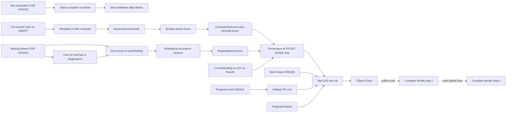

# Audit transversal des autorités transactionnelles, du fencing et des verrous

Date : 2026-10-18. **Audit statique du checkout local**, sans changement runtime et sans décision TARGET. Référentiel : `90926a5ec37d1ca841e3de017bec0d1f705d8839`, branche `feat/runtime-monolith`.

> **Résolution R03 : PASS, voir section J.** La section I conserve la preuve rouge initiale `DEFECT_CONFIRMED`. Voir section I pour les trois tests PostgreSQL (un rouge métier conservé) et les limites de la preuve. Le corps A–H conserve les conclusions de l’audit statique initial.

## A. Executive summary

Les huit chemins demandés sont présents. `BusinessEvent → SourceVersionWatermark` est précisément le runtime **LatestKnownVersion**, et non un neuvième chemin indépendant. Le monolithe compose les mêmes capacités ; il ne constitue pas un autre protocole de Consumption. Event possède une consommation par conséquence/projection, et ProjectionTask sépare préparation et publication : il faut conserver ces exceptions dans toute description du protocole.

**Garanties confirmées dans le périmètre inspecté :** effets SQL provisoires puis provenance lorsqu'elle existe, flush, CAS `PENDING/current_claim_id`, clôture conditionnelle du claim et commit commun. Perdre le CAS lève une exception qui annule les effets. L'acquisition est une transaction antérieure indépendante. La lease expirée n'annule pas l'autorité ; le takeover committé la remplace. Le fence métier Binding est distinct du fence Consumption. Les tests PostgreSQL archivés WP4/WP6 couvrent des courses de takeover, FK, unicité et refus de commit ; ils ne démontrent ni absence universelle de deadlock ni performance en charge. Voir [finalizer], [lifecycle], [slot], [tx-tests] et [WP6](../plans/2026-10-16-consumption-generic-transactional-protocol-wp6-closure.md).

**Aucun nouveau défaut runtime reproduit par cet audit.** Un risque précis de contexte Expense mixant deux états est identifié sous READ COMMITTED (R03, E.4) ; il doit être caractérisé avant de conclure à la correction exhaustive des validations métier. Le deadlock D17 historique a été corrigé avant ce HEAD. L'ancien audit du 6 octobre décrit encore deux prélocks de finalisation/récupération supprimés ; ses propositions sur ces locks ne sont plus applicables. Les dettes structurelles WA6 restent ouvertes à ce HEAD local. Cela ne signifie pas qu'un chemin inverse actuel soit démontré.

**Pot utilise déjà une préparation optimiste suivie d'un CAS tardif.** Les dix mutations calculent leur candidat avant d'insérer/avancer l'autorité de version. Un verrou par Expense ne remplace pas à garanties constantes la version globale commune au Pot, aux enfants, à l'autorisation et aux projections exactes. Les pistes les plus crédibles sont la préparation des représentations persistées/Events et la réduction du travail technique résiduel après CAS, après mesure. Aucun gain chiffré n'est établi. Voir E.

**Compteur Event tardif : faisabilité transactionnelle conditionnelle, pas prêt à brancher.** Un suffixe après CAS/claim et avant commit peut encore écrire et rollbacker avec toute la transaction. Il doit être à l'intérieur du runner propriétaire, couvrir tous les producteurs et toutes les familles, imposer un ordre global des compteurs et empêcher en base tout Event committé sans position. Ni ce suffixe ni cette contrainte n'existent actuellement. L'immutabilité physique et les colonnes legacy doivent être traitées explicitement. Voir F.

Confiance élevée sur les prédicats et séquences explicites ; moyenne sur l'exhaustivité des compositions futures et les ordres fins du flush JPA ; aucune conclusion mesurée sur les durées, le débit ou la contention.

### Baseline Git, limites et méthode

- Dépôt : `/Users/julien.guezennec/Dev/projects/pocoma`, remote `origin=https://github.com/kartaguez/pocoma.git`.
- HEAD local : `90926a5e`. Référence distante **locale** `origin/feat/runtime-monolith=2eef3ab9785c524c2fab86f586fc12580c8b1c2e`, divergence `0` local / `2` distants. Commits absents du checkout : `4158de69` (tests ownership/order Binding), `2eef3ab9` (documentation résolution WA6). Ils ne sont pas incorporés dans les conclusions CURRENT.
- `git ls-remote origin refs/heads/feat/runtime-monolith` a échoué : résolution DNS de github.com impossible. **HEAD du serveur non vérifié** ; la référence locale ne lui est pas assimilée. Aucun fetch/mise à jour de référence, changement de branche, staging, commit, stash, nettoyage, merge, rebase, tag ou push.
- État initial : 13 chemins locaux Keycloak/Bruno (8 modifiés, 1 supprimé, 4 non suivis), conservés. Empreintes des fichiers présents et absence du fichier supprimé contrôlées avant/après les écritures documentaires.
- Entrée canonique lue : [docs/README](../README.md), puis Architecture, garanties, protocole Consumption, write-side closure, audits et dettes. Politique normative [Reactor Verification Policy](../testing/Reactor_Verification_Policy.md) lue avant analyse sous `app/`.
- **Verification scope déclaré avant écriture : documentation uniquement.** Impact production interdit ; slices exécutées : aucune. Périmètre de lecture : WEB, COMMAND, EVENT, PROJECTION, BINDING, LKV, Registration et Results. Gate architecture global non requis ; reactor complet non exécuté ; vérification DB aucune, aucune migration ni connexion PostgreSQL. Les tests supplémentaires ci-dessous sont des propositions seulement.
- Commandes effectivement utilisées : `pwd`, `git remote -v`, `git branch --show-current`, `git branch -vv`, `git rev-parse`, `git status --short/--porcelain`, `git rev-list --left-right --count HEAD...origin/feat/runtime-monolith`, `git log --oneline HEAD..origin/feat/runtime-monolith`, `git ls-remote` (échec), recherches `rg/rg --files`, lectures `cat/sed/head/tail`, scripts Python bornés de documentation/empreintes/liens et `git diff --check`. Aucun Maven, Docker, test, benchmark ou SQL exécuté.

### Échelle de preuve

**S** = démontré statiquement par SQL/code transactionnel sous le wiring inspecté ; **T** = scénario présent dans un test PostgreSQL, avec résultat historique cité séparément ; **D** = seulement documentaire ; **U** = non démontré ; **X** = affirmation contredite par le code. S suppose la même base/connexion transactionnelle, les writers conformes et l'absence d'un effet externe irréversible ajouté au callback. T n'est pas une preuve universelle et aucune campagne n'est réexécutée ici.

## B. Matrice des chemins Consumption

### Préfixe et suffixe communs

**Acquisition A (transaction propre)** : insertion initiale du slot `ON CONFLICT DO NOTHING` → `findByKeyForUpdate` → décision DONE/NotReady/Busy ou takeover → invalidation du claim expiré → insertion/flush du nouveau claim → installation du claim → commit. Cette transaction ne détient plus ses verrous lors de l'exécution. Un claim acquis et jamais exécuté sera récupérable par expiration/takeover. Preuves : [lifecycle] `acquire`, [slot], [claim].

**Suffixe Z (transaction des effets)** : effet rollbackable → `appendInputs` → `appendResults` → flush JPA automatique → `terminalize WHERE slot_id=? AND status='PENDING' AND current_claim_id=?` → exiger exactement une ligne → clôture du claim exact encore ouvert/non invalidé, exactement une ligne → commit du runner. CAS zéro : `LostClaimException`. Échec clôture : `ConsumptionClaimClosureException`, rollback du CAS aussi. `clearAutomatically` détache les objets ; il ne committe ni ne libère les verrous. Le commit peut encore échouer après Z, notamment sur contrainte différée. [finalizer] `finalizeConsumption`, [lifecycle] `terminalize/closeClaim`, [slot], [claim], [owner], [tx-tests] `deferredConstraintRefusesCommitAfterWinningCasAndRollsBackEverything`.

**Échec H (nouvelle transaction après rollback physique)** : classifier/policy → retry : CAS slot `PENDING/C` libérant le current claim, `nextClaimAt`, puis clôture en erreur ; ou échec terminal : effet spécialisé éventuel → Z en FAILED. La provenance de l'essai rollbacké ne survit pas. COMMITTED/UNKNOWN du runner ne sont pas traités comme un rollback confirmé et ne provoquent pas automatiquement une nouvelle décision métier. LostClaim ne passe pas dans la policy. [failure], [sequential] `handleExecution`, [owner].

| # / source → consumer | Producteur, discovery et acquisition | Transaction réelle d'exécution / autorités / écritures | Finalisation, alternatives et preuve |
|---|---|---|---|
| 1 RegistrationRequest → Registration worker | Admission WEB `JdbcRegistrationRequestStore.insert`, Request immutable V27. `RegistrationConsumptionLocator.openSearch` / `JdbcRegistrationDiscovery.next`, scan metadata puis A par Request/`REGISTRATION_WORKER_V1`. | Reload Request et outcome éventuel. Si outcome existant, le retourner. Sinon stream Binding E créé si absent et verrouillé ; conflit actif → Rejected ; libre → initializer User + UserCreatedFact → occurrence B → actif E → avance R → BindingFact → RegistrationOutcome. | Input Request v1 puis Z ; pas de ConsumptionResult produit ici. Tout U/B/faits/outcome rollbacke sur claim perdu. H : invariant terminal, technique retry 5 s selon policy ; pas d'outcome métier artificiel sur failure. [registration], [reg-locator], [binding], [reg-outcome], [reg-test]. |
| 2 RecordedCommand → Command processor | Admission WEB durable, V8/V19/V24. `CommandConsumptionLocator` / `JpaCommandConsumptionDiscoveryAdapter` : candidate metadata, A avant reload/decode. | Reload RecordedCommand ; observer E/B→U/R ; permissions/expiration ; decode/dispatch ; préparation Pot ; CAS Pot/metadata/DML ; capture d'Events puis append SQL/flush ; fence exact Binding ; insert strict CommandOutcome puis CommandTerminalEvent ; provenance. | Z. Rejets métier : outcome/terminal Event, aucun BusinessEvent ajouté par ce chemin. Absence B exact → rejet direct ; expiration/AuthZ/rejet après observation → fence. H : retry pour erreurs techniques classées transitoires ; sinon FAILED + terminal Event dans H. Recovery séparée après perte fence (voir B.2). [command], [cmd-execution], [append], [outcome], [command-config], [cmd-test]. |
| 3 BusinessEvent → ProjectionTask materializer | BusinessEvents Pot persistés par Command. `JdbcProjectionMaterializationDiscoveryAdapter.findCandidates` route metadata vers une conséquence `(EventId,ProjectionType)`, sans décoder le payload ; A par conséquence. | **Finalize court**, pas Execute/reload générique du payload : `producer.ensure(candidate)` dans durableEffect. INSERT Task `ON CONFLICT` par clé projection cible/version ; réutilisation de la tâche logique. | Z **sans provenance** ici ; consumer distinct par ProjectionType. Une erreur ensure/commit remonte, slot reste acquis jusqu'à reprise ; ce chemin n'appelle pas H pour fabriquer FAILED à chaque exception. Test rollback après ensure et takeover. [event-service], [event-discovery], [produce-task], [event-test], [acquire-finalize]. |
| 4 BusinessEvent → SourceVersionWatermark / LatestKnownVersion | Même source SQL que #3 ; consumer indépendant `SOURCE_VERSION_WATERMARK`. `LatestKnownVersionConsumptionLocator` / discovery JPA, A. | Reload RecordedEvent, lecture Pot/version, `advanceToAtLeast` : upsert READ seulement si version supérieure ; lecture du résultat courant si inchangé. | Input EVENT/version puis Z. Claim perdu rollbacke aussi le watermark. H technique retry/classification terminale dédiée ; Event manquant au reload peut échouer terminalement sans watermark/provenance de succès. **LKV et SourceVersionWatermark sont un seul chemin.** [lkv-locator], [lkv-store], [lkv-test]. |
| 5 ProjectionTask → Projection executor | Task produite en #3 ; discovery `JdbcProjectionTaskStoreAdapter.findNextEligible`, A par tâche/consumer projection. | **Préparation avant transaction finale** : chargement historique à V, calcul et validation par ProjectionEngine. Prepared → transaction publication `projection_root` (clé unique) puis artifacts. Pas de verrou Pot WRITE pendant le calcul. | Z sans provenance fournie. Temporary → H/retry ; Terminal → publication ProjectionFailure + Z FAILED ; erreur de transaction remonte et ne doit pas être confondue avec échec métier déjà committé. First-published-wins au root, pas de comparaison complète de payload. [projection-service], [projection-config], [projection-store], [projection-test]. |
| 6 BindingFact → CurrentBinding projector | Acquire/Detach/Registration appendent BindingFacts ; migrations V20–23 produisent aussi des baselines historiques. `BindingFactConsumptionLocator` / `JdbcBindingFactDiscoveryAdapter`, A par EventId. | Reload fact exact, `MaterializeCurrentBindingService.apply` ; upsert READ E si R augmente ; R inférieur ignoré ; R égal compare payload, divergence lève. Aucun lock du Binding WRITE pour matérialiser. | Input fact v1, même si R=0, puis Z. H par classifier/policy Binding. Stale publication rollbackée ; fact découvert tard retrouvé par nouveau scan. [binding-locator], [current-store], [binding-test]. |
| 7 RegistrationOutcome → RegistrationResult materializer | Outcome de #1, V28 ; `RegistrationResultConsumptionLocator` / `JdbcRegistrationResultDiscovery` ; A Request/consumer résultat distinct. | Reload Request + Outcome et vérifier les identités ; construire owner historique ; `ensureResult` INSERT/compare immutable par Request. Ne consulte pas Binding courant. | Input Outcome v1 puis Z. H invariant terminal ou technique retry ; replay identique accepté, divergence ne remplace rien. [reg-result-locator], [reg-result-service], [reg-result-store], [reg-result-test]. |
| 8 CommandTerminalEvent → CommandResult materializer | Event APPLIED/REJECTED/FAILED de #2/H/recovery ; `CommandResultConsumptionLocator` / `JdbcCommandResultSource` ; A par terminal EventId. | Reload joint source/outcome/RecordedCommand ; cohérence ID et type Event/outcome ; owner historique ; INSERT/compare CommandResult immutable par CommandId. | Input terminal Event v1 puis Z. H invariant terminal ou technique retry. Chemin direct, aucun ancien Event→Task CommandResult exécuté dans ce runtime. [cmd-result-locator], [cmd-result-service], [cmd-result-store], [cmd-result-test]. |

### B.1 Couverture des invariants par chemin

| Chemin | Atomicité | Fencing Consumption | CAS après effets/provenance | Idempotence | Recovery / limites |
|---|---|---|---|---|---|
| 1 | S + T | S + T | S, input avant CAS | PK Request/outcome, stream E, B unique | S + T ; outcome existant évite recréation ; failure n'invente pas un Registered |
| 2 | S + T | S + T ; fence Binding supplémentaire | S + T, flush réel | CAS Pot, PK outcome, UNIQUE terminal Command | S + T ; classification conservatrice et recovery B.2 |
| 3 | S + T | S + T | S + T, provenance vide autorisée | UNIQUE Task logique | T : reprise après exception par lease ; pas de policy H uniforme |
| 4 | S + T | S + T | S + T | max-upsert + slot propre | T : rollback watermark/input et reprise |
| 5 | S + T sur publication, pas sur calcul préparatoire | S + T | S + T, provenance vide | UNIQUE root ; failure ID | Calcul historique hors transaction d'effets ; ne pas le décrire comme reload mutable sous lock |
| 6 | S + T | S + T | S + T | max R + égalité du payload | T : takeover/restart/commit tardif |
| 7 | S + T | S + T | S + T | PK + comparaison exacte + trigger | T : replay divergent et writer failure |
| 8 | S + T | S + T | S + T | PK + comparaison exacte + trigger | T : stale Result/provenance rollbackés |

Les T désignent les scénarios nommés en G et dans les tests liés, pas une couverture exhaustive des combinaisons. La possibilité générale de faire un effet réseau dans un callback n'est pas fenced par PostgreSQL : le protocole exige des effets SQL rollbackables ou une sortie durable à consommer séparément. Aucun appel réseau métier irréversible n'a été identifié dans ces callbacks.

### B.2 Recovery Binding et producteurs hors parcours principal

`BindingFenceRecoveryExecuteUseCase.execute` intercepte uniquement la perte du fence après retour en exception du propriétaire Execute : l'ancienne transaction Pot/Events est rollbackée. Il ouvre une transaction propriétaire neuve, relit **E/B exact** ; B toujours présent → `BindingFenceConflictException` technique ; absent → participant Execute qui publie Rejected `CALLER_IDENTITY_NOT_CURRENT`, puis Z avec provenance vide. **Ni rejeu Pot ni prélock du slot.** L'absence est stable dans le protocole courant parce que l'occurrence B est réservée définitivement et ne peut pas être réattribuée. Une réutilisation future de B invaliderait ce raisonnement. [recovery], [binding], migrations V21–23, [D17](../debts/BINDING_LOCK_ORDER_GUARD/Resolution_D17_2026-10-16.md).

Autres surfaces trouvées par recherche des writers et des ports :

| Surface | Autorité / transaction | Conséquence audit |
|---|---|---|
| `JpaExternalIdentityBindingAdapter.acquire/acquireWithInitializer/detach` | Participants MANDATORY, stream E → actif/occurrence/fact ; `acquire` délègue au même protocole sans initializer | APIs de mutation Binding utilisables par un appelant propriétaire hors Consumption ; aucun second protocole SQL autonome identifié. Les seuls appels métier d'acquire trouvés ici sont Registration ; Detach reste une capacité du port, exercée par les tests. |
| `JpaBusinessEventOutboxAdapter.append` | Autre adapter `BusinessEventAppendPort`, `@Transactional` REQUIRED, `repository.save` sans flush forcé | Peut produire un BusinessEvent hors Command si appelé ; aucun appel métier de production supplémentaire identifié par recherche du port. Il ne faut pas oublier cette surface dans un futur finaliseur/guard. [other-append] |
| `JdbcCommandOutcomeAdapter.publish` | MANDATORY ; strict outcome puis terminal Event | Succès, rejet, terminal failure et recovery : **tous** doivent numéroter le terminal Event si cette famille est concernée. Ne pas ne couvrir que `appendAll`. |
| `JdbcRegistrationOutcomeStore`, `JdbcUserCreatedFactAdapter`, stores RegistrationResult/CommandResult | JDBC ; certains adapters Registration sans annotation transactionnelle propre, participants par wiring du caller | L'atomicité actuelle vient de la transaction propriétaire. La formule documentaire « tous les adapters d'écriture sont MANDATORY » est trop large (voir H). Un appel direct hors propriétaire demanderait une autre preuve. |
| Admission Request/Command et migrations SQL | Transaction admission distincte ; bootstrap historique BindingFacts/User/etc. | Pas d'effet Pot dans l'admission. Les migrations/bulk loaders sont des producteurs de données durables à traiter lors d'un déploiement du compteur ; ils ne sont pas des nouveaux workers runtime. |
| Lifecycle slot/claim | Toutes les mutations applicatives trouvées passent par acquire/terminalize/scheduleRetry ; repositories restent une surface technique | Pas de heartbeat/prolongation de lease trouvé. L'unicité et les FK ne remplacent pas le protocole des writers. Les SQL de test/operations et migrations ne sont pas une preuve de writer runtime alternatif. |

## C. Matrice des autorités et verrous

Notation : P=Pot ; B=stream Binding E ; A=actif E ; S=slot ; C=claim ; Q=outcome Command ; Evt=ligne Event ; F=famille de publication future. **Durée** signifie travail restant avant commit, sans temps inventé. Un UPDATE/CAS prend aussi un verrou ; « optimiste » ne signifie pas absence d'attente.

| Chemin / transaction | Autorité / objet SQL et granularité | Opération / moment | Durée restante | Invariant et concurrents | Preuve / opportunité |
|---|---|---|---|---|---|
| Tous, A | S : une clé consommable/consumer | INSERT initial/UNIQUE puis SELECT FOR UPDATE par clé avant décision | Lecture lease, invalidation C, insert C, install C, commit | Un propriétaire/attempt ; acquisitions et takeover, final CAS, FK provenance | [lifecycle] `acquire`, [slot], V4 ; T [tx-tests]. CAS alternatif possible seulement avec revalidation de tous les champs de décision ; pas de gain démontré pour cette transaction courte. |
| Tous, A | C : ancien/nouveau claim, UNIQUE `(slot,attempt)` | UPDATE invalidation ancien ; INSERT/flush nouveau ; FK vers S ; S→C lors installation | Installation puis commit | Histoire et rattachement exact ; clôture concurrente, takeover | [claim], V4. Pas d'effet métier sous ces verrous ; ne pas additionner leur durée à Execute. |
| Execute/Finalize/H/recovery, Z | S, une ligne | UPDATE CAS **après** flush de tous effets ; pas de FOR UPDATE préalable | Clôture C, commit (plus suffixe futur éventuel) | Ancien claim ne committe pas ; A/takeover et autres finalisations même slot | [slot] `terminalize/scheduleRetry`, [tx-tests]. Déjà tardif ; avancer le CAS rallongerait sa détention. |
| Z | C exact `(slotId,claimId)` encore ouvert/non invalidé | UPDATE `end/fail` après CAS ; contrôle nombre de lignes | Commit | Clôture cohérente avec transition S ; A et closes concurrents | [claim], [lifecycle] `closeClaim` ; T refus de clôture rollbacke S. |
| Chemins avec provenance | `consumption_inputs/results` ; clés input + PK result ; parent S | INSERT/flush, UNIQUE input et FK KEY SHARE S **avant** CAS | CAS, C, commit | Provenance ne survit pas au perdant ; takeover FOR UPDATE peut attendre | V4, [provenance], WP4 T02/T07. Compatible avec CAS non-clé caractérisé ; ne pas supprimer FK pour raccourcir arbitrairement. |
| Command create Pot | `pot_global_versions(P)` + metadata `(P,1)` | INSERT/saveAndFlush autorité, puis metadata | Header, Event append/flush, B, Q/terminal Event, provenance/Z, commit | Un nouvel ID Pot, une metadata exacte ; mêmes PK si collision | [version-adapter], [version], [create-pot], V1/V11. Préparation domaine déjà avant insert. |
| Command mutations Pot existant | `pot_global_versions(P)` | UPDATE `WHERE P AND version=expected`, avant DML enfants ; flush/clear automatique | Metadata, DML temporel, Events, B, Q, provenance/Z, commit | Sérialise les mutations **d'un Pot**, valide le snapshot de décision ; autres Commands même P | [version] `updateIfActive`, neuf services, [cmd-test]. Pas de CAS global ni de verrou de toutes les lignes Pot à la lecture. |
| Même transaction Pot | `pot_version_metadata(P,V)` | INSERT PK, FK P, `current_timestamp` ; trigger interdit UPDATE/DELETE | Tout suffixe Pot/Command | Timestamp exact du commit métier au sens transactionnel, pas horloge Event ; concurrent même P/V | V11, [version]. Trigger ne vérifie pas à lui seul qu'une avance P possède sa metadata ; cette obligation est dans l'adapter actuel. |
| Update/Delete Pot | `pot_headers` ancienne ligne temporelle + nouvelle `(id,started)` | UPDATE closeActiveVersion puis INSERT ; après CAS P | Event, B, Q, Z, commit | Une représentation historique à chaque V ; mutations même P | [pot-header], V1. Aucun SELECT FOR UPDATE enfant trouvé ; contraintes et UPDATE verrouillent réellement. |
| Shareholders | `shareholders` IDs modifiés d'un P ; ajout nouveaux IDs | closeActiveVersions bulk seulement pour IDs updated ; saveAll des updated/added ; après P | Flush Event puis B/Q/Z | Cohérence multi-shareholders et appartenance/auth ; même P | [shareholders]. Lecture de l'agrégat complet n'est pas lock pessimiste ; ordre physique des IDs du bulk/JPA non garanti par un Set. |
| Expense header / shares | Header d'une Expense ; shares actives de cette Expense | UPDATE fermeture + INSERT ; Create écrit Header + Shares à même V ; après P | Flush Event puis B/Q/Z | État historique, payer/appartenance et version commune ; toutes mutations même P | [expense-header], [expense-shares]. `save` Shares relit encore les lignes actives et compte après P ; candidat d'optimisation bornée, voir E. |
| Command append Events | `business_event_outbox` IDs neufs + index Pot/version et type | saveAllAndFlush après DML ; contraintes PK/type | B, outcome/terminal Event, provenance/Z, commit | Events et effets gagnants atomiques ; collisions ID/index seulement possibles | [append], V2/V15. Les index non uniques partagés ne prouvent pas un verrou logique global. Préparer mapping/JSON avant P à étudier. |
| Command fence | B : une ligne `(issuer,subject)` ; lecture sous-requête A exact | UPDATE B `SET R=R WHERE E,R AND EXISTS(A E/U/B)` après Events | Q/terminal Event, provenance/Z, commit | Empêche commit d'une Command sous occurrence détachée ; Acquire/Detach même E, Commands même E | [stream] `FENCE_EXACT`, [command] `fence`. UPDATE no-op conserve verrou au commit ; sous-requête A n'est pas un lock A explicite. |
| Registration / Acquire / Detach | B stream E | bootstrap UNIQUE puis FOR UPDATE avant lecture A | User/fact si initializer, occurrence/actif, R/fact, outcome, provenance/Z (si Consumption), commit | Décisions positives/négatives et R/fact cohérents ; fence Command, mutations Binding E | [binding], [stream]. Remplacement par CAS exige protocole complet ; NOT EXISTS seul réfuté par [binding-cas-test]. |
| Binding mutations | A `external_identities(E)` ; occurrence B ; fact `(E,R)` | INSERT/DELETE exact, PK/UNIQUE, FK E/U/B ; sous verrou B | Avance R/fact/outcome/Z, commit | Au plus un actif ; B non réutilisé ; fait unique par R | V18/V20–23, [binding]. Inversion A→B non trouvée dans ce writer ; guard historique incomplet à ce HEAD. |
| Registration | User, UserCreatedFact, RegistrationOutcome Request | INSERT User/fact après B libre ; outcome après B/fact | Provenance/Z, commit | Pas d'User orphelin ni seconde décision ; autres Requests même E/Request | [registration], V28, [reg-outcome]. Déplacer SQL User avant B crée travail perdant et change ordre ; pas recommandé sans preuve. |
| Command normal / H / recovery | Q `command_outcomes(CommandId)` → terminal Event unique Command | INSERT strict Q puis INSERT terminal Event, FK RecordedCommand/outcome | Provenance/Z, commit | Une issue ; tentative stale et gagnante du même Command peuvent attendre Q avant CAS | [outcome], V17, D17/WP4. Sérialisation par unicité réelle ; pas d'upsert silencieux du gagnant. |
| Event materializer | Task clé `(projection type,target type,id,V)` | INSERT ON CONFLICT DO NOTHING avant CAS S | Z, commit | Une tâche logique même si plusieurs Events la demandent | [task-store], V13 ; [event-test] courses commit/rollback. Attente UNIQUE réelle, ne justifie pas suppression. |
| Projection Prepared | root clé logique puis artifacts FK root | INSERT root ON CONFLICT ; INSERT artifacts si nouveau root | CAS S, C, commit | Publication atomique first-wins ; deux Tasks même projection | [projection-store], read V7, [projection-test]. Calcul déjà préparé ; root avant artifacts cohérent. |
| Projection Terminal | `projection_failures` failure ID | INSERT/compare dans même transaction que FAILED | CAS S, C, commit | Échec durable lié au traitement gagnant | [projection-store] `recordFailure`, [projection-test]. |
| Binding projector | READ current_binding E | UPSERT conditionnel R supérieur ; même égalité relue | Input, Z, commit | Monotonie/payload cohérent ; facts même E hors ordre | [current-store], read V9–13, [binding-test]. Pas de verrou WRITE B ; conserver séparation. |
| LKV | READ source_version_watermarks P | UPSERT max, même WHERE false peut attendre/verrouiller le conflit | Input, Z, commit | Aucun recul ; Events même P | [lkv-store], read V4, [lkv-test]. Un précheck non verrouillé n'est qu'un filtre : l'upsert reste nécessaire. |
| Results 7/8 | `registration_results(RequestId)` / `command_results(CommandId)` | INSERT ON CONFLICT puis comparaison, FK parents et triggers immutable | Input/Z, commit | Replay exact ou erreur ; stale consumer/winner même résultat | [reg-result-store], [cmd-result-store], V25/V29, tests Results. |

**Verrous implicites et bornes.** Les SELECT simples prennent des verrous de relation ACCESS SHARE, sans exclusion entre readers/writers ordinaires. DML prend ROW EXCLUSIVE de relation ; ce nom ne signifie pas exclusion de tous les writers. UPDATE non-clé prend normalement NO KEY UPDATE ; DELETE/FOR UPDATE est plus fort. Les PK/UNIQUE peuvent attendre une transaction ayant inséré la même clé ; les FK peuvent protéger les parents en KEY SHARE. Les FK présentes doivent être lues dans les migrations actuelles, pas déduites des noms d'agrégats : les tables temporelles V1 n'ont pas toutes des FK métier. Les triggers immutables repérés rejettent des mutations ; ils ne prennent pas un compteur caché. Les attentes exactes de pages/index, ordre des tuples d'un bulk UPDATE et timings restent U, sans instrumentation. [PostgreSQL 17, locks](https://www.postgresql.org/docs/17/explicit-locking.html).

## D. Graphe global d'acquisition

Un arc signifie « peut demander B en conservant A dans **la même transaction** ». Les commits d'acquisition et d'exécution ne sont pas raccordés par un arc. Le graphe regroupe des types de ressources ; deux nœuds de même type ne sont pas forcément la même ligne.



Q→terminal Event et root→artifact incluent leurs FK ; des arcs vers les parents immuables Request/RecordedCommand/User existent également (C), mais ne constituent pas des autorités exclusives supplémentaires en compétition entre lectures ordinaires. La recovery commence à Q→Z : elle ne passe plus par P ou un prélock S.

**Ordres cohérents observés :** Pot→DML→Events→Binding→Q→provenance→S→C ; Binding writer stream→actif/occurrence/fait→outcome→provenance→S→C ; dérivés→S→C. Aucun chemin actuel inspecté ne prend Binding puis demande Pot. Acquire prend S→C, mais ne demande jamais Q/P/Binding dans cette transaction. La seule opposition S/C ne démontre pas un cycle : le finalizer doit gagner S avant de demander C, et le takeover doit posséder S avant d'invalider C.

**Cycle historique faisable et observé, désormais supprimé :** C1 tient Q, C2 (après takeover) prenait S FOR UPDATE puis attendait Q ; C1 demandait KEY SHARE S via provenance. Q→S→Q, SQLSTATE 40P01 documenté WP0. Le finalizer courant laisse C2 attendre Q **sans détenir S** ; WP4 a caractérisé les huit variantes failure/recovery et provenance. Ne pas reporter ce PROVEN_DEFECT historique comme un défaut présent. [D17](../debts/BINDING_LOCK_ORDER_GUARD/Resolution_D17_2026-10-16.md).

**FK / file takeover :** une provenance peut tenir KEY SHARE S avant le CAS ; takeover FOR UPDATE attend. Les arcs condensés peuvent sembler dessiner une conversion circulaire. WP4 T02/T07/T10 a exercé deux détenteurs FK, un takeover en attente et le CAS non-clé compatible avec KEY SHARE, avec résolution par commit/rollback. Aucun deadlock observé dans ces cas ; pas de preuve de fairness ou d'absence de cycle pour toutes les futures contraintes.

**Risques non démontrés :** plusieurs Pots, plusieurs Bindings, plusieurs clés dérivées ou plusieurs compteurs pris dans des ordres opposés produiraient des cycles théoriques. Les commandes courantes sont mono-Pot ; les préparations ont parfois des ensembles sans ordre, mais leur DML enfant est sous le même P. Cela réduit la concurrence sur ces enfants sans prouver tous les futurs callers directs sûrs. L'ordre JPA fin des inserts/flush et celui des lignes d'un UPDATE multi-ID ne sont pas contractuels. Pas de cycle concurrent actuel supplémentaire démontré par cet audit ; ne pas confondre graphe de types et wait-for graph des sessions.

## E. Analyse Pot : version, enfants et acquisition tardive

### E.1 Ce qui se passe déjà avant le verrou

Les neuf mutations d'un Pot existant chargent un contexte et sa version V, contrôlent `expectedVersion`, les états deleted, l'appartenance et l'autorisation, chargent l'agrégat à V, appliquent la mutation en mémoire puis calculent V+1. Elles appellent ensuite `updateIfActive(V,V+1)`. CreatePot prépare valeurs/autorisation/agrégat et initialise V1 par INSERT. L'appel `EventPublisherPort.publish` des services capture l'Event dans `PotCommandInvocation` ; sa vraie insertion SQL est ensuite effectuée par `JpaPotCommandEventAppendAdapter.appendAll`. [create-pot], [update-pot], [add-shareholders], [create-expense], [update-expense-shares], [invocation], [append].

| Mutation | Candidat / validations avant autorité | Écritures après autorité |
|---|---|---|
| CreatePot | AuthZ create, factory et header | version V1 + metadata, nouveau header, Event |
| UpdatePotDetails / DeletePot | contexte V, terminal deleted, expectedVersion, créateur, header à V, mutation | CAS+metadata, fermeture header actif, nouvelle ligne, Event |
| AddPotShareholders | contexte V, terminal deleted, créateur, agrégat à V, nouveaux noms/poids/IDs | CAS+metadata, nouveaux shareholders, Event |
| UpdatePotShareholdersDetails / Weights | contexte V, IDs, autorisations créateur/self selon action, agrégat à V, mutation | CAS+metadata, fermeture des seuls IDs updated, nouvelles lignes, Event |
| CreateExpense | contexte V, Pot non deleted, payer/shares membres, AuthZ, factory/header/shares | CAS+metadata unique, header et shares nouveaux au même V+1, Event |
| DeleteExpense / UpdateExpenseDetails | contexte Expense/Pot, deleted, expectedVersion, header à V et cohérence d'identité, AuthZ, mutation | CAS+metadata, fermeture/nouveau header Expense, Event |
| UpdateExpenseShares | contexte, deleted, IDs membres, expectedVersion/AuthZ, shares à V, mutation | CAS+metadata, relecture shares actives, fermeture de toutes les anciennes shares de cette Expense, nouvelles shares, Event |

**Revalidation actuelle :** le CAS sur V ne répète pas chaque validation métier ; il certifie que l'autorité globale du Pot utilisée par le candidat n'a pas avancé. Ce raisonnement couvre les objets enfants seulement si toutes leurs mutations concurrentes avancent P dans la même transaction et si les lectures sont bien attachées à V. Les loaders utilisent largement `findActiveAtVersion(V)` ; `JpaExpenseContextAdapter.loadExpenseContextData` commence néanmoins par `findCurrentActive(expenseId)` avant de lire P puis le header Pot à V. Les services rechargent le header Expense à V et vérifient l'identité par `ExistingExpenseAuthorizationContext`. La cohérence de toutes les décisions négatives sous chaque interleaving READ COMMITTED n'est pas une preuve universelle fournie ici : un futur déplacement des lectures doit notamment conserver la cohérence entre ce contexte initial et l'agrégat rechargé. [expense-context], [expense-consistency].

Le CAS gagnant empêche un autre writer conforme d'avancer P jusqu'au commit. Si un writer a avancé V entre lecture et CAS, zéro ligne/VersionConflict annule la mutation candidate. Les lectures multiples en READ COMMITTED ne constituent pas par elles-mêmes un snapshot atomique ; la validation par autorité et les lectures historiques sont essentielles. [PostgreSQL, isolation](https://www.postgresql.org/docs/17/transaction-iso.html).

### E.2 Portée et durée incompressible

La portée de l'exclusion est **une ligne d'autorité par Pot**, pas chaque ligne enfant et pas tous les Pots. Elle ordonne aussi les versions consommées par AUTH/READ_POT/BALANCES. Deux Expenses distinctes d'un même Pot peuvent donc attendre P : c'est la conséquence du contrat de version globale, pas une redondance démontrée. Des verrous enfants seuls ne valident pas membership/payer/creator/deleted ou une projection cohérente à une version globale.

Après le CAS restent metadata, DML temporel, mappage et sérialisation des Events, saveAllAndFlush, fence Binding (qui peut attendre un autre acteur E), outcome/terminal Event, provenance/flush, CAS Consumption et claim, puis commit. P reste tenu pendant **toute** cette suffixe, y compris les attentes d'autres autorités. Renvoyer le snapshot au service appelant ou faire `clear()` ne libère pas P. La numérotation tardive ajouterait une attente compteur à cette durée ; elle raccourcit la détention du compteur, pas automatiquement celle de P.

`PotVersionMetadata` est insérée par le même adapter après le CAS ou l'INSERT initial, avec `current_timestamp`. Sa PK empêche le doublon, sa FK rattache au Pot, son trigger interdit UPDATE/DELETE. Un échec d'insertion remonte et rollbacke toute l'exécution. **Pas de contrainte SQL inverse trouvée imposant une metadata à chaque update brut de P** : la garantie de complétude est celle du chemin applicatif, pas de n'importe quel SQL privilégié. Le timestamp désigne le temps transactionnel, ni le moment du lock ni l'instant physique du commit. [version-adapter], [version], [metadata-migration].

### E.3 Opportunités, sans décision d'optimiser

| Idée | Sûreté conceptuelle / revalidation nécessaire | Limite, risque ou coût déplacé |
|---|---|---|
| Préparer DTO persistés, ensembles et JSON d'Events avant CAS | Possible pour fonctions pures basées sur candidat immuable validé par V ; ne pas faire d'insert ni de nouvelle lecture mutable cachée | Nécessite découpage entre préparation et écriture, IDs/trace/horodatages stabilisés et aucune divergence avec Events/provenance ; travail perdu sur conflit |
| Déplacer la relecture shares dans `JpaExpenseSharesAdapter.save` avant CAS | Possible seulement avec un plan capturant les lignes exactes à V, validé par CAS P puis contrôle des fermetures | Le comptage actuel est un contrôle de cohérence ; supprimer sans plan exact affaiblit la preuve. Charge de copies/mémoire, retries inchangés ou augmentés |
| Faire le CAS P après DML enfants | Peut théoriquement rollbacker le perdant, mais **aucun bénéfice net prouvé** | Change le graphe enfant→P ; conflits/UNIQUE et flush avant élection, travail perdant, nouveaux cycles. Ne pas le présenter comme optimisation sûre |
| Passer de P global à une version par Expense | Ne conserve pas les garanties actuelles sans nouveau protocole multi-objets/version publiée | Refonte de contrat et projections ; hors audit, pas un petit remplacement de lock |
| Déplacer tout le calcul hors de la transaction Execute | Les calculs purs sont déjà hors lock, mais restent dans Execute. Un plan devrait capturer/revalider V et toutes autorités non couvertes, dont Binding | Réduit durée transactionnelle possible, pas nécessairement durée du lock P ; résolution provenance/rejet doit rester correcte |
| Avancer le fence Binding avant Pot pour échouer plus vite | Peut réduire travail perdu pour B périmé | Inverse l'ordre P→B, allonge B, change concurrence Registration/Detach. Non retenu sans preuve globale et mesure |

Aucun verrou Pot explicitement redondant n'a été trouvé. Le CAS actuel est déjà l'alternative optimiste au SELECT FOR UPDATE préalable.

### E.4 Risque concret à caractériser : contexte Expense lu avant la version Pot (R03)

**Code observé.** `JpaExpenseContextAdapter.loadExpenseContextData` lit d'abord `expenseHeaderRepository.findCurrentActive`, puis `potGlobalVersionRepository.findById`, puis le Pot à cette version. `loadUpdateExpenseSharesContext` transporte le `deleted` du **premier** header. `UpdateExpenseSharesService` valide ce contexte, recharge les **shares** à V, puis CAS V→V+1 ; il ne recharge pas le statut deleted du header. `ExistingExpenseAuthorizationContext.assertConsistent` contrôle IDs/Pot, pas deleted. `ExpenseShares.updateExpenseShares` vérifie les membres, pas le lifecycle Expense. [expense-context], [expense-header-repository], [update-shares-context], [update-expense-shares], [expense-consistency], [expense-shares-domain].

**Entrelacement proposé, non exécuté :**

1. État initial P=5, Expense X non deleted. Command T1 UpdateExpenseShares porte `expectedVersion=6` ; ce nombre peut être soumis avant que la mutation concurrente soit committée (l'admission ne lit pas le primaire).
2. T1 lit le header courant X@5, `deleted=false`, puis est suspendue avant la lecture P.
3. T2 DeleteExpense, autorisée et attendue à V5, ferme le header, insère X@6 `deleted=true`, avance P à 6, produit Event/outcome et committe.
4. T1 lit maintenant P=6 et Pot@6 ; son contexte contient P6 mais le booléen Expense@5. `expectedVersion=6` passe ; les shares à V6 existent encore, DeleteExpense ne les ferme pas.
5. T1 peut prendre CAS P6→7, remplacer les shares et produire ExpenseSharesUpdated ; un Binding et un claim restés courants ne refuseraient pas ce commit. Le CAS P valide P6, **pas** la lecture header@5 utilisée avant lui.

**Qualification.** Risque de mutation de shares après suppression logique d'Expense, pas de perte de fencing Claim/Binding, ni de corruption atomique démontrée. Le scénario exige plusieurs snapshots READ COMMITTED et un expectedVersion égal à la version obtenue après le commit concurrent ; avec expectedVersion=5 le contrôle refuse. Les owners Command utilisent TransactionTemplate sans isolation explicitement renforcée dans le code inspecté ; PostgreSQL a READ COMMITTED par défaut, mais la configuration effective du serveur/session déployée n'a pas été lue. Pas de reproduction PostgreSQL ajoutée/exécutée. Classification **POTENTIAL_RISK**, confiance élevée sur la différence de lectures, faisabilité runtime à confirmer avec le vrai EntityManager/transaction manager.

`DeleteExpense` et `UpdateExpenseDetails` rechargent le header à V et appellent `ExpenseHeader.markAsDeleted/updateDetails`, qui refont `assertNotDeleted` ; ne pas généraliser R03 à ces opérations sans distinguer ce guard domaine. [expense-header-domain]. Un test proposé doit placer une barrière **entre** la première lecture header et la lecture P, utiliser les vrais adapters et une Command attendue à V+1, puis observer si shares/Event/outcome APPLIED peuvent committer. Il faut également vérifier le contrat fonctionnel terminal Expense et le comportement sous isolation effective. Ce chantier de preuve précède toute optimisation du plan de lecture Expense.

## F. Faisabilité d'un compteur Event transactionnel tardif

### F.1 Garantie recherchée et preuve conceptuelle

Hypothèse auditée : compteur **en table PostgreSQL**, une ligne par famille non brûlable, incrément transactionnel ; même commit que mutations et Events ; aucune publication asynchrone supplémentaire ni statut Consumption sur les Events. Une séquence `nextval` ne satisfait pas la non-consommation des positions rollbackées. [PostgreSQL, séquences](https://www.postgresql.org/docs/17/functions-sequence.html).

Si T1 détient le compteur famille F, attribue le prochain bloc puis committe/rollbacke, T2 ne peut attribuer un bloc suivant de F avant cette résolution. Avec incrément rollbackable et allocation intégrale, une transaction visible à position supérieure ne peut pas précéder une transaction encore indécise de position inférieure **dans cette famille**. Il faut lire sur une base offrant cette visibilité, conserver les Events numérotés et initialiser correctement le compteur. Cela ne définit pas un ordre global entre familles ni un ordre temporel par `created_at`.

Le point proposé est cohérent avec la mécanique SQL :

```text
BEGIN propriétaire
  candidat et mutation métier ; Events insérés provisoirement
  fence métier Binding ; outcomes et terminal Events
  provenance ; FLUSH complet des effets existants
  CAS S ; clôture conditionnelle C
  FINALISEUR SPÉCIALISÉ : compteurs ordonnés, positions de tous les Events
  validation finale / flush éventuel strictement contrôlé
COMMIT confirmé par le runner
```

CAS et clôture sont des écritures **non committées** : perdre le compteur, refuser une contrainte ou lever dans le finaliseur doit rollbacker Pot, metadata, Events, outcome, provenance, S et C ensemble. Le CAS interdit un takeover gagnant jusqu'à la résolution de cette transaction ; il ne transforme pas la suite en transaction autonome. Aucun callback `afterCommit` ne peut satisfaire cet atomicité.

### F.2 Emplacement de composition et flush

Aujourd'hui `TransactionalExecuteConsumptionUseCase.execute` appelle le participant **dans** `TransactionRunner.runInTransaction`; le runner retourne après commit. Décorer ce wrapper à l'extérieur pour numéroter serait **trop tard**. Un composant spécialisé de la composition productrice pourrait entourer le participant : exécuter moteur générique → finaliseur Event → retour au runner propriétaire. Le moteur générique garderait uniquement son contrat de transaction/lifecycle, sans import de BusinessEvent. Cette possibilité conceptuelle nécessite de revoir le contrat documentaire « seule clôture suit CAS ; aucun callback ensuite », sans le contourner silencieusement. [execute-tx], [owner], [command-config].

Le finaliseur doit recevoir un registre **local à la transaction** des Events réellement insérés et de leurs familles/IDs ; pas de recherche globale `WHERE position IS NULL` mélangeant d'autres transactions. Il faut également entourer les propriétaires Finalize/HandleFailure/recovery producteurs, et les producteurs sans Consumption. Un registre transactionnel doit être vidé au rollback et isolé des retries/threads ; une liste d'Events métier seule ne couvre pas terminal Events et facts produits en JDBC.

`JpaPotCommandEventAppendAdapter.saveAllAndFlush` exécute déjà les INSERT BusinessEvents ; le CAS S possède `flushAutomatically=true`, puis `clearAutomatically=true`. Les entités Event sont donc susceptibles d'être détachées après CAS : changer un champ Java après ce point ne garantit **aucun UPDATE**. Une attribution SQL explicite et conditionnelle par ID, ou une table d'association publication, est à évaluer. Le flush de clôture ne doit pas découvrir de nouveau DML métier. Un flush natif peut également déclencher des listeners ou contraintes futurs : aucun listener n'a été identifié ici comme producteur métier post-CAS, mais cette absence doit devenir un contrat éprouvé avant le suffixe.

### F.3 Schéma, immutabilité et impossibilité de commit incomplet

Le schéma courant ne possède ni compteur ni position de publication. BusinessEvent a un payload JPA `updatable=false`, mais V2 conserve encore des colonnes physiques legacy `status/claim_token/lease/...` ; le runtime ne les utilise plus comme lifecycle. `updatable=false` n'est pas un trigger SQL append-only. V17 crée terminal Events/PK/UNIQUE/FK sans trigger générique d'immutabilité comparable à Registration V28. Ne pas déduire une protection SQL uniforme de tous les journaux de la formule documentaire « append-only ». [event-entity], [event-schema], [terminal-schema], [registration-schema].

Deux options conceptuelles à éprouver :

1. Event inséré avec position nullable provisoire, UPDATE unique de NULL vers position avant commit, puis immuable ; les triggers doivent autoriser uniquement cette transition et refuser toute réécriture du payload ou d'une position déjà fixée.
2. Event physiquement immuable et table de publication `(famille, position, event_id)` unique insérée tardivement ; la publication n'est pas un worker différé, elle reste dans la même transaction. Il faut garantir qu'un Event concerné a exactement une association au commit et définir ce que signifie « Event immuable » au niveau enveloppe.

Un `NOT NULL` immédiat sur la ligne Event interdit l'INSERT initial sans position. Un CHECK immédiat ne peut pas simplement être différé à la fin comme souhaité. Une contrainte/constraint trigger différée appropriée peut contrôler **l'état final** par EventId (et non seulement l'image NEW initialement nulle), avec protections d'unicité et d'immutabilité. Un simple `CHECK position>0` accepte NULL en SQL et ne suffit pas. Un filtre Discovery `position IS NOT NULL` cache l'incomplétude mais n'empêche pas son commit. Le contrôle doit couvrir tous les producteurs concernés, y compris l'oubli du finaliseur. [PostgreSQL, constraint triggers](https://www.postgresql.org/docs/17/sql-createtrigger.html), [contraintes](https://www.postgresql.org/docs/17/ddl-constraints.html).

Pas de schéma privilégié par cet audit ; le choix doit préciser payload versus enveloppe publication et le comportement des outils/migrations historiques. Aucun bypass de trigger n'est proposé.

### F.4 Plusieurs Events / familles, graphe et récupération

| Cas | Condition nécessaire / risque |
|---|---|
| Plusieurs BusinessEvents dans un succès | `appendAll` accepte une liste ; réserver un bloc transactionnel de N et ordonner de façon déterministe les Events du bloc. Ne pas confondre nombre d'Events et version Pot. La plupart des services actuels émettent un Event, le port n'impose pas cette limite. |
| BusinessEvent + CommandTerminalEvent | Déjà deux catégories durables dans une réussite Command ; si ce sont deux familles, déterminer l'ensemble complet avant le premier compteur et acquérir selon une nomenclature totale stable. |
| Registration | UserCreatedFact + BindingFact + RegistrationOutcome : décider explicitement lesquels sont familles d'Events non brûlables. Ne pas compter automatiquement un Outcome comme Event. Les différents INSERT JDBC doivent participer au registre. |
| FAILED / REJECTED | Pas de BusinessEvent Pot ajouté, mais terminal Event Command existe. Le suffixe doit s'exécuter sur la transaction H ou recovery qui le produit. |
| Recovery Binding | Transaction initiale rollbackée, donc aucun compteur/position ne doit survivre. La nouvelle transaction de rejet possède son terminal Event propre ; elle doit aussi passer par le finaliseur. B encore présent → exception technique, aucune allocation durable. |
| Producteur `JpaBusinessEventOutboxAdapter.append` sans Consumption | Suffixe nécessaire dans son propriétaire ; un hook uniquement Command laisse ce port non couvert. La contrainte DB doit refuser un commit incomplet même si un appelant oublie le hook. |
| Bootstrap/migrations/outils | Définir positions initiales, baselines, familles et pas de duplication ; un tri historique par timestamp n'est pas une preuve d'ancien ordre de commit. Hors runtime mais nécessaire au déploiement. |
| Cursor famille/consumer | Ordre de publication évite un trou dû au commit tardif. Il ne prouve pas qu'un worker a terminé toutes les positions précédentes : curseur de discovery et progression/ack Consumption restent distincts. Avec concurrence/segmentation, il faut un protocole de checkpoint qui conserve retries et trous de traitement. |

Ordre obligatoire à étudier : toutes autorités métier/dérivées/uniques/provenance/S/C **avant** compteurs ; compteurs F1→F2 selon ordre total ; après le premier compteur, uniquement DML de numérotation sur Events déjà détenus/créés et validations finales. Aucun nouveau lock métier ou unique partagé antérieur ne doit être réintroduit. Cela limite le risque d'inversion mais les FK/UNIQUE de la publication sont encore des locks à inclure dans le graphe et les tests.

Cycle théorique explicite : T1 détient compteur F puis demande G ; T2 détient G puis demande F → F↔G. Un autre : T1 garde Q ou P et attend F ; T2 tient F puis demande Q/P → P/Q↔F. Ils seraient possibles avec un producteur prenant les compteurs tôt ou un callback tardif inattendu. **Aucun compteur actuel, donc aucun deadlock compteur observé.** Trier seulement les compteurs sans interdire les acquisitions métier après eux ne suffit pas.

Le compteur F est un nouveau point de sérialisation **de famille**, plus large que P, E ou S. Sa détention tardive minimise le travail qui suit, mais les producteurs attendent F en tenant leurs autorités précédentes. Elle peut donc propager de la contention entre Pots/Bindings indépendants. Plusieurs familles dans une transaction allongent la détention des premiers compteurs pendant les suivants. Des blocs réduisent les opérations sur le compteur par transaction, sans supprimer l'ordre de commit requis. Aucun bénéfice de débit présumé.

## G. Inventaire des preuves et validité documentaire

### G.1 Résultats existants réutilisés

La [clôture WP6](../plans/2026-10-16-consumption-generic-transactional-protocol-wp6-closure.md) et son [archive brute](../plans/2026-10-16-consumption-generic-transactional-protocol-wp6-verification.txt) rapportent PostgreSQL 17.11 et une campagne finale ALL8 de **967 tests, zéro failure/error/skip**. Il s'agit d'une preuve historique bornée avant ce HEAD, **pas d'un test de cette passe** ni d'un reactor complet réexécuté. Les sorties conservées contiennent notamment `WP4_CAS_MODE KEY SHARE NOWAIT granted`, `WP4_COMMIT_REFUSED SQLSTATE=[23503]`, courses Task commit/rollback, `WP4_POT_BINDING samePot=true/false` et les huit variantes D17 avec stale rollback/outcome gagnant. Les trois échecs intermédiaires de fixture sont explicitement corrigés dans le rapport ; ils ne sont ni occultés ni attribués au runtime courant.

Scénarios réfutables dans les sources actuelles :

- [tx-tests] : `takeoverDuringProvisionalEffectWinsBeforeFinalCas`, `expiredLeaseStillCommitsWithoutTakeover`, `winningCasAndEffectsRollBackWhenClaimClosureRefuses`, `retryCasAndScheduleRollBackWhenClaimClosureRefuses`, `deferredConstraintRefusesCommitAfterWinningCasAndRollsBackEverything`, `technicalExceptionRollsBackThenRetryPolicyRunsInASeparateTransaction`.
- [event-test] : `expiredCurrentClaimMayFinalizeAndStaleEnsureRollsBackAfterTakeover`, `failureAfterEnsureBeforeCommitLeavesNoOrphanTask`, `technicalFailureRemainsBusyThenTakeoverReplaysToSuccess`, `concurrentTaskEnsureConvergesAfterHolderCommit/Rollback`.
- [projection-test] : `canonicalPublishRollsBackWhenFinalizationTransactionFails`, `canonicalProjectionFailureAndConsumptionFinalizationShareOneLocalTransaction`, `staleProjectionPublishAndFailureRollBackTheirRealSql`.
- [binding-test] : `lateCommitBeforeTheEphemeralCursorIsFoundOnTheNextScan`, `lostClaimRollsBackProjectionBeforeWinnerAndMultipleWorkersConverge` ; [lkv-test] : `lostClaimRollsBackLatestKnownVersionAndProvenanceBeforeWinnerRetries`.
- [cmd-result-test] : `staleResultAndProvenanceRollBackBeforeWinnerPublishes`, `identicalReplayIsIdempotentAndDivergentOwnerCannotReplaceResult` ; [reg-result-test] : `expiredClaimCannotPublishAndParallelWorkersConverge`, `divergentReplayFailsAndTechnicalWriterFailureRetries`.
- [reg-test] et [registration-authority-test] : chaîne de Registration et rollback de ses autorités ; [binding-cas-test] : contre-exemple PostgreSQL au fence naïf `NOT EXISTS`, pas preuve que tout protocole CAS serait impossible.

Les tests nommés « expiredClaim » doivent être lus avec leur takeover effectif : une lease expirée seule ne retire pas l'autorité. Une assertion sur effets persistés après rollback est plus probante que le seul nom d'un test.

### G.2 Documentation actuelle, historique et divergences

| Source | Usage valide à ce HEAD / qualification |
|---|---|
| [Architecture](Architecture.md), [Consumption](consumption-transactional-execution.md), [System Guarantees](../guarantees/System_Guarantees.md) | Sources CURRENT ; protocole final CAS confirmé. Description high-level des étapes métier à compléter par B/C pour ordre exact. |
| [Write-side closure](write-side-closure.md) | Voie Command et metadata confirmées pour les callers courants ; ne pas transformer « allocation sans metadata rollbacke » en contrainte SQL inverse inexistante. |
| [Audit du 6 octobre](Concurrency_Authorities_Fencing_Locks_Audit.md) | Historique f9981eb4 : sites L2/L3 `findByIdForUpdate/lockCurrentClaim` supprimés, échec wiring BINDING de l'époque non requalifié comme échec courant. Pot/B/fence à reconfronter ; preuves NOT EXISTS encore pertinentes. |
| [Audit protocole du 16 octobre](Consumption_Generic_Transactional_Protocol_Audit_2026-10-16.md), [WP0–WP6](../plans/2026-10-16-consumption-generic-transactional-protocol-wp6-closure.md) | Distinguer diagnostic pré-correction, conception et preuve finale WP6. D17 initial PROVEN_DEFECT historique, correction bornée actuelle. |
| [WA6](../steps/completed/WRITE_ADMISSION/WA6_Audit.md), [Wave2 optimistic Binding](../steps/completed/REGISTRATION/Wave2_Optimistic_Binding_and_Module_Boundary_Audit.md) | Historique/design : alternatives CAS et obligations de preuve, pas implémentation optimiste livrée. Ne pas réactiver leur plan comme TARGET décidé. |
| [Dettes](../debts/README.md) + [D17](../debts/BINDING_LOCK_ORDER_GUARD/Resolution_D17_2026-10-16.md) | À HEAD local : WA6-01 et 02 OPEN/LOW ; test quality RESOLVED, incident historique INCONCLUSIVE. Deux commits présents seulement dans la référence origin locale annoncent une évolution du guard ; hors checkout audité. |
| Formule « adapters d'écriture MANDATORY » du document Consumption | X si comprise universellement : `JpaPotGlobalVersionAdapter`, adapters core et `JpaBusinessEventOutboxAdapter` sont REQUIRED, stores Registration JDBC souvent sans annotation. Le wiring courant les appelle dans la transaction propriétaire ; cette différence ne prouve pas une rupture d'atomicité actuelle. |
| « Events immuables » | S au niveau des writers inspectés/payloads JPA, mais protection SQL non uniforme selon familles. V28/V29 ont des triggers ; V2/V17 n'ont pas le même guard. Distinguer convention d'append et interdiction DB de tout UPDATE arbitraire. |

### G.3 Références de code et SQL

Les liens ci-dessous sont relatifs au rapport ; les méthodes indiquées dans les sections précédentes fixent les références sémantiques, même si les numéros de lignes évoluent. Les ancres de ligne sont générées depuis le checkout audité.

| Référence | Fichier | Point de preuve |
|---|---|---|
| `finalizer` | [FinalizeConsumptionService.java][finalizer] | `public FencedMutationResult finalizeConsumption` (ligne 43) |
| `lifecycle` | [JpaConsumptionLifecycleAdapter.java][lifecycle] | `public AcquireResult acquire` (ligne 63) |
| `slot` | [JpaConsumptionSlotRepository.java][slot] | `int terminalize` (ligne 84) |
| `claim` | [JpaConsumptionClaimRepository.java][claim] | `int end` (ligne 35) |
| `owner` | [ConsumptionOwnerTransactionRunner.java][owner] | `public <T> T runInTransaction` (ligne 21) |
| `execute-tx` | [TransactionalExecuteConsumptionUseCase.java][execute-tx] | `public ConsumptionExecutionResult execute` (ligne 23) |
| `failure` | [HandleConsumptionFailureService.java][failure] | `public FencedMutationResult handle` (ligne 46) |
| `sequential` | [SequentialConsumptionOrchestrator.java][sequential] | `private RuntimeException handleExecution` (ligne 126) |
| `registration` | [ExecuteRegistrationService.java][registration] | `public RegistrationOutcome execute` (ligne 32) |
| `reg-locator` | [RegistrationConsumptionLocator.java][reg-locator] | `public ConsumptionSearch openSearch` (ligne 39) |
| `binding` | [JpaExternalIdentityBindingAdapter.java][binding] | `public BindingAcquireResult acquireWithInitializer` (ligne 92) |
| `stream` | [ExternalIdentityBindingStreamJdbcRepository.java][stream] | `private static final String FENCE_EXACT` (ligne 33) |
| `reg-outcome` | [JdbcRegistrationOutcomeStore.java][reg-outcome] | `public void insert` (ligne 30) |
| `command` | [ExecuteRecordedCommandService.java][command] | `public RecordedCommandExecutionResult execute` (ligne 58) |
| `cmd-execution` | [CommandConsumptionExecution.java][cmd-execution] | `private ConsumptionExecutionResult execute` (ligne 44) |
| `append` | [JpaPotCommandEventAppendAdapter.java][append] | `public List<CommandExecutionArtifact> appendAll` (ligne 57) |
| `outcome` | [JdbcCommandOutcomeAdapter.java][outcome] | `public void publish` (ligne 32) |
| `command-config` | [CommandConsumptionRuntimeConfiguration.java][command-config] | `public class` (ligne 60) |
| `recovery` | [BindingFenceRecoveryExecuteUseCase.java][recovery] | `public ConsumptionExecutionResult execute` (ligne 41) |
| `event-service` | [ProjectionMaterializationConsumptionService.java][event-service] | `public FencedMutationResult finalize` (ligne 29) |
| `event-discovery` | [JdbcProjectionMaterializationDiscoveryAdapter.java][event-discovery] | `public List<ProjectionMaterializationCandidate> findCandidates` (ligne 40) |
| `produce-task` | [ProduceProjectionTaskService.java][produce-task] | `public` (ligne 10) |
| `acquire-finalize` | [AcquireThenFinalizeConsumptionOrchestrator.java][acquire-finalize] | `public` (ligne 22) |
| `lkv-locator` | [LatestKnownVersionConsumptionLocator.java][lkv-locator] | `private ConsumptionExecutionResult execute` (ligne 73) |
| `lkv-store` | [JdbcLatestKnownVersionAdapter.java][lkv-store] | `public LatestKnownVersionUpdate advanceToAtLeast` (ligne 30) |
| `projection-service` | [ProjectionTaskConsumptionService.java][projection-service] | `public ProjectionTaskExecutionResult execute` (ligne 42) |
| `projection-config` | [CanonicalProjectionTaskRuntimeConfiguration.java][projection-config] | `public class` (ligne 75) |
| `projection-store` | [JdbcProjectionStoreAdapter.java][projection-store] | `private ProjectionPublicationResult publishInTransaction` (ligne 55) |
| `binding-locator` | [BindingFactConsumptionLocator.java][binding-locator] | `private ConsumptionExecutionResult execute` (ligne 54) |
| `current-store` | [JdbcCurrentBindingAdapter.java][current-store] | `public CurrentBindingApplyResult apply` (ligne 35) |
| `reg-result-locator` | [RegistrationResultConsumptionLocator.java][reg-result-locator] | `public ConsumptionSearch openSearch` (ligne 34) |
| `reg-result-service` | [MaterializeRegistrationResultService.java][reg-result-service] | `public void materialize` (ligne 21) |
| `reg-result-store` | [JdbcRegistrationResultStore.java][reg-result-store] | `public void ensureResult` (ligne 19) |
| `cmd-result-locator` | [CommandResultConsumptionLocator.java][cmd-result-locator] | `public ConsumptionSearch openSearch` (ligne 38) |
| `cmd-result-service` | [MaterializeCommandResultService.java][cmd-result-service] | `public void materialize` (ligne 19) |
| `cmd-result-store` | [JdbcCommandResultStore.java][cmd-result-store] | `public void ensureResult` (ligne 23) |
| `other-append` | [JpaBusinessEventOutboxAdapter.java][other-append] | `public void append` (ligne 35) |
| `provenance` | [JpaConsumptionProvenanceAdapter.java][provenance] | `public void appendInputs` (ligne 34) |
| `version-adapter` | [JpaPotGlobalVersionAdapter.java][version-adapter] | `public void updateIfActive` (ligne 33) |
| `version` | [JpaPotGlobalVersionRepository.java][version] | `int updateIfActive` (ligne 24) |
| `create-pot` | [CreatePotService.java][create-pot] | `public PotHeaderSnapshot createPot` (ligne 48) |
| `update-pot` | [UpdatePotDetailsService.java][update-pot] | `public PotHeaderSnapshot updatePotDetails` (ligne 55) |
| `add-shareholders` | [AddPotShareholdersService.java][add-shareholders] | `public PotShareholdersSnapshot addPotShareholders` (ligne 62) |
| `create-expense` | [CreateExpenseService.java][create-expense] | `public ExpenseSharesSnapshot createExpense` (ligne 70) |
| `update-expense-shares` | [UpdateExpenseSharesService.java][update-expense-shares] | `public ExpenseSharesSnapshot updateExpenseShares` (ligne 64) |
| `invocation` | [PotCommandInvocation.java][invocation] | `final class` (ligne 35) |
| `pot-header` | [JpaPotHeaderAdapter.java][pot-header] | `public void save` (ligne 39) |
| `shareholders` | [JpaPotShareholdersAdapter.java][shareholders] | `private void saveAll` (ligne 63) |
| `expense-header` | [JpaExpenseHeaderAdapter.java][expense-header] | `public void save` (ligne 39) |
| `expense-shares` | [JpaExpenseSharesAdapter.java][expense-shares] | `public void save(` (ligne 68) |
| `expense-context` | [JpaExpenseContextAdapter.java][expense-context] | `private ExpenseContextData loadExpenseContextData` (ligne 97) |
| `expense-consistency` | [ExistingExpenseAuthorizationContext.java][expense-consistency] | `static void assertConsistent` (ligne 17) |
| `task-store` | [JdbcProjectionTaskStoreAdapter.java][task-store] | `public` (ligne 30) |
| `event-entity` | [JpaBusinessEventOutboxEntity.java][event-entity] | `public class` (ligne 20) |
| `metadata-migration` | [V11__pot_version_metadata.sql][metadata-migration] | `create table` (ligne 1) |
| `event-schema` | [V2__projection_outbox_tasks.sql][event-schema] | `create table` (ligne 1) |
| `terminal-schema` | [V17__command_outcomes_and_terminal_events.sql][terminal-schema] | `create table command_terminal_events` (ligne 24) |
| `registration-schema` | [V28__registration_outcomes.sql][registration-schema] | `create table` (ligne 1) |
| `metrics` | [MicrometerConsumptionPollingWorkerObservation.java][metrics] | `public void cycleCompleted` (ligne 30) |
| `lkv-metrics` | [MeteredAdvanceLatestKnownVersionUseCase.java][lkv-metrics] | `public` (ligne 29) |
| `tx-tests` | [TransactionalConsumptionExecutionPostgresTest][tx-tests] | Scénarios décrits en G.1 ; test PostgreSQL, non exécuté ici |
| `reg-test` | [RegistrationRuntimePostgresTest][reg-test] | Scénarios décrits en G.1 ; test PostgreSQL, non exécuté ici |
| `cmd-test` | [CommandConsumptionRuntimePostgresTest][cmd-test] | Scénarios décrits en G.1 ; test PostgreSQL, non exécuté ici |
| `event-test` | [ProjectionMaterializationConsumptionPostgresTest][event-test] | Scénarios décrits en G.1 ; test PostgreSQL, non exécuté ici |
| `lkv-test` | [LatestKnownVersionRuntimePostgresTest][lkv-test] | Scénarios décrits en G.1 ; test PostgreSQL, non exécuté ici |
| `projection-test` | [CanonicalProjectionTaskRuntimePostgresTest][projection-test] | Scénarios décrits en G.1 ; test PostgreSQL, non exécuté ici |
| `binding-test` | [BindingRuntimePostgresTest][binding-test] | Scénarios décrits en G.1 ; test PostgreSQL, non exécuté ici |
| `reg-result-test` | [RegistrationResultRuntimePostgresTest][reg-result-test] | Scénarios décrits en G.1 ; test PostgreSQL, non exécuté ici |
| `cmd-result-test` | [CommandResultRuntimePostgresTest][cmd-result-test] | Scénarios décrits en G.1 ; test PostgreSQL, non exécuté ici |
| `binding-cas-test` | [BindingOptimisticCasSemanticsPostgresTest][binding-cas-test] | Scénarios décrits en G.1 ; test PostgreSQL, non exécuté ici |
| `registration-authority-test` | [RegistrationAuthorityPostgresTest][registration-authority-test] | Scénarios décrits en G.1 ; test PostgreSQL, non exécuté ici |
| SQL | [V1__init_schema.sql](../../app/infra-persistence-primary-jpa/src/main/resources/db/migration/V1__init_schema.sql#L1) | Contraintes et évolution du schéma ; lire la chaîne, pas seulement la création initiale |
| SQL | [V4__consumption_engine.sql](../../app/infra-persistence-primary-jpa/src/main/resources/db/migration/V4__consumption_engine.sql#L1) | Contraintes et évolution du schéma ; lire la chaîne, pas seulement la création initiale |
| SQL | [V13__canonical_projection_tasks.sql](../../app/infra-persistence-primary-jpa/src/main/resources/db/migration/V13__canonical_projection_tasks.sql#L1) | Contraintes et évolution du schéma ; lire la chaîne, pas seulement la création initiale |
| SQL | [V15__canonical_business_event_types.sql](../../app/infra-persistence-primary-jpa/src/main/resources/db/migration/V15__canonical_business_event_types.sql#L1) | Contraintes et évolution du schéma ; lire la chaîne, pas seulement la création initiale |
| SQL | [V18__user_identity_binding_authority.sql](../../app/infra-persistence-primary-jpa/src/main/resources/db/migration/V18__user_identity_binding_authority.sql#L1) | Contraintes et évolution du schéma ; lire la chaîne, pas seulement la création initiale |
| SQL | [V20__external_identity_binding_lifecycle.sql](../../app/infra-persistence-primary-jpa/src/main/resources/db/migration/V20__external_identity_binding_lifecycle.sql#L1) | Contraintes et évolution du schéma ; lire la chaîne, pas seulement la création initiale |
| SQL | [V21__binding_occurrences_and_fact_expand.sql](../../app/infra-persistence-primary-jpa/src/main/resources/db/migration/V21__binding_occurrences_and_fact_expand.sql#L1) | Contraintes et évolution du schéma ; lire la chaîne, pas seulement la création initiale |
| SQL | [V22__repair_binding_history_and_contract.sql](../../app/infra-persistence-primary-jpa/src/main/resources/db/migration/V22__repair_binding_history_and_contract.sql#L1) | Contraintes et évolution du schéma ; lire la chaîne, pas seulement la création initiale |
| SQL | [V23__close_binding_fact_type_contract.sql](../../app/infra-persistence-primary-jpa/src/main/resources/db/migration/V23__close_binding_fact_type_contract.sql#L1) | Contraintes et évolution du schéma ; lire la chaîne, pas seulement la création initiale |
| SQL | [V24__contract_recorded_commands.sql](../../app/infra-persistence-primary-jpa/src/main/resources/db/migration/V24__contract_recorded_commands.sql#L1) | Contraintes et évolution du schéma ; lire la chaîne, pas seulement la création initiale |
| SQL | [V25__immutable_command_result.sql](../../app/infra-persistence-primary-jpa/src/main/resources/db/migration/V25__immutable_command_result.sql#L1) | Contraintes et évolution du schéma ; lire la chaîne, pas seulement la création initiale |
| SQL | [V27__registration_requests.sql](../../app/infra-persistence-primary-jpa/src/main/resources/db/migration/V27__registration_requests.sql#L1) | Contraintes et évolution du schéma ; lire la chaîne, pas seulement la création initiale |
| SQL | [V29__registration_results.sql](../../app/infra-persistence-primary-jpa/src/main/resources/db/migration/V29__registration_results.sql#L1) | Contraintes et évolution du schéma ; lire la chaîne, pas seulement la création initiale |
| SQL | [V4__add_source_version_watermarks.sql](../../app/infra-persistence-read-jdbc/src/main/resources/db/read-store/migration/V4__add_source_version_watermarks.sql#L1) | Contraintes et évolution du schéma ; lire la chaîne, pas seulement la création initiale |
| SQL | [V7__canonical_projection_store.sql](../../app/infra-persistence-read-jdbc/src/main/resources/db/read-store/migration/V7__canonical_projection_store.sql#L1) | Contraintes et évolution du schéma ; lire la chaîne, pas seulement la création initiale |
| SQL | [V9__current_external_identity_binding.sql](../../app/infra-persistence-read-jdbc/src/main/resources/db/read-store/migration/V9__current_external_identity_binding.sql#L1) | Contraintes et évolution du schéma ; lire la chaîne, pas seulement la création initiale |
| SQL | [V10__current_binding_expand.sql](../../app/infra-persistence-read-jdbc/src/main/resources/db/read-store/migration/V10__current_binding_expand.sql#L1) | Contraintes et évolution du schéma ; lire la chaîne, pas seulement la création initiale |
| SQL | [V11__current_binding_canonical_detached.sql](../../app/infra-persistence-read-jdbc/src/main/resources/db/read-store/migration/V11__current_binding_canonical_detached.sql#L1) | Contraintes et évolution du schéma ; lire la chaîne, pas seulement la création initiale |
| SQL | [V12__current_binding_fact_provenance.sql](../../app/infra-persistence-read-jdbc/src/main/resources/db/read-store/migration/V12__current_binding_fact_provenance.sql#L1) | Contraintes et évolution du schéma ; lire la chaîne, pas seulement la création initiale |
| SQL | [V13__verify_terminal_binding_facts.sql](../../app/infra-persistence-read-jdbc/src/main/resources/db/read-store/migration/V13__verify_terminal_binding_facts.sql#L1) | Contraintes et évolution du schéma ; lire la chaîne, pas seulement la création initiale |

| `expense-header-repository` | [JpaExpenseHeaderRepository.java][expense-header-repository] | `Optional<JpaExpenseHeaderEntity> findCurrentActive` ligne 33 |
| `update-shares-context` | [UpdateExpenseSharesContext.java][update-shares-context] | `public void assertUpdatePreconditions` ligne 36 |
| `expense-shares-domain` | [ExpenseShares.java][expense-shares-domain] | `public void updateExpenseShares` ligne 28 |
| `expense-header-domain` | [ExpenseHeader.java][expense-header-domain] | `private void assertNotDeleted` ligne 94 |
| Discovery / wiring / métier | [JpaCommandConsumptionDiscoveryAdapter.java](../../app/infra-persistence-primary-jpa/src/main/java/com/kartaguez/pocoma/infra/persistence/primary/jpa/adapter/command/JpaCommandConsumptionDiscoveryAdapter.java#L1) | Composition et séquence réelles citées en B/E |
| Discovery / wiring / métier | [JdbcRegistrationDiscovery.java](../../app/infra-persistence-primary-jpa/src/main/java/com/kartaguez/pocoma/infra/persistence/primary/jpa/adapter/registration/JdbcRegistrationDiscovery.java#L1) | Composition et séquence réelles citées en B/E |
| Discovery / wiring / métier | [JdbcRegistrationResultDiscovery.java](../../app/infra-persistence-primary-jpa/src/main/java/com/kartaguez/pocoma/infra/persistence/primary/jpa/adapter/registration/JdbcRegistrationResultDiscovery.java#L1) | Composition et séquence réelles citées en B/E |
| Discovery / wiring / métier | [JdbcCommandResultSource.java](../../app/infra-persistence-primary-jpa/src/main/java/com/kartaguez/pocoma/infra/persistence/primary/jpa/adapter/command/JdbcCommandResultSource.java#L1) | Composition et séquence réelles citées en B/E |
| Discovery / wiring / métier | [JdbcBindingFactDiscoveryAdapter.java](../../app/infra-persistence-primary-jpa/src/main/java/com/kartaguez/pocoma/infra/persistence/primary/jpa/adapter/identity/JdbcBindingFactDiscoveryAdapter.java#L1) | Composition et séquence réelles citées en B/E |
| Discovery / wiring / métier | [JpaLatestKnownVersionEventDiscoveryRepository.java](../../app/infra-persistence-primary-jpa/src/main/java/com/kartaguez/pocoma/infra/persistence/primary/jpa/repository/consumption/JpaLatestKnownVersionEventDiscoveryRepository.java#L1) | Composition et séquence réelles citées en B/E |
| Discovery / wiring / métier | [RegistrationRuntimeConfiguration.java](../../app/composition-runtime-spring/src/main/java/com/kartaguez/pocoma/runtime/registration/RegistrationRuntimeConfiguration.java#L1) | Composition et séquence réelles citées en B/E |
| Discovery / wiring / métier | [RegistrationResultRuntimeConfiguration.java](../../app/composition-runtime-spring/src/main/java/com/kartaguez/pocoma/runtime/registrationresult/RegistrationResultRuntimeConfiguration.java#L1) | Composition et séquence réelles citées en B/E |
| Discovery / wiring / métier | [CommandResultRuntimeConfiguration.java](../../app/composition-runtime-spring/src/main/java/com/kartaguez/pocoma/runtime/result/CommandResultRuntimeConfiguration.java#L1) | Composition et séquence réelles citées en B/E |
| Discovery / wiring / métier | [BindingRuntimeConfiguration.java](../../app/composition-runtime-spring/src/main/java/com/kartaguez/pocoma/runtime/binding/BindingRuntimeConfiguration.java#L1) | Composition et séquence réelles citées en B/E |
| Discovery / wiring / métier | [EventConsumptionRuntimeConfiguration.java](../../app/composition-runtime-spring/src/main/java/com/kartaguez/pocoma/runtime/event/consumption/EventConsumptionRuntimeConfiguration.java#L1) | Composition et séquence réelles citées en B/E |
| Discovery / wiring / métier | [LatestKnownVersionRuntimeConfiguration.java](../../app/runtime-latest-known-version-consumption-worker/src/main/java/com/kartaguez/pocoma/runtime/latestknownversion/LatestKnownVersionRuntimeConfiguration.java#L1) | Composition et séquence réelles citées en B/E |
| Discovery / wiring / métier | [SpringTransactionRunner.java](../../app/infra-tx-spring/src/main/java/com/kartaguez/pocoma/infra/tx/spring/SpringTransactionRunner.java#L1) | Composition et séquence réelles citées en B/E |
| Discovery / wiring / métier | [DeleteExpenseService.java](../../app/engine-write-pot/src/main/java/com/kartaguez/pocoma/engine/write/pot/service/DeleteExpenseService.java#L1) | Composition et séquence réelles citées en B/E |
| Discovery / wiring / métier | [DeletePotService.java](../../app/engine-write-pot/src/main/java/com/kartaguez/pocoma/engine/write/pot/service/DeletePotService.java#L1) | Composition et séquence réelles citées en B/E |
| Discovery / wiring / métier | [UpdateExpenseDetailsService.java](../../app/engine-write-pot/src/main/java/com/kartaguez/pocoma/engine/write/pot/service/UpdateExpenseDetailsService.java#L1) | Composition et séquence réelles citées en B/E |
| Discovery / wiring / métier | [UpdatePotShareholdersDetailsService.java](../../app/engine-write-pot/src/main/java/com/kartaguez/pocoma/engine/write/pot/service/UpdatePotShareholdersDetailsService.java#L1) | Composition et séquence réelles citées en B/E |
| Discovery / wiring / métier | [UpdatePotShareholdersWeightsService.java](../../app/engine-write-pot/src/main/java/com/kartaguez/pocoma/engine/write/pot/service/UpdatePotShareholdersWeightsService.java#L1) | Composition et séquence réelles citées en B/E |

## H. Registre des constats

La criticité est laissée **non attribuée** sauf dette existante explicitement citée. Une limite de preuve ou une opportunité n'est pas une vulnérabilité démontrée.

| ID | Classe | Constat / portée de preuve | Criticité |
|---|---|---|---|
| C01 | CONFIRMED_CORRECT | Acquisition distincte, final CAS PENDING/C puis clôture ; rollback commun des effets SQL. S/T, B/Z et G.1. | — |
| C02 | CONFIRMED_CORRECT | Expiration seule autorise takeover ; C courant peut encore gagner. Prédicat sans lease, T dédié. | — |
| C03 | CONFIRMED_CORRECT | Fence Binding E/U/B/R tardif, mutation/fact sous stream E ; B non réutilisable permet recovery négative. S/T, B.2/C. | — |
| C04 | CONFIRMED_CORRECT | Pot prépare déjà son candidat avant CAS ; metadata et enfants dans Execute courant ; scope un Pot. S/T borné, E. | — |
| C05 | CONFIRMED_CORRECT | Dérivés ont leurs propres arbitres : monotonicité LKV/Binding, Results INSERT/compare, Task/root uniques ; slot séparé par consumer. S/T. | — |
| C06 | CONFIRMED_CORRECT | D17 historique corrigé par retrait prélock terminal ; les huit entrelacements archivés ne reproduisent plus le cycle. Pas d'absence universelle promise. | — |
| R01 | POTENTIAL_RISK | Futur compteur famille propage l'attente sous P/B/S et peut cycler si multi-familles ou reprise DML métier après compteur. Conceptuel, aucun compteur actuel. | — |
| R02 | POTENTIAL_RISK | Les ports/adapters REQUIRED ou JDBC non gardés peuvent être composés hors propriétaire ; pas de caller runtime fautif démontré. Renforcement de frontière à étudier. | — |
| O01 | OPTIMIZATION_OPPORTUNITY | Préparer représentation SQL/JSON et plan shares avant P sous validation V ; bénéfice à mesurer, modifications non décidées. | — |
| O02 | OPTIMIZATION_OPPORTUNITY | Binding CAS complet peut remplacer lock-before-decide ; il doit couvrir absence/décisions négatives et tous writers. NOT EXISTS naïf insuffisant. | — |
| U01 | UNVERIFIED | Absence générale de deadlock, timings JPA/bulk, fairness/charge et pannes réseau réelles au commit/rollback non prouvés. | — |
| U02 | UNVERIFIED | Numérotation Event complète, contraintes différées, multi-familles, tous producteurs et migration de positions : aucune implémentation/preuve actuelle. | — |
| U03 | UNVERIFIED | HEAD serveur inaccessible ; commits origin locaux postérieurs hors audit. Dette WA6-01 reste OPEN/LOW dans ce checkout. | LOW hérité pour la dette, pas pour DNS |
| R03 | POTENTIAL_RISK | Contexte UpdateExpenseShares : header courant antérieur à P, deleted potentiellement périmé alors que CAS de P gagne ; scénario READ COMMITTED détaillé E.4, sans reproduction ni criticité attribuée. | — |
| D01 | CONFIRMED_CORRECT | **Qualification historique** : L2/L3 de l'audit du 6 octobre ne décrivent plus les méthodes et SQL livrés. Son périmètre historique est explicite ; cette obsolescence ne constitue pas à elle seule une erreur du document ancien. | — |
| D02 | PROVEN_DEFECT | **Documentaire** : généralisation MANDATORY à tous adapters, ou append-only SQL uniforme, contredite par annotations/migrations réelles. Aucune fuite transactionnelle runtime démontrée. | — |

## I. Propositions de chantiers indépendants, sans décision TARGET

Ordre proposé par valeur de preuve et risque de changement. Aucun chantier n'est lancé par cet audit et aucun test ci-dessous n'est exécuté.

| Ordre / objectif | Garantie à préserver / modification conceptuelle | Preuves manquantes et tests proposés | Régression / bénéfice attendu |
|---|---|---|---|
| 0 Caractériser R03 avant déplacement des lectures Expense | Préserver le rejet des mutations après delete Expense ; aucune correction présupposée | Barrière après findCurrentActive et avant lecture P ; DeleteExpense concurrent committe V+1 ; UpdateExpenseShares expected V+1 ; vrais adapters JPA, commit/rollback, Events/outcome/shares ; vérifier isolation effective | Faible pour preuve seule ; tranche un risque concret de validation, sans estimation performance |
| 1 Mesurer le suffixe transactionnel | Garder protocole inchangé ; spans/timers acquisition P/B, attente SQL, flush, CAS, claim, résolution commit/rollback | Campagne bornée même-Pot/autres-Pots, même-E/autres-E ; corrélation pg_blocking_pids et SQLSTATE ; contrôler surcoût des métriques | Faible à modéré pour instrumentation ; localise le coût avant d'optimiser, aucun gain annoncé |
| 2 Qualifier les frontières propriétaires de tous writers | Même transaction effets/lifecycle ; inventaire/guard sémantique des ports JDBC/REQUIRED et producteurs Event | Tests hors transaction rejetés ou contrat explicite, transaction ambiante, wiring même datasource ; relire les deux commits postérieurs avant décider un nouveau guard Binding | Faible si documentaire/guard seulement ; évite une composition future non atomique |
| 3 Prouver un suffixe spécialisé avec tables de fixture | Aucun dépendance engine-consumption→BusinessEvent ; décorateur participant à l'intérieur du propriétaire | PostgreSQL : exception après CAS, après close, compteur, refus commit ; stale claim ; H/recovery ; flush/clear JPA réel ; aucun Event incomplet committé | Modéré ; établit faisabilité sans migrer les Events de production |
| 4 Définir puis éprouver les contrats publication par famille | Non brûlable, complet/unique/immuable au commit, ordre total multi-familles ; modèle position/enveloppe et checkpoint consumer | Matrice familles/producteurs ; N Events et N familles, ordres opposés, UNIQUE/FK/différé, oubli finaliseur, retries, bootstrap et commit tardif ; campagne PostgreSQL ciblée seulement après approbation | Élevé (schéma/protocole Discovery) ; curseur fiable, coût de scan potentiellement réduit sans débit garanti |
| 5 Préparer le travail technique Pot avant CAS | V valide toutes données influentes ; plan immutable SQL/JSON et plan exact des shares ; aucun DML avant P | Tests toutes dix mutations, contexte Expense concurrent, rollback metadata/Event, same-Pot, Detach/fence, plan stale et payload/provenance exacts ; comparaison durée sous P | Modéré ; moins de CPU/lectures après P si mesures confirment le coût |
| 6 Étudier Binding CAS complet | Un actif/E, B permanent, R/fact/outcome atomiques et décisions négatives validées ; remplacer protocole entier, pas une requête | Conserver contre-exemple NOT EXISTS, prouver bootstrap libre/occupé, Detach stale, Registration concurrente, fence Command, rollback/stale claim ; tous writers et ordre global | Élevé face au bénéfice non mesuré ; peut éviter lock avant préparation, ne supprime pas verrou UPDATE ni retries |

Les tests futurs doivent avoir des slices déclarées selon la politique ; Registration/Results n'ont pas de slice canonique nommée dans la politique actuelle, alors que les runtimes existent. Définir leur preuve bornée explicitement au prochain chantier, sans transformer cette lacune documentaire en autorisation de reactor complet. Aucun global gate n'est requis pour ce rapport.

## J. Performance et observabilité

| Mesure demandée | Accessible aujourd'hui / preuve | Manque et proposition |
|---|---|---|
| Durée totale d'une transaction | Timer `pocoma.consumption.poll.cycle.duration` = **cycle**, pas transaction ; log HTTP duration = requête ; `done_at/created_at` = proxy | Timer autour de la frontière physique incluant commit/rollback, tags capability/outcome bornés |
| Attente locks / durée autorité→commit | PostgreSQL `pg_stat_activity`, `pg_locks`, `pg_blocking_pids` permettent sondes ponctuelles ; archive WP4 le fait | Traces timestamp acquisition/requête/acquisition accordée/résolution ; distinguer attente et détention ; sondage limité en fréquence |
| Deadlocks | Compteur PostgreSQL `pg_stat_database.deadlocks`, erreurs SQLSTATE 40P01 classifiables Command | Export/alert corrélé capability/famille, baseline et charge ; aucune série de production inspectée |
| Conflits CAS / retries | Slots/claims/attempts/failures persistés ; orchestration et policy ; counters polling candidats/exécutions | Counters distincts CAS Pot/Binding/Consumption et retry/takeover/lostClaim ; compter au bon résultat transactionnel |
| Transactions et Events par famille | Tables source/outcomes/facts et types disponibles ; trace_id parfois présent | Pas d'identifiant transaction applicatif commun couvrant toutes familles ; histogramme Events/transaction et familles/transaction, sans IDs haute cardinalité en labels |
| Flush et commit | Barrières visibles dans le code, aucune distribution dédiée identifiée | Timer flush ; temps du commit physique séparé du callback ; outcome UNKNOWN explicitement conservé |
| Contention compteur futur | Aucune mesure : compteur absent | Attente/détention par famille, taille blocs, backlog, impact sur P/B/S ; tester avec distribution de familles représentative |

[Polling metrics][metrics] expose cycles/candidats/exécutions et état du worker Command, pas un chronométrage d'autorité. [LKV metrics][lkv-metrics] distingue advanced/unchanged/error et diffère certains comptages jusqu'à résolution transactionnelle ; ne pas assimiler tentative à effet committé. L'[audit de latence historique](../steps/completed/POT_E2E/E2E_Latency_Observability_Audit.md) qualifie déjà `submitted_at→done_at` comme proxy. Les outils PostgreSQL rendent ces mesures possibles, leur collecte actuelle dans un environnement déployé n'a pas été vérifiée. [PostgreSQL, statistiques](https://www.postgresql.org/docs/17/monitoring-stats.html).

## K. Livraison et arrêt

Rapport et lien d'index uniquement ; aucun changement de production, SQL, migration, configuration ou test. Slices déclarées : aucune exécutée (audit documentaire), aucun crossing inattendu. Commandes de vérification documentaire : contrôle liens locaux, empreintes locales, `git diff --check`, état Git final. Le check global signale des espaces de fin de ligne préexistants dans Keycloak/Bruno, laissés intacts ; le check ciblé des deux documents livrés passe. Gate global non requis ; reactor complet **non exécuté**, conformément à la mission. Aucun test supplémentaire lancé ni ajouté. Aucun commit/push. HEAD final identique au HEAD initial ; divergence contre référence origin locale inchangée `0/2`, serveur non vérifié. Les propositions restent soumises à revue architecturale ; arrêt après remise du rapport.


[finalizer]: ../../app/engine-consumption/src/main/java/com/kartaguez/pocoma/engine/service/consumption/FinalizeConsumptionService.java#L43
[lifecycle]: ../../app/infra-persistence-primary-jpa/src/main/java/com/kartaguez/pocoma/infra/persistence/primary/jpa/adapter/consumption/JpaConsumptionLifecycleAdapter.java#L63
[slot]: ../../app/infra-persistence-primary-jpa/src/main/java/com/kartaguez/pocoma/infra/persistence/primary/jpa/repository/consumption/JpaConsumptionSlotRepository.java#L84
[claim]: ../../app/infra-persistence-primary-jpa/src/main/java/com/kartaguez/pocoma/infra/persistence/primary/jpa/repository/consumption/JpaConsumptionClaimRepository.java#L35
[owner]: ../../app/composition-runtime-spring/src/main/java/com/kartaguez/pocoma/runtime/consumption/ConsumptionOwnerTransactionRunner.java#L21
[execute-tx]: ../../app/engine-consumption/src/main/java/com/kartaguez/pocoma/engine/service/transaction/consumption/TransactionalExecuteConsumptionUseCase.java#L23
[failure]: ../../app/engine-consumption/src/main/java/com/kartaguez/pocoma/engine/service/consumption/HandleConsumptionFailureService.java#L46
[sequential]: ../../app/orchestrator-consumption/src/main/java/com/kartaguez/pocoma/orchestrator/consumption/SequentialConsumptionOrchestrator.java#L126
[registration]: ../../app/engine-consume-registration/src/main/java/com/kartaguez/pocoma/engine/consume/registration/ExecuteRegistrationService.java#L32
[reg-locator]: ../../app/supra-consume-registration/src/main/java/com/kartaguez/pocoma/supra/consume/registration/RegistrationConsumptionLocator.java#L39
[binding]: ../../app/infra-persistence-primary-jpa/src/main/java/com/kartaguez/pocoma/infra/persistence/primary/jpa/adapter/identity/JpaExternalIdentityBindingAdapter.java#L92
[stream]: ../../app/infra-persistence-primary-jpa/src/main/java/com/kartaguez/pocoma/infra/persistence/primary/jpa/repository/identity/ExternalIdentityBindingStreamJdbcRepository.java#L33
[reg-outcome]: ../../app/infra-persistence-primary-jpa/src/main/java/com/kartaguez/pocoma/infra/persistence/primary/jpa/adapter/registration/JdbcRegistrationOutcomeStore.java#L30
[command]: ../../app/engine-consume-command/src/main/java/com/kartaguez/pocoma/engine/consume/command/execution/ExecuteRecordedCommandService.java#L58
[cmd-execution]: ../../app/engine-consume-command/src/main/java/com/kartaguez/pocoma/engine/consume/command/consumption/CommandConsumptionExecution.java#L44
[append]: ../../app/infra-persistence-primary-jpa/src/main/java/com/kartaguez/pocoma/infra/persistence/primary/jpa/adapter/outbox/JpaPotCommandEventAppendAdapter.java#L57
[outcome]: ../../app/infra-persistence-primary-jpa/src/main/java/com/kartaguez/pocoma/infra/persistence/primary/jpa/adapter/command/JdbcCommandOutcomeAdapter.java#L32
[command-config]: ../../app/composition-runtime-spring/src/main/java/com/kartaguez/pocoma/runtime/command/consumption/CommandConsumptionRuntimeConfiguration.java#L60
[recovery]: ../../app/engine-consume-command/src/main/java/com/kartaguez/pocoma/engine/consume/command/consumption/BindingFenceRecoveryExecuteUseCase.java#L41
[event-service]: ../../app/supra-consume-event/src/main/java/com/kartaguez/pocoma/supra/consume/event/materialization/ProjectionMaterializationConsumptionService.java#L29
[event-discovery]: ../../app/infra-persistence-primary-jpa/src/main/java/com/kartaguez/pocoma/infra/persistence/primary/jpa/adapter/processing/event/JdbcProjectionMaterializationDiscoveryAdapter.java#L40
[produce-task]: ../../app/engine-produce-projection-task/src/main/java/com/kartaguez/pocoma/engine/produce/projectiontask/materialization/ProduceProjectionTaskService.java#L10
[acquire-finalize]: ../../app/orchestrator-consumption/src/main/java/com/kartaguez/pocoma/orchestrator/consumption/AcquireThenFinalizeConsumptionOrchestrator.java#L22
[lkv-locator]: ../../app/supra-consume-lkv/src/main/java/com/kartaguez/pocoma/supra/consume/lkv/LatestKnownVersionConsumptionLocator.java#L73
[lkv-store]: ../../app/infra-persistence-read-jdbc/src/main/java/com/kartaguez/pocoma/infra/persistence/read/jdbc/JdbcLatestKnownVersionAdapter.java#L30
[projection-service]: ../../app/engine-consume-projection-task/src/main/java/com/kartaguez/pocoma/engine/consume/projectiontask/ProjectionTaskConsumptionService.java#L42
[projection-config]: ../../app/composition-runtime-spring/src/main/java/com/kartaguez/pocoma/runtime/task/consumption/CanonicalProjectionTaskRuntimeConfiguration.java#L75
[projection-store]: ../../app/infra-persistence-projection-jdbc/src/main/java/com/kartaguez/pocoma/infra/persistence/projection/jdbc/JdbcProjectionStoreAdapter.java#L55
[binding-locator]: ../../app/supra-consume-binding/src/main/java/com/kartaguez/pocoma/supra/consume/binding/BindingFactConsumptionLocator.java#L54
[current-store]: ../../app/infra-persistence-read-jdbc/src/main/java/com/kartaguez/pocoma/infra/persistence/read/jdbc/JdbcCurrentBindingAdapter.java#L35
[reg-result-locator]: ../../app/supra-consume-registration-result/src/main/java/com/kartaguez/pocoma/supra/consume/registrationresult/RegistrationResultConsumptionLocator.java#L34
[reg-result-service]: ../../app/engine-materialize-registration-result/src/main/java/com/kartaguez/pocoma/engine/materialize/registrationresult/MaterializeRegistrationResultService.java#L21
[reg-result-store]: ../../app/infra-persistence-primary-jpa/src/main/java/com/kartaguez/pocoma/infra/persistence/primary/jpa/adapter/registration/JdbcRegistrationResultStore.java#L19
[cmd-result-locator]: ../../app/supra-consume-command-result/src/main/java/com/kartaguez/pocoma/supra/consume/commandresult/CommandResultConsumptionLocator.java#L38
[cmd-result-service]: ../../app/engine-materialize-command-result/src/main/java/com/kartaguez/pocoma/engine/materialize/commandresult/MaterializeCommandResultService.java#L19
[cmd-result-store]: ../../app/infra-persistence-primary-jpa/src/main/java/com/kartaguez/pocoma/infra/persistence/primary/jpa/adapter/command/JdbcCommandResultStore.java#L23
[other-append]: ../../app/infra-persistence-primary-jpa/src/main/java/com/kartaguez/pocoma/infra/persistence/primary/jpa/adapter/outbox/JpaBusinessEventOutboxAdapter.java#L35
[provenance]: ../../app/infra-persistence-primary-jpa/src/main/java/com/kartaguez/pocoma/infra/persistence/primary/jpa/adapter/consumption/JpaConsumptionProvenanceAdapter.java#L34
[version-adapter]: ../../app/infra-persistence-primary-jpa/src/main/java/com/kartaguez/pocoma/infra/persistence/primary/jpa/adapter/JpaPotGlobalVersionAdapter.java#L33
[version]: ../../app/infra-persistence-primary-jpa/src/main/java/com/kartaguez/pocoma/infra/persistence/primary/jpa/repository/JpaPotGlobalVersionRepository.java#L24
[create-pot]: ../../app/engine-write-pot/src/main/java/com/kartaguez/pocoma/engine/write/pot/service/CreatePotService.java#L48
[update-pot]: ../../app/engine-write-pot/src/main/java/com/kartaguez/pocoma/engine/write/pot/service/UpdatePotDetailsService.java#L55
[add-shareholders]: ../../app/engine-write-pot/src/main/java/com/kartaguez/pocoma/engine/write/pot/service/AddPotShareholdersService.java#L62
[create-expense]: ../../app/engine-write-pot/src/main/java/com/kartaguez/pocoma/engine/write/pot/service/CreateExpenseService.java#L70
[update-expense-shares]: ../../app/engine-write-pot/src/main/java/com/kartaguez/pocoma/engine/write/pot/service/UpdateExpenseSharesService.java#L64
[invocation]: ../../app/engine-consume-command/src/main/java/com/kartaguez/pocoma/engine/consume/command/pot/dispatch/PotCommandInvocation.java#L35
[pot-header]: ../../app/infra-persistence-primary-jpa/src/main/java/com/kartaguez/pocoma/infra/persistence/primary/jpa/adapter/core/JpaPotHeaderAdapter.java#L39
[shareholders]: ../../app/infra-persistence-primary-jpa/src/main/java/com/kartaguez/pocoma/infra/persistence/primary/jpa/adapter/core/JpaPotShareholdersAdapter.java#L63
[expense-header]: ../../app/infra-persistence-primary-jpa/src/main/java/com/kartaguez/pocoma/infra/persistence/primary/jpa/adapter/core/JpaExpenseHeaderAdapter.java#L39
[expense-shares]: ../../app/infra-persistence-primary-jpa/src/main/java/com/kartaguez/pocoma/infra/persistence/primary/jpa/adapter/core/JpaExpenseSharesAdapter.java#L68
[expense-context]: ../../app/infra-persistence-primary-jpa/src/main/java/com/kartaguez/pocoma/infra/persistence/primary/jpa/adapter/context/JpaExpenseContextAdapter.java#L97
[expense-consistency]: ../../app/engine-write-pot/src/main/java/com/kartaguez/pocoma/engine/write/pot/service/ExistingExpenseAuthorizationContext.java#L17
[task-store]: ../../app/infra-persistence-primary-jpa/src/main/java/com/kartaguez/pocoma/infra/persistence/primary/jpa/adapter/projection/JdbcProjectionTaskStoreAdapter.java#L30
[event-entity]: ../../app/infra-persistence-primary-jpa/src/main/java/com/kartaguez/pocoma/infra/persistence/primary/jpa/entity/outbox/JpaBusinessEventOutboxEntity.java#L20
[metadata-migration]: ../../app/infra-persistence-primary-jpa/src/main/resources/db/migration/V11__pot_version_metadata.sql#L1
[event-schema]: ../../app/infra-persistence-primary-jpa/src/main/resources/db/migration/V2__projection_outbox_tasks.sql#L1
[terminal-schema]: ../../app/infra-persistence-primary-jpa/src/main/resources/db/migration/V17__command_outcomes_and_terminal_events.sql#L24
[registration-schema]: ../../app/infra-persistence-primary-jpa/src/main/resources/db/migration/V28__registration_outcomes.sql#L1
[metrics]: ../../app/composition-runtime-spring/src/main/java/com/kartaguez/pocoma/runtime/command/consumption/MicrometerConsumptionPollingWorkerObservation.java#L30
[lkv-metrics]: ../../app/runtime-latest-known-version-consumption-worker/src/main/java/com/kartaguez/pocoma/runtime/latestknownversion/MeteredAdvanceLatestKnownVersionUseCase.java#L29
[tx-tests]: ../../app/infra-persistence-primary-jpa/src/test/java/com/kartaguez/pocoma/infra/persistence/primary/jpa/adapter/consumption/TransactionalConsumptionExecutionPostgresTest.java#L110
[reg-test]: ../../app/runtime-registration-consumption-worker/src/test/java/com/kartaguez/pocoma/runtime/registration/RegistrationRuntimePostgresTest.java#L48
[cmd-test]: ../../app/runtime-command-consumption-worker/src/test/java/com/kartaguez/pocoma/runtime/command/consumption/CommandConsumptionRuntimePostgresTest.java#L96
[event-test]: ../../app/runtime-event-consumption-worker/src/test/java/com/kartaguez/pocoma/runtime/event/consumption/ProjectionMaterializationConsumptionPostgresTest.java#L95
[lkv-test]: ../../app/runtime-latest-known-version-consumption-worker/src/test/java/com/kartaguez/pocoma/runtime/latestknownversion/LatestKnownVersionRuntimePostgresTest.java#L69
[projection-test]: ../../app/runtime-task-consumption-worker/src/test/java/com/kartaguez/pocoma/runtime/task/consumption/CanonicalProjectionTaskRuntimePostgresTest.java#L108
[binding-test]: ../../app/runtime-binding-consumption-worker/src/test/java/com/kartaguez/pocoma/runtime/binding/BindingRuntimePostgresTest.java#L58
[reg-result-test]: ../../app/runtime-registration-result-consumption-worker/src/test/java/com/kartaguez/pocoma/runtime/registrationresult/RegistrationResultRuntimePostgresTest.java#L51
[cmd-result-test]: ../../app/runtime-command-result-consumption-worker/src/test/java/com/kartaguez/pocoma/runtime/result/CommandResultRuntimePostgresTest.java#L47
[binding-cas-test]: ../../app/infra-persistence-primary-jpa/src/test/java/com/kartaguez/pocoma/infra/persistence/primary/jpa/adapter/identity/BindingOptimisticCasSemanticsPostgresTest.java#L22
[registration-authority-test]: ../../app/infra-persistence-primary-jpa/src/test/java/com/kartaguez/pocoma/infra/persistence/primary/jpa/adapter/registration/RegistrationAuthorityPostgresTest.java#L39

[expense-header-repository]: ../../app/infra-persistence-primary-jpa/src/main/java/com/kartaguez/pocoma/infra/persistence/primary/jpa/repository/core/JpaExpenseHeaderRepository.java#L33
[update-shares-context]: ../../app/engine-write-pot/src/main/java/com/kartaguez/pocoma/engine/write/pot/context/UpdateExpenseSharesContext.java#L36
[expense-shares-domain]: ../../app/domain-pot/src/main/java/com/kartaguez/pocoma/domain/pot/aggregate/ExpenseShares.java#L28
[expense-header-domain]: ../../app/domain-pot/src/main/java/com/kartaguez/pocoma/domain/pot/aggregate/ExpenseHeader.java#L94


## I. Preuve PostgreSQL R03 — UpdateExpenseShares (2026-10-18)

**Verdict : DEFECT_CONFIRMED.** Cette vérification expérimentale complète et remplace la qualification `POTENTIAL_RISK` de E.4 pour cet entrelacement précis. Les paragraphes précédents décrivent l'audit statique initial ; leur mention « aucun défaut reproduit » ne décrit plus le résultat de ce complément. Aucune correction runtime réalisée.

### Périmètre déclaré avant implémentation

- Impact production attendu et observé : aucun. Ajout d'un test et documentation associée seulement.
- Slice primaire : **COMMAND** ; ancre canonique `runtime-command-consumption-worker`, fermeture `-am`, sélection de la seule classe ciblée. Slice secondaire : aucune. Aucun franchissement inattendu.
- Runtime, schéma, migrations, dépendances et configuration production : changements interdits, aucun constaté.
- Gate architecture global : non requis ; reactor complet : non requis et non exécuté. Pas de CI globale, stress ni installation de SNAPSHOT.
- Vérification DB : CURRENT, PostgreSQL **17.11**, image `postgres:17-alpine`. La politique normative indique `Trusted baseline: NONE` : bootstrap Flyway existant V1–V29 dans un conteneur neuf, sans changement de migration ni campagne historique séparée.
- Escalade : uniquement si le graphe ne permet pas le test dans COMMAND ; aucune escalade nécessaire. Maven s'arrête dans le module persistence sur le rouge métier, les modules suivants ne sont pas exécutés.

### Test et transactions réellement exécutés

Source : [UpdateExpenseSharesConcurrencyPostgresTest](../../app/infra-persistence-primary-jpa/src/test/java/com/kartaguez/pocoma/infra/persistence/primary/jpa/adapter/context/UpdateExpenseSharesConcurrencyPostgresTest.java).

Les deux transactions sont possédées par des `TransactionTemplate` utilisant le vrai `PlatformTransactionManager` JPA Spring. A s'exécute dans un executor, B dans le thread du test ; le retour de `delete()` précède la libération de A et atteste le commit physique de B. Le `Future.get` de A précède l'inspection finale hors transaction. `SHOW transaction_isolation` est asserté à `read committed` dans chaque exécution de A ; Hibernate constate également READ_COMMITTED par défaut. Aucun `Thread.sleep`, retry ou changement d'isolation.

Collaborateurs de production : `PotBusinessUseCaseFactory.updateExpenseShares/deleteExpense`, `UpdateExpenseSharesService.updateExpenseShares`, `DeleteExpenseService.deleteExpense`, `PotAuthorizationGuard`, `JpaExpenseContextAdapter.loadExpenseContextData/loadUpdateExpenseSharesContext`, `JpaExpenseHeaderRepository.findCurrentActive`, `JpaExpenseHeaderAdapter`, `JpaExpenseSharesAdapter.loadActiveAtVersion/save`, `JpaPotGlobalVersionAdapter.updateIfActive` et `JpaPotCommandEventAppendAdapter.appendAll`. Les repositories exécutent leur vrai SQL sur PostgreSQL. Le publisher de test capture les deux types d'Events puis appelle l'append de production après retour du use case dans la même transaction, comme le chemin Command.

La fixture SQL construit un Pot courant V5, créateur autorisé, un shareholder actif, une Expense non supprimée datant du 18 octobre et une share de poids 1/1. Les metadata 1 à 5 sont des données de fixture, pas une reconstitution de cinq commandes historiques. Chaque test utilise des UUID distincts ; aucune suppression de metadata immuable ou donnée d'autre test.

**Cas R03 :**

1. A reçoit `UpdateExpenseShares(expectedVersion=6, poids=2/1)` alors que P=5.
2. Le spy du repository exécute la vraie requête `findCurrentActive`, conserve son résultat X@5 non deleted, signale le latch `read`, puis attend `proceed`. La pause est avant le retour au loader et donc avant sa lecture P. Le délégué réel du proxy Spring Data est conservé ; aucune valeur métier n'est fabriquée.
3. L'observateur voit P5, Expense active, share 1/1, zéro Event. B appelle le vrai DeleteExpense attendu à V5, gagne P5→6, ferme X@5, insère X@6 deleted et append `EXPENSE_DELETED` V6, puis committe. L'observateur voit ces effets et les anciennes shares encore actives.
4. `proceed` libère A. Le loader conserve le header ancien mais lit P6 et le Pot à V6. Le contrôle expectedVersion=6 et le guard autorisation passent. Les shares historiques à V6 sont encore présentes. Aucun contrôle lifecycle sur leur agrégat ne relit le deleted à V6.
5. A gagne le vrai CAS P6→7, insère metadata V7, ferme les shares à V7, insère poids 2/1, append/flush `EXPENSE_SHARES_UPDATED` V7 et committe. Aucun retry ni conflit CAS. La dernière assertion de lifecycle échoue **après** vérification de ces effets durables : aucune share nouvelle ne doit suivre la suppression V6 ; attendu 0, observé 1.

**Contrôle CAS perdu :** la barrière est cette fois après la vraie lecture `JpaExpenseSharesAdapter.loadActiveAtVersion`. A possède déjà le contexte et les shares à V5, expectedVersion=5. B supprime et committe V6. A reprend et perd CAS P5→6 : `VersionConflictException` observée comme cause du Future. P6 et les seules metadata 1…6 subsistent ; une seule share 1/1 non fermée ; seul l'Event B est durable. Aucun effet durable A ni metadata V7.

**Contrôle rollback :** A cohérente à V5 gagne P5→6, écrit shares/metadata et append l'Event avec `saveAllAndFlush`. Les effets sont assertés visibles dans A (deux lignes shares, poids actif 2/1, P6, six metadata, un Event). Une exception de test volontaire impose ensuite le rollback propriétaire. L'inspection hors transaction retrouve exactement P5, cinq metadata, la seule share initiale 1/1, Expense active, zéro Event. Cela vérifie un vrai rollback après flush, pas seulement l'absence de publication avant CAS.

### Assertions et observations PostgreSQL

Le cas principal vérifie avant l'assertion rouge : version Pot 7, metadata exactement `[1,2,3,4,5,6,7]`, fermeture des anciennes shares `[5,7)`, une nouvelle share à 7 poids positif 2/1, référence à un shareholder du même Pot, Expense toujours deleted à 6, deux Events durables. Les contrôles vérifient comptes de lignes, unicité de la share active, poids et absence d'Event/metadata/fermeture partiels. L'invariant lifecycle est violé ; l'atomicité SQL et l'invariant local de membership/poids exercé ne le sont pas. Aucune contrainte SQL du schéma courant n'interdit cette mutation après suppression logique.

Extraits bruts de l'exécution finale et résultats SQL : [preuve R03](../testing/evidence/UpdateExpenseShares_R03_2026-10-18.txt). Ces lignes sont les résultats de requêtes JDBC sur PostgreSQL et les logs Flyway/Hibernate/Surefire ; ce n'est pas une trace serveur exhaustive de chaque statement. Pas de SQLSTATE d'erreur métier : le CAS perdant est traduit en `VersionConflictException`, et le défaut principal committe sans erreur SQL.

### Commandes et résultats

Depuis `app/`, commande identique pour les quatre tentatives :

```sh
./mvnw -pl runtime-command-consumption-worker -am test -Dtest=UpdateExpenseSharesConcurrencyPostgresTest -Dsurefire.failIfNoSpecifiedTests=false
```

| Tentative | Résultat exact et qualification |
|---|---|
| 1 | Docker inaccessible depuis le sandbox ; Surefire rapporte 1 erreur d'initialisation de classe, aucun scénario métier exécuté. |
| 2 | Accès Docker autorisé ; 3 tests, 3 failures, 0 error. Instrumentation incorrecte : `callRealMethod()` sur méthode abstraite du proxy repository, deux timeouts de barrière ; aucune preuve métier. |
| 3 | Délégué Spring Data conservé ; 3 tests, 2 failures, 1 error. Fixture sans date Expense : rejet `historic expense date is missing`, un timeout ; aucune preuve métier. |
| 4 | Fixture valide ; **3 tests, 1 failure, 0 error, 0 skipped**, 4.897 s pour la classe, 9.083 s Maven. Deux contrôles PASS ; R03 rouge sur l'assertion lifecycle `expected 0 / actual 1`. **BUILD FAILURE conservé**. |

Les relances corrigent exclusivement l'instrumentation et la fixture du test ; aucune assertion métier affaiblie et aucun runtime modifié. Trois scénarios distincts dans l'exécution concluante ; neuf invocations de méthodes au total dans les tentatives 2–4, plus l'échec d'initialisation de la tentative 1. Aucun autre test sélectionné. Les logs temporaires complets étaient `/tmp/pocoma-r03-maven-{1,2,3,4}.log` ; seuls les extraits utiles durables sont livrés. Les commandes auxiliaires incluent `docker info`, `open -a Docker`, `jstack` (diagnostic sans trace exploitable), inspections Git, recherches/lectures et contrôle d'empreintes.

### Conclusion et limites

**Preuve expérimentale forte, bornée : DEFECT_CONFIRMED dans les use cases/adapters de production sous READ COMMITTED, pour expectedVersion anticipant le commit concurrent.** Le CAS Pot fonctionne ; son V6 ne certifie pas le header Expense lu avant V6. La suppression logique est terminale selon `UpdateExpenseSharesContext.assertUpdatePreconditions` (`EXPENSE_ALREADY_DELETED`), mais cette validation porte ici sur un état ancien.

Le test ne passe pas par admission/décodage RecordedCommand, CommandOutcome/APPLIED, fence Binding, claim Consumption ou finalisation provenance. Il ne démontre donc pas un outcome APPLIED de bout en bout, une perte de claim ou une course Binding. Ces autorités peuvent légitimement rester courantes pendant le scénario et ne réparent pas la lecture incohérente. Le rollback prouvé est celui du propriétaire Spring/JPA des effets Pot/Events. Pas de preuve générale sous REPEATABLE READ/SERIALIZABLE, pour tous les entrelacements, ni de campagne de performance. Ne pas étendre ce constat aux autres mutations.

**Correction conceptuelle minimale proposée, non implémentée :** utiliser la première lecture Expense seulement pour identifier le Pot, lire sa version V, puis recharger le header Expense historique actif à V et dériver le lifecycle depuis ce header, avant les validations, avec le CAS Pot V inchangé. Dans l'entrelacement reproduit le header à V6 est deleted et doit faire rejeter A. Une autre revalidation cohérente du lifecycle peut être étudiée, mais aucun verrou ou changement d'isolation global n'est requis par cette proposition. Prochaine étape séparée : corriger le loader puis faire passer cette régression, et compléter la preuve via l'enveloppe Command si une garantie APPLIED complète est souhaitée.

### Git, préservation et nettoyage contrôlé

- Branche initiale/finale : `feat/runtime-monolith`. HEAD initial/final : `90926a5ec37d1ca841e3de017bec0d1f705d8839`. Origin : `https://github.com/kartaguez/pocoma.git`.
- `git fetch origin` : premier essai sandbox refusé sur `.git/FETCH_HEAD`, second essai autorisé **réussi**. Serveur vérifié ; divergence `0/2` confirmée (commits distants `4158de69`, `2eef3ab9`), aucun commit local non poussé. Nouvelle vérification finale identique.
- Worktrees préexistants : checkout courant ; `/private/tmp/pocoma-binding-lock-order-guard` sur `fix/binding-lock-order-guard` à `2eef3ab9` ; `~/.codex/worktrees/debt-wa6-integration/pocoma` détaché à `2eef3ab9`. Aucun modifié par ce chantier.
- Initial : 10 chemins suivis modifiés/supprimés (9 M, 1 D), 5 non suivis dont cet audit. Les 14 autres chemins préexistants sont préservés par comparaison SHA-256 et contrôle de l'absence du fichier supprimé. Le rapport non suivi préexistait : son contenu initial est conservé, avec ce complément et une note de statut ajoutés.
- Final : mêmes changements préexistants, plus la classe de test et la preuve texte, soit 10 chemins suivis modifiés/supprimés et 7 non suivis. Aucun runtime, schéma, migration ou configuration production ajouté/modifié par ce chantier.
- Aucun artefact de build non suivi non ignoré à supprimer. Les `target/` ignorés préexistants ne sont pas purgés. Seuls les temporaires `/tmp/pocoma-r03-*` créés ici sont supprimés après extraction et vérification. Aucun nettoyage global, stash, reset, changement de main, merge, rebase, staging ou push.
- Références distantes synchronisées, checkout volontairement non avancé : branche préexistante non dédiée et travaux locaux mêlés ; pas de fusion automatique ambiguë ni de commit mélangeant l'audit préexistant avec ce chantier. La condition de commit local sur branche dédiée/synchronisée/exclusive n'est pas remplie. L'intégration des deux commits distants reste à faire séparément après organisation des travaux préexistants.
- `git diff --check` global signale des espaces finaux préexistants Keycloak/Bruno ; conservés. Vérification des seuls fichiers du chantier sans erreur d'espacement.


## J. Résolution — contextes Expense cohérents à V (2026-10-18)

**Verdict : PASS dans le périmètre des writers de production examinés.** Cette section remplace le statut ouvert de R03 et la proposition non implémentée de I. Les sections précédentes et la [preuve rouge initiale](../testing/evidence/UpdateExpenseShares_R03_2026-10-18.txt) restent conservées comme historique. Les optimisations de verrous Pot (E) et le compteur Event tardif (F) sont des sujets distincts, sans implémentation ici. Aucun travail Discovery.

### Contrat, analyse et correction

`ExpenseContextPort` retourne un contexte à **une unique version logique V du Pot propriétaire** : lifecycle Expense (dont tombstone), lifecycle Pot, creator, shareholders et associations utilisateur sont valides à V. Le port ne prend actuellement que `ExpenseId`, sans version attendue. Ajouter ce paramètre imposerait des changements de signatures et d'appels sans nécessité pour ce défaut. Le contrat retenu conserve donc la découverte de la version courante ; la commande continue de comparer son expectedVersion à V.

Cause confirmée : `findCurrentActive` identifiait le Pot **et fournissait le lifecycle** avant la lecture de V. En READ COMMITTED, le commit de B entre ces deux statements autorisait Expense active@5 + Pot@6. Le CAS ne certifie que V, pas les faits lus avant V. Les trois méthodes Delete/Details/Shares partagent ce loader.

Correction minimale dans `JpaExpenseContextAdapter.loadExpenseContextData` :

1. La première lecture Expense fournit uniquement le PotId.
2. Lire son autorité `PotGlobalVersion`, fixer V.
3. Relire `findActiveAtVersion(expenseId,V)`, convertir en snapshot domaine ; refuser une incohérence du Pot propriétaire.
4. Lire PotHeader et shareholders à ce même V, puis construire le contexte.

`ExpenseContextPort` documente cette obligation. Aucune requête, migration, dépendance, use case, CAS ou configuration runtime modifiée. Le use case conserve validations, autorisation, calcul V→V+1, CAS, persistence et publication ; le propriétaire transactionnel conserve append/commit/rollback. Aucun `SELECT FOR UPDATE`, retry, sleep ou changement d'isolation ajouté.

### Garantie historique et limites réelles

- `JpaExpenseHeaderRepository.findActiveAtVersion` utilise `started_at_version <= V AND (ended_at_version IS NULL OR V < ended_at_version)`. **Active signifie intervalle valide, pas `deleted=false`** : le tombstone de suppression est visible à V6 et le payload précédent reste visible à V5.
- ExpenseHeader possède un PotId final dans le domaine et non updatable dans le mapping JPA. Ses mutations métier ne déplacent pas une Expense vers un autre Pot. Le loader contrôle également le propriétaire après relecture.
- `JpaExpenseHeaderAdapter`, `JpaPotHeaderAdapter`, `JpaPotShareholdersAdapter` et `JpaExpenseSharesAdapter` ferment les anciennes lignes à V+1 et insèrent des lignes à nouvelle identité. Les payloads historiques ne sont pas réécrits par ces writers. Les repos PotHeader/shareholders appliquent les mêmes intervalles ; les shareholders deleted sont exclus des relations d'autorisation.
- L'historique n'est **pas physiquement immuable** : `ended_at_version` est mis à jour lors de la fermeture, plusieurs colonnes payload restent updatables dans JPA, et V1 ne fournit que PK et indexes temporels pour ces tables, sans trigger d'immutabilité ni exclusion des intervalles chevauchants. Les migrations jusqu'à V29 inspectées n'ajoutent pas de protection complète à ces historiques. V11 protège séparément l'immutabilité des metadata Pot.
- La garantie nécessaire est le respect du protocole existant par tous les writers : CAS monotone sur le Pot propriétaire, fermeture à une version strictement postérieure, insertion du nouveau payload, commit atomique version/metadata/données/Events, aucun rewrite rétroactif ni purge. C'est le protocole des writers examinés, et non une propriété universelle de SQL. Un writer administratif contournant ce protocole demanderait une protection supplémentaire ; aucune migration de durcissement n'est nécessaire pour corriger R03 dans les chemins actuels.
- PostgreSQL READ COMMITTED donne un snapshot par statement et masque les écritures non committées. Le commit atomique rend V visible avec ses effets. Après fixation de V, tout writer conforme ferme les lignes à W>V et ajoute des débuts W>V ; ces modifications ne changent ni les faits ni l'appartenance d'intervalle à V. Des lectures historiques indépendantes sont donc cohérentes à V sans snapshot transactionnel global. Le cache JPA peut conserver l'ancien objet d'une ligne fermée : son payload à V reste identique ; le tombstone suivant possède une autre PK.
- Si l'autorité progresse après fixation de V, les préconditions portent sur l'état cohérent V et le CAS final perd. Le loader n'a pas à arbitrer la mutation ou à verrouiller le Pot.

### Preuves et couverture

La classe existante `UpdateExpenseSharesConcurrencyPostgresTest` est réutilisée, avec sa barrière originale après la vraie lecture `findCurrentActive`, avant retour au loader. A conserve expectedVersion=6 pendant que B supprime à V6 : aucun entrelacement déplacé ou retry ajouté. Les assertions décrivant volontairement le commit fautif V7 sont remplacées par les assertions de rejet et d'absence d'effets. L'ancien rouge est conservé dans la preuve R03 copiée intégralement.

**15 scénarios PostgreSQL, zéro failure/error/skipped :**

- R03 initial : rejet par précondition Expense déjà supprimée ; Pot reste V6, metadata exactement 1…6, une seule share initiale non fermée poids 1/1, aucun Event SharesUpdated, seul Event Deleted de B.
- CAS perdu après lecture des shares cohérentes à V5 : `VersionConflictException`, aucun effet A durable.
- Exception après append/flush réel : version, metadata, shares et Event sont observés dans A, puis tous rollbackés physiquement.
- Même entrelacement ownership→version pour Delete, Details et Shares : les trois use cases rejettent à la précondition lifecycle ; pas de V7, de nouveau header ni d'Event supplémentaire.
- Pour chaque contexte, commit B après lecture historique Expense à V5 mais avant lecture PotHeader/shareholders : Pot supprimé et creator modifié à V6, membre supprimé ; A conserve lifecycle/creator/membre V5. Les relectures V5 et V6 confirment respectivement Expense active et supprimée. Le contexte V6 contient Pot supprimé, nouveau creator, aucun membre et refuse la mutation.
- Pour chaque contexte, réassociation shareholder→nouvel utilisateur à V6 dans une transaction concurrente : contexte V5 conserve l'ancien utilisateur, contexte V6 expose le nouveau.
- Pour chaque contexte, un autre Pot V99 supprimé avec un autre creator n'affecte pas la résolution de l'Expense du Pot V5.

Les modifications de relations historiques des fixtures utilisent du SQL borné reproduisant fermeture/insertion dans la transaction qui avance V ; elles testent le loader et ne prétendent pas représenter une commande métier combinée suppression Expense/Pot/shareholder.

Voisins : 52 tests engine/adapters existants PASS (préconditions, autorisation, header/shares, CAS), puis `TerminalPotDeleteExpenseContextsTest` (1) et `CommandConsumptionRuntimePostgresTest` (8) PASS. **76 tests distincts au total, dont 23 PostgreSQL.** Le runtime voisin exerce notamment les dates historiques Expense, rejet sans mutation/Event et refus de commit différé. Les tests Expense isolés n'exercent pas admission/fence Binding/claim ; le protocole de fencing n'est pas modifié et aucune nouvelle campagne exhaustive de takeover/fencing n'est revendiquée.

### Verification scope et commandes réellement exécutées

Déclaré avant modification production : impact attendu loader partagé Expense et contrat de cohérence ; slice primaire **COMMAND** ; secondaire **NONE**. Impact observé identique. Impact interdit : use cases/CAS, Consumption, Binding/fencing, lifecycle Events, Discovery, schéma, moteur et autres runtimes. Aucun franchissement inattendu. Gate global **NOT REQUIRED**, non exécuté ; full reactor **NOT REQUIRED**, non exécuté. Prochain gate global : intégration significative vers main, hors mission. Escalade seulement si contrat partagé hors COMMAND ou dépendances runtime changent ; aucune rencontrée.

DB **CURRENT**, PostgreSQL **17.11**, image `postgres:17-alpine`. Politique lue : baseline trusted **NONE**. Bootstrap Flyway existant V1–V29 des conteneurs neufs conservé ; aucune campagne dédiée d'évolution historique, aucun test de migration sélectionné. Les commandes canoniques utilisent l'ancre COMMAND et `-am`, avec sélection Surefire bornée pour éviter les campagnes historiques/fencing hors mission.

Depuis `/private/tmp/pocoma-expense-context/app` :

```sh
./mvnw -pl runtime-command-consumption-worker -am test -Dtest=UpdateExpenseSharesConcurrencyPostgresTest,JpaExpenseContextAdapterTest -Dsurefire.failIfNoSpecifiedTests=false
./mvnw -pl runtime-command-consumption-worker -am test -Dtest=UpdateExpenseSharesConcurrencyPostgresTest,JpaExpenseContextAdapterTest,JpaExpenseHeaderAdapterTest,JpaExpenseSharesAdapterTest,JpaPotGlobalVersionAdapterTest,*Expense*ContextTest,*Expense*ServiceTest -Dsurefire.failIfNoSpecifiedTests=false
./mvnw -pl runtime-command-consumption-worker -am test -Dtest=TerminalPotDeleteExpenseContextsTest,CommandConsumptionRuntimePostgresTest -Dsurefire.failIfNoSpecifiedTests=false
```

- Première commande, tentative sandbox : Docker inaccessible, 1 erreur d'initialisation PostgreSQL ; 3 tests adapter H2 PASS. Ce résultat n'est pas une preuve du scénario.
- Même commande avec accès Docker autorisé : **15 tests PASS** (première version à 12 scénarios PostgreSQL + 3 adapter), BUILD SUCCESS, 12.369 s.
- Deuxième commande, couverture finale augmentée : **67 tests PASS**, BUILD SUCCESS, 10.586 s (15 PostgreSQL + 52 voisins).
- Troisième commande : **9 tests PASS**, BUILD SUCCESS, 11.115 s. Aucun échec métier après correction.

Extraits conservés dans [preuve de résolution](../testing/evidence/Expense_Context_Coherence_Fix_2026-10-18.txt). Les sélections bornent la preuve : aucune affirmation de suite COMMAND intégrale ou de reactor complet. Autres commandes : inspections Git/status/log/diff, fetch, création du worktree, `rg`, lectures, scripts de copie/empreintes et extraction de preuve, `git diff --check`, staging explicite et commit local.

### Isolation Git et livraison

- Start HEAD : `90926a5ec37d1ca841e3de017bec0d1f705d8839`, branche initiale `feat/runtime-monolith`. Remote origin `https://github.com/kartaguez/pocoma.git`. Fetch d'abord refusé sur FETCH_HEAD dans le sandbox, puis réussi avec autorisation ; divergence vérifiée **0/2**. Commits distants non incorporés : `4158de69`, `2eef3ab9`, tous deux hors correctif Expense.
- Branche dédiée `fix/expense-context-version-coherence`, worktree `/private/tmp/pocoma-expense-context`, créé explicitement au HEAD constaté. Aucun merge/rebase/reset/stash ni déplacement du checkout initial. La branche descend volontairement du HEAD audité ; les deux commits distants restent à intégrer séparément.
- Test non committé, audit transversal et preuve rouge transférés par **copie explicite** ; égalité byte à byte vérifiée avant toute modification. SHA-256 initiaux : test `13ccfca8dbdfe2a51a7469c6d9ed3b7670c25e0073d189cdbb1ef8b4c9f96069`, audit `9946491d247f55a255d6b319974ab5e3efaeecc4daef4d7ce6c253c8254409ec`, preuve rouge `81ce198fa5c655f8bc0bae3809796c0c0dcdc0123afc2c9a7c844565b937d839`.
- Tous les chemins modifiés/non suivis du checkout initial ont été inventoriés et comparés par SHA-256 (absence du chemin supprimé incluse) avant livraison ; aucun changement préexistant perdu ou modifié. Keycloak, Bruno et docs/README restent exclusivement dans le checkout initial.
- Diff de livraison limité à deux fichiers production (adapter et Javadoc du port), test repris/complété, audit, preuve rouge originale et preuve de résolution. Aucun changement hors périmètre. `git diff --check` du correctif sans erreur. Commit local sur la branche dédiée ; son identifiant est fourni dans le compte rendu de livraison. Aucune fusion main, aucun push.
