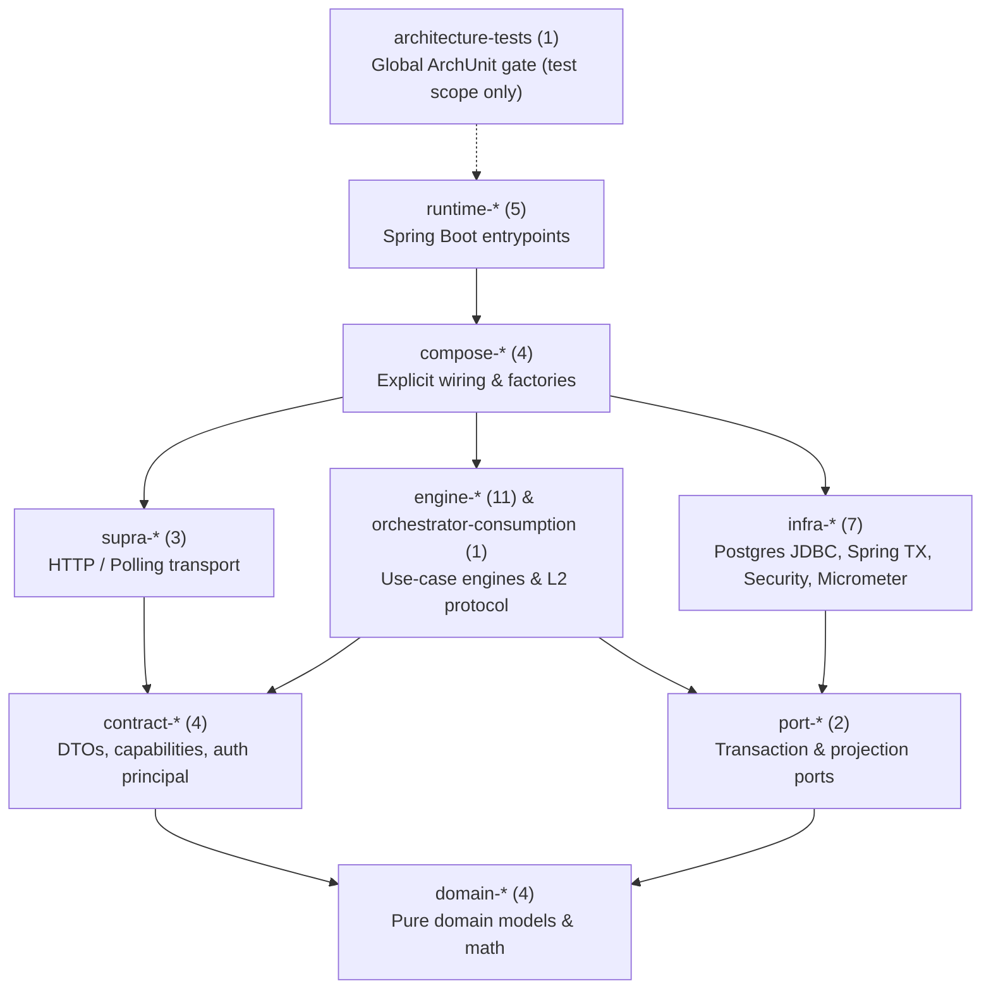

# Maven Modules & Layer Architecture (42 Modules)

The Java codebase under [`app/pom.xml`](../../app/pom.xml) is organized into **42 child modules** (41 production/runtime modules + 1 global architecture test gate). Rather than a flat monolith, modules follow a strict hexagonal/layered dependency direction enforced at test time by `architecture-tests` (ArchUnit).

> [!NOTE]
> For the full normative adjacency matrix (`C01`–`C43`), see [`docs/v3/L7_Target_Modular_Architecture_and_Migration_Plan.md`](../v3/L7_Target_Modular_Architecture_and_Migration_Plan.md).

## 1. Layer Dependency Flow

## 2. Module Taxonomy

| Prefix | Count | Role & Allowed Dependencies | Modules |
| :--- | :---: | :--- | :--- |
| **`domain-*`** | 4 | Pure domain models, value objects, exact rational math, state transitions. **No Spring, no JDBC, no I/O.** | `domain-pot`, `domain-identity`, `domain-projection`, `domain-consumption` |
| **`contract-*`** | 4 | Neutral data contracts, capability interfaces, and L2 consumption SPIs. | `contract-authentication`, `contract-write-admission`, `contract-read-query`, `contract-consumption` |
| **`port-*`** | 2 | Neutral persistence and transaction port interfaces (`AttemptTransactions`, `RecoveryReadContext`, `CurrentBindingStore`). | `port-transaction`, `port-projection` |
| **`engine-*`** | 11 | Application use-case participants (admission, command/identity execution, materialization, READ queries & execution policy). Depend only on `domain-*`, `contract-*`, `port-*`. | `engine-admit-command`, `engine-admit-identity`, `engine-write-pot`, `engine-write-identity`, `engine-materialize-pot`, `engine-materialize-identity`, `engine-materialize-results`, `engine-read-pot`, `engine-read-identity`, `engine-read-results`, `engine-read-execution` |
| **`orchestrator-*`** | 1 | L2 consumption protocol authority (claims, lease renewal, recovery, Burnable/NonBurnable variants). | `orchestrator-consumption` |
| **`supra-*`** | 3 | Delivery channels: HTTP controllers/DTOs (`supra-web-*`) and generic polling loop (`supra-polling-consumption`). Never depend on `engine-*` or `infra-*` implementations. | `supra-web-write`, `supra-web-read`, `supra-polling-consumption` |
| **`infra-*`** | 7 | Technical adapters: PostgreSQL JDBC stores & SQL baselines, Spring TX, Spring Security, Micrometer. | `infra-tx-spring`, `infra-security-spring`, `infra-postgres-core`, `infra-postgres-write`, `infra-postgres-read`, `infra-postgres-write-source-read`, `infra-observability-micrometer` |
| **`compose-*`** | 4 | Inert Spring/Java wiring that binds `supra-*`, `engine-*`, `orchestrator-*`, and `infra-*` together. | `compose-web-write-postgres`, `compose-web-read-postgres`, `compose-polling-burnable-write-postgres`, `compose-polling-nonburnable-materialize-postgres` |
| **`runtime-*`** | 5 | Executable Spring Boot apps (`runtime-web-write`, `runtime-web-read`, `runtime-worker-process`, `runtime-worker-materialize`, plus `runtime-monolith` for combined composition). | `runtime-web-write`, `runtime-web-read`, `runtime-worker-process`, `runtime-worker-materialize`, `runtime-monolith` |
| **`architecture-tests`** | 1 | Cross-cutting ArchUnit rules checking module boundaries, forbidden dependencies, and resource ownership. | `architecture-tests` |

## 3. Where Should I Place New Code?

| What you want to change | Target module(s) | Verification slice |
| :--- | :--- | :--- |
| Pot domain rule, rational balance math, visibility rule | `domain-pot` | `COMMAND` (`runtime-worker-process`) |
| New HTTP route, request/response DTO, or status mapping | `supra-web-write` or `supra-web-read` (+ `contract-*` if new capability) | `WEB` (`runtime-web-write,runtime-web-read`) |
| Command execution logic or identity registration/unlink | `engine-write-pot` or `engine-write-identity` | `COMMAND` (`runtime-worker-process`) |
| SQL query or schema change on WRITE | `infra-postgres-write` | `COMMAND` and/or `WEB` |
| Projection materialization logic | `engine-materialize-pot`, `engine-materialize-identity`, `engine-materialize-results` | `PROJECTION` (`runtime-worker-materialize`) |
| SQL query or schema change on READ | `infra-postgres-read` (or `infra-postgres-write-source-read` for source SELECTs) | `PROJECTION` and/or `WEB` |
| Partition lease, claim, or polling protocol | `orchestrator-consumption`, `supra-polling-consumption`, `infra-postgres-core` | `COMMAND,PROJECTION` |
| Module dependency or boundary rule change | `pom.xml` + affected modules | Affected slices **+ `architecture-tests`** |

## 4. Key Architectural Invariants

1. **Strict WRITE / READ isolation**: `infra-postgres-read` and `runtime-web-read` must never depend on WRITE mutation stores. Materializers read from `pocoma_write` exclusively through `infra-postgres-write-source-read` (`SELECT`-only role).
2. **No `infra-*` or `engine-*` imports in `supra-*`**: HTTP and polling channels talk only to neutral `contract-*` interfaces.
3. **No runtime-to-runtime dependencies**: `runtime-*` modules only activate their own `compose-*` module(s) and never depend on each other.
