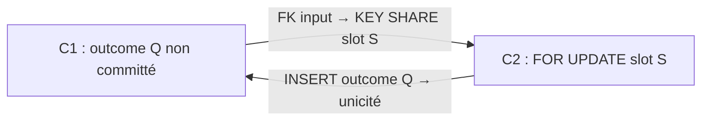

# Audit PostgreSQL — Binding, ordre des verrous et deadlocks

Date : 2026-10-16. Code audité : `e0bd47a40727b850927fa37cd15dde509073f9c7`, branche `feat/runtime-monolith`. Audit documentaire et caractérisations ; aucun changement de production ni de schéma. Système non encore en production : les risques ci-dessous sont des propriétés des chemins exécutables, pas des incidents de production.

## A. Executive summary

**Oui, un scénario problématique existe : un deadlock PostgreSQL `40P01` a été reproduit entre l'Execute d'une ancienne Command et la finalisation d'échec terminal du nouveau claim après takeover.** Le cycle passe par l'unicité de `command_outcomes`, le verrou `FOR UPDATE` du slot et la FK de `consumption_inputs` vers ce slot. Il ne passe pas par une inversion Binding `authority → stream`.

Le verrouillage Binding courant est cohérent dans les chemins de production identifiés : mutation d'une seule E, stream avant autorité, Registration créant U sous le stream, Command observant sans verrou puis effectuant son fence tardif. Aucun chemin de production `User verrouillé → stream` opposé à `stream → User` n'a été trouvé. Les contraintes FK sur un User partagé prennent des protections compatibles entre elles ; le code ne supprime ni ne modifie ces Users.

Risque Binding local : **faible, sans deadlock démontré**. Risque de progression Command/Consumption : **réel mais conditionnel**, après expiration de lease et chevauchement de deux tentatives, dont la nouvelle échoue terminalement. Le deadlock est détecté et une transaction annulée ; l'intégrité persistée est conservée dans le test. Dans l'exécution observée, le nouveau worker est victime, l'ancien perd son CAS, aucun outcome ne reste et le slot reste PENDING avec le nouveau claim : la reprise ultérieure est nécessaire. Fréquence et coût opérationnel inconnus, sans mesure de charge ni déploiement inspecté.

Inventaire : **31 sites de SQL verrouillant ou d'écriture dans le périmètre Binding/Registration/Consumption et leurs journaux Command**, dont **3 sites `SELECT FOR UPDATE` en production**. Complément : familles DML Pot/Event/projection/LKV et un `LOCK TABLE` historique V24, explicitement séparés du comptage. **20 couples/scénarios : 1 PROVEN, 0 POSSIBLE, 17 REFUTED sous les préconditions décrites, 2 INCONCLUSIVE.** REFUTED qualifie le cycle étudié, jamais tous les entrelacements imaginables du système.

Recommandation : **requalifier DEBT-WA6-01 en durcissement préventif local des compositions Binding**, conserver LOW et ne pas proposer sa clôture. Documenter séparément le défaut de progression Command/Consumption établi ici. Aucun registre officiel de dette n'est modifié.

### Baseline, discipline et provenance

- `git status --short --branch`, `git rev-parse HEAD`, `git remote -v`, `git branch -vv` : branche courante conservée ; référence distante locale alignée, divergence initiale 0/0.
- `git ls-remote origin refs/heads/feat/runtime-monolith` : après échec DNS en sandbox, vérification avec accès réseau autorisé ; serveur à `e0bd47a40727b850927fa37cd15dde509073f9c7`.
- Working tree préexistant : modification de `docker/keycloak/pocoma-realm.json`, suppression de `scripts/bruno/00 Pot E2E/01 Create Pot.bru`, modifications des fichiers 02–07 et `folder.bru`, quatre nouveaux fichiers 001–004. Aucun n'est inclus dans les commits d'audit.
- Politique normative [Reactor_Verification_Policy](../../testing/Reactor_Verification_Policy.md) lue avant l'analyse sous `app/`. Impact production attendu/observé : NONE. Slices déclarées : BINDING principale, COMMAND secondaire pour fencing et caractérisations ; lecture complémentaire Registration/Consumption. Preuve locale READ ajoutée explicitement : son test CurrentBinding n'appartient pas à la fermeture Maven des anchors choisis. Aucun changement de frontière de production ni dépendance.
- Gate architecture global : NOT REQUIRED, non exécuté. Reactor complet : interdit par la mission, non exécuté. Pas de `install`, pas de SNAPSHOT installé. Baseline trusted : NONE dans la politique ; bootstrap Flyway existant des tests conservé. Pas de campagne de migrations historiques autonome.
- Historique retrouvé par `git log` : `3a4ba961` clôt WRITE_ADMISSION ; `4bf164d5` établit le registre ; `2919a7c6` produit l'audit de concurrence du 6 octobre. [Dette vivante](Debt.md) et [Step debt WA.6](../../steps/completed/WRITE_ADMISSION/Step_debt.md) désignent explicitement **la même DEBT-WA6-01**, dont `BINDING_LOCK_ORDER_GUARD` est le répertoire.
- Sources historiques réévaluées : [audit fencing/locks](../../architecture/Concurrency_Authorities_Fencing_Locks_Audit.md), [audit Binding optimiste](../../steps/completed/REGISTRATION/Wave2_Optimistic_Binding_and_Module_Boundary_Audit.md), [alignement Binding](../../steps/completed/WRITE_ADMISSION/Binding_Canon_Alignment_Audit.md), [audit WA6](../../steps/completed/WRITE_ADMISSION/WA6_Audit.md), [concurrence takeover](../TAKEOVER_TEST_FLAKINESS/Concurrent_Takeover_2026-10-15.md). Les campagnes takeover historiques ne sont pas comptées comme des exécutions du présent audit. Elles portent notamment sur Command Result, une chaîne différente du terminal failure Command.

## B. Inventaire des attentes transactionnelles

### Modes et convention de comptage

`E=(issuer,subject)`, `U=user_id`, `B=binding_id`, `S=slot_id`, `C=claim_id`, `Q=command_id`, `R=révision Binding`. Un site désigne une instruction SQL ou une écriture ORM distincte ; les deux branches SQL d'outcome Registration sont comptées séparément. Les simples SELECT MVCC sont inventoriés ensuite mais exclus de ces 31 sites, car ils ne verrouillent pas les lignes. Ce nombre n'est pas le nombre de locks physiques pris lors d'une exécution.

Modes table : SELECT ordinaire prend ACCESS SHARE ; SELECT FOR UPDATE ajoute ROW SHARE ; INSERT/UPDATE/DELETE prennent ROW EXCLUSIVE sur la table cible. Ces modes ne constituent pas des verrous exclusifs sur toutes les lignes et sont compatibles entre transactions DML ordinaires. Modes ligne : FOR UPDATE et DELETE protègent exclusivement la ligne ; les UPDATE de R/status/version sans modification de clé référencée prennent normalement NO KEY UPDATE. Les FK peuvent demander KEY SHARE sur les parents ; INSERT/UPSERT peuvent attendre un concurrent via ses clés uniques et son transaction ID. Les modes sont déduits du SQL et du schéma ; les attentes directement observées sont signalées en E. Références PostgreSQL : [verrous](https://www.postgresql.org/docs/17/explicit-locking.html), [READ COMMITTED](https://www.postgresql.org/docs/17/transaction-iso.html#XACT-READ-COMMITTED).

Tous les verrous transactionnels décrits sont conservés jusqu'au commit/rollback de la transaction englobante, pas jusqu'au retour du repository. Les protections internes brèves des pages/index ne sont pas des autorités métier supplémentaires ; l'attente d'unicité peut néanmoins durer jusqu'à la fin de la transaction concurrente.

Racines des sources, relatives à `app/` :

- `P=infra-persistence-primary-jpa/src/main/java/com/kartaguez/pocoma/infra/persistence/primary/jpa/`
- `I=P/repository/identity/`, `C=P/repository/consumption/`, `A=P/adapter/`
- `READ=infra-persistence-read-jdbc/src/main/java/com/kartaguez/pocoma/infra/persistence/read/jdbc/`

Les noms de méthodes ci-dessous permettent de retrouver chaque instruction avec `rg -n`. Les fichiers principaux sont liés en H.

| Site | Opération / repository.méthode | SQL exécuté ou forme ORM | Ressource et attente | Ordre / concurrents |
|---|---|---|---|---|
| 01 | Acquire, stream.createIfAbsent | `INSERT streams(E,0) ON CONFLICT(E) DO NOTHING` | PK E, attente d'unicité possible avant le lock explicite | Premier write Acquire/Registration ; autre bootstrap E |
| 02 | Acquire/Detach, stream.lock | `SELECT ... WHERE E FOR UPDATE` | Ligne stream E certaine | Avant toute mutation active ; autres mutations et fences E |
| 03 | mutation, stream.advance | `UPDATE streams SET current_revision=? WHERE E AND current_revision=?` | Ligne E, déjà verrouillée ; CAS défensif | Après INSERT/DELETE actif, avant fait |
| 04 | Command, stream.fenceExact | `UPDATE streams s SET current_revision=s.current_revision WHERE E AND R=? AND EXISTS(active E,U,B)` | Ligne E si correspondance, NO KEY UPDATE ; EXISTS ne verrouille pas l'actif | Après métier/Event, avant outcome et slot ; autres fences/mutations E |
| 05 | Acquire, occurrence.reserve | `INSERT occurrences(B,E,U,R) ON CONFLICT(B) DO NOTHING` | PK B, UNIQUE(E,attached_revision), UNIQUE(B,E,U), FK U/stream | Après initializer ; autres réservations B ou même E/R |
| 06 | Acquire, identity.acquire | `INSERT external_identities(E,U,B) ON CONFLICT(E) DO NOTHING` | PK E, UNIQUE B, FK U/occurrence | Après réservation, avant advance ; Acquire/Detach E |
| 07 | Detach, identity.detach | `DELETE external_identities WHERE E AND B` | Ligne active exacte FOR UPDATE, vérifications référentielles | Après stream lock ; aucune suppression de l'occurrence |
| 08 | mutation, fact.append | `INSERT binding_facts(event_id,E,R,type,U,B,...)` | PK event, UNIQUE(E,R), FK stream/U/occurrence | Après advance ; fait immuable |
| 09 | Registration, UserJdbcRepository.insert | `INSERT users(user_id) VALUES(?)` | PK U ; pas de SELECT FOR UPDATE User | Dans initializer après stream, avant occurrence |
| 10 | worker Binding, JdbcCurrentBindingAdapter.apply | `INSERT current_external_identity_binding ... ON CONFLICT(E) DO UPDATE ... WHERE excluded.R > current.R RETURNING ...` | PK E, unique partiel source_event_id, verrou de conflit même si stale ; pas de FK primaire | Avant provenance/slot du fait ; autres faits E |
| 11 | Registration, JdbcUserCreatedFactAdapter.append | `INSERT user_created_facts(event_id,request_id,user_id,recorded_at)` | PK event, UNIQUE request/U, FK request/U | Après User, avant Binding occurrence |
| 12 | admission, JdbcRegistrationRequestStore.insert | `INSERT registration_requests(request_id,issuer,subject,payload,created_at)` | PK request ; E n'est pas unique | Transaction HTTP indépendante de l'exécution |
| 13 | Registration Registered, JdbcRegistrationOutcomeStore.insert | `INSERT registration_outcomes(...,'REGISTERED',U,B,now())` | PK request, FK request/U/occurrence | Après Acquire ; avant provenance/slot |
| 14 | Registration Rejected, même méthode | `INSERT registration_outcomes(...,'REJECTED',code,now())` | PK request, FK request | Après conflit Acquire ou nouvel outcome ; mêmes requests |
| 15 | worker résultat Registration, JdbcRegistrationResultStore.ensureResult | `INSERT registration_results ... ON CONFLICT(request_id) DO NOTHING` | PK request, FK request ; comparaison du résultat après insert | Transaction du worker résultat, jamais le stream WRITE |
| 16 | acquire/takeover Consumption, slot.insertInitial | `INSERT consumption_slots ... ON CONFLICT(logical_key) DO NOTHING` | PK S et UNIQUE clé logique ; attente possible dès l'INSERT | Avant lock slot |
| 17 | acquire/takeover, slot.findByKeyForUpdate | `SELECT * FROM consumption_slots WHERE key FOR UPDATE` | Ligne S certaine | Avant invalidation/claim/install ; tous les workers même clé |
| 18 | finalize/recovery, slot.findByIdForUpdate | `SELECT * FROM consumption_slots WHERE slot_id=? FOR UPDATE` | Ligne S certaine | Avant effet terminal / recovery ; takeover et FK de provenance S |
| 19 | acquire, slot.installClaim | `UPDATE slots SET current_claim_id=?,last_attempt_number=?,revision=revision+1 WHERE S AND status='PENDING'` | Ligne S déjà verrouillée, FK(S,C) | Après flush nouveau claim |
| 20 | Execute/finalize, slot.terminalize | `UPDATE slots SET status='DONE',current_claim_id=null,... WHERE S AND status='PENDING' AND current_claim_id=C` | Ligne S si match ; un C déjà remplacé peut donner zéro sans attendre | Après métier/outcome/provenance ; avant claim.end |
| 21 | retry, slot.scheduleRetry | `UPDATE slots SET current_claim_id=null,next_claim_at=?,revision=revision+1 WHERE S AND status='PENDING' AND current_claim_id=C` | Ligne S conditionnelle | Avant claim.fail ; pas de nouvel effet métier |
| 22 | acquire, claims.saveAndFlush | ORM `INSERT consumption_claims(...)` | PK C, UNIQUE(S,attempt), UNIQUE(S,C), FK S | Sous slot lock, avant installClaim |
| 23 | takeover, claim.invalidateForTakeover | `UPDATE claims SET invalidated_at=?,end_reason='TAKEN_OVER' WHERE C AND S AND ... lease_until<=?` | Ligne ancien claim ; colonnes de clé inchangées | Après lock S, avant nouveau claim |
| 24 | succès/rejet, claim.end | `UPDATE claims SET ended_at=?,end_reason=? WHERE C AND S AND ended_at IS NULL AND invalidated_at IS NULL` | Ligne claim ; no key update | Après CAS slot gagnant |
| 25 | failure, claim.fail | `UPDATE claims SET ended_at=?,end_reason='PROCESSING_FAILURE',failure_... WHERE C AND S AND ...` | Ligne claim ; no key update | Après CAS slot gagnant |
| 26 | Execute, JpaConsumptionProvenanceAdapter.appendInputs | ORM `INSERT consumption_inputs(...)` via saveAll | PK input, UNIQUE(S,subject...), **FK S → KEY SHARE** | Planifié après outcome ; flush avant CAS slot ; cycle D17 |
| 27 | Execute, même adapter.appendResults | ORM `INSERT consumption_results(...)` via saveAll | PK result, **FK S → KEY SHARE** | Même flush que 26 ; variante du cycle à éprouver séparément |
| 28 | Command, JdbcCommandOutcomeAdapter.publish | `INSERT command_outcomes(Q,type,pot,version,code,time)` | PK Q, FK recorded_command ; attente sur outcome non committé | Execute avant provenance/slot ; recovery/failure après lock S |
| 29 | même publish | `INSERT command_terminal_events(event_id,type,Q,...)` | PK event, UNIQUE Q, FK outcome | Après 28, même transaction |
| 30 | admission Command, JpaRecordedCommandRepository.insert | `INSERT recorded_commands ... ON CONFLICT(command_id) DO NOTHING` | PK Q, enveloppe immuable ; pas de FK vers le Binding actif | HTTP, avant toute acquisition worker |
| 31 | résultat Command, JdbcCommandResultStore.ensureResult | `INSERT command_results ... ON CONFLICT(command_id) DO NOTHING` | PK Q, FK recorded_command, comparaison après conflit | Worker résultat indépendant ; ne verrouille ni stream ni slot Command |

### Contraintes et triggers qui changent l'analyse

Migrations primaires V4, V18, V20–V23 et V27–V29 inspectées ; READ V9–V13 inspectées. L'autorité active référence U et l'occurrence exacte (B,E,U). Faits et occurrences référencent le stream et U ; les faits référencent aussi l'occurrence exacte. Aucun FK actif/stream ne force à lui seul `stream avant actif` : cet ordre vient du writer. Occurrence B permanente et absence de delete runtime interdisent ABA par réattribution de B. L'unicité(E,R) garantit au plus un fait, pas l'existence d'un fait par mutation : celle-ci dépend du writer atomique.

Les FK Consumption sont immédiates : claim→slot, slot→(slot,claim), input→slot, result→slot. **KEY SHARE sur S est incompatible avec le FOR UPDATE du finalizer**, même si le futur CAS de terminalisation serait stale. La preuve du CAS seul n'est donc pas une preuve d'absence de deadlock sur toute la transaction.

Les triggers métier courants trouvés rejettent les UPDATE/DELETE des valeurs immuables : command_results (V25), registration_requests (V27), registration_outcomes/user_created_facts (V28), registration_results (V29), pot_version_metadata (V11). Ils ne composent pas un nouveau chemin Binding verrouillant. Le trigger READ historique de métadonnées Pot a été retiré par la migration READ V8. Les triggers d'échec injectés par les tests ne sont pas des mécanismes de production. Aucune advisory lock, `@Lock`, `PESSIMISTIC_*`, FOR SHARE/NO KEY UPDATE/KEY SHARE explicite dans le Java de production trouvé par recherche globale ; les KEY SHARE référentiels sont implicites.

### Complément hors Binding

| Famille / source | Arbitrage et ordre utile à l'analyse |
|---|---|
| JpaPotGlobalVersionRepository/Adapter | INSERT initial ou `UPDATE ... WHERE pot_id AND version=expected` puis INSERT pot_version_metadata ; DML temporel Pot sous cette autorité ; Command touche un Pot dans les handlers inspectés, puis fence E. Aucun writer Binding n'attend ce Pot. |
| JpaPotCommandEventAppendAdapter / outbox | INSERT événements uniques après métier, avant fence ; pas de retour vers un verrou Binding/slot détenu par un autre subsystem hors chemin Command décrit. |
| JdbcProjectionTaskStoreAdapter.ensure | INSERT ON CONFLICT clé logique ; effet EVENT sous slot, tâches immuables. |
| JdbcProjectionStoreAdapter.publish/recordFailure | TransactionTemplate REQUIRED, INSERT root ON CONFLICT puis artifacts, ou INSERT failure ON CONFLICT ; FK artifact→root. Finalize sous slot du task. Pas d'écriture stream/autorité Binding. |
| JdbcLatestKnownVersionAdapter | UPSERT monotone par Pot ; aucun verrou du Pot WRITE ou stream Binding. |
| V24__contract_recorded_commands.sql | `LOCK TABLE recorded_commands IN SHARE ROW EXCLUSIVE MODE`, uniquement migration ; les DDL Flyway prennent aussi leurs locks propres. Pas un quatrième SELECT FOR UPDATE runtime. Coexistence DDL/activité : non caractérisée. |

Lectures sans verrou de ligne : `findUserId`, `hasActiveBinding`, `observeExact` JOIN stream/actif, `findCurrentRevision`, lecture des faits/discovery, lecture READ et chargement request/outcome. Elles peuvent attendre un DDL ACCESS EXCLUSIVE, mais ne créent pas à elles seules le verrou User/Binding imaginé dans un ordre inverse.

## C. Cartographie transactionnelle

### Frontières réelles

`SpringTransactionRunner` délègue à `TransactionTemplate.execute`. Les configurations runtime construisent les templates avec le `PlatformTransactionManager` injecté, sans REQUIRES_NEW ni isolation explicite : propagation REQUIRED, isolation DEFAULT. Avec l'unique datasource PostgreSQL/JPA configurée, JDBC et JPA rejoignent la même transaction. Les caractérisations utilisent le vrai manager Spring/JPA, de vrais adapters JDBC/JPA et constatent READ COMMITTED ; deux backend_xid distincts sont observés pendant l'attente. Aucun niveau d'isolation de production déployée n'est affirmé : une configuration externe pourrait le modifier.

`JpaExternalIdentityBindingAdapter` impose MANDATORY ; ses repositories JDBC ne créent pas de transaction. L'auto-appel `acquire → acquireWithInitializer` ne passe pas par un second proxy, mais le MANDATORY d'entrée impose déjà la transaction. `JdbcCurrentBindingAdapter.apply` impose aussi MANDATORY. Les wrappers TransactionalAcquire/Execute/Finalize/HandleFailure englobent leurs delegates. Plusieurs appels repository ne signifient donc pas plusieurs commits dans ces chemins.

Registration outcome/result/request stores n'ont pas de frontière Spring propre : ils participent à la transaction de l'appelant dans les chemins assemblés ; un appel direct hors transaction pourrait s'autocommitter et n'est pas protégé par une annotation MANDATORY. L'admission Registration utilise son runner dédié. Aucun appel HTTP ou effet réseau sous le stream n'est trouvé dans l'initializer runtime : il crée User et UserCreatedFact en SQL.

`SequentialConsumptionOrchestrator` appelle acquisition puis exécution séparément. L'acquisition committe avant le traitement métier. Failure et recovery sont normalement de nouvelles transactions après rollback de l'Execute. REQUIRED ne garantit toutefois pas une nouvelle transaction physique si un futur appelant enveloppe tout le worker dans une transaction : ce n'est pas le wiring inspecté. Les loaders Pot annotés REPEATABLE_READ sont des lectures ; lorsqu'ils rejoignent une transaction existante, ils ne la transforment pas en une nouvelle transaction à cette isolation.

### Séquences et branches

| Opération / point d'entrée | Séquence jusqu'à commit/rollback |
|---|---|
| Acquire/Attach via port | Tx appelante → 01 bootstrap E → 02 stream E → SELECT actif. Occupé : CONFLICT puis commit sans R/fait. Libre : initializer éventuel → 05 réserver B → 06 actif → 03 R+1 → 08 fait → retour → autres writes appelant → commit. Attach est le fait et le sens métier d'Acquire ; pas de worker Attach indépendant identifié. |
| Detach via port | Tx appelante → SELECT stream ; absent : NOT_CURRENT sans lock ligne → sinon 02 → SELECT actif exact B ; absent/stale : NOT_CURRENT → sinon 07 delete exact → 03 R+1 → 08 DETACHED → commit appelant. Le NOT_CURRENT sur stream absent est une observation, pas un verrou de gap qui interdirait un Acquire ultérieur. |
| Registration HTTP puis worker | Admission : INSERT request → commit. Worker : Acquire Consumption 16→17→22→19→commit. Execute : reload request/outcome ; outcome existant : réutilisé. Sinon 01→02→SELECT actif ; libre : 09 User→11 UserFact→05→06→03→08 ; occupé : aucun User créé. Puis 13 ou 14 → 26 provenance → flush → 20→24→commit. Claim perdu : exception et rollback de tous ces effets. |
| Takeover | Aucun takeover d'autorité Binding distinct trouvé. Le takeover existant est Consumption : 16→17→lecture lease ; Busy/NotReady/DONE : retour ; expirée : 23 invalider ancien→22 nouveau claim flush→19 installer→commit. Ne touche pas stream, User ou Pot. |
| Command normale | Acquisition slot indépendante ; Execute → reload Q → observe E+B sans lock → absent : rejet sans métier/fence ; présent : AuthZ/validité→dispatch Pot (CAS et writes éventuels)→append Events éventuels→04 fence→28 outcome→29 terminal event→26/27 provenance→flush implicite **avant** 20 (flushAutomatically=true)→20→24→commit. Rejet métier/expiration avec Binding observé : fence aussi. |
| Command fence perdu | 04 donne zéro → BindingFenceLostException → rollback complet métier/Events → recovery runner →18 lock slot + vérifier claim ; perdu : abandon. Puis SELECT exact E+B ; présent : conflit technique ; absent : 28 rejet→29→20→24→commit. Le delegate TransactionalExecute rejoint la transaction de recovery, il n'en crée pas une indépendante. |
| Command failure terminal | Execute échoue et rollbacke ; HandleFailure relit claim/policy ; Fail → FinalizeConsumptionService →18→vérifier claim courant→28 FAILED→29→20→25→commit. RetryAfter : 21→25, pas d'outcome terminal. |
| worker Binding / CurrentBinding | discovery MVCC hors transaction Execute ; acquisition du slot du fait séparée ; Execute → relire fait immuable→10 UPSERT READ(E)→26 input du fait→flush→20 slot de ce fait→24→commit. Aucun appel au stream/actif primaire. |
| résultats Command/Registration | Travail depuis sources immuables →31 ou15→provenance→CAS slot du résultat→commit. Slot du résultat distinct du slot de la Command/Registration source. |
| EVENT/PROJECTION finalizer | Acquisition claim séparée ; travail préparatoire hors section finale ; transaction Finalize :18→validation claim→effet SQL task/projection→CAS slot→claim.end/fail→commit. |

## D. Matrice et graphes d'attente

La matrice regroupe les opérations ayant la même signature de verrous. E identique ou différente, Pot et slot concernés sont précisés ; elle ne prétend pas énumérer chaque paire de méthodes triviale.

| ID | Couple / préconditions | Ressources et ordre | Classe / preuve |
|---|---|---|---|
| D01 | Acquire/Acquire même E | E stream commun en premier, puis un seul actif/fait gagnant | REFUTED : sérialisation ; tests concurrentAcquires et unicité R/B |
| D02 | Acquire/Detach même E | Tous deux stream avant actif ; absence de stream ne verrouille rien | REFUTED : pas d'ordre inverse ; test simultaneousAttachAndDetach |
| D03 | Detach/Detach même B | Stream commun ; second voit absence de l'actif exact | REFUTED : test concurrentDetaches, un seul R+1 |
| D04 | Registration/Registration même E | Stream avant nouveaux U distincts ; loser ne crée pas U | REFUTED : code + RegistrationAuthorityPostgresTest |
| D05 | Registration/Acquire même E | Même writer ; initializer exécuté après lock | REFUTED : code + course Registration/Attach existante |
| D06 | Registration/Detach même E | Même ordre stream→actif | REFUTED : code + course Registration/Detach existante |
| D07 | Acquires E distinctes, U commun | Stream distinct ; KEY SHARE User compatibles ; aucun UPDATE/DELETE User | REFUTED : pas de chemin inverse User exclusif→E dans la production inspectée |
| D08 | Command fence / mutation E | Fence UPDATE E et mutation FOR UPDATE E se sérialisent ; mutation ne prend pas Pot/slot Command | REFUTED pour le cycle stream/actif ; tests detach pendant métier et après fence |
| D09 | Deux Commands même E, Pots distincts | Pot A→E et Pot B→E ; aucun ne demande le Pot de l'autre | REFUTED dans les handlers mono-Pot ; contention du fence réelle |
| D10 | Deux Commands même Pot, E distinctes | Pot commun avant E distincts ; perdant CAS Pot rollbacke | REFUTED pour ce cycle ; pas de batch multi-Pot trouvé |
| D11 | Registration / Command même E | Registration E→User/outcome/slot Registration ; Command Pot→E→outcome/slot Command | REFUTED : clés de slots et outcomes distinctes, aucun retour Registration vers Pot/slot Command |
| D12 | matérialisation Binding / Acquire-Detach | READ(E) et stream/actif(E) sont des tables indépendantes ; fait lu en MVCC | REFUTED : pas d'attente inverse ; pas de FK READ→WRITE |
| D13 | deux faits même E, slots différents | READ(E) avant chaque slot ; FK inputs vers slots propres | REFUTED pour deux Executes : le détenteur READ n'attend pas le slot de l'autre ; upsert monotone sérialise |
| D14 | acquire/takeover / acquire même clé | Slot commun avant claims ; bootstrap peut déjà attendre | REFUTED : ordre commun et tests lifecycle |
| D15 | Execute / takeover même S | Métier→provenance→CAS S contre S→claim, aucun effet métier du takeover | REFUTED pour ce couple seul : FK peut attendre takeover mais takeover n'attend pas l'effet Execute ; test stale rollback |
| D16 | recovery Binding C2 / ancien Execute C1, Binding désormais absent | C1 outcome→CAS sans provenance ; C2 S→outcome | REFUTED **dans cet entrelacement** sur PostgreSQL : C1 CAS zéro sans attendre S ; rollback libère outcome. Test ajouté. |
| D17 | terminal failure C2 / ancien Execute C1 avec input de provenance | C1 outcome→FK KEY SHARE S ; C2 FOR UPDATE S→outcome | **PROVEN `40P01`**, test ajouté ; voir chronologie ci-dessous |
| D18 | même terminal failure, ancien Execute sans provenance | C1 outcome→CAS C1 déjà remplacé ; C2 S→outcome | REFUTED sur PostgreSQL : CAS zéro sans attente ; test témoin ajouté |
| D19 | migrations DDL / transactions runtime | Relations et locks DDL, V24 SHARE ROW EXCLUSIVE et autres DDL | INCONCLUSIVE : chevauchement de déploiement non caractérisé ; pas un défaut runtime Binding établi |
| D20 | futur initializer arbitraire ou batch de plusieurs E/Pots dans une transaction | Peut composer plusieurs ressources dans un ordre choisi par l'appelant | INCONCLUSIVE : API expressive, aucun tel chemin runtime opposé établi ; ne justifie pas POSSIBLE sans deux chemins exécutables identifiés |

### D17 — preuve du cycle indirect

Préconditions fonctionnelles : C1 a été acquis ; sa lease expire avant qu'il ait verrouillé le slot via sa provenance. C2 est acquis et committé par takeover. L'ancien worker continue ou démarre son Execute ; il peut légitimement atteindre le SQL avant le contrôle final du claim. C2 subit une erreur technique classée terminale (par exemple exception de programmation) ; son Execute rollbacke, puis la policy prend la branche Fail. Le Binding peut rester inchangé tout du long. La Command de C1 renvoie au moins un input de provenance — comportement normal des mises à jour Pot, établi par `PotCommandInvocation.capture/record`.

```text
Acquisition C1 : slot S, claim C1 ; COMMIT.
Temps contrôlé : lease C1 expirée ; takeover C2 sur S ; COMMIT.
Execute C2 : travail entré, puis exception ; ROLLBACK avant finalisation.
Execute C1 : observe Binding courant ; métier/fence ; INSERT outcome(Q)
             + terminal event ; détient l'unicité Q, suspendu avant retour.
Failure C2 : FOR UPDATE slot S ; C2 est courant ; INSERT outcome(Q) attend C1.
Execute C1 : appendInputs ; flush JPA avant UPDATE terminalize
             → INSERT consumption_inputs(...,S,...)
             → FK demande KEY SHARE S, bloqué par FOR UPDATE de C2.
             C1 attend C2 ; C2 attend C1 → PostgreSQL 40P01.
```



**Le CAS C1 final ne sauve pas la progression : il n'est pas encore exécuté lorsque la FK bloque le flush.** Dans les tests sans provenance, il est effectivement exécuté et retourne zéro ; confondre ces deux branches masquerait le cycle. Les résultats de provenance portent la même FK ; c'est une extension plausible de la même cause, pas un second deadlock reproduit par ce test.

La caractérisation utilise un use case de test renvoyant un input POT comme le dispatcher réel, sans changer runtime/SQL. Elle exerce les vrais services Execute/HandleFailure/Finalize, les adapters et le flush Hibernate. L'exception terminale est injectée dans le comportement métier de C2, puis passée au classifier et à la policy existants ; aucun échec forcé du fencing et aucun SQL de verrou ajouté pour fabriquer le cycle. Ce n'est pas un E2E d'un endpoint Pot : le point d'entrée et le contexte de charge restent à reproduire si l'on veut quantifier la fréquence.

## E. Vérifications PostgreSQL

Environnement observé : Java Temurin 21 ; Docker 29.4.0 ; image `postgres:17-alpine`, serveur PostgreSQL 17.11 ; Maven wrapper 3.9.14 ; bootstrap primaire Flyway V1–V29 dans les tests existants. Les tests READ utilisent leur bootstrap existant. Accès Docker obtenu après échec permission sandbox ; aucune absence de Docker utilisée comme skip.

Toutes les commandes Maven ci-dessous ont été lancées depuis `app/`. Le filtre Surefire borne les tests, `-am` conserve la vraie fermeture de compilation ; ce ne sont pas des PASS des suites complètes des slices.

```bash
# 1 — tests existants ; 68 PASS, puis 5 erreurs d'injection runtime Binding
./mvnw -pl runtime-binding-consumption-worker,runtime-command-consumption-worker -am -Dtest=BindingOptimisticCasSemanticsPostgresTest,JpaExternalIdentityBindingLifecycleAdapterPostgresTest,JpaUserIdentityAuthorityAdapterPostgresTest,RegistrationAuthorityPostgresTest,CommandConsumptionPostgresTest,JpaConsumptionLifecycleAdapterPostgresTest,TransactionalConsumptionExecutionPostgresTest,CurrentBindingPersistencePostgresTest,BindingRuntimePostgresTest -Dsurefire.failIfNoSpecifiedTests=false test

# 2 — hypothèse initiale sans provenance : 2 échecs de l'assertion « deadlock attendu »
./mvnw -pl runtime-command-consumption-worker -am '-Dtest=CommandConsumptionPostgresTest#bindingRecoveryAndStaleOutcomeFormARealPostgresDeadlock+terminalFailureAndStaleOutcomeFormARealPostgresDeadlock' -Dsurefire.failIfNoSpecifiedTests=false test

# 3 — mêmes entrelacements requalifiés, suite 27/27 PASS ; exécutée deux fois
./mvnw -pl runtime-command-consumption-worker -am -Dtest=CommandConsumptionPostgresTest -Dsurefire.failIfNoSpecifiedTests=false test

# 4 — preuve locale READ séparée : 6/6 PASS
./mvnw -pl infra-persistence-read-jdbc -am -Dtest=CurrentBindingPersistencePostgresTest -Dsurefire.failIfNoSpecifiedTests=false test

# 5 — ajout de la variante avec provenance : suite 28/28 PASS
./mvnw -pl runtime-command-consumption-worker -am -Dtest=CommandConsumptionPostgresTest -Dsurefire.failIfNoSpecifiedTests=false test

# 6 — trois caractérisations finales, diagnostic SQLSTATE conservé
./mvnw -pl runtime-command-consumption-worker -am '-Dtest=CommandConsumptionPostgresTest#bindingRecoveryWaitingOnStaleOutcomeDoesNotDeadlock+terminalFailureWaitingOnStaleOutcomeDoesNotDeadlock+terminalFailureAndStaleProvenanceFormARealPostgresDeadlock' -Dsurefire.failIfNoSpecifiedTests=false test
```

| Classe existante / couverture | Résultat de campagne |
|---|---|
| RegistrationAuthorityPostgresTest : concurrence registration/attach/detach, atomicité | 6 PASS |
| JpaUserIdentityAuthorityAdapterPostgresTest : Acquire/Detach, UUID collision, rollback fait | 10 PASS |
| BindingOptimisticCasSemanticsPostgresTest : NOT EXISTS après attente concurrente | 1 PASS ; réfute une simplification optimiste naïve, pas le fence positif actuel |
| JpaExternalIdentityBindingLifecycleAdapterPostgresTest | 2 PASS |
| TransactionalConsumptionExecutionPostgresTest : effets stale rollbackés, CAS et finalisation | 12 PASS |
| JpaConsumptionLifecycleAdapterPostgresTest : claims/leases/takeover/fencing | 12 PASS |
| CommandConsumptionPostgresTest initiale, puis avec 3 caractérisations | 25 PASS initialement ; 28 PASS après ajout |
| CurrentBindingPersistencePostgresTest : monotonie, tombstones, divergence R égale | 6 PASS ; test local fonctionnel, pas preuve de tous les entrelacements concurrents |
| BindingRuntimePostgresTest | **5 ERROR**, aucune assertion de scénario atteinte : `NoUniqueBeanDefinitionException`, `transactionRunner,bindingTransactionRunner` |

Bilan de couverture distincte : **77 tests PostgreSQL passent, dont 3 nouveaux, et 5 scénarios runtime restent non vérifiés à cause de l'injection**. Les deux échecs expérimentaux initiaux sont conservés dans l'historique de démarche : l'hypothèse de cycle sans provenance était fausse ; aucune modification runtime n'a servi à les rendre verts. Les noms provisoires de ces deux méthodes ont été remplacés par les noms finaux explicites. Aucun retry n'a masqué ces échecs.

Les trois caractérisations synchronisent explicitement les étapes par latches, utilisent une horloge contrôlée pour la lease, attendent une vraie attente `pg_stat_activity.wait_event_type='Lock'` avec `pg_blocking_pids` sur l'INSERT outcome, et vérifient deux PIDs et deux backend_xid distincts. Aucun Thread.sleep ajouté. Elles acceptent le choix de victime fait par PostgreSQL, exigent exactement un `40P01` dans D17 et vérifient le rollback de l'effet stale et de la provenance, les claims, le slot et l'unicité outcome/event. Dans les témoins, elles exigent LostClaimException et commit du nouveau worker.

Les tests existants ne sont pas tous des preuves déterministes d'attente : certains utilisent seulement un départ simultané ou une attente bornée de Future. Le test CAS existant contient un sleep de polling de pg_blocking_pids, pas une temporisation destinée à créer la race. Aucun n'a été réécrit. Les tests architecture globaux et `CommandResultTakeoverRacePostgresTest` ont été lus, pas exécutés ; leur module n'a pas été ajouté comme gate.

Les extraits d'exécution sont archivés dans [Verification_2026-10-16.txt](Verification_2026-10-16.txt). Les logs Maven complets temporaires sont sous `/tmp/pocoma-lock-audit-*.log` et ne constituent pas un artefact durable du dépôt.

## F. Dette et garde-fou Binding

1. **Plusieurs ressources verrouillées existent**, même sans deux SELECT FOR UPDATE : stream, actif, occurrences/faits, parents FK et uniques. L'ordre local `stream avant mutations actif/occurrence/fait` doit rester contractuel tant que le protocole courant subsiste.
2. **Un ordre canonique local suffit au risque Binding identifié.** Une hiérarchie globale User→Binding→Pot→Consumption ne correspond pas aux transactions réelles : Command prend Pot avant E, Registration ne touche pas Pot ; le cycle D17 a une cause FK/provenance plus précise.
3. **Une hiérarchie globale serait aujourd'hui trop couplante** sans traitement explicite des FK, du flush et des predicates CAS. Le cas démontré mérite une décision locale Command/Consumption, pas une simple déclaration globale.
4. `Wa67BindingArchitectureTest` vérifie des propriétaires SQL et des positions textuelles. Il détecte plusieurs accès directs indésirables et déplacements simples du lock. Son `assertOrdered` cherche les tokens à partir du nom de méthode ; il ne construit ni graphe d'appels ni chemins de contrôle et ne prouve pas que toute branche a pris le lock. Il ne détecte pas le cycle indirect D17.
5. Une règle structurelle peut interdire les dépendances aux repositories Binding hors writer et ports autorisés. Elle détecterait une nouvelle composition directe interdite ; elle ne prouverait ni l'ordre d'appels indirects, ni les transactions réelles, ni les FK, ni les verrous pris par un callback ou un flush.
6. **Les tests PostgreSQL restent nécessaires** pour les entrelacements qui ont une attente réelle. Les contraintes actuelles protègent unicité, cohérence référentielle et non-réutilisation B ; elles ne garantissent pas toutes les séquences sans cycle. Ici une FK participe précisément au cycle.

Décision recommandée : **REQUALIFICATION, maintien ouvert LOW comme dette de prévention des régressions Binding**, sans revendiquer un deadlock Binding courant. Le critère « guard global sémantiquement exhaustif » devrait devenir une propriété locale testable : writer unique, aucune mutation active avant sérialisation E, atomicité des effets, tests de contention et rollback. Pas de clôture sur la seule base d'une recherche sans inversion. Le défaut D17 doit être suivi séparément ; il n'est pas honnête de le consolider automatiquement dans la dette d'ordre stream/authority existante.

## G. Contention et recommandations

| Classe | Proposition / justification | Coût / bénéfice |
|---|---|---|
| Correctif nécessaire | Traiter D17 avant de promettre une progression sans deadlock des finalisations Command après takeover. Choisir un protocole qui évite le cycle outcome→FK slot contre slot→outcome ; prouver toutes les branches, y compris provenance et rollback. Aucun correctif runtime n'est réalisé ici. | Travail de conception ciblé COMMAND/Consumption ; bénéfice établi par reproduction. Un simple ajout de retry ne supprime pas la cause. |
| Durcissement préventif | Conserver l'ordre local stream→mutations Binding et borner les dépendances directes aux repositories. | Faible à moyen ; empêche des inversions futures concrètes, sans promesse d'analyse statique exhaustive. |
| Amélioration des tests | Conserver D17 comme caractérisation du défaut ; lors d'un correctif ultérieur, exiger la progression sans 40P01. Conserver les deux témoins sans provenance. | Trois tests ciblés ; distingue l'effet du CAS de celui des FK. |
| Amélioration des tests | Résoudre séparément l'ambiguïté de TransactionRunner dans BindingRuntimePostgresTest, puis réexécuter les cinq scénarios. | Limité au câblage/test selon diagnostic à venir ; nécessaire pour la preuve runtime, aucune correction autorisée dans cet audit. |
| Optimisation de contention | Mesurer attentes par E et slot, durée SQL/transaction, nombre de Commands par E et fréquence de takeover ; pg_stat_activity/pg_blocking_pids et latences corrélées. | Faible à moyen ; aucune estimation de débit sans charge représentative. |
| Optimisation de contention | Examiner les préparations pures hors lock stream, en conservant la décision « créer User seulement si E libre » sous l'autorité transactionnelle. | Gain inconnu ; l'initializer courant est SQL local court. Le déplacer sans preuve pourrait créer des Users orphelins. |
| Aucune action nécessaire | Ne pas retirer FOR UPDATE Binding, ne pas introduire un CAS négatif naïf, ne pas ajouter de lock User global. | Aucun défaut stream/authority établi ; coût de refonte non justifié par cet audit. |

Points de sérialisation intentionnels : un stream par E, un slot par clé de consommation, un Pot par version et une ligne READ par E. Deux Commands sous la même E et sur des Pots distincts peuvent préparer leur travail en parallèle, mais leurs fences UPDATE de la même ligne E se sérialisent jusqu'au commit ; même un UPDATE R=R a un coût d'écriture/verrou/WAL. Cet hotspot peut devenir important pour une identité très active. Le verrou Acquire/Registration reste tenu pendant initializer, réservations, facts, outcome, provenance et terminalisation : la durée utile dépasse le temps de la seule instruction FOR UPDATE.

Le worker Binding peut consommer plusieurs faits d'une même E sous des slots différents : ils se sérialisent sur la même ligne READ, même si chaque fait est déjà protégé par son propre claim. L'UPSERT stale ne signifie pas « aucune attente ». Les leases expirées permettent le chevauchement des acteurs ; le fencing garantit leur autorité au commit, il n'arrête pas immédiatement le calcul/SQL d'un ancien worker. Cela peut augmenter contention et travail rollbacké sans violer les invariants.

Sécurité concurrente, absence de deadlock, contention et performance sont donc quatre conclusions séparées : les invariants testés résistent au scénario D17, l'absence globale de deadlock est fausse, la contention par E est intentionnelle mais peut coûter cher, et son coût n'a pas été benchmarké.

## H. Sources de code et limites de clôture

Les liens suivants pointent vers les chemins du checkout (les méthodes sont nommées dans les tables) :

- [writer Binding](../../../app/infra-persistence-primary-jpa/src/main/java/com/kartaguez/pocoma/infra/persistence/primary/jpa/adapter/identity/JpaExternalIdentityBindingAdapter.java), [SQL stream/fence](../../../app/infra-persistence-primary-jpa/src/main/java/com/kartaguez/pocoma/infra/persistence/primary/jpa/repository/identity/ExternalIdentityBindingStreamJdbcRepository.java), [SQL autorité](../../../app/infra-persistence-primary-jpa/src/main/java/com/kartaguez/pocoma/infra/persistence/primary/jpa/repository/identity/ExternalIdentityJdbcRepository.java).
- [Registration Execute](../../../app/engine-consume-registration/src/main/java/com/kartaguez/pocoma/engine/consume/registration/ExecuteRegistrationService.java), [Command Execute](../../../app/engine-consume-command/src/main/java/com/kartaguez/pocoma/engine/consume/command/execution/ExecuteRecordedCommandService.java), [Command outcome/provenance](../../../app/engine-consume-command/src/main/java/com/kartaguez/pocoma/engine/consume/command/consumption/CommandConsumptionExecution.java), [provenance Pot réelle](../../../app/engine-consume-command/src/main/java/com/kartaguez/pocoma/engine/consume/command/pot/dispatch/PotCommandInvocation.java).
- [recovery](../../../app/engine-consume-command/src/main/java/com/kartaguez/pocoma/engine/consume/command/consumption/BindingFenceRecoveryExecuteUseCase.java), [Execute Consumption](../../../app/engine-consumption/src/main/java/com/kartaguez/pocoma/engine/service/consumption/ExecuteConsumptionService.java), [Finalize Consumption](../../../app/engine-consumption/src/main/java/com/kartaguez/pocoma/engine/service/consumption/FinalizeConsumptionService.java), [slot SQL et flush](../../../app/infra-persistence-primary-jpa/src/main/java/com/kartaguez/pocoma/infra/persistence/primary/jpa/repository/consumption/JpaConsumptionSlotRepository.java), [FK Consumption](../../../app/infra-persistence-primary-jpa/src/main/resources/db/migration/V4__consumption_engine.sql).
- [CurrentBinding SQL](../../../app/infra-persistence-read-jdbc/src/main/java/com/kartaguez/pocoma/infra/persistence/read/jdbc/JdbcCurrentBindingAdapter.java), [transaction runner](../../../app/infra-tx-spring/src/main/java/com/kartaguez/pocoma/infra/tx/spring/SpringTransactionRunner.java), [guard statique](../../../app/architecture-tests/src/test/java/com/kartaguez/pocoma/architecture/Wa67BindingArchitectureTest.java), [tests de caractérisation](../../../app/infra-persistence-primary-jpa/src/test/java/com/kartaguez/pocoma/infra/persistence/primary/jpa/adapter/command/CommandConsumptionPostgresTest.java).

Limites : pas de preuve de schéma effectivement déployé, pas de charge/bench, pas de vérification runtime Binding réussie, pas d'interférence DDL reproduite, pas d'analyse exhaustive de callbacks futurs ni de toute mutation SQL hors des workflows bornés. Les séquences sans trace dynamique sont des conclusions statiques sur le code courant. La reproduction D17 démontre l'existence d'un cycle ; les PASS des autres tests ne démontrent pas l'impossibilité de tout autre deadlock.

Livraison : rapport et extraits dans un commit documentaire dédié ; tests dans un commit séparé. Branche conservée, modifications utilisateur préservées, aucune fusion ni changement du registre officiel. Les SHA finaux et l'état distant sont fournis dans la restitution Git ; le rapport ne s'auto-référence pas par son propre SHA.
