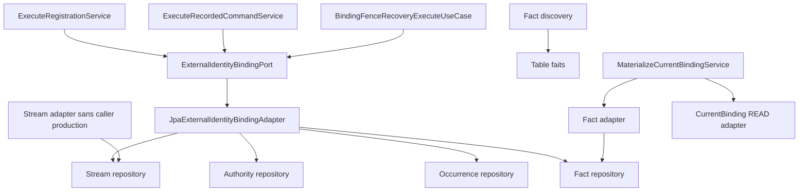

# DEBT-WA6-01 — Résolution du guard d'ordre Binding

Date : 2026-10-16. Verdict : **PASS**. Dette : **RESOLVED**, au périmètre explicite ci-dessous.
Aucun défaut runtime Binding corrigé ; aucun changement de production ou de schéma.

## Baseline et isolation

- Source : `feat/runtime-monolith`, HEAD local `90926a5ec37d1ca841e3de017bec0d1f705d8839`.
- Upstream local : `origin/feat/runtime-monolith`, divergence 0/0.
- `git ls-remote --heads origin feat/runtime-monolith fix/binding-lock-order-guard` confirme
  le même SHA serveur pour la source et l'absence initiale de branche cible. Les commits WP3–WP6
  sont donc poussés à cet instant, contrairement à la dernière restitution antérieure.
- Branche créée : `fix/binding-lock-order-guard` ; worktree :
  `/private/tmp/pocoma-binding-lock-order-guard`, créé explicitement à ce SHA.
- Aucune branche/worktree cible préexistante. Aucun checkout, merge ou rebase du dépôt principal.
- Les modifications Keycloak et Bruno préexistantes sont exclues. Leur inventaire et leurs empreintes
  SHA-256 sont comparés en fin de chantier ; aucune modification de leur contenu n'est autorisée.

Références relues : [Debt](Debt.md), [audit initial](Audit_2026-10-16.md),
[WA6 Audit](../../steps/completed/WRITE_ADMISSION/WA6_Audit.md),
[Step debt](../../steps/completed/WRITE_ADMISSION/Step_debt.md),
[Step Canon](../../steps/completed/WRITE_ADMISSION/Step_Canon.md),
[protocole Consumption](../../architecture/consumption-transactional-execution.md),
[politique normative](../../testing/Reactor_Verification_Policy.md),
[distinction D17](Resolution_D17_2026-10-16.md).
L'audit initial conserve ses observations historiques ; ses prélocks terminaux Consumption ne
représentent plus la baseline WP2–WP6 courante.

## Verification scope déclaré avant implémentation

- Impact production attendu / observé : **NONE**. Tests, deux dépendances Maven **test** et documentation.
- Slice principale : **BINDING**, anchor `runtime-binding-consumption-worker`.
- Slice secondaire : **COMMAND**, anchor `runtime-command-consumption-worker`, pour fence et rollback.
- Preuve locale READ : `CurrentBindingPersistencePostgresTest`, déjà dans la fermeture des anchors.
- Gate structurel global : **REQUIRED**, politique §17.2, car il s'agit de dépendances interdites.
- Reactor complet : **NOT REQUIRED / NOT RUN** ; aucun changement du graphe de production,
  aucune intégration main, aucune clôture de Wave majeure.
- DB : schéma courant PostgreSQL réel, bootstrap Flyway existant. Baseline trusted **NONE** selon
  la politique : les migrations existantes et leurs tests restent exécutés par les slices canoniques.
  Aucune campagne historique autonome ni certification de baseline ajoutée.
- Impacts interdits : protocole Consumption, contrats/outcomes/événements, ordre Pot/Binding,
  règles de fencing, nouvelles transactions, locks globaux, schéma, Keycloak, Bruno.
- Escalade prévue : stop si la solution nécessite de modifier le protocole générique ou un usage
  métier légitime. Aucun franchissement inattendu de slice de production.
- Ajustement explicite de preuve : ajout de `runtime-monolith` et `runtime-task-consumption-worker`
  au classpath **test** d'architecture, pour couvrir les entrypoints absents. Cette extension du
  graphe de test n'est pas une restructuration des dépendances de production. Les suites runtime
  supplémentaires sont filtrées ; leur bytecode est compilé/importé pour le gate structurel.
- Prochain gate : l'intégration significative dans main conserve les obligations globales de la politique.

## Phase A — Inventaire actuel et classification

Les noms ci-dessous sont ceux des types Java ; tous les accès directs Java aux tables ont également
été recherchés globalement. Hors migrations historiques, aucun SQL Binding dans des resources,
requête native JPA ou entité ORM Binding n'est trouvé. Les écritures Binding sont JDBC immédiates.

| Composant | Dépendance / accès effectif | Classification |
|---|---|---|
| `JpaExternalIdentityBindingAdapter` | authority + stream + occurrence + fact repositories | **Seul compositeur direct**, conforme stream → authority |
| `JpaExternalIdentityBindingStreamAdapter` | stream repository ; appelle seulement create/find | Une autorité ; create peut attendre l'unicité, find est MVCC |
| `ExternalIdentityJdbcRepository` | SELECT actif exact/non exact, INSERT actif, DELETE exact | Autorité active ; DML verrouillant, lectures MVCC |
| `ExternalIdentityBindingStreamJdbcRepository` | stream create/find/lock/advance ; observe JOIN actif ; fence UPDATE stream avec EXISTS actif | stream verrouillé ; lecture de l'actif sans lock de ligne |
| `ExternalIdentityBindingOccurrenceJdbcRepository` | INSERT réservation permanente B | DML/unique/FK après stream, uniquement appelé par le writer |
| `ExternalIdentityBindingFactJdbcRepository` | INSERT fait et SELECT par eventId | DML/FK ou lecture MVCC |
| `JpaExternalIdentityBindingFactAdapter` | fact repository, append/findByEventId | Aucun accès au repository authority ou stream ; append protégé par MANDATORY |
| `JdbcBindingFactDiscoveryAdapter` | SQL SELECT faits | Sans verrouillage de ligne pertinent |
| `JpaUserAuthorityAdapter` / `UserJdbcRepository` | INSERT User / SELECT User | User seul ; aucun UPDATE/DELETE User courant |
| `ExecuteRegistrationService` | port Binding ; initializer User + UserCreatedFact ; outcome | Composition indirecte via writer, conforme |
| `ExecuteRecordedCommandService` | port Binding observe/fence ; métier Pot | Composition indirecte via writer ; observe MVCC, fence stream seul |
| `BindingFenceRecoveryExecuteUseCase` | port Binding findUserId exact après rollback initial | Lecture MVCC ; pas de lock authority puis stream |
| `MaterializeCurrentBindingService`, locator Binding | lecture faits + écriture READ via ports | Ne prend aucune des deux autorités WRITE |
| `JdbcCurrentBindingAdapter` | UPSERT `current_external_identity_binding` | Autorité READ distincte, monotonie R ; aucun retour vers WRITE |
| Configurations Spring Registration, CommandConsumption et PotCommandBinding | injectent le port Binding dans les services ci-dessus | Assemblage, pas acquisition SQL |
| Configuration Spring Binding | faits/READ + participants génériques Consumption | Aucun accès stream/actif WRITE |

Les seuls dépendants directs du repository stream sont le writer et l'adapter stream.
Le seul dépendant direct du repository authority est le writer. Aucun autre composant de production
ne dépend simultanément des deux. Aucun consommateur de production du port stream indépendant
n'est trouvé, hors son implémentation. Les tests de lifecycle utilisent légitimement ce port.
Les delegates spécialisés complètent cet inventaire : `RegistrationConsumptionLocator` construit
le callback vers `ExecuteRegistrationService` ; `CommandConsumptionLocator` construit le callback
`CommandConsumptionExecution.forCommand` → `ExecuteRecordedCommandUseCase` →
`ExecuteRecordedCommandService`. `BindingFenceRecoveryExecuteUseCase` décore le wrapper Execute
et ne relit l'autorité qu'après rollback. Leurs callbacks passent par
`TransactionalExecuteConsumptionUseCase` → `ExecuteConsumptionService` ; l'amont assemblé est
`ConsumptionPollingWorker` → `ConsumptionOwnerOrchestrator` → `SequentialConsumptionOrchestrator`.
Ces composants génériques délèguent une exécution fournie par le locator ; ils ne détiennent aucune
capacité de repository Binding ni ne composent une acquisition authority indépendante. Le runner
`ConsumptionOwnerTransactionRunner` / `SpringTransactionRunner` impose la frontière propriétaire ;
`ConsumptionTerminalParticipant` / `FinalizeConsumptionService` ajoutent le suffixe provenance/CAS,
sans retour vers le stream Binding. Les interfaces de callbacks ne sont pas elles-mêmes des
acquisitions. Les chemins Spring des runtimes dédiés et du monolithe réutilisent ces mêmes objets.
Les callers de Registration/Command traversent le même writer ; les factories Spring ne prennent
pas de lock en construisant les objets. Aucun worker Attach/Detach indépendant n'est identifié :
ces opérations existent via `acquire`/`detach` du port canonique.



### Ordre réel et frontières

`E=(issuer,subject)`, `B=bindingId`, `R=revision`. Tous les locks de transaction restent détenus
jusqu'au commit/rollback appelant, même après le retour du repository.

| Chemin | Première acquisition et SQL suivant | Frontière / preuve |
|---|---|---|
| Attach/acquire | INSERT stream ON CONFLICT (attente unique possible) → SELECT stream FOR UPDATE → SELECT actif → initializer éventuel → INSERT occurrence → INSERT actif → UPDATE R CAS → INSERT fait | MANDATORY du writer, même transaction appelante ; conflit sans mutation/R/fait |
| Registration | même préfixe stream → initializer INSERT User puis UserCreatedFact → occurrence/actif/R/fait → outcome | Execute Consumption propriétaire ; initializer seulement si libre, jamais transaction autonome |
| Detach | SELECT stream MVCC ; absent = NOT_CURRENT ; sinon stream FOR UPDATE → SELECT actif exact → DELETE exact → UPDATE R → INSERT fait | MANDATORY ; absent/stale ne modifie pas l'histoire ; nouvelle preuve dynamique décrite ci-dessous |
| Command | observe JOIN stream/actif MVCC → autorisation/métier/CAS Pot/Events → UPDATE stream R=R avec prédicat E,U,B,R et EXISTS actif → outcome/event | Observe sans lock de ligne ; fence stream en fin de préfixe métier, aucun lock actif explicite ; ordre Pot/Binding conservé |
| Recovery Command | rollback Execute initial → nouvelle frontière propriétaire → SELECT Binding exact → effet de rejet éventuel | Aucun prélock slot terminal WP2–WP6, aucune mutation authority |
| Matérialisation | lire fait → UPSERT READ conditionnel R → provenance/flush/CAS slot/clôture claim | Aucun stream/actif WRITE ; rollback READ si claim perdu |

Locks implicites pertinents : PK E des streams/actifs, B global unique et uniques E/R des
occurrences/faits peuvent attendre un concurrent. FK occurrence/fait vers stream et User,
actif vers User/occurrence : protections KEY SHARE des parents. Le stream est déjà détenu par le
writer avant ces DML. User est créé sous stream en Registration ; les acquires vers un User
existant ne le modifient/suppriment pas et leurs KEY SHARE sont compatibles. DELETE actif prend
un lock exclusif de ligne ; les mises à jour de révision/fence sans changement de clé prennent
normalement NO KEY UPDATE. Le JOIN/EXISTS du fence ne prend pas un FOR UPDATE actif.
Aucun lock User exclusif → stream opposé trouvé. Les locks de tables DML ordinaires ne sont pas
un verrou global sur toutes les lignes.

Les écritures ORM concernent notamment provenance/claims Consumption, pas les mutations Binding.
Le flush complet avant CAS S/PENDING/C reste en place ; clôture C seule après CAS. Acquire/takeover
Consumption conserve slot → claims, sans publication métier. Les callbacks terminaux ne prélockent
plus S. D17 reste traité par TARGET ; les anciennes descriptions historiques ne le rouvrent pas.

Couples pertinents : acquire/acquire, acquire/detach, detach/detach et Registration/attach/detach
partagent stream en premier ; Command fence et mutation se sérialisent sur stream. Deux Commands
peuvent travailler avant le fence ; même Pot se sérialise avant Binding, Pots distincts/E commune
se rejoignent au fence. Registration ne revient pas vers Pot ou le slot Command. READ traite une
ligne distincte. Aucun cycle Binding opposé démontré. Callbacks multiclés et DDL concurrents restent
hors preuve ; absence de cycle trouvé n'est pas absence universelle de deadlock.

**Point A : PASS.** Le writer unique existe déjà. Rendre cette propriété obligatoire par CI est
local et ne rompt aucun usage actuel ; une refonte de ports ou du protocole serait superflue.

## Phase B — Protection retenue

Nouveau test complémentaire `BindingLockOwnershipTest`, avec ArchUnit 1.4.1 déjà disponible :

1. Pour chaque source de production découverte, présence du type déclaré dans l'import bytecode.
   **634 fichiers Java** courants couverts. Un nouveau module absent du classpath fait échouer le test.
   Le package déclaré est lu pour cette correspondance, y compris un fichier historique dont le
   répertoire diffère du package ; l'analyse des dépendances est faite sur le bytecode.
2. Toute dépendance au repository authority ou occurrence est interdite hors writer canonique.
   Toute dépendance au repository stream est interdite hors writer et adapter stream.
   Champs, signatures, appels et constructions sont des dépendances ArchUnit, indépendamment du nom
   du composant appelant. Un delegate non autorisé échoue dès sa propre dépendance, quelle que soit
   la longueur de la chaîne qui le précède. Pas besoin d'une liste de tous les callers.
3. Une seule implémentation de chaque port Binding/stream est admise. L'accès à l'adapter concret
   writer est interdit : les callers passent par le port métier. Le port stream indépendant et son
   adapter concret ne peuvent acquérir de nouveaux callers de production sans révision du guard.
   Ses usages de test restent disponibles. Une façade stream ne permet donc pas de réintroduire
   une composition indépendante avec l'autorité.
4. Auto-tests : composition authority→stream, delegates séparés, réservation directe, accès au port
   stream et adapters concrets doivent être rejetés. Un caller du port métier reste accepté.
   Assertions de présence des ressources/propriétaires et couverture des sources évitent un PASS vide.

`Wa67BindingArchitectureTest` est conservé : owners SQL des tables actif/stream/occurrence/faits/READ,
append-only et ordre textuel du writer. Il couvre les contournements SQL directs évidents, en
complément de la protection structurelle. Aucun scan textuel n'est présenté comme analyse sémantique
SQL exhaustive ; cette limite distincte appartient aussi à DEBT-WA6-02, non modifiée.

Nouvelle preuve PostgreSQL `detachWaitsForStreamBeforeTakingAuthorityLock` : transaction A détient
stream FOR UPDATE, B appelle le vrai Detach et publie son PID avant l'appel. Une connexion observatrice
attend `A = any(pg_blocking_pids(B))`. Pendant cette attente réelle, A obtient authority FOR UPDATE
NOWAIT : B ne l'a donc pas verrouillée avant stream. A committe ; B termine et la révision/histoire
passe exactement de 1 à 2. Deux PIDs distincts, aucune temporisation `Thread.sleep`, aucun retry
métier : la boucle ne fait qu'observer l'attente PostgreSQL, avec délai maximal d'échec.

Options rejetées : nouvelles interfaces redondantes ou déplacement des repositories (aucun second
compositeur actuel à retirer) ; nouveau lock global/hiérarchie totale (aucun défaut qui le justifie) ;
preuve uniquement textuelle (insuffisante) ; prétendue preuve statique de toutes les branches SQL,
FK et callbacks (ArchUnit ne la fournit pas). La contrainte CI est volontairement plus forte qu'un
simple interdit de double injection : même un delegate détenant une seule capacité brute est rejeté.

**Point B : PASS.** Aucun code de production, contrat, SQL runtime, transaction, événement, verrou,
ordre Pot/Binding ou fencing modifié. Les deux ajouts Maven sont `scope=test` uniquement.

## Phase C — Exécutions et résultats

Toutes les commandes Maven partent du worktree dédié, répertoire `app/`.

```bash
./mvnw -pl runtime-binding-consumption-worker,runtime-command-consumption-worker -am test

./mvnw -pl architecture-tests -am '-Dtest=*ArchitectureTest,*BoundaryTest,*AbsenceTest,Pcl8DatabaseDemolitionTest,Wp5TargetTopologyTest,Pcl7ModuleDependencyCollapseTest,DistributedComposeConfigurationTest,BindingLockOwnershipTest' -Dsurefire.failIfNoSpecifiedTests=false test
```

| Campagne / classe | Résultat final |
|---|---|
| BINDING + COMMAND canoniques, fermeture Maven comprise | **895 PASS**, 187 classes, 0 failure/error/skip |
| Sous-ensemble PostgreSQL de cette campagne | **203 PASS**, inclus dans 895 |
| `JpaUserIdentityAuthorityAdapterPostgresTest` | **11 PASS**, dont nouvelle preuve de lock |
| `RegistrationAuthorityPostgresTest` | **6 PASS**, atomicité, concurrence attach/detach/registration, rollback |
| `JpaExternalIdentityBindingLifecycleAdapterPostgresTest` | **2 PASS** |
| `BindingOptimisticCasSemanticsPostgresTest` | **1 PASS** |
| `CurrentBindingPersistencePostgresTest` | **6 PASS**, monotonie/replays/tombstones/divergence R |
| `BindingRuntimePostgresTest` | **6 PASS**, inclut les 5 scénarios historiquement bloqués + refus de transaction ambiante |
| `CommandConsumptionPostgresTest` | **36 PASS**, fence/rebind/rollback, huit variantes D17 failure/recovery/provenance et topologies Pot/Binding |
| `TransactionalConsumptionExecutionPostgresTest` | **26 PASS**, suffixe TARGET, stale/rollback/échecs de résolution |
| `JpaConsumptionLifecycleAdapterPostgresTest` | **12 PASS**, acquire/claim/lease/takeover |
| `CommandConsumptionRuntimePostgresTest` / MultiWorker | **8 + 1 PASS** |
| Gate global **structurel filtré** | **113 PASS**, 16 classes, 0 failure/error/skip |
| `BindingLockOwnershipTest` | **4 PASS**, dont auto-tests des règles et couverture complète de l'import |
| `Wa67BindingArchitectureTest` | **5 PASS**, contrôles historiques conservés |

Le gate compile sa fermeture globale (61 modules avec la racine), mais n'exécute que les tests
structurels listés par le filtre. Les E2E globaux et takeover CommandResult n'ont pas été relancés.
Ce résultat n'est donc pas un PASS de la suite complète `architecture-tests`, ni du reactor complet.
La campagne des 967 tests WP6 n'a pas été rejouée comme gate global. Aucun install/SNAPSHOT massif,
ALL8 intégral, test de performance ou commande `./mvnw test` sans anchor.

Incidents de vérification conservés : premier lancement sandbox bloqué par Docker, relancé avec
accès autorisé ; premier gate lancé en chevauchement Maven, erreur de `.class` absent pendant une
recompilation concurrente, puis toutes les exécutions suivantes séquentielles. Deux relances ont
révélé une mauvaise assertion `JavaClasses.contains(Class/String)` dans le nouveau test, corrigée
par comparaison explicite des types importés ; le contrôle de couverture a ensuite trouvé un chemin
Java historique différent du package déclaré, pris en compte sans toucher ce fichier. Aucune
assertion métier existante ni contrôle de production assoupli pour obtenir le PASS.

Preuves durables : [Verification_Guard_2026-10-16.txt](Verification_Guard_2026-10-16.txt), extraits
finaux Maven, nombres et SHA-256 des logs complets temporaires. Les logs temporaires ne sont pas
nécessaires à la lecture des résultats archivés.

**Point C : PASS.** Non-régression WA.5–WA.11 observée dans les chemins concernés ; aucune modification
Consumption nécessaire. Pas de nouvelle régression D17 démontrée.

## Limites et décision de clôture

Trois propriétés distinctes :

- Les tests concurrents passent sans deadlock observé dans leurs entrelacements ; cela ne prouve
  pas l'absence de deadlock pour toute charge, tout DDL ou toute combinaison future de clés.
- L'ordre courant découle du SQL du writer ; la preuve PostgreSQL ajoutée démontre spécifiquement
  l'attente stream avant lock authority de Detach. ArchUnit n'analyse pas l'ordre de tous les SQL.
- La CI rejette une nouvelle composition statique non autorisée des capacités brutes, directement
  ou par delegates, et les façades indépendantes couvertes. Le writer canonique reste la frontière
  autorisée ; son évolution interne exige toujours preuves PostgreSQL et revue.

Non couverts : réflexion/chargement dynamique caché, SQL volontairement construit pour masquer les
noms de tables, nouveau DML caché dans des resources/procédures ou hors Java, callbacks arbitraires
multiclés, versions mixtes de workers, configuration DB déployée, fairness/latence/performance.
Le guard n'est pas une sandbox de sécurité contre du code malveillant. Une modification des règles
ou d'un propriétaire SQL doit être revue ; une nouvelle API stream légitime peut exiger d'affiner
l'interdit actuellement sans consommateur. Rien n'empêche le writer actuel ou le port métier de
fonctionner. Aucun schéma ou pessimisme supplémentaire n'est introduit.

Les dix critères sont satisfaits au périmètre architectural demandé : inventaire des deux autorités,
ordre transactionnel actuel, refus automatisé d'une composition interdite représentative,
contournements directs évidents contrôlés, dépendances bytecode au-delà du texte, architecture et
PostgreSQL verts, garanties fonctionnelles conservées, aucun nouveau protocole/lock global,
limites explicites. **DEBT-WA6-01 passe à RESOLVED** pour le durcissement local du compositeur Binding.
La clôture ne transforme pas cette preuve en théorème global d'absence de deadlock. DEBT-WA6-02
reste distincte ; D17 reste corrigé par TARGET, sans réouverture.

Vérification finale de préservation : les **13 entrées** modifiées/supprimées/non suivies du dépôt
principal ont le même inventaire et les mêmes empreintes de contenu qu'avant travaux. Sa branche
reste `feat/runtime-monolith`, au SHA de départ ; Keycloak et Bruno sont inchangés par cette mission.
Commit de renforcement : `4158de69`.

Livraison : commits séparés tests/guard et preuves/documentation sur la seule branche dédiée.
Aucune intégration automatique ; les SHA et l'état distant finaux sont donnés dans la restitution.
