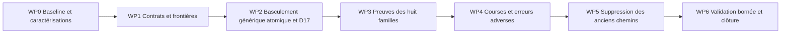

# Plan d'implémentation — protocole transactionnel générique Consumption

Date : 2026-10-16. Statut du plan : **WP0–WP6 PASS — COMPLETE**, clôture fonctionnelle bornée ; aucun gate d’intégration main revendiqué. Voir la [synthèse finale WP6](2026-10-16-consumption-generic-transactional-protocol-wp6-closure.md). Voir le [rapport WP2](2026-10-16-consumption-generic-transactional-protocol-wp2-implementation.md).

## 1. Executive summary

La cible est un seul protocole transactionnel pour les huit familles Consumption : effets SQL provisoires selon les autorités locales, provenance éventuelle, flush, CAS `S/PENDING/C`, clôture conditionnelle du claim, commit commun. Toute perte du CAS ou anomalie de clôture annule l'ensemble de la transaction. Le moteur possède ce suffixe ; les familles possèdent leurs effets et leurs policies. Aucun protocole final Command spécifique, aucun prélock terminal maintenu pour Event/Projection.

Le succès et le rejet via Execute suivent déjà cet ordre. Les inversions sont dans Finalize partagé et la recovery Binding. Le chantier comprend **sept WP (WP0–WP6)**. WP2 bascule ensemble le moteur, les wrappers, la recovery et les assemblages qui doivent évoluer ; D17 y est vérifié dès que le chemin réel est exécutable. WP3 et WP4 approfondissent les preuves, sans attendre leur clôture pour migrer une famille. Ce regroupement évite un état intermédiaire où l'on retire un verrou tout en conservant un retour normal qui committe des effets stale.

Le CONDITIONAL GO initial de l'audit a maintenant une première preuve PostgreSQL TARGET bornée au WP2 ; les approfondissements WP3/WP4 restent requis. Les recommandations de contrat ci-dessous sont suffisamment précises pour guider l'implémentation ; les préconditions WP0/WP1 doivent être satisfaites avant WP2. Ni ce plan ni un test D17 vert ne prouvent l'absence universelle de deadlock ou une progression bornée.

## 2. Baseline initiale du plan, références et écarts au HEAD initial

### 2.1 État Git avant travail

- Branche conservée : `feat/runtime-monolith`.
- HEAD initial : `056ec136672b8d7b4cbd80d2af430d62288c08de`.
- Upstream : `origin/feat/runtime-monolith`, divergence locale `0/0`.
- `git ls-remote origin refs/heads/feat/runtime-monolith` confirme le même SHA serveur, après un premier échec DNS en sandbox puis une lecture réseau autorisée.
- Modifications préexistantes exclues du livrable : `docker/keycloak/pocoma-realm.json` ; Bruno `01 Create Pot.bru` supprimé, `02`–`07` et `folder.bru` modifiés ; quatre fichiers non suivis `001 Registrations.bru`, `002 RegistrationResult.bru`, `003 Me-Binding.bru`, `004 Create Pot.bru`. Aucun staging global autorisé.

### 2.2 Références lues et préséance

| Référence | Révision / rôle |
|---|---|
| [Audit générique](../architecture/Consumption_Generic_Transactional_Protocol_Audit_2026-10-16.md) | Commit `056ec136672b8d7b4cbd80d2af430d62288c08de`, sources auditées `78e861abc737f81283b35f91887824137f55ca24` ; référence de conception principale, CONDITIONAL GO pour huit familles |
| [Étude initiale](../architecture/Consumption_Finalization_Unification_Study_2026-10-16.md) | Commit `78e861ab`, sources `306963fc` ; ses possibilités d'exemption Event/Projection sont remplacées par la cible générique de l'audit suivant et de cette mission |
| [Audit PostgreSQL](../debts/BINDING_LOCK_ORDER_GUARD/Audit_2026-10-16.md) et [diagnostics](../debts/BINDING_LOCK_ORDER_GUARD/Verification_2026-10-16.txt) | Commit documentaire `306963fc` ; tests ajoutés en `c839e780` ; D17 CURRENT reproduit avec `40P01`, pas preuve TARGET |
| [Canon Consumption](../architecture/consumption-transactional-execution.md) | Autorité du claim courant, rollback, séparation Execute/failure, effets externes via SQL/outbox |
| [Garanties système](../guarantees/System_Guarantees.md) | Distinguer garanties de schéma/code, preuves bornées et propriétés non spécifiées |
| [Canon ProjectionTask](../architecture/projection-task-execution.md), [canon Binding WA5–WA11](../steps/completed/WRITE_ADMISSION/Step_Canon.md) | Préparation pure, first published wins, exactitude des versions ; occurrence Binding non réutilisable et fence valide au commit |
| [Courses takeover](../debts/TAKEOVER_TEST_FLAKINESS/Concurrent_Takeover_2026-10-15.md), [dette vivante](../debts/TAKEOVER_TEST_FLAKINESS/Debt.md) | Preuves historiques déterministes ; la recommandation OPEN du rapport ancien est remplacée par RESOLVED dans la fiche vivante, sans réécrire le passé |
| [Politique Maven](../testing/Reactor_Verification_Policy.md) | Normative, lue avant analyse sous `app/` ; anchors et gates du §7 |
| [Dette ordre Binding](../debts/BINDING_LOCK_ORDER_GUARD/Debt.md), [guards append-only](../debts/SQL_APPEND_ONLY_GUARDS/Debt.md) | OPEN/LOW conservés ; les scans structurels ne prouvent pas les attentes FK/flush ; aucune modification de statut dans cette mission |

Lecture intégrale des trois rapports obligatoires, complétée par inspection des composants du §6 et des tests du §9. `git diff --stat 306963fc..HEAD -- app docs/testing docs/architecture/consumption-transactional-execution.md` est vide : les deux commits suivants sont documentaires. Aucun écart runtime/test/schéma depuis les références demandées ; aucune adaptation de cible due à un changement de code.

Écarts documentaires à traiter pendant le chantier : le canon ProjectionTask §10/§12 présente encore vérification initiale et claim avant slot dans sa séquence conceptuelle ; expliciter le CAS final puis claim au WP2, tout en conservant son invariant de rollback. Les garanties système emploient des formulations générales d'idempotence/divergence : préserver les distinctions concrètes (outcome Command strict, Results comparés, Projection first wins). La politique indique encore baseline V23 candidate, **Trusted baseline NONE**, tandis que le bootstrap primaire courant des tests va jusqu'à V29. Cela n'autorise ni baseline improvisée ni certification implicite.

Point de preuve non résolu au HEAD : cinq erreurs d'injection historiques dans `BindingRuntimePostgresTest`, deux beans `TransactionRunner`. Le test contient encore `@Autowired TransactionRunner transactions` sans qualifier ; cela étaye le risque, sans constituer une nouvelle exécution. WP0 doit diagnostiquer et lever ce blocage, pas déclarer BINDING vert sur les 77 PASS historiques des autres scénarios.

## 3. Architecture CURRENT et couverture des huit familles

`SequentialConsumptionOrchestrator` appelle Acquire puis Execute dans deux transactions ; après exception et rollback, il classe et appelle HandleFailure dans une autre transaction. Event et Projection utilisent AcquireThenFinalize, avec préparation hors de la transaction finale. Les templates sont REQUIRED/DEFAULT ; JDBC et JPA partagent le manager dans le wiring inspecté. REQUIRED peut rejoindre une transaction ambiante : l'absence de transaction englobant tout l'orchestrateur est une précondition effective, à vérifier, pas une conséquence du mot REQUIRED.

| Famille / assemblage | CURRENT et effets propres | TARGET, conservation et preuve |
|---|---|---|
| Command / `CommandConsumptionRuntimeConfiguration` | Execute : Pot/Events → fence Binding → outcome strict + terminal event → provenance → CAS/claim ; failure et recovery prennent S avant outcome | Même succès/rejet ; Fail et recovery vers suffixe commun sans prélock. T01/T03/T05/T08 ; aucun déplacement Pot/Binding |
| Registration / `RegistrationRuntimeConfiguration` | Stream Binding → initializer User/UserCreatedFact → occurrence/actif/fait → outcome → input request → CAS/claim ; outcome existant réutilisé | Préfixe inchangé, suffixe mutualisé ; FAILED technique effet vide, aucun nouvel outcome Registration FAILED. T02/T09/T10 |
| Binding / `BindingRuntimeConfiguration` | Fait immutable → UPSERT CURRENT_BINDING monotone → input → CAS/claim ; ne modifie pas l'autorité WRITE | Même monotonie/tombstone/comparaison R égale ; failure vide commune. T02/T09/T10 |
| Event / `EventConsumptionRuntimeConfiguration` | Finalize verrouille S avant Task.ensure ; pas de provenance ni failure handler câblé | ensure provisoire avant CAS ; stale autorisé à invoquer, zéro effet durable perdant ; erreur SQL reste RuntimeFailure, claim ouvert jusqu'au takeover. T06/T11 |
| Projection Task / `CanonicalProjectionTaskRuntimeConfiguration` | Préparation/validation hors finale ; prélock S puis root/artifacts ou failure ; Temporary via retry | Garder préparation pure et courte publication ; publication/failure provisoires puis suffixe ; first wins sans comparaison, Temporary jamais terminalisé par budget. T04/T06/T11 |
| Command Result / `CommandResultRuntimeConfiguration` | Sources immuables → ensureResult et comparaison → input terminal event → CAS/claim | Même contenu, owner historique, immutabilité ; slot résultat distinct du slot Command ; FAILED propre vide. T05/T09 |
| Registration Result / `RegistrationResultRuntimeConfiguration` | Sources immuables → ensureResult comparé → input outcome → CAS/claim | Même contrat ; aucun fence Binding ajouté pour relire une décision immutable. T05/T09 |
| Latest Known Version / `LatestKnownVersionRuntimeConfiguration` | UPSERT watermark monotone → input Event → CAS/claim ; succès métrique afterCommit | UPSERT avant suffixe, aucun verrou Pot WRITE ajouté ; métriques succès seulement après commit, erreurs de tentative permises. T09/T10/T11 |

Les chemins absents restent absents : pas de FAILED Event automatique, pas de REJECTED inventé pour les matérialiseurs, pas de nouveau chemin ABANDONED. Un Result qui matérialise une source FAILED termine lui-même SUCCESS. Task.ensure converge par ProjectionKey ; root ALREADY_EXISTS ne compare pas les payloads ; failure compare un failure_id en conflit ; Results comparent le contenu immutable ; Command INSERT strict ne devient pas DO NOTHING.

## 4. Ordre canonique : relation partielle, locks et flushs

### 4.1 Transactions et suffixe obligatoire

```text
Tx Acquire : créer slot si absent → verrou par clé → examiner lease/DONE
             → invalider ancien claim si takeover → insérer/flush nouveau claim
             → installer token ; COMMIT
Préparation pure éventuelle hors transaction d'effets

BEGIN Tx effets (Execute, Finalize ou recovery après rollback)
  préfixe de famille : SQL métier + validations d'autorités à leurs positions locales
  publications SQL outcome/Event/task/projection/failure requises, encore provisoires
  valider les slotIds de provenance ; append inputs/results éventuels
  FLUSH tous les writes ORM nécessaires AVANT envoi du CAS
  CAS S : WHERE slot_id=S AND status=PENDING AND current_claim_id=C
    terminal : DONE, outcome/raison/date cohérents, current_claim_id=NULL
    retry : PENDING, next_claim_at, current_claim_id=NULL, aucun résultat terminal
  cardinalité 0 : lever LostClaimException, sortie exceptionnelle jusqu'au rollback
  cardinalité autre que 1 : anomalie, rollback
  UPDATE claim WHERE claim_id=C AND slot_id=S
    AND ended_at IS NULL AND invalidated_at IS NULL
  exiger exactement 1 ; sinon anomalie, rollback
COMMIT
Seulement après résolution physique : APPLIED ou traduction de perte en LOST_CLAIM
```

Après CAS réussi, seule la clôture du claim est permise avant commit. Aucun callback, acquire d'autre slot, publication, nouveau flush d'effet retardé ou requête métier verrouillante. Le flush automatique du repository Claim ne doit donc plus découvrir de writes métier. Le commit et ses contraintes peuvent encore échouer ; APPLIED n'est rendu qu'après sortie réussie du runner.

### 4.2 Ordres locaux et acquisitions

| Étape / ressource | Verrous explicites et implicites attendus | Ordre impératif et barrière |
|---|---|---|
| Acquire/Takeover | INSERT slot peut attendre unique clé ; SELECT FOR UPDATE S ; UPDATE ancien C ; INSERT C avec FK S/uniques(S,attempt)/(S,C) ; install S avec FK composite C | S avant mutation C ; `saveAndFlush` nouveau C avant install. Aucun accès outcome/projection/métier sous S. Conserver `findByKeyForUpdate` |
| Pot Command | INSERT ou CAS `updateIfActive`, metadata unique(Pot,version), UPDATE fermetures temporelles et INSERT nouvelles versions | CAS Pot **avant** mutations qu'il autorise. `flushAutomatically` avant son UPDATE ne justifie pas de déplacer le CAS après les mutations |
| Events métier et Binding positif Command | outbox PK/uniques/FK ; `saveAllAndFlush` flush Pot/Events ; fence `SELECT stream WHERE E FOR SHARE` puis validation fraîche séparée `E,R,U,B` ; verrou jusqu'à résolution physique TE | Pot/DML/Events → fence Binding → outcome ; garder la position présente. La validation fraîche ne verrouille pas l'actif ; les writers lifecycle gardent FOR UPDATE sur le stream. Sans Events, les inserts ORM restants doivent au plus tard être flushés avant S |
| Registration / Attach / Detach | bootstrap unique E ; FOR UPDATE stream ; FK User/occurrence/stream ; actif PK E et unique B ; DELETE actif exclusif ; fact unique(E,R) | Stream avant initializer et mutations actif/occurrence/fact. Aucun User créé si E occupée. Ne pas imposer User→Binding→Pot |
| Binding recovery négative | Relecture exacte E/B en nouvelle transaction après rollback ; pas de gap lock négatif | B permanent, non réutilisable : absence stable de cette occurrence. B encore présent = conflit technique, pas rejet public. Pas de prélock S |
| Outcome/terminal event | INSERT strict outcome Q : attente sur unicité/XID concurrent ; INSERT terminal event unique Q et FK outcome | Outcome avant terminal event, tous deux avant provenance/S ; pas d'idempotence fabriquée |
| Task / Projection / Results | Task/root unique ProjectionKey ; artifacts FK root et uniques ; failure PK ; Results unique Q/request et FK sources | Root avant artifacts ; chaque publication partageable avant son propre S. Comparaisons et first wins conservés |
| READ Binding et LKV | UPSERT unique E/PotId peut attendre même si candidat stale ; pas de lock sur WRITE homonyme | UPSERT avant provenance/S ; monotonie indépendante du claim |
| Provenance | saveAll différé, inputs unique(S,subject,type/version), results PK ; FK immédiates → KEY SHARE S | Vérifier S pour tous les éléments avant append ; flush effectif avant CAS. FK conservées, leurs locks ne prouvent pas ownership |
| CAS slot terminal/retry | UPDATE non-clé : normalement NO KEY UPDATE, compatible KEY SHARE, en conflit avec autres writers ; prédicat réévalué sous READ COMMITTED | Dernier arbitrage du slot, garde lock jusqu'au commit ; zéro peut être immédiat si ancien token, ou attendre selon état réel |
| Clôture claim | UPDATE non-clé end/fail, cardinalité exacte | S puis C ; aucune condition lease. Lease expirée encore courante accepte ; revision n'est pas un token |

INSERT/UPDATE/DELETE prennent aussi ROW EXCLUSIVE sur leurs tables ; SELECT FOR UPDATE prend ROW SHARE ; lectures MVCC prennent ACCESS SHARE. Les attentes d'unicité/XID, FK parents et triggers ne disparaissent pas avec le CAS. `clearAutomatically` détache les entités, ne libère aucun verrou. Modes attendus à confirmer par T07, surtout en présence d'une file de takeover ; ne pas conclure d'un graphe de noms sans mêmes clés/modes.

Exceptions autorisées : Acquire/Takeover garde S→C car il ne demande jamais les publications détenues par Execute ; les autorités métier gardent leurs ordres locaux ; logs et métriques de tentative n'ont pas de rollback métier ; préparation pure hors transaction ; effets vides sans provenance. Aucune exception terminale par famille. Si un futur callback prend plusieurs Pots/E partageables, tous les writers concernés doivent adopter un ordre stable sur ces clés ; pas de hiérarchie globale arbitraire pour les ressources jamais composées.

### 4.3 D17 : argument borné de suppression

CURRENT : C1 détient outcome Q ; C2, après takeover committé et rollback Execute, détient FOR UPDATE S et attend Q ; le flush input C1 demande KEY SHARE S : cycle `Q→S→Q`.

TARGET : C2 attend Q **avant tout CAS/lock S terminal**. C1 peut flusher la FK, perdre CAS(S,C1), rollbacker et libérer Q. C2 publie FAILED, gagne CAS(S,C2), clôt C2 et committe. Les contraintes restent actives. Le témoin est conservé au commit `c839e780` et dans les diagnostics ; WP0 capture l'état CURRENT avant de modifier le test actif en non-régression TARGET au WP2. Ne pas conserver un test actif exigeant un défaut corrigé, ni un runtime alternatif legacy pour le faire passer.

Le retrait d'une arête explique cet entrelacement ; les effets multi-autorités, upgrades et files d'attente restent à éprouver. Aucun engagement de fairness, temps maximal ou débit amélioré sans mesure.

## 5. Contrat générique, erreurs et résultats publics

### 5.1 Contrat des callbacks existants

Conserver `FencedDurableEffect` et le callback Execute ; préciser leurs Javadocs et les ports appelés. Pas de framework de phases ni huit stratégies :

1. Le callback rejoint la transaction locale du moteur, même datasource/manager ; aucun commit indépendant, REQUIRES_NEW, transaction autonome ou écriture auto-commit requise.
2. Tous les effets métier sont SQL rollbackables. Aucune mutation de cache métier partagé, notification réseau/email ou publication durable hors transaction avant commit. Les Events requis utilisent l'outbox SQL ; afterCommit ne garantit pas leur livraison.
3. L'invocation stale et les SQL provisoires sont permis ; le callback ne suppose pas une élection préalable. Il ne finalise pas son lifecycle ni un autre slot et respecte les ordres locaux du §4.
4. Il laisse traverser les erreurs de fencing, contraintes et flush. Le moteur seul exige CAS/clôture ; aucune capture suivie d'un retour normal ou d'une compensation partielle.
5. Les listes d'inputs/Events Command restent locales à l'invocation ; validateSlotIds avant persistence ; préparation Projection pure et historique exact hors finale.
6. Les compteurs/logs de tentative peuvent observer une tentative rollbackée ; les métriques LKV advanced/unchanged sont afterCommit. Une exception d'observation après commit ne déclenche pas un FAILED de ce succès durable.

### 5.2 Choix concret de mutualisation

Faire de Finalize le propriétaire du suffixe terminal dans `engine-consumption`. Étendre `ConsumptionFinalization` avec Rejected(code), conserver Success et TerminalFailure(ProcessingFailure). Ajouter à l'entrée de finalisation une provenance optionnelle (listes vides par défaut). Execute exécute son callback dans sa transaction, adapte le résultat et délègue **sans réinvoquer** l'effet déjà joué. Les autres callers transmettent leur callback existant. Un helper interne suffit si nécessaire ; aucune seconde mécanique CAS/clôture n'est permise.

Le port lifecycle reçoit une opération terminale commune acceptant décision/raison/failure et exigeant CAS puis clôture, en réutilisant `terminalize`, `end`, `fail` actuels. Les signatures exactes peuvent être arrêtées en WP1, mais l'ownership du suffixe, la validation des métadonnées et la sémantique d'échec sont décidés ici. Une transition retry distincte conserve `scheduleRetry` ; elle partage le contrôle des cardinalités/perte et la clôture atomique, pas l'UPDATE DONE ni le modèle de publication. Aucun booléen de perte laissé sans contrôle par un caller après writes.

### 5.3 Frontière précise de LOST_CLAIM

Recommandation : conserver `LostClaimException` en signal interne non classifiable. Finalize, Execute, failure et recovery la laissent traverser **tout** delegate transactionnel. Les wrappers publics Finalize/HandleFailure peuvent conserver `FencedMutationResult.LOST_CLAIM` en capturant **après** `runInTransaction`, uniquement aux entrées propriétaires physiques sans transaction ambiante. Execute continue de propager ; Sequential l'absorbe après rollback comme aujourd'hui. La recovery appelle un delegate qui propage, rejoint sa transaction REQUIRED, et laisse la perte sortir de son propre runner ; aucune traduction imbriquée.

Les entrées publiques Finalize/HandleFailure sont interdites sous transaction ambiante ; documenter ce contrat en WP1 et le contrôler à la frontière Spring de composition en WP2, sans introduire Spring dans le moteur. Les délégations internes (HandleFailure→Finalize et recovery→Execute) utilisent les services participants qui ne capturent rien. Le garde doit viser les entrées propriétaires, **pas** chaque appel REQUIRED, sous peine de casser la recovery. T10 doit inclure un appel public sous transaction ambiante rejeté avant effet, et le cas interne recovery qui rejoint correctement son owner. Si cette distinction n'est pas réalisable sans ambiguïté dans le wiring, bloquer WP2 et garder l'exception jusqu'à l'orchestrateur externe ; ne jamais rendre normalement LOST_CLAIM à une transaction encore active avec effets.

### 5.4 Matrice des sorties et erreurs

| Chemin / erreur | Comportement retenu |
|---|---|
| SUCCESS / REJECTED | Effets et provenance conformes → suffixe commun ; rejet métier sans ProcessingFailure ; raisons exactes conservées |
| FAILED technique | Rollback physique Execute d'abord ; nouvelle transaction HandleFailure ; policy Fail → callback terminal spécialisé ou vide → CAS commun FAILED → claim.fail ; code public Command distinct du code failure slot/claim |
| RetryAfter | Après rollback Execute, effet vide, aucune provenance/outcome/failure terminal ; slot PENDING sans C avec nextClaimAt calculé, claim.fail avec détails ; perte lève en interne, traduit après rollback |
| Recovery Binding | Après rollback fence perdu, relire E/B exact ; présent → BindingFenceConflictException, classifier transitoire/budget existant ; absent → rejet public précis via suffixe commun, sans rejouer le métier rollbacké ni prélock S |
| CAS zéro | Exception traverse le propriétaire physique, rollback métier/publications/provenance ; puis LOST_CLAIM. Aucun retry automatique de l'effet et aucune classification technique de la perte |
| Clôture zéro après CAS un | Anomalie d'intégrité/composition distincte de perte normale ; rollback également du DONE/nextClaimAt ; aucune réparation REQUIRES_NEW |
| 23505 avant CAS | Rollback, relecture fraîche S/C hors transaction avortée pour normaliser seulement si token supplanté ou slot fini. Encore courant : garder erreur technique/invariant et classification existante ; contenu divergent jamais converti en succès |
| 40P01 / 40001 / timeout | Rollback puis classifier/policy de la famille ; distinguer cause SQL et ownership fraîche. Aucun retry expérimental pour cacher D17, aucune conversion systématique en LOST_CLAIM |
| Échec flush/contrainte différée/commit | Aucun APPLIED anticipé ; rollback confirmé → traitement normal de l'erreur. Réseau au commit : état indéterminé, relire slot/claim/publications, pas d'affirmation de rollback ni de republication aveugle |
| Exception de métrique après commit | Observation séparée, ne pas refaire Execute ni publier FAILED ; journaliser l'erreur d'observation avec commit déjà résolu |

Conserver les policies : Command 1 s/5 s/30 s puis Fail à tentative 4 pour transitoire, inconnue terminale ; Registration et Results invariants terminaux/autres 5 s ; Binding policy actuelle ; LKV budget actuel ; Projection Temporary non borné par tentatives ; Event aucun failure handler ajouté. Relire les valeurs au début de chaque WP si le HEAD a changé.

## 6. Inventaire des adaptations par module et classe

Les noms sont recherchables dans `app/` ; les chemins centraux sont liés en annexe. Chaque ligne est une obligation de review, pas une permission de modifier tout le module.

| Élément | CURRENT → TARGET / contrat | Tests impactés et risque |
|---|---|---|
| `engine-consumption/ExecuteConsumptionService` | Callback, validation provenance et CAS local → callback conservé, adaptation Success/Rejected et délégation suffixe commun ; résultat public métier conservé | Execute tests et `TransactionalConsumptionExecutionPostgresTest` ; double callback ou double provenance si délégation incorrecte |
| `FinalizeConsumptionService`, `ConsumptionFinalization`, `FinalizeConsumptionInput`, `FencedDurableEffect` | Prélock puis effet → effet/provenance/flush/CAS/clôture communs ; ajout Rejected et listes optionnelles ; perte par exception | `FinalizeConsumptionServiceTest`, `TransactionalConsumptionUseCaseTest` ; retour normal stale et métadonnées invalides |
| `HandleConsumptionFailureService` | Query claim/policy ; `new FinalizeConsumptionService` pour Fail → délégation au même finalizer participant ; retry explicite | Failure service tests ; finalisation FAILED indépendante ou mauvais budget |
| `ConsumptionLifecyclePersistencePort` | acquire/lock/tryTerminalize/handleFailure → acquire conservé, opération terminale commune et retry conditionnel ; anciens points d'entrée transitoirement adaptateurs seulement | Doubles de ports dans moteur/orchestrateur/tests SQL ; méthode booléenne oubliée par un caller |
| `JpaConsumptionLifecycleAdapter` | CAS+end et failure CAS+fail dupliqués → contrôles communs, validations Success/Rejected/Failed, exception sur perte et cardinalité ; MANDATORY conservé | Lifecycle et transactionnels PostgreSQL ; perdre reason/failure details ou accepter claim fermé |
| `JpaConsumptionSlotRepository` | `terminalize`/`scheduleRetry` avec flush/clear → SQL et prédicat S/PENDING/C conservés ; suppression id FOR UPDATE après zéro caller | `JpaConsumptionSlotRepositoryFencingQueryTest`, T04/T07 ; changement de clé référencée et mode lock, flush déplacé |
| `JpaConsumptionClaimRepository` | end/fail/invalidate conditionnels → SQL conservé, exactly-one obligatoire ; aucun test lease en clôture | Lifecycle/T04 ; DONE persistant avec claim non clos |
| `JpaConsumptionProvenanceAdapter` | saveAll différé → conserve FK et écritures, barrière finale garantie par adapter lifecycle avant CAS | Provenance/cross-slot/flush T01/T04/T07 ; ne pas traiter saveAll comme flush effectif |
| Wrappers `TransactionalAcquire/Execute/Finalize/HandleConsumptionFailureUseCase` | REQUIRED délégation simple → Acquire/Execute propagation conservée ; Finalize/Failure traduction uniquement après fin physique sous contrat §5.3 | Tests runner + T10 ; capture dans transaction englobante, UnexpectedRollback ou commit partiel |
| `infra-tx-spring/SpringTransactionRunner`, composition | execute sans capture → conserver le mécanisme ; garde d'entrée owner dans infrastructure/composition, distinction participant ; observation postcommit séparée | T10/T11 ; modifier globalement TransactionRunner affecterait admission et WEB, hors périmètre déclaré |
| `SequentialConsumptionOrchestrator` | Perte Execute ignorée, autres classées après rollback → conserver ; intégrer normalisation pré-CAS externe sans classifier LostClaim | Orchestrator tests, T05 ; classifier une perte ou une erreur afterCommit comme failure métier |
| `AcquireThenFinalizeConsumptionOrchestrator`, adaptateurs Event/Projection | Résultat finalizer APPLIED/LOST → conserver API publique et budgets ; wrappers garantissent rollback avant résultat ; pas de fusion des deux orchestrateurs | Tests Event/Projection, T06/T11 ; transformer perte en RuntimeFailure ou boucler sans budget |
| `BindingFenceRecoveryExecuteUseCase` | S lock puis relecture Binding puis Execute imbriqué → suppression prélock, relecture exacte conservée, rejet par suffixe commun dans tx recovery, participants sans capture | Command recovery/D17/T08 ; rejouer Pot, confondre B absent et conflit positif, catch trop tôt |
| Configurations des huit runtimes | Instancient services/wrappers actuels → injection du suffixe commun et choix owner/participant ; pas de flag par famille | Tests des huit runtimes/T10 ; manager secondaire, mauvais qualifier, dépendance nouvelle |
| Callbacks et stores des huit familles (§3) | SQL locaux rollbackables → mêmes politiques et préfixes ; contrat explicite, aucune publication hors tx ; garde MANDATORY là où nécessaire au chemin | T06/T09 ; altérer immutabilité, first wins, monotonie ou owner historique |
| `architecture-tests` | Guards textuels et races historiques → aucune dépendance ni gate automatique ; lecture pour réutiliser l'intention ; preuves locales nouvelles près des runtimes | Global seulement selon §7 ; ne pas déplacer tous les tests dans ce module pour commodité |

Méthodes candidates à suppression WP5 : `lockCurrentClaim`, `findByIdForUpdate`, anciennes variantes `tryTerminalize` et branche terminale de `handleFailure` si l'API commune les remplace. Suppression uniquement après recherche de tous les callers de production **et** doubles de tests et compilation ; Acquire `findByKeyForUpdate` et stream Binding jamais concernés. Aucun changement de schéma proposé.

## 7. Verification scope et commandes futures

### 7.1 Déclaration de la présente mission

Impact production attendu/observé : **NONE**. Slices exécutées : **NONE** (documentaire). Analyse : Consumption partagé + COMMAND/EVENT/PROJECTION/BINDING/LKV et Registration/Results complémentaires. Forbidden production impact : tout runtime, test, SQL, migration, dépendance `app/`. Gate global NOT REQUIRED, interdit dans cette mission ; full reactor NOT REQUIRED, interdit ; database verification NONE. Aucun install/SNAPSHOT. Contrôles réels : lectures/recherches, inspection Git, parsing statique des POM, validation documentaire et diff ; aucun test Maven/PostgreSQL ni migration lancé.

### 7.2 Catalogue vérifié des anchors

Toutes les commandes suivantes sont **à exécuter lors de l'implémentation, depuis `app/`**, pas des résultats de cette mission.

| Code | Slice / anchor réel | Commande canonique de clôture locale |
|---|---|---|
| C | COMMAND | `./mvnw -pl runtime-command-consumption-worker -am test` |
| E | EVENT | `./mvnw -pl runtime-event-consumption-worker -am test` |
| P | PROJECTION | `./mvnw -pl runtime-task-consumption-worker -am test` |
| B | BINDING | `./mvnw -pl runtime-binding-consumption-worker -am test` |
| L | LKV | `./mvnw -pl runtime-latest-known-version-consumption-worker -am test` |
| R | Complément Registration, pas nouvelle slice canonique | `./mvnw -pl runtime-registration-consumption-worker -am test` |
| CR | Complément Command Result | `./mvnw -pl runtime-command-result-consumption-worker -am test` |
| RR | Complément Registration Result | `./mvnw -pl runtime-registration-result-consumption-worker -am test` |

`ALL8` désigne exactement la composition explicite suivante, aucune inclusion WEB ou architecture implicite :

```sh
./mvnw -pl runtime-command-consumption-worker,runtime-event-consumption-worker,runtime-task-consumption-worker,runtime-binding-consumption-worker,runtime-latest-known-version-consumption-worker,runtime-registration-consumption-worker,runtime-command-result-consumption-worker,runtime-registration-result-consumption-worker -am test
```

Les huit répertoires sont déclarés dans `app/pom.xml` ; leurs artifactIds sont préfixés `pocoma-`, les commandes `-pl` ci-dessus utilisent les chemins réels. Analyse statique XML des dépendances directes, incluant optional pour la fermeture de build : sept anchors atteignent 50 modules enfants, L atteint 38, hors parent ; tous atteignent engine-consumption, orchestrator-consumption, infra-tx-spring et les trois infrastructures primary/read/projection. Aucun n'atteint architecture-tests. Ce comptage indicatif n'est pas un reactor Maven exécuté ni une certification des profils ; Maven reste autorité de la fermeture `-am`. La présence READ dans cette fermeture courante corrige la supposition historique d'une preuve séparée nécessaire au HEAD plus ancien de l'audit locks. Vérifier à nouveau si les POM évoluent.

Cette fermeture large via composition ne fait pas de chaque module compilé une capacité modifiée ; surtout, elle n'exécute pas les tests d'un autre **runtime** absent de l'anchor. D'où les compléments R/CR/RR explicites. Aucun `-amd`, `install` ou résolution par SNAPSHOT installés artificiellement.

Feedback ciblé autorisé, puis commande canonique à la clôture du WP ayant modifié le comportement :

```sh
# CURRENT WP0 puis TARGET WP2, avec la classe au nom courant à chaque étape
./mvnw -pl runtime-command-consumption-worker -am -Dtest=CommandConsumptionPostgresTest,TransactionalConsumptionExecutionPostgresTest,JpaConsumptionLifecycleAdapterPostgresTest -Dsurefire.failIfNoSpecifiedTests=false test
# Contrat Java / wrappers WP1 et WP2
./mvnw -pl runtime-command-consumption-worker -am -Dtest=FinalizeConsumptionServiceTest,TransactionalConsumptionUseCaseTest -Dsurefire.failIfNoSpecifiedTests=false test
# Event / Projection, preuves SQL locales WP2–WP4
./mvnw -pl runtime-event-consumption-worker,runtime-task-consumption-worker -am -Dtest=ProjectionMaterializationConsumptionPostgresTest,CanonicalProjectionTaskRuntimePostgresTest -Dsurefire.failIfNoSpecifiedTests=false test
```

Ces classes existent et appartiennent aux fermetures inspectées. Avec `failIfNoSpecifiedTests=false`, exiger dans les rapports Surefire la présence des méthodes attendues, zéro skip/erreur, tests TARGET nouveaux inclus et leurs témoins SQL ; un build sans test ciblé n'est jamais PASS. Aucun retry de test ; pas de skip de compilation pour masquer une API cassée.

### 7.3 Gates, base et escalade

WP0–WP6 sont des étapes bornées de migration de comportement dans les frontières existantes, **pas une clôture de Major Wave ni une intégration main**. Primary C pour le moteur partagé, secondaires E/P/B/L et R/CR/RR selon la table WP ; pas WEB si admission, HTTP et port transactionnel global restent inchangés. Gate architecture global NOT REQUIRED en l'état ; full reactor NOT REQUIRED à ces étapes, impact borné aux huit consommateurs explicitement testés.

Si une modification de dépendances/modules/frontières/runtime isolation ou un couplage inattendu apparaît : identifier le module et sa capacité, expliquer l'écart, réviser le scope avant édition. Le gate `./mvnw -pl architecture-tests -am test` devient REQUIRED selon §17 de la politique. Si restructuration large ou impact non bornable : gate full `./mvnw test` selon §19. Ces commandes sont réservées au chantier futur dûment déclaré, jamais à la présente mission. Prochain gate obligatoire d'intégration main : full reactor + architecture globale + preuves DB applicables ; aucune fusion main prévue ici. Une éventuelle requalification ultérieure en Major Wave exige son gate avant de revendiquer cette clôture.

DB future : CURRENT avec FK/uniques/triggers réels. Tant que Trusted baseline NONE, garder bootstrap Flyway primaire/READ existant des tests ; son exécution interne est nécessaire à ces tests, sans campagne HISTORICAL supplémentaire. Si une baseline certifiée existe au début du WP, l'utiliser avec migrations postérieures. Pas de DDL production, certification baseline ou migrations historiques autonomes dans le périmètre. Un test de contrainte tardive peut utiliser un trigger **de fixture isolée**, retiré après test ; ce n'est pas une migration de schéma applicatif.

## 8. Graphe et Work Packages



La passe WP3–WP6 impose désormais la séquence WP3 → WP4 → WP5 → WP6 ; chaque étape exige PASS et commit avant la suivante. La possibilité initiale de travaux WP3/WP4 séparés n’a pas été utilisée. WP0 est **PASS** (campagne CURRENT du 2026-10-16, commit tests `2a9d8f3f1a1d0830e01c4f42a9f338b4361bc0c8` ; [rapport](2026-10-16-consumption-generic-transactional-protocol-wp0-baseline.md), [preuves](2026-10-16-consumption-generic-transactional-protocol-wp0-verification.txt)). WP1 est **PASS contractuel** ([rapport et décisions D01–D10](2026-10-16-consumption-generic-transactional-protocol-wp1-contracts.md)) ; WP2 est **PASS borné** (moteur/tests `72687053`, [rapport](2026-10-16-consumption-generic-transactional-protocol-wp2-implementation.md), [preuves](2026-10-16-consumption-generic-transactional-protocol-wp2-verification.txt)) ; WP3–WP6 restent **PLANNED**. Le suivi vit dans les tableaux de ce plan : ajouter SHA et lien vers preuves lors de l'exécution, sans tracker redondant.

### WP0 — Baseline reproductible et préconditions expérimentales

| Élément | Attendu |
|---|---|
| Objectif | Conserver la preuve CURRENT D17 et rendre les preuves nécessaires exécutables avant migration |
| Périmètre | Tests Command/lifecycle/transactionnels dans infra-primary ; fixtures Binding runtime ; inventaire des huit assemblages, POM et canons |
| Préconditions | Relever nouveau HEAD, divergence et working tree ; relire politique ; Java 21, Docker/PostgreSQL réels disponibles |
| Modifications | Archiver le diagnostic CURRENT avec SHA, PID/XID, SQLSTATE, FK/uniques actives ; préserver les deux témoins sans provenance ; inventorier callbacks/ordres ; diagnostiquer ambiguïté Binding et qualifier la fixture si c'est bien la cause, sans changer policy/moteur ; préparer points de barrière déterministes |
| Invariants | Runtime et schéma inchangés ; ne pas fabriquer le deadlock par un nouveau lock ; aucun sleep de race ni retry ; C1/C2 réellement distincts |
| Risques | Prendre une erreur d'environnement pour un résultat ; modifier le scénario avant d'avoir capturé CURRENT ; correction d'injection hors fixture révélant un vrai défaut de composition |
| Tests | Scope C primaire, B secondaire si fixture adaptée ; commande ciblée CURRENT §7.2, puis B pour cinq scénarios runtime ; C canonique si tests modifiés ; T01 CURRENT et inventaire T01–T11 |
| Exit criteria | D17 exactement un 40P01 avec témoins SQL et états cohérents ; D16/D18 sans deadlock ; rapports archivés non ambigus ; Binding runtime réellement exécuté ou blocage explicite résolu avant WP2 ; chaque test relié à un WP/anchor |
| Rollback | Revert uniquement nouvelles fixtures/diagnostics invalides ; garder preuve historique et fichiers locaux ; pas de correction runtime opportuniste |
| Documentation | Ajouter liens de campagne CURRENT dans ce plan ; conserver audit/diagnostics historiques intacts et statuts de dettes |

**Suivi historique à la clôture WP0, 2026-10-16 — PASS** : D17 CURRENT reproduit (`40P01`), rollback attesté, 52 tests ciblés PASS, Binding 5/5 après qualifier local, COMMAND canonique 857/857 après qualification de deux fixtures Command. Aucun changement de production ; WP1/WP2 non engagés. Voir les preuves liées ci-dessus.

**Instruction initiale WP0, exécutée lors de cette campagne** : lancer uniquement la caractérisation CURRENT existante et diagnostiquer la fixture Binding, après disponibilité PostgreSQL. Il ne corrige pas D17 et ne peut clôturer le chantier. Si une correction de production Binding est requise, requalifier le scope avant intervention ; la migration générique attend sa preuve runtime.

### WP1 — Contrat commun et frontière de rollback décidés

| Élément | Attendu |
|---|---|
| Objectif | Verrouiller les décisions qui conditionnent la sûreté avant changement d'ordre SQL |
| Périmètre | Contrats engine-consumption, wrappers, conception des entrées owner/participant dans composition ; tests de contrat existants |
| Préconditions | WP0 ; ordre de chaque callback et appels imbriqués inventoriés |
| Modifications | Formaliser §5 ; arrêter entrée terminale Rejected/provenance et API lifecycle commune ; préciser perte interne versus résultat externe ; préparer extensions additives et tests de métadonnées si utiles, sans remplacer l'ordre runtime courant ; définir les substitutions d'assertions §9.3 ; choisir le contrôle Spring des entrées ambiantes |
| Invariants | Contrat actuel encore exécutable ; aucune assertion CURRENT supprimée avant sa preuve TARGET ; pas de capture ajoutée sous transaction ; aucune publication externe |
| Risques | API trop générale, framework de phases ; garde REQUIRED qui interdit la recovery ; méthodes ajoutées sans propriétaire transactionnel |
| Tests | C primaire et E/P/B/L + R/CR/RR pour compilation des contrats partagés si signatures changent ; feedback contrats §7.2 ; clôture ALL8 si contrats Java modifiés. DB NONE si documentaire/additif sans comportement ; pas de gate global/full |
| Exit criteria | D01–D10 ci-dessous fixées, aucun choix de rollback/ownership/flush reporté ; exemples owner/participant compilables si API ajoutée ; aucun nouveau chemin terminal actif ; plan de tests avec résultats attendus complets |
| Rollback | Revert extensions additives comme unité ; conserver contrat documentaire corrigé ; ne pas migrer un caller isolé |
| Documentation | Canon Consumption : contrat callback et perte ; inscrire décision sur ordre physique Projection sans annoncer TARGET implémenté |

**Suivi historique à la clôture WP1, 2026-10-16 — PASS contractuel** : [rapport WP1](2026-10-16-consumption-generic-transactional-protocol-wp1-contracts.md), D01–D10 CLOSED, owners sans transaction ambiante et participants internes explicites, API terminale/provenance et barrière pré-CAS arrêtées. Mission exclusivement documentaire : aucun runtime/test/schéma modifié, aucun test exécuté. WP2 non commencé ; preuves TARGET restent à obtenir. Les obligations de contrat du rapport WP1 précisent les recommandations §5/§10.2.

### WP2 — Basculement cohérent du protocole et preuve D17 immédiate

| Élément | Attendu |
|---|---|
| Objectif | Un seul suffixe actif pour succès, rejet, failure, recovery ; aucune transaction ne committe après perte |
| Périmètre | Services et port engine-consumption, lifecycle adapter, wrappers et gardes Spring des entrées, recovery Command, assemblages des huit familles ; tests d'ordre et stale impactés |
| Préconditions | WP0/WP1 clos ; décisions D01–D10 actées ; manager commun vérifiable et garde ambiante défini |
| Modifications | Finalize sans prélock, effet/provenance avant CAS ; Execute délègue le suffixe ; Fail délègue au même service participant ; opération terminale commune CAS+claim ; retry garde SQL distinct avec même contrôle ; traductions après runner ; recovery sans lock S, relecture E/B conservée ; ajuster toutes constructions et tests de contrat ; ajouter preuves stale Event/Projection minimales et T10 ; aucune policy modifiée |
| Invariants | I01–I12 du §10 ; pas de double callback/provenance ; Pot et Binding inchangés ; aucun effet après CAS ; FK/uniques/immutabilité actives |
| Risques | Fenêtre de coexistence S→outcome contre outcome→S ; anciennes captures LOST_CLAIM ; flush à claim.end découvrant du métier ; callback stale autocommit ; rollout mixte |
| Tests | Scope C primaire, E/P/B/L secondaires, R/CR/RR explicites ; feedback D17 §7.2 dès chemin exécutable, puis T01 toutes variantes failure/recovery, T04 CAS/clôture, T05 23505, T06 stale minimal, T10 ; ALL8 à clôture ; DB CURRENT ; aucun gate global/full sauf escalade §7.3 |
| Exit criteria | D17 TARGET sans 40P01, C1 intégralement rollbacké, unique FAILED C2 et claim clos ; tous chemins actifs utilisent suffixe commun ; Event/Projection stale SQL annulés ; CAS perdu et clôture zéro rollbackés ; ALL8 sans scénario bloqué/skip ; aucune famille reste pessimiste |
| Rollback | Revert ensemble moteur/wrappers/recovery/assemblages/tests TARGET ; suspendre les workers concernés et drainer avant tout retour à CURRENT. Ne jamais restaurer seulement le prélock d'une famille |
| Documentation | Canon Consumption et séquences ProjectionTask alignés sur protocole réellement livré ; liens des premières preuves T01/T04/T06/T10, risque D17 CURRENT conservé historique |

**Suivi 2026-10-16 — WP2 clos PASS borné** : moteur/tests `72687053d2d5ec2dd1c47f667e4f95403aa1f4d8`, [rapport WP2](2026-10-16-consumption-generic-transactional-protocol-wp2-implementation.md), [journal](2026-10-16-consumption-generic-transactional-protocol-wp2-verification.txt). ALL8 949/949, zéro failure/error/skip ; dernière reprise D17 34/34 après renforcement des assertions, huit entrelacements sans 40P01, C1 rollbacké et C2 terminal cohérent. Protocole partagé, owners gardés et recovery participante ; aucun schéma/policy/fence métier changé. Précision d'emplacement : garde locale LKV dans son module de composition existant, sans nouvelle dépendance. Preuves approfondies WP3/WP4 toujours différées, aucune ouverture de ces WP.

WP2 est une unité de cohérence plus large que les autres WP mais son contenu reste mécanique : les effets métier ne sont pas réécrits. Les sous-commits de développement peuvent ajouter types puis migrer appels pour compiler, **sans livraison/exécution d'un état mélangeant protocoles**. Aucune coexistence runtime n'est autorisée au terme de WP2 ; aucun flag legacy. Les anciennes APIs peuvent encore exister comme délégations vers le suffixe unique jusqu'à WP5.

### WP3 — Validation fonctionnelle des huit familles

| Élément | Attendu |
|---|---|
| Objectif | Prouver chaque préfixe métier sous le contrat déjà migré, sans exemption de famille |
| Périmètre | Tests runtime des huit familles et stores correspondants ; adaptations minimales de garde/assemblage identifiées par preuve |
| Préconditions | WP2, notamment preuves minimales Event/Projection et rollback physique |
| Modifications | T02/T06/T09/T10/T11 par famille ; renforcer callbacks/store participation si preuve manque ; vérifier owner historique, contenu exact/provenance, root/artifacts/failure, monotonie Binding/LKV ; tester retry et failure vides ; pas de nouveau mécanisme terminal |
| Invariants | Modèles de résultats distincts conservés ; aucun outcome inventé ; Temporary Projection et lease expirée courante préservés |
| Risques | Confondre SQL idempotent et absence d'effets stale ; affaiblir comparaison Results ou ajouter comparaison Projection ; métriques succès après rollback |
| Tests | C primaire pour preuves communes, E/P/B/L et R/CR/RR selon table familles ; chaque sous-étape annonce ses anchors avant édition, commandes C/E/P/B/L/R/CR/RR ; clôture ALL8 ; DB CURRENT ; global/full non requis |
| Exit criteria | Huit lignes §3 ont liens vers tests exécutés au TARGET, commit/rollback et policies ; aucune fuite durable stale ; cinq scénarios Binding auparavant bloqués exécutés ; aucun test d'absence d'invocation supprimé sans remplacement |
| Rollback | Revert adaptation de famille et preuve associée si indépendante ; si régression du suffixe, revenir au lot WP2 entier, pas réintroduire un finalizer pessimiste |
| Documentation | Compléter matrice T02/T06/T09–T11 et garanties bornées ; déclarer toute exception trouvée comme blocage architectural, pas exemption silencieuse |

### WP4 — Courses PostgreSQL et erreurs adverses

| Élément | Attendu |
|---|---|
| Objectif | Éprouver les ordres d'attente et les points d'échec restants, au-delà du seul D17 |
| Périmètre | Tests infra-primary Command/lifecycle/transactionnels ; Event/Projection ; Results complémentaires ; wiring LKV |
| Préconditions | WP3 PASS et committé pour cette passe séquentielle ; reprendre preuves ciblées si la production change |
| Modifications | Compléter T02/T03/T04/T05/T07/T08/T11 ; troisième backend takeover, double finalisation/même C, détenteur publication commit/rollback, contraintes/commit refusés ; preuves de flush avec et sans Events ; observation postcommit séparée |
| Invariants | Aucun effet requis hors tx ; pas de timeout/retry utilisé pour autoriser un mauvais ordre ; pas de suppression FK/unique ; ancien et nouveau rôles vérifiés |
| Risques | Deadlock du contrôleur de test attendant le takeover avant de libérer le CAS ; faux PASS sans attente SQL ; erreurs de normalisation masquées par 23505 |
| Tests | C primaire ; E/P pour publications partagées ; B si contrat authority modifié (sinon usage Command seulement) ; CR/RR pour divergence ; L pour postcommit. Commandes correspondantes §7 ; ALL8 seulement si nouvelle correction générique, pas répétition automatique ; DB CURRENT ; pas de gate global/full |
| Exit criteria | T01–T11 complets avec témoins attendus, zéro skip/erreur ; deux ordres de victoire et résolution commit/rollback ; T07 modes/files documentés ; toute nouvelle arête inverse concrète résolue avant WP5 |
| Rollback | Revert corrections génériques comme unité cohérente et relancer preuves directement affectées ; conserver traces d'échec sans les compter comme PASS ; aucune hausse artificielle de retry |
| Documentation | Archiver rapports, SQLSTATE, PID/XID, environnement, contraintes, limites ; mettre à jour décisions/risques du plan |

### WP5 — Consolidation et retrait de surface obsolète

| Élément | Attendu |
|---|---|
| Objectif | Supprimer les anciennes APIs et tout protocole terminal divergent |
| Périmètre | Port/adapter/repository Slot, doubles de tests, injections devenues inutiles et duplication de suffixe ; canons |
| Préconditions | WP3 et WP4 clos, tous appelants migrés et preuves au vert |
| Modifications | Recherche de production/tests ; retirer lockCurrentClaim et findByIdForUpdate sans callers ; supprimer adaptateurs transitoires tryTerminalize/branche Fail remplacés ; garder acquire/scheduleRetry/claim SQL utiles ; réduire les constructions redondantes sans ajouter module/dépendance |
| Invariants | Aucun changement comportemental ; Acquire et locks stream toujours présents ; un propriétaire du suffixe ; invariants de métadonnées inchangés |
| Risques | Supprimer le mauvais FOR UPDATE, laisser un caller indirect/test double, tests textuels d'architecture périmés |
| Tests | C primaire, secondaires E/P/B/L + R/CR/RR, ALL8 ; recherches structurelles ciblées en complément ; DB via slices. Aucun architecture-tests automatique ; requis seulement si frontière/dépendance réellement changée |
| Exit criteria | Zéro usage des APIs retirées ; zéro prélock S terminal/recovery ; aucun effet après CAS hors clôture ; compilation et suites correspondantes vertes ; aucun bridge legacy restant |
| Rollback | Restaurer seulement la surface supprimée comme délégation au suffixe unique, jamais son comportement pessimiste ; si comportement change, reclasser et répéter preuves impactées |
| Documentation | Canons à jour, inventaire de suppression avec preuves ; réévaluation des dettes dans rapport de chantier, sans changement de statut officiel sans mission dédiée |

### WP6 — Validation finale bornée et clôture documentaire

| Élément | Attendu |
|---|---|
| Objectif | Vérifier la DoD au HEAD final et rendre la livraison auditable |
| Périmètre | Huit anchors, preuves T01–T11, revue du graphe/contrats et documentation |
| Préconditions | WP5 clos ; aucun point de correction bloquant ouvert |
| Modifications | Aucun nouveau protocole ; réconcilier les preuves avec le HEAD final, exécuter clôture ALL8 une fois, contrôles de usages/flush/wrappers ; si correction nécessaire, retour au WP propriétaire avec scope préalable |
| Invariants | DoD §11 complète ; aucune assertion de performance/absence globale de deadlock ; modifications utilisateur préservées |
| Risques | Revendiquer PASS avec preuves d'un ancien binaire, compter compilation comme test runtime, rebaptiser cette clôture bornée en Major Wave sans son gate |
| Tests | ALL8 et contrôles documentaires/diff ; DB CURRENT ; global/full non requis dans ce scope existant. Si gates déclenchés §7.3, les planifier explicitement ; intégration main distincte obligatoire avant merge |
| Exit criteria | Tous items DoD démontrés, références SHA/commandes/rapports et limites ; aucun scénario critique non exécuté ; un protocole unique pour huit familles ; revue finale des frontières |
| Rollback | Ne pas déclarer clôturé ; réouvrir WP en défaut ; rollback d'exploitation par ensemble cohérent sans migration DB ni compensation partielle |
| Documentation | Rapport final avec slices déclarées/réelles, commandes, crossings, gates, full reactor et raison, DB, commit/push/divergence ; suivi WP et garanties actualisés |

## 9. Plan de preuves PostgreSQL — matrice T01–T11

### 9.1 Protocole expérimental commun

PostgreSQL réel, isolation effective capturée (référence CURRENT READ COMMITTED/PostgreSQL 17.11), FK/uniques/triggers de production actifs. Horloge injectée contrôlée pour lease ; latches/barrières/futures bornées pour ordonnancer. Chaque transaction active utilise une connexion/PID distinct et son XID est relevé ; troisième connexion observatrice hors transaction longue pour ne pas figer un snapshot. Relever `pg_stat_activity`, `pg_locks`, `pg_blocking_pids`, SQL actif et SQLSTATE. Une attente est attestée par SQL/PID bloqué et bloqueur, pas par Future non terminée. Pas de sleep pour créer la race, pas de retry/rerun pour obtenir PASS. Une phase absente au timeout est un échec de preuve.

Avant commit, l'observateur voit l'état antérieur, jamais les effets provisoires. Après résolution, contrôler le contenu exact des tables d'effets, provenance, slot et historique C1/C2 : pas seulement un count outcome. Pour un rollback d'une transaction d'effets, l'acquisition antérieure reste committée ; ne pas exiger la disparition du claim acquis. Les fixtures ne doivent pas introduire un lock qui fabrique le cycle supposé. Les erreurs de clôture peuvent être injectées via fixture/trigger isolé après un **vrai** CAS, jamais via CAS simulé gagnant.

Réutiliser les patterns des courses historiques de `CommandResultTakeoverRacePostgresTest` ; cette classe réside dans `architecture-tests`. Ne pas ajouter cet anchor au feedback local : implémenter les nouvelles preuves dans les modules locaux indiqués ci-dessous, sans supprimer les tests historiques globaux. Leurs exécutions restent au gate global applicable.

Abréviations modules : **IP** = `infra-persistence-primary-jpa`, **RE** = `runtime-event-consumption-worker`, **RP** = `runtime-task-consumption-worker`, **RB** = `runtime-binding-consumption-worker`, **RL** = `runtime-latest-known-version-consumption-worker`, **RRg** = `runtime-registration-consumption-worker`, **RCR** = `runtime-command-result-consumption-worker`, **RRR** = `runtime-registration-result-consumption-worker`. Slices/commandes C/E/P/B/L/R/CR/RR sont définies au §7.2, non de nouveaux anchors.

### 9.2 Matrice de réalisation

| ID / WP responsable | Scénario, transactions et synchronisation | Locks / états et assertions de rollback | Module cible, test existant et slice |
|---|---|---|---|
| **T01 — WP0 CURRENT, WP2 TARGET** | D17 : Acquire C1 commit ; temps expire ; takeover C2 commit ; Execute C2 échoue/rollback ; C1 insère outcome Q + event puis latch ; failure C2 attend vraiment INSERT Q ; observateur atteste attente, libère C1. Décliner inputs seuls, results seuls, les deux, sans provenance ; même séquence recovery Binding négative | CURRENT exactement un 40P01, victime indifférente, preuve conservée. TARGET C2 ne détient pas S en attendant Q ; FK KEY SHARE C1 franchie, CAS C1=0, rollback libère Q ; aucune 40P01 des participants, C2 seul outcome FAILED/event, S DONE/FAILED sans courant, C2 PROCESSING_FAILURE clos avec détails, C1 TAKEN_OVER, aucun effet/provenance C1 ; recovery gagnante REJECTED/raison exacte et C2 REJECTED clos. Vérifier inputs **et** results, pas seulement input | IP `CommandConsumptionPostgresTest.characterizeOutcomeSlotWait`, méthode CURRENT `terminalFailureAndStaleProvenanceFormARealPostgresDeadlock` à renommer en non-régression TARGET ; témoins `bindingRecoveryWaitingOnStaleOutcomeDoesNotDeadlock` et `terminalFailureWaitingOnStaleOutcomeDoesNotDeadlock` conservés. C |
| **T02 — WP2 minimum, WP3 par famille, WP4 files** | Finalisation F1 contre takeover A2 : avant effet, après SQL provisoire/avant CAS, après CAS avant commit ; A2 commit puis rollback dans variantes ; lease expirée sans A2 ; deux takeovers A2/A3 sur C1 expiré. Barrières après effet ou CAS ; libérer holder après vraie attente du contender | Avant CAS A2 peut gagner si locks déjà acquis le permettent ; ne pas attendre un takeover impossible derrière FK/autorité détenue. Après CAS un, A2 attend S/unique slot puis AlreadyDone si commit F1, ou acquiert après rollback. A2 rollback laisse C1 autoritaire ; A3 réutilise tentative 2, C2 rollbacké absent. Un seul Acquired aux takeovers concurrents, autre Busy ; lease expirée courante peut terminer. Tous effets/provenance du perdant annulés | IP lifecycle et `TransactionalConsumptionExecutionPostgresTest` ; compléter tests des huit runtimes pour leur SQL réel. C puis E/P/B/L/R/CR/RR selon famille |
| **T03 — WP2 minimum, WP4 complet** | Deux F1/F2 même S/C ; puis C1/C2 success/reject/fail dans ordres de publication inversés après takeover committé ; Projection success/failure et Registration registered/rejected selon chemins réalisables. Latch après première publication non committée, observer seconde attente avant libération commit/rollback | Unique outcome/root/Results peut sérialiser avant S ; CAS S sérialise le droit terminal. Exactement une transition gagnante ; second effet annulé ou erreur pré-CAS traitée sans faux succès. Claim clos une fois ; reasons/dates cohérents. Pour même C, CAS perdant rollbacke sans invalider l'historique gagnant. Aucun failure/root/artifact nouveau du perdant. Ne pas exiger absence mondiale de root et failure sur des slots distincts | IP Command/transactionnels, RRg `RegistrationRuntimePostgresTest`, RP `CanonicalProjectionTaskRuntimePostgresTest`. C/R/P |
| **T04 — WP2 CAS/clôture, WP3 stores, WP4 erreurs tardives** | Effet SQL + provenance, vrai CAS un, fixture fait refuser end/fail ; variantes terminal et retry. Exception entre CAS et commit, contrainte différée au commit, erreur flush inputs/results/effets. Latch avant résolution pour observateur ; restauration fixture après test | UPDATE slot puis claim, cardinalité zéro doit remonter ; aucune sortie APPLIED. Après rollback, S et C identiques à avant tx effets (ou à dernier takeover indépendant), pas de DONE ni nextClaimAt nouveau, aucun write métier/Event/outcome/root/artifact/failure/provenance de la tentative. L'erreur flush empêche le CAS SQL si barrière avant CAS ; observer ordre, pas seulement appel Java | IP `TransactionalConsumptionExecutionPostgresTest`, `JpaConsumptionLifecycleAdapterPostgresTest` ; RE/RP pour Task et root/artifacts/failure, RRg/RCR/RRR/RL/RB représentants §3. C/E/P/R/CR/RR/L/B |
| **T05 — WP2 23505, WP4 erreurs/ambiguïtés** | C2 takeover et publication Q commit ; C1 callback strict tente Q, 23505 avant CAS. Variante C1 encore courant avec conflit/divergence ; Results same-key divergent ; 40001/40P01 catégorisés séparément. Barrière avant INSERT perdant et témoin d'ordre quand holder non committé | Rollback avant relecture S/C sur connexion fraîche. Token supplanté/fini → LOST_CLAIM ; encore courant → erreur/classifier d'origine, aucun faux succès ni DO NOTHING Command. Aucun effet/provenance perdant ; version/root gagnant inchangé. Ne pas utiliser un deadlock provoqué pour faire passer T01 ; SQLSTATE synthétique peut tester classifier, preuve concurrente nécessite PostgreSQL | IP `CommandConsumptionPostgresTest`, `JdbcCommandResultStorePostgresTest` ; RCR/RRR runtime pour contrats immutable. C/CR/RR |
| **T06 — WP2 stale minimal, WP3 convergence complète** | Event C1 stale après C2 takeover, ensure réellement exécuté avant CAS ; deux slots Event mêmes ProjectionKey, holder commit puis rollback. Projection stale publish root/artifacts puis CAS, stale recordFailure ; même clé déjà publiée, holder commit/rollback. Latches après INSERT provisoire, observer attente d'unicité puis libérer | Task/root uniques avant S ; FK artifacts→root ; failure_id compare si conflit. Aucun nouveau durable stale ; C2 et son slot/claim restent intacts, puis winner finalise. Task unique, root immutable first wins, ALREADY_EXISTS sans comparaison ; artifacts tous ou aucun. Une root préexistante d'un autre slot reste préservée après rollback stale ; ne pas exiger sa disparition | RE `ProjectionMaterializationConsumptionPostgresTest` ; RP `CanonicalProjectionTaskRuntimePostgresTest`, store tests locaux si nécessaire. E/P |
| **T07 — WP2 assertion ordre minimum, WP4 file complète** | F1 et F2 insèrent provenance sous slots/claims contrôlés ; A3 takeover FOR UPDATE en troisième backend sur S. Variantes ordre de mise en file, F1 CAS avant A3 puis commit/rollback ; barrière après flush FK et avant UPDATE, capturer attente réelle avant résolution | KEY SHARE FK compatible attendu avec CAS NO KEY UPDATE ; FOR UPDATE A3 incompatible FK ; clôture/invalidation S→C. Vérifier locks et progression sans supposer upgrade FOR UPDATE du CAS. Tests sans unicité partagée préemptant la phase pour isoler S ; autres avec input unique partagé pour caractériser attente antérieure. Zéro 40P01 dans séquences ciblées, aucun résultat/provenance perdant, historique end/invalidate cohérent | IP lifecycle et transactionnels ; C. Réutiliser patterns historiques takeover, pas gate architecture automatique |
| **T08 — WP2 non-régression, WP4 multi-autorités** | Command métier Pot écrit puis Detach D2 commit avant fence ; variante fence E gagné puis D2 attendu ; deux Commands même E/Pots distincts, même Pot/E distinctes ; Registration concurrente même E ; recovery C2 contre ancien Execute avec provenance. Latches après mutation, après fence, après outcome ; observateur des waits | Pot CAS avant temporel ; Events flushés avant E si présents ; E puis Q/S ; Detach stream avant actif. Fence perdu rollback Pot/version metadata/Events ; recovery B absent rejette, B présent retry technique (puis FAILED au budget), reattach même User avec B neuf ne rend pas B ancien valide. Fence gagné bloque Detach jusqu'à commit/rollback. Aucun ordre E→Pot ajouté ni nouveau cycle concret partagé | IP `CommandConsumptionPostgresTest`, `RegistrationAuthorityPostgresTest`, tests Binding authority ; C. B secondaire seulement si contrat WRITE modifié, R pour assembly Registration si touché |
| **T09 — WP2 smoke huit familles, WP3 complet** | Registration initializer écrit User/facts/outcome puis takeover gagne avant CAS ; Binding READ upsert ; Results ensure ; LKV upsert ; barrière après SQL réel avant provenance/CAS, takeover committé au point admissible, winner exécute après rollback stale | READ/upsert/unique avant S ; rollback perdant de User/facts/Binding/outcome et materializations/watermark/provenance. État initial exact restauré, puis une version gagnante monotone ; divergence R égale/immutable reste erreur. Retry après erreur ne publie rien de terminal ; FAILED technique effet vide sauf famille qui définit un effet. Préserver input request/fact/terminal-event/outcome/Event, resulting versions et owner | RRg/RB/RCR/RRR/RL classes runtime nommées au §3 ; stores `CurrentBindingPersistencePostgresTest`, `LatestKnownVersionPersistencePostgresTest` en infra-read ; R/B/CR/RR/L (compilation infra-read vérifiée §7) |
| **T10 — WP1 contrat, WP2 preuve, WP3 chaque wiring** | Entrées réelles Acquire puis Execute/Finalize/Failure ; PID/XID du callback JDBC, du flush JPA et des mutations S/C corrélés dans la même tx ; recovery nested Execute REQUIRED ; appel public owner sous tx ambiante ; métriques LKV commit/rollback. Latches avant sortie physique | Acquisition XID distinct de Execute ; failure/recovery XID distinct après rollback Execute ; même XID pour effet/S/C. Entrée publique ambiante rejetée avant callback, delegate participant recovery autorisé sans capture. Aucun APPLIED avant commit, aucun succès métrique au rollback. Template Projection rejoint exactement le manager de Finalize, pas un commit indépendant | Tests transactionnels IP et tests wiring des huit runtimes ; C/E/P/B/L/R/CR/RR, infra-tx-spring dans fermetures ; pas nouvelle dépendance Spring moteur |
| **T11 — WP2 conservation minimum, WP3 policies, WP4 postcommit** | Projection Temporary, Terminal, invariant imprévu ; Event ensure erreur avant/après write ; LKV observateur afterCommit lève après commit ; panne commit avec issue inconnue simulée au niveau wrapper puis relecture réelle contrôlée | Temporary slot PENDING/nextClaimAt et claim clos sans projection_failure ; Terminal failure SQL + S FAILED + C.fail atomiques ; imprévu Projection et SQL Event restent RuntimeFailure, claim acquis ouvert puis Busy/takeover selon canon. Après commit réel, erreur observation ne fabrique pas FAILED ni nouvelle publication ; issue commit inconnue demeure signalée jusqu'à réconciliation, sans affirmer rollback | RP/RE/RL runtimes et tests wrapper infra-tx-spring ; P/E/L. Simulation d'erreur wrapper ne doit pas être présentée comme panne réseau PostgreSQL reproduite |

Le scénario T09 « takeover après SQL » doit utiliser un préfixe où la provenance n'a pas encore acquis KEY SHARE S et où les autres locks n'interdisent pas l'acquisition ; sinon le bon témoin est l'attente du takeover et la variante rollback/commit du holder. Un test ne doit pas exiger un entrelacement physiquement impossible.

### 9.3 Intention des tests d'invocation et remplacement

| Test CURRENT inspecté | Intention à préserver / détail d'implémentation | Adaptation et preuve remplaçante |
|---|---|---|
| `FinalizeConsumptionServiceTest.locksAndFencesBeforeApplyingTheDurableEffect`, `staleClaimCannotApplyItsDurableEffect`, `anImpossiblePostLockFenceLossFailsTheTransaction` | Ordre Java pessimiste, absence d'appel et anomalie postlock ; protège historiquement contre publication stale | Remplacer assertions lock/effect par effect/provenance/CAS et exception de perte ; conserver validation métadonnées/erreurs ; test wrapper réel rollback avant LOST_CLAIM + T04/T10. Les doubles seuls ne prouvent pas rollback |
| `TransactionalConsumptionExecutionPostgresTest.shortFinalizationLocksBeforeTheEffectAndAnExpiredCurrentClaimMayFinish`, `takeoverBeforeShortFinalizationPreventsAnyDurableEffect` | Lease expirée courante autorisée ; aucune publication stale durable ; nom/ordre lock spécifique | Garder cas lease ; remplacer exclusion initiale par invocation SQL stale forcée puis rollback de tous effets. T02/T04, renommer pour propriété cible et conserver historique Git |
| Event `expiredCurrentClaimMayFinalizeButTakeoverFencesTheOldClaimBeforeEnsure` | Claim expiré courant autorisé ; winner protégé. `counting.calls=0` fige l'implémentation | Conserver lease/winner/TAKEN_OVER ; permettre et forcer ensure stale, assert aucune Task nouvelle durable après rollback et LOST_CLAIM après résolution. T06 |
| Event `twoWorkersNeverInvokeTheEffectConcurrentlyForTheSameCandidate` | Un claim actif empêche deux acquisitions ; scénario sans expiration pendant callback | Conserver cette propriété sous lease active ; ajouter takeover pendant effet et accepter callbacks provisoires concurrents avec unicité durable/rollback. Ne pas transformer le compteur en promesse universelle |
| Event service unitaire avec finalizer double retournant LOST_CLAIM sans appeler l'effet | Vérifie délégation ; double du finalizer, pas une preuve PostgreSQL | Conserver test de délégation si utile ; ajouter double qui invoque puis signale perte au bon niveau de wrapper et preuve SQL T06 |
| Projection `ProjectionTaskConsumptionServiceTest` et `ProjectionTaskConsumptionOrchestratorTest` | Pas de test stale explicite trouvé dans ces sources au HEAD ; `writer.called=false` concerne Temporary et invariant de préparation ; `finalizer must not be called` concerne Temporary | **Conserver** les assertions de préparation pure/Temporary, elles restent fonctionnelles. La garantie stale actuelle est héritée de Finalize et de ses tests ; ajouter explicitement stale publish **et** recordFailure T06, sans inventer un ancien test à supprimer |
| Projection `canonicalPublishAndConsumptionFinalizationShareOneLocalTransaction`, `canonicalPublishRollsBackWhenFinalizationTransactionFails` | Atomicité réelle publication/finalisation | Conserver et étendre root/artifacts/échec clôture ; ne pas se contenter d'un mock publish non appelé |

## 10. Invariants suivis et registre des décisions/risques

### 10.1 Invariants conservés et preuves

| ID | Garantie et mécanisme conservé | Preuves |
|---|---|---|
| I01 | Un seul claim courant : unique clé logique, FK composite S/C, token non réutilisé | T02/T07 |
| I02 | Acquire/takeover sérialisés : bootstrap/lock S puis C, installation/invalidation atomiques | T02/T07/T10 |
| I03 | Stale jamais durable : exception après effets/CAS perdu, rollback physique avant résultat | T01/T04/T05/T06/T09 |
| I04 | Atomicité mutations/Events/outcome/provenance/slot/claim : manager et commit uniques | T04/T08/T09/T10 |
| I05 | Publications terminales 0..1 et contenu cohérent : uniques/immutabilité, pas d'upsert abusif | T01/T03/T05/T06 |
| I06 | Claim expiré mais courant peut terminer : pas de lease/revision au CAS ni clôture | T02 |
| I07 | Retry : aucun terminal, slot PENDING et nextClaimAt, claim failure clos, policy conservée | T04/T09/T11 |
| I08 | FAILED après rollback Execute : effet spécialisé ou vide, raison et détails failure exacts | T01/T03/T10/T11 |
| I09 | Binding exact positif jusqu'au commit, négatif stable par B permanent ; autres autorités locales | T08/T09 |
| I10 | Intégrité PostgreSQL : FK provenance/claim/slot et parents actives, contraintes non affaiblies | T01/T04/T07 |
| I11 | Versions Pot : CAS avant temporel, metadata et Events atomiques, aucun effet du fence perdu | T08 |
| I12 | Projection first wins/artifacts atomiques, Results immutables/owner historique, READ monotones | T05/T06/T09/T11 |

### 10.2 Décisions de correction obligatoires avant WP2

Ces recommandations sont les choix du plan. WP1 les inscrit dans les contrats ; les alternatives ne sont pas des échappatoires pour livrer un protocole incohérent. Si l'une est rejetée pendant l'implémentation, produire une solution équivalente et ses preuves **avant** basculement.

| ID / échéance | Options | Recommandation, justification et conséquences | Preuve attendue |
|---|---|---|---|
| D01 — WP1 : LOST_CLAIM public | Retour normal dans service ; exception partout ; exception interne puis résultat après rollback | Exception interne, wrapper owner seulement traduit après runner (§5.3) ; Execute conserve exception. Évite commit stale et conserve API Event/Projection. Garde ambiante nécessaire, participants imbriqués sans capture | T04/T05/T10 + tests orchestrateurs |
| D02 — WP1 : CAS perdu | Retour false ; rollback-only capturé ; exception non capturée jusqu'à owner | Exception ; pas de savepoint pour continuer. Tous effets de la tx annulés, jamais nouvel Execute automatique | T01/T04/T06/T09 |
| D03 — WP1 : clôture refusée | Tolérer/réparer plus tard ; classer comme perte normale ; anomalie rollbackante | Exiger une ligne et erreur d'intégrité distincte. DONE/nextClaimAt rollbackés ; conserver end/fail sémantiques, aucune condition lease | T04 vrai CAS puis clôture zéro |
| D04 — WP1 : stale callbacks | Conserver exclusion par lock pour certaines familles ; contrat zéro durable | Zéro effet durable pour toutes ; pas d'exemption Event/Projection ; autorise travail provisoire perdu, exige participation SQL et pureté | T06/T09 + substitutions §9.3 |
| D05 — WP1 : flush | Supposer Java=SQL ; flush systématique à chaque étape ; barrières déclarées minimales | Garder flush Pot/Events actuel et flush global pré-CAS via repository/modifying ou flush explicite adapter si trace l'exige ; rien en attente après S. Ne pas ajouter un framework flush moteur | T01/T04/T07/T08 avec et sans Events, trace flush avant fence lorsque requis et avant CAS |
| D06 — WP1 : autorités métier | Hiérarchie totale ; tous fences finaux ; ordres locaux composés | Pot précoce, Binding à position actuelle ; stream avant mutations Binding ; toutes acquisitions partageables avant suffixe S/C. Plusieurs clés : ordre stable local déclaré | T08, revue des mêmes clés et T07 |
| D07 — WP1 : uniques pré-CAS | DO NOTHING universel ; convertir toute SQL en perte ; rollback et vérifier ownership frais | Dernière option ; erreur du courant conservée, perdant établi normalisé. Aucune comparaison Projection ajoutée, aucune divergence Results cachée | T05 et deux ordres T03/T06 |
| D08 — WP1 : recovery | Prélock spécial ; nouvelle transaction autonome des effets ; transaction après rollback avec suffixe commun | Relecture E/B exacte, delegate participant, aucun prélock S, aucune réexécution Pot. Positive reste conflit technique, négative rejet public unique | T01 recovery/T08/T10 |
| D09 — WP1 : technique/retry/postcommit | Unifier policies ; retries comme FAILED ; conserver politiques et distinguer résolution | Conserver policies/budgets ; transition retry dédiée avec contrôle commun ; classer erreurs après rollback, observation postcommit séparée ; commit incertain requiert réconciliation | T09/T11 et tests classifiers |
| D10 — WP1 : suppression prélocks/APIs | Retrait immédiat du port ; maintien legacy par famille ; migration puis suppression sans callers | Retrait comportement terminal en WP2 pour tous ; APIs transitoires délèguent uniquement au suffixe unique, suppression WP5 après usages zéro ; Acquire/stream conservés | T01, inventaire §6, recherches WP5 + ALL8 |

### 10.3 Risques opérationnels et points d'arrêt

| Risque | Impact / traitement / propriétaire |
|---|---|
| Rollout d'anciens et nouveaux workers | Ancien failure S→Q peut conserver D17 contre Execute ; pas de promesse de correction en rollout mixte. WP2/WP6 : arrêter/drainer/reprendre l'ensemble concerné au même artefact ; aucun déploiement autorisé dans cette mission |
| Callback futur avec réseau, autocommit, cache partagé ou multi-datasource | Hors atomicité locale ; bloquer son adoption, produire intention SQL/outbox ou revoir l'architecture avant WP2. Pas de finalizer pessimiste « protecteur » |
| Ambiguïté TransactionRunner Binding | Preuve runtime manquante ; WP0 bloque l'acceptation WP2 tant que scénarios non exécutés ; distinguer fixture et production |
| Flush caché/entité réutilisée après clear | Réintroduit S→effet ou perte de write ; WP2/T04/T08, audit SQL et zéro nouveau DML métier après CAS |
| Callback multi-Pot/multi-E ajouté pendant chantier | Cycle métier indépendant de D17 ; réviser ordre local et scope avant édition ; T08 plus preuve dédiée sur clés réelles |
| Erreur commit réseau / observateur afterCommit | Ne pas déduire rollback d'une exception ; WP4/WP6 imposent réconciliation, signalement indéterminé et absence de republication aveugle |
| Charge et travail stale plus coûteux | Sécurité ne garantit pas débit/fairness ; mesurer séparément avant toute promesse. Aucun benchmark bloquant pour correction fonctionnelle |
| Gate global requis par changement de frontière | WP propriétaire doit réviser scope ; ne pas faire passer une extension silencieuse dans ALL8. WP6 ne clôture pas sans preuve structurelle applicable |

## 11. Definition of Done globale

La clôture exige des preuves liées au SHA final, aucune case remplacée par « compile » ou un PASS historique :

- [x] Huit familles actives sous le même contrat transactionnel, callbacks et assemblages inventoriés, aucune exemption silencieuse.
- [x] Un seul suffixe terminal du moteur ; Success, Rejected, Failed et recovery y convergent avec leurs métadonnées propres.
- [x] Retry conserve sa sémantique PENDING et sa policy, mais utilise la discipline commune de fencing/clôture.
- [x] Tous les effets, publications et provenance nécessaires sont provisoires avant flush/CAS ; aucune mutation d'effet après CAS hors claim.
- [x] Prélocks terminaux/recovery devenus inutiles retirés ; Acquire/Takeover garde sérialisation et garanties (y compris acquéreurs concurrents).
- [x] Fences Pot et Binding corrects et à leurs positions locales ; versionnement Pot et occurrence Binding sans ABA préservés.
- [x] FK de provenance, FK composites slot/claim, uniques, contraintes et immutabilité actives ; aucune migration d'affaiblissement.
- [x] Aucun effet stale durable ; CAS zéro et clôture refusée rollbackent effets/provenance/slot/claim dans les huit chemins applicables.
- [x] Lease expirée courante peut finir ; claim supplanté ne peut publier ; aucun APPLIED avant commit.
- [x] D17 CURRENT conservé comme preuve historique et TARGET caractérisé sans 40P01 avec vrai takeover committé, ancien worker actif, FAILED nouveau et provenance ancienne ; variantes inputs/results/recovery vérifiées.
- [x] T01–T11 exécutés, courses critiques PostgreSQL déterministes, témoins d'attente archivés, aucun retry masquant défaut ni skip compté PASS.
- [x] Garanties task/projection/root/artifacts/failure, Result/owner/provenance et watermarks conservées ; tests d'invocation remplacés selon leur intention sans effacer les tests Temporary/pureté.
- [x] Entrées owner et delegates participants sans capture prématurée ; même ressource transactionnelle ; ambient interdit testé ; erreurs pré-CAS et postcommit traitées selon §5.
- [x] Anciennes APIs et chemins obsolètes supprimés après migration de tous les callers ; aucune branche/flag legacy, pas de duplication de finalisation.
- [x] Canons Consumption/Projection et garanties système alignés sur les preuves bornées ; dettes réévaluées sans modification automatique de statut.
- [x] ALL8 et contrôles applicables au HEAD final réussis ; crossings expliqués ; gates structurels/intégration exécutés seulement s'ils sont requis et leur horizon clairement indiqué.

La fin WP6 est une clôture fonctionnelle bornée du protocole sur cette branche. Une intégration dans main nécessite en plus le gate d'intégration de la politique ; aucune absence générale de deadlock, performance ou progression temporelle n'est affirmée.

Preuves de clôture : [WP6, contrôles et niveaux de preuve](2026-10-16-consumption-generic-transactional-protocol-wp6-closure.md), [T01–T11 qualifiés](2026-10-16-consumption-generic-transactional-protocol-wp4-concurrency.md). Les cases couvrent les scénarios applicables et nommés, sans transformer les simulations UNKNOWN/SQLSTATE en pannes PostgreSQL réelles.

## 12. Stratégie de migration et rollback

1. WP0 conserve CURRENT sans corriger le moteur ; WP1 introduit contrat et éventuelles extensions additives seulement. Tous les commits doivent compiler ; les tests CURRENT conservent leur intention jusqu'à leur remplacement atomique.
2. WP2 migre ensemble suffixe, wrappers, recovery et assemblages impactés. Pas de déploiement des sous-commits intermédiaires ; les huit familles exécutent TARGET avant sortie WP2. Les APIs encore présentes sont de simples délégations communes. D17 est un exit criterion immédiat, pas un test réservé à WP6.
3. WP3/WP4 renforcent les preuves et corrigent seulement dans les frontières déclarées. Un contre-exemple réel remet le WP2 en cause avant consolidation ; aucune exemption pessimiste durable pour « finir plus vite ».
4. WP5 retire la surface obsolète et WP6 fait la validation bornée finale. L'état de suivi de chaque WP doit porter son SHA, les commandes et liens de rapports ; aucune relecture de document ne compte comme test TARGET.
5. Rollback source : revert des seuls commits du chantier comme ensembles cohérents, sans reset des modifications utilisateur. Aucun rollback DDL attendu, puisque le schéma ne change pas. Rollback d'un lot ne valide pas CURRENT : il restaure aussi son risque D17 documenté.
6. Rollback exploitation futur : arrêter/drainer tous workers susceptibles de partager le protocole, attendre la résolution de leurs transactions puis redéployer un artefact cohérent. Les effets SQL committés restent valides ; pas de suppression d'outcomes/provenance ni compensation partielle. Les claims ouverts seront repris par le mécanisme normal de lease/takeover. Le détail des commandes de déploiement est hors de cette mission documentaire.

## 13. Points ouverts et verdict à la clôture WP2 (historique)

**Préconditions initiales avant WP2, arrêtées par WP0/WP1** : capture CURRENT reproductible et preuve Binding runtime résolues au WP0 ; choix Java terminal/provenance, distinction owner/participant, garde Spring et contrats des huit callbacks décidés dans le [rapport WP1](2026-10-16-consumption-generic-transactional-protocol-wp1-contracts.md). Leur implémentation commune et les preuves minimales TARGET sont maintenant livrées au WP2, sans préjuger des approfondissements suivants. Les décisions de correction ne sont pas reportées : recommandations D01–D10 retenues, toute alternative exige preuve équivalente avant basculement.

**Bloquants à la clôture globale WP6** : preuves TARGET T01–T11, trace des barrières de flush, cardinalités/rollback réels, Event/Projection stale, réconciliation erreurs pré-CAS/postcommit, zéro ancien protocole et suites runtime complètes. Les preuves minimales WP2 sont maintenant liées au suivi ; les approfondissements et retraits WP3–WP6 ne sont pas supposés PASS.

**Non bloquants pour préparer l'implémentation** : schéma effectivement déployé et fréquence D17 en charge non inspectés, DDL concurrent et pannes distribuées non caractérisés, coût comparatif de contention non mesuré, callbacks futurs arbitraires non prouvés. Aucune prétention sur ces périmètres. Le contrat rejette les nouveaux effets qui sortiraient de la transaction locale.

**Suivi courant : WP2 PASS borné ; chantier global non clos.** WP0 a été clos PASS le 2026-10-16 ; WP1 est clos PASS contractuel ([rapport](2026-10-16-consumption-generic-transactional-protocol-wp1-contracts.md)). WP2 est clos PASS borné avec le rapport et les preuves liés ci-dessus ; aucun protocole spécial Command ni exemption de famille. La DoD globale reste ouverte aux approfondissements WP3/WP4, au nettoyage WP5 et au gate WP6.

## 14. Journal historique de la mission documentaire initiale (avant WP0–WP2)

Commandes effectivement utilisées : `git status --short --branch`, `git branch --show-current`, `git rev-parse HEAD`, upstream et `git rev-list --left-right --count`, `git log --oneline -5`, `git diff --stat 306963fc..HEAD -- app docs/testing docs/architecture/consumption-transactional-execution.md`, `git remote -v`, `git ls-remote` (échec DNS sandbox puis succès avec réseau autorisé) ; `rg`/`rg --files`, `cat`/`sed`, `wc` et lectures de POM ; script Python standard XML pour vérifier anchors/dépendances ; écriture de ce Markdown. Contrôles de livraison : validation locale des liens et références, parité des fences Markdown, couverture des sept tableaux WP et des onze tests, `git diff --check -- <ce plan>`, revue du diff stagé et `git diff --cached --check`, commit de ce seul livrable puis push normal si état distant compatible. SHA de livraison et résultat Git final donnés dans la restitution, sans autoréférence du document à son propre commit.

Tests réellement exécutés : **NONE**. Aucun Maven, test PostgreSQL, migration, install SNAPSHOT, gate global ou full reactor. Impact production observé NONE ; slices exécutées NONE ; franchissement inattendu NONE ; global gate NOT REQUIRED ; full reactor NOT REQUIRED (mission documentaire) ; DB NONE. Aucun merge, changement de branche ou statut de dette. Fichiers Keycloak/Bruno conservés et exclus du commit.

## Annexe — Sources de code pour reprise

Les références de code détaillées de l'[audit générique §K](../architecture/Consumption_Generic_Transactional_Protocol_Audit_2026-10-16.md#k-sources-précises-et-traçabilité) complètent cet index ; les noms de classes et méthodes des §6/§9 servent de repères au HEAD initial.

- [Execute](../../app/engine-consumption/src/main/java/com/kartaguez/pocoma/engine/service/consumption/ExecuteConsumptionService.java), [Finalize](../../app/engine-consumption/src/main/java/com/kartaguez/pocoma/engine/service/consumption/FinalizeConsumptionService.java), [Failure](../../app/engine-consumption/src/main/java/com/kartaguez/pocoma/engine/service/consumption/HandleConsumptionFailureService.java), [port lifecycle](../../app/engine-consumption/src/main/java/com/kartaguez/pocoma/engine/port/out/consumption/ConsumptionLifecyclePersistencePort.java), [wrappers](../../app/engine-consumption/src/main/java/com/kartaguez/pocoma/engine/service/transaction/consumption).
- [Lifecycle adapter](../../app/infra-persistence-primary-jpa/src/main/java/com/kartaguez/pocoma/infra/persistence/primary/jpa/adapter/consumption/JpaConsumptionLifecycleAdapter.java), [Slot SQL](../../app/infra-persistence-primary-jpa/src/main/java/com/kartaguez/pocoma/infra/persistence/primary/jpa/repository/consumption/JpaConsumptionSlotRepository.java), [Claim SQL](../../app/infra-persistence-primary-jpa/src/main/java/com/kartaguez/pocoma/infra/persistence/primary/jpa/repository/consumption/JpaConsumptionClaimRepository.java), [FK/uniques V4](../../app/infra-persistence-primary-jpa/src/main/resources/db/migration/V4__consumption_engine.sql).
- [Recovery Binding](../../app/engine-consume-command/src/main/java/com/kartaguez/pocoma/engine/consume/command/consumption/BindingFenceRecoveryExecuteUseCase.java), [exécution Command et fence](../../app/engine-consume-command/src/main/java/com/kartaguez/pocoma/engine/consume/command/execution/ExecuteRecordedCommandService.java), [autorité Binding](../../app/port-binding-authority/src/main/java/com/kartaguez/pocoma/port/binding/authority/ExternalIdentityBindingPort.java), [CAS Pot](../../app/infra-persistence-primary-jpa/src/main/java/com/kartaguez/pocoma/infra/persistence/primary/jpa/repository/JpaPotGlobalVersionRepository.java).
- [Spring runner](../../app/infra-tx-spring/src/main/java/com/kartaguez/pocoma/infra/tx/spring/SpringTransactionRunner.java), [composition](../../app/composition-runtime-spring/src/main/java/com/kartaguez/pocoma/runtime), [Sequential](../../app/orchestrator-consumption/src/main/java/com/kartaguez/pocoma/orchestrator/consumption/SequentialConsumptionOrchestrator.java), [AcquireThenFinalize](../../app/orchestrator-consumption/src/main/java/com/kartaguez/pocoma/orchestrator/consumption/AcquireThenFinalizeConsumptionOrchestrator.java).
- [D17 et témoins](../../app/infra-persistence-primary-jpa/src/test/java/com/kartaguez/pocoma/infra/persistence/primary/jpa/adapter/command/CommandConsumptionPostgresTest.java), [preuve transactionnelle](../../app/infra-persistence-primary-jpa/src/test/java/com/kartaguez/pocoma/infra/persistence/primary/jpa/adapter/consumption/TransactionalConsumptionExecutionPostgresTest.java), [tests lifecycle](../../app/infra-persistence-primary-jpa/src/test/java/com/kartaguez/pocoma/infra/persistence/primary/jpa/adapter/consumption/JpaConsumptionLifecycleAdapterPostgresTest.java).
- [Event PostgreSQL](../../app/runtime-event-consumption-worker/src/test/java/com/kartaguez/pocoma/runtime/event/consumption/ProjectionMaterializationConsumptionPostgresTest.java), [Projection PostgreSQL](../../app/runtime-task-consumption-worker/src/test/java/com/kartaguez/pocoma/runtime/task/consumption/CanonicalProjectionTaskRuntimePostgresTest.java), [Projection tests de préparation](../../app/engine-consume-projection-task/src/test/java/com/kartaguez/pocoma/engine/consume/projectiontask/ProjectionTaskConsumptionServiceTest.java), [Finalize tests CURRENT](../../app/engine-consumption/src/test/java/com/kartaguez/pocoma/engine/service/consumption/FinalizeConsumptionServiceTest.java).

## Suivi WP3 (2026-10-16)

**PASS** — [matrice fonctionnelle et scope](2026-10-16-consumption-generic-transactional-protocol-wp3-functional.md), [951 tests ALL8](2026-10-16-consumption-generic-transactional-protocol-wp3-verification.txt). Aucun changement de production ; séquence imposée pour cette passe : WP3 → WP4 → WP5 → WP6. Les paragraphes de suivi antérieurs sont historiques.

## Suivi WP4 (2026-10-16)

**PASS**, après WP3 `7b2c3a8b` — [matrice T01–T11, qualifications et erreurs intermédiaires](2026-10-16-consumption-generic-transactional-protocol-wp4-concurrency.md), [293 exécutions / 146 méthodes distinctes](2026-10-16-consumption-generic-transactional-protocol-wp4-verification.txt). Dix nouvelles méthodes transactionnelles, deux Command, deux Event et deux store Projection. Aucune production changée ; aucun défaut connu reporté vers WP5.

## Suivi WP5 (2026-10-16)

**PASS**, après WP4 `19ef83d8` — [audit des callers et retrait exact](2026-10-16-consumption-generic-transactional-protocol-wp5-consolidation.md), [ALL8 967/967](2026-10-16-consumption-generic-transactional-protocol-wp5-verification.txt). Port réduit à acquire/terminalize/scheduleRetry ; zéro référence Java aux quatre API obsolètes, locks Acquire/Takeover et autorités métier conservés. Aucun crossing ni gate global requis.

## Suivi WP6 et clôture (2026-10-16)

**PASS — CONSUMPTION GENERIC TRANSACTIONAL PROTOCOL — COMPLETE**, après WP5 `5bb8fc5d`.
[Synthèse finale architecture/garanties/Git/dettes](2026-10-16-consumption-generic-transactional-protocol-wp6-closure.md), [preuve ALL8 967/967](2026-10-16-consumption-generic-transactional-protocol-wp6-verification.txt). WP3 `7b2c3a8b`, WP4 `19ef83d8`, WP5 `5bb8fc5d` ; SHA du commit documentaire WP6 dans la restitution finale. Les suivis antérieurs restent historiques.

Les huit familles partagent le suffixe commun ; retraits WP5 compilés, preuves fonctionnelles/concurrentes requises réussies et documentées. Aucun défaut bloquant connu. Les points historiquement manquants du §13 ont leur preuve bornée dans WP3/WP4/WP6 ; les limites réseau/multiclés/charge/DDL restent explicites et ne sont pas des garanties inventées. D17 corrigé dans les huit entrelacements ; Binding lock order guard reste OPEN/LOW. Aucun gate global ni reactor complet requis/exécuté dans ce scope ; gate main distinct, aucun merge/push.
