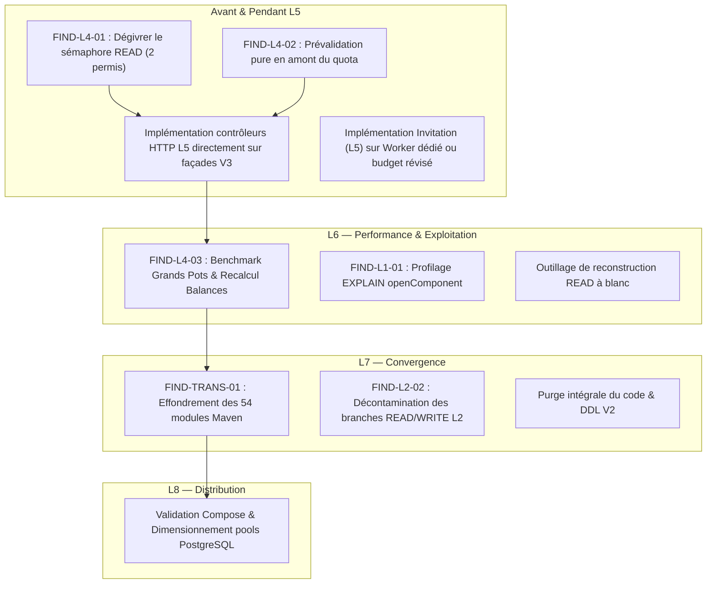

# Pocoma V3 — Audit transversal indépendant L1–L4 (Fin de lot L4)
## Exigences, simplicité architecturale et performances anticipées

---

### Vérification préalable et contexte de l'audit

- **Branche :** `feat/v3-architecture`
- **Jalon audité :** Fin de lot L4 (READ Projections)
- **SHA de référence audité :** `c6dc722f69133206a4a46e533336d0f1bfb68d72` (décision humaine de clôture définitive de L4 du 3 novembre 2026 : *CLOSED WITH EXPLICIT RESERVATIONS — COMPOSITE INTERNAL QUALIFICATION ACCEPTED*)
- **Nature de la mission :** Audit indépendant, transversal et critique de l'architecture livrée par les lots L1, L2, L3 et L4.
- **Mode d'exécution :** Strictement en lecture seule. Aucun changement de code de production ou de test, aucune commande Maven, Docker, PostgreSQL ou Testcontainers n'a été exécutée. L'audit est fondé sur l'inspection contradictoire des sources, des spécifications normatives (SPEC-01 à SPEC-10), des actes de clôture et des preuves archivées.

---

## A. Verdict exécutif

| Question d'audit | Réponse synthétique |
|---|---|
| **1. Respect des exigences et principes ?** | **OUI.** Les invariants fondamentaux du domaine (SPEC-01 à SPEC-04) sont respectés : pureté fonctionnelle du domaine, arithmétique rationnelle exacte sans arrondi, séparation des autorités transactionnelles WRITE/READ sans 2PC, séquencement événementiel dense, protection contre les interblocages et immutabilité stricte des projections historiques. |
| **2. Simplicité réelle ou complexité inutile ?** | **CONTRASTÉE.** Le cœur de domaine (`domain-pot/v3`, `domain-user-identity/v3`) est d'une grande élégance et d'une concision exemplaire (records Java 21, transitions pures). En revanche, la structure globale souffre d'une **hyper-fragmentation industrielle excessive** (54 modules Maven pour ~800 classes de production, dont 14 modules à 1 seule classe) et d'un couplage historique lourd avec le socle V2 encore présent sous forme de classes mortes, de profils de contournement et de DDL historiques. |
| **3. Performances anticipées raisonnables ?** | **OUI AU NOMINAL, AVEC DEUX GOULETS IDENTIFIÉS.** Les requêtes d'accès direct et par clés sont performantes et bien indexées (keyset pagination, index partiels). Deux points critiques appellent une vigilance immédiate : un **verrou de concurrence artificiel de 2 permis** sur les façades de lecture (`Semaphore quota = new Semaphore(2)`), et le coût en $O(N)$ du recalcul intégral des balances à chaque version sur les grands Pots. |
| **4. Principaux risques de montée en charge ?** | (1) L'inflation du budget de lease L2 à **180 secondes** induite par la multiplication des participants dans un Worker unique, retardant d'autant la reprise sur panne ; (2) L'empreinte en connexions de base de données ($4 \text{ pools} \times M_W$ connexions par instance de Worker) ; (3) L'accumulation non purgée des révisions historiques et événements dans PostgreSQL en l'absence de politique d'archivage ou de partitionnement physique. |
| **5. Maturité suffisante pour démarrer L5 ?** | **OUI.** Les contrats d'entrée de L5 sont solides : façades READ typées et cohérentes à V, moteur de commandes WRITE asynchrone protégé, autorité Identity stricte. L5 peut entrer en cadrage sans refonte préalable de L1–L4, sous réserve d'adapter ses contrôleurs HTTP à la réalité des façades V3. |

### Verdict global : **GO L5 WITH RESERVATIONS**

Le feu vert pour le cadrage de L5 est accordé. Les réserves formulées ne remettent pas en cause la viabilité du projet mais constituent des gardes-fous stricts : L5 ne doit pas hériter de la bride de concurrence READ arbitraire, ne doit pas s'appuyer sur les anciens contrôleurs V2, et ne doit pas créer de nouveaux modules Maven.

---

## B. Scorecard transversale

*Échelle d'évaluation : 1 (Très insuffisant / Dette critique) à 5 (Exemplaire / Conforme à l'état de l'art)*

| Critère | L1 (Command WRITE) | L2 (Consumption & Discovery) | L3 (Identity WRITE) | L4 (READ Projections) | Ensemble L1–L4 | Justification synthétique |
|---|:---:|:---:|:---:|:---:|:---:|---|
| **Conformité normative** | **5** | **4** | **5** | **4** | **4.5** | Invariants du domaine, arithmétique rationnelle et atomicité parfaitement respectés. Dérogation sur le lease (180 s) et qualification composite acceptée en L4. |
| **Simplicité conceptuelle** | **4** | **3** | **5** | **4** | **3.5** | L1 et L3 brillent par leurs transitions pures. L2 introduit une machinerie complexe (claims, leases, tickets, quarantaine, observateurs) qui charge le modèle mental. |
| **Simplicité du code** | **4** | **2.5** | **4.5** | **3.5** | **3.5** | `ConsumptionEngine` (912 lignes) et `V3ConsumptionWorkerSettings` (453 lignes) sont denses et imbriqués. Cœur domaine L1/L3 très concis et lisible. |
| **Complexité opérationnelle** | **4** | **2** | **4.5** | **2.5** | **2.5** | 4 pools Hikari par Worker, validation stricte de 7 coordonnées de cibles dev, lease étendu à 180 s, quota READ bridé à 2 permis concurrents. |
| **Efficacité algorithmique** | **4** | **4** | **5** | **3** | **3.5** | Résolution d'identités canoniques sans interblocage ($O(1)$). Recalcul intégral des soldes L4 en $O(N)$ sur l'historique complet des dépenses actives. |
| **Efficacité SQL anticipée** | **3.5** | **4** | **4.5** | **4** | **4** | Indexation rigoureuse (index partiels, keyset). Requête de garde `openComponent` en L1 lourde (4 jointures de la même table + overlap de ranges). |
| **Scalabilité probable** | **4** | **3** | **4.5** | **2.5** | **3** | Sérialisation par Pot/EUI saine. Scalabilité READ compromise localement par le sémaphore à 2 permis et la contention de lease sous workers multiples. |
| **Maintenabilité et évolutivité** | **4** | **3** | **4** | **3** | **3** | La dispersion en 54 modules Maven et la coexistence passive du code V2 alourdissent chaque ajout de fonctionnalité (~10 fichiers à toucher par projection). |

---

## C. Findings classés par priorité

```
Légende des sévérités :
- MAJOR       : Risque de performance sérieux ou dette technique substantielle à traiter avant déploiement large.
- MODERATE    : Amélioration importante, sans blocage pour engager L5.
- MINOR       : Ajustement local ou simplification de faible portée.
- RESERVATION : Limite admise par les décisions de clôture humaines antérieures.
- OBSERVATION : Constat factuel ou information de conception sans action corrective immédiate.
```

### Tableau de synthèse des constats

| ID | Domaine | Sévérité | Fichiers et lignes | Résumé du constat | Lot recommandé |
|---|---|:---:|---|---|:---:|
| **FIND-L4-01** | Performance / Scalabilité | **MAJOR** | `V3ReadFacadeComposition.java:62-99` | Quota de lecture bridé à 2 permis concurrents via sémaphore en dur (`new Semaphore(2)`) | **L5 (cadrage)** |
| **FIND-L2-01** | Performance / Disponibilité | **MAJOR** | `V3ConsumptionWorkerSettings.java:281-308` | Inflation mécanique du lease L2 à 180 s due à l'agrégation de 6 participants (30 entités) dans un Worker unique | **L6 / L8** |
| **FIND-TRANS-01** | Architecture / Simplicité | **MAJOR** | `pom.xml:24-81` | Hyper-fragmentation en 54 modules Maven et coexistence passive de runtimes/profils V2 | **L7** |
| **FIND-L1-01** | Performance / Efficacité SQL | **MODERATE** | `PotHistoryRows.java:198-226` | Requête SQL de garde `openComponent` effectuant 4 auto-jointures et une sous-requête corrélée sur `int8range` | **L6** |
| **FIND-L4-02** | Conformité / Simplicité | **MINOR** | `V3ReadFacadeComposition.java:123-138` | Prévalidation des paramètres `expenses` et `visible` exécutée après acquisition du quota READ (`AUD-FINAL-I8-01`) | **L5** |
| **FIND-L4-03** | Performance / Algorithme | **MODERATE** | `MaterializePotBalance.java:11-19` | Recalcul intégral sans état des soldes à chaque version : complexité $O(N)$ sur le volume de dépenses du Pot | **L6** |
| **FIND-L2-02** | Simplicité conceptuelle | **MODERATE** | `ConsumptionEngine.java:191-198` | Contamination du moteur L2 par des branches conditionnelles dures selon l'autorité READ ou WRITE | **L7** |
| **FIND-L3-01** | Sécurité / Conformité | **OBSERVATION** | `V6__identity_authority_and_requests.sql:19-30` | Validation de l'intention Link restreinte à la structure JSONB en base en attente du serveur d'authentification réel | **L5** |

---

### Fiches détaillées des constats

#### FIND-L4-01 — Quota de lecture bridé à 2 permis concurrents via sémaphore en dur
1. **Identifiant :** `FIND-L4-01`
2. **Domaine :** Performance / Scalabilité
3. **Sévérité :** **MAJOR**
4. **Fichiers et lignes :** `app/composition-runtime-spring/src/main/java/com/kartaguez/pocoma/runtime/consumption/v3/V3ReadFacadeComposition.java:62-99`
5. **Comportement observé :** La classe `V3ReadFacadeComposition.Services` instancie un champ privé `private final Semaphore quota = new Semaphore(2);`. Chaque méthode de lecture (`current`, `at`, `balance`, `expenses`, `visible`, `binding`, `commandResult`, `identityResult`) invoque `query()`, qui exécute `if (!quota.tryAcquire()) return new Unavailable<>();`.
6. **Conséquence concrète :** À tout instant, **au maximum 2 requêtes de lecture** peuvent s'exécuter concurremment par instance applicative, toutes façades confondues. Dès qu'une 3ᵉ requête se présente (par exemple un appel HTTP concurrent dans L5), elle reçoit instantanément `Unavailable`, ce qui se traduira en HTTP par un code `503 Service Unavailable`.
7. **Conditions d'apparition :** Dès l'ouverture des consultations HTTP dans L5 sous charge utilisateur réelle ou lors de tests de charge multi-utilisateurs.
8. **Correction minimale :** Rendre la taille du sémaphore configurable via `ReadLimitsV3` en l'alignant sur la capacité du pool `readBusiness` (ex. 8 à 16 permis), ou remplacer le sémaphore rejetant immédiatement par une file d'attente bornée avec timeout de prise de permis.
9. **Coût et risque :** Très faible coût (quelques lignes de configuration). Risque nul si le pool sous-jacent est dimensionné en conséquence.
10. **Lot recommandé :** **L5 (dès le cadrage de l'exposition HTTP)**.

---

#### FIND-L2-01 — Inflation mécanique du lease L2 à 180 secondes dans le profil Worker READ
1. **Identifiant :** `FIND-L2-01`
2. **Domaine :** Performance / Disponibilité
3. **Sévérité :** **MAJOR**
4. **Fichiers et lignes :** `app/composition-runtime-spring/src/main/java/com/kartaguez/pocoma/runtime/consumption/v3/V3ConsumptionWorkerSettings.java:281-308`
5. **Comportement observé :** La formule de validation statique du budget de renouvellement calcule :
   $$\text{leaseBound} = \text{renewalInterval} + \text{renewalBudget} \times (\text{candidates} + \text{bindings}) + \text{minPoll} \times \text{candidates} + 4\text{ s}$$
   Avec 6 participants READ configurés sur 4 partitions (24 candidatures + 6 bindings = 30 entités), $\text{leaseBound}$ atteint $10\text{ s} + (5\text{ s} \times 30) + 0{,}24\text{ s} + 4\text{ s} = 164{,}24\text{ s}$. Pour satisfaire la précondition `leaseBound < leaseDuration`, la durée du lease a dû être haussée de 30 s à 180 s dans le profil `v3-read-worker`.
6. **Conséquence concrète :** Si un Worker READ plante ou perd sa connectivité, les partitions qu'il détenait restent verrouillées en base pendant **3 minutes pleines** avant qu'un autre Worker ne puisse en reprendre la propriété. De plus, l'ajout du futur 7ᵉ participant READ (`MaterializeInvitation` en L5) fera grimper $\text{leaseBound}$ à plus de 195 s, imposant une nouvelle augmentation du lease.
7. **Conditions d'apparition :** Déploiement multi-instances, reprise après incident ou redémarrage impromptu d'un Worker.
8. **Correction minimale :** Ne pas renouveler séquentiellement l'intégralité des partitions dans une seule boucle synchrone, ou scinder les participants en plusieurs groupes de Workers autonomes dotés de budgets indépendants.
9. **Coût et risque :** Coût moyen. Risque modéré de régression sur les tests d'ordonnancement de renouvellement L2.
10. **Lot recommandé :** **L6 (Performance/Exploitation) ou L8 (Distribution)**.

---

#### FIND-TRANS-01 — Hyper-fragmentation en 54 modules Maven et coexistence passive V2/V3
1. **Identifiant :** `FIND-TRANS-01`
2. **Domaine :** Architecture / Simplicité
3. **Sévérité :** **MAJOR**
4. **Fichiers et lignes :** `app/pom.xml:24-81`, `app/runtime-monolith/src/main/java/com/kartaguez/pocoma/PocomaRuntimeMonolithApplication.java`
5. **Comportement observé :** Le projet compte 54 modules Maven. 14 modules ne contiennent qu'un seul fichier Java en `src/main` (ex. `runtime-task-consumption-worker`, `supra-consume-registration`, etc.) et 16 autres en comptent entre 2 et 5. De surcroît, le code V2 cohabite intégralement avec V3 (tables V1–V31, services historiques, entités mutables), forçant l'emploi de profils Spring négatifs (`!v3-consumption-pilot & !v3-consumption-worker-dev & !v3-read-worker`).
6. **Conséquence concrète :** (a) Temps de compilation et d'initialisation des plugins Maven prohibitif ; (b) Fragilité des scans de composants Spring (à l'origine directe de l'échec `FULL-02-FAIL` en L4 I8 où la configuration legacy du monolithe masquait le `transactionRunner` V3) ; (c) Friction cognitive élevée : comprendre où réside une responsabilité impose de naviguer à travers 4 à 6 modules imbriqués.
7. **Conditions d'apparition :** Permanent au développement et à la maintenance.
8. **Correction minimale :** Ne pas entreprendre de refactorisation avant L7 (qui est spécifiquement missionné pour cela dans le Master Plan). Pour L5 : **interdiction stricte de créer de nouveaux modules Maven** ; implémenter les contrôleurs HTTP dans les modules web existants.
9. **Coût et risque :** La restructuration complète relève de L7 (coût élevé). Le respect de l'interdiction de nouveaux modules en L5 est à coût nul.
10. **Lot recommandé :** **L7 (Rationalisation et convergence finale)**.

---

#### FIND-L1-01 — Complexité SQL et coût de la garde `openComponent` sur le chemin d'écriture
1. **Identifiant :** `FIND-L1-01`
2. **Domaine :** Performance / Efficacité SQL
3. **Sévérité :** **MODERATE**
4. **Fichiers et lignes :** `app/infra-persistence-primary-jpa/src/main/java/com/kartaguez/pocoma/infra/persistence/primary/jpa/v3/PotHistoryRows.java:198-226`
5. **Comportement observé :** Pour vérifier les préconditions d'écriture des révisions ouvertes imposées par la matrice L1-F2, la méthode `openComponent` exécute une requête SQL joignant la table de composant 4 fois sur elle-même (`c` courante, `f` v1, `p` v-1, `l` lateral join pour max local_version) plus une sous-requête corrélée avec test de recouvrement d'intervalles (`int8range && int8range`).
6. **Conséquence concrète :** Cette requête est exécutée sur chaque table de composant impactée par une commande WRITE. Lorsque la profondeur de l'historique d'un Pot augmente (nombre élevé de révisions), l'optimiseur PostgreSQL doit évaluer ces jointures multiples et calculs de range, induisant un coût CPU et I/O notable sur la transaction d'écriture.
7. **Conditions d'apparition :** Pots anciens ayant subi un grand nombre de mutations successives (historiques longs).
8. **Correction minimale :** Profiler la requête sous EXPLAIN ANALYZE dans L6 ; si nécessaire, remplacer la sous-requête corrélée et les auto-jointures par une fonction d'agrégation / fenêtrage ou un contrôle applicatif léger au moment de l'insertion.
9. **Coût et risque :** Faible coût d'analyse en L6. Risque nul tant que les oracles de non-chevauchement restent validés.
10. **Lot recommandé :** **L6 (Campagnes de performance et budgets)**.

---

#### FIND-L4-02 — Prévalidation pure des requêtes READ exécutée après acquisition du quota
1. **Identifiant :** `FIND-L4-02` (Suivi de la réserve de clôture `AUD-FINAL-I8-01`)
2. **Domaine :** Conformité / Simplicité
3. **Sévérité :** **MINOR**
4. **Fichiers et lignes :** `app/composition-runtime-spring/src/main/java/com/kartaguez/pocoma/runtime/consumption/v3/V3ReadFacadeComposition.java:123-138`, `app/engine-read-pot/src/main/java/com/kartaguez/pocoma/engine/read/pot/v3/ReadPotV3.java:156-163`, `app/engine-read-pot/src/main/java/com/kartaguez/pocoma/engine/read/pot/v3/ReadNavigationV3.java:16`
5. **Comportement observé :** Dans `V3ReadFacadeComposition.Services`, la méthode `expenses` vérifie `refs == null` mais ne valide pas `refs.isEmpty()` ni `refs.size() > limits.expenseBatch()`. De même, `visible` ne valide pas `limit < 1 || limit > limits.visibleBatch()`. Ces vérifications sont déléguées à `ReadPotV3` et `ReadNavigationV3`, qui ne s'exécutent qu'*après* l'appel à `query()`, donc *après* `quota.tryAcquire()`.
6. **Conséquence concrète :** Des requêtes clientes manifestement invalides (ex. batch de dépenses vide ou dépassant le plafond) consomment un des rares permis du sémaphore de lecture avant d'être rejetées en `InvalidInput`, pénalisant inutilement les lectures concurrentes légitimes.
7. **Conditions d'apparition :** Dès l'exposition des API REST publiques dans L5.
8. **Correction minimale :** Déplacer ces deux contrôles purs de bornes en amont de `query()` dans `V3ReadFacadeComposition.java`.
9. **Coût et risque :** Coût négligeable (3 lignes de code). Risque nul.
10. **Lot recommandé :** **L5 (Exposition HTTP)**.

---

#### FIND-L4-03 — Recalcul intégral des soldes en $O(N)$ à chaque version active
1. **Identifiant :** `FIND-L4-03`
2. **Domaine :** Performance / Algorithme
3. **Sévérité :** **MODERATE**
4. **Fichiers et lignes :** `app/engine-consume-projection-task/src/main/java/com/kartaguez/pocoma/engine/consume/projectiontask/v3/MaterializePotBalance.java:11-19`, `app/infra-persistence-primary-jpa/src/main/java/com/kartaguez/pocoma/infra/persistence/primary/jpa/v3/JdbcPotHistoryAdapter.java:97-155`
5. **Comportement observé :** La spécification SPEC-04 (§4 et AUD-V3-013) impose un calcul intégral et indépendant des soldes à chaque version active V, sans delta-chaining. `JdbcPotBalanceSource` recharge la totalité des dépenses actives, de leurs participations et des poids de tous les participants applicables à V depuis WRITE, puis `PotBalanceCalculator` recalcule l'intégralité du vecteur de balance.
6. **Conséquence concrète :** La matérialisation d'un événement `POT_EVENT` par `MaterializePotBalance` a une complexité temporelle et mémoire proportionnelle au nombre total de dépenses actives du Pot ($O(N)$). Pour un Pot contenant 5 000 dépenses, l'ajout d'une seule dépense oblige à recharger et recalculer les 5 001 dépenses.
7. **Conditions d'apparition :** Pots volumineux dits "Grands Pots" (centaines ou milliers de dépenses).
8. **Correction minimale :** Le choix de conception est assumé normativement pour garantir l'indépendance stricte et l'idempotence des projections sans dérive d'arrondi. Il ne doit pas être remis en cause prématurément sans mesures physiques. Instrumenter et mesurer sous les oracles de charge L6 (PERF-01).
9. **Coût et risque :** Coût d'instrumentation modéré. Risque de refonte majeur si une optimisation s'avérait requise.
10. **Lot recommandé :** **L6 (Mesures et performance)**.

---

#### FIND-L2-02 — Contamination du moteur générique L2 par des branches WRITE/READ explicites
1. **Identifiant :** `FIND-L2-02`
2. **Domaine :** Simplicité conceptuelle
3. **Sévérité :** **MODERATE**
4. **Fichiers et lignes :** `app/engine-consumption/src/main/java/com/kartaguez/pocoma/engine/consumption/v3/ConsumptionEngine.java:191-198`, `app/composition-runtime-spring/src/main/java/com/kartaguez/pocoma/runtime/consumption/v3/V3ConsumptionWorkerSettings.java:281-301`
5. **Comportement observé :** Alors que L2 a pour vocation d'offrir un moteur de consommation générique (claims, slots, leases, recovery), le constructeur de `ConsumptionEngine` contient des conditions explicites `if (definition.authority() == ConsumptionDefinition.Authority.READ)` pour imposer la présence de `recoverySource` et d'admissions d'effets, tout en interdisant ces mêmes éléments en autorité WRITE. De même, `V3ConsumptionWorkerSettings` calcule différemment le lease selon `readMode`.
6. **Conséquence concrète :** L2 n'est pas un moteur totalement neutre vis-à-vis de ses participants ; il a intégré des hypothèses structurelles propres aux deux topologies WRITE et READ. Tout nouvel usage ou nouvelle autorité imposera de modifier le moteur cœur.
7. **Conditions d'apparition :** Évolution de la taxonomie des consommables ou ajout d'une autorité tierce.
8. **Correction minimale :** Extraire les règles de validation d'autorité dans des politiques de configuration injectées (`AuthorityValidationStrategy`) lors de la rationalisation L7.
9. **Coût et risque :** Faible coût lors de L7.
10. **Lot recommandé :** **L7 (Convergence)**.

---

#### FIND-L3-01 — Validation de consentement Link restreinte à la forme JSONB en attente du serveur d'authentification réel
1. **Identifiant :** `FIND-L3-01`
2. **Domaine :** Sécurité / Conformité
3. **Sévérité :** **OBSERVATION**
4. **Fichiers et lignes :** `app/infra-persistence-primary-jpa/src/main/resources/db/v3-identity/migration/V6__identity_authority_and_requests.sql:19-30`
5. **Comportement observé :** La table `v3_identity_request` valide la présence d'attestations de consentement via une contrainte SQL CHECK stricte sur le schéma du document JSONB `admission_context` (`origin`, `validator`, `intentionFingerprint`, etc.).
6. **Conséquence concrète :** En L3, l'autorité Identity prouve parfaitement l'atomicité et l'ordre de verrouillage canonique des EUI (`lockInCanonicalOrder`), mais la preuve cryptographique et l'interaction avec un serveur OIDC/RAR réel ne sont pas encore branchées (conformément aux décisions de clôture L3).
7. **Conditions d'apparition :** Entrée dans l'implémentation des parcours Link de L5.
8. **Correction minimale :** Aucune correction sur L1–L4. L5 doit implémenter l'adaptateur d'admission validant la signature et le consentement réel avant d'insérer dans `v3_identity_request`.
9. **Coût et risque :** Déjà prévu au Master Plan L5.
10. **Lot recommandé :** **L5 (Intégration OIDC)**.

---

## D. Analyse transversale des axes normatifs

### 1. Axe A — Respect des exigences et principes directeurs

#### L1 — Command / WRITE
- **Autorité des faits métier :** Les tables `v3_pot_header`, `v3_pot_details`, `v3_shareholder_*` et `v3_expense_*` constituent la source unique et autoritative de vérité. Le domaine pur (`domain-pot/v3`) ne contient aucune dépendance vers Spring, JPA ou Hibernate.
- **Invariants financiers :** La représentation de la monnaie et des quotes-parts repose sur les types immuables `Amount`, `Weight` et `Fraction`. La classe `Fraction` implémente une arithmétique rationnelle exacte (numérateur et dénominateur strictement positifs, simplification par le PGCD, division exacte sans arrondi flottant). Les soldes se compensent rigoureusement à zéro ($\sum \text{balances} = 0$).
- **Gestion des références et suppressions :** `DeletePot` est strictement logique (Header `deleted = true` à la version terminale $D$, enfants intacts). Les dépenses actives référençant un Shareholder empêchent sa suppression fonctionnelle (`activeUsage`), protégeant l'intégrité référentielle historique sans contrainte de clé étrangère bloquante.
- **Découplage WRITE/READ :** Aucune référence à READ n'existe dans L1. La publication d'événements dans `v3_pot_event`, `v3_command_result` et `v3_command_completion_event` est réalisée dans la même transaction physique que la mutation métier, garantissant l'absence d'états fantômes.

#### L2 — Consumption & Discovery
- **Généricité et séparation :** La boucle de Discovery interroge les sources (fenêtre $(K, H]$ dense pour les non-burnables, requêtes `PENDING` sans slot pour les burnables) et insère les slots dans `consumption_slot`. Le moteur d'exécution (`ConsumptionEngine`) acquiert ensuite les slots disponibles avec `SKIP LOCKED`, isole les tentatives, applique les claims et gère les retries/quarantaines.
- **Atomicité de finalisation :** Le slot n'est supprimé qu'au sein de la transaction physique finale qui committe les effets du participant (`Prepared.finalizeIn(SlotCompletion)`).
- **Gestion de l'incertitude :** En cas d'erreur réseau ou de statut de commit incertain (`UNKNOWN`), le système n'émet aucune fausse terminalisation et applique un drainage conservateur de sécurité (`unresolvedRecovery = true`).

#### L3 — Identity WRITE
- **Autorité et modèle EUI/User :** PocomaUser ($0..N$ EUI) et ExternalUserIdentity ($0..1$ PocomaUser) sont rigoureusement distingués. `Binding` n'est pas une entité persistée mais une relation qualifiée par un `bindingToken` aléatoire et renouvelé à chaque transition.
- **Concurrence sans interblocage :** `ExecuteIdentityRequest` résout le risque de deadlock lors de mutations croisées (`Link(E1, E2)` vs `Unlink(E2, E1)`) en acquérant systématiquement les verrous de ligne dans l'ordre lexicographique canonique de la clé `(issuer, subject)` (`authority.lockInCanonicalOrder`).
- **Secret du jeton :** Le `bindingToken` est strictement exclu des événements publics (`IDENTITY_EVENT`) et n'est retourné qu'à son propre titulaire authentifié via la façade `CurrentBinding`.

#### L4 — READ Projections
- **Indépendance des participants :** Les 6 participants READ (`MaterializePotVersion`, `MaterializePotBalance`, `MaterializePotVisibility`, `MaterializeCurrentBinding`, `MaterializeCommandResult`, `MaterializeIdentityRequestResult`) progressent de manière totalement autonome avec leurs propres checkpoints et slots.
- **Immutabilité historique :** Des triggers SQL `BEFORE UPDATE OR DELETE` interdisent formellement toute modification des tables de projection historiques (`read_pot_version`, `read_subobject_version`, `read_pot_balance`, etc.).
- **Consultation à version cohérente (V) :** La façade `ReadPotV3` capture la version $V$ et résout l'ensemble des composantes (`PotVersion`, `SubobjectVersion`, `PotBalance`) à cette exacte même version sous isolation `REPEATABLE READ`. Si une composante est en retard de matérialisation, elle retourne `NotReady` sans jamais servir un mélange incohérent de versions.

---

### 2. Axe B — Simplicité architecturale

#### B1. Complexité conceptuelle
Le domaine métier pur est simple et élégant : 8 composantes de Pot, 3 composantes d'identité, des transitions déterministes.
Cependant, l'infrastructure introduit un coût conceptuel disproportionné :
- **Multiplication des niveaux d'indirection :** Pour traiter un événement, le système empile `V3ConsumptionWorker` $\rightarrow$ `WorkerCapacity` $\rightarrow$ `DiscoveryEngine` $\rightarrow$ `ConsumptionEngine` $\rightarrow$ `PreparationReads` $\rightarrow$ `ConsumptionParticipant` $\rightarrow$ `Prepared` $\rightarrow$ `SlotCompletion` $\rightarrow$ `SpringAttemptTransactions`.
- **Modèle de persistance hybride :** L1 utilise à la fois un `LocalContainerEntityManagerFactoryBean` (JPA/Hibernate) configuré programmatiquement pour `writeBusiness` et du pur JDBC via `JdbcTemplate` pour les requêtes historiques et de contrôle. Deux paradigmes d'accès aux données coexistent sur la même base.

#### B2. Complexité du code
- **Dispersion extrême :** Le code est éclaté sur 54 modules Maven. Pour implémenter les 6 participants READ, le code a dû être dispersé dans `engine-consume-projection-task` (pour PotVersion/Balance/Visibility), `engine-materialize-current-binding`, `engine-materialize-command-result`, `engine-materialize-registration-result`, `infra-persistence-read-jdbc`, `composition-runtime-spring`, `runtime-task-consumption-worker` et `runtime-monolith`.
- **Méthodes fleuves et configuration verbeuse :** `V3ConsumptionWorkerSettings.from()` fait plus de 180 lignes de parsing textuel et de validations imbriquées.
- **Garde SQL L1-F2 :** La méthode `PotHistoryRows.openComponent()` est un exemple de sur-ingénierie défensive : 4 jointures sur la même table pour vérifier qu'une révision locale est bien consécutive à la précédente, alors que les contraintes d'intégrité et l'ordonnancement transactionnel garantissent déjà cette propriété.

#### B3. Complexité opérationnelle
- **Nombre de pools de connexions :** Chaque Worker instancie 4 pools Hikari distincts (`writeBusiness`, `writeControl`, `readBusiness`, `readControl`). Un déploiement avec 2 Workers spécialisés plus 1 API Web totalise 9 à 12 pools de connexions simultanés à manager et superviser.
- **Paramétrage ultra-rigide :** La propriété `pocoma.v3.worker.dev-targets` exige exactement 2 tuples de 7 valeurs séparées par des virgules (`host,port,database,schema,role,serverAddress,serverPort`). La moindre coquille lève une `IllegalArgumentException` fatale au démarrage.

#### B4. Complexité accidentelle et historique (Coexistence V2/V3)
Bien que le Canon V3 stipule « Aucun système V1/V2 à maintenir en production », la base de code conserve l'intégralité des squelettes V2 :
- 31 scripts de migration Flyway V2 dans `infra-persistence-primary-jpa` et 14 dans `infra-persistence-read-jdbc`.
- Des dizaines de classes de services et d'anciens contrôleurs REST V2.
- Cette présence parasite a provoqué l'échec `FULL-02-FAIL` en L4 I8 car le scan de packages Spring du monolithe chargeait par inadvertance les configurations legacy.

#### B5. Simplicité d'évolution (Exemples concrets)
- **Pour ajouter un type de commande :** Toucher ~7 fichiers dans 4 modules (`domain-pot/v3`, `engine-write-pot/v3`, `contracts-command`, `infra-persistence-primary-jpa/v3`).
- **Pour ajouter une nouvelle projection READ :** Toucher **11 fichiers répartis dans 6 modules distincts** (Catalogue, Définition, Participant, Source, Store, SQL Migration, `V3ReadParticipants`, `V3ConsumptionWorkerSettings`, Façade de lecture, Composition Spring, ArchUnit oracles).

---

### 3. Axe C — Performances anticipées et dimensionnement

#### C1. WRITE (Chemin critique d'écriture)
Une commande WRITE complète (`ExecutePotCommand`) déroule :
1. Transaction de lecture snapshot (`REPEATABLE READ`) : chargement de la commande enregistrée, validation des droits et calcul de la proposition métier.
2. Transaction physique d'écriture :
   - Verrouillage de la commande et rechargement de sécurité.
   - Verrouillage de l'autorité acteur et protection de la version courante du Pot (`SELECT ... FOR UPDATE`).
   - Requêtes `openComponent` pour vérifier l'absence d'anomalie sur chaque composant impacté (requête multi-jointures).
   - Insertion de la nouvelle révision avec `active_to = null` et clôture de l'ancienne avec `active_to = V + 1`.
   - Insertion dans `v3_pot_version` ($V+1$).
   - Insertion du résultat terminal dans `v3_command_result`.
   - Insertion des événements dans `v3_pot_event` et `v3_command_completion_event`.
   - Incrémentation transactionnelle dense des positions dans `v3_event_counter` (point de contention potentiel sous forte concurrence multi-pots).
   - Suppression du slot `v3_command_slot`.
   - Commit physique unique.

*Analyse de charge :* Très robuste sous faible à moyenne concurrence. Sous très forte concurrence multi-pots, le compteur partagé `v3_event_counter` sérialise les commits physiques au niveau du verrou de ligne sur la famille `POT`.

#### C2. Consumption & Discovery
- **Navigation et acquisition :** Utilisation efficace de `SELECT ... FROM consumption_slot WHERE ... ORDER BY consumable_id LIMIT ... FOR UPDATE SKIP LOCKED`. Aucun interblocage entre Workers concurrents sur l'acquisition de slots.
- **Régulation :** Le `softCap` (mesuré dynamiquement par comptage indexé des slots actifs) prévient l'engorgement de la table de slots en cas de ralentissement de l'Engine.

#### C3. READ (Chemin critique de lecture et matérialisation)
- **Matérialisation PotVersion :** Optimale grâce au chargement delta des sous-objets manquants (`JdbcSubobjectVersionStore.readAll` par chunks de 256). Les sous-objets immuables déjà présents en READ ne sont jamais rechargés depuis WRITE.
- **Matérialisation PotBalance (Risque majeur) :** Le recalcul complet à chaque version engendre une charge I/O et mémoire croissante avec le nombre de dépenses actives. Pour un Pot avec $E$ dépenses et $S$ participants, le coût mémoire est en $O(E \times S)$ par événement `POT_EVENT`.
- **Façade de consultation (`ReadPotV3`) :**
  - Requête `current` ou `at` : 1 lecture `read_pot_version`, 1 lecture groupée `read_subobject_version` (Header, Details, Shareholders), 1 lecture `read_pot_balance`. Soit **3 requêtes SQL ciblées sur clés primaires**. Temps d'exécution anticipé : < 2 ms sur PostgreSQL local.
  - Goulet d'étranglement artificiel : Le sémaphore `quota = new Semaphore(2)` limite le débit maximal théorique de l'instance à :
    $$\text{Débit}_{\max} = \frac{2}{\text{Latence moyenne}} \approx \frac{2}{0{,}005\text{ s}} = 400\text{ req/s}$$
    Toute gigue ou requête plus lourde (ex. chargement de 100 dépenses) fera chuter ce débit et rejettera immédiatement les appels excédentaires.

#### C4. Formules de dimensionnement et capacité (Axe C6)

Soit :
- $W$ : nombre d'instances de Workers déployées.
- $P_{\text{read}}$ : nombre de participants READ actifs (actuellement 6, bientôt 7 avec Invitation).
- $K$ : nombre de partitions par famille (fixé à 4 dans le schéma).
- $M_W$ : capacité de parallélisme par Worker (`worker-limit`, typiquement 8 à 16).

1. **Nombre total de connexions PostgreSQL consommées :**
   $$N_{\text{connexions}} = W \times [ \text{Pool}_{\text{wb}} + \text{Pool}_{\text{wc}} + \text{Pool}_{\text{rb}} + \text{Pool}_{\text{rc}} ] = W \times 4 \times M_W$$
   *Exemple :* Avec $W = 3$ et $M_W = 10$, le cluster applicatif consomme $3 \times 4 \times 10 = \mathbf{120\text{ connexions}}$ PostgreSQL permanentes rien que pour les Workers.

2. **Borne minimale de durée de lease ($\text{leaseDuration}$) :**
   $$\text{leaseBound} = \text{renewalInterval} + \text{renewalBudget} \times (K \cdot P_{\text{read}} + P_{\text{read}}) + \text{minPoll} \times (K \cdot P_{\text{read}}) + 4\text{ s}$$
   Avec $\text{renewalInterval} = 10\text{ s}$, $\text{renewalBudget} = 5\text{ s}$, $\text{minPoll} = 10\text{ ms}$, $K = 4$ et $P_{\text{read}} = 6$ :
   $$\text{leaseBound} = 10 + 5 \times (24 + 6) + (0{,}010 \times 24) + 4 = \mathbf{164{,}24\text{ s}}$$
   D'où l'obligation mathématique d'avoir $\text{leaseDuration} \ge 180\text{ s}$.

---

### 4. Axe D — Rapport entre complexité et valeur

| Mécanisme | Propriété apportée | Prix imposé | Jugement d'utilité |
|---|---|---|---|
| **Séparation WRITE / READ (CQRS pur)** | Découplage total, résilience, modèles de lecture optimisés, aucune transaction distribuée. | Redondance du stockage, latence de projection (éventuelle cohérence à terme), 2 schémas/bases. | **Indispensable et hautement rentable.** |
| **Arithmétique rationnelle (`Fraction`)** | Zéro centime d'erreur d'arrondi sur les répartitions financières, balance toujours exacte. | Utilisation de `BigInteger`, code d'affichage et de conversion plus lourd. | **Indispensable (cœur de la valeur métier).** |
| **Séquencement dense des événements** | Détection immédiate des trous sans perte d'événements, fenêtres de découverte sûres. | Verrou partagé sur `v3_event_counter` au commit d'écriture, sérialisant les écritures par famille. | **Justifié par la sûreté des données.** |
| **Verrouillage canonique des EUI (L3)** | Élimination totale et prouvée des interblocages sur les requêtes Link/Unlink concurrentes. | Tri lexicographique systématique des paires d'identités avant verrouillage SQL. | **Excellente ingénierie, coût négligeable.** |
| **6 participants READ indépendants** | Tolérance aux pannes : un blocage sur les soldes ne paralyse ni les droits, ni la visibilité. | 6 checkpoints, 6 tables de slots, requêtes répétées de découverte, lease porté à 180 s. | **Justifié conceptuellement mais lourd en mono-instance.** |
| **Sémaphore de quota READ (2 permis)** | Protection basique de la base READ contre les surcharges. | Blocage arbitraire du débit de consultation, rejets `503` massifs sous charge web. | **Injustifié sous sa forme actuelle (Dette L4).** |
| **Découpage en 54 modules Maven** | Isolation supposée des frontières hexagonales par le compilateur. | Explosion des temps de build, prolifération de POMs vides, difficultés de scan Spring. | **Excessif / Dette historique V2 majeure.** |

---

### 5. Axe E — Préparation aux lots L5–L8

#### L5 — Supras et parcours HTTP externes
- **Atouts :** Les façades créées par `V3ReadFacadeComposition` fournissent exactement les méthodes requises (`current`, `at`, `balance`, `expenses`, `visible`, `binding`, `commandResult`, `identityResult`).
- **Pièges et obstacles à éviter :**
  1. Ne pas chercher à brancher les nouveaux endpoints sur les anciens contrôleurs de `supra-http-read` ou `supra-http-write` qui dépendent des use cases V2.
  2. Supprimer la barrière du sémaphore à 2 permis (`FIND-L4-01`) dès le cadrage de l'exposition HTTP.
  3. L'amendement Invitation nécessite d'implémenter `INVITATION_EVENT` (5ᵉ séquence), `MaterializeInvitation` et `CurrentInvitation`. Attention à l'impact sur le calcul du lease L2 qui dépassera les 180 s si ce participant est ajouté au même Worker !

#### L6 — Reconstruction, maintenance et performance
- C'est en L6 que devront être exécutés les benchmarks réels sur les Grands Pots (démontrant la tenue du recalcul intégral des balances `FIND-L4-03`) et le profilage de la requête `openComponent` (`FIND-L1-01`).
- Le protocole de reconstruction READ à blanc (purge coordonnée des projections, checkpoints et slots) devra être scripté et outillé.

#### L7 — Convergence et rationalisation
- Chantier de salubrité publique pour le projet : fusionner les 54 modules en un nombre restreint de packages cohérents (ex. `pocoma-domain`, `pocoma-engine-write`, `pocoma-engine-read`, `pocoma-worker`, `pocoma-app`), purger définitivement le DDL V1–V31 et éradiquer le profil Spring legacy.

#### L8 — Distribution finale
- Prévoir le dimensionnement adéquat des connexions PostgreSQL sur Docker Compose en tenant compte de la formule établie au §C4.

---

## E. Analyse de simplicité approfondie

### Les cinq principales sources de complexité réelle

1. **L'émiettement modulaire Maven (54 modules) :** C'est la source n°1 de friction pour les développeurs et pour l'outillage d'intégration continue.
2. **La gestion de la capacité et du cycle de vie L2 (`ConsumptionEngine` + `WorkerCapacity`) :** Machinerie à base de tickets atomiques locaux, de baux renouvelés sous contrainte de temps stricte et de double boucle de polling qui rend le débogage local asynchrone complexe.
3. **Le double moteur de persistance en WRITE :** L'usage simultané de JPA/Hibernate (pour gérer une simple transaction Spring sur `writeBusiness`) et de JDBC direct (`JdbcTemplate`) pour tout le reste crée une confusion inutile.
4. **La machinerie de garde SQL `openComponent` (L1-F2) :** Requêtes multi-jointures et tests d'intervalles complexes pour prouver en base des invariants déjà garantis par le code applicatif amont.
5. **La multiplication des pools Hikari (4 par Worker) :** Gestion de 4 sources de données distinctes par instance avec des privilèges de base de données différents (`expectedRuntime` vs `expectedAdmin`).

### Abstractions indispensables vs excessives

- **Indispensables :**
  - `Versioned<T>` et `TransitionResult<T>` : Isolent les règles métier des contraintes de base de données.
  - `Fraction` et `Weight` : Garantissent l'absence totale de dérive financière.
  - `ConsumptionParticipant` et `Prepared` : Permettent de brancher n'importe quel traitement sur L2 sans transaction distribuée.
- **Excessives / Redondantes :**
  - Les modules `supra-consume-*` et `runtime-*-consumption-worker` qui ne font qu'emballer une classe en 3 lignes de Spring.
  - L'entité JPA `LocalContainerEntityManagerFactoryBean` dans `V3ConsumptionWorkerConfiguration` : un simple `DataSourceTransactionManager` suffirait amplement en écriture comme en lecture.

---

## F. Feuille de route priorisée



### 1. Avant et pendant L5
- **Recommandation 1 (Pendant cadrage L5) :** Rendre configurable la capacité du sémaphore de lecture dans `ReadLimitsV3` et la dimensionner à au moins 8 ou 16 pour absorber la concurrence HTTP (`FIND-L4-01`).
  - *Bénéfice :* Évite les erreurs 503 immédiates sous test web. *Coût :* 1 heure. *Risque :* Nul.
- **Recommandation 2 (Pendant implémentation L5) :** Déplacer la prévalidation des listes `refs` et limites de pagination en amont de `query()` (`FIND-L4-02`).
  - *Bénéfice :* Évite la rétention indue de quota. *Coût :* 15 minutes. *Risque :* Nul.
- **Recommandation 3 (Cadrage Invitation L5) :** Pour l'ajout de `MaterializeInvitation`, veiller à ne pas dépasser le plafond de lease de 180 s en isolant ce participant dans un thread/binding adapté ou en révisant les paramètres de batch.
  - *Bénéfice :* Évite l'échec de validation au démarrage du Worker. *Coût :* Faible. *Risque :* Faible.
- **Recommandation 4 (Interdiction stricte L5) :** Ne créer **aucun nouveau module Maven**. Coder l'API HTTP dans `runtime-web-api` et `supra-http-*` existants en s'adressant aux services de `V3ReadFacadeComposition`.

### 2. Lors de L6 (Performance, Exploitation et Mesures)
- Mesurer l'impact de `openComponent` (`FIND-L1-01`) et le temps de calcul des balances sur les historiques de 1 000 à 10 000 dépenses (`FIND-L4-03`).
- Valider la procédure de reset / rejeu intégral de READ depuis l'historique d'événements WRITE.

### 3. Lors de L7 (Convergence finale)
- Réduire les 54 modules Maven à un graphe ramassé de 5 à 7 modules structurants (`FIND-TRANS-01`).
- Supprimer toutes les migrations V1–V31 et V1–V14, ainsi que le code historique V2.
- Remplacer l'instanciation de `LocalContainerEntityManagerFactoryBean` dans `Resources` par un pur `DataSourceTransactionManager`, éliminant Hibernate du runtime.

### 4. Ne rien faire (Mécanismes confirmés)
- **Conserver l'arithmétique rationnelle `Fraction` :** Même si elle paraît plus lourde qu'un `BigDecimal`, elle élimine structurellement tout risque de déséquilibre de centimes.
- **Conserver les 6 participants READ indépendants :** L'indépendance de progression et de reprise sur incident vaut largement le surcoût de slots en base.
- **Conserver le verrouillage canonique des EUI (L3) :** C'est une garantie absolue contre les courses critiques et interblocages.

---

## G. Conclusion indépendante

> **Question de clôture :**  
> *Si l'on devait conserver cette architecture plusieurs années et lui ajouter des fonctionnalités, est-elle suffisamment simple, robuste et efficace pour le faire sans refonte majeure ?*

### Réponse de l'auditeur :

**OUI, LE CŒUR EST SAIN ET PÉRENNE, MAIS L'ENVELOPPE DOIT ÊTRE DÉGRAISSÉE.**

Sur le plan **métier, transactionnel et fonctionnel**, la conception de Pocoma V3 est d'une robustesse exceptionnelle. Le choix de l'Event-Sourcing sans 2PC, la matérialisation asynchrone découplée, les transitions pures et le respect intransigeant des invariants mathématiques (soldes toujours nuls, fractions exactes, unicité canonique) garantissent que le système ne souffrira d'aucune corruption de données ni d'état incohérent sous forte concurrence. Cette fondation-là traversera les années sans nécessiter de réécriture.

Ce qui menace en réalité la pérennité du système à moyen terme n'est pas son architecture logique, mais sa **surchauffe organisationnelle et technique** :
1. Une granularité Maven démesurée (54 modules) qui paralyse la refactorisation et ralentit chaque cycle de livraison.
2. Un profilage de Worker ultra-contraignant qui nécessite 180 secondes de lease pour coordonner 6 participants sur une même machine.
3. Des brides locales incongrues (comme le sémaphore READ à 2 places) qui témoignent d'une tentation de compenser une absence de qualification de charge par des verrous arbitraires.

### Ce qui pourrait invalider cette conclusion :
- Si l'équipe tentait de déployer en production l'API L5 sans faire sauter le sémaphore de 2 permis, provoquant l'effondrement immédiat du service sous les requêtes des utilisateurs.
- Si le volume de dépenses par Pot dépassait plusieurs dizaines de milliers d'unités actives sans que L6 n'ait apporté d'optimisation au recalcul intégral des balances.
- Si le chantier L7 de rationalisation des modules et de suppression de la V2 était reporté indéfiniment, laissant la base de code sombrer sous le poids de sa double identité historique.

En respectant les consignes de cadrage pour L5 et en planifiant la rationalisation en L7, l'équipe peut engager le lot L5 avec une **pleine confiance architecturale**.
