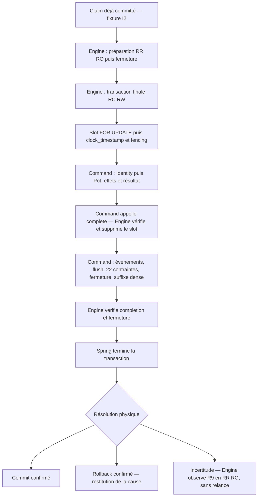

# Pocoma V3 — L2 I2 : owner transactionnel Engine et participant Command

**Statut courant : I2 CLOSED / LOCAL BOUNDED PASS**, après GO humain distinct et vérifications bornées ; [dossier d’exécution](L2_I2_Execution_Report.md). Audit indépendant du code et des preuves à venir. Le texte de préparation ci-dessous est conservé comme référence du plan simplifié approuvé ; ses interdictions de code décrivent le mandat documentaire antérieur. Aucun GO I3.

**26 octobre 2026 — PLAN SIMPLIFIÉ PRÊT POUR AUDIT, NON EXÉCUTÉ.** Référence du plan initial et du code réexaminé : `1fd9ce7529e5da439f32f889f92cec39de2c79fa` (branche distante `feat/v3-architecture`, identique au début du mandat). La simplification remplace la réalisation technique antérieure, sans modifier A01–A12/R1–R10. I1 est **CLOSED / LOCAL BOUNDED PASS** par décision humaine ; aucune autorisation d'implémenter I2 n'est donnée par le mandat de préparation. Aucun PASS I2 n'est acquis. G1/G2/G3 restent futurs et L2 n'est pas ACCEPTED.

Autorités : [plan directeur](V3_Implementation_Master_Plan.md), [plan L2](L2_Design_and_Verification_Plan.md), [canon](V3_Canon_and_Roadmap.md), SPEC-01 à SPEC-10, notamment [SPEC-03](SPEC-03_Events_Requests_Consumables.md), [SPEC-05](SPEC-05_Consumption_Discovery.md) et [SPEC-10](SPEC-10_Test_Certification.md), [A01–A12](L2_Decision_Register.md), [R1–R10](L2_R1_R10_Normative_Consolidation.md), [manifeste](L2_Certification_Coverage_Manifest.md), [oracles](L2_Independent_Test_Oracles.md), [contrat C](L1_C_Transaction_Contract.md), [F](L1_F_Closure_Report.md), [F2](L1_F2_Closure_Report.md) et [matrice F2](L1_F2_Invariant_Matrix.md), `AGENTS.md`, [politique de vérification](../testing/Reactor_Verification_Policy.md). Les décisions A/R sont appliquées, sans nouvel arbitrage métier. Les signatures ci-dessous fixent la réalisation proposée pour l'audit ; elles ne créent pas un second corpus normatif.

## 1. Objectifs, exclusions et entrée

I2 transfère la propriété de la transaction physique finale à Engine, extrait Command comme participant métier, livre le fencing final, la suppression R1, le poisoning et l'observation R9. La préparation utilise une transaction de lecture distincte, également ouverte par Engine ; aucune transaction de préparation ne reste ouverte pendant la finalisation.

Entrée technique : arbre I1 connu et propre, clôture documentaire I1, mêmes sept familles/neuf UUID/P=4, schémas V3 neufs autorisés, contraintes L1/I1 et scripts d'amorçage conservés, accès PostgreSQL réel pour les preuves. À la reprise, recontrôler remote/delta/worktrees et lire ce plan puis la politique avant code. **Entrée procédurale manquante par construction : audit du présent plan puis instruction humaine distincte d'exécution I2.** Le GO technique du §12 ne la remplace pas.

Exclus : acquisition/renouvellement réels des claims et leases, capacité, cession/retry/quarantaine/admin I3, Discovery I4, polling/raccord actif I5, Identity réelle L3, projections métier L4, invitation réelle/HTTP/consentement L5, nettoyage général L7, déploiement. Pas de nouveau module, état durable, reçu de commit, journal de claims, table de compteurs de capacité ou abstraction de locking universelle.

**Raccord I3 :** `ClaimedSlot` est une donnée d'entrée issue d'une acquisition déjà committée ; son contenu n'est jamais une preuve suffisante de validité. I2 revalide la ligne réelle sous verrou. Les tests installent source PENDING et slot/claim par SQL explicite dans une transaction de fixture committée ; ils peuvent remplacer un token sous verrou pour simuler un concurrent. Aucun service `acquire`, lease, scheduler ou endpoint d'administration de production n'est créé. Une nouvelle tentative exige un nouveau claim fourni par la fixture puis, en I3, par l'acquisition réelle.

## 2. Inventaire et destination du code

Chemins Java relatifs à `app/<module>/src/main/java/com/kartaguez/pocoma/`. Les fichiers cités ont été lus à la référence ci-dessus ; les destinations nouvelles sont des fichiers à créer après autorisation.

| Élément | Décision I2 | Responsabilité cible et limite |
|---|---|---|
| `engine-consumption/engine/{service/consumption,service/transaction/consumption,port/in/consumption,port/out/consumption}` historiques | REPLACE sur le parcours V3 ; RETIRE son raccord pilote ; retrait physique général DEFER | Nouveau `engine/consumption/v3` orchestre le cycle borné par ports. Ne pas adapter les anciens slotId/DONE/provenance/horloges applicatives en clé canonique par traduction. Ces classes restent hors composition pilote. |
| `domain-consumption/domain/consumption/v3/{ConsumptionId,ConsumptionDefinition,ConsumableFamily,RoutingV1}` | REUSE | Identités, autorité et routage purs I1. `ClaimedSlot` est un contrat d'exécution Engine, pas une nouvelle identité métier. |
| `engine-write-pot/engine/write/pot/v3/ExecutePotCommand` | ADAPT | Conserver sélection, décisions pures et proposition privée ; implémenter le participant. Retirer snapshot/write/recovery/cession et RetryPolicy de ce chemin. Aucun appel inchangé à `execute` depuis Engine. |
| `.../port/execution/v3/{PotCommand,PotActorAuthority}` | REUSE | Intention/observedVersion/requesterEui immuables ; observation/protection du témoin Identity positif ou négatif. Fournisseur Identity réel DEFER. |
| `.../port/execution/v3/PotCommandStore` | ADAPT | Lecture Command, protectPot, terminalisation, préparation/validation des événements, observation métier ; retirer protectClaim, suppression du slot, recordFailure et FailureRecorded. Le port reste possédé par Command. |
| `.../port/execution/v3/PotCommandTransactions` | RETIRE de production | Son contrat est remplacé par le port `AttemptTransactions` consommé par Engine. Ne pas maintenir une interface relais Pot vers Engine. |
| `infra-persistence-primary-jpa/.../v3/PotCommandJdbcTransactions` | REPLACE puis RETIRE de production dans la même livraison I2 | Déplacer ses mécanismes réellement utiles vers `infra-tx-spring/.../v3/SpringAttemptTransactions` ; un seul owner commun instancié par autorité. Aucun wrapper propriétaire Pot temporaire. |
| `.../v3/JdbcPotCommandStore` | ADAPT | `finish` n'écrit plus le slot ; `load` n'interroge plus `v3_command_slot`. SQL/mapping métier et suffixe POT puis COMMAND_COMPLETION conservés. Utilise les guards communs. |
| `.../v3/{JdbcPotHistoryAdapter,PotHistoryRows,PotCommandJson}` | REUSE | Faits sélectifs et temporels directs, codec exact. ADAPT seulement si une signature compilée l'exige ; aucun changement algorithmique. |
| `.../v3/JdbcPotRevisionAdapter` et ports `{PotHistoryPort,PotRevisionPort,ComponentRead}` | ADAPT guards ; REUSE toutes préconditions F2 | Remplacer les 12 appels statiques à l'owner Pot ; conserver l'usage autonome B sous transaction caller dans ses tests, avec rollback-only sur erreur. En présence d'une tentative Engine, la participation est obligatoire ; garde L1 avant opération, sans nouveau protocole de phases. |
| `port-transaction/{TransactionRunner,PublishedEvents,EventFamily,EventRef,TransactionCommitUnknownException}` | DEFER contrats historiques ; REUSE classification et savoir-faire | Pas d'ajout des cinq familles V3 dans l'enum V2 ; pas de conversion POT→BUSINESS_EVENT. Ajouter le seul port de transaction et le contexte RO ci-dessous dans ce module existant, sans dépendance métier. |
| `infra-tx-spring/{SpringTransactionRunner,SpringTransactionRunnerConfiguration}` | DEFER parcours historiques ; ADAPT module | Réutiliser son approche TransactionTemplate. Son contrat historique ne porte ni modes RC/RR ni résolution/poisoning : ne pas étendre silencieusement tous ses consommateurs. Un seul adaptateur V3, sans runner délégué ni fallback `@ConditionalOnMissingBean`. |
| `PrimaryEventTransactionRunner/Suffix`, `JdbcEventTransactionSequencer`, `PrimaryWriteParticipation`, `runtime/consumption/ConsumptionOwner*`, `ConsumptionTerminalParticipant` | DEFER / RETIRE du raccord V3 | Réutiliser les principes de suffixe et poison, jamais imbriquer ces owners dans le nouveau ni appeler leur terminalisation V2. |
| `JpaConsumption{Lifecycle,Provenance}Adapter`, entités/repos slot/claim/input/result historiques ; `engine-consume-command` decode/dispatch | RETIRE du pilote ; DEFER retrait global | Aucun deuxième moteur ni double écriture. Les scans/imports I1 doivent continuer à les exclure. |
| `composition-runtime-spring/runtime/command/v3/V3PotCommandComposition` | ADAPT | Fabrique explicite de l'Engine + participant + adaptateurs, même datasource/manager WRITE ; ne retourne plus l'ancien handoff propriétaire. |
| `runtime/consumption/v3/{V3ConsumptionCatalogConfiguration,V3BootstrapGuard}` et racines worker Command/monolithe | REUSE inactivité ; ADAPT inventaire de refus des nouveaux types | Le profil `v3-consumption-pilot` reste inerte à ce jalon : pas de boucle, runner ni bean Engine actif. La fabrique est exercée explicitement par les tests. Activation/grants du Worker en I5. |
| `infra-persistence-read-jdbc`, EVENT/PROJECTION, supras, WEB/BINDING/LKV | DEFER production | Banc physique READ minimal en test du propriétaire commun, pas de nouvel adaptateur métier READ. Adapter READ réellement en I5. |
| Migrations Pot V1/V3/V4, exécution V2 et fondations WRITE V5 / READ V1 ; seed admin | REUSE | Voir §7 : le prédicat terminal canonique est déjà livré en I1 ; ne pas le réécrire par principe. |

Un ancien fichier peut rester pour un runtime historique isolé ; il ne doit être ni importé ni invoqué sur les cibles I1. À la fin d'I2, les deux classes propriétaires spécifiques Pot ne sont plus en production. Les autres anciens owners ne sont pas retirés globalement à ce jalon, mais sont absents du graphe d'objets pilote prouvé. Pas de duplication du métier de `ExecutePotCommand`.

### 2.1. Constat sur le code livré : ce qui existe et ce qui manque

Inspection de la référence `1fd9ce75`, et non déduction depuis le plan :

| Source réellement lue | Garantie déjà fournie / manque I2 |
|---|---|
| `PotCommandJdbcTransactions` (`Unit`, `run`, `guarded`, `revision`, `closePublication`) | Deux TransactionTemplate : RR RO et RC RW ; refus d'ambiance ; manager/source identiques, nesting interdit ; capture des deux holders ; garde **avant** opération ; faute → status/ConnectionHolder rollback-only ; drapeau de fermeture ; afterCompletion et détection SQLSTATE transport. Le code actuel ne contrôle pas les holders après chaque opération. Pas encore de completion générique ni de lecture R9 dédiée. |
| `ExecutePotCommand.execute/finalize/prepare/recover` | Une tentative, proposition privée, revalidation intention/Identity/Pot dans cet ordre ; INVALID_BINDING sans Pot ; résultat puis publication. Il possède encore ouverture/recovery/cession : extraire ces responsabilités, conserver décisions et effets. |
| `JdbcPotCommandStore.finish/publish/position` | Résultat + CAS PENDING→TERMINAL + DELETE dédié ; publication vérifie huit tables/candidate xid8, stage événements, flush JPA, force les 22 contraintes, ferme, positionne POT puis COMMAND_COMPLETION par compteurs transactionnels. **Reprendre ce chemin**, remplacer seulement le slot et les points de raccord nécessaires. |
| `JdbcPotRevisionAdapter`, douze entrées `revision(...)`, `PotHistoryRows` | Poisoning même validation Java interceptée ; préconditions F2 locales/groupées, fermeture exacte `revision_id` + anciennes bornes ; pas de commit propre. `revision` sait aussi condamner un caller B autonome via ConnectionHolder. Aucun besoin de réimplémenter les règles F2. |
| `PotCommandTransactions`, `TransactionRunner`, `SpringTransactionRunner` | Le premier est un port Pot à retirer ; le second est historique, un troisième port relais serait inutile. Le runner Spring montre déjà la délégation à TransactionTemplate, mais n'explicite pas toutes les garanties C/R9. Un unique port V3 borné, sans étendre V2. |
| `PrimaryWriteParticipation`, `PrimaryEventTransactionRunner/Suffix` et séquenceur historique | Participation locale et principes suffixe/poison éprouvés. Une garde « transaction active » seule ne distingue pas REQUIRES_NEW. Ne pas empiler leurs owners V2 avec l'adaptateur V3. |
| `V3PotCommandComposition.assemble`, POMs, `V3BootstrapGuard`, tests I1 | Même source/manager JPA dans la fabrique explicite ; I1 inerte, pas de runtime productif à activer. V5 a déjà retiré `v3_command_slot`, adapté le trigger terminal à `consumption_slot` et conservé sa vérification différée. Le Java L1 doit donc être extrait, pas invoqué inchangé. |
| `CommandExecutionPostgresTest` c10/c11/c13/c14/c15/c16/c17/c18/c20/c22 ; f02/f03/f05, `PotFinancePostgresTest` d14 | Coupures réelles, FK différée, proxy ACK, attente de slot, densité, PID/xid JPA/JDBC, erreurs interceptées dans les deux ordres, mauvais manager, post-fermeture, REQUIRES_NEW, protections Identity. Les méthodes ont été lues ; **aucune n'a été exécutée par ce mandat**. |
| `PotHistoryPostgresTest` f01, `WriteRevisionPostgresTest` f202…207, `WriteRevisionPerformancePostgresTest` f201 et matrice F2 | Audits explicites, corruptions locales/anciennes, groupement, close concurrent, effet exact et profondeur 100/1000/10000. Le nouveau raccord conserve les mêmes attendus et ne transforme pas ces archives en PASS I2. |

Spring fournit begin/commit/rollback, binding JDBC/JPA et rollback-only ; PostgreSQL fournit atomicité, verrous, CAS, contraintes et snapshot. L1 fournit la discipline de participation, le poisoning applicatif et le suffixe fermé. I2 manque seulement de l'orchestration commune, du slot canonique avec completion unique et de l'observation R9 cohérente. **Aucun de ces manques ne justifie un gestionnaire transactionnel maison.**

## 3. Architecture concrète, dépendances et injection



Le verrou/fencing invalide sort sans appel métier par un signal de claim perdu ; Spring termine par rollback avant restitution du statut. Une préparation déjà terminale conduit à R9, sans nouvelle finalisation. Aucune boucle de retry dans ce schéma.

| Propriétaire | Responsabilités exclusives |
|---|---|
| Engine | Demander les trois moments transactionnels via **un port** (deux modes), protéger le slot, construire complete sur sa clé/token, vérifier unicité et fermeture, interpréter résolution/R9. Aucun Pot/Identity/type d'événement. |
| Adaptateur Spring | Configurer deux TransactionTemplate, vérifier l'autorité, déléguer begin/commit/rollback au manager, garder le rollback-only et la fermeture L1, restituer la preuve physique disponible. Aucune phase slot, aucun ordre d'effets métier, aucun workflow. |
| Consumption Command | Préparer/revalider les faits, protéger Identity puis Pot, appliquer les effets, écrire le résultat, appeler complete, exécuter sa publication L1 et observer ses faits. Aucune dépendance injectée au port de transaction. |
| Adaptateur slot | Verrou/horloge/fencing, DELETE exact et lecture technique, sous transaction Engine. Aucun SQL métier ni acquisition cachée. |
| Composition | Constructeurs explicites : définition + participant + source/manager d'une autorité. Aucun lookup de manager à la demande, fallback, scan ou owner supplémentaire. |

### 3.1. Comparaison avant/après et suppression justifiée des concepts

Comptage sur les **contrats/implémentations nommés dans le plan I2**, pas sur le dépôt entier ni sur des classes imaginées. Exclure des deux colonnes les données/enums de résultat inchangés, les fixtures et les classes métier existantes adaptées. Les petites classes privées de contexte/completion sont de la réalisation locale, pas des contrats injectables.

| Dimension | A — plan initial `1fd9ce75` | B — plan simplifié |
|---|---|---|
| Interfaces top-level communes Engine/transaction | **8** : PhysicalTransactions, FinalizationUnit, ReadUnit, PublicationControl, ConsumptionParticipant, SlotCompletion, RecoveryReadContext, ConsumptionSlotStore | **5** : AttemptTransactions, ConsumptionParticipant, SlotCompletion, RecoveryReadContext, ConsumptionSlotStore |
| Port métier de lecture R9, inchangé | 1 : PotCommandObservation | 1 : PotCommandObservation |
| Totaux des interfaces nouvelles, Prepared comprise | 8 communes + 1 métier + 1 imbriquée = **10** | 5 communes + 1 métier + 1 imbriquée = **7** |
| Classes concrètes nouvelles explicitement prévues | **5** : ConsumptionEngine, SpringPhysicalTransactions, PhysicalWriteGuard, JdbcConsumptionSlotStore, JdbcPotCommandObservation | **4** : ConsumptionEngine, SpringAttemptTransactions, JdbcConsumptionSlotStore, JdbcPotCommandObservation ; gardes dans l'adaptateur, observation conservée pour isoler le SQL R9 |
| États de protocole | ≥5 étapes représentées : ouverte, slot protégé, completed, closed/suffixe terminé, résolue ; POISONED dominant | **Aucun enum de phases**. Deux faits contrôlés : appel unique complete côté Engine et `publicationClosed` L1 côté adaptateur. Rollback-only reste celui de Spring. Durée/thread et traces de résolution sont des métadonnées, pas des phases métier. |
| Gardes de writers | 3 modes business/publication/suffixe + contrôles holders avant/après + capacités de lecture superposées | Une garde de participation/poisoning L1 **avant chaque opération publique** ; fermeture L1 ; vérification du contexte RO avant observation. Suffixe privé sans garde qui interdirait ses propres écritures. |
| Organisation publication | SlotCompletion + FinalizationUnit + PublicationControl + writer | SlotCompletion Engine + writer métier L1, dans l'ordre concret du code |
| Responsabilités métier/techniques | Engine, Spring, Command, slot, composition | Les mêmes ; pas de fusion de responsabilités pour réduire artificiellement le nombre de classes |

| Concept initial / invariant et risque concret | Décision / garantie de remplacement |
|---|---|
| `PhysicalTransactions` : owner unique, modes RC/RR, résolution | **Remplacé par AttemptTransactions**, un port sans unités/capacités de finalisation exposées. Deux TransactionTemplate et le manager existant portent les mécanismes physiques. Ce n'est pas un simple renommage : suppression des callbacks d'unités et fusion snapshot/observation en read. |
| `FinalizationUnit` : suivi slot/finalisation/poison | **Supprimé**. Engine n'expose complete qu'après verrou valide ; closure privée vérifie unicité et portée ; SQL DELETE exact + DDL terminal + contrôle final Engine. `poison` agit directement sur TransactionStatus. Aucun markSlotProtected/markSlotCompleted. |
| `PhysicalWriteGuard` séparé : empêcher commit après faute ou effet indépendant | **Classe supprimée, protection conservée** dans SpringAttemptTransactions : reprise de guarded/revision L1. Sa suppression complète laisserait c17/c20 échouer ; Spring ne voit pas une exception interceptée. Pas de second registre/context manager. |
| `PublicationControl` : flush/fermeture/suffixe dans l'ordre | **Supprimé**. JdbcPotCommandStore garde `publish`, le flush existant et le suffixe privé. Le même adaptateur fournit des méthodes concrètes flush/close à l'infra ; aucune interface relais injectée dans Command. |
| `ReadUnit` : lien au snapshot courant | **Supprimé**, absorbé par le seul RecoveryReadContext nécessaire à R9. Pas d'adaptateur ReadUnit→RecoveryReadContext. |
| `RecoveryReadContext` : cohérence RO, risque de mauvaise source/unité ou contexte expiré | **Conservé et réduit**, une interface pure avec requireActiveRead, instance locale au callback read ; même contexte directement fourni à la lecture slot et au participant. Pas d'état durable ni de transaction ouvrable. R9-02 interdit de supprimer sa responsabilité. |
| Machine de finalisation / capacités par phase : absent/double/tardif et writer après fermeture | **Supprimées**. Appel complete capturé, vérification métier réelle avant DELETE, drapeau L1 irréversible, séquence fermée du writer, contraintes au commit. Les oracles négatifs demeurent. Le plan ne transforme plus chaque étape du code en capacité Java. |
| Holders avant **et après** chaque opération : changement d'unité | **Avant conservé**, car c20 exige le refus avant SQL indépendant. **Après supprimé** : opération infra inventoriée sans ouverture/suspension/rebinding ; son contrôle tardif ne pourrait annuler un commit intérieur. Spring gère les ressources ; ArchUnit + tests négatifs empêchent un nouvel owner caché. |
| Guard SLOT_PROTECTED/SLOT_COMPLETED/SUFFIX : hors ordre | **Supprimé**. Engine appelle Command seulement après fencing ; Command a un chemin fermé effets→résultat→complete→publish. Le préfixe vérifié et le writer privé portent cet ordre. La prohibition normative reste toute mutation métier **après fermeture** ; aucun état supplémentaire « completed mais pas closed » n'est imposé aux participants. |

Ne pas remplacer ces contrats supprimés par des interfaces de mêmes responsabilités sous d'autres noms. Toute nouvelle abstraction exige un invariant non couvert et un contre-exemple concret.

### 3.2. Dépendances Maven futures

Aucun POM modifié dans ce mandat. À déclarer avant code I2 :

- `engine-consumption → port-transaction/domain-consumption` : existant ; `engine-write-pot → engine-consumption` : nouveau pour le participant. Déclarer aussi `engine-write-pot → port-transaction` directement pour le type RecoveryReadContext importé. Aucune dépendance Engine→Pot/infra.
- `infra-persistence-primary-jpa → infra-tx-spring` : dépendance existante **test → compile**, pour la garde concrète commune. Pas d'interface technique de délégation dans les ports métier.
- `infra-tx-spring` : Spring TX/context existants ; `spring-jdbc` **test → compile** ; `spring-orm` et `jakarta.persistence-api` directs compile pour le manager/holders/flush. Pas de dépendance à Engine ni au domaine ; RecoveryReadContext réside donc dans port-transaction.
- Starter JPA, PostgreSQL, Flyway, Testcontainers et données de fixture L0 restent **test** dans infra-tx-spring. Réutiliser les versions gérées par le parent Boot **4.0.5** (Spring **7.0.6** dans le cache examiné), sans upgrade opportuniste ni nouveau module.
- Composition utilise ses dépendances existantes ; pas de cycle, pas de manager V3 de remplacement. Adapter les règles ArchUnit précisément à ces arêtes et fournir des contre-exemples, jamais une exception globale V3.

## 4. Signatures et contrats à réaliser

Signatures minimales prospectives ; les records/enums auxiliaires sont regroupés dans le port qui les utilise. Aucun Connection/EntityManager/TransactionStatus/Spring dans les contrats purs.

```java
// port-transaction / ...port.transaction.v3
interface AttemptTransactions {
    <T> T read(Function<RecoveryReadContext, T> action); // RR, RO
    <T> T write(Supplier<T> action);                    // RC, RW
    void poison(Throwable cause);                     // rollback-only courant
    void requirePublicationClosed();                  // vérification finale Engine
    // Failure : résolution physique, cause disponible, contexte de résolution.
    // Resolution = COMMITTED / ROLLED_BACK / UNKNOWN, jamais un état SQL.
}
interface RecoveryReadContext { void requireActiveRead(); }

// engine-consumption / ...engine.consumption.v3
record ClaimedSlot(ConsumptionId consumptionId, UUID consumableId, UUID claimToken) {}
interface SlotCompletion { void complete(); }
interface ConsumptionParticipant {
    Prepared prepare(UUID consumableId);
    RecoveryObservation observe(UUID consumableId, RecoveryReadContext context);
    interface Prepared {
        void finalizeIn(SlotCompletion completion);
        void requireCompletionReady(); // assertions métier DB avant DELETE
    }
}
enum RecoveryObservation { COMPLETED, NOT_COMPLETED, INCONSISTENT, UNAVAILABLE }
interface ConsumptionSlotStore {
    Protection protectFinal(ClaimedSlot claim); // lock puis horloge DB séparée
    void deleteProtected(ClaimedSlot claim);   // rowcount=1, même token, sans échéance tardive
    SlotObservation observe(ConsumptionId id, UUID consumableId, RecoveryReadContext context);
}
// Protection = VALID / ABSENT / STALE_OR_EXPIRED ; SlotObservation = faits techniques.
// ConsumptionEngine.execute(ClaimedSlot, ConsumptionParticipant) -> Attempt
// Attempt = COMMITTED / CLAIM_LOST / ROLLED_BACK / RECOVERY_PENDING / INCONSISTENT
// + cause bornée ; aucun résultat métier Pot dans Engine.
```

`poison` et `requirePublicationClosed` sont les **deux opérations nécessaires hors exécution** : une faute complete interceptée doit condamner le TransactionStatus, et l'Engine doit vérifier la fermeture sans connaître l'événement métier. Elles ne pilotent aucune étape. `requirePublicationClosed` vérifie aussi participation/unité saine, sans SQL métier. Le participant ne reçoit pas AttemptTransactions. Ses adaptateurs infra partagent la réalisation concrète assemblée, sans ouvrir une transaction.

Le read de préparation ignore le contexte après les lectures ; le read R9 transmet **la même instance** au slot store et au participant. RecoveryReadContext est construit par l'adaptateur dans read, expire à sa sortie et vérifie thread, unité courante, source attendue, mode RO/RR. Il n'est ni une donnée sérialisable ni une capacité de mutation. Les adaptateurs SQL vérifient aussi leur datasource contre celle du contexte via l'aide concrète de SpringAttemptTransactions : un contexte valide sur une autre autorité ne suffit pas. Si sa validation échoue, aucune lecture supplémentaire et observation UNAVAILABLE.

La `Failure` ne transforme pas une exception en preuve physique : succès normal seulement après commit confirmé ; ROLLED_BACK seulement selon §8 ; UNKNOWN sinon. Une exception de callback/cleanup après COMMITTED confirmé porte cette résolution et un diagnostic, jamais un faux rollback. Pas d'effet métier dans afterCommit. Aucun retry de l'adaptateur.

**Completion minimale.** L'Engine crée une closure privée liée au claim validé, au thread et à la durée du callback write. Un seul indicateur d'appel, marqué dès l'entrée pour interdire la réentrance ; toute erreur appelle poison puis est relancée. Un double appel intercepté reste ainsi condamné. La closure vérifie sa portée, puis `Prepared.requireCompletionReady()`, puis demande DELETE exact. Hors portée, mauvaise transaction, publication fermée, échec SQL ou précondition invalide : refus et poisoning de toute tentative active concernée, sans toucher un autre slot. L'indicateur seul ne prouve jamais la réussite du DELETE : une faute a déjà condamné le status et la sortie write le vérifie.

`requireCompletionReady` délègue aux lectures métier Command : intention/résultat terminal exacts ; pour Changed, candidate du xid8 courant et égalité des effets sur les huit tables avec la proposition ; pour no-op/rejet, résultat exact sans effet de cette tentative. Pas de vérification prématurée des positions différées. Réutiliser le contrôle `changedComponents` L1 à ce point, avec collection immuable jusqu'à publish, sans scanner l'histoire F2 ni doubler le même contrôle par principe. Les contraintes finales restent nécessaires. Un complete appelé avant résultat/effets échoue réellement en DB ; une simple attestation booléenne du participant ne suffit pas.

La méthode privée de finalisation Command reste lisible : revalider, appliquer, finishTerminal, complete, publish ; elle ne capte aucune exception pour continuer une tentative condamnée. Ses adaptateurs ne peuvent recevoir le slot store. Le `Prepared` reste privé, jetable et non réutilisé ; le contrôle Engine à la sortie porte sur complete et fermeture, pas sur un workflow technique.

### 4.1. Ce que Spring garantit, et les protections spécifiques indispensables

Sources primaires revues pour la version employée : [TransactionTemplate 7.0.6](https://github.com/spring-projects/spring-framework/blob/v7.0.6/spring-tx/src/main/java/org/springframework/transaction/support/TransactionTemplate.java), [AbstractPlatformTransactionManager 7.0.6](https://github.com/spring-projects/spring-framework/blob/v7.0.6/spring-tx/src/main/java/org/springframework/transaction/support/AbstractPlatformTransactionManager.java), [JpaTransactionManager 7.0.6](https://github.com/spring-projects/spring-framework/blob/v7.0.6/spring-orm/src/main/java/org/springframework/orm/jpa/JpaTransactionManager.java). La documentation de [propagation Spring](https://docs.spring.io/spring-framework/reference/data-access/transaction/declarative/tx-propagation.html) explique REQUIRED/REQUIRES_NEW/NESTED. Les décisions suivantes sont l'analyse du code livré et de ces mécanismes ; elles restent à prouver sur le raccord I2.

| Cas | Garantie réelle et protection minimale |
|---|---|
| Exception quitte le callback TransactionTemplate | Spring déclenche rollback ; l'adaptateur conserve la cause du callback et observe la terminaison. Pas de try/commit/rollback propriétaire en plus. |
| Validation/SQL/JPA interceptée **dans** l'opération | TransactionTemplate ne la voit pas. Reprendre guarded/revision : `catch (RuntimeException | Error)` condamne le TransactionStatus capturé **avant de relancer**, même si Command catch ensuite. Hors owner, B conserve le poison ConnectionHolder existant. Un SQL PostgreSQL peut avorter la transaction et JPA marquer rollback-only, mais ce n'est pas la preuve pour une validation Java avant SQL. Aucun catch interne à l'opération ne peut avaler une faute : s'il existe, il doit poison au point de capture puis relancer. Inventorier ces catch et tester validation Java/erreur SQL/JPA séparément ; un COMMIT JDBC d'une transaction PostgreSQL déjà avortée ne constitue pas à lui seul un succès métier. |
| `setRollbackOnly()` | Rend la tentative non committable par Spring. La sortie du callback vérifie `status.isRollbackOnly()` et lève une faute ; ne pas annoncer un succès simplement parce que TransactionTemplate peut revenir après un rollback local. Pas de flag POISONED concurrent du status. |
| REQUIRED | Peut rejoindre une transaction ambiante : ce n'est pas une garantie de propriété. Les deux templates ont REQUIRED **explicite**, mais l'entrée refuse transaction **ou synchronization** ambiante avant de commencer. En l'absence d'ambiance Spring crée la transaction physique. Refus imbriqué par le même adaptateur condamne aussi l'extérieur si la faute est interceptée. |
| REQUIRES_NEW | Crée une transaction indépendante. `nestedTransactionAllowed=false` ne l'interdit pas. La garde L1 conserve le contexte extérieur sous sa clé de ressource propre, que le manager concret ne suspend pas avec les holders. Avant le premier SQL du writer intérieur, comparer source/ConnectionHolder et EntityManagerHolder attendus ; différence → poison du status extérieur, refus de l'effet intérieur. Conserver c20 et ajouter le manager JPA réel, ainsi que le DELETE, avec catch extérieur. |
| NESTED/savepoint | Le manager JPA a `nestedTransactionAllowed=false` explicitement ; même exigence pour le manager JDBC du probe READ (son défaut peut différer). Pas de TransactionStatus/Connection exposés aux participants, pas de savepoints manuels. Le probe de tentative NESTED s'injecte dans une opération gardée : son refus traverse la garde et condamne l'extérieur même si le caller catch ensuite ; le participant productif ne dispose d'aucun manager pour tenter cette ouverture. Un autre manager avec nesting autorisé n'est pas injecté dans le graphe ; sa création/utilisation est un négatif structurel. La comparaison des holders seule ne détecterait **pas** un savepoint sur la même connexion. |
| JPA et JDBC | Un JpaTransactionManager WRITE avec même EMF/datasource, dialecte compatible, JdbcTemplate/DataSourceUtils et EntityManager lié à Spring. Pas d'EntityManager ou connexion manuels. Vérifier manager/source/EMF une fois à composition ; capture des holders à l'entrée ; **une** garde avant chaque opération publique de persistance, pas autour de chaque instruction SQL. PID/xid8 de test prouvent le partage. |
| Mauvaise source ou absence d'owner | Les writers Command/slot exigent l'owner ; B n'accepte sa compatibilité caller autonome qu'en absence de **toute** tentative Engine. Une tentative d'autre autorité n'autorise pas ce fallback ; poison de l'extérieur et refus avant SQL. Le contexte reste visible pendant suspension par les managers supportés, comme dans L1. |

**Rôle du manager.** Réutiliser l'instance JpaTransactionManager fournie à la fabrique et la datasource WRITE identique. L'adaptateur construit deux templates : read = REQUIRED/RR/readOnly=true ; write = REQUIRED/RC/readOnly=false ; timeout transactionnel explicite de composition, avec lock_timeout/statement_timeout de test bornés. Vérifier nested=false, conserver `rollbackOnCommitFailure=true` du L1 et `globalRollbackOnParticipationFailure=true` ; aucun flag ne prouve un rollback serveur après un COMMIT incertain. Ne pas changer discrètement les réglages d'un manager partagé au milieu d'une tentative. Le manager JDBC de l'autorité READ n'est utilisé que dans le probe technique I2, avec nesting=false ; aucune unité ne mélange WRITE et READ.

**Limite du garde, fermée par la composition.** La garde L1 protège les writers inventoriés ; elle n'intercepte pas un participant qui contournerait tous les ports avec une connexion brute, un EntityManager neuf ou un manager arbitraire. L1 ne le garantit pas davantage. Maintenir les interdits structurels dans les engines/participants et les adaptateurs writers : annotations transactionnelles, templates/managers, connexions/EM manuels, rebinding, scheduling/async et savepoints hors adaptateur autorisé. Inventorier les appels directs/indirects, fournir des tests négatifs de règle et les probes physiques c20 ; un grep seul n'est pas une preuve exhaustive. Aucun accès JPA mutable ne s'échappe vers Command ; tout flush/persist de participant est une opération gardée. Ajouter un nouveau writer sans cette preuve est un critère d'arrêt. Ce périmètre de confiance explicite évite proxies universels, surveillance de toutes les connexions et nouveau manager concurrent de Spring.

La garde compare les holders **avant** l'opération car un SQL indépendant déjà committé serait irrécupérable. Elle ne les recompare pas après : l'opération n'ouvre/suspend aucune transaction et ne rebind aucune ressource. La sortie de write vérifie encore unité courante/rollback-only ; ce contrôle unique n'est pas une seconde garde par instruction.

## 5. Protocole physique R1, dans l'ordre effectif

1. **Entrée déjà claimée.** Définition/participant/autorité cohérents ; absence d'ambiance ; aucun lookup de partition ownership à la finalisation. Le claim d'entrée n'est pas une preuve.
2. **Préparation.** `read` RR RO de l'Engine : intention, témoin Identity, faits Pot sélectifs et proposition pure. INVALID_BINDING sans histoire/version Pot. Fermer cette transaction. TERMINAL observé → R9, sans effets ni complete.
3. **Finalisation.** `write` RC RW de l'Engine ; slot canonique `(consumption_id,consumable_id)` par `SELECT ... FOR UPDATE`, puis **seconde instruction** `SELECT clock_timestamp()`. Ni `now()` transactionnel ni horloge Java pour le fencing.
4. **Revalidation sous verrou.** Ligne AVAILABLE, token exact, `claimed_until > dbNow` après attente. Sinon signal claim perdu quittant le callback par exception, sans participation ; après rollback confirmé l'Engine restitue CLAIM_LOST, après résolution incertaine il observe R9. Le verrou reste jusqu'à résolution ; son acquisition valide autorise la fin même si la deadline passe ensuite. DELETE ne reteste pas l'heure ; pas de verrou de partition ajouté.
5. **Command.** Intention immuable identique et PENDING, protection du témoin Identity positif/négatif, puis sauf INVALID_BINDING advisory Pot `hashtextextended(...,731)` et identité Pot FOR UPDATE, workingVersion exacte. Absence Pot protégée par advisory. Collision → rollback technique, pas de rejet OBSOLETE fabriqué ni recalcul interne.
6. **Effets/résultat.** Appliquer la proposition typée ; CAS/xid8, toutes préconditions et close exact F2 conservés ; résultat + CAS terminal exact. `finishTerminal` n'écrit plus de slot. No-op/rejet sans nouvelle V/POT_EVENT.
7. **Completion.** Command appelle complete une fois ; l'Engine vérifie le préfixe métier réel puis DELETE `(C,id,token)`, exactement une ligne. Toute faute marque rollback-only, même interceptée. L'Engine n'a aucun SQL Pot et n'écrit pas les événements.
8. **Publication L1.** Command appelle son store : préfixe POT_EVENT/composantes si Changed, puis COMMAND_COMPLETION_EVENT ; flush JPA existant ; SET CONSTRAINTS statique des 18 FK + 4 complétudes B. Les trois contraintes terminales restent différées. La collection de composantes a été vérifiée avant complete ; aucune mutation métier entre complete et publish dans cette réalisation fermée.
9. **Fermeture/suffixe L1.** Même `publish` ferme irréversiblement `publicationClosed`, puis appelle son `position` privé : POT si nécessaire, COMMAND_COMPLETION ensuite. Seulement compteurs transactionnels et positions ; pas de callback suffixe arbitraire fourni à un contrôleur générique. Aucun retour métier après compteurs, aucune réouverture. Une faute de suffixe traverse la garde extérieure et poison.
10. **Contrôle Engine, puis terminaison Spring.** Avant retour du callback : complete unique et `transactions.requirePublicationClosed()`. Absence/double/tardif/erreur → rollback-only et exception. Spring termine la seule transaction finale, avec contraintes terminales différées ; le résultat n'est déclaré committé qu'après preuve physique §8. Pas de surveillance des phases dans l'adaptateur.

Le slot verrouillé garantit la possession physique sans état Java SLOT_PROTECTED. Le booléen d'appel protège une invocation, pas l'état durable. Le drapeau de fermeture L1 protège l'ordre après publication, pas le commit. PostgreSQL garantit le vecteur atomique final. Ces responsabilités ne se dupliquent pas.

**Après fermeture, JPA ne doit pas ajouter de métier au commit.** Flush explicite avant fermeture, aucun objet managé exposé/modifié ensuite, aucun callback métier beforeCommit/afterCommit, aucun nouveau persist/merge/repository call. Le parcours Command V3 livré est JDBC ; le probe JPA conserve la preuve de partage et de poisoning sans introduire un participant ORM caché. La trace SQL de commit et un négatif de writer/flush tardif sont obligatoires. Si un nouveau participant requiert des objets ORM encore modifiables après close, arrêter et concevoir son encapsulation minimale ; ne pas prétendre qu'un simple flush précédent intercepte ces modifications.

La fermeture sans completion fait échouer le contrôle Engine et les négatifs R1 ; elle ne devient pas une nouvelle phase du manager. Pour un complete tardif après close, la garde slot refuse avant DELETE et poison. Suffixe manquant/partiel ne passe pas les contraintes terminales de publication. Pour le probe READ sans suffixe événementiel, fermer via la même méthode concrète puis contrôler l'atomicité de fixture ; cela ne livre aucun writer READ métier.

## 6. Garanties L1 à transférer et preuves nouvelles

Chaque ligne demande une preuve sous **nouvel Engine**, en plus de la régression historique. Les archives historiques ne sont jamais attribuées au nouveau chemin.

| Garantie | Owner actuel → cible | Modification et invariant | Preuve future / manifeste |
|---|---|---|---|
| Snapshot RR / final RC, JPA et JDBC physiques | owner Pot → Engine + owner commun | Identité source/manager/EMF, holders avant opération, PID et `pg_current_xact_id()` xid8 identiques ; pas de nested owner | C06-A/E/F/G/H/I/M, R1-09 ; c17/c18/c20 transférés, OR-AR-BOUND/OR-AT-POISON |
| claim→intention→Identity→Pot | store/Execute → Engine slot puis participant | Horloge post-attente, témoin positif/négatif, advisory absence ; aucun verrou final partition | C04-A/B/C/H/I, R1-01/08/10, c07/c14/c15/c22, f02 ; OR-CL-FENCE/OR-L1-STATE |
| CAS et revalidation | Execute/store/B → participant/store/B | Original observedVersion conservé, workingVersion revalidée pour Changed/no-op/rejet ; collision jette la proposition | c02/c03/c04 (huit variantes)/c05/c06/c08/c19, L2M-L1-C-* ; nouvelle acquisition par fixture, acquisition réelle I3 |
| xid8 | V1 trigger/B/store → identiques + guard commun | Pas de troncature txid, candidate du même writer, autre unité refusée | c17, F2 aucune-V-sans-effet et publication ; snapshot des valeurs SQL et refus candidate étrangère |
| Poisoning SQL/JPA/applicatif | owner Pot + B → owner commun et tous writers | Catch ne rend jamais committable ; garde avant opération et poison sur faute, y compris validation Java | C06-E/F/G/I, R1-05 variantes, c10/c11/c18/c20 ; vecteur avant=après rollback |
| Commit incertain | owner/recover Pot → owner classe résolution, Engine observe | 08*/40003 pendant COMMIT ne prouve pas rollback ; conserver cause originelle et ne pas compter l'échec | C04-E/F, E02-G deux variantes, R9-01…10 ; proxy filaire PostgreSQL existant adapté |
| Préconditions locales et groupées | B/F2 → B participant | Queries première/prédécesseur/ouverte, bornes/naissance/identités/références, NotLoaded≠absent ; tout batch validé avant close | f202/f204/f205 + quinze lignes d'invariants F2, OR-L1-STATE ; aucune chaîne historique implicite |
| Fermeture exacte | B/F2 → inchangé sous owner commun | UPDATE revision_id/anciennes bornes affecte 1 ; insertion successeur dans même unité ; aucun chevauchement introduit | f206 + deux connexions/barrières, corruption ouverte/ancienne borne, état complet après rollback |
| Contraintes différées | DDL L1/I1 + store → mêmes DDL/store | Ensemble statique 22 avant close, terminal/event unit au commit ; défaut différé fait tout rollback | f05, c11 ; catalogues complets avant/après et vraie FK invalide 23503 |
| Résultat/événements/source conservés | store → participant/store, Engine slot | Même intention/requesterEui ; résultat immuable ; replay exact ; aucune projection READ supposée disponible | E02-A/B/C/F/G/H/I, c01/c09/c19 ; SQL indépendants OR-AT-UNIT |
| Suffixe dense fermé | publish/owner Pot → publish L1/adaptateur commun | Égalité changedComponents huit tables, flush/22 contrôles, POT puis COMPLETION ; aucun writer métier après close | E01-A/B/C/E/F/H pertinents Command, c16, f207, R1-03/06/07 ; OR-AT-DENSE |
| Rollback sans effets partiels | owner Pot → Engine/owner commun | Résultat, terminal, révisions, événements, compteurs, positions et DELETE même unité | C04-D/I, C06-E/F/G, E02-F-01…06, c10 ; OR-AT-UNIT/POISON |
| Coût et audit historique | F/F2 → inchangés | verifyHistory explicite, jamais réparation ; transferts Java indépendants profondeur à cibles égales, surcoût technique séparé | f01/f201/f203/f207 ; 100/1000/10000 et EXPLAIN réels, pas SLO ni temps constant affirmé |
| Cession unique/N/quarantaine/reset | Execute/store historiques → Engine **I3** | RETIRER de production Command ; ne pas reconstruire cession complète en I2. Conserver oracles et variantes c12/c21/c23/c24, R5, CON-05 | À I2 : preuve aucune cession sur UNKNOWN/claim perdu ; à I3 : nouvelles méthodes sur vraie cession. Aucun PASS I3 tiré de fixture I2 |

**Couverture R1/R9 explicite.** R1-01/09 : absence d'ambiance + manager/config/garde L1 et composition ; R1-02/04/05 : closure bornée + requireCompletionReady + DELETE exact + contrôle Engine/poison ; R1-03/06 : chemin Command fixe et publication L1 fermée ; R1-07 : même transaction + DDL terminal ; R1-08 : clock post-attente et verrou maintenu ; R1-10 : inventaire FK/locks §7. R9-01/02/06/07/08 : Engine ouvre read RR physiquement RO, contexte unique, observation pure sans seconde base ; R9-03/04/05/09 : table §8, consolidation technique/métier, aucun rollback déduit des faits ; R9-10 : proxy ACK/oracles §10. Aucun invariant n'est remplacé par le seul contrôle du nombre de classes.

**Tests historiques couplés à l'ancienne API.** Adapter les corps des tests métiers/transfert à l'Engine commun, sans effacer les variantes ni changer les manifestes historiques pour « faire vert ». Pour les scénarios de cession c12/c21/c23 et la partie cession c24 : un `L1CommandCompatibilityHarness` exclusivement en test peut garder les stimuli SQL historiques, en utilisant **le même owner commun pour les tentatives d'effets**, sans implémentation propriétaire supplémentaire. Les préconditions et transitions SQL de fixture sont posées hors tentative, après résolution, par le TransactionTemplate de test ; elles ne doivent pas emprunter `write` comme une transaction d'effets R1 ; completion/fermeture sont vérifiées par Engine. Aucun callback de cession ne tourne dans l'unité d'effets. Il ne constitue aucune preuve du futur service de cession Engine ; enregistrer ce changement de sujet explicitement et maintenir ces obligations I3 ouvertes. Les compteurs configurés manuellement sont des préconditions, jamais la preuve qu'Engine les a calculés. Les variantes rollback/ACK du nouvel adaptateur et observation R9 restent obligatoires en I2, indépendamment de ce harnais. Si la conservation d'un test requiert finalement du code productif I3, arrêter cette extraction, consigner la dépendance et la soumettre ; ne pas implémenter I3 implicitement ou ajouter un skip obligatoire dissimulé.

## 7. PostgreSQL, DDL et transactions significatives

Le DDL I1 a **déjà** remplacé `v3_require_command_unit()` par le prédicat `consumption_slot` de l'UUID `98f7268d-d340-581c-b83d-010926223e14` + requestId et supprimé le slot dédié vide. La table canonique a une FK sortante vers le contrat de routage ; aucune FK entrante ni cascade métier ne référence le slot dans V1…V5. Le DELETE R1 ne supprime donc pas de résultat/source par cascade. Vérifier ce catalogue sur le schéma de test réel avant de conclure à l'absence d'attente, sans se contenter de la lecture du script.

**DDL prévu I2 : aucune nouvelle migration par défaut.** REUSE intégral des V1/V2/V3/V4/V5 et READ V1. Modifier le Java pour la clé canonique, pas réécrire une migration livrée. Comparer définitions/fonctions/triggers/FK/UNIQUE/index avant/après ; si une incompatibilité est démontrée, l'expliquer et proposer une V6 sur la location WRITE dédiée (et une migration READ propre seulement si un invariant commun change), sans éditer l'historique. Ce serait une révision préalable du scope. Ni suppression d'une contrainte terminale, ni FK inter-bases, ni reçu/état supplémentaire.

Les rôles runtime et la garde I1 sont SELECT seulement : ils doivent rester inertes en I2. Les preuves finales d'écriture utilisent des schémas neufs et une identité d'exécution de **test** explicite autorisée à écrire ; elle est distincte du rôle runtime I1 et n'est pas déployée. Ne pas utiliser ce rôle pour prétendre prouver les privilèges futurs du Worker. Leur matrice et leur activation sont un livrable I5, à tester alors. Les tests d'inactivité/runtime I1 conservent leurs assertions SELECT seulement. Bootstrap admin inchangé ; pas de reset de cible existante.

| Transaction | Verrous et ordre | Concurrents / horloge / fencing | États durables et rollback / incertitude |
|---|---|---|---|
| Installation fixture I2 | Source PENDING, puis INSERT slot/claim canonique dans une transaction de test ; contrat déjà seedé | Fixture seule ou token remplacé explicitement pour un test ; temps `clock_timestamp()` PostgreSQL ; pas de droit de partition revendiqué | PENDING+slot acquis après commit confirmé. Pas une preuve d'admission/discovery/acquisition. Pas de suppression/réactivation par la fixture pendant la tentative protégée. |
| Préparation | Snapshot RR RO ; aucun FOR UPDATE | Identity/Pot peuvent changer après photographie ; comparaison finale obligatoire ; pas d'heure de claim réutilisée | Aucun durable modifié. Panne → jeter préparation. Sa lecture NOT_COMPLETED ne conclut jamais à rollback d'une autre transaction. |
| Finalisation Changed | Slot exclusif → lecture source → Identity occurrence → advisory Pot → Pot identity → CAS/version/révisions/identités/enfants → résultat/source → DELETE → événements/composantes/complétion → flush/FK/contraintes B → compteurs POT puis COMPLETION/positions | Autre finaliseur même slot, autre Command même Pot/EUI, révocation Identity, writer de publication autre Pot. Heure fraîche après attente slot ; pas de test partition ; pas d'heure après DELETE pour invalider un lock déjà acquis | Commit : terminal+résultat+effets exacts+events/positions+slot absent. Rollback : vecteur initial entier, slot conservé. Transport COMMIT inconnu : aucune cession/exécution spéculative. |
| Finalisation no-op/rejet | Même préfixe de protection ; INVALID_BINDING : slot→source→Identity seulement, aucun Pot ; résultat→DELETE→complétion→COMPLETION | Revoker doit attendre jusqu'à résolution pour témoin positif **et négatif** ; absence Pot également protégée pour les autres rejets | Aucune nouvelle version/POT_EVENT ; résultat et complétion uniques. Rejet n'est pas échec technique. Rollback restaure PENDING sans résultat. |
| Concurrent takeover/renewal simulé | Slot FOR UPDATE, puis heure fraîche, remplacement conditionnel du token par fixture | Attend le verrou final si obtenu avant expiration ; après libération voit absence ou token courant ; indépendant du lease partition | Aucun takeover avant résolution du finaliseur valide ; ancien token tardif sans effet. Cet entrelacement prouve le verrou final, pas la politique réelle d'acquisition I3. |
| Deux publications de Pots/EUI indépendants | Chacun finit ses verrous métier puis POT→COMPLETION ; pas de retour vers un verrou métier | Deux PID, `pg_blocking_pids`, T2 bloqué sur compteur de T1 ; répéter commit/rollback T1 | T2 ne publie pas de position supérieure committée pendant indécision T1 ; rollback ne consomme aucune position. Conflit 23505/40P01 technique → rollback sans retry interne. |
| Observation R9 | Nouveau snapshot RR RO de l'Engine, SELECT des faits techniques et métier dans **la même** transaction/base ; aucun verrou d'écriture | Ancienne transaction en cours, commit entre deux SELECT, DB indisponible ; snapshot stable ne voit qu'un état committé cohérent | Zéro DML/réparation. Une vue ancienne PENDING est possible pendant un COMMIT concurrent : NOT_COMPLETED ne prouve pas rollback. Échec d'observation → UNAVAILABLE. |
| Probe READ de l'owner commun | Slot READ fixture → effet technique READ → complete → fermeture sans suffixe événementiel | Instance indépendante de l'owner et datasource/manager READ distincts ; aucun effet WRITE | Une transaction READ atomique ; même code owner physique. Pas de matérialisation métier ni checkpoint/Discovery prouvé en I2 ; banc intégré I5 encore dû. |

**Attentes cachées à instrumenter.** Les FK immédiates `v3_command_result→command`, `v3_pot_event→command/version`, composantes→event, complétion→result, ainsi que UNIQUE requestId/subject/version/eventId peuvent attendre une transaction non résolue. Les créations enfant et les FK différées des bornes/références peuvent également attendre. Les verrous Pot/Identity volontaires doivent donc être respectés par **tous** les writers du test. Forcer les 22 contraintes métier après flush et avant compteurs réduit les attentes métier tardives ; il ne supprime pas les verrous des contraintes terminales. `v3_command_unit`, `v3_result_unit`, `v3_pot_event_request` sont des triggers de contrainte à validation en lecture au commit ; relever leur définition et les instructions SQL réellement émises pour vérifier qu'elles ne réacquièrent aucun verrou métier après suffixe. La FK de positions→compteur porte sur les lignes déjà verrouillées par le suffixe. Aucune revendication « aucun deadlock » à partir de ces seules descriptions.

Prévenir les cycles : aucune ownership partition dans la finalisation, slot avant source/Identity/Pot, ordre unique POT→COMPLETION, aucun retour après fermeture. Un writer externe prenant Pot puis slot/source ou compteur puis métier serait incompatible et doit être exclu. La Discovery I4 devra respecter le protocole source/slot non bloquant déjà décrit au plan I1 ; I2 lui livre les verrous acquis, pas sa réalisation. Un deadlock PostgreSQL réel reste une faute technique avec rollback total ; ne pas masquer un cycle systématique par relances. Chaque course impose `lock_timeout`/`statement_timeout` de test explicites, barrières/attentes observées, diagnostic des PID/locks en cas de timeout et arrêt propre des connexions. Un sleep seul ne prouve jamais l'ordre.

## 8. Recovery R9 et décisions de l'Engine

Séparer **résolution physique** (COMMITTED, ROLLED_BACK certain, UNKNOWN) et **observation** (les quatre résultats R9). Ni reçu ni UNKNOWN durable. Réutiliser `run`/afterCompletion L1 avec une classification **conservatrice**, pas un nouveau listener de phases. `rollbackOnCommitFailure=true` n'est pas une preuve : Spring peut appeler doRollback après une erreur COMMIT, et JpaTransactionManager peut alors ne rien envoyer si l'EntityTransaction n'est plus active. Une callback « rolled back » peut donc suivre un COMMIT serveur réussi dont l'ACK est perdu. Cette lecture de doCommit/doRollback du manager explique pourquoi la callback seule est insuffisante ; voir les sources Spring liées au §4.1.

| Preuve disponible à la sortie du template | Résolution physique |
|---|---|
| Retour normal et afterCompletion COMMITTED ; ou COMMITTED confirmé puis erreur de callback/cleanup | COMMITTED, avec diagnostic séparé si nécessaire. Jamais rollback sur un échec après commit. |
| Exception/rollback-only du callback **avant remise au chemin commit**, rollback Spring confirmé et aucune ambiguïté transport | ROLLED_BACK ; conserver la cause capturée avant que le manager puisse la remplacer. |
| Rejet PostgreSQL explicite au commit (par exemple 23503/23514 différé, 40001/40P01), provenance du rejet non ambiguë dans l'erreur serveur, rollback confirmé, aucune erreur transport ni cause perdue | ROLLED_BACK. Test c11 conserve sa classification technique ; jamais rejet métier. Une classe d'exception Spring seule ne suffit pas. |
| Callback revenu puis échec commit sans preuve précédente, rollback non confirmé, cause commit remplacée/masquée, SQLSTATE 08* ou 40003 dans la chaîne au commit | UNKNOWN, même si afterCompletion annonce ROLLED_BACK. Un rollback ultérieur réussi ne réfute pas un commit antérieur. |

L'indicateur local « callback revenu » et le résultat afterCompletion existent déjà en L1 ; ce sont des preuves de terminaison, pas une machine de finalisation. Inspecter causes, suppressed, nextException avec protection contre cycles ; une perte de cause ou un doute **interdit** de déduire rollback de la seule absence de SQLSTATE transport. Pas de promesse impossible de récupérer une exception que le manager a entièrement masquée ; dans ce cas UNKNOWN et diagnostic disponible. L'erreur initiale du callback reste conservée. Tester gestionnaire masquant l'erreur de commit/rollback et les deux ordres JDBC/JPA. Ne pas créer un manager/proxy productif pour rendre toutes les pannes certaines.

**RO physique, pas seulement une intention Spring.** read configure readOnly=true et émet `SET TRANSACTION READ ONLY` via la connexion Spring avant toute lecture applicative (si le dialecte l'a déjà appliqué, la commande est redondante mais sûre). La preuve exécute `SHOW transaction_read_only` (attendu `on`) et `SHOW transaction_isolation` (attendu `repeatable read`), puis un INSERT de test refusé dans un essai distinct. Une observation normale n'essaie aucun DML. Pas de SELECT FOR UPDATE, séquence, DML ou seconde base dans observe. PostgreSQL porte le snapshot et l'interdiction de mutation des tables durables ; le contexte vérifie sa portée. Voir [isolation PostgreSQL 17](https://www.postgresql.org/docs/17/transaction-iso.html) et [SET TRANSACTION](https://www.postgresql.org/docs/17/sql-set-transaction.html).

Engine ouvre l'observation RR RO ; lit le slot par son port, puis demande au participant d'observer Command dans **ce même contexte RecoveryReadContext**, directement créé par read. `JdbcPotCommandObservation` est un adaptateur du port Command de lecture seule, distinct de `load` qui lançait des exceptions mêlant absence métier et cohérence technique. Il lit intention/source/résultat/completion/position/POT_EVENT et composantes attendues, avec le lien candidate/requestId pour CHANGED. Ne pas exiger que la version soit encore courante : d'autres commandes peuvent avoir avancé le Pot. Vérifier les révisions historiques de la version atteinte et leurs références, sans reconstruire la chaîne entière ni réutiliser le mapper testé pour calculer l'oracle.

| Faits cohérents d'une clé ayant fait l'objet d'une tentative | Observation consolidée | Décision I2 |
|---|---|---|
| TERMINAL, résultat exact cohérent, complétion positionnée unique, événements/effets requis conformes à l'issue, slot canonique absent | COMPLETED | Consigner la fin, retrouver le résultat original, aucune nouvelle completion/publication. |
| PENDING, aucun résultat ni événement/effet attribuable à cette demande, slot présent (token identique, expiré ou nouveau possibles) | NOT_COMPLETED | Ne conclut pas au rollback ni à la propriété du claim. Retour d'attente ; nouvelle tentative seulement après résolution et acquisition/fencing normaux. I2 ne l'automatise pas. |
| TERMINAL incomplet, PENDING avec effet/résultat, slot toujours présent avec unité terminée ; ou PENDING sans slot **pour la tentative déjà acquise** | INCONSISTENT | Bloquer la conclusion optimiste ; diagnostic ; aucune purge/réparation. PENDING sans slot avant tout enrôlement est normal et doit être distingué par le contexte d'appel. |
| Base indisponible, contexte expiré/mauvaise autorité, vue cohérente non garantie ou observation techniquement impossible | UNAVAILABLE | Préserver l'incertitude ; aucune cession ni relance. |

Le participant fournit la cohérence **métier** ; Engine combine avec `SlotObservation` dans la même photographie. Un participant COMPLETED + slot présent devient INCONSISTENT. Aucun des deux ne déduit COMPLETED de l'absence seule. Une lecture partielle ne devient pas NOT_COMPLETED. Les fixtures invalides nécessaires aux tests sont produites uniquement dans un schéma jetable isolé par rôle de test, avec contraintes désactivées de façon explicite puis restaurées, ou en simulant l'impossibilité d'observer ; elles ne deviennent jamais une voie de réparation de production.

ROLLED_BACK certain permet de classer collision/technique/faits incohérents ; **I2 s'arrête à cette résolution et à la restitution de la cause**. Le budget et la cession séparée appartiennent à I3. NOT_COMPLETED après UNKNOWN ne les autorise pas. COMPLETED résout l'incertitude de la demande ; INCONSISTENT/UNAVAILABLE laissent la reprise bloquée sans effet. La disparition de processus/crash ne fabrique aucun incrément. Aucun `REQUIRES_NEW` dans observe, aucun accès autonome à une seconde base, aucun reçu SQL.

## 9. Ordre d'implémentation fichier par fichier

Toutes ces modifications sont **futures**. Chaque groupe doit compiler et son contrat local doit être vérifié avant le groupe dépendant ; ne pas livrer un état intermédiaire à deux owners. Les extractions/retirements et les migrations des tests couplés forment une même unité de livraison I2.

| Ordre | Fichiers à créer/modifier (préfixe Java du §2) | Condition de fin |
|---|---|---|
| 0 | Présent plan, rapport de campagne I2 futur et liste des méthodes obligatoires | Audit/instruction d'exécution ; recontrôle SHA, graphes, DB cibles et déclaration scope §11. Aucun PASS avant exécution. |
| 1 | `port-transaction/.../port/transaction/v3/{AttemptTransactions,RecoveryReadContext}.java` ; `engine-consumption/.../engine/consumption/v3/{ClaimedSlot,ConsumptionParticipant,SlotCompletion,RecoveryObservation,ConsumptionEngine}.java`, `.../port/ConsumptionSlotStore.java` | Un port transactionnel ; closure complete privée, pas de FinalizationUnit/ReadUnit/PublicationControl ni enum de phases. Contrats purs et valeurs auxiliaires imbriquées. |
| 2 | `infra-tx-spring/.../infra/tx/spring/v3/SpringAttemptTransactions.java` ; POM infra-tx-spring | Extraire Unit/run/guarded/revision/flush/close/transport de L1 dans **cette classe** ; read/write par templates, contexte RO direct, garde avant opération et status rollback-only. Pas de PhysicalWriteGuard séparé ni de code métier/suffixe. Classification conservative §8. |
| 3 | `infra-persistence-primary-jpa/.../v3/consumption/JdbcConsumptionSlotStore.java` ; POM PRIMARY | SQL canonique, horloge séparée après lock, DELETE exact sans échéance tardive ; même garde L1, contexte RO pour observe. Aucun acquire/renew/cede. |
| 4 | `engine-write-pot/.../v3/ExecutePotCommand.java`, `.../port/execution/v3/PotCommandStore.java`, nouveau `.../port/execution/v3/PotCommandObservation.java` ; POM engine-write-pot | Participant/private Prepared ; retirer ouverture/recovery/cession/RetryPolicy. `requireCompletionReady` utilise le contrôle métier existant ; chemin ordonné effets→résultat→complete→publish. Port observation métier sans transaction propre. |
| 5 | PRIMARY `.../v3/{JdbcPotCommandStore,JdbcPotRevisionAdapter}.java`, nouveau `.../v3/JdbcPotCommandObservation.java` | finishTerminal sans slot, load sans ancienne table ; supprimer protectClaim/recordFailure. Gardes concrètes communes, douze entrées B conservées ; contrôle exact avant complete, `publish` garde événements/flush/22 contraintes/close/position privé L1. Aucun contrôleur événementiel générique. |
| 6 | Retirer `PotCommandTransactions.java`, `PotCommandJdbcTransactions.java` de production ; `V3PotCommandComposition.java` et tests couplés | Même source/manager/EMF WRITE ; fabrique Engine + Command sans RetryPolicy ; aucune interface Pot relais, aucune ancienne méthode execute appelée par Engine. Retrait et transfert dans la même livraison. |
| 7 | `V3BootstrapGuard.java` (inventaire refus des nouveaux types actifs), `V3ConsumptionCatalogConfiguration.java` si nécessaire ; tests `ConsumptionBootstrapPostgresTest`, `ConsumptionPilotIsolationTest`, `V3PotCommandCompositionPostgresTest` | Gardes/profils I1 toujours inertes ; fabrique explicite testable en worker/monolithe sans runner/polling/grants DML runtime. |
| 8 | Tests PRIMARY `v3/consumption/{L2ManifestProof,ConsumptionI2PostgresFixture}.java` ; `infra-tx-spring/.../v3/AttemptTransactionsPostgresTest.java` | Tous scénarios §10 ; probes manager JPA WRITE et manager JDBC READ ; proxy ACK de test existant, pas de nouvelle infrastructure durable. |
| 9 | `ExecutePotCommandTest`, PRIMARY `CommandExecutionPostgresTest`, `PotFinancePostgresTest`, `PotHistoryPostgresTest`, `WriteRevisionPostgresTest`, `WriteRevisionPerformancePostgresTest` ; harnais L1 test seul ; architecture `V3PotExecutionArchitectureTest`, `V3ConsumptionFoundationArchitectureTest`, nouveau `V3ConsumptionEngineArchitectureTest` | Variantes C/F/F2 conservées ; carch02 pointe la garde commune concrète, pas un nom de classe supprimé. Remplacer le garde temporaire NoI2ContractsExistYet par pureté/directions/owner unique ; négatifs REQUIRES_NEW/NESTED, accès brut, mauvaise source, post-close. |
| 10 | Manifestes/campagnes/rapports I2 futurs, plan directeur et plan L2 | Preuves fraîches, mêmes obligations/variantes/oracles ; aucune réécriture des archives/PASS L1/I1. Clôture locale seulement après critères §12. |

Aucun autre fichier de production n'est implicitement autorisé par ce tableau. Si les recherches d'usages après extraction révèlent un autre consommateur actif, déclarer le module/capacité et réviser le scope avant de le modifier. Retrait global des familles historiques, des anciennes supras et des tâches reste DEFER.

## 10. Matrice de tests, oracles et interleavings

Tous les tests ci-dessous sont **À IMPLÉMENTER / NON EXÉCUTÉS**. Les identifiants du manifeste existant restent l'autorité d'allocation ; aucune ligne n'est promue à PASS maintenant. Pour chaque ID `L2M-X` alloué à PRIMARY, la méthode prévue reste `L2ManifestProof.l2m_<x en minuscules, tirets remplacés par underscores>`, exactement comme sa colonne Méthode prévue. Chaque variante composée conserve sa méthode distincte, même si une fixture est partagée. Les tests structurels/owner locaux ont leurs méthodes propres, reliées comme preuves complémentaires ; ils ne remplacent pas une méthode obligatoire absente.

Fixtures PG : image postgres:17-alpine figée par digest à la campagne, version effective archivée ; schéma WRITE neuf V1…V5 + seed admin existant. Claim fixture typique deadline DB+60 s pour succès ; expiration par barrier + DB clock pour les cas temporels, jamais par horloge Java. Valeurs cibles/Pots/EUI/versions/counters déterministes, pas UUID aléatoires sans archive. Plan d'entrelacement T1/T2 et état attendu écrits avant essai ; `pg_blocking_pids`, PID, xid8 et chronologie DB conservés. Snapshot oracle via connexion extérieure après résolution, sur l'ensemble du vecteur OR-AT-UNIT ; attendu calculé depuis la fixture à la main/SQL indépendante, sans `ExecutePotCommand`, mapper ou méthode de recovery testée.

| Scénarios I2 / IDs du manifeste | Stimulus déterministe / méthode prévue | Oracle et preuve décisive |
|---|---|---|
| R1 positif : `L2M-R1-01…10` | Command Changed, no-op, rejet ; matrice dans méthodes `l2m_r1_01…10` | OR-AT-UNIT/POISON/AR-BOUND/CL-FENCE selon ligne ; ordre SQL réel, un DELETE, bon token, avant close, vecteur complet atomicité |
| `L2M-R1-05-MISSING`, `DOUBLE`, `LATE`, `WRONG` et cas hors ordre de `L2M-R1-05` | Pas d'appel ; deuxième appel intercepté ; fermeture avant complete puis retour ; complete après fermeture ; capacité tardive ; capacité d'autre unité/clé/thread ; appel avant résultat ; faute DELETE interceptée | OR-AT-POISON ; tester chaque coupure séparément ; rollback total même catch, slot témoin d'une autre Consumption inchangé. Aucun commit partiel via booléen d'appel seulement |
| `L2M-C04-A`, `I-STATUS`, `I-RESULT` | Deux T préparent même token ; T1 verrouille, T2 attend (blocker vérifié), T1 commit/rollback, T2 revalide | OR-AT-UNIT/CL-FENCE : un seul résultat/effet/complétion, ou reprise conditionnelle ; pas de terminal sans résultat |
| `L2M-C04-B`, `C`, `H` ; `L2M-C03-E/F/G/H` (contribution fence final) | Token changé avant lock ; lock acquis avant échéance puis B attend ; attente du lock dépassant échéance ; partition transférée seulement dans fixture | OR-CL-FENCE/OWNER ; clock_timestamp **après** attente ; finaliseur valide reste protégé jusqu'au commit ; pas de lecture/lock partition. Acquisition/renewal de ces variantes intégrales restent I3 |
| `L2M-C04-D`, `L2M-E02-F-01…06` | Coupures avant première écriture, après mutation, après événement mutation, après terminal/résultat, après complétion, avant COMMIT ; ajouter coupures juste avant/après DELETE R1, au flush, après chaque compteur/position | OR-AT-UNIT/POISON/DENSE : vecteur initial identique, compteurs sans trou, slot présent. La chronologie de publication existante est conservée, chaque coupure porte son nom réel |
| `L2M-E02-A-CREATE/UPDATE/MULTITARGET`, `L2M-E02-B/C`, `L2M-E01-E-COMMAND-NOOP/COMMAND-REJECT` | Création, mutation multi-cibles, no-op, rejet obsolète, INVALID_BINDING | OR-AT-UNIT/DENSE : une V et un POT_EVENT seulement Changed, changedComponents exacts ; une complétion pour chaque terminal ; zéro lookup/protectPot pour INVALID_BINDING |
| `L2M-E02-I-ABS/UNKNOWN/WRONG` | Événement sans requestId, inconnu, requestId d'une autre Command/Pot/version | Vraies contraintes PG ; rollback intégral ; aucun événement orphelin. Identity/Invitation réels restent reportés |
| `L2M-C06-A/E/F/G/H/M`, `L2M-R1-09` | JPA/JDBC PID+xid8 ; erreur JDBC catch ; JPA après JDBC puis ordre inverse ; mauvais manager/source/EMF ; owner ambiant/nested | OR-AR-BOUND/AT-POISON/UNIT : mêmes ressources et XID pour effects/result/events/DELETE ; NESTED même manager tenté à l'intérieur d'une opération gardée et refusé ; erreur interceptée à l'extérieur, unité condamnée, refus ou zéro état partiel. Tous points d'entrée inventoriés |
| `L2M-C06-I-EFFECT/DELETE` | Suspendre par REQUIRES_NEW aux deux endroits, avec manager JDBC puis même JpaTransactionManager ; writer intérieur tente une mutation puis catch extérieur | Guard refuse **avant SQL intérieur**, poison extérieur ; oracle extérieur zéro effet/DELETE survivant. Un simple FAIL architectural n'autorise pas un PASS physique |
| `L2M-C06-L`, `L2M-C04-E/F`, `L2M-E02-G-COMMIT-ACK/ROLLBACK-ACK` | Proxy filaire coupe avant COMMIT puis après commit serveur avant ACK ; variante rollback non confirmé/callback trompeur, cause masquée et cleanup après commit confirmé | OR-RC-FOUR/AT-UNIT ; état serveur extérieur décide zéro/un effet ; aucune cession ; conservation cause/phase ; reprise par fixture sous nouveau claim uniquement quand applicable |
| `L2M-R9-01…10`, `L2M-R9-03-COMPLETED/NOTCOMPLETED/INCONSISTENT/UNAVAILABLE` | Quatre états §8, photo pendant T1 non résolue, commit entre deux SELECT, base inaccessible, contexte périmé/mauvaise source, INSERT interdit dans un probe RO distinct | OR-RC-FOUR ; même snapshot pour technique/métier, SHOW transaction_read_only attendu on, DML interdit et zéro DML d’observation ; NOT_COMPLETED ne prouve pas rollback ; COMPLETED avec slot devient INCONSISTENT |
| `L2M-C04-L`, `L2M-R8-01/02`, `L2M-R1-04/10` | Revue SQL/JPA/scripts/grants, DELETE rowcount 0 et mauvaise clé, slot témoin QUARANTINED, FK/catalogue | OR-AR-NOPURGE/BOUND + snapshot ; unique DELETE productif sous R1, aucune purge/incomplete, aucune cascade cachée |
| `L2M-E01-A/B/C/F/H` pertinents Command, `L2M-L1-C-c16` | T1/T2 Pots/EUI distincts, T2 bloque sur compteur ; T1 commit puis rollback dans deux essais ; prefixes de compteur non nuls | OR-AT-DENSE ; positions=intervalle exact des transactions committées, aucune position supérieure visible pendant T1 indécise ; ordre POT→COMPLETION |
| `L2M-L1-C-c01…11`, `c13…20`, `c22`, succès avec count préconfiguré de `c21` et partie facts de `c24` | Toutes variantes transférables du contrat C ; c04 conserve ses huit combinaisons, c10 ses cinq coupes historiques en plus des nouvelles | OR-L1-STATE + oracles de la ligne, mêmes attendus métier sur nouvel Engine ; anciennes archives seules insuffisantes |
| `L2M-L1-F-f01/f02/f03/f05`, `L2M-L1-F2-f201…207`, quinze invariants `L2M-L1-F2-*` | Corruptions locales distinctes, regroupement multi-cibles, close exact concurrent, ancien trou étranger, vrai défaut différé ; profondeur 100/1000/10000 | OR-L1-STATE/OBS-METRIC ; toutes assertions F2 conservées, aucun transfert de chaîne, coût métier et surcoût owner séparés ; audit explicite échoue sur ancien trou sans bloquer mutation saine |
| Owner READ local ; contribution partielle `L2M-R1-01/02/04/07/09`, R9, C06-H/J | Deux instances du **même** adaptateur, une WRITE JPA/JDBC et une READ JDBC ; table slot+effet de fixture READ, rollback puis commit ; mauvais mélange refusé | OR-AR-BOUND/AT-UNIT/RC-FOUR ; pas de SQL WRITE de la tentative READ ni 2PC. Ce probe ne valide pas C06-C/D/N/O/P complets ni les projections métier |
| Compositions et architecture ; `L2M-C06-M`, `L2M-R1-09`, `L2M-R9-08` | Fabrique réelle testée en worker/mono ; profil I1 toujours inerte ; import direct/indirect legacy refusé ; test négatif dépendance Engine→Pot, Connection en domaine, owner supplémentaire | OR-AR-BOUND/BOOT/CERT ; pas de scan/fallback qui active un chemin incompatible ; tests négatifs de règles, pas seulement règles vides |

**Tests techniques retirés ou fusionnés, sans retrait d'exigence.** Retirer seulement les tests unitaires de transitions markSlotProtected/markSlotCompleted/ReadUnit et de délégation PublicationControl qui n'ont plus d'API cible. Leur exigence est prouvée par les mêmes méthodes obligatoires R1/R9 sur Engine/slot/publish réel. Les assertions holders « après chaque writer » deviennent garde **avant SQL** + preuve c20 JDBC/JPA et contrôle unique en sortie ; aucun oracle d'atomicité n'est supprimé. **Aucune ligne/variante du manifeste n'est retirée**, notamment MISSING/DOUBLE/LATE/WRONG, fermeture sans complete, post-close, erreurs catch, mauvais manager, contexte RO périmé et incertitude de commit. Aucun test purement technique supprimé n'autorise à supprimer sa preuve PostgreSQL normative.

**Reports explicites sans perte d'ID :** C04-G (renew/libération), C04-K (workers/crashs répétés), CON-03 intégral, CON-05, R2/R4/R5/R10 → I3–I5 ; C04-J et C06-C/D/N/O/P complets → banc intégré I5 puis métier L4 selon le manifeste ; C06-K/CON-01/02 → I4/I5 ; E02-J reprise après admission/redémarrage → I4/I5 ; E02-D/E et familles Identity réelles → L3 ; Invitation réelle/f04 → L5 ; EVT-01 cinq familles complètes et E03 → suites des producteurs/pilote intégré. Les tests de fixtures de claims/d'effets READ I2 ne remplacent aucune de ces preuves. Aucun PASS global CON-04/06/EVT-02 n'est possible à I2 ; seuls leurs sous-scénarios effectivement exécutés peuvent contribuer à G1.

Le collecteur futur refuse ID/méthode manquants, doublons, skip obligatoire, XML anciens ou SHA d'entrée différent sans explication. Une méthode paramétrée ne vaut pas toutes variantes sans inventaire des invocations. Conserver les essais échoués, pas seulement la dernière relance ; archiver logs, SQL, snapshots, PID/XID/horloges, traces proxy/barrières, catalogues et commandes, versions/config/digest, code de fixture et SHA256. Aucun oracle ne lit uniquement le retour du service testé.

## 11. Verification scope et gates

Déclaration **prospective avant tout code I2** selon la politique normative. Impact production attendu : contrats physiques/Engine, participant Command, guards PRIMARY et owner Spring, fabrique/inventaires d'inactivité. Primaire **COMMAND**. Secondaires canoniques **NONE** tant que comportement EVENT/PROJECTION/BINDING/WEB/LKV inchangé. Preuves directes complémentaires : **infra-tx-spring** (owner JDBC/JPA et probe READ technique) et **runtime-monolith** (composition/inactivité). Pas de slice READ inventée. Le banc READ intégré appartient à I5, pas au probe adaptateur I2.

Depuis `app/`, commandes futures obligatoires de clôture I2 :

```sh
./mvnw -pl runtime-command-consumption-worker -am test
./mvnw -pl infra-tx-spring -am test
./mvnw -pl runtime-monolith -am test
./mvnw -pl architecture-tests -am test
```

Le graphe de tests doit montrer que `L2ManifestProof`, les tests PRIMARY, la fabrique worker et le probe owner se trouvent dans ces fermetures ; aucun PASS par absence de méthodes. L'ancre infra-tx-spring est également celle de FOUNDATION (§34 de la politique), dont la portée reste exclusivement le socle de test L0 : ne pas présenter le nouvel adaptateur productif comme certifié par FOUNDATION seule. Ses dépendances PostgreSQL/JPA/Flyway de fixture restent test ; les dépendances directes nécessaires à la nouvelle responsabilité productive sont déclarées séparément et vérifiées via COMMAND selon §14, plus architecture selon §17. Les preuves directes ne créent pas de nouvelle slice canonique. Ne pas additionner les mêmes tests réexécutés dans plusieurs gates.

**Architecture globale REQUIRED à I2** : transfert intentionnel de frontières/owner et dépendances décrites au §3. Mettre à jour les gardes L1 qui exigent encore l'ancien owner et le garde I1 temporaire « pas de contrats I2 », avec négatifs équivalents ou plus précis. Les domaines restent purs ; aucun type métier dans Engine ; un seul propriétaire réel par tentative.

**Full reactor NOT REQUIRED par défaut pour cette étape bornée.** Les quelques arêtes annoncées ne constituent pas une restructuration large : vérifier statiquement le delta du graphe puis les slices/gate architecture. Full `./mvnw test` obligatoire à G3 clôture majeure L2, intégration significative main, stabilisation globale explicite, restructuration large ou effet infrastructure impossible à borner. Si ce dernier cas apparaît pendant I2, réviser le scope et exécuter le gate global avant clôture ; ne pas l'utiliser pour diagnostiquer un simple échec de slice. Aucun `-amd` par défaut.

DB **CURRENT V3 neuf**, isolé par cible/schéma/rôle inventoriés ; pas de baseline V2 TRUSTED présumée, ni campagne historique supplémentaire par défaut. Les historiques transitifs réellement exécutés par Maven seront rapportés. Ne modifier/destructurer aucune base existante. Contrôles documentaires de livraison : `python3 -B docs/v3/check_l2_manifest.py`, `python3 -B scripts/v3/check-routing-vectors.py`, liens/ancrages, correspondance ID/méthodes, `git diff --check`, diff de production et préservation worktrees.

Impact interdit : vrai lifecycle I3, Discovery/polling, producteurs/projections métier absents, API/consentement, nettoyage V2 général, runtime actif. Escalade préalable si contrat Binding change → BINDING+COMMAND ; si comportement EVENT/PROJECTION change → leurs commandes canoniques respectives `./mvnw -pl runtime-event-consumption-worker -am test` et `./mvnw -pl runtime-task-consumption-worker -am test` ; si nouveau READ adapter réel devient nécessaire → documenter pourquoi I5 ne suffit plus et ajouter sa preuve directe/slice réellement consommatrice avant code. Ne pas élargir silencieusement.

## 12. Risques, sortie et recommandation

| Risque résiduel | Protection / critère d'arrêt |
|---|---|
| Contournement du writer gardé, connexion/EM/transaction indépendante | Graphe explicite sans manager dans Command ; règles négatives, inventaire des entrées publiques et c20 JDBC/JPA/DELETE. Une voie non couverte interdit la clôture ; pas de promesse d'interception de code arbitraire. |
| Cause de commit masquée, callback rollback trompeur, JPA inactive au rollback | UNKNOWN conservateur §8 ; aucun budget/cession/retry I2. Les pertes ACK et remplacement de cause sont des preuves obligatoires ; jamais déduire rollback de NOT_COMPLETED. |
| Completion prématurée/double, fermeture sans completion, suffixe omis | Vérification métier DB, closure/poison, contrôle Engine et contraintes différées. Chaque négatif intercepté doit laisser le vecteur initial intact. |
| JPA flush tardif ou callback métier après close | Flush avant close, encapsulation sans objet managé échappé, règles et trace SQL jusqu'au commit. Un DML métier tardif bloque la clôture ; ne pas ajouter de capacités de phases pour masquer cette faute. |
| Anciennes classes Pot/slot dédié encore raccordés après V5 | Retrait/extraction simultanés ; aucun appel de l'ancien execute ni owner concurrent ; fabriques et références inspectées. Pas de double écriture. |
| Cycle de locks ou attentes tardives FK/UNIQUE | Catalogue et SQL réel §7, ordre slot→Identity→Pot puis POT→COMPLETION ; 22 validations avant suffixe. Cycle systématique → arrêt, pas de retry qui le cache. |
| Régression F2 sous prétexte de simplification | Douze guards transférés, algorithmes bornés/groupés et close exact inchangés ; mêmes corruptions, courses et mesures de profondeur, audit historique explicite. |
| Fixture de claims/READ surévaluée ou code I3 rendu nécessaire par adaptation des tests L1 | Harnais test déclaré ; aucune acquisition/cession productive. Besoin de production I3 ou d'adaptateur métier READ → arrêt et révision de scope. |
| Runtime I1 rendu actif par une nouvelle composition | Profil/grants SELECT et refus des composants actifs conservés ; preuve fabrique en test seulement ; activation I5. |

**Écarts assumés avec l'ancien plan :** un port/deux modes au lieu de trois opérations à unités ; suppression de trois interfaces techniques et d'une classe de garde, aucune machine de finalisation ; RecoveryReadContext directement créé par l'adaptateur ; garde avant opération L1 sans comparaison systématique après ; publication/suffixe demeurent dans Command ; contrôles de completion dans Engine et preuve durable PostgreSQL ; classification plus explicite des causes perdues, sans instrumentation transactionnelle supplémentaire. La phase technique distincte « slot completed » et ses capabilities ne sont pas nécessaires à R1 : le code Command impose l'ordre, la closure valide le préfixe et la fermeture interdit la reprise métier. Les participants ordinaires n'ont à connaître que prepare/finalizeIn/observe et complete avant publish.

**Sortie I2 exigée :** un seul port et adaptateur Spring par autorité, aucun owner Pot productif ni transaction propre Command ; slot canonique verrouillé/fenced à l'heure DB après attente ; complete unique, exact et contrôlé avant fermeture ; résultat/effets/slot/événements/positions atomiques ; poisoning des fautes interceptées ; guards JDBC/JPA et tests indépendants des transactions incompatibles ; suffixe dense fermé L1 ; quatre observations R9 dans un snapshot RO, jamais assimilées à résolution physique ; mêmes obligations C/F/F2 transférables réexécutées sans skip ; inactivité I1 préservée ; méthodes/variantes/provenance présentes et slices/gate architecture futurs réussis. Toute méthode obligatoire manquante ou oracle bloquant interdit la clôture locale. Les preuves I3–I5/Identity/Invitation/READ intégral restent ouvertes ; aucun PASS global L2 par ce jalon.

**Recommandation : GO technique pour implémenter le plan simplifié, après audit et instruction humaine distincte d'exécution I2.** Aucun besoin démontré d'un gestionnaire transactionnel supplémentaire ni d'une nouvelle infrastructure durable. Le risque de contournement des frontières et les issues COMMIT incertaines imposent les protections minimales conservées ; leurs preuves I2 restent futures. NO-GO si l'audit refuse ces frontières, si une contrainte normative contredit le protocole, ou si un scénario bloquant ne peut être prouvé ; ne pas restaurer automatiquement le framework de phases. G1/G2/G3 demeurent futurs et L2 non ACCEPTED.

**Bilan de complexité.** Dix interfaces nouvelles prévues, Prepared et port métier R9 inclus, deviennent sept ; cinq classes concrètes nouvelles deviennent quatre. La réduction principale reste celle du protocole exposé : un port transactionnel, aucun objet de finalisation ou contrôle de publication à faire circuler, et le suffixe L1 conservé chez Command. Les types de données et les responsabilités séparées ne sont pas artificiellement supprimés.

**Mandat documentaire présent.** Source distante contrôlée par le connecteur GitHub : identique à `1fd9ce75`. Checkout utilisateur `feat/runtime-monolith` à `90a3e9bc`, travaux préexistants et worktrees préservés. La création d'un worktree nécessitant une écriture dans le Git partagé n'était pas permise par le sandbox ; rédaction dans un clone local isolé `/private/tmp/pocoma-v3-i2-simplification` au même commit, sans modifier ces checkouts. Publication documentaire seulement sur `feat/v3-architecture`, sans force, avec comparaison du HEAD attendu avant mise à jour. Aucun code/POM/DDL/test applicatif modifié. Les renvois existants vers §1 et §10 restent valides ; pas de rapport redondant.

Vérification déclarée/exécutée de ce mandat : **NONE applicatif** ; `python3 -B docs/v3/check_l2_manifest.py`, `python3 -B scripts/v3/check-routing-vectors.py`, contrôle des liens/ancrages locaux et des IDs conservés, `git diff --check`, contrôle du diff limité à ce plan et préservation Git. Aucun franchissement inattendu. Gate global non requis/non exécuté ; full reactor non requis/non exécuté ; aucun Maven/PostgreSQL lancé. Les commandes du §11 sont **futures**, pas des preuves acquises. Résultats obtenus : manifeste OK (253 identifiants normatifs, 380 lignes, 324 obligations L2, 56 reports, 33 oracles, aucun orphelin), 21 vecteurs de routage PASS ; liens/ancrages locaux, conservation des IDs et diff documentaire contrôlés. Le commit de publication est indiqué dans le message de livraison.

**Arrêt obligatoire après publication de ce plan : aucun code applicatif I2, aucune acquisition I3, aucune activation runtime.**
