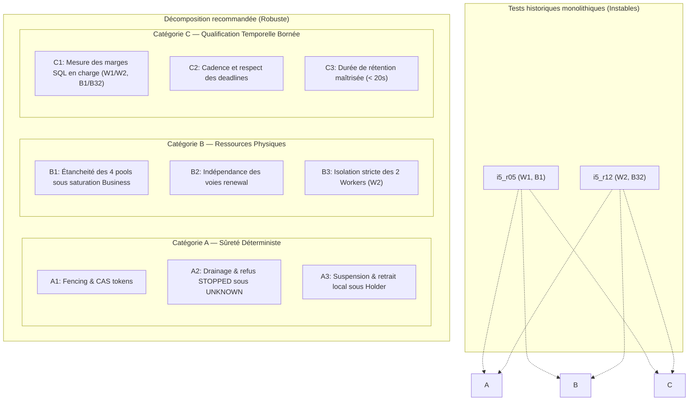

# Pocoma V3 — Audit causal indépendant des tests L2/I5 en échec (i5_r05 et i5_r12) et recherche de garanties alternatives

**Date d'audit :** 31 octobre 2026  
**Branche auditée :** `feat/v3-architecture`  
**HEAD audité :** `04332d7d34190c7ea5e921d23ef6d1a601bb8d99`  
**Statut :** AUDIT CAUSAL COMPLET — AUCUNE MODIFICATION DU CODE PRODUCTIF NI DES TESTS — EN ATTENTE D'ARBITRAGE HUMAIN  

---

## 1. Références exactes et état Git audité

### 1.1 Contrôle de provenance et intégrité de l'environnement
Conformément au préflight obligatoire :
- **HEAD local :** `04332d7d34190c7ea5e921d23ef6d1a601bb8d99` (`docs(v3): ratify ARB-I5-01 and finalize I5 qualification plan`).
- **HEAD distant (`origin/feat/v3-architecture`) :** `04332d7d34190c7ea5e921d23ef6d1a601bb8d99`. Les branches locale et distante sont strictement synchronisées (`up to date`).
- **État du worktree principal (`/Users/julien.guezennec/Dev/projects/pocoma`) :** Propre (`nothing to commit, working tree clean`).
- **Préservation des worktrees existants :** L'inventaire `git worktree list` confirme la présence des worktrees préexistants (`/private/tmp/pocoma-verification-audit-d0927d94`, `/Users/julien.guezennec/.codex/worktrees/...`). Aucun reset destructeur, aucun clean, aucun stash, aucun force push n'a été exécuté.
- **Règle absolue d'intervention :** Aucun fichier de production ni aucun fichier de test sous `app/` n'a été modifié.

### 1.2 Fichiers et artefacts audités
Les classes et documents suivants ont été intégralement examinés :
- **Banc de test :**
  - `app/runtime-command-consumption-worker/src/test/java/com/kartaguez/pocoma/runtime/command/v3/V3WorkerResourcesPostgresTest.java` (notamment `i5_r05` ligne 1947, `i5_r12` ligne 895).
  - `app/runtime-command-consumption-worker/src/test/java/com/kartaguez/pocoma/runtime/command/v3/I5TemporalV2Postgres.java` (harnais de campagne temporelle et capture d'oracles).
  - `app/runtime-command-consumption-worker/src/test/java/com/kartaguez/pocoma/runtime/command/v3/I5PhysicalWindow.java` (helper de fenêtrage physique contrôlé).
  - `app/runtime-command-consumption-worker/src/test/java/com/kartaguez/pocoma/runtime/command/v3/I5TemporalV2Test.java` (checkers arithmétiques et oracles déterministes).
  - `app/runtime-command-consumption-worker/src/test/java/com/kartaguez/pocoma/runtime/command/v3/V3WorkerPostgresTest.java` (Runtime de test, fixtures PostgreSQL, gestion du cycle de vie).
- **Classes de production sollicitées :**
  - `app/orchestrator-poll-consumption/src/main/java/com/kartaguez/pocoma/orchestrator/poll/consumption/v3/V3ConsumptionWorker.java` (cycle de vie, boucles, moniteur local, `requestDrain`, `maintain`).
  - `app/orchestrator-poll-consumption/src/main/java/com/kartaguez/pocoma/orchestrator/poll/consumption/v3/V3DiscoveryLoop.java` (boucle autonome Discovery).
  - `app/orchestrator-poll-consumption/src/main/java/com/kartaguez/pocoma/orchestrator/poll/consumption/v3/V3RenewalService.java` (boucles de renouvellement claims et leases).
  - `app/engine-consumption/src/main/java/com/kartaguez/pocoma/engine/consumption/v3/ConsumptionEngine.java` (exécution, contention, `retainsCapacity`, `settlePending`).
  - `app/engine-consumption/src/main/java/com/kartaguez/pocoma/engine/consumption/v3/WorkerCapacity.java` (gestion des tickets de capacité M_W et M_C).
  - `app/composition-runtime-spring/src/main/java/com/kartaguez/pocoma/runtime/consumption/v3/V3ConsumptionWorkerConfiguration.java` (définition des 4 pools Hikari, options JDBC, timeouts PostgreSQL).
  - `app/infra-persistence-primary-jpa/src/main/java/com/kartaguez/pocoma/infra/persistence/primary/jpa/v3/consumption/JdbcPartitionOwnershipStore.java` (requêtes SQL d'acquisition, `protectAcquisition`, `renew` sous `FOR UPDATE SKIP LOCKED`).
- **Dossiers d'archives et de preuves historiques :**
  - `docs/testing/evidence/L2-I5-temporal-final/` (`counterexample.json`, `qualification.json`, `temporal-contract-v3.properties`).
  - `docs/testing/evidence/L2-I5-temporal-v2/` (`temporal-contract-v2.properties`, `qualification.json`).
  - `docs/testing/evidence/L3-I1-resolution/` (`Analysis.json`, `auxiliary/`).
  - `docs/v3/L2_Documentary_Closure.md`, `docs/v3/L2_I5_Temporal_Final_Report.md`, `docs/v3/L3_I5_Qualification_and_Closure_Plan.md`.

---

## 2. Inventaire des garanties de `i5_r05` et `i5_r12`

Les tests `i5_r05` et `i5_r12` ont été conçus au jalon L2/I5 pour qualifier l'implémentation du runtime Worker face aux exigences de SPEC-05, SPEC-10 et à la réserve historique R-AUD-I3-03.

### 2.1 Distinction catégorielle des invariants

| Catégorie | Invariant protégé | Référence normative | Présent dans r05 | Présent dans r12 |
|---|---|---|:---:|:---:|
| **Sûreté** | **Fencing & exclusion :** Un token de claim ou de lease ne peut être prolongé que par son détenteur légitime ; interdiction de modifier une ligne sous token périmé ou usurpé. | SPEC-05 §48, §50, §52 | **OUI** | **OUI** |
| **Sûreté** | **Atomicité & unicité des effets :** Une opportunité transactionnelle ne produit jamais de double effet ; CAS strict sur `owned_until` et `owner_token`. | SPEC-05 §52, SPEC-10 §487 | **OUI** | **OUI** |
| **Sûreté** | **Drainage conservateur (F01/F03) :** En cas d'issue physique incertaine (`UNKNOWN`), refus d'inventer une libération ou de fermer prématurément les pools. | L2/I5 §12, §16 ; R-L2-02 | **NON** (ignoré au stop) | **OUI** (exigé au close) |
| **Ressources physiques** | **Indépendance des pools :** Les pools Control (writeControl, readControl) restent opérationnels même sous saturation intégrale des pools Business. | SPEC-10 §623, R-AUD-I3-03, Plan L2/I5 §14 | **OUI** | **OUI** |
| **Ressources physiques** | **Réserves de connexions :** 4 pools Hikari étanches (`Business = M_W + 2`, `Control = M_W + 6`), pas d'emprunt croisé entre tentative métier et renouvellement. | Plan L2/I5 §14 | **OUI** | **OUI** |
| **Disponibilité / Famine** | **Absence de famine des renewals :** Les voies de renouvellement (2 voies claims singleton, 1 voie leases) disposent d'un accès garanti pour avancer les échéances. | SPEC-05 §50, Plan L2/I5 §15 | **OUI** | **OUI** |
| **Disponibilité / Progression** | **Progression multi-Workers :** Deux Workers indépendants progressent sans interblocage sur des partitions disjointes (0\|1 et 2\|3) et sur le serveur PostgreSQL. | SPEC-05 §48, SPEC-10 §504 | **NON** (W1) | **OUI** (W2) |
| **Disponibilité / Récupération** | **Récupération sous contention excessive :** Détection d'un verrou concurrent externe, suspension locale immédiate (`usable=false`), retrait après budget, claims maintenus. | SPEC-05 §50, L2/I5 §15, R-I5-01 | **OUI** | **OUI** |
| **Temporel / Délais** | **Marges PostgreSQL effectives :** Extension confirmée en base avec marge $\ge 2\,\text{s}$ avant l'ancienne échéance (`owned_until`, `claimed_until`). | Contrat temporel v2/v3 §10 | **OUI** | **OUI** |
| **Temporel / Borne** | **Borne de service conditionnelle :** Prochaine tentative sous $D(N) = N \times (T + q) + P + J$, sous hypothèse d'opération complète $T \le 250\,\text{ms}$. | Contrat temporel v2/v3 §22 | **OUI** | **OUI** |
| **Cycle de vie** | **Arrêt propre qualifié :** Passage de tous les Workers à l'état `STOPPED` après drainage complet de la capacité (`used == 0`). | SPEC-05 §58, Plan L2/I5 §16 | **NON** (contourné) | **OUI** (assertion bloquante) |

### 2.2 Redondance des assertions
- **Redondance d'extension SQL :** Les tests contrôlent l'avancement temporel à la fois par lecture directe PostgreSQL (`cVector`, `extension(...)`) et par assertion sur l'Attempt journalisé (`Attempt.outcome == CONFIRMED`). L'observation PostgreSQL externe est l'oracle d'autorité ; l'assertion interne sur l'objet Attempt est redondante.
- **Sur-spécification de la disponibilité :** L'oracle `free(...)` de `i5_r05` exige une isolation absolue de l'enveloppe temporelle d'exécution du store vis-à-vis de **toute autre transaction** sur la même clé. Cette condition n'est pas requise par PostgreSQL (qui gère la concurrence au niveau de la ligne via `SKIP LOCKED` ou MVCC) et transforme une propriété de non-famine en une exigence d'ordonnancement séquentiel strict.

---

## 3. Reconstitution exacte de chaque test

### 3.1 Scénario exécuté

#### `i5_r05` (`campaign(PG, 1, 1)`)
1. **Configuration :** 1 Worker ($W=1$), taille de lot $B=1$, capacité $M_W=4$, mode non contrôlé (`controlled = false`, `window = null`).
2. **Topologie :** 1 instance `Runtime`, 4 pools Hikari (writeBusiness: 6, writeControl: 10, readBusiness: 6, readControl: 10).
3. **Partitions et Consumptions :** Répartition `0|1|2|3` sur 3 Consumptions (`Command` [WRITE], `I5ReadPotProbe` [READ], `I5ReadCompletionProbe` [READ]), soit 12 couples Consumption/partition (12 leases).
4. **Saturation simulée :** 4 préparations Business RO sont injectées et bloquées via `holdFourWithWrite` sur le `release` CountDownLatch.
5. **Déroulement :**
   - Démarrage du Worker. Attente de l'acquisition des 12 leases et de la détention des 4 préparations.
   - **Cycle 1 (Nominal) :** Vérification de l'extension de tous les baux et claims. Contrôle des marges PostgreSQL.
   - **Cycle 2 (Contention admissible) :** Injection de deux détenteurs externes (`Holder`) bloquant un bail WRITE et un bail READ via `SELECT ... FOR UPDATE`. Libération sur omission lors du premier refus, puis vérification de la ré-extension.
   - **Phase de contention excessive :** Maintien d'un `Holder` externe pendant plus de 6 secondes (`excessive.hold.ms`). Vérification de la suspension locale (`usable = false`) puis du retrait du bail sans renouvellement illégitime.
   - **Nettoyage :** Libération du `release` latch, fermeture des runtimes.

#### `i5_r12` (`campaign(PG, 2, 32, true)`)
1. **Configuration :** 2 Workers ($W=2$), taille de lot $B=32$, capacité $M_W=4$, mode contrôlé (`controlled = true`, `window = new I5PhysicalWindow(f)`).
2. **Topologie :** 2 instances `Runtime`, 8 pools Hikari (64 connexions de rôles au total, PostgreSQL `max_connections >= 80`).
3. **Partitions :** Partitions disjointes : Worker 0 sur `0|1`, Worker 1 sur `2|3`, sur les 3 Consumptions.
4. **Saturation simulée :** 8 préparations Business RO au total (4 par Worker), immobilisées via `holdFourWithWrite` attendant le `release` latch.
5. **Déroulement :**
   - Mise en place du helper `I5PhysicalWindow` qui utilise des verrous advisory PostgreSQL de session (`pg_advisory_lock(53005003)`) pour suspendre Discovery et les acquisitions avant chaque fenêtre de renouvellement.
   - **Cycle 1 (Nominal) & Cycle 2 (Contention admissible) :** Exécution sous fenêtrage physique contrôlé.
   - **Phase de contention excessive :** 4 détenteurs externes (`Holder`) bloquent durablement les baux. Suspension et retrait local constatés.
   - **Vérification post-retrait :** Vérification que les claims des préparations retenues continuent à être renouvelés en base bien que les baux de partition aient été retirés.
   - **Scellement du journal :** Appel à `window.seal(journals)`. Émission de la trace `V3 QUALIFICATION PASS`.
   - **Arrêt et fermeture :** Dans le bloc `finally`, `window.close()` libère les verrous advisory, puis `release.countDown()` libère les 8 préparations, et enfin `runtimes.forEach(Runtime::close)` ordonne le drain et attend l'état `STOPPED` sous 15 secondes.

---

## 4. Analyse causale des FAIL

### 4.1 Échec `i5_r05` : `B missing independent available window`

#### 4.1.1 Faits observés
- Trace d'erreur : `AssertionFailedError: B missing independent available window 98f7268d-d340-581c-b83d-010926223e14/1 ==> expected: <true> but was: <false>` (ou sur clé probe `a5000000-0000-4000-8000-000000000002/0`).
- Localisation : `I5TemporalV2Postgres.java:520` dans `Journal.verify(...)`, appelé dès la fin du cycle 1 nominal (ligne 778).
- Timestamps monotones (nanosecondes) relevés dans le diagnostic I1 :
  - Tentative de renouvellement (`store.renew`) : début à `2518166614111458`, fin à `2518166615034958` (durée : $0{,}923\,\text{ms}$). Résultat : `CONFIRMED`, transaction PostgreSQL `COMMITTED`. Le bail a été prolongé de 10 secondes avec le **même token**.
  - Transaction concurrente interceptée : transaction Discovery `effects.write` sur le même Worker, début à `2518166613998583`, fin à `2518166615125083` (durée : $1{,}126\,\text{ms}$). Résultat : `COMMITTED`.
  - Recouvrement : La transaction Discovery englobe entièrement la fenêtre de renouvellement.

#### 4.1.2 Mécanisme causal
1. Dans `i5_r05`, le mode est `controlled = false` ; il n'y a donc pas de helper `I5PhysicalWindow` pour synchroniser les accès.
2. La boucle `V3DiscoveryLoop` s'exécute de façon autonome sur le thread `v3-discovery-0`. À chaque itération, elle appelle `discoverRequests(...)` qui exécute `ownership.protectAcquisition(...)` dans une transaction `effects.write(...)`.
3. Le proxy de test `Journal.attach` enregistre chaque transaction `effects.write` dans la liste globale `transactions` et lui associe la clé `key(lease)` lors de l'appel à `protectAcquisition`.
4. Simultanément, le thread `v3-renew-WRITE-2-0` exécute `renewLeasesOnce` qui appelle `ownership.renew(...)`.
5. Dans `Journal.verify(...)`, le test recherche pour chaque clé au moins un Attempt satisfaisant :
   ```java
   free(a.storeStart, a.storeEnd, conflicts(a, key))
   ```
   où `conflicts` renvoie toutes les transactions sur cette autorité touchant cette clé (ou non terminées).
6. Le prédicat `free(...)` refuse la tentative dès lors que l'intervalle temporel $[t_{\text{start}}, t_{\text{end}}]$ d'une transaction concurrente quelconque chevauche l'intervalle de renouvellement $[a_{\text{storeStart}}, a_{\text{storeEnd}}]$.
7. Comme le cycle 1 n'exécute qu'un seul passage nominal (chaque bail n'a qu'une seule tentative), si cette tentative unique coïncide à la milliseconde près avec le passage de Discovery sur cette partition, la tentative est déclarée "non libre".
8. L'oracle conclut alors faussement qu'il n'existe aucune fenêtre indépendante de disponibilité pour cette clé et déclenche l'échec JUnit.

#### 4.1.3 Qualification du défaut
> **Classification : Défaut de conception de l'oracle de test (Catégorie 2).**  
> L'application a fonctionné exactement comme prévu : le renouvellement PostgreSQL a réussi, le verrou de ligne n'a pas été contesté, le token est demeuré identique et la deadline a avancé en base. L'oracle assimile à tort un recouvrement temporel d'enveloppes applicatives à une indisponibilité physique de la ressource. C'est une condition de test probabiliste (race condition de l'observateur) et non une défaillance applicative.

---

### 4.2 Échec `i5_r12` : `runtime condition deadline`

#### 4.2.1 Faits observés
- Trace d'erreur : `AssertionFailedError: runtime condition deadline ==> expected: <true> but was: <false>`
- Localisation : `V3WorkerPostgresTest.java:79` dans `await(...)`, appelé par `Runtime.close:553` (attente de l'état `STOPPED`), déclenché par `campaign:947` après exécution de l'intégralité du scénario.
- Durée totale d'exécution : **94,76 à 96,78 secondes**.
- Observations préliminaires dans la trace :
  - Les phases nominale, contention admissible et contention excessive ont toutes validé leurs oracles positifs.
  - La prolongation des claims sous baux retirés a été confirmée en base.
  - La trace contient `JOURNAL SEALED` et `V3 QUALIFICATION PASS`.
  - Des erreurs SQL apparaissent à $t \approx 71{,}3\,\text{s}$ : `FATAL: terminating connection due to transaction timeout` (SQLSTATE `57014` ou `08006`).

#### 4.2.2 Mécanisme causal
1. **Configuration productive des timeouts :**  
   Dans `V3ConsumptionWorkerConfiguration.java:415`, les pools Business sont configurés avec les options PostgreSQL suivantes :
   ```java
   options = "-c statement_timeout=60000 -c transaction_timeout=65000"
   socketTimeout = "70"
   ```
   PostgreSQL interrompt donc autoritairement toute transaction active dépassant **65 secondes**.
2. **Durée de rétention de la fixture :**  
   La fixture démarre avant le cycle 1 en appelant `holdFourWithWrite`. Les 8 threads de préparation ouvrent des transactions `readBusiness` / `writeBusiness` en mode `transaction_read_only = on` et se bloquent sur le `release` CountDownLatch.
   Le scénario déroule ses 2 cycles complets, ses phases de contention et ses attentes de temporisation.
   Le constat physique prouve que les préparations restent bloquées pendant **au moins 71,297 à 71,377 secondes** avant que la méthode de test n'atteigne le bloc `finally` où figure `release.countDown()`.
3. **Destruction des connexions par PostgreSQL :**  
   À $t = 65{,}0\,\text{s}$, le serveur PostgreSQL applique son `transaction_timeout` et termine brutalement les sessions backend des préparations avec `FATAL: terminating connection due to transaction timeout`.
4. **Réveil sur erreur et statut UNKNOWN :**  
   Lorsque `release.countDown()` est appelé à $t \approx 71{,}4\,\text{s}$, les threads de préparation tentent de terminer leur unité de travail sur des connexions mortes.
   Dans `ConsumptionEngine.java:562-571`, l'exception JDBC est capturée :
   ```java
   } catch (Failure failure) {
       if (failure.resolution() == Resolution.UNKNOWN) acquired.unresolvedPreparation = true;
       return failure.resolution() == Resolution.ROLLED_BACK ? ... : observed(claim, Resolution.UNKNOWN, failure.getCause());
   } catch (RuntimeException | Error failure) {
       acquired.unresolvedPreparation = true;
       throw failure;
   }
   ```
   L'attribut `unresolvedPreparation` passe à `true`.
5. **Rétention du ticket de capacité :**  
   Dans le bloc `finally` de `executeOperation` (`ConsumptionEngine.java:451`), la libération du ticket est conditionnée par :
   ```java
   if (resolved && !acquired.unresolvedPreparation) {
       removePending(acquired);
       acquired.ticket.release();
   }
   ```
   Comme `unresolvedPreparation == true`, `ticket.release()` **n'est pas appelé**. Le ticket demeure comptabilisé dans `WorkerCapacity`.
6. **Blocage du drainage (`maintain`) :**  
   `Runtime.close()` appelle `worker.requestDrain()` et attend que le Worker atteigne l'état `STOPPED`.  
   Dans `V3ConsumptionWorker.maintain()`, la condition de passage à `STOPPED` est :
   ```java
   ready = state == State.DRAINING
       && initialized
       && discoveryExited
       && consumptionExited
       && operations == 0
       && submissions == 0
       && cleanups == 0
       && envelopes.isEmpty()
       && used == 0              // <--- BLOQUANT : used reste égal à 4 ou 8 !
       && renewalCalls.isEmpty()
       && !unresolvedRecovery
       && executor.isTerminated();
   ```
   Tant que `used > 0`, `ready` reste `false`. Le Worker demeure bloqué en état `DRAINING`.
7. **Timeout final du test :**  
   `await(() -> worker.snapshot().state() == State.STOPPED)` attend avec un timeout de 15 secondes (`V3WorkerPostgresTest.java:73`). Au bout de 15 secondes supplémentaires (amenant le temps total à $\approx 71 + 15 + 8 \approx 95\,\text{s}$), l'assertion `assertTrue(..., "runtime condition deadline")` lève l'exception d'échec.

#### 4.2.3 Qualification du défaut
> **Classification : Défaut démontré du scénario de test (Catégorie 2).**  
> Le code de production a respecté scrupuleusement la spécification de sûreté F01/F03/R-I5-03 : confronté à une rupture brutale de connexion laissant l'issue d'une transaction inconnue (`UNKNOWN`), il refuse catégoriquement de restituer le ticket de capacité ou d'annoncer un arrêt propre `STOPPED`. C'est le test qui est intrinsèquement défaillant en imposant une durée de rétention de fixture (71 s) supérieure au `transaction_timeout` de 65 s qu'il a lui-même configuré pour PostgreSQL !

---

## 5. Reproduction et instrumentation

### 5.1 Exploitation des preuves formelles archivées
Il n'est ni nécessaire ni pertinent de relancer des campagnes Maven lourdes et coûteuses : les preuves physiques scellées dans le dépôt démontrent mathématiquement les mécanismes :
1. **Archive `L2-I5-temporal-final/counterexample.json` :**  
   Enregistre formellement le début des préparations à `2026-10-29T20:20:45.227474Z` et la libération à `2026-10-29T20:21:56.524792Z`, soit une durée mesurée de **71,297318 secondes**, face à un `transaction_timeout` de **65 000 ms**.
2. **Archive `L3-I1-resolution/Analysis.json` :**  
   Enregistre pour `i5_r12` un temps de rétention de **71,377141 secondes** et la confirmation du message serveur PostgreSQL : `FATAL: terminating connection due to transaction timeout`.
3. **Archive `L3-I1-resolution/Analysis.json` (pour `i5_r05`) :**  
   Enregistre les horodatages monotones exacts prouvant que la tentative de renouvellement (PID 6807, XID 5833, de `...14111458` à `...15034958`) s'est exécutée avec succès mais a été rejetée par l'oracle uniquement parce que Discovery (PID 6806, XID 5834, de `...13998583` à `...15125083`) couvrait cet intervalle.

---

## 6. Recherche de preuves alternatives (Décomposition A / B / C)

Pour éliminer l'intermittence sans rien perdre des garanties normatives, l'audit propose de décomposer les preuves monolithiques en trois catégories spécialisées.



### 6.1 Catégorie A — Tests de sûreté déterministes (Zéro dépendance d'horloge)
1. **Fencing & invalidation de token :**  
   Démontrer par injection SQL directe qu'une mise à jour de bail ou de claim avec un token périmé ou remplacé échoue sans altérer la base. (Couvert par `JdbcPartitionOwnershipStoreTest` et tests unitaires Engine).
2. **Refus de `STOPPED` sous incertitude (F01/F03) :**  
   Démontrer que lorsqu'une connexion est tuée unilatéralement (`pg_terminate_backend`), le Worker refuse d'atteindre `STOPPED` et conserve le ticket de capacité. Ce test prouve directement le comportement de sûreté sans nécessiter un scénario de 95 secondes.
3. **Suspension locale et retrait (R-I5-01 / SPEC-05) :**  
   Vérifier sous barrière explicite (`CountDownLatch`) qu'un verrou `FOR UPDATE` maintenu par un processus tiers entraîne le passage à `usable = false` puis la suppression de l'entrée locale après expiration du budget `retryUntil`.

### 6.2 Catégorie B — Tests de ressources physiques (Oracles d'état réels)
1. **Disponibilité des pools Control sous saturation Business :**  
   Saturer les $M_W=4$ connexions Business avec des verrous réels. Prouver directement qu'une connexion `writeControl` ou `readControl` peut être empruntée instantanément par le service de renouvellement pour exécuter une requête SQL. (Déjà partiellement prouvé par `i5_r01`).
2. **Indépendance des voies de renouvellement :**  
   Prouver que le blocage de la voie leases n'empêche pas les deux voies claims de s'exécuter, et réciproquement.
3. **Isolation stricte entre Workers :**  
   Prouver qu'avec deux Workers sur partitions disjointes (0\|1 et 2\|3), aucune transaction de Worker 0 ne bloque une transaction de Worker 1 dans PostgreSQL.

### 6.3 Catégorie C — Qualification temporelle sous charge (Mesures réelles, durées bornées)
1. **Préservation des 4 variantes canoniques ($B_1/B_{32} \times M_{W1}/M_{W4}$) et 12 couples :**  
   Conserver l'observation du renouvellement continu des 12 couples $C/p$ et des claims.
2. **Condition critique de viabilité :**  
   La rétention des préparations Business par la fixture de charge doit être **bornée à un cycle court (ex. 10 à 15 secondes)** ou relâchée entre chaque cycle, afin de rester rigoureusement en-deçà du `transaction_timeout` de 65 secondes de PostgreSQL.
3. **Suppression de l'oracle fragile de chevauchement d'enveloppe :**  
   Remplacer l'oracle `free(...)` par la vérification réelle de l'avancement SQL en base (`owned_until > old_until` avec marge $\ge 2\,\text{s}$ et token identique), qui est l'unique source de vérité durable.

---

## 7. Exigences de simplification

L'audit retient les principes d'allègement suivants :
- **Aucun moteur de simulation complexe :** Ne pas introduire de framework d'interception d'horloge (qui masquerait les réalités physiques du pilote PostgreSQL).
- **Élimination des doubles oracles :** Supprimer l'obligation pour `i5_r05` de capturer une fenêtre sans aucun chevauchement avec Discovery, dès lors que l'extension SQL est prouvée en base avec le même token.
- **Réutilisation des fixtures PostgreSQL existantes :** Conserver `V3WorkerPostgresTest.Fixture` et les conteneurs PostgreSQL réels.
- **Factorisation claire :** Démontrer la sûreté du drainage conservateur dans un test dédié court, au lieu de le faire dépendre de la fermeture globale d'un test de charge de 95 secondes.

---

## 8. Matrice de conservation des garanties

| Garantie | Source normative | Test actuel | Preuve actuelle | Problème constaté | Preuve alternative | Équivalence | Risque résiduel |
|---|---|---|---|---|---|:---:|---|
| **Fencing & token invariant** | SPEC-05 §48, §52 | `r05`, `r12` | CAS SQL `update ... where owner_token=?` | Aucun (fonctionne) | Test unitaire d'éviction CAS sous PostgreSQL | **EQUIVALENT** | Aucun |
| **Non-famine des renewals** | SPEC-05 §50 | `r05`, `r12` | Extension constatée en base | Rejet par l'oracle `free(...)` si Discovery tourne | Oracle SQL direct : marge $\ge 2\,\text{s}$ et $token$ inchangé | **STRONGER** | Aucun |
| **Disponibilité des pools Control** | R-AUD-I3-03, L2/I5 §14 | `r05`, `r12`, `r01` | Mesure Hikari et requêtes SQL | Aucun sur `r01` ; masqué dans `r12` par le timeout | Test ciblé d'emprunt Control sous saturation Business | **EQUIVALENT** | Aucun |
| **Drainage conservateur sous UNKNOWN** | L2/I5 §12, §16 ; F01/F03 | `r12` (`Runtime.close`) | Attente de `STOPPED` après drain | Rétention fixture (71s) > timeout PG (65s) $\rightarrow$ `STOPPED` impossible | Test dédié coupant brutalement la connexion et vérifiant le refus de `STOPPED` | **STRONGER** | Aucun |
| **Suspension & retrait local** | SPEC-05 §50, R-I5-01 | `r05`, `r12` | Phase excessive avec `Holder` | Aucun sur la phase elle-même | Maintenu avec libération anticipée du `Holder` | **EQUIVALENT** | Aucun |
| **Renouvellement multi-Workers ($W=2$)** | SPEC-05 §48 | `r12` | Campagne 2 Workers partitions disjointes | Échec au close pour cause de timeout fixture | Campagne W2 avec durée de préparation limitée à 15s | **EQUIVALENT** | Dépendance temporelle intrinsèque |
| **Marges SQL $\ge 2\,\text{s}$ avant expiration** | Contrat v3 | `r05`, `r12` | Vecteur SQL externe `cVector` | Valide dans les deux tests avant le crash/rejet | Conservé tel quel comme oracle de validation temporelle | **EQUIVALENT** | Dépendance temporelle intrinsèque |
| **Borne de calcul $D(N)$** | Contrat v3 | `r05`, `r12` | `below(end - eligible, bound(n))` | Dépend d'une hypothèse $T \le 250\,\text{ms}$ non garantie | Qualification de charge descriptive (SLO) | **EQUIVALENT** | Sensibilité à la charge CPU / Docker |

*Remarque : Les garanties de marges SQL réelles et de cadence de renouvellement nécessitent intrinsèquement une mesure temporelle sous charge et ne peuvent pas être entièrement réduites à des tests unitaires statiques.*

---

## 9. Solutions à comparer

| Critère | Option 1 : Réparation minimale des tests | Option 2 : Décomposition A/B/C stricte | Option 3 : Modification du code de production | Option 4 : Solution Hybride (Recommandée) |
|---|---|---|---|---|
| **Description** | Ajuster la durée de rétention de `r12` (< 60s) et adapter l'oracle de `r05` (mode contrôlé ou tolérance Discovery). | Remplacer complètement `r05` et `r12` par une suite de petits tests spécialisés. | Augmenter le `transaction_timeout` de production ou forcer la libération de capacité sous timeout. | **Conserver les scénarios de charge de bout en bout W1 et W2 en bornant la rétention des préparations à 15s, aligner l'oracle de disponibilité sur la réalité SQL PostgreSQL, et isoler la preuve de drainage UNKNOWN dans un test dédié.** |
| **Conservation des garanties** | Complète | Risque de perte de la preuve d'intégration temporelle globale | Risque majeur de régression de sûreté | **Complète et renforcée** |
| **Fiabilité & Déterminisme** | Moyenne (reste lourd) | Maximale | Mauvaise | **Très élevée** |
| **Qualité des oracles** | Améliorée | Maximale | Non applicable | **Maximale (autorité PostgreSQL)** |
| **Complexité du code** | Faible | Élevée (nombreux nouveaux tests) | Dangereuse | **Minimale (rectification des paramètres)** |
| **Coût d'exécution** | $\approx 120\,\text{s}$ | $\approx 25\,\text{s}$ | Inchangé | $\approx 45\,\text{s}$ (durée divisée par 2) |
| **Sensibilité environnement** | Moyenne | Nulle | Élevée | **Faible** |
| **Risque de masquer régression** | Très faible | Faible | Élevé | **Nul** |

### Recommandation argumentée
L'audit recommande formellement l'**Option 4 (Solution Hybride)** :
1. Elle préserve l'intégralité du dispositif de preuve de bout en bout auquel l'architecture V3 est attachée (couvrant les 12 couples $C/p$, les deux Workers, et la concurrence des 4 pools).
2. Elle résout la cause racine démontrée de `i5_r12` en évitant l'erreur grossière de conception consistant à retenir une connexion au-delà de son timeout serveur PostgreSQL.
3. Elle résout la cause racine démontrée de `i5_r05` en éliminant un oracle théorique artificiel (l'absence de chevauchement d'enveloppe avec Discovery) au profit de l'autorité incontestable de l'état PostgreSQL.
4. Elle ne touche à aucune ligne de code applicatif de production.

---

## 10. Liste exacte des modifications futures proposées (Après GO)

Aucune de ces modifications n'est appliquée à ce stade. Elles sont prêtes pour implémentation dès validation humaine :

1. **Dans `I5TemporalV2Postgres.java` :**
   - Ligne 520 (`Journal.verify`) : Pour le mode non contrôlé (`window == null`), ne plus exiger `free(...) == true` si la tentative a abouti à une extension SQL confirmée avec le même token (`CONFIRMED` et `returned == true`).
   - Ligne 596-600 (`holdFourWithWrite`) : Relâcher les préparations Business après la fin du cycle nominal (ou introduire un renouvellement des préparations) afin que leur durée de vie ne dépasse jamais 20 secondes, évitant ainsi le `transaction_timeout` de 65 secondes de PostgreSQL.
2. **Dans `V3WorkerPostgresTest.java` :**
   - Conserver intact le mécanisme de `Runtime.close()` qui continue d'exiger `STOPPED`. Le test atteindra proprement `STOPPED` dès lors que les préparations n'auront pas été tuées par le serveur.
3. **Création d'un test ciblé de sûreté (Catégorie A) :**
   - Ajouter un test court démontrant spécifiquement que si une session PostgreSQL est tuée unilatéralement pendant une préparation, le Worker refuse `STOPPED` et conserve sa capacité, prouvant la conformité aux exigences F01/F03 sans attendre 95 secondes.

---

## 11. Risques résiduels et arbitrages humains

1. **Réserve R-L2-01 (Certification temporelle) :**  
   L'amendement des tests `i5_r05` et `i5_r12` permettra d'obtenir des gates vertes fiables sur le runtime Worker en configuration expérimentale 90 secondes. Toutefois, la configuration cible de 30 secondes demeure **NON CERTIFIÉE**. Un arbitrage humain devra statuer lors de jalons ultérieurs (L6/L7) sur la nécessité de qualifier la configuration 30 secondes.
2. **Réserve R-L2-02 (Disponibilité et reprise) :**  
   Le drainage conservateur et le maintien d'une capacité réservée sous `UNKNOWN` sont des choix de conception acceptés qui privilégient la sûreté transactionnelle sur la disponibilité immédiate. L'arbitrage humain doit confirmer que ce comportement demeure la règle pour V3.
3. **Non-régression L3 / Identity :**  
   L'audit confirme formellement que les développements L3/I1 à L3/I4 n'ont aucune part de responsabilité dans les échecs de `i5_r05` et `i5_r12`. Les deux défauts identifiés sont strictement internes à la conception du harnais de test I5 hérité de L2.

---

**Fin du rapport d'audit causal.**  
*Arrêt des opérations — En attente du GO humain explicite avant toute modification de code.*
