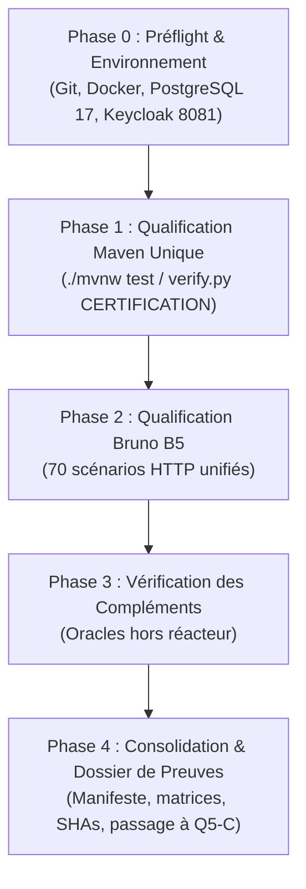
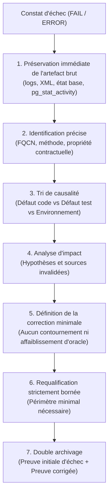

# Pocoma V3 — L5/Q5 — Plan de qualification finale du lot L5

Date : **5 novembre 2026**  
Dépôt : **`kartaguez/pocoma`**  
Branche : **`feat/v3-architecture`**  
Statut du plan : **SOUMIS À DÉCISION HUMAINE — Q5-A TERMINÉ — Q5-B EN ATTENTE DE GO**  
Référence Git d'entrée : **`df7a03aedf53ac663de8c65e7c6112e960430b2e`** (`df7a03ae`)  
Dernier commit productif/test modifié : **`2b1271d0ca3db6c6e9dfddd74f2b877cf4631dd2`** (`2b1271d0`)

---

## 1. Contexte, objectifs et gouvernance

### 1.1 Contexte du lot L5
Le lot L5 ("Supras et parcours externes V3") a complété ses quatre incréments fonctionnels, chacun ayant fait l'objet d'une clôture locale avec réserves explicites ratifiée par le responsable du programme :
- **L5/I1** — Entrées HTTP READ, Resource Server JWT/OIDC, masquage EUI, sérialisation bornée, prévalidation pure et quota partagé $Q=2$ ([Acte I1](L5_I1_Acceptance_and_Closure_Decision.md)).
- **L5/I2** — Commandes Pot (11 commandes), Registration et Unlink publics, admission atomique asynchrone, idempotence S-03 et privilèges SQL resserrés V8 ([Acte I2](L5_I2_Acceptance_and_Closure_Decision.md)).
- **L5/I3** — Link headless simplifié, proposition technique distincte, consentement explicite par POST E2 authentifiée, admission atomique V9 et Keycloak réel ([Acte I3](L5_I3_Acceptance_and_Closure_Decision.md)).
- **L5/I4** — Protocole d'invitation complet, chiffrement AES-GCM, publication `INVITATION_EVENT`, restitution confidentielle du lien, auto-rattachement et désaffiliation volontaire sans perte d'historique ([Acte I4](L5_I4_Acceptance_and_Closure_Decision.md)).

Le lot **L5 reste formellement OPEN**. Les gates canoniques non filtrées, la gate Architecture globale et la certification d'ensemble ont été explicitement différées à la phase de qualification finale **Q5**.

La gouvernance humaine a découpé la fin de vie du lot L5 en quatre étapes séquentielles strictes :
1. **Q5-A** : Préparation du plan de qualification finale (la présente mission).
2. **Q5-B** : Exécution des qualifications après approbation humaine explicite (**STRICTEMENT NO GO** en Q5-A).
3. **Q5-C** : Audit indépendant de qualité, simplicité, complexité, performances et exhaustivité fonctionnelle.
4. **Q5-D** : Décision humaine définitive de clôture du lot L5.

### 1.2 Objectif de Q5-A
Établir un plan de qualification finale de L5 directement exécutable en Q5-B après approbation humaine, respectant simultanément :
1. La rigueur sur les invariants, les contrats et les spécifications normatives (SPEC-01 à SPEC-10).
2. L'exhaustivité des obligations applicables à L5.
3. L'économie des exécutions redondantes conformément à la décision **D6** et au §34 de la *Reactor Verification Policy*.
4. L'attribution stricte des preuves à des sources et SHAs précis.
5. Le réalisme budgétaire (70–90 min full natif, 100 min point de décision ; 15–25 min Bruno B5, 40 min plafond).
6. La distinction nette entre défauts productifs, défauts d'oracles/tests et limites d'environnement.
7. La compatibilité avec les décisions humaines ratifiées (D1 à D7, H1 à H5, clôtures I1–I4).

---

## 2. Préflight Git et baseline de qualification

### 2.1 État du dépôt à l'entrée de Q5-A
- **Branche courante :** `feat/v3-architecture`
- **HEAD local :** `df7a03aedf53ac663de8c65e7c6112e960430b2e` (`df7a03ae`)
- **HEAD distant (`origin/feat/v3-architecture`) :** `df7a03aedf53ac663de8c65e7c6112e960430b2e`
- **Divergence Git :** `0` commit en avance, `0` commit en retard (`up to date`).
- **État du worktree :** Strictement propre (`working tree clean`).

### 2.2 Analyse des derniers commits et distinction des SHAs
L'historique récent depuis la finalisation du code I4 montre :
1. `d722e9d5` — *feat(v3): finalize invitation and voluntary departure verification (L5/I4)* : introduction du code et des tests I4 initiaux.
2. `2b1271d0` — *fix(v3): resolve audit observations AUD-I4-01..03 and align invitation routes (L5/I4)* : **dernier commit touchant au code productif et aux tests applicatifs** (rectification des routes `/by-creation-request/{requestId}` et `/available-shareholders/query`, fiabilisation du test d'expiration, alignement des helpers Bruno et assertions).
3. `a087dd8b` — *docs(v3): add L5/I4 post-audit targeted corrections report* (documentaire seul).
4. `17129919` — *docs(v3): finalize L5 I4 evidence provenance and SQL audit references* (documentaire et manifestes).
5. `df7a03ae` — *docs(v3): close L5 I4 with explicit reservations* (clôture humaine I4).

**Distinction impérative des SHAs :**
- **SHA du code productif et des tests sous test :** `2b1271d0ca3db6c6e9dfddd74f2b877cf4631dd2`
- **SHA de baseline documentaire I4 :** `df7a03aedf53ac663de8c65e7c6112e960430b2e`
- **SHA de publication du plan Q5-A :** SHA du commit contenant le présent document.
- **SHA candidat à la qualification Q5-B :** Le commit intégrant ce plan (le diff vis-à-vis de `2b1271d0` est strictement documentaire sous `docs/`, sans aucun impact sur `app/` ou `scripts/`).

L'inspection statique démontre que **zéro modification de code applicatif, de configuration Maven, de script ou de test n'est intervenue depuis `2b1271d0`**. Aucune propriété démontrée lors des tests post-audit d'I4 n'est invalidée par les commits documentaires subséquents.

---

## 3. Inventaire exhaustif des obligations L5

La matrice ci-dessous recense l'ensemble des exigences, invariants et contrats applicables à L5, leur statut probatoire et la couverture prévue en Q5-B :

| Identifiant | Propriété à démontrer | Origine normative | Preuve existante & SHA | Validité | Preuve encore due en Q5 | Gate prévue | Criticité |
|---|---|---|---|---|---|---|---|
| **REQ-READ-01** | Consultation Pot courant & historique à V | SPEC-04 §1 ; SPEC-06 §6 | T1 (`46b94ce6`), B07, B08 | Reusable | Inclusion dans full natif Q5-B | G5 / Full natif | BLOCKING |
| **REQ-READ-02** | Droits & balances historiques à V | SPEC-04 §4 ; SPEC-06 §6 | T1 (`46b94ce6`), B09 | Reusable | Inclusion dans full natif Q5-B | G5 / Full natif | BLOCKING |
| **REQ-READ-03** | Chargement groupé Expense batch (max 50) | SPEC-04 §5 ; SPEC-06 §6 | T1 (`46b94ce6`), B15, B16 | Reusable | Inclusion dans full natif Q5-B | G5 / Full natif | MAJOR |
| **REQ-READ-04** | Navigation keyset (défaut 20, max 100) | SPEC-04 §6 ; SPEC-06 §6 | T1 (`46b94ce6`), B21–B23 | Reusable | Inclusion dans full natif Q5-B | G5 / Full natif | MAJOR |
| **REQ-READ-05** | Masquage uniforme (404) & pas de fuite EUI | SPEC-06 §1 ; SPEC-07 §2 | T1 (`46b94ce6`), B10–B12 | Reusable | Inclusion dans full natif Q5-B | G5 / Full natif | BLOCKING |
| **REQ-READ-06** | Sérialisation complète bornée (4 Mio, 503 sans troncature) | SPEC-06 §6 ; D4-READ | T1 (`46b94ce6`), B32 | Reusable | Inclusion dans full natif Q5-B | G5 / Full natif | MAJOR |
| **REQ-READ-07** | Prévalidation pure avant quota SQL $Q=2$ | AUD-FINAL-I8-01 ; Plan L5 §11 | T1 (`46b94ce6`), B17–B19 | Reusable | Inclusion dans full natif Q5-B | G5 / Full natif | MAJOR |
| **REQ-CMD-01** | 11 commandes Pot publiques admises asynchrones | SPEC-01 §3 ; SPEC-06 §7 | C-04 (`df0c3a22`), B202–B212 | Reusable | Requalification fraîche sous V8/V10 | G5 / Full natif | BLOCKING |
| **REQ-CMD-02** | Registration & Unlink publics asynchrones | SPEC-02 §3 ; SPEC-06 §8 | C-04 (`df0c3a22`), B201, B220 | Reusable | Requalification fraîche sous V8/V10 | G5 / Full natif | BLOCKING |
| **REQ-CMD-03** | Idempotence atomique S-03 (même clé $\rightarrow$ même requestId) | SPEC-06 §7 ; SPEC-10 S-03 | C-04 (`df0c3a22`), B213 | Reusable | Requalification fraîche sous V8/V10 | G5 / Full natif | BLOCKING |
| **REQ-CMD-04** | Conflit d'intention différente sur même clé (409) | SPEC-06 §7 ; SPEC-10 S-03 | C-04 (`df0c3a22`), B214 | Reusable | Requalification fraîche sous V8/V10 | G5 / Full natif | BLOCKING |
| **REQ-CMD-05** | Résolution SELF uniquement dans le moteur WRITE | SPEC-06 §7 ; SPEC-07 §3 | C-04 (`df0c3a22`), B204 | Reusable | Requalification fraîche sous V8/V10 | G5 / Full natif | BLOCKING |
| **REQ-CMD-06** | Rôles SQL distincts & privilèges resserrés V8 | AUD-I2-02 ; L5/I2 Post-Audit | 9/9 PASS (`1fc07000`) | Partielle (ciblée) | Preuve terminale fraîche intégrée | G5 / Full natif | MAJOR |
| **REQ-LINK-01** | Proposition technique distincte de l'IdentityRequest | SPEC-02 §5 ; H1 A-READ | FAST/PG (`0d415a67`), B302 | Reusable | Requalification intégrée | G5 / Full natif | BLOCKING |
| **REQ-LINK-02** | Consentement explicite par POST E2 authentifiée | SPEC-02 §5 ; SPEC-10 ID-02 | FAST/PG (`0d415a67`), B307 | Reusable | Requalification intégrée | G5 / Full natif | BLOCKING |
| **REQ-LINK-03** | E1 propriétaire du résultat, E2 découvre son binding | SPEC-02 §5 ; SPEC-10 ID-02 | FAST/PG (`0d415a67`), B309, B310 | Reusable | Requalification intégrée | G5 / Full natif | BLOCKING |
| **REQ-LINK-04** | Anti-rejeu & admission atomique V9 après acceptation | SPEC-06 §8 ; SPEC-10 ID-02 | FAST/PG (`0d415a67`), B307, B313 | Reusable | Requalification intégrée | G5 / Full natif | BLOCKING |
| **REQ-INV-01** | Création invitation réservée au seul créateur | SPEC-06 §13 ; SPEC-10 INV-A | T4-B (`7a284405`), B401 | Partielle (XML écrasé) | Preuve fraîche intégrale | G5 / Full natif | BLOCKING |
| **REQ-INV-02** | Persistance atomique, version Pot inchangée | SPEC-06 §13 ; SPEC-10 INV-A | T4-A, T4-E (`7a284405`) | Partielle (XML écrasé) | Preuve fraîche intégrale | G5 / Full natif | BLOCKING |
| **REQ-INV-03** | Chiffrement AES-GCM & lookup par hash | SPEC-06 §13 ; SPEC-10 INV-I | `V3InvitationReadPostgresTest` (`2b1271d0`) | Reusable | Requalification intégrée | G5 / Full natif | BLOCKING |
| **REQ-INV-04** | Restitution confidentielle par creationRequestId (404 tiers) | SPEC-06 §13 ; SPEC-10 INV-C | `V3InvitationHttpTest` (`2b1271d0`), B402 | Reusable | Requalification intégrée | G5 / Full natif | BLOCKING |
| **REQ-INV-05** | Consultation des places libres sans fuite de solde/historique | SPEC-06 §14 ; SPEC-10 INV-D | `V3InvitationHttpTest` (`2b1271d0`), B402 | Reusable | Requalification intégrée | G5 / Full natif | BLOCKING |
| **REQ-INV-06** | Auto-rattachement atomique & revalidation autoritative WRITE | SPEC-06 §14 ; SPEC-10 INV-E/F | `V3InvitationWritePostgresTest` (`2b1271d0`) | Reusable | Requalification intégrée | G5 / Full natif | BLOCKING |
| **REQ-INV-07** | Concurrence sur même place & réutilisation par tiers | SPEC-06 §14 ; SPEC-10 INV-F | `V3InvitationWritePostgresTest` (`2b1271d0`), B403 | Partielle (XML écrasé T4-C/D) | Preuve fraîche intégrale | G5 / Full natif | BLOCKING |
| **REQ-INV-08** | Expiration transactionnelle fiable sans faux PASS | SPEC-06 §14 ; AUD-I4-02 | `V3InvitationWritePostgresTest#expiration...` | Reusable (avec réserve) | Preuve fraîche intégrée | G5 / Full natif | MAJOR |
| **REQ-INV-09** | Matérialisation monotone `read_current_invitation` | SPEC-04 §7 ; SPEC-06 §13 | `V3InvitationReadPostgresTest` (`2b1271d0`) | Reusable | Preuve fraîche intégrée | G5 / Full natif | MAJOR |
| **REQ-DEP-01** | Désaffiliation volontaire (`DETACH`, `userId=null`) | SPEC-01 §6 ; SPEC-06 §15 | `V3AdmissionFlowPostgresTest` (`2b1271d0`), B401 | Reusable | Preuve fraîche intégrée | G5 / Full natif | BLOCKING |
| **REQ-DEP-02** | Conservation intégrale de l'historique financier | SPEC-01 §6 ; SPEC-06 §15 | `InvitationAttachmentTest` (`2b1271d0`) | Reusable | Preuve fraîche intégrée | G5 / Full natif | BLOCKING |
| **REQ-DEP-03** | Départ du dernier affilié & indépendance des identités | SPEC-01 §6 ; SPEC-06 §15 | `V3InvitationHttpTest` (`2b1271d0`) | Reusable | Preuve fraîche intégrée | G5 / Full natif | MAJOR |
| **REQ-TOPO-01** | Topologie 7 READ (3 Monolithe + 4 PROJECTION) & pool $\le 65$ | D6-topologie ; SPEC-09 §3 | `V3InvitationTopologyPostgresTest` (`2b1271d0`) | Reusable | Preuve fraîche intégrée | G5 / Full natif | MAJOR |
| **REQ-ARCH-01** | Isolation hexagonale, absence de cycles, règles de couches | *Reactor Policy* §16, §17 | `architecture-tests` (L4: 167 PASS, I2: 170 PASS) | Différée Q5 | Gate Architecture non filtrée | G5 / Full natif | BLOCKING |
| **REQ-EXT-01** | Intégration Keycloak OIDC réel (3 sessions E1/E2/E3) | SPEC-10 ID-02 ; R-I1-03 | `V3LinkBrunoPostgresTest` (`0d415a67`) | Partielle (banc I3) | Rejeu sur banc unifié B5 | B5 / Externe | BLOCKING |
| **REQ-EXT-02** | Collection HTTP Bruno V3 complète (B01–B404) | SPEC-10 ; Plans I1–I4 | B1 (32 PASS), B2 (24 PASS), B3 (10 PASS), B4 (4 PASS) | Morcelée (4 runs séparés) | Campagne B5 unique unifiée | B5 / Externe | MAJOR |

---

## 4. Stratégie D6 — Mutualisation des gates

### 4.1 Justification normative
La décision **D6** ([Rapport de mutualisation D6](L5_D6_Gates_Mutualization_Report.md)) repose sur les articles §§17, 34 et 35 de la *Reactor Verification Policy* :
- Le §35 stipule qu'une clôture de lot requise (*Required lot closure*) déclenche le niveau **CERTIFICATION**, dont l'oracle canonique est un **full reactor natif non filtré** (`./mvnw test`).
- Le §34 autorise la mutualisation lorsque plusieurs tranches déclarées partagent des modules amont, à la condition expresse que chaque ancre, chaque méthode, chaque variante et chaque exigence de provenance soient effectivement couvertes sans aucune omission.
- Le §17 impose la gate `architecture-tests` globale dès lors que des frontières architecturales ou des dépendances ont évolué (ce qui est le cas avec l'introduction des supras V3, de l'admission V8 et d'Invitation V10).

### 4.2 Analyse statique du graphe Maven et du reactor
L'inspection de `app/pom.xml` confirme la composition du réacteur :
1. **Modules déclarés :** Exactement **60 modules enfants** plus le parent agrégateur (total 61 projets).
2. **Couverture des ancres canoniques :**
   - WEB : `runtime-web-api` (inclus, ligne 89).
   - COMMAND : `runtime-command-consumption-worker` (inclus, ligne 97).
   - PROJECTION : `runtime-task-consumption-worker` (inclus, ligne 96).
   - EVENT : `runtime-event-consumption-worker` (inclus, ligne 90).
   - BINDING : `runtime-binding-consumption-worker` (inclus, ligne 95).
   - LKV : `runtime-latest-known-version-consumption-worker` (inclus, ligne 94).
   - MONOLITHE : `runtime-monolith` (inclus, ligne 88).
   - ARCHITECTURE : `architecture-tests` (inclus, ligne 98).
3. **Ordre d'exécution :** `architecture-tests` est situé en 60ème position dans `app/pom.xml`. Le graphe de dépendances place ce module à la fin du réacteur après la compilation de tous les modules productifs et de tous les runtimes.

### 4.3 Matrice de couverture de la campagne unique proposée

| Obligation différée | Méthode / variante requise | Module responsable | Inclusion dans le full natif | Statut de couverture | Complément nécessaire |
|---|---|---|:---:|:---:|---|
| **Fermeture canonique G5** | 60 modules compilés et testés | Tous (parent `app/pom.xml`) | **OUI** | Couverture intégrale | Aucun |
| **Gate Architecture globale** | 178 tests / oracles ArchUnit | `architecture-tests` | **OUI** (si aucun échec amont) | Couverture intégrale | Aucun (condition : zéro échec amont) |
| **Tranche WEB (I1, I2, I3, I4)** | Routes REST, transport, sérialisation | `runtime-web-api` | **OUI** | Couverture intégrale | Aucun |
| **Tranche COMMAND (I2, I3, I4)** | Moteur d'admission & exécution | `runtime-command-consumption-worker` | **OUI** | Couverture intégrale | Aucun |
| **Tranche PROJECTION (I1, I4)** | Matérialisation Pot, Balance, Invitation | `runtime-task-consumption-worker` | **OUI** | Couverture intégrale | Aucun |
| **Assemblage MONOLITHE** | Concurrence, flux de bout en bout | `runtime-monolith` | **OUI** | Couverture intégrale | Précondition : Keycloak démarré |
| **Non-régression historique** | Isolation, L2 Consumption, L3 Identity | `engine-consumption`, `domain-user-identity`, etc. | **OUI** | Couverture intégrale | Quarantaine active : 0 |
| **Preuve réelle Keycloak** | Authentification OIDC réelle | `V3LinkBrunoPostgresTest` | **OUI** | Couvert sous condition | Dépendance Keycloak localhost:8081 |
| **Collection Bruno B5 (70 scénarios)** | 70 requêtes HTTP scriptées | `scripts/bruno-v3/` | **NON** (hors Surefire) | **Non couvert par Maven** | **Campagne B5 dédiée obligatoire** |

### 4.4 Conclusion sur la mutualisation
La mutualisation D6 est **STRICTEMENT VALIDE** sous la commande canonique unique, **à une exception près : la collection externe Bruno B5 (70 scénarios)**, qui relève d'un interpréteur Node.js/CLI externe et d'un environnement HTTP dédié.  
Il est donc formellement démontré qu'il est inutile et redondant d'exécuter successivement G5, puis Architecture, puis un full reactor. **Une seule campagne Maven native intégrale couvre 100% du périmètre Java/PostgreSQL.**

---

## 5. Réutilisation des preuves historiques et classification

### 5.1 Règles de classification normative
Conformément aux directives de la politique Reactor (§34) et aux actes de clôture I1–I4, chaque preuve historique est classée selon l'un des huit statuts normatifs :
- **`PASS VERIFIED`** : Preuve exécutée avec succès, rapport XML Surefire disponible, empreinte SHA-256 archivée, et code source sous test identique au SHA courant.
- **`PASS HISTORICAL REUSABLE`** : Preuve réussie lors d'une étape antérieure, documentée dans un manifeste figé, dont les hypothèses et sources restent valides au SHA courant, bien que le run physique date d'un commit amont.
- **`PASS REPORTED WITHOUT ARCHIVED EVIDENCE`** : Résultat rapporté avec succès par l'agent ou les logs d'exécution, mais dont le fichier XML d'origine est indisponible (notamment les 5 méthodes WRITE I4 écrasées).
- **`FAIL`** : Échec d'exécution (conservé tel quel, jamais transformé en PASS).
- **`SKIP`** : Test sauté ou ignoré (formellement interdit pour toute gate de certification).
- **`NOT RUN`** : Non exécuté dans le périmètre concerné.
- **`INCONCLUSIVE`** : Exécution incomplète, interrompue ou dont l'oracle n'a pu statuer.
- **`INVALIDATED`** : Preuve rendue caduque par une modification ultérieure du code ou de l'environnement.

### 5.2 Tableau de classification des preuves historiques L5

| Ensemble de preuves | SHA testé | Méthodes / Scénarios | Classification Q5-A | Justification & Traitement en Q5-B |
|---|---|:---:|:---:|---|
| **L5/I1 — T1 Suite** | `46b94ce6` | 40 méthodes | `PASS HISTORICAL REUSABLE` | Sources stables depuis `46b94ce6`. Sera fraîchement réexécuté dans le full Q5-B. |
| **L5/I1 — Architecture native** | `46b94ce6` | 2 231 tests (167 arch) | `PASS HISTORICAL REUSABLE` | Preuve historique de la gate I1. Remplacé par la nouvelle gate Q5-B. |
| **L5/I1 — Bruno B1** | `46b94ce6` | 32 scénarios | `PASS HISTORICAL REUSABLE` | Archivé dans `evidence/L5-I1`. Réexécuté dans la suite B5 unifiée. |
| **L5/I2 — T2 Suite (C-04)** | `df0c3a22` | 85 identités | `PASS HISTORICAL REUSABLE` | Reçu C-04 archivé. Requalification fraîche dans le full Q5-B. |
| **L5/I2 — Post-Audit V8** | `1fc07000` | 9 tests PG | `PASS VERIFIED` | XML archivé dans `evidence/L5-I2-post-audit`. Réexécuté dans le full Q5-B. |
| **L5/I2 — Bruno B2** | `df0c3a22` | 24 scénarios | `PASS HISTORICAL REUSABLE` | Archivé dans `evidence/L5-I2`. Réexécuté dans B5. |
| **L5/I3 — FAST Suite** | `0d415a67` | 13 tests | `PASS VERIFIED` | XML archivé dans `evidence/L5-I3`. Réexécuté dans le full Q5-B. |
| **L5/I3 — PG/HTTP Composite** | `0d415a67` | 25 oracles | `PASS VERIFIED` | Run initial 25 tests reste `FAIL` (24/1), 1 oracle corrigé `PASS`. Réexécuté unifié dans le full Q5-B. |
| **L5/I3 — Bruno Keycloak** | `0d415a67` | 10 scénarios | `PASS VERIFIED` | Reçus et traces archivés dans `evidence/L5-I3`. Réexécuté dans B5. |
| **L5/I4 — JUnit avec XML** | `2b1271d0` | 17 méthodes | `PASS VERIFIED` | XML archivés sous `evidence/L5-I4/surefire-reports/`. Réexécuté dans le full Q5-B. |
| **L5/I4 — WRITE (méthodes 1 à 5)** | `7a284405` | 5 méthodes | `PASS REPORTED WITHOUT ARCHIVED EVIDENCE` | **XML écrasés lors du run ciblé de la méthode 6.** Ne pas régénérer en Q5-A. Le full natif Q5-B produira des preuves fraîches natives. |
| **L5/I4 — Bruno B4** | `2b1271d0` | 4 scénarios | `PASS VERIFIED` | Reçus archivés dans `evidence/L5-I4/bruno-b4/`. Réexécuté dans B5. |
| **Gates Q5 différées** | - | Full natif / Arch / B5 | `NOT RUN` | **Obligations actives différées à Q5-B.** |

---

## 6. Plan de qualification externe Bruno B5

### 6.1 Inventaire exhaustif des scénarios (70 scénarios)
La collection versionnée dans `scripts/bruno-v3/` comporte exactement 70 fichiers `.bru` répartis en quatre dossiers fonctionnels :

1. **`01 Identity and READ` (32 scénarios) :**
   - *01 Own Binding :* B01 (active), B02 (inactive), B03 (absent), B04 (minVersion), B05 (foreignSelector), B06 (noBearer).
   - *02 Pot and Balance :* B07 (currentComplete), B08 (exactHistory), B09 (exactBalance), B10 (forbiddenAbsent), B11 (deletedCurrent), B12 (terminalVersion), B13 (historyBeforeDeletion), B14 (authorizedLag).
   - *03 Expense Batches :* B15 (singleExpense), B16 (fiftyExpenses), B17 (emptyBatch), B18 (oversizedBatch), B19 (duplicateBatch), B20 (foreignReference).
   - *04 Navigation and Results :* B21 (navigationPages), B22 (invalidCursor), B23 (pageLimits), B24 (mismatchedToken), B25 (commandCompleted), B26 (commandRejected), B27 (identityCompleted), B28 (identityRejected), B29 (foreignAndSameUserResult), B30 (boundedResultPolling), B31 (invalidBearer), B32 (transportAndPrivacy).
2. **`02 Admission and Commands` (24 scénarios) :**
   - B201 (RegistrationUnknown), B202 (CreatePot), B203 (UpdatePotDetails), B204 (AddShareholdersSELF), B205 (UpdateShareholderDetailsKEEP), B206 (UpdateShareholderWeights), B207 (CreateExpense), B208 (UpdateExpenseDetails), B209 (UpdateExpenseFinancials), B210 (DeleteExpense), B211 (DeleteShareholder), B212 (DeletePot).
   - B213 (SameKeyReplayAfterTerminal), B214 (DifferentIntent409), B215 (EquivalentJSON), B216 (IdentityScopeIsolation), B217 (MalformedAndUnauthenticated), B218 (DeferredBusinessRejection), B219 (Atomic101AndRead), B220 (UnlinkOtherSelfAndStaleSELF), B221 (NoPublicLinkOrInvitation), B222 (MediaAndBodyLimits), B223 (RegistrationFree), B224 (ResultsOwnershipAfterUnlink).
3. **`03 Link Requests` (10 scénarios) :**
   - B301 (RegistrationE1), B302 (CreateAndSummary), B303 (ThirdIdentityMasked), B304 (InitiatorCannotAccept), B305 (InvalidBearerRefused), B307 (AcceptAndReplay), B308 (ImmutableIntent), B309 (OwnBindingOnly), B310 (ResultBelongsToE1), B313 (CreationIdempotency).
   - *Note normative :* B306, B311, B312, B314 sont **absents de Bruno** (réserve **R-Q1**) et sont couverts par des oracles PostgreSQL ciblés dans Surefire.
4. **`04 Invitations` (4 scénarios) :**
   - B401 (JourneyAndVoluntaryDeparture), B402 (ConfidentialityAndMasking), B403 (ReusableInvitation), B404 (ExpiredCreation).

### 6.2 Dépendances externes et réalité du fournisseur d'identité
- **Distinction impérative :** Un jeton signé localement par une fixture cryptographique (clé privée éphémère en mémoire) qualifie le Resource Server et les filtres HTTP locaux ; il **ne certifie pas l'intégration avec un fournisseur OIDC externe réel**.
- **Fournisseur de qualification :** Keycloak 26.7.0 conteneurisé via `docker-compose.functional.yml` (realm `pocoma`, 3 utilisateurs réels : `bruno`, `link-e2`, `link-e3`).
- **Prérequis pour B5 :**
  1. Conteneurs `postgres` (port 5432) et `keycloak` (port 8081) actifs et sains (`healthy`).
  2. Obtention préalable des jetons via `scripts/testing/l5-i3-auth.py` et alimentation du trousseau éphémère.
  3. Démarrage du runtime monolithique V3 configuré sur l'émetteur `http://localhost:8081/realms/pocoma`.

### 6.3 Ordre d'exécution et commande candidate B5
Les scénarios doivent être exécutés dans l'ordre de leurs dépendances d'état :
`01 Identity and READ` $\rightarrow$ `02 Admission and Commands` $\rightarrow$ `03 Link Requests` $\rightarrow$ `04 Invitations`.

**Commande candidate unifiée B5 :**
```sh
cd scripts/bruno-v3
node_modules/.bin/bru run -r \
  --env Local \
  --sandbox developer \
  --noproxy \
  --reporter-json <evidence-dir>/bruno-b5.json \
  --reporter-skip-all-headers \
  --reporter-skip-body
```

**Critères de sortie B5 :**
- 70 scénarios exécutés, **0 échec, 0 erreur**.
- Absence formelle de fuite de tokens ou secrets dans les logs (`bruno.log`).
- Temps d'exécution total $\le 25$ minutes (seuil d'alerte à 40 minutes).

---

## 7. Budgets, performances et efficacité d'exécution

### 7.1 Analyse des budgets D6 et cohérence historique
Les données empiriques issues des campagnes antérieures (L4-I8, L5-I1 à I4) établissent la répartition prévisionnelle :

| Poste de qualification | Estimation nominale | Point de décision / Watchdog | Fondement historique |
|---|:---:|:---:|---|
| **Compilation du reactor (60 modules)** | 3–5 min | 8 min | Mesuré ~3 min sur reactor incrémental |
| **Démarrage Spring & Testcontainers** | 8–12 min | 15 min | Multiples conteneurs PostgreSQL 17 éphémères |
| **Tests unitaires & domaine rapides** | 2–3 min | 5 min | ~350 tests ultra-rapides (<10 ms/test) |
| **Tests intégration & workers (COMMAND, READ)** | 40–55 min | 65 min | FULL-04-FAIL L4 mesuré à 68,6 min total |
| **Tests à lease & temporisations (T4-L topologie, etc.)** | 5–8 min | 10 min | T4-L mesuré à 207s ; lease180 renouvelé |
| **Tests d'Architecture (178 oracles ArchUnit)** | 1–2 min | 3 min | Mesuré à ~47s en ciblé, ~85s en charge |
| **Collecte des preuves & vérification d'intégrité** | 2–3 min | 5 min | Scan XML et calculs SHA-256 |
| **TOTAL Full Natif Unique (G5 + Arch + Full)** | **70–90 min** | **100 min** | **Seuil d'alerte D6 confirmé** |
| **TOTAL Bruno B5 (70 scénarios)** | **15–25 min** | **40 min** | Somme des B1 (2m), B2 (5m), B3 (3m), B4 (1m) + marges |

### 7.2 Critères de détection d'anomalie et d'interruption précoce
Une campagne saine ne doit pas être interrompue arbitrairement parce qu'elle dépasse de quelques minutes son estimation. En revanche, le superviseur doit identifier immédiatement les états pathologiques :
1. **Blocage technique / Deadlock :** Aucune nouvelle trace Surefire ou aucun événement Docker pendant plus de 5 minutes consécutives.
2. **Attente pathologique de lease :** Dépassement anormal d'un timeout de test unitaire au-delà de 300 secondes.
3. **Défaillance d'environnement :** Crash du démon Docker, épuisement d'espace disque sous `/tmp` ou saturation de la mémoire vive (OOM killer).
4. **Boucle infinie / Non-terminaison :** Blocage sur un verrou de synchronisation (`v3_event_counter` ou `v3_pot_version`).
5. **Échec reproductible précoce :** Échec d'un module amont fondamental (ex: `domain-pot` ou `infra-tx-spring`) qui invalidera mécaniquement l'ensemble des modules avals.

En cas de survenance de l'un de ces critères, la campagne doit être arrêtée proprement, les traces préservées, et aucune relance à l'identique ne doit être engagée sans diagnostic.

---

## 8. Préflight des risques issus de l'audit qualité post-L4

L'audit qualité indépendant post-L4 a émis huit recommandations techniques. Le tableau ci-dessous effectue le tri préliminaire de leur impact sur la qualification Q5-B :

| Recommandation L4 | Risque pour l'exécution Q5-B | Décision proposée pour Q5-A / Q5-B | Statut pour la suite |
|---|---|---|---|
| **FIND-L4-01** (Quota READ $Q=2$ partagé) | **NON BLOQUANT**. $Q=2$ est un invariant contractuel testé. Risque de saturation uniquement sous charge concurrente artificielle. | Conserver $Q=2$. Vérifier que les fixtures libèrent leurs permis. | Suivi de dimensionnement en L6. |
| **FIND-L4-02 / AUD-FINAL-I8-01** (Prévalidation pure avant quota) | **NON BLOQUANT**. Entièrement implémenté et validé lors de L5/I1 (`ReadPotV3`, `ReadNavigationV3`). | Vérifié acquis. Aucune action préalable. | Résolu. |
| **FIND-L2-01** (Lease READ 180s vs défaut 30s) | **NON BLOQUANT POUR LE TEST**. Validé par `V3InvitationTopologyPostgresTest` (T4-L, 207s). | Maintenir la réserve explicite d'homologation hors production. | Audit approfondi en Q5-C / L6. |
| **FIND-TRANS-01** (60 modules enfants / complexité POM) | **NON BLOQUANT POUR Q5-B**. Complexité de build statique connue et stable. | Ne modifier aucun POM. Conserver le graphe existant. | Rationalisation globale en L7. |
| **FIND-L1-01** (Requête `openComponent` complexe dans `PotHistoryRows`) | **NON BLOQUANT**. Aucun défaut fonctionnel ou d'intégrité identifié. | Ne pas altérer la requête SQL avant la qualification. | Audit d'optimisation en Q5-C / L6. |
| **FIND-L4-03** (Recalcul intégral de Balance à chaque version) | **NON BLOQUANT**. Strictement conforme à SPEC-04 §4 (normatif). | Ne pas tenter d'optimisation prématurée. | Mesures de latence sous volume en L6. |
| **FIND-L2-02** (Branches READ/WRITE de `ConsumptionEngine`) | **NON BLOQUANT**. Architecture stable réemployée avec succès dans les 4 incréments. | Conserver l'implémentation éprouvée. | Examen en Q5-C. |
| **FIND-L3-01** (Consentement Link sans serveur d'autorisation externe) | **RÉSOLU PAR RATIFICATION H1–H5**. Le POST explicite E2 remplace le serveur externe. | Vérifier la présence du banc Keycloak pour B5. | Validé en I3, réserve de rétention L6. |

**Conclusion de l'audit préliminaire :** Aucune recommandation post-L4 ne constitue un bloqueur technique immédiat pour le lancement de Q5-B, sous réserve du respect scrupuleux des conditions d'environnement (Keycloak actif pour les tests de liaison).

---

## 9. Plan opérationnel Q5-B proposé

Le déroulement proposé pour la phase d'exécution Q5-B s'articule en cinq phases séquentielles strictes :



### Phase 0 — Préflight & Validation de l'environnement
1. Contrôle Git : validation que le HEAD local est propre et correspond exactement au SHA autorisé par l'approbation humaine.
2. Démarrage des conteneurs d'infrastructure externe :
   ```sh
   docker compose -p pocoma-functional -f docker-compose.functional.yml up -d postgres keycloak
   ```
3. Attente de disponibilité (`healthy`) de PostgreSQL (`5432`) et Keycloak (`8081`).
4. Vérification de l'absence de processus orphelins ou de verrous résiduels.
5. Création d'un répertoire neuf et isolé pour les preuves : `/tmp/pocoma-q5b-evidence-<timestamp>/`.

### Phase 1 — Qualification Maven mutualisée (Full Natif Unique)
- **Commande canonique exacte :**
  ```sh
  python3 -B scripts/testing/verify.py CERTIFICATION --output /tmp/pocoma-q5b-evidence/maven-full/
  ```
  *(Équivalent exact à : `./mvnw --batch-mode --no-transfer-progress test` sous le profil de provenance avec injection de `pocoma.verification.id` et reports distincts par module).*
- **Modules couverts :** L'intégralité des 60 modules du reactor, incluant WEB, COMMAND, PROJECTION, MONOLITH et `architecture-tests`.
- **Nombre de tests attendus :** Entre 2 350 et 2 420 méthodes de tests JUnit.
- **Critères de succès :**
  - Exit code Maven = 0 (`BUILD SUCCESS`).
  - Zéro failure, zéro error, zéro skip (`0/0/0`).
  - Module `architecture-tests` intégralement exécuté (178/178 tests PASS).
  - Présence et validité de l'ensemble des rapports Surefire dans le répertoire de preuves.

### Phase 2 — Qualification Bruno B5
1. Préparation des sessions d'authentification Keycloak réelles via `scripts/testing/l5-i3-auth.py`.
2. Démarrage du serveur monolithique V3 en tâche de fond sur le port `8080`.
3. Exécution séquentielle de la collection HTTP :
   ```sh
   cd scripts/bruno-v3
   node_modules/.bin/bru run -r --env Local --sandbox developer --noproxy \
     --reporter-json /tmp/pocoma-q5b-evidence/bruno/bruno-b5.json \
     --reporter-skip-all-headers --reporter-skip-body
   ```
4. Arrêt propre du serveur HTTP et purge immédiate des fichiers contenant des jetons éphémères.
5. **Critères de succès :** 70/70 scénarios PASS, aucun secret dans les logs, intégrité des données observée via oracles SQL indépendants.

### Phase 3 — Contrôle des compléments éventuels
- Vérification qu'aucune exigence n'est restée orpheline en dehors de Phase 1 et Phase 2.
- Si une obligation exigeait une preuve indépendante (ex: contrôle statique des scripts de migration ou vérification des profils Maven), constatation directe par script d'audit sans nouvelle campagne de test.

### Phase 4 — Consolidation & Manifeste de preuves
1. Génération du manifeste unifié de preuves `Q5_Proof_Manifest.json`.
2. Mise à jour de la matrice de conformité SPEC-10.
3. Enregistrement des mesures de performance et des temps réels observés.
4. Synthèse des réserves résiduelles pour présentation à l'étape **Q5-C** (Audit qualité indépendant).

---

## 10. Politique de traitement des échecs

En cas d'échec (`FAIL`, `ERROR` ou blocage) lors de Q5-B, la procédure impérative suivante doit être appliquée :



### Interdictions formelles absolues en cas d'échec :
- **Interdiction de supprimer un test** ou d'ajouter une annotation `@Disabled` pour faire passer la suite.
- **Interdiction d'augmenter arbitrairement un timeout** sans démonstration causale d'un défaut d'oracle.
- **Interdiction d'exclure un module** ou de modifier les exclusions Surefire dans un POM.
- **Interdiction de relancer en boucle** la même campagne sans diagnostic ni modification.
- **Interdiction de transformer un SKIP en PASS**.
- **Interdiction d'affirmer un succès** sur la seule base d'une compilation réussie sans exécution des tests.

---

## 11. Matrice des réserves L5 et décisions soumises à arbitrage humain

### 11.1 Réserves héritées maintenues actives
1. **L4 Qualification composite :** Rappel que L4 a été clos sur une qualification composite acceptée par dispense humaine ; aucun full natif L4 n'avait fait un 100% PASS. Le full Q5-B sera le premier full natif intégral de l'ère V3.
2. **Dimensionnement & Lease 180s :** La durée de validité du bail READ à 180 secondes et les mesures sous charge locale ne constituent pas une homologation pour la haute disponibilité de production (reporté à L6).
3. **Fournisseur d'identité externe :** La qualification Keycloak locale en conteneur prouve le protocole OIDC standard mais ne certifie pas les fournisseurs d'identité infonuagiques tiers ni les topologies multi-tenants complexes.
4. **Absence de purge des propositions Link :** Aucune purge automatique des anciennes propositions de liaison n'est implémentée dans L5 (suivi en L6/Q5).

### 11.2 Décision soumise au responsable du programme pour Q5-B

Il est recommandé au responsable humain de statuer sur les arbitrages suivants :

1. **Approbation du plan de qualification Q5-B :**
   - **GO pour la Phase 0 et Phase 1 (Full Natif Unique)** sous le budget indicatif de 70–90 min (décision à 100 min).
   - **GO pour la Phase 2 (Bruno B5)** sous le budget indicatif de 15–25 min (borne à 40 min).
2. **Ratification des conditions d'arrêt :** Autorisation d'interrompre immédiatement la campagne en cas de blocage technique avéré (>5 min sans log) ou de défaillance matérielle.
3. **Maintien du périmètre :** Confirmation qu'aucune modification fonctionnelle ou architecturale n'est autorisée durant Q5-B.

---

## 12. Statut terminal de la mission Q5-A

La mission de préparation Q5-A est pleinement achevée. L'ensemble des obligations, dépendances, conditions de mutualisation et critères de gestion des échecs sont établis de façon normative et vérifiable.

```
================================================================================
Q5-A — PLAN READY FOR HUMAN REVIEW
================================================================================
Q5-B — NO GO PENDING HUMAN APPROVAL
L5 — OPEN — NO GLOBAL CERTIFICATION
================================================================================
```
