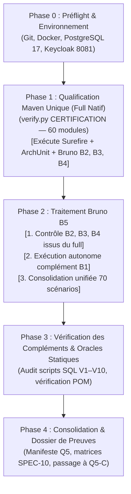

# Pocoma V3 — L5/Q5 — Plan de qualification finale du lot L5 (Version amendée définitive)

Date : **5 novembre 2026**
Dépôt : **`kartaguez/pocoma`**
Branche : **`feat/v3-architecture`**
Statut du plan : **CYCLE Q5 ACHEVÉ — QUALIFIÉ ET FORMELLEMENT CLOS PAR DÉCISION HUMAINE Q5-D (L5 CLOSED WITH EXPLICIT RESERVATIONS)**
Référence Git d'entrée : **`65b0fee97cf7ba2c58ca861e687e8346f1ec52c9`** (`65b0fee9`)
Dernier commit productif/test modifié : **`2b1271d0ca3db6c6e9dfddd74f2b877cf4631dd2`** (`2b1271d0`)
Rapport d'amendement associé : [docs/v3/L5_Q5A_Plan_Amendment_Report.md](L5_Q5A_Plan_Amendment_Report.md)

---

## 1. Contexte, objectifs et gouvernance

### 1.1 Contexte du lot L5
Le lot L5 ("Supras et parcours externes V3") a complété ses quatre incréments fonctionnels, chacun ayant fait l'objet d'une clôture locale avec réserves explicites ratifiée par le responsable du programme :
- **L5/I1** — Entrées HTTP READ, Resource Server JWT/OIDC, masquage EUI, sérialisation bornée, prévalidation pure et quota partagé $Q=2$ ([Acte I1](L5_I1_Acceptance_and_Closure_Decision.md)).
- **L5/I2** — Commandes Pot (11 commandes), Registration et Unlink publics, admission atomique asynchrone, idempotence S-03 et privilèges SQL resserrés V8 ([Acte I2](L5_I2_Acceptance_and_Closure_Decision.md)).
- **L5/I3** — Link headless simplifié, proposition technique distincte, consentement explicite par POST E2 authentifiée, admission atomique V9 et Keycloak réel ([Acte I3](L5_I3_Acceptance_and_Closure_Decision.md)).
- **L5/I4** — Protocole d'invitation complet, chiffrement AES-GCM, publication `INVITATION_EVENT`, restitution confidentielle du lien, auto-rattachement et désaffiliation volontaire sans perte d'historique ([Acte I4](L5_I4_Acceptance_and_Closure_Decision.md)).

Le lot **L5 reste formellement OPEN**. Les gates canoniques non filtrées, la gate Architecture globale et la certification d'ensemble ont été explicitement différées à la phase de qualification finale **Q5**.

La gouvernance humaine a découpé la fin de vie du lot L5 en quatre étapes séquentielles strictes :
1. **Q5-A** : Préparation et amendement du plan de qualification finale (la présente mission).
2. **Q5-B** : Exécution des qualifications après approbation humaine explicite (**STRICTEMENT NO GO** en Q5-A).
3. **Q5-C** : Audit indépendant de qualité, simplicité, complexité, performances et exhaustivité fonctionnelle.
4. **Q5-D** : Décision humaine définitive de clôture du lot L5.

### 1.2 Objectif de l'amendement final Q5-A
Le présent plan amendé optimise l'exécution de Q5-B en exploitant les synergies réelles entre la campagne Maven et les tests Bruno :
1. **Mutualisation effective Maven / Bruno :** Constat que le full Maven `verify.py CERTIFICATION` exécute déjà les trois méthodes porteuses JUnit de Bruno B2, B3 et B4 dans `runtime-monolith`.
2. **Élimination des rejeux redondants :** Réutilisation des preuves Bruno B2, B3 et B4 issues de la campagne Maven, évitant des exécutions physiques en double à oracles identiques.
3. **Exécution ciblée du complément B1 :** Exécution autonome et rigoureuse du seul corpus B1 (absent du réacteur Surefire par nature) sur sa fixture `V3ReadHttpFixture`.
4. **Consolidation unifiée B5 :** Réconciliation des 70 scénarios (B01–B404) dans un manifeste consolidé certifiant la conformité de la surface HTTP V3.
5. **Précision budgétaire sans double comptage :** Évaluation réaliste du temps total d'exécution (~75–95 min).

---

## 2. Préflight Git et baseline de qualification

### 2.1 État du dépôt à l'entrée de l'amendement
- **Branche courante :** `feat/v3-architecture`
- **HEAD de départ :** `65b0fee97cf7ba2c58ca861e687e8346f1ec52c9` (`65b0fee9`)
- **HEAD distant (`origin/feat/v3-architecture`) :** Identique (`65b0fee9`).
- **Divergence Git :** `0` commit en avance, `0` commit en retard (`up to date`).
- **État du worktree :** Strictement propre (`working tree clean`).

### 2.2 Analyse des derniers commits et distinction des SHAs
L'historique récent depuis la finalisation du code I4 montre :
1. `d722e9d5` — *feat(v3): finalize invitation and voluntary departure verification (L5/I4)* : introduction du code et des tests I4 initiaux.
2. `2b1271d0` — *fix(v3): resolve audit observations AUD-I4-01..03 and align invitation routes (L5/I4)* : **dernier commit touchant au code productif et aux tests applicatifs**.
3. `a087dd8b`, `17129919`, `df7a03ae` : clôture documentaire et publication des preuves I4.
4. `a4a92cee` : publication initiale du plan Q5-A.
5. `65b0fee9` : amendement après audit indépendant (AUD-Q5A-01 à 04).

**Distinction impérative des SHAs :**
- **SHA du code productif et des tests sous test :** `2b1271d0ca3db6c6e9dfddd74f2b877cf4631dd2`
- **SHA de baseline documentaire I4 :** `df7a03aedf53ac663de8c65e7c6112e960430b2e`
- **SHA candidat à la qualification Q5-B :** Le commit intégrant ce plan amendé (le diff vis-à-vis de `2b1271d0` est strictement documentaire sous `docs/`, sans aucun impact sur `app/` ou `scripts/`).

---

## 3. Inventaire exhaustif des obligations L5

La matrice ci-dessous recense l'ensemble des exigences, invariants et contrats applicables à L5, leur statut probatoire et la couverture prévue en Q5-B :

| Identifiant | Propriété à démontrer | Origine normative | Preuve existante & SHA | Validité | Preuve due en Q5 | Acquisition principale | Criticité |
|---|---|---|---|---|---|---|---|
| **REQ-READ-01** | Consultation Pot courant & historique à V | SPEC-04 §1 ; SPEC-06 §6 | T1 (`46b94ce6`), B07, B08 | Reusable | Inclusion dans full natif Q5-B | Full Maven | BLOCKING |
| **REQ-READ-02** | Droits & balances historiques à V | SPEC-04 §4 ; SPEC-06 §6 | T1 (`46b94ce6`), B09 | Reusable | Inclusion dans full natif Q5-B | Full Maven | BLOCKING |
| **REQ-READ-03** | Chargement groupé Expense batch (max 50) | SPEC-04 §5 ; SPEC-06 §6 | T1 (`46b94ce6`), B15, B16 | Reusable | Inclusion dans full natif Q5-B | Full Maven | MAJOR |
| **REQ-READ-04** | Navigation keyset (défaut 20, max 100) | SPEC-04 §6 ; SPEC-06 §6 | T1 (`46b94ce6`), B21–B23 | Reusable | Inclusion dans full natif Q5-B | Full Maven | MAJOR |
| **REQ-READ-05** | Masquage uniforme (404) & pas de fuite EUI | SPEC-06 §1 ; SPEC-07 §2 | T1 (`46b94ce6`), B10–B12 | Reusable | Inclusion dans full natif Q5-B | Full Maven | BLOCKING |
| **REQ-READ-06** | Sortie bornée 4 Mio / 503 | SPEC-06 §6, D4-READ | T1 (`46b94ce6`), B32 | Reusable | Inclusion dans full natif Q5-B | Full Maven | MAJOR |
| **REQ-READ-07** | Prévalidation pure avant quota SQL $Q=2$ | AUD-FINAL-I8-01 ; Plan L5 §11 | T1 (`46b94ce6`), B17–B19 | Reusable | Inclusion dans full natif Q5-B | Full Maven | MAJOR |
| **REQ-CMD-01** | 11 commandes Pot publiques admises asynchrones | SPEC-01 §3 ; SPEC-06 §7 | C-04 (`df0c3a22`), B202–B212 | Reusable | Requalification fraîche sous V8/V10 | Full Maven | BLOCKING |
| **REQ-CMD-02** | Registration & Unlink publics asynchrones | SPEC-02 §3 ; SPEC-06 §8 | C-04 (`df0c3a22`), B201, B220 | Reusable | Requalification fraîche sous V8/V10 | Full Maven | BLOCKING |
| **REQ-CMD-03** | Idempotence atomique S-03 (même clé $\rightarrow$ même requestId) | SPEC-06 §7 ; SPEC-10 S-03 | C-04 (`df0c3a22`), B213 | Reusable | Requalification fraîche sous V8/V10 | Full Maven | BLOCKING |
| **REQ-CMD-04** | Conflit d'intention différente sur même clé (409) | SPEC-06 §7 ; SPEC-10 S-03 | C-04 (`df0c3a22`), B214 | Reusable | Requalification fraîche sous V8/V10 | Full Maven | BLOCKING |
| **REQ-CMD-05** | Résolution SELF uniquement dans le moteur WRITE | SPEC-06 §7 ; SPEC-07 §3 | C-04 (`df0c3a22`), B204 | Reusable | Requalification fraîche sous V8/V10 | Full Maven | BLOCKING |
| **REQ-CMD-06** | Rôles SQL distincts & privilèges resserrés V8 | AUD-I2-02 ; L5/I2 Post-Audit | 9/9 PASS (`1fc07000`) | Partielle (ciblée) | Preuve terminale fraîche intégrée | Full Maven | MAJOR |
| **REQ-LINK-01** | Proposition technique distincte de l'IdentityRequest | SPEC-02 §5 ; H1 A-READ | FAST/PG (`0d415a67`), B302 | Reusable | Requalification intégrée | Full Maven | BLOCKING |
| **REQ-LINK-02** | Consentement explicite par POST E2 authentifiée | SPEC-02 §5 ; SPEC-10 ID-02 | FAST/PG (`0d415a67`), B307 | Reusable | Requalification intégrée | Full Maven | BLOCKING |
| **REQ-LINK-03** | E1 propriétaire du résultat, E2 découvre son binding | SPEC-02 §5 ; SPEC-10 ID-02 | FAST/PG (`0d415a67`), B309, B310 | Reusable | Requalification intégrée | Full Maven | BLOCKING |
| **REQ-LINK-04** | Anti-rejeu & admission atomique V9 après acceptation | SPEC-06 §8 ; SPEC-10 ID-02 | FAST/PG (`0d415a67`), B307, B313 | Reusable | Requalification intégrée | Full Maven | BLOCKING |
| **REQ-INV-01** | Création invitation réservée au seul créateur | SPEC-06 §13 ; SPEC-10 INV-A | T4-B (`7a284405`), B401 | Partielle (XML écrasé) | Preuve fraîche intégrale | Full Maven | BLOCKING |
| **REQ-INV-02** | Persistance atomique, version Pot inchangée | SPEC-06 §13 ; SPEC-10 INV-A | T4-A, T4-E (`7a284405`) | Partielle (XML écrasé) | Preuve fraîche intégrale | Full Maven | BLOCKING |
| **REQ-INV-03** | Chiffrement AES-GCM & lookup par hash | SPEC-06 §13 ; SPEC-10 INV-I | `V3InvitationReadPostgresTest` (`2b1271d0`) | Reusable | Requalification intégrée | Full Maven | BLOCKING |
| **REQ-INV-04** | Restitution confidentielle par creationRequestId (404 tiers) | SPEC-06 §13 ; SPEC-10 INV-C | `V3InvitationHttpTest` (`2b1271d0`), B402 | Reusable | Requalification intégrée | Full Maven | BLOCKING |
| **REQ-INV-05** | Consultation des places libres sans fuite de solde/historique | SPEC-06 §14 ; SPEC-10 INV-D | `V3InvitationHttpTest` (`2b1271d0`), B402 | Reusable | Requalification intégrée | Full Maven | BLOCKING |
| **REQ-INV-06** | Auto-rattachement atomique & revalidation autoritative WRITE | SPEC-06 §14 ; SPEC-10 INV-E/F | `V3InvitationWritePostgresTest` (`2b1271d0`) | Reusable | Requalification intégrée | Full Maven | BLOCKING |
| **REQ-INV-07** | Concurrence sur même place & réutilisation par tiers | SPEC-06 §14 ; SPEC-10 INV-F | `V3InvitationWritePostgresTest` (`2b1271d0`), B403 | Partielle (XML écrasé T4-C/D) | Preuve fraîche intégrale | Full Maven | BLOCKING |
| **REQ-INV-08** | Expiration transactionnelle fiable sans faux PASS | SPEC-06 §14 ; AUD-I4-02 | `V3InvitationWritePostgresTest#expiration...` | Reusable (avec réserve) | Preuve fraîche intégrée | Full Maven | MAJOR |
| **REQ-INV-09** | Matérialisation monotone `read_current_invitation` | SPEC-04 §7 ; SPEC-06 §13 | `V3InvitationReadPostgresTest` (`2b1271d0`) | Reusable | Preuve fraîche intégrée | Full Maven | MAJOR |
| **REQ-DEP-01** | Désaffiliation volontaire (`DETACH`, `userId=null`) | SPEC-01 §6 ; SPEC-06 §15 | `V3AdmissionFlowPostgresTest` (`2b1271d0`), B401 | Reusable | Preuve fraîche intégrée | Full Maven | BLOCKING |
| **REQ-DEP-02** | Conservation intégrale de l'historique financier | SPEC-01 §6 ; SPEC-06 §15 | `InvitationAttachmentTest` (`2b1271d0`) | Reusable | Preuve fraîche intégrée | Full Maven | BLOCKING |
| **REQ-DEP-03** | Départ du dernier affilié & indépendance des identités | SPEC-01 §6 ; SPEC-06 §15 | `V3InvitationHttpTest` (`2b1271d0`) | Reusable | Preuve fraîche intégrée | Full Maven | MAJOR |
| **REQ-TOPO-01** | Topologie 7 READ (3 Monolithe + 4 PROJECTION) & pool $\le 65$ | D6-topologie ; SPEC-09 §3 | `V3InvitationTopologyPostgresTest` (`2b1271d0`) | Reusable | Preuve fraîche intégrée | Full Maven | MAJOR |
| **REQ-ARCH-01** | Architecture globale (178 oracles) | *Reactor Policy* §16, §17 | `architecture-tests` (L4: 167 PASS, I2: 170 PASS) | Différée Q5 | Gate Architecture non filtrée | Full Maven | BLOCKING |
| **REQ-EXT-01** | Intégration Keycloak OIDC réel (3 sessions E1/E2/E3) | SPEC-10 ID-02 ; R-I1-03 | `V3LinkBrunoPostgresTest` (`0d415a67`) | Partielle (banc I3) | Rejeu sur Keycloak port 8081 | Full Maven (`runtime-monolith`) | BLOCKING |
| **REQ-EXT-02** | Surface Bruno B5 consolidée (70 scénarios B01–B404) | SPEC-10 ; Plans I1–I4 | B1 (32 PASS), B2 (24 PASS), B3 (10 PASS), B4 (4 PASS) | Morcelée (4 runs historiques) | Suite B5 composite unifiée | Maven (B2,3,4) + B1 autonome | MAJOR |

---

## 4. Stratégie D6 — Mutualisation des gates et contrôles de couverture

### 4.1 Justification normative
La décision **D6** ([Rapport de mutualisation D6](L5_D6_Gates_Mutualization_Report.md)) s'appuie sur la *Reactor Verification Policy* (§§17, 34 et 35) :
- Le §35 stipule qu'une clôture de lot requise (*Required lot closure*) déclenche le niveau **CERTIFICATION**, dont l'oracle canonique est un **full reactor natif non filtré** (`./mvnw test`).
- Le §34 autorise la mutualisation lorsque plusieurs tranches déclarées partagent des modules amont, à la condition expresse que chaque ancre, chaque méthode, chaque variante et chaque exigence de provenance soient effectivement couvertes sans aucune omission.
- Le §17 impose la gate `architecture-tests` globale dès lors que des frontières architecturales ou des dépendances ont évolué.

### 4.2 Hypothèse statique vs Validation dynamique (AUD-Q5A-02)
L'inspection de `app/pom.xml` confirme la présence déclarée des **60 modules enfants** (et du module `architecture-tests` en 60ème position).
Cependant, la présence statique des modules dans le POM n'est qu'une **hypothèse structurelle** : elle garantit que Maven résout le graphe, mais **ne constitue pas une preuve dynamique d'exécution complète**.

Pour que la mutualisation D6 soit formellement certifiée lors de Q5-B, le collecteur et l'auditeur devront valider les **10 contrôles dynamiques post-run** suivants :
1. **Graphe effectif :** Confirmation que le réacteur a résolu les 61 projets dans l'ordre topologique sans exclusion de projet.
2. **Exécution des modules :** Vérification dans les logs que chaque module a atteint le statut `SUCCESS`.
3. **Découverte nominative :** Comparaison stricte entre l'inventaire nominatif des méthodes JUnit découvertes dans les sources et les exécutions réelles (zéro test omis).
4. **Zéro skip / Zéro exclusion :** Constatation de l'absence totale de tests sautés (`skipped=0`), d'exclusions Surefire dans les POMs, ou d'annotations `@Disabled`.
5. **Résultats Surefire applicables :** Vérification de l'intégrité de chaque fichier `TEST-*.xml` généré dans les sous-répertoires de build.
6. **Exécution intégrale d'Architecture :** Vérification que le module `architecture-tests` a exécuté ses **178 oracles** sans court-circuit provoqué par un échec amont.
7. **Attribution et provenance :** Contrôle des propriétés système `pocoma.verification.id`, `pocoma.verification.module` et `pocoma.verification.producer` dans chaque rapport XML.
8. **Couverture des obligations différées :** Rapprochement méthode par méthode avec les obligations issues de I1, I2, I3 et I4.
9. **Non-régression historique :** Absence de régression sur les suites héritées L1–L4 et vérification que les scénarios de quarantaine historique levée (`i5_r05`, `i5_r12`) ont bien été exécutés avec succès.
10. **Frontière des preuves extérieures :** Traçabilité explicite de l'exécution des tests porteurs Bruno dans `runtime-monolith` et isolation du complément B1.

---

## 5. Réutilisation des preuves historiques et classification

### 5.1 Règles de classification normative
Conformément à la politique Reactor (§34) et aux actes de clôture I1–I4 :
- **`PASS VERIFIED`** : Preuve exécutée avec succès, rapport XML Surefire disponible, empreinte SHA-256 archivée, code source sous test identique au SHA courant.
- **`PASS HISTORICAL REUSABLE`** : Preuve réussie lors d'une étape antérieure, documentée dans un manifeste figé, dont les hypothèses et sources restent valides au SHA courant, bien que le run physique date d'un commit amont.
- **`PASS REPORTED WITHOUT ARCHIVED EVIDENCE`** : Résultat rapporté avec succès par l'agent ou les logs d'exécution, mais dont le fichier XML d'origine est indisponible (notamment les 5 méthodes WRITE I4 écrasées).
- **`FAIL`** : Échec d'exécution (conservé tel quel, jamais transformé en PASS).
- **`SKIP`** : Test sauté ou ignoré (formellement interdit pour toute gate de certification).
- **`NOT RUN`** : Non exécuté dans le périmètre concerné.
- **`INCONCLUSIVE`** : Exécution incomplète, interrompue ou dont l'oracle n'a pu statuer.
- **`INVALIDATED`** : Preuve rendue caduque par une modification ultérieure du code ou de l'environnement.

### 5.2 Traçabilité des cinq méthodes WRITE I4 écrasées
Lors de la qualification initiale de L5/I4, les cinq premières méthodes de `V3InvitationWritePostgresTest` (`atomicCreationAndIdempotence`, `creatorOnlyAndExpiredCreation`, `twoGuestsOnePlaceAndReusableToken`, `oneGuestCannotTakeTwoPlaces`, `rollbackAfterInvitationPositionKeepsDensePublication`) avaient réussi (run de 14:06 CET). Leurs rapports XML d'origine ont été écrasés lors du rejeu ciblé de la méthode 6 (`expirationAfterPublicationCounterWait`).
Elles sont formellement répertoriées comme **`PASS REPORTED WITHOUT ARCHIVED EVIDENCE`**.
Le plan Q5-B prévoit leur réexécution fraîche et intégrale lors du full reactor unique, ce qui produira des rapports XML neufs et traçables sans altération historique.

---

## 6. Plan Bruno B5 — Mutualisation effective et complément autonome B1

### 6.1 Démonstration de la mutualisation Bruno au sein du full Maven
L'analyse statique des tests de `app/runtime-monolith/src/test/java/` démontre que la campagne Maven `verify.py CERTIFICATION` exécute **trois méthodes JUnit porteuses de sous-processus Bruno CLI** :

1. **Corpus B2 (24 scénarios B201–B224) :**
   - *Méthode :* `V3AdmissionFlowPostgresTest#brunoB2PublicProtocol`
   - *Mécanisme :* Démarre une instance HTTP V3 d'admission et PostgreSQL 17, puis invoque `node_modules/.bin/bru run -r "02 Admission and Commands"`.
   - *Sortie :* Génère directement les rapports dans `${pocoma.verification.reports}/../bruno-b2/` (`bruno.json`, `requests.jsonl`, `receipt.json`).
   - *Assertions :* Vérifie `running.exitValue() == 0`, compare les 24 scénarios B201–B224, et contrôle par SQL indépendant `v3_command`, `v3_identity_request`, `v3_admission_association`.
2. **Corpus B3 (10 scénarios B301–B313) :**
   - *Méthode :* `V3LinkBrunoPostgresTest#realKeycloakLinkProtocol`
   - *Mécanisme :* Obtient 3 sessions OIDC réelles auprès de Keycloak 26.7.0 (`http://localhost:8081/realms/pocoma`) via `l5-i3-auth.py`, puis lance `node_modules/.bin/bru run -r "03 Link Requests"`.
   - *Sortie :* Écrit dans `${pocoma.verification.reports}/../bruno-i3/` (`bruno.json`, `requests.jsonl`, `receipt.json`, `real-jwt-claims.json`).
   - *Assertions :* Vérifie les 10 scénarios B301–B305, B307–B310, B313, scanne `bruno.log` contre toute fuite de token, et valide les oracles SQL indépendants (`v3_link_proposal`, `v3_identity_request`).
3. **Corpus B4 (4 scénarios B401–B404) :**
   - *Méthode :* `V3InvitationHttpTest#brunoB4StandaloneCorpus`
   - *Mécanisme :* Instancie la topologie complète d'invitation V10 et lance `node_modules/.bin/bru run -r "04 Invitations"`.
   - *Sortie :* Écrit dans `${pocoma.verification.reports}/../bruno-b4/` (`bruno.json`, `requests.jsonl`, `receipt.json`).
   - *Assertions :* Valide l'exit code 0, les 4 scénarios B401–B404 et la non-régression d'intégrité des fichiers sources Bruno.

**Conclusion d'optimisation :**
Lancer une nouvelle campagne Bruno globale pour B2, B3 et B4 après le full Maven constituerait une duplication stricte sans gain probatoire.
Les preuves de B2, B3 et B4 **sont acquises dès la Phase 1**, sous réserve de la vérification de leurs artefacts.

### 6.2 Matrice d'acquisition des preuves Bruno B5

| Corpus Bruno | Scénarios | Acquisition principale | Condition de réutilisation | Complément en Phase 2 |
|---|:---:|---|---|---|
| **B1 (READ)** | 32 (B01–B32) | Fixture autonome `V3ReadHttpFixture.main` | Reçu `requests.jsonl` (32 scénarios) et oracle B30 validés | **Exécution nominale obligatoire** (non couvert par Surefire) |
| **B2 (Commandes)** | 24 (B201–B224) | Full Maven (`V3AdmissionFlowPostgresTest`) | Méthode PASS, 24 scénarios dans `requests.jsonl`, SQL conformes | **Aucun (réutilisation)** ; rejeu ciblé uniquement si artefact manquant |
| **B3 (Link)** | 10 (B301–B313) | Full Maven (`V3LinkBrunoPostgresTest`) | Keycloak 8081 actif, méthode PASS, 10 scénarios, SQL conformes | **Aucun (réutilisation)** ; rejeu ciblé uniquement si artefact manquant |
| **B4 (Invitations)** | 4 (B401–B404) | Full Maven (`V3InvitationHttpTest`) | Méthode PASS, 4 scénarios dans `requests.jsonl`, lifecycle conforme | **Aucun (réutilisation)** ; rejeu ciblé uniquement si artefact manquant |

### 6.3 Procédure directement exécutable pour le complément B1 (AUD-Q5A-06)

Le corpus B1 (32 scénarios de consultation READ) repose sur le jeu de données synthétique injecté par `V3ReadHttpFixture` (Pots `...0300`, `...0301`, soldes, navigation de 205 items).
Sa méthode `main` est conçue pour être invoquée de manière autonome.

#### Gestion stricte de la racine des preuves
Un répertoire racine unique de qualification doit être alloué pour l'ensemble de la mission (noté `<EVIDENCE_ROOT>`, par exemple `/tmp/pocoma-q5b-evidence/`).
Tous les chemins de sortie en découlent sans mélange de chemins fixes et horodatés :
- Campagne Maven full : `<EVIDENCE_ROOT>/maven-full/`
- Corpus B2 : `<EVIDENCE_ROOT>/maven-full/bruno-b2/`
- Corpus B3 : `<EVIDENCE_ROOT>/maven-full/bruno-i3/`
- Corpus B4 : `<EVIDENCE_ROOT>/maven-full/bruno-b4/`
- Corpus B1 autonome : `<EVIDENCE_ROOT>/bruno-b1/`
- Manifeste consolidé B5 : `<EVIDENCE_ROOT>/bruno-b5-consolidated.json`

#### Dépendance de classpath et enchaînement
Lors de la Phase 1, l'exécution du test `V3ReadHttpContractTest` sous Maven écrit automatiquement le classpath de test complet dans le fichier :
`app/runtime-web-api/target/i1-classpath.txt`
*(Ligne 31 de `V3ReadHttpContractTest.java` : `@BeforeAll static void retainClasspath()`).*

#### Commande canonique pour B1
La commande doit transmettre le classpath Surefire sous la forme d'un argument unique entre guillemets doubles :
```sh
java -Xmx512m \
  -cp "$(cat app/runtime-web-api/target/i1-classpath.txt)" \
  com.kartaguez.pocoma.V3ReadHttpFixture \
  "$(pwd)" \
  "<EVIDENCE_ROOT>/bruno-b1"
```

#### Règle en cas d'absence de classpath
Aucune procédure de secours non équivalente (telle que `dependency:build-classpath`) n'est autorisée.
Si `i1-classpath.txt` venait à manquer à l'issue du full Maven :
1. Classer immédiatement le complément B1 comme non prêt (`NOT READY`).
2. Diagnostiquer la cause exacte de l'absence.
3. Ne pas relancer une campagne globale Maven de façon automatique.
4. Ne pas substituer un classpath partiel ou incomplet.
5. Conserver l'ensemble des preuves déjà acquises et décider d'une éventuelle reprise ciblée.

#### Artefacts réels et oracles de B1
Les fichiers réellement produits et requis pour B1 sont strictement :
- `bruno.json` (rapport d'exécution au format JSON)
- `bruno.log` (traces d'exécution de Bruno CLI)
- `requests.jsonl` (32 reçus de requêtes pour les scénarios B01 à B32)
- `receipt.json` (métadonnées d'exécution, statut du signal B30 et exitCode)

*(Aucun fichier `results.json` n'est attendu de la fixture).*

Déroulement vérifié :
1. `V3ReadHttpFixture` démarre un conteneur PostgreSQL 17 jetable et une instance `PocomaWebApiApplication`.
2. Elle peuple les tables `read_pot`, `read_command_result`, `read_identity_request_result` et `read_user_pot`.
3. Elle lance un thread virtuel d'écoute sur le signal de publication B30 (`POCOMA_I1_PUBLISH_SIGNAL`).
4. Elle invoque le CLI Bruno sur `"01 Identity and READ"`.
5. Elle vérifie l'exit code 0, les 32 scénarios dans `requests.jsonl`, l'absence de fuite de tokens, et écrit `receipt.json`.
6. Elle arrête le serveur et détruit le conteneur.

### 6.4 Procédure de consolidation unifiée B5 (AUD-Q5A-05)

Une fois le complément B1 exécuté et les artefacts B2, B3, B4 contrôlés dans le dossier de preuves Maven, la consolidation B5 est réalisée par l'outil dédié minimal `scripts/testing/consolidate_bruno_b5.py` :

```sh
python3 -B scripts/testing/consolidate_bruno_b5.py \
  --evidence-root "<EVIDENCE_ROOT>" \
  --sha "<SHA_QUALIFIE>" \
  --output "<EVIDENCE_ROOT>/bruno-b5-consolidated.json"
```

Le script fonctionne exclusivement avec la bibliothèque standard Python et remplit les obligations suivantes :
1. Vérification de la présence effective des 4 répertoires et de leurs artefacts obligatoires (`requests.jsonl`, `receipt.json`, `bruno.json`, `bruno.log`).
2. Réconciliation stricte avec l'inventaire exact des 70 scénarios attendus (B01–B32, B201–B224, B301–B313, B401–B404).
3. Rejet formel des doublons, omissions et scénarios inattendus.
4. Contrôle de zéro failure, zéro error, zéro skip dans les rapports Bruno et reçus.
5. Contrôle des oracles spécifiques (handshake B30, SQL B2 et B3, absence de fuite dans B4).
6. Calcul et archivage des empreintes SHA-256 de chaque artefact source.
7. Contrôle strict de non-prolifération des secrets : aucun token n'est copié dans le manifeste.
8. Préservation des métadonnées d'infrastructure (bancs et fournisseurs d'identité réels vs locaux).

### 6.5 Critères normatifs d'acceptation B5
Le verdict de la qualification B5 est strictement conditionné :
- **`B5 COMPOSITE PASS`** :
  1. Exactement 70 scénarios distincts exécutés avec succès (B01–B32, B201–B224, B301–B313, B401–B404).
  2. Zéro échec, zéro erreur (`0 failure, 0 error`).
  3. Preuves et rapports Surefire/Bruno attribués à leurs invocations d'origine sans falsification.
  4. Oracles indépendants satisfaits (handshake B30, oracles SQL de B2 et B3).
  5. Absence de secrets/tokens dans les logs.
  6. Distinction explicite : qualification composite sur bancs dédiés étanches, sans prétention d'un état persistant partagé universel.
- **`B5 INCOMPLETE / INCONCLUSIVE`** : Un scénario manquant ou un rapport manquant dans l'un des 4 répertoires.
- **`B5 FAIL`** : Échec HTTP ou violation d'un oracle SQL.

---

## 7. Budgets, performances et efficacité d'exécution (AUD-Q5A-04)

### 7.1 Distinction stricte entre critères fonctionnels et indicateurs de suivi
Le plan établit formellement qu'**une durée d'exécution n'est pas un critère de succès ou d'échec fonctionnel** :
- **Critères d'acceptation fonctionnelle :** 100% des tests exécutés avec succès, zéro failure, zéro error, zéro skip, oracles indépendants satisfaits, intégrité des preuves archivées.
- **Prévisions budgétaires :** Repères indicatifs d'organisation basés sur l'historique empirique.
- **Seuils d'investigation / Watchdog :** Points de contrôle déclenchant l'analyse d'activité, **sans coupure automatique d'une campagne qui progresse normalement**.

### 7.2 Budget recalculé sans double comptage

| Phase / Poste | Estimation nominale | Point de diagnostic (Watchdog) | Seuil de vigilance | Justification empirique |
|---|:---:|:---:|:---:|---|
| **Phase 1 — Full Maven (G5 + Arch + Bruno B2, B3, B4)** | 70–90 min | 100 min | 120 min | FULL-04-FAIL L4 mesuré à 68,6 min ; intègre les 2 350+ tests JUnit et les 3 sous-processus Bruno B2, B3, B4. |
| **Phase 2 — Complément autonome B1** | 3–5 min | 8 min | 10 min | Mesuré historiquement à ~2 min 15 s lors de L5/I1 (fixture + 32 requêtes). |
| **Phase 2 — Consolidation B5 & Manifeste** | 1–2 min | 3 min | 5 min | Scan statique des 4 répertoires et génération du JSON consolidé. |
| **TOTAL QUALIFICATION Q5-B CONSOLIDÉ** | **75–95 min** | **105 min** | **130 min** | **Aucun double comptage des suites B2, B3, B4.** |

### 7.3 Motifs d'interruption technique légitime
Une campagne ne doit être interrompue avant son terme que sur incident technique avéré :
1. **Deadlock / Blocage avéré :** Absence totale d'émission de traces (Surefire, logs Docker, pg_stat_activity) pendant plus de 5 minutes consécutives.
2. **Crash d'infrastructure :** Arrêt inattendu du démon Docker, saturation du disque hôte (`No space left on device`) ou intervention de l'OOM killer du système d'exploitation.
3. **Boucle infinie :** Répétition indéfinie d'un même appel sans progression de curseur ou de verrou.
4. **Échec amont critique :** Échec d'un composant de base (`domain-pot`, `infra-tx-spring`) invalidant mécaniquement tous les tests dépendants.

---

## 8. Préflight des risques issus de l'audit post-L4 (AUD-Q5A-03)

### 8.1 Traçabilité documentaire des recommandations
L'audit indépendant de fin de lot L4 a été formellement consigné dans l'acte [docs/v3/L4_Read_Closure_Decision.md](L4_Read_Closure_Decision.md) (§5) et dans [docs/v3/L4_I8_Execution_Report.md](L4_I8_Execution_Report.md).
Le seul constat ayant fait l'objet d'un identifiant normatif formellement enregistré dans la clôture L4 est **`AUD-FINAL-I8-01`** (prévalidation pure des entrées de `expenses` et `visible` avant acquisition du quota READ).
Les sept autres recommandations ont été transmises par le mandat de cadrage du lot L5 et instruites dans [docs/v3/L5_Supra_Entry_Audit_and_Implementation_Plan.md](L5_Supra_Entry_Audit_and_Implementation_Plan.md) (§11) sous les identifiants de suivi `FIND-*`.

### 8.2 Matrice détaillée des 8 recommandations

| Identifiant de suivi | Source & Référence d'origine | Constat initial | Recommandation initiale | Situation après L5 (I1–I4) | Risque pour Q5-B | Décision | Justification & Preuve / SHA |
|---|---|---|---|---|---|:---:|---|
| **FIND-L4-01** | Mandat L5 / Plan L5 §11 | Sémaphore exact $Q=2$ pour le quota READ | Risque de contention sous charge externe | Maintenu à $Q=2$ ; formalisation de l'allocation et mesure des refus | **Nul** (tests locaux non saturants) | **Reporter à Q5-C / L6** | $Q=2$ est un contrat stable. Suivi de charge à instruire en L6. |
| **FIND-L4-02 / AUD-FINAL-I8-01** | `L4_Read_Closure_Decision.md` §5 | Validation de cardinalité et pagination après requête SQL | Placer la prévalidation pure avant l'acquisition du quota | **Entièrement corrigé en L5/I1** dans `ReadPotV3` et `ReadNavigationV3` | **Nul** | **Déjà fait** | Preuve acquise au commit `46b94ce6` (tests C01–C06). |
| **FIND-L2-01** | Mandat L5 / Plan L5 §11 | Lease READ qualifié à 180s vs défaut 30s | Durée de lease non homologuée en production | Réserve d'exploitation maintenue ; topologie 7 READ qualifiée | **Nul** pour le test (T4-L passe en 207s) | **Reporter à Q5-C / L6** | Le lease 180s est couvert par `V3InvitationTopologyPostgresTest` (`2b1271d0`). Homologation hors Q5-B. |
| **FIND-TRANS-01** | Mandat L5 / Plan L5 §11 | 60 modules reactor et coexistence V2/V3 | Complexité de maintenance et lenteur de build | Coexistence préservée ; zéro nouveau module créé en L5 | **Nul** | **Reporter à Q5-C / L7** | La rationalisation des modules est contractuellement réservée au lot L7. |
| **FIND-L1-01** | Mandat L5 / Plan L5 §11 | Requête complexe avec EXISTS et LATERAL dans `PotHistoryRows` | Coût d'exécution potentiellement élevé sous grand historique | Aucun défaut fonctionnel constaté ; intégrité préservée | **Nul** | **Reporter à Q5-C / L6** | Aucun problème d'intégrité ou d'oracle. Optimisation prématurée évitée. |
| **FIND-L4-03** | Mandat L5 / Plan L5 §11 | Recalcul complet de la balance à chaque version | Coût cumulatif sous grand nombre d'Expenses | Maintenu conforme à la norme SPEC-04 §4 | **Nul** | **Reporter à Q5-C / L6** | Strictement conforme à la spécification normative. Pas de refonte en L5. |
| **FIND-L2-02** | Mandat L5 / Plan L5 §11 | Dualité des branches READ et WRITE dans `ConsumptionEngine` | Abstraction commune envisageable | Moteur réutilisé avec succès pour l'admission et les workers | **Nul** | **Reporter à Q5-C / L7** | Moteur éprouvé sur l'ensemble des 4 incréments. Refonte hors périmètre. |
| **FIND-L3-01** | Mandat L5 / Plan L5 §11 | Consentement Link sans serveur d'autorisation externe | Nécessité d'une preuve authentifiée anti-rejeu | **Résolu par décision H1–H5** (POST explicite E2 avec Keycloak réel) | **Nul** | **Déjà fait** | Preuve livrée et qualifiée en I3 au commit `0d415a67`. |

**Conclusion de l'audit préliminaire :** Aucune recommandation post-L4 ne constitue un bloqueur pour Q5-B. Les éléments d'architecture globale, d'optimisation de performance et de rationalisation sont légitimement renvoyés à l'audit **Q5-C** et aux lots ultérieurs (**L6/L7**).

---

## 9. Plan opérationnel Q5-B révisé



### Phase 0 — Préflight & Initialisation
1. Contrôle Git : Vérification du worktree propre et correspondance exacte avec le SHA approuvé.
2. Démarrage des conteneurs :
   ```sh
   docker compose -p pocoma-functional -f docker-compose.functional.yml up -d postgres keycloak
   ```
3. Contrôle de santé : Attente de l'état `healthy` sur PostgreSQL (port 5432) et Keycloak (port 8081).
4. Allocation du dossier unique de preuves : `<EVIDENCE_ROOT>` (ex: `/tmp/pocoma-q5b-evidence/`).

### Phase 1 — Qualification Maven Unique (Full Natif)
- **Commande canonique :**
  ```sh
  python3 -B scripts/testing/verify.py CERTIFICATION --output "<EVIDENCE_ROOT>/maven-full"
  ```
- **Couverture dynamique constatée :**
  - Les 60 modules du réacteur sont compilés et testés.
  - Le module `architecture-tests` exécute ses 178 oracles.
  - Les méthodes porteuses Bruno `brunoB2PublicProtocol` (B2), `realKeycloakLinkProtocol` (B3) et `brunoB4StandaloneCorpus` (B4) sont exécutées dans `runtime-monolith`.
  - Le fichier de classpath `app/runtime-web-api/target/i1-classpath.txt` est généré par `V3ReadHttpContractTest`.

### Phase 2 — Traitement Bruno B5 & Complément autonome B1
1. **Vérification des preuves B2, B3, B4 produites en Phase 1 :**
   - Contrôle d'existence et d'intégrité de `<EVIDENCE_ROOT>/maven-full/bruno-b2/receipt.json` (24 scénarios).
   - Contrôle de `<EVIDENCE_ROOT>/maven-full/bruno-i3/receipt.json` (10 scénarios sous Keycloak réel).
   - Contrôle de `<EVIDENCE_ROOT>/maven-full/bruno-b4/receipt.json` (4 scénarios).
2. **Exécution du complément autonome B1 :**
   ```sh
   java -Xmx512m \
     -cp "$(cat app/runtime-web-api/target/i1-classpath.txt)" \
     com.kartaguez.pocoma.V3ReadHttpFixture \
     "$(pwd)" \
     "<EVIDENCE_ROOT>/bruno-b1"
   ```
3. **Consolidation unifiée B5 :**
   ```sh
   python3 -B scripts/testing/consolidate_bruno_b5.py \
     --evidence-root "<EVIDENCE_ROOT>" \
     --sha "<SHA_QUALIFIE>" \
     --output "<EVIDENCE_ROOT>/bruno-b5-consolidated.json"
   ```
   - Réconciliation stricte des 70 scénarios (32 + 24 + 10 + 4).
   - Contrôle d'absence de doublons, omissions et surprises.
   - Contrôle zéro skip, zéro failure, zéro fuite de secret.
   - Émission du verdict normatif (`B5 COMPOSITE PASS`).

### Phase 3 — Contrôle des compléments éventuels
- Vérification statique des règles d'isolation des POMs et des scripts SQL de migration (V1–V10).
- Si une preuve B2, B3 ou B4 manquait en Phase 1 (ex: Keycloak non démarré à temps), exécution du seul sous-test défaillant à titre de reprise ciblée.

### Phase 4 — Consolidation du dossier de preuves
- Production du manifeste global `Q5_Proof_Manifest.json`.
- Émission du rapport d'exécution Q5-B et recommandation pour le passage à l'étape **Q5-C** (Audit qualité indépendant).

---

## 10. Politique de traitement des échecs

En cas d'échec (`FAIL` ou `ERROR`) lors de Q5-B, la procédure impérative suivante s'applique :
1. **Préservation immédiate** des artefacts bruts (logs Surefire, traces conteneurs, capture de base de données).
2. **Identification formelle** de la classe, de la méthode et du contrat SPEC enfreint.
3. **Tri d'imputabilité :** Déterminer si l'anomalie relève du code productif, de l'oracle de test ou de l'environnement matériel.
4. **Interdictions formelles :** Aucun test supprimé, aucun `@Disabled`, aucun skip, aucune hausse arbitraire de timeout.
5. **Requalification minimale :** Rejeu strictement borné à l'anomalie après correction, et double archivage de l'échec initial et du succès corrigé.

---

## 11. Statut terminal officiel

```
================================================================================
L5/Q5 — CYCLE DE QUALIFICATION GLOBALE ACHEVÉ ET CLOS (Q5-A → Q5-B → Q5-C → Q5-D)
================================================================================
Q5-A : PLAN AMENDÉ APPROUVÉ (docs/v3/L5_Q5A_Plan_Amendment_Report.md)
Q5-B : CERTIFICATION GLOBALE PASS (docs/v3/L5_Q5B6_Final_Certification_Execution_Report.md, 2890d88f)
Q5-C : AUDIT INDÉPENDANT ACCEPTÉ (docs/v3/L5_Q5C_Quality_Performance_and_Restructuring_Audit.md, f4f5d973)
Q5-D : DÉCISION HUMAINE DE CLÔTURE FORMELLE AVEC RÉSERVES (docs/v3/L5_Q5D_Formal_Closure_Decision.md)
Statut officiel du lot L5 :
L5 — CLOSED WITH EXPLICIT RESERVATIONS — GLOBAL CERTIFICATION PASS, Q5-C AUDIT ACCEPTED, OPTIMIZATIONS DEFERRED UNTIL AFTER L6
================================================================================
```
