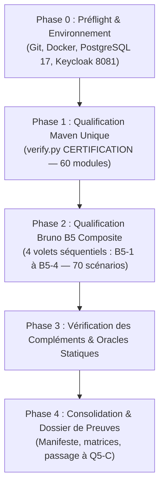

# Pocoma V3 — L5/Q5 — Plan de qualification finale du lot L5 (Version amendée)

Date : **5 novembre 2026**
Dépôt : **`kartaguez/pocoma`**
Branche : **`feat/v3-architecture`**
Statut du plan : **PLAN AMENDÉ SOUMIS À DÉCISION HUMAINE — Q5-A TERMINÉ — Q5-B EN ATTENTE DE GO**
Référence Git d'entrée : **`a4a92cee482058bdd8e07d551f0346a3c2c2bf16`** (`a4a92cee`)
Dernier commit productif/test modifié : **`2b1271d0ca3db6c6e9dfddd74f2b877cf4631dd2`** (`2b1271d0`)
Rapport d'amendement associé : [docs/v3/L5_Q5A_Plan_Amendment_Report.md](L5_Q5A_Plan_Amendment_Report.md)

---

## 1. Contexte, objectifs et gouvernance

### 1.1 Contexte du lot L5
Le lot L5 ("Supras et parcours externes V3") a complété ses quatre incréments fonctionnels, chacun ayant fait l'objet d'une clôture locale avec réserves explicites ratifiée par le responsable du programme :
- **L5/I1** — Entrées HTTP READ, Resource Server JWT/OIDC, masquage EUI, sérialisation bornée, prévalidation pure et quota partagé $Q=2$ ([Acte I1](L5_I1_Acceptance_and_Closure_Decision.md)).
- **L5/I2** — Commandes Pot (11 commandes), Registration et Unlink publics, admission atomique asynchrone, idempotence S-03 et privilèges SQL resserrés V8 ([Acte I2](L5_I2_Acceptance_and_Closure_Decision.md)).
- **L5/I3** — Link headless simplifié, proposition technique distincte, consentement explicite par POST E2 authentifiée, admission atomique V9 et Keycloak réel ([Acte I3](L5_I3_Acceptance_and_Closure_Decision.md)).
- **L5/I4** — Protocole d'invitation complet, chiffrement AES-GCM, publication `INVITATION_EVENT`, restitution confidentielle du lien, auto-rattachement et désaffiliation volontaire sans perte d'historique ([Acte I4](L5_I4_Acceptance_and_Closure_Decision.md)).

Le lot **L5 reste formellement OPEN**. Les gates canoniques non filtrées, la gate Architecture globale et la certification d'ensemble ont été explicitement différées à la phase de qualification finale **Q5**.

La gouvernance humaine a découpé la fin de vie du lot L5 en quatre étapes séquentielles strictes :
1. **Q5-A** : Préparation et amendement du plan de qualification finale (la présente mission).
2. **Q5-B** : Exécution des qualifications après approbation humaine explicite (**STRICTEMENT NO GO** en Q5-A).
3. **Q5-C** : Audit indépendant de qualité, simplicité, complexité, performances et exhaustivité fonctionnelle.
4. **Q5-D** : Décision humaine définitive de clôture du lot L5.

### 1.2 Objectif de Q5-A et prise en compte de l'audit indépendant
Le présent plan amendé intègre les corrections issues de l'audit indépendant post-Q5-A :
- **AUD-Q5A-01 (BLOCKER) :** Refonte de la procédure Bruno B5 en une suite composite orchestrée en 4 volets séquentiels, démontrant l'exécutabilité effective des 70 scénarios sur leurs bancs respectifs.
- **AUD-Q5A-02 (MAJOR) :** Nuance de la couverture du full reactor, distinguant sélection statique des 60 modules et contrôles dynamiques d'exécution post-run.
- **AUD-Q5A-03 (MAJOR) :** Traçabilité formelle des 8 recommandations issues de l'audit qualité post-L4 et distinction des identifiants normatifs.
- **AUD-Q5A-04 (MINOR) :** Dissociation stricte entre indicateurs budgétaires de suivi et critères de succès fonctionnel.

---

## 2. Préflight Git et baseline de qualification

### 2.1 État du dépôt à l'entrée de Q5-A
- **Branche courante :** `feat/v3-architecture`
- **HEAD de départ de l'amendement :** `a4a92cee482058bdd8e07d551f0346a3c2c2bf16` (`a4a92cee`)
- **HEAD distant (`origin/feat/v3-architecture`) :** Identique à l'entrée.
- **Divergence Git :** `0` commit en avance, `0` commit en retard (`up to date`).
- **État du worktree :** Strictement propre (`working tree clean`).

### 2.2 Analyse des derniers commits et distinction des SHAs
L'historique récent depuis la finalisation du code I4 montre :
1. `d722e9d5` — *feat(v3): finalize invitation and voluntary departure verification (L5/I4)* : introduction du code et des tests I4 initiaux.
2. `2b1271d0` — *fix(v3): resolve audit observations AUD-I4-01..03 and align invitation routes (L5/I4)* : **dernier commit touchant au code productif et aux tests applicatifs**.
3. `a087dd8b`, `17129919`, `df7a03ae` : clôture documentaire et publication des preuves I4.
4. `a4a92cee` : publication initiale du plan Q5-A.

**Distinction impérative des SHAs :**
- **SHA du code productif et des tests sous test :** `2b1271d0ca3db6c6e9dfddd74f2b877cf4631dd2`
- **SHA de baseline documentaire I4 :** `df7a03aedf53ac663de8c65e7c6112e960430b2e`
- **SHA de publication initiale Q5-A :** `a4a92cee482058bdd8e07d551f0346a3c2c2bf16`
- **SHA candidat à la qualification Q5-B :** Le commit intégrant ce plan amendé (le diff vis-à-vis de `2b1271d0` est strictement documentaire sous `docs/`, sans aucun impact sur `app/` ou `scripts/`).

---

## 3. Inventaire exhaustif des obligations L5

La matrice ci-dessous recense l'ensemble des exigences, invariants et contrats applicables à L5, leur statut probatoire et la couverture prévue en Q5-B :

| Identifiant | Propriété à démontrer | Origine normative | Preuve existante & SHA | Validité | Preuve encore due en Q5 | Gate prévue | Criticité |
|---|---|---|---|---|---|---|---|
| **REQ-READ-01** | Consultation Pot courant & historique à V | SPEC-04 §1 ; SPEC-06 §6 | T1 (`46b94ce6`), B07, B08 | Reusable | Inclusion dans full natif Q5-B | G5 / Full natif | BLOCKING |
| **REQ-READ-02** | Droits & balances historiques à V | SPEC-04 §4 ; SPEC-06 §6 | T1 (`46b94ce6`), B09 | Reusable | Inclusion dans full natif Q5-B | G5 / Full natif | BLOCKING |
| **REQ-READ-03** | Chargement groupé Expense batch (max 50) | SPEC-04 §5 ; SPEC-06 §6 | T1 (`46b94ce6`), B15, B16 | Reusable | Inclusion dans full natif Q5-B | G5 / Full natif | MAJOR |
| **REQ-READ-04** | Navigation keyset (défaut 20, max 100) | SPEC-04 §6 ; SPEC-06 §6 | T1 (`46b94ce6`), B21–B23 | Reusable | Inclusion dans full natif Q5-B | G5 / Full natif | MAJOR |
| **REQ-READ-05** | Masquage uniforme (404) & pas de fuite EUI | SPEC-06 §1 ; SPEC-07 §2 | T1 (`46b94ce6`), B10–B12 | Reusable | Inclusion dans full natif Q5-B | G5 / Full natif | BLOCKING |
| **REQ-READ-06** | Sérialisation complète bornée (4 Mio, 503 sans troncature) | SPEC-06 §6 ; D4-READ | T1 (`46b94ce6`), B32 | Reusable | Inclusion dans full natif Q5-B | G5 / Full natif | MAJOR |
| **REQ-READ-07** | Prévalidation pure avant quota SQL $Q=2$ | AUD-FINAL-I8-01 ; Plan L5 §11 | T1 (`46b94ce6`), B17–B19 | Reusable | Inclusion dans full natif Q5-B | G5 / Full natif | MAJOR |
| **REQ-CMD-01** | 11 commandes Pot publiques admises asynchrones | SPEC-01 §3 ; SPEC-06 §7 | C-04 (`df0c3a22`), B202–B212 | Reusable | Requalification fraîche sous V8/V10 | G5 / Full natif | BLOCKING |
| **REQ-CMD-02** | Registration & Unlink publics asynchrones | SPEC-02 §3 ; SPEC-06 §8 | C-04 (`df0c3a22`), B201, B220 | Reusable | Requalification fraîche sous V8/V10 | G5 / Full natif | BLOCKING |
| **REQ-CMD-03** | Idempotence atomique S-03 (même clé $\rightarrow$ même requestId) | SPEC-06 §7 ; SPEC-10 S-03 | C-04 (`df0c3a22`), B213 | Reusable | Requalification fraîche sous V8/V10 | G5 / Full natif | BLOCKING |
| **REQ-CMD-04** | Conflit d'intention différente sur même clé (409) | SPEC-06 §7 ; SPEC-10 S-03 | C-04 (`df0c3a22`), B214 | Reusable | Requalification fraîche sous V8/V10 | G5 / Full natif | BLOCKING |
| **REQ-CMD-05** | Résolution SELF uniquement dans le moteur WRITE | SPEC-06 §7 ; SPEC-07 §3 | C-04 (`df0c3a22`), B204 | Reusable | Requalification fraîche sous V8/V10 | G5 / Full natif | BLOCKING |
| **REQ-CMD-06** | Rôles SQL distincts & privilèges resserrés V8 | AUD-I2-02 ; L5/I2 Post-Audit | 9/9 PASS (`1fc07000`) | Partielle (ciblée) | Preuve terminale fraîche intégrée | G5 / Full natif | MAJOR |
| **REQ-LINK-01** | Proposition technique distincte de l'IdentityRequest | SPEC-02 §5 ; H1 A-READ | FAST/PG (`0d415a67`), B302 | Reusable | Requalification intégrée | G5 / Full natif | BLOCKING |
| **REQ-LINK-02** | Consentement explicite par POST E2 authentifiée | SPEC-02 §5 ; SPEC-10 ID-02 | FAST/PG (`0d415a67`), B307 | Reusable | Requalification intégrée | G5 / Full natif | BLOCKING |
| **REQ-LINK-03** | E1 propriétaire du résultat, E2 découvre son binding | SPEC-02 §5 ; SPEC-10 ID-02 | FAST/PG (`0d415a67`), B309, B310 | Reusable | Requalification intégrée | G5 / Full natif | BLOCKING |
| **REQ-LINK-04** | Anti-rejeu & admission atomique V9 après acceptation | SPEC-06 §8 ; SPEC-10 ID-02 | FAST/PG (`0d415a67`), B307, B313 | Reusable | Requalification intégrée | G5 / Full natif | BLOCKING |
| **REQ-INV-01** | Création invitation réservée au seul créateur | SPEC-06 §13 ; SPEC-10 INV-A | T4-B (`7a284405`), B401 | Partielle (XML écrasé) | Preuve fraîche intégrale | G5 / Full natif | BLOCKING |
| **REQ-INV-02** | Persistance atomique, version Pot inchangée | SPEC-06 §13 ; SPEC-10 INV-A | T4-A, T4-E (`7a284405`) | Partielle (XML écrasé) | Preuve fraîche intégrale | G5 / Full natif | BLOCKING |
| **REQ-INV-03** | Chiffrement AES-GCM & lookup par hash | SPEC-06 §13 ; SPEC-10 INV-I | `V3InvitationReadPostgresTest` (`2b1271d0`) | Reusable | Requalification intégrée | G5 / Full natif | BLOCKING |
| **REQ-INV-04** | Restitution confidentielle par creationRequestId (404 tiers) | SPEC-06 §13 ; SPEC-10 INV-C | `V3InvitationHttpTest` (`2b1271d0`), B402 | Reusable | Requalification intégrée | G5 / Full natif | BLOCKING |
| **REQ-INV-05** | Consultation des places libres sans fuite de solde/historique | SPEC-06 §14 ; SPEC-10 INV-D | `V3InvitationHttpTest` (`2b1271d0`), B402 | Reusable | Requalification intégrée | G5 / Full natif | BLOCKING |
| **REQ-INV-06** | Auto-rattachement atomique & revalidation autoritative WRITE | SPEC-06 §14 ; SPEC-10 INV-E/F | `V3InvitationWritePostgresTest` (`2b1271d0`) | Reusable | Requalification intégrée | G5 / Full natif | BLOCKING |
| **REQ-INV-07** | Concurrence sur même place & réutilisation par tiers | SPEC-06 §14 ; SPEC-10 INV-F | `V3InvitationWritePostgresTest` (`2b1271d0`), B403 | Partielle (XML écrasé T4-C/D) | Preuve fraîche intégrale | G5 / Full natif | BLOCKING |
| **REQ-INV-08** | Expiration transactionnelle fiable sans faux PASS | SPEC-06 §14 ; AUD-I4-02 | `V3InvitationWritePostgresTest#expiration...` | Reusable (avec réserve) | Preuve fraîche intégrée | G5 / Full natif | MAJOR |
| **REQ-INV-09** | Matérialisation monotone `read_current_invitation` | SPEC-04 §7 ; SPEC-06 §13 | `V3InvitationReadPostgresTest` (`2b1271d0`) | Reusable | Preuve fraîche intégrée | G5 / Full natif | MAJOR |
| **REQ-DEP-01** | Désaffiliation volontaire (`DETACH`, `userId=null`) | SPEC-01 §6 ; SPEC-06 §15 | `V3AdmissionFlowPostgresTest` (`2b1271d0`), B401 | Reusable | Preuve fraîche intégrée | G5 / Full natif | BLOCKING |
| **REQ-DEP-02** | Conservation intégrale de l'historique financier | SPEC-01 §6 ; SPEC-06 §15 | `InvitationAttachmentTest` (`2b1271d0`) | Reusable | Preuve fraîche intégrée | G5 / Full natif | BLOCKING |
| **REQ-DEP-03** | Départ du dernier affilié & indépendance des identités | SPEC-01 §6 ; SPEC-06 §15 | `V3InvitationHttpTest` (`2b1271d0`) | Reusable | Preuve fraîche intégrée | G5 / Full natif | MAJOR |
| **REQ-TOPO-01** | Topologie 7 READ (3 Monolithe + 4 PROJECTION) & pool $\le 65$ | D6-topologie ; SPEC-09 §3 | `V3InvitationTopologyPostgresTest` (`2b1271d0`) | Reusable | Preuve fraîche intégrée | G5 / Full natif | MAJOR |
| **REQ-ARCH-01** | Isolation hexagonale, absence de cycles, règles de couches | *Reactor Policy* §16, §17 | `architecture-tests` (L4: 167 PASS, I2: 170 PASS) | Différée Q5 | Gate Architecture non filtrée | G5 / Full natif | BLOCKING |
| **REQ-EXT-01** | Intégration Keycloak OIDC réel (3 sessions E1/E2/E3) | SPEC-10 ID-02 ; R-I1-03 | `V3LinkBrunoPostgresTest` (`0d415a67`) | Partielle (banc I3) | Rejeu sur banc unifié B5 | B5 / Externe | BLOCKING |
| **REQ-EXT-02** | Collection HTTP Bruno V3 complète (B01–B404) | SPEC-10 ; Plans I1–I4 | B1 (32 PASS), B2 (24 PASS), B3 (10 PASS), B4 (4 PASS) | Morcelée (4 runs séparés) | Campagne B5 composite consolidée | B5 / Externe | MAJOR |

---

## 4. Stratégie D6 — Mutualisation des gates et contrôles de couverture

### 4.1 Justification normative
La décision **D6** ([Rapport de mutualisation D6](L5_D6_Gates_Mutualization_Report.md)) s'appuie sur la *Reactor Verification Policy* (§§17, 34 et 35) :
- Le §35 stipule qu'une clôture de lot requise (*Required lot closure*) déclenche le niveau **CERTIFICATION**, dont l'oracle canonique est un **full reactor natif non filtré** (`./mvnw test`).
- Le §34 autorise la mutualisation lorsque plusieurs tranches déclarées partagent des modules amont, à la condition expresse que chaque ancre, chaque méthode, chaque variante et chaque exigence de provenance soient effectivement couvertes sans aucune omission.
- Le §17 impose la gate `architecture-tests` globale dès lors que des frontières architecturales ou des dépendances ont évolué.

### 4.2 Hypothèse statique vs Validation dynamique (AUD-Q5A-02)
L'inspection de `app/pom.xml` confirme la présence déclarée des **60 modules enfants** (et du module `architecture-tests` en 60ème position).
Cependant, la présence statique des modules dans le POM n'est qu'une **hypothèse structurelle** : elle garantit que Maven résout le graphe, mais **ne constitue pas une preuve dynamique d'exécution complète**.

Pour que la mutualisation D6 soit formellement certifiée lors de Q5-B, le collecteur et l'auditeur devront valider les **10 contrôles dynamiques post-run** suivants :
1. **Graphe effectif :** Confirmation que le réacteur a résolu les 61 projets dans l'ordre topologique sans exclusion de projet.
2. **Exécution des modules :** Vérification dans les logs que chaque module a atteint le statut `SUCCESS`.
3. **Découverte nominative :** Comparaison stricte entre l'inventaire nominatif des méthodes JUnit découvertes dans les sources et les exécutions réelles (zéro test omis).
4. **Zéro skip / Zéro exclusion :** Constatation de l'absence totale de tests sautés (`skipped=0`), d'exclusions Surefire dans les POMs, ou d'annotations `@Disabled`.
5. **Résultats Surefire applicables :** Vérification de l'intégrité de chaque fichier `TEST-*.xml` généré dans les sous-répertoires de build.
6. **Exécution intégrale d'Architecture :** Vérification que le module `architecture-tests` a exécuté ses **178 oracles** sans court-circuit provoqué par un échec amont.
7. **Attribution et provenance :** Contrôle des propriétés système `pocoma.verification.id`, `pocoma.verification.module` et `pocoma.verification.producer` dans chaque rapport XML.
8. **Couverture des obligations différées :** Rapprochement méthode par méthode avec les obligations issues de I1, I2, I3 et I4.
9. **Non-régression historique :** Absence de régression sur les suites héritées L1–L4 et vérification que les scénarios de quarantaine historique levée (`i5_r05`, `i5_r12`) ont bien été exécutés avec succès.
10. **Frontière des preuves extérieures :** Traçabilité explicite du fait que les protocoles extérieurs (collection Bruno B5, IdP externe de production) ne sont pas réputés acquis par le seul succès Maven.

---

## 5. Réutilisation des preuves historiques et classification

### 5.1 Règles de classification normative
Conformément à la politique Reactor (§34) et aux actes de clôture I1–I4 :
- **`PASS VERIFIED`** : Preuve exécutée avec succès, rapport XML Surefire disponible, empreinte SHA-256 archivée, code source sous test identique au SHA courant.
- **`PASS HISTORICAL REUSABLE`** : Preuve réussie lors d'une étape antérieure, documentée dans un manifeste figé, dont les hypothèses et sources restent valides au SHA courant, bien que le run physique date d'un commit amont.
- **`PASS REPORTED WITHOUT ARCHIVED EVIDENCE`** : Résultat rapporté avec succès par l'agent ou les logs d'exécution, mais dont le fichier XML d'origine est indisponible (notamment les 5 méthodes WRITE I4 écrasées).
- **`FAIL`** : Échec d'exécution (conservé tel quel, jamais transformé en PASS).
- **`SKIP`** : Test sauté ou ignoré (formellement interdit pour toute gate de certification).
- **`NOT RUN`** : Non exécuté dans le périmètre concerné.
- **`INCONCLUSIVE`** : Exécution incomplète, interrompue ou dont l'oracle n'a pu statuer.
- **`INVALIDATED`** : Preuve rendue caduque par une modification ultérieure du code ou de l'environnement.

### 5.2 Traçabilité des cinq méthodes WRITE I4 écrasées
Lors de la qualification initiale de L5/I4, les cinq premières méthodes de `V3InvitationWritePostgresTest` (`atomicCreationAndIdempotence`, `creatorOnlyAndExpiredCreation`, `twoGuestsOnePlaceAndReusableToken`, `oneGuestCannotTakeTwoPlaces`, `rollbackAfterInvitationPositionKeepsDensePublication`) avaient réussi (run de 14:06 CET). Leurs rapports XML d'origine ont été écrasés lors du rejeu ciblé de la méthode 6 (`expirationAfterPublicationCounterWait`).
Elles sont formellement répertoriées comme **`PASS REPORTED WITHOUT ARCHIVED EVIDENCE`**.
Le plan Q5-B prévoit leur réexécution fraîche et intégrale lors du full reactor unique, ce qui produira des rapports XML neufs et traçables sans altération historique.

---

## 6. Plan de qualification externe Bruno B5 (AUD-Q5A-01)

### 6.1 Analyse contradictoire des bancs et fixtures existants
L'examen des 70 scénarios et de leurs lanceurs démontre l'hétérogénéité des préconditions :

| Corpus Bruno | Scénarios | Préconditions d'infrastructure | Données & états requis | Autorité d'authentification | Orchestrateur existant | Oracle indépendant |
|---|:---:|---|---|---|---|---|
| **B1 (READ)** | 32 (B01–B32) | PostgreSQL 17 jetable, port HTTP libre | Tables `read_*` pré-peuplées (`read_pot` ...0300/0301/0302/0304, 205 lignes de navigation), thread de signal B30 | RSA local en mémoire (`V3ReadHttpFixture`), 6 porteurs + 2 tokens binding | `V3ReadHttpFixture.main` | Reçu `requests.jsonl` (32 scénarios), scan anti-fuite secrets |
| **B2 (Commandes)** | 24 (B201–B224) | PostgreSQL V1–V8, worker d'écriture actif | Base initialement propre, création dynamique de Pot et 11 commandes, signal thread L3 (`controlled-internal-link`) | RSA local éphémère (`V3AdmissionFlowPostgresTest`), porteurs `owner`/`other` | `V3AdmissionFlowPostgresTest#brunoB2PublicProtocol` | SQL direct sur `v3_command`, `v3_identity_request`, `v3_admission_association` |
| **B3 (Link)** | 10 (B301–B313) | PostgreSQL V1–V9, **Keycloak 26.7.0 actif sur port 8081** | Realm `pocoma` importé, utilisateurs `bruno`, `link-e2`, `link-e3`, base propre pour Link | **Vrais JWT Keycloak** émis via OIDC PKCE (`l5-i3-auth.py`) | `V3LinkBrunoPostgresTest#realKeycloakLinkProtocol` | SQL direct sur `v3_link_proposal`, `v3_identity_request`, `v3_identity_request_result` |
| **B4 (Invitations)** | 4 (B401–B404) | PostgreSQL V1–V10, worker et projections d'invitation | Base propre, cycle de vie invitation, rattachement et désaffiliation volontaire | RSA local éphémère (`V3InvitationHttpTest`), porteurs `owner`, `guest`, `second` | `V3InvitationHttpTest#brunoB4StandaloneCorpus` | Reçu `requests.jsonl` (4 scénarios), non-fuite logs, intégrité inputs |

### 6.2 Arbitrage stratégique B5 : Option B retenue
- **Option A (Instance unique intégrée) : REJETÉE.**
  Une exécution monolithique globale échouerait immédiatement en raison des conflits dans `scripts/bruno-v3/collection.bru` (qui interdit le chargement simultané des variables d'environnement `POCOMA_I1_*` et `POCOMA_I2_*` / `POCOMA_I4_*`) et de l'incompatibilité des états de base (B1 exige une base pré-injectée en lecture seule, B2/B3/B4 exigent une base transactionnelle avec workers).
- **Option B (Campagne composite orchestrée) : ADOPTÉE.**
  La campagne B5 est organisée en **quatre volets séquentiels étanches**, exécutant chacun ses scénarios sur son banc dédié, avec consolidation globale dans un rapport de preuves unifié.

### 6.3 Procédure opérationnelle d'exécution de B5

La campagne B5 se déroule selon la séquence ordonnée :

1. **Sous-campagne B5-1 (READ — 32 scénarios B01–B32) :**
   - Démarrage de `V3ReadHttpFixture` (porteur Java dédié).
   - Exécution de Bruno via CLI :
     ```sh
     node_modules/.bin/bru run -r "01 Identity and READ" --env Local --sandbox developer --noproxy \
       --reporter-json <evidence-dir>/b1/bruno.json --reporter-skip-all-headers --reporter-skip-body
     ```
   - Validation de l'oracle de signal B30 et réconciliation des 32 scénarios dans `requests.jsonl`.
2. **Sous-campagne B5-2 (Admission & Commandes — 24 scénarios B201–B224) :**
   - Exécution sous l'orchestrateur `V3AdmissionFlowPostgresTest#brunoB2PublicProtocol`.
   - Exécution de Bruno sur `"02 Admission and Commands"`.
   - Validation de l'oracle SQL indépendant sur les tables d'admission et de version Pot.
3. **Sous-campagne B5-3 (Link Keycloak — 10 scénarios B301–B313) :**
   - Prérequis : Conteneur Keycloak 26.7.0 actif (`http://localhost:8081`).
   - Obtention des 3 sessions réelles via `scripts/testing/l5-i3-auth.py`.
   - Exécution sous l'orchestrateur `V3LinkBrunoPostgresTest#realKeycloakLinkProtocol`.
   - Exécution de Bruno sur `"03 Link Requests"`.
   - Validation de l'oracle SQL indépendant sur `v3_link_proposal` et `v3_identity_request`.
4. **Sous-campagne B5-4 (Invitations — 4 scénarios B401–B404) :**
   - Exécution sous l'orchestrateur `V3InvitationHttpTest#brunoB4StandaloneCorpus`.
   - Exécution de Bruno sur `"04 Invitations"`.
   - Contrôle du cycle de vie complet, du secret confidentiel et de la désaffiliation.
5. **Consolidation B5 :**
   - Agrégation des quatre reçus `receipt.json` et des fichiers `requests.jsonl`.
   - Vérification du total cumulé : exactement **70 scénarios exécutés, 0 échec, 0 erreur**.
   - Scan automatisé des rapports et traces contre toute fuite de secret ou token JWT.

---

## 7. Budgets, performances et efficacité d'exécution (AUD-Q5A-04)

### 7.1 Distinction stricte entre critères fonctionnels et indicateurs de suivi
Le plan établit formellement qu'**une durée d'exécution n'est pas un critère de succès ou d'échec fonctionnel** :
- **Critères d'acceptation fonctionnelle :** 100% des tests exécutés avec succès, zéro failure, zéro error, zéro skip, oracles indépendants satisfaits, intégrité des preuves archivées.
- **Prévisions budgétaires :** Repères indicatifs d'organisation basés sur l'historique empirique.
- **Seuils d'investigation / Watchdog :** Points de contrôle déclenchant l'analyse d'activité, **sans coupure automatique d'une campagne qui progresse normalement**.

### 7.2 Tableau des prévisions et seuils de diagnostic

| Campagne | Estimation nominale | Point de diagnostic (Watchdog) | Seuil de vigilance | Fondement historique |
|---|:---:|:---:|:---:|---|
| **Full Natif Unique (G5 + Arch)** | 70–90 min | 100 min | 120 min | FULL-04-FAIL L4 mesuré à 68,6 min ; nouveaux tests L5 ajoutés |
| **Campagne Bruno B5 (4 volets)** | 15–25 min | 35 min | 45 min | B1 (~3m) + B2 (~5m) + B3 (~3m) + B4 (~1m) + temps d'initialisation |
| **Consolidation & Manifestes** | 3–5 min | 8 min | 10 min | Scan des 60 modules Surefire et des 70 scénarios Bruno |

### 7.3 Motifs d'interruption technique légitime
Une campagne ne doit être interrompue avant son terme que sur incident technique avéré :
1. **Deadlock / Blocage avéré :** Absence totale d'émission de traces (Surefire, logs Docker, pg_stat_activity) pendant plus de 5 minutes consécutives.
2. **Crash d'infrastructure :** Arrêt inattendu du démon Docker, saturation du disque hôte (`No space left on device`) ou intervention de l'OOM killer du système d'exploitation.
3. **Boucle infinie :** Répétition indéfinie d'un même appel sans progression de curseur ou de verrou.
4. **Échec amont critique :** Échec d'un composant de base (`domain-pot`, `infra-tx-spring`) invalidant mécaniquement tous les tests dépendants.

---

## 8. Préflight des risques issus de l'audit post-L4 (AUD-Q5A-03)

### 8.1 Traçabilité documentaire des recommandations
L'audit indépendant de fin de lot L4 a été formellement consigné dans l'acte [docs/v3/L4_Read_Closure_Decision.md](L4_Read_Closure_Decision.md) (§5) et dans [docs/v3/L4_I8_Execution_Report.md](L4_I8_Execution_Report.md).
Le seul constat ayant fait l'objet d'un identifiant normatif formellement enregistré dans la clôture L4 est **`AUD-FINAL-I8-01`** (prévalidation pure des entrées de `expenses` et `visible` avant acquisition du quota READ).
Les sept autres recommandations ont été transmises par le mandat de cadrage du lot L5 et instruites dans [docs/v3/L5_Supra_Entry_Audit_and_Implementation_Plan.md](L5_Supra_Entry_Audit_and_Implementation_Plan.md) (§11) sous les identifiants de suivi `FIND-*`.

### 8.2 Matrice détaillée des 8 recommandations

| Identifiant de suivi | Source & Référence d'origine | Constat initial | Recommandation initiale | Situation après L5 (I1–I4) | Risque pour Q5-B | Décision | Justification & Preuve / SHA |
|---|---|---|---|---|---|:---:|---|
| **FIND-L4-01** | Mandat L5 / Plan L5 §11 | Sémaphore exact $Q=2$ pour le quota READ | Risque de contention sous charge externe | Maintenu à $Q=2$ ; formalisation de l'allocation et mesure des refus | **Nul** (tests locaux non saturants) | **Reporter à Q5-C / L6** | $Q=2$ est un contrat stable. Suivi de charge à instruire en L6. |
| **FIND-L4-02 / AUD-FINAL-I8-01** | `L4_Read_Closure_Decision.md` §5 | Validation de cardinalité et pagination après requête SQL | Placer la prévalidation pure avant l'acquisition du quota | **Entièrement corrigé en L5/I1** dans `ReadPotV3` et `ReadNavigationV3` | **Nul** | **Déjà fait** | Preuve acquise au commit `46b94ce6` (tests C01–C06). |
| **FIND-L2-01** | Mandat L5 / Plan L5 §11 | Lease READ qualifié à 180s vs défaut 30s | Durée de lease non homologuée en production | Réserve d'exploitation maintenue ; topologie 7 READ qualifiée | **Nul** pour le test (T4-L passe en 207s) | **Reporter à Q5-C / L6** | Le lease 180s est couvert par `V3InvitationTopologyPostgresTest` (`2b1271d0`). Homologation hors Q5-B. |
| **FIND-TRANS-01** | Mandat L5 / Plan L5 §11 | 60 modules reactor et coexistence V2/V3 | Complexité de maintenance et lenteur de build | Coexistence préservée ; zéro nouveau module créé en L5 | **Nul** | **Reporter à Q5-C / L7** | La rationalisation des modules est contractuellement réservée au lot L7. |
| **FIND-L1-01** | Mandat L5 / Plan L5 §11 | Requête complexe avec EXISTS et LATERAL dans `PotHistoryRows` | Coût d'exécution potentiellement élevé sous grand historique | Aucun défaut fonctionnel constaté ; intégrité préservée | **Nul** | **Reporter à Q5-C / L6** | Aucun problème d'intégrité ou d'oracle. Optimisation prématurée évitée. |
| **FIND-L4-03** | Mandat L5 / Plan L5 §11 | Recalcul complet de la balance à chaque version | Coût cumulatif sous grand nombre d'Expenses | Maintenu conforme à la norme SPEC-04 §4 | **Nul** | **Reporter à Q5-C / L6** | Strictement conforme à la spécification normative. Pas de refonte en L5. |
| **FIND-L2-02** | Mandat L5 / Plan L5 §11 | Dualité des branches READ et WRITE dans `ConsumptionEngine` | Abstraction commune envisageable | Moteur réutilisé avec succès pour l'admission et les workers | **Nul** | **Reporter à Q5-C / L7** | Moteur éprouvé sur l'ensemble des 4 incréments. Refonte hors périmètre. |
| **FIND-L3-01** | Mandat L5 / Plan L5 §11 | Consentement Link sans serveur d'autorisation externe | Nécessité d'une preuve authentifiée anti-rejeu | **Résolu par décision H1–H5** (POST explicite E2 avec Keycloak réel) | **Nul** | **Déjà fait** | Preuve livrée et qualifiée en I3 au commit `0d415a67`. |

**Conclusion de l'audit préliminaire :** Aucune recommandation post-L4 ne constitue un bloqueur pour Q5-B. Les éléments d'architecture globale, d'optimisation de performance et de rationalisation sont légitimement renvoyés à l'audit **Q5-C** et aux lots ultérieurs (**L6/L7**).

---

## 9. Plan opérationnel Q5-B révisé



### Phase 0 — Préflight & Initialisation
1. Contrôle Git : Vérification du worktree propre et correspondance exacte avec le SHA approuvé.
2. Démarrage des conteneurs :
   ```sh
   docker compose -p pocoma-functional -f docker-compose.functional.yml up -d postgres keycloak
   ```
3. Contrôle de santé : Attente de l'état `healthy` sur PostgreSQL (port 5432) et Keycloak (port 8081).
4. Allocation du dossier de preuves : `/tmp/pocoma-q5b-evidence-<timestamp>/`.

### Phase 1 — Qualification Maven Unique (Full Natif)
- **Commande canonique :**
  ```sh
  python3 -B scripts/testing/verify.py CERTIFICATION --output /tmp/pocoma-q5b-evidence/maven-full/
  ```
- **Contrôles dynamiques post-run :** Application stricte des 10 contrôles formalisés au §4.2 (zéro skip, 178 oracles Architecture exécutés, 60 modules `SUCCESS`).

### Phase 2 — Qualification Bruno B5 Composite
- Exécution séquentielle des quatre volets (§6.3) :
  1. Volet B5-1 (READ) via `V3ReadHttpFixture.main`.
  2. Volet B5-2 (Commandes) via `V3AdmissionFlowPostgresTest#brunoB2PublicProtocol`.
  3. Volet B5-3 (Link Keycloak) via `V3LinkBrunoPostgresTest#realKeycloakLinkProtocol`.
  4. Volet B5-4 (Invitations) via `V3InvitationHttpTest#brunoB4StandaloneCorpus`.
- Consolidation des 70 scénarios dans un reçu unifié `bruno-b5-consolidated.json`.

### Phase 3 — Contrôle des compléments éventuels
- Vérification statique des règles d'isolation des POMs et des scripts SQL de migration (V1–V10).

### Phase 4 — Consolidation du dossier de preuves
- Production du manifeste global `Q5_Proof_Manifest.json`.
- Émission du rapport d'exécution Q5-B et recommandation pour le passage à l'étape **Q5-C**.

---

## 10. Politique de traitement des échecs

En cas d'échec (`FAIL` ou `ERROR`) lors de Q5-B, la procédure impérative suivante s'applique :
1. **Préservation immédiate** des artefacts bruts (logs Surefire, traces conteneurs, capture de base de données).
2. **Identification formelle** de la classe, de la méthode et du contrat SPEC enfreint.
3. **Tri d'imputabilité :** Déterminer si l'anomalie relève du code productif, de l'oracle de test ou de l'environnement matériel.
4. **Interdictions formelles :** Aucun test supprimé, aucun `@Disabled`, aucun skip, aucune hausse arbitraire de timeout.
5. **Requalification minimale :** Rejeu strictement borné à l'anomalie après correction, et double archivage de l'échec initial et du succès corrigé.

---

## 11. Statut terminal officiel

```
================================================================================
Q5-A — AMENDED PLAN READY FOR HUMAN REVIEW
================================================================================
Q5-B — NO GO PENDING HUMAN APPROVAL
L5 — OPEN — NO GLOBAL CERTIFICATION
================================================================================
```
