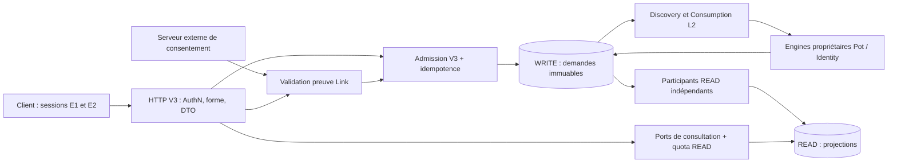

# Pocoma V3 — L5 — Audit d’entrée et plan global d’implémentation

Date de statut : **5 novembre 2026**. **I1 — CLOSED WITH EXPLICIT RESERVATIONS** (libellé complet et attribution dans l’[acte I1](L5_I1_Acceptance_and_Closure_Decision.md)). **L5/I2 — CLOSED — LOCAL BOUNDED PASS WITH EXPLICIT RESERVATIONS**, selon l’[acte humain I2](L5_I2_Acceptance_and_Closure_Decision.md). Qualification initiale livrée à `df0c3a221ce20b4eb569616d7df621fa4090a32b` : C-04 2 291 PASS dont 170 Architecture, T2 85 identités, B2 24 scénarios/468 requêtes et onze reçus Pot ; [rapport initial](L5_I2_Execution_Report.md), [manifeste figé](L5_I2_Proof_Manifest.json). [Correctif post-audit](L5_I2_Post_Audit_Correction_Report.md) livré à `1fc07000e586394298b2f2cf7acbd5e84ff1c5e6` : 9/9 PASS PostgreSQL en 17,252554 s, sans rejeu Architecture, terminal complet ou full reactor. Les preuves initiales sont héritées dans leurs seules hypothèses non invalidées, sans fraîcheur au SHA corrigé. R-I2-01 historique et R-CLO-I2-01…04 conservées dans l’acte. **I3 NON CLOS — À CADRER ; I4 NON CLOS — ULTÉRIEUR ; Q5 DÛ ; L5 OPEN.** Aucun certificat SPEC-10 global ni homologation production.

Le [rapport I1](L5_I1_Execution_Report.md) conserve T1 40/40, reprise 63/63, B1 32/32 (66 requêtes) et Architecture native non filtrée 2 231 PASS. R-I1-01…04 et réserves L1–L4 sont maintenues ; EXTERNAL AUTHN NOT QUALIFIED. D6 conserve le full natif unique à Q5 sous couverture effective G5/Architecture ; B5 et preuves externes restent dus indépendamment. Aucun rejeu pour cette clôture. Les constats de préparation, décisions de GO et allocations initiales ci-dessous sont historiques, sans réécriture des preuves.

Référence auditée : branche `feat/v3-architecture`, SHA **`c6dc722f69133206a4a46e533336d0f1bfb68d72`**. Le GO historique provient de la [ratification humaine](L5_I1_Human_Ratification_and_GO.md) ; le présent audit initial ne le donnait pas. Il ne modifie ni les SPEC, ni les clôtures historiques, ni les règles de qualification. Aucune expérimentation applicative n’a été exécutée pour cet audit.

Version initiale publiée : `e006794db62f0ae03b9739c5096499d625e6e14c`. Le mandat d’amendement transmet le verdict indépendant **READY FOR TARGETED AMENDMENTS**, favorable à l’architecture générale et au découpage I1–I4 + Q5. Les observations AUD-L5-01…09 sont traitées aux sections indiquées au §17 ; leur traitement documentaire ne constitue pas une nouvelle qualification physique ni une approbation humaine du plan.

**Décisions humaines du 4 novembre 2026 sur la version amendée publiée `5193c540` :** voir l'[acte D1/D6 et mandat D4](L5_D1_D6_Ratification_and_D4_Calibration_Decision.md) pour D1-HTTP/représentation et D6-composition I1 approuvés, D1-AuthN et D6-gates conditionnels, principes D4-READ approuvés. Le [rapport de calibration D4](L5_D4_Read_Calibration_Report.md) et ses [preuves isolées](../testing/evidence/L5-D4/README.md) concluent **D4 PARTIALLY CALIBRATED — ADDITIONAL DECISION REQUIRED** : valeurs nouvelles PENDING, mémoire/délais non démontrés et tension de gouvernance §35 CERTIFICATION/full à arbitrer. Ces références précisent les statuts sans réécrire les propositions historiques ci-dessous. **Aucun GO I1, aucune ratification numérique par la calibration ; documents soumis à revue avant publication.**

**Préparation opérationnelle I1 sur la référence publiée `9dd1c447` (04-11-2026), soumise à décision :** [proposition finale D4-READ](L5_D4_Read_Limits_Arbitration_Proposal.md), [rapport D6 G5/Architecture/full](L5_D6_Gates_Mutualization_Report.md) et [plan opérationnel I1](L5_I1_Implementation_and_Qualification_Plan.md). D4 recommande quatre **APPROVE WITH CONDITIONS**, valeurs toujours PENDING. D6 conclut **MUTUALIZATION CONDITIONALLY VALID** : proposer à Q5 un seul full natif satisfaisant G5 et Architecture, sans dispense, selon §35 et sous conditions d'inventaire/provenance/variantes. I1 : huit endpoints READ, 40 tests T1 + 32 scénarios B1 dans 15 minutes partagées ; aucun code ni campagne exécuté. **READY WITH EXPLICIT DECISIONS ; aucun GO I1.** Ces propositions actualisent les seuls détails D4/I1 et l'allocation D6 ci-dessous, sans modifier l'acte enregistré ni les clôtures L1–L4.

**Statut historique du GO, mandat du 4 novembre sur `f46d63a9` :** [ratification humaine L5/I1](L5_I1_Human_Ratification_and_GO.md) : plan global et plan I1 approuvés, limites D4 initiales ratifiées avec réserves physiques, D6 option B approuvée sous couverture effective à Q5, **GO I1 IMPLEMENTATION AUTHORIZED**. Les paragraphes de préparation ci-dessus et les rapports historiques ci-dessous conservent leur attribution. I2–I4/Q5 ne sont pas démarrés par ce mandat.

## 1. Synthèse et préparation

Les fondations permettent L5, avec les réserves acceptées de L1–L4. Les moteurs WRITE Pot et Identity, Discovery/Consumption et huit projections READ existent. **L5 n’est toutefois pas un simple câblage HTTP** : les admissions publiques V3 avec idempotence, le consentement Link réel et la chaîne Invitation sont absents. Les contrôleurs livrés utilisent encore des contrats V2. Un enum, un UUID de Consumption ou une famille dans le catalogue ne prouvent pas qu’un participant est livré.

Architecture recommandée : étendre les modules existants, exposer des contrôleurs V3 minces sur des contrats applicatifs typés, conserver les moteurs et leurs propriétaires transactionnels. Une association durable d’admission est nécessaire pour S-03 et l’anti-rejeu ; aucun workflow durable de consentement, moteur supplémentaire ou état PROCESSING n’est requis. Invitation ajoute sa propre histoire et projection parce que les SPEC les exigent, pas pour organiser une orchestration.

Trois conclusions structurantes :

- **Quota READ : conserver deux permis dans le partage actuel.** Le plan I8 réserve explicitement deux connexions supplémentaires aux consultations ; augmenter à 8/16 menacerait les traitements. Corriger la prévalidation avant quota et rendre le lien quota/réserve explicite. La capacité de service externe reste à mesurer.
- **Link : fermer la frontière externe avant de l’ouvrir.** `AdmissionContext` et son CHECK JSONB décrivent une provenance ; ils ne vérifient aucune signature ni action de consentement. `insertPending` refuse actuellement l’origine externe. La levée de cette restriction suppose un validateur qualifié, une admission atomique et des privilèges adaptés.
- **Invitation : septième participant READ, effet de lease démontrable statiquement.** Avec sept fois quatre candidats et les paramètres I8, le préflight calcule `189,28 s`, au-delà de 180 s. La proposition immédiatement compatible avec le mécanisme existant répartit les sept participants entre Monolithe et PROJECTION, sans Worker spécialisé. Le monolithe unique reste une cible à réexaminer après étude, sans allonger automatiquement le lease.

Découpage proposé : **I1 frontière HTTP/AuthN et READ ; I2 admission V3 et commandes/Registration/Unlink ; I3 Link qualifié ; I4 Invitation complète ; Q5 qualification finale et clôture**. I3 et I4 peuvent progresser indépendamment après I2, mais les campagnes PostgreSQL restent sérielles. Aucun code avant approbation du plan global et résolution des décisions préalables.

Amendements ciblés : Bruno livré/exécuté par delta à I1–I4 puis globalement à Q5 ; quatre checkpoints internes d’I4 sans nouvelles gates ; choix D1–D7 ordonnés par premier composant dépendant ; comparaison opérationnelle 3/4, rétention et sortie HTTP complète précisées. **Les décisions propres à I3/I4 ne bloquent pas I1** : son sous-ensemble préalable est explicitement listé au §15. Les montants et plafonds §13.3 restent des réservations non mesurées, avec Bruno incrémental inclus sans hausse automatique.

## 2. État Git et méthode

| Contrôle effectué | Constat |
|---|---|
| Branche et HEAD | `feat/v3-architecture`, `c6dc722f69133206a4a46e533336d0f1bfb68d72` |
| Référence de suivi | `origin/feat/v3-architecture` au même SHA ; aucun ahead/behind rapporté |
| Distant interrogé | `git ls-remote origin refs/heads/feat/v3-architecture` retourne ce même SHA ; pas seulement une référence locale supposée fraîche |
| Worktree initial | Propre, aucune modification préexistante dans ce checkout |
| Autres worktrees | Cinq autres worktrees recensés, non modifiés par la mission |
| Actions pendant l’audit initial | Aucun commit/push/fetch modifiant les références, Maven, PostgreSQL, Docker, migration, serveur ou test applicatif |

Inspections : `pwd`, `git status --short --branch`, `git branch --show-current`, `git rev-parse HEAD`, `git remote -v`, `git for-each-ref`, `git ls-remote`, `git worktree list --porcelain`, recherches `rg`/`rg --files`, lectures `cat`/`sed`, analyse Python en lecture seule des POM et reçus JSON. Les nombres historiques cités sont lus dans leurs dossiers, sans recalcul exhaustif de leurs archives ni certification nouvelle.

Le recontrôle distant final a rencontré une erreur DNS dans la sandbox ; le même `git ls-remote` en lecture seule avec accès réseau autorisé a ensuite confirmé à nouveau `c6dc722…`. La divergence locale/suivi contrôlée par `git rev-list --left-right --count HEAD...origin/feat/v3-architecture` est `0 0`. Aucun fetch ou changement de référence n’a été nécessaire.

Frontière de la présente mission déclarée avant rédaction : **documentation uniquement ; slices primaire/secondaires NONE ; impact productif interdit ; DB NONE ; Architecture globale NOT REQUIRED / NOT RUN ; full reactor NOT REQUIRED / NOT RUN**. Les déclarations futures d’I1–Q5 figurent au §12. Le worktree doit être revérifié au GO : toute divergence impose un delta d’audit, pas une réutilisation automatique du présent état.

## 3. Référentiel et hiérarchie

### 3.1 Autorités

1. **Exigences et arbitrages normatifs** : [Canon](V3_Canon_and_Roadmap.md), [SPEC-01](SPEC-01_Pot_Domain.md), [SPEC-02](SPEC-02_Identity_Domain.md), [SPEC-03](SPEC-03_Events_Requests_Consumables.md), [SPEC-04](SPEC-04_Read_Projections.md), [SPEC-05](SPEC-05_Consumption_Discovery.md) et ses [amendements normatifs L2 R1–R10](L2_R1_R10_Normative_Consolidation.md), [SPEC-06](SPEC-06_Supra_Contracts.md), [SPEC-07](SPEC-07_Transverse_Requirements.md), [SPEC-08](SPEC-08_Observability.md), [SPEC-09](SPEC-09_Performance.md), [SPEC-10](SPEC-10_Test_Certification.md). Une exigence métier ne change pas par modification d’un plan.
2. **Politique de preuve normative** : [Reactor Verification Policy](../testing/Reactor_Verification_Policy.md), notamment §§3, 14, 17, 19, 22–27, 34 et 35. Les commandes canoniques ne deviennent pas des recettes filtrées ; les budgets ne modifient pas les oracles.
3. **Décisions humaines de clôture** : [L1](L1_Documentary_Closure.md), compléments [F](L1_F_Closure_Report.md)/[F2](L1_F2_Closure_Report.md), [L2](L2_Documentary_Closure.md), [L3](L3_Identity_Closure.md), [L4](L4_Read_Closure_Decision.md). Elles prévalent sur les anciens statuts de plan pour le programme, sans transformer les résultats techniques historiques ni modifier les SPEC.
4. **Programme et allocation** : [Master Plan §§1–5](V3_Implementation_Master_Plan.md). L5 inclut Invitation complète et fournisseur Link qualifié ; L6 porte maintenance/mesures, L7 rationalisation, L8 distribution.
5. **Plans, réalisations et preuves** : [plan L3](L3_Identity_Inventory_and_Implementation_Plan.md), [acceptation I3/R1–R4](L3_I3_Acceptance_Decision.md), [plan L4](L4_Read_Inventory_and_Implementation_Plan.md), [plan I8](L4_I8_Implementation_and_Qualification_Plan.md), [rapport I8](L4_I8_Execution_Report.md), [manifestes L3](L3_Identity_Proof_Manifest.json)/[L4](L4_I8_Proof_Manifest.json). Ils renseignent conception et preuve dans leur portée.
6. **Code au SHA audité** : preuve de disponibilité effective et des écarts, jamais autorité permettant d’abaisser une SPEC.
7. **Recommandations d’audit** : hypothèses à instruire. Les huit findings transmis dans le mandat n’ont pas de rapport post-L4 autonome retrouvé dans les Markdown du dépôt sous ces identifiants. Leur provenance est le mandat utilisateur. `AUD-FINAL-I8-01` est, lui, enregistré dans la clôture L4. Les verdicts du §11 résultent de la présente inspection statique.

Les bandeaux anciens « non implémenté » des SPEC sont explicitement historiques. Le Canon contient aussi des phrases de progression antérieures à L4 ; l’acte L4 et le statut courant du Master Plan fixent la progression. Ce n’est pas une contradiction d’invariant.

### 3.2 État amont et réserves

| Lot | Capacité réutilisable et portée acceptée | Réserve réellement transférée à L5 |
|---|---|---|
| L1/F/F2 | Transitions Pot, histoire exacte, CAS, droits, calcul rationnel, publication et préconditions WRITE locales ; transition pure d’auto-rattachement | HTTP et Invitation complète non livrés ; coût Grand Pot/histoire longue à L6 ; aucun calcul différentiel autorisé |
| L2 | Discovery, slots, claims/fencing, retry/quarantaine, workers et séparation Business/Control | R-L2-01 temps conditionnel, R-L2-02 disponibilité/reprise, R-L2-03 gates globales non acquises, R-L2-04 portée fonctionnelle historique, R-L2-05 déploiement. G1/G2 INCONCLUSIVE ; G3 NOT PASSED / NOT COMPLETED |
| L3 | Autorité User/EUI, tokens/histoire, Registration/Link/Unlink internes, participant L2, fournisseur d’autorité pour Pot | R1 composition WRITE JPA qualifiée seulement ; R2 confiance administrateurs/objets PostgreSQL ; R3 canaux de logs bornés ; R4 historique de qualification. AuthN externe, E1/E2, consentement et HTTP restent L5 |
| L4 | Six participants réels ; façades `current/at/balance/expenses/visible/binding/commandResult/identityResult` ; huit projections | Lease180 non homologué production ; prévalidation mineure ; tokens fournis par appelants internes de confiance ; pas de CurrentInvitation ; tailles HTTP/sessions/idempotence non qualifiées |

L4 reste **CLOSED WITH EXPLICIT RESERVATIONS — COMPOSITE INTERNAL QUALIFICATION ACCEPTED** au 03-11-2026. Les 2 024 tests applicatifs et 167 Architecture sont deux contributions à deux SHAs, pas un full natif PASS. Aucun nouveau full L4 n’est un prérequis L5. Les succès ultérieurs de `i5_r05/r12` ne lèvent pas leurs réserves historiques. **Aucune certification SPEC-10 globale n’est acquise.**

## 4. Inventaire de code et contrats effectifs

Les alias ci-dessous désignent des fichiers existants. Les fichiers futurs sont annoncés comme tels ; leurs noms sont des propositions, pas des contrats disponibles.

| Alias | Fichiers existants consultés | Verdict de réemploi |
|---|---|---|
| HTTP | [AsyncCommandController](../../app/supra-http-write/src/main/java/com/kartaguez/pocoma/supra/http/write/AsyncCommandController.java), [RegistrationController](../../app/supra-http-write/src/main/java/com/kartaguez/pocoma/supra/http/write/RegistrationController.java), [CurrentBindingController](../../app/supra-http-read/src/main/java/com/kartaguez/pocoma/supra/http/read/CurrentBindingController.java) et autres contrôleurs de ces deux modules | **REPLACE dans la sélection V3**, garder V2 hors parcours V3 ; `BindingId`, UserId public et services historiques ne conviennent pas |
| AUTH | [WebApiSecurityConfiguration](../../app/composition-runtime-spring/src/main/java/com/kartaguez/pocoma/runtime/web/authentication/WebApiSecurityConfiguration.java), [SpringSecurityExternalPrincipalAdapter](../../app/composition-runtime-spring/src/main/java/com/kartaguez/pocoma/runtime/web/authentication/SpringSecurityExternalPrincipalAdapter.java), [AuthenticatedExternalPrincipal](../../app/contracts-authentication/src/main/java/com/kartaguez/pocoma/contracts/authentication/AuthenticatedExternalPrincipal.java), [application WEB](../../app/runtime-web-api/src/main/resources/application.properties) | **ADAPT** Resource Server et extraction du principal ; audience configurée ; aucune preuve réelle OIDC V3 déduite de ces fichiers |
| CMD | [PotCommand](../../app/engine-write-pot/src/main/java/com/kartaguez/pocoma/engine/write/pot/port/execution/v3/PotCommand.java), [ExecutePotCommand](../../app/engine-write-pot/src/main/java/com/kartaguez/pocoma/engine/write/pot/v3/ExecutePotCommand.java), [PotCommandStore](../../app/engine-write-pot/src/main/java/com/kartaguez/pocoma/engine/write/pot/port/execution/v3/PotCommandStore.java), [JdbcPotCommandStore](../../app/infra-persistence-primary-jpa/src/main/java/com/kartaguez/pocoma/infra/persistence/primary/jpa/v3/JdbcPotCommandStore.java), [PotCommandJson](../../app/infra-persistence-primary-jpa/src/main/java/com/kartaguez/pocoma/infra/persistence/primary/jpa/v3/PotCommandJson.java) | **REUSE** exécution ; **ADAPT** intentions publiques et Invitation. Pas de méthode d’admission publique V3 dans le store actuel |
| ID | [IdentityRequest](../../app/contracts-registration/src/main/java/com/kartaguez/pocoma/contracts/registration/v3/IdentityRequest.java), [ExecuteIdentityRequest](../../app/engine-consume-registration/src/main/java/com/kartaguez/pocoma/engine/consume/registration/v3/ExecuteIdentityRequest.java), [JdbcIdentityRequestStore](../../app/infra-persistence-primary-jpa/src/main/java/com/kartaguez/pocoma/infra/persistence/primary/jpa/v3/identity/JdbcIdentityRequestStore.java), [V6 Identity](../../app/infra-persistence-primary-jpa/src/main/resources/db/v3-identity/migration/V6__identity_authority_and_requests.sql) | **REUSE** autorité/exécution ; `insertPending` n’admet que `CONTROLLED_INTERNAL`. `EXTERNAL_AUTHORIZATION_SERVER` dans l’enum/SQL ne livre pas le validateur |
| ADM ancien | [SubmitRecordedCommandService](../../app/engine-admit-command/src/main/java/com/kartaguez/pocoma/engine/admit/command/SubmitRecordedCommandService.java), [AdmitRegistrationService](../../app/engine-admit-registration/src/main/java/com/kartaguez/pocoma/engine/admit/registration/AdmitRegistrationService.java) | Modules réutilisés ; **nouveaux services V3 requis**, pas de réutilisation du contrat durable V2 |
| READ | [ReadPotV3](../../app/engine-read-pot/src/main/java/com/kartaguez/pocoma/engine/read/pot/v3/ReadPotV3.java), [ReadNavigationV3](../../app/engine-read-pot/src/main/java/com/kartaguez/pocoma/engine/read/pot/v3/ReadNavigationV3.java), [ReadLimitsV3](../../app/engine-read-pot/src/main/java/com/kartaguez/pocoma/engine/read/pot/v3/ReadLimitsV3.java), [PotVisibilityStore](../../app/port-projection/src/main/java/com/kartaguez/pocoma/port/projection/v3/PotVisibilityStore.java) | **REUSE** sécurité à V, manifeste, lots, keyset ; **ADAPT** prévalidation, ports d’appel, curseur/encodage HTTP et compteur récapitulatif Link |
| FACADE | [V3ReadFacadeComposition](../../app/composition-runtime-spring/src/main/java/com/kartaguez/pocoma/runtime/consumption/v3/V3ReadFacadeComposition.java), [V3ReadFacadeConfiguration](../../app/composition-runtime-spring/src/main/java/com/kartaguez/pocoma/runtime/consumption/v3/V3ReadFacadeConfiguration.java) | **ADAPT** exposition typée ; quota partagé deux, transaction READ RR, zéro source WRITE. `Services` est dans composition : HTTP ne doit pas importer ce module en retour |
| RESULTS | [GetCurrentBindingV3](../../app/engine-read-current-binding/src/main/java/com/kartaguez/pocoma/engine/read/currentbinding/v3/GetCurrentBindingV3.java), [CommandTerminalResult](../../app/engine-read-command-result/src/main/java/com/kartaguez/pocoma/engine/read/commandresult/v3/CommandTerminalResult.java), [IdentityTerminalResult](../../app/engine-read-registration-result/src/main/java/com/kartaguez/pocoma/engine/read/registrationresult/v3/IdentityTerminalResult.java) | **REUSE** propriété EUI et binding propre ; **ADAPT** résultat CreateInvitation sans version Pot artificielle |
| INV socle | [AttachShareholderViaInvitation](../../app/domain-pot/src/main/java/com/kartaguez/pocoma/domain/pot/v3/AttachShareholderViaInvitation.java), [ShareholderTransitions](../../app/domain-pot/src/main/java/com/kartaguez/pocoma/domain/pot/v3/ShareholderTransitions.java), [PotVersion](../../app/domain-projection/src/main/java/com/kartaguez/pocoma/domain/projection/v3/PotVersion.java) | **REUSE** transition pure, `isFree`, `attachedActiveUserIds` déjà distinct de `authorizedUserIds`. Pas besoin d’ajouter un nouvel index métier d’éligibilité à PotVersion |
| L2/source | [JdbcEventDiscoveryReferences](../../app/infra-persistence-primary-jpa/src/main/java/com/kartaguez/pocoma/infra/persistence/primary/jpa/v3/consumption/JdbcEventDiscoveryReferences.java), [V3ReadParticipants](../../app/composition-runtime-spring/src/main/java/com/kartaguez/pocoma/runtime/consumption/v3/V3ReadParticipants.java), [catalogue](../../app/composition-runtime-spring/src/main/java/com/kartaguez/pocoma/runtime/consumption/v3/V3ConsumptionCatalogConfiguration.java), [ConsumptionEngine](../../app/engine-consumption/src/main/java/com/kartaguez/pocoma/engine/consumption/v3/ConsumptionEngine.java) | **REUSE** algorithmes ; ajouter uniquement mapping source et participant Invitation. UUID `924cd9e3-435d-5804-9d1e-c6aecadb9ab4` déjà réservé, non actif |
| COMPOSE | [WorkerConfiguration](../../app/composition-runtime-spring/src/main/java/com/kartaguez/pocoma/runtime/consumption/v3/V3ConsumptionWorkerConfiguration.java), [Settings](../../app/composition-runtime-spring/src/main/java/com/kartaguez/pocoma/runtime/consumption/v3/V3ConsumptionWorkerSettings.java), [BootstrapGuard](../../app/composition-runtime-spring/src/main/java/com/kartaguez/pocoma/runtime/consumption/v3/V3BootstrapGuard.java), [racine WEB](../../app/runtime-web-api/src/main/java/com/kartaguez/pocoma/PocomaWebApiApplication.java), [Monolithe](../../app/runtime-monolith/src/main/java/com/kartaguez/pocoma/PocomaRuntimeMonolithApplication.java), [PROJECTION](../../app/runtime-task-consumption-worker/src/main/java/com/kartaguez/pocoma/PocomaTaskConsumptionWorkerApplication.java) | **ADAPT** sélection explicite : les préflights actuels rejettent les beans HTTP non alloués et WEB utilise encore un scan général ; aucun montage externe complet V3 déjà disponible |

Le POM racine déclare **60 modules enfants**, et 61 POM existent sous `app/`, parent inclus. Le chiffre 54 du finding transmis ne décrit donc pas ce HEAD. Ce constat n’autorise ni suppression ni ajout de module. Les dépendances optionnelles de composition imposent de vérifier les POM des racines ; la présence d’une classe dans la composition ne garantit pas son classpath dans WEB.

## 5. Matrice d’entrée et traçabilité normative

Catégories : **A intégration**, **B fonctionnalité nouvelle**, **C correction héritée**. Risque : H élevé (sécurité/atomicité), M moyen, F faible. Une ligne mixte sépare explicitement ses travaux.

| Capacité / exigence | État réel et réemploi | Manque / travaux nécessaires | Dépendance ou réserve | Catégorie / risque / allocation |
|---|---|---|---|---|
| AuthN, EUI fiable — SPEC-02 §§1/5/6, SPEC-06 §3, SEC-01 | AUTH sait extraire iss/sub/temps/scopes d’un JWT déjà authentifié ; audience WEB configurée | Chaîne V3 explicite, issuer/JWK/audience/algorithmes/temps qualifiés, aucune EUI client ; sessions E1/E2 distinctes | Fournisseur et configuration réelle à décider | A câblage + B qualification externe / H / I1, I3 |
| Résolution User et token — SPEC-02 §§4/6/7, ID-01 | ID et fournisseur Pot réels ; binding propre READ disponible | Exposer binding propre filtré, convertir ses états internes ; ne pas exposer l’annuaire WRITE | L3 R1–R3, propagation L4 | A / H / I1–I2 |
| Admission Command/Identity — SPEC-03 §3, SPEC-06 §2, ADM-01 | CMD/ID durables et workers ; HTTP/ADM anciens V2 | Services V3, validation autonome, capture immuable EUI, contexte d’admission et INSERT minimal sans lecture métier | Pas de slot synchrone ; droits au Worker | B / H / I2 |
| Idempotence/anti-rejeu — SPEC-06 §2, S-03, ID-02 | requestId unique seulement ; pas d’association clé client/portée/intention | Canonicalisation versionnée, unicité durable, association atomique, rejeu Link non substituable | Rétention et client authentifié à décider | B / H / I2–I3 |
| Commandes Pot ordinaires — SPEC-01 §§1–7/10, DOM-01…03 | Onze intentions scellées, domaine et exécution disponibles | Adapter HTTP et représentation de self-attachment sans UserId arbitraire ; conserver invariants et rejets | Formes publiques ≠ codec de faits durables ; F2 à préserver | A + B adaptation intention SELF / H / I2 |
| Registration/Unlink — SPEC-02 §§4–7 | Trois opérations ID exécutables en interne | Admission externe sûre, résultat et récupération token ; Unlink E1→E2 avec seul token E1 | Pas de vérification fournisseur au retry | A/B / H / I2 |
| Link/consentement — SPEC-02 §5, SPEC-06 §§2/3, ID-02/C-01 | AdmissionContext structurel et exécution stricte existent | Fournisseur réel, preuve signée/session fiable, récapitulatif, unicité grant, admission externe séparée | FIND-L3-01 ; Keycloak non réputé qualifié | B / H bloquant exposition / I3 |
| Pot courant/historique/balance — SPEC-04 §§3/4/9/10, SPEC-06 §4, READ-01/A11 | READ et FACADE appliquent droits à V avant minVersion/dépendances | Ports d’exposition et DTO sans données internes ; statuts et budget HTTP exact | L4 accepté avec réserves ; D ne demande pas Balance(D) | A / M / I1 |
| Détails Expense — SPEC-06 §5, S-02 | Appartenance manifeste exact et chargement groupé dans READ | Contrat public références/lot, prévalidation pure avant quota ; taille réellement encodée | FIND-L4-02 ; 50 reste candidat | A + C / M / I1 |
| Navigation — SPEC-06 §6, S-01 | Keyset UUID dans READ/SQL, index `(user_id,pot_id)` partiel | Curseur opaque, limite, page suivante sans snapshot ; compteur indicatif Link distinct | Liste non autorisante ; ne pas paginer tout pour compter | A + B compteur / M / I1, I3 |
| Résultats — SPEC-06 §8, A10-A…K | RESULTS et projections immuables, requesterEui | HTTP sans token ; absence/tiers 404, panne 503 ; Invitation nécessite forme de succès dédiée | Résultat visible ≠ métier READ prêt | A ; B extension Invitation / H / I1, I4 |
| Invitation création — SPEC-01 §8, SPEC-03 §§6/9, INV-A/B | INV socle seulement ; pas d’intention CreateInvitation, table, compteur ni événement réels | Histoire Invitation, token confidentiel récupérable, publication INVITATION→COMMAND_COMPLETION, résultat sans lien | Ne pas produire V Pot ni POT_EVENT ; garde SQL CHANGED actuelle suppose Pot | B / H / I4 |
| CurrentInvitation/discovery — SPEC-04 §12, SPEC-05 §10, INV-H/I | Famille/UUID réservés ; source JDBC refuse cette famille | Source exacte, cinquième compteur, participant, store READ monotone, droits et activation | Septième READ ; lease/topologie à arbitrer | B / H / I4 |
| Restitution/consultation invitée — SPEC-06 §13, INV-C/D/E/J | PotVersion possède index d’utilisateurs attachés et isFree | Façade dédiée minimale, hash/expiration, seulement places libres/noms ; pas d’accès complet | Éventualité READ, pas de réservation | B / H / I4 |
| Auto-rattachement — SPEC-01 §§6/8, SPEC-06 §14, INV-F/G | Transition pure et CAS/primitives Pot réutilisables | Intention durable sans observedVersion obligatoire ; validation token/expiration atomique et bénéficiaire WRITE ; câblage Engine | Deux courses, protection Identity/Pot, token réutilisable | B / H / I4 |
| Régulation — SPEC-06 §11, plan I8 §§ressources/façades | Deux permis partagés et refus immédiat ; pools Business M+2 | Prévalidation, invariant quota/réserve et diagnostic agrégé ; aucune hausse justifiée | FIND-L4-01/02, budgets longs existants | C locale pour prévalidation, A explicitation / M / I1 |
| Composition — Master §§4/5, SPEC-05/06 | COMPOSE fermé, aucun HTTP V3 actif | Allocation explicite beans, rôles admission/lecture, tests des deux racines ; pas de scan V2 | Frontière/isolation changée → Architecture globale requise | A/B / H / I1–Q5 |
| Mesures/reconstruction/rationalisation — SPEC-08/09/10, Master L6/7/8 | Preuves physiques amont bornées | L5 : métriques de coût ciblées et preuve de rejeu Invitation isolé ; L6 : charge/REC-01 complet ; L7 : convergence | Pas de certification SLO, reset administratif complet ni nettoyage général en L5 | DEFER sauf sécurité/coût public direct / M–H |

## 6. Périmètre et parcours externes

### 6.1 Inventaire HTTP proposé

Le préfixe **`/api/v3` est une proposition de réalisation à approuver (D1)**. Les chemins sans préfixe cités par les SPEC restent leurs exemples/contrats fonctionnels. Aucun alias `/api/v1` n’est ajouté vers V3. Les controllers V2 restent exclus de la sélection V3 ; leur retrait physique relève de L7.

| Supra / contrat proposé | Entrée publique | Sortie nominale |
|---|---|---|
| `POST /api/v3/commands` | clé `Idempotency-Key`, bindingToken, operation, potId, observedVersion quand requis, payload typé | `202 {requestId, resultUrl}` après commit connu ; `Location` résultat |
| `POST /api/v3/identity/requests` | même clé ; operation Registration/Link/Unlink ; token E1 sauf Registration ; targetEui seulement pour Link/Unlink ; preuve Link dédiée | même `202`, résultat Identity |
| `POST /api/v3/identity/link-context` | AuthN E1, token E1, E2 cible et clé/intention envisagée ; aucun UserId | contexte signé et expirant destiné au serveur d’autorisation : E1, intention, nombre indicatif de Pots, date READ ; aucune admission |
| `GET /api/v3/identity/me/binding?minVersion=` | seulement EUI authentifiée ; aucun sélecteur tiers ni token entrant | `200 {euiVersion,active,bindingToken?}` ; aucun UserId |
| `GET /api/v3/commands/{requestId}/result` | AuthN EUI, pas de token | `200` résultat terminal filtré ou `404` |
| `GET /api/v3/identity/requests/{requestId}/result` | idem | `200` succès/rejet, cible/version si succès ; jamais token E2 |
| `GET /api/v3/pots/{potId}?minVersion=` | AuthN + token ; courant | `200` Pot complet à W≥minimum, manifeste Expense complet |
| `GET /api/v3/pots/{potId}/versions/{V}` | AuthN + token | même représentation à V exacte |
| `GET /api/v3/pots/{potId}/versions/{V}/balance` | AuthN + token | soldes rationnels exacts à V ; consultation dédiée réutilisant la façade existante |
| `POST /api/v3/pots/{potId}/versions/{V}/expenses/query` | AuthN + token, liste ordonnée de références `{id,headerVersion,detailsVersion,financialsVersion,deleted}` | détails complets dans l’ordre demandé ; aucune admission |
| `GET /api/v3/me/pots?cursor=&limit=` | AuthN + token ; curseur opaque et plafond serveur | `{potIds,nextCursor?}`, sans snapshot entre pages |
| `GET /api/v3/invitations/by-creation-request/{requestId}` | AuthN créateur EUI, pas de token de binding requis pour récupérer son propre lien (D5) | lien confidentiel et expiration depuis CurrentInvitation, jamais depuis CommandResult |
| `POST /api/v3/invitations/available-shareholders/query` | AuthN invité + son token de binding ; token invitation dans le corps | uniquement IDs/noms des Shareholders libres du Pot actif ; pas de Pot complet, soldes ou dépenses |

Invitation est admise via deux opérations supplémentaires du **même** `POST /commands` : `CreateInvitation` et `AttachShareholderViaInvitation`. Pas de nouvelle famille burnable. Aucun endpoint de gestion User, annuaire inverse EUI, Consent, Entitlements, révocation d’invitation, réservation, purge ou statut de traitement n’est inclus.

Le bindingToken voyage dans un en-tête dédié pour les GET (nom à figer en D1), dans l’enveloppe d’admission pour les POST métier. Jamais dans les URLs. Token invitation présenté dans le corps du POST de consultation ; le lien destiné au navigateur utilisera de préférence un fragment, transféré au POST par le client. Pocoma reste headless, sans fournir de front ou page de consentement.

### 6.2 Catalogue exhaustif des intentions Command

| Intention existante ou future | Entrée spécifique ; déclencheur et acteur | Exécution / contrat de sortie |
|---|---|---|
| CreatePot | acteur lié ; potId et label, observation 0 | CMD ; créateur déduit de l’acteur WRITE ; succès V1 ou rejet |
| UpdatePotDetails | créateur/participant ; label, observation | droits courants et composante Details ; succès V inchangée ou +1 |
| DeletePot | créateur ; observation égale à V courante | Header terminal seulement ; résultat D, lecture courante/D 404 |
| AddShareholders | créateur/participant ; liste id/nom/poids et mode libre/SELF | Header/Details/Weight v1 ; aucun UserId tiers ; une V pour tout le lot |
| UpdateShareholderDetails | créateur/participant ; liste id/nom/mode de rattachement | rattachement SELF sur libre ; détachement soi/créateur selon domaine ; une V |
| UpdateShareholderWeights | créateur/participant ; liste id/poids exact | dépendances locales Weight ; calcul Balance reste au matérialisateur |
| DeleteShareholder | créateur ; id et observation | refus si Expense active référence payeur/participant ; Header seulement |
| CreateExpense | créateur/participant ; id/détails/financials, observation | références Shareholder à l’observation et actives ; mêmes invariants financiers |
| UpdateExpenseDetails | créateur/participant ; id/label/date, observation | dépendances Details |
| UpdateExpenseFinancials | créateur/participant ; montant/payeur/participants/poids, observation | dépendances Financials et références, sans confondre changement de rattachement et obsolescence |
| DeleteExpense | créateur/participant ; id, observation | Header/Details/Financials inchangés depuis observation ; seul Header muté |
| **CreateInvitation (nouveau)** | créateur ; potId et expiration demandée selon D5 | autorisation WRITE, Invitation v1 et INVITATION_EVENT ; pas de mutation Pot ; résultat succès sans lien |
| **AttachShareholderViaInvitation (nouveau durable)** | invité lié ; token invitation, potId, shareholderId ; pas de UserId ni observation obligatoire | valide expiration et éligibilité sous protections WRITE, applique la transition INV socle ; Pot V+1/POT_EVENT, sans consommer Invitation |

Le contrat SELF manque dans l’enveloppe durable actuelle : les cibles de `PotCommand` portent encore `Optional<UserId>`. L’API publique ne doit ni publier ces identifiants ni résoudre l’acteur depuis READ pour les remplir. **Proposition I2 : ajouter un mode d’intention explicite libre/SELF/conserver/détacher selon l’opération, résoudre SELF dans ExecutePotCommand après autorité Identity, puis appeler les transitions existantes avec les faits typés.** L’admission ne prend aucune décision métier. L’adaptation conserve les cas internes existants ou les convertit explicitement ; aucune nouvelle possibilité d’affecter un tiers.

Rationnels publics : numérateur/dénominateur en chaînes d’entiers, valeur exacte normalisée et dénominateur positif ; pas de nombre flottant ni plafond métier d’entier ajouté. Pour les poids, conversion décimale exacte possible si retenue ; la première représentation recommandée reste fractionnaire pour limiter les variantes. Les limites d’octets/profondeur/cardinalité protègent le transport, pas une restriction métier arbitraire à 100 cibles.

### 6.3 Fiches de parcours : autorités, transactions, sécurité, preuves

Toutes les lectures passent par une transaction READ seule, sans WRITE synchrone. Tous les acteurs viennent du principal validé ; la possession d’un token, d’un curseur, d’un requestId ou d’une référence n’est jamais une authentification.

| Parcours / acteur et déclencheur | Préconditions, services, transaction/admission | Sorties et états attendus | Sécurité et tests indispensables |
|---|---|---|---|
| AuthN / client appelle V3 | Resource Server → AUTH ; confiance dans issuer/clefs déclarés, pas dans JSON client ; aucune transaction métier | principal EUI ou 401, indisponibilité d’authentification traitée sans identité de secours | signature falsifiée, mauvais iss/aud, exp/nbf, sujet absent, rotation clef connue/inconnue ; aucun bearer en logs |
| Command / utilisateur soumet une intention | HTTP → service admission V3 → INSERT demande + association dans même WRITE physique ; pas de SELECT Pot/Identity métier ; Discovery/Consumption → CMD → domaine | 202 durable ; puis 404 résultat jusqu’à matérialisation, 200 COMPLETED/REJECTED ; rejet de forme sans aucun durable | ADM-01/S-03 ; cible inexistante/obsolète/forbidden admise puis rejetée ; invalid binding sans lecture Pot ; atomicité multi-cibles et SELF |
| Registration / EUI authentifiée veut un compte | pas de token ; admission ID V3 → ID → User/EUI/version/token atomiques, événement User+EUI puis complétion | 202, résultat E1, binding propre après propagation ; Registration concurrente perdante sans User orphelin | aucune création publique UserId ; deux admissions ne garantissent pas deux succès ; ID-01 interne réutilisé et raccord externe prouvé |
| Binding propre / EUI après Registration ou Link | HTTP → port Binding → FACADE → GetCurrentBindingV3 ; E2 utilise sa propre session | ABSENT interne → 404 proposé ; NOT_READY → 503 ; actif/inactif 200 ; panne 503 ; minimum porte sur EUI cible de la session | I01-Q, token E2 inaccessible à E1 ; aucun UserId/cache partagé ; absent avec minimum non atteint reste état ABSENT du lecteur existant |
| Link contexte et consentement / E1 veut rattacher E2 | propre Binding READ pour résumé + COUNT de navigation ; contexte d’intention signé/expirant → serveur d’autorisation externe présente E1 + compteur indicatif, authentifie E2, recueille accord actif | contexte sans durable ; puis preuve liée au Link exact ; refus/SSO seul ne donne pas d’admission | C-01 : résumé altéré/retardé, identité E2 substituée, nonce/ID Token ordinaires refusés ; pas de compteur d’EUI |
| Link admission/exécution / E1 retourne une preuve E2 | validateur externe → service ID admission → association clé/grant + demande dans même WRITE ; ID revalide E1/token courant et E2 libre à l’exécution | 202 unique ou refus préalable ; résultat E1 seulement ; E2 récupère son propre binding | ID-02 A…Q ; deux sessions réelles ; signature falsifiée, double retour et grant sous autre clé ; révocation fournisseur après admission sans réévaluation au Worker |
| Unlink / E1 choisit E2 liée au même U ou elle-même | admission sans lookup WRITE ; ID protège E1 et E2 en ordre canonique, seul token E1 ; User persiste même dernière EUI détachée | résultat E1 ; propagation CurrentBinding indépendante ; ancien droit READ possible jusqu’à matérialisation, refus ensuite | absence de token E2 exigé ; Unlink croisés, ancien token, résultats conservés après re-Link ; SEC-02 sans promesse de révocation immédiate |
| Résultat Command/Identity / EUI poll après 202 | HTTP → lecteurs RESULTS → projection terminale ; comparaison requesterEui, pas de Binding/User | 401 ; absent ou tiers même 404 ; vrai incident 503 ; terminal 200, y compris REJECTED ; aucun EXPIRED/PENDING READ | A10-A…K : EUI partageant User ne partage pas résultat ; polling après Unlink ; aucun SELECT WRITE ; pas de payload/secret dans erreur |
| Pot courant / acteur ouvre P | FACADE → CurrentBinding → CurrentPot W → PotVersion W/autorisation → minimum → sous-versions Shareholder + Balance W | 404 absent/interdit/supprimé ; 503 seulement après autorisation pour minimum/dépendance ; 200 complet, références Expense toutes présentes | READ-01/SEC-01/A11 ; minVersion extrême sur Pot tiers reste 404 ; WRITE connu/READ absent 404 ; réponse sans authorizedUserIds/attachedActiveUserIds |
| Historique/balance / acteur choisit V | même binding actuel, droits à V ; aucun droit courant supplémentaire ; balance dédiée même autorisation | V<D consultable ; D 404 sans attendre Balance(D) ; dépendance active manquante 503 | droits historiques après détachement/suppression, créateur sans Shareholder, refus après Unlink matérialisé ; aucune substitution V courante |
| Expense batch / acteur utilise manifeste à V | prévalidation pure → quota → READ autorise V et chaque référence exacte → readAll groupé | liste complète ordonnée, ou erreur uniforme ; sous-version manquante 503 ; ref étrangère 404 | 0/1/N, doublon, null, limite±1, mélange Pot/V, V+1 avancée, payload extrême, pas de N+1 ni de 200 tronqué |
| Navigation / acteur ouvre page | binding réévalué par page → visibilité keyset, limite serveur ; `limit+1` si nextCursor retenu | potIds/curseur ; changements de visibilité sans snapshot, redémarrage du parcours possible | S-01 ; curseur invalide, changement binding, insertion avant/après curseur, aucun droit accordé par liste ; ne pas dépasser plafond pour calculer nextCursor |
| CreateInvitation / créateur veut partager | admission Command → autorité E1 → protection Pot/droit créateur → histoire Invitation + résultat + événement + suffixe dense dans WRITE unique | résultat sans lien ; CurrentInvitation peut arriver avant/après CommandResult ; version Pot inchangée | INV-A/B, rollback à chaque frontière, aucune publication avant état complet, pas de secret dans événement |
| Récupération lien / EUI créatrice | façade Invitation READ par creationRequestId, égalité creatorEui ; pas de WRITE ni dépendance CommandResult | lien/expiration ou même 404 pour tiers/inconnu ; panne 503 | INV-C/I ; EUI du même User ne suffit pas ; logs/URL/cache expurgés |
| Places libres / invité présente lien | AuthN et son binding actif ; hash/expiration READ, CurrentPot actif, PotVersion et attachedActiveUserIds ; sous-versions des noms libres | seulement IDs/noms libres ; 404 uniforme pour token invalide/expiré/Pot terminal/déjà attaché ; 200 liste vide proposé si aucune place libre | INV-D/E/J ; créateur sans Shareholder traité distinctement ; aucune autorisation Pot complète ; état READ ne réserve rien |
| Rattachement / invité choisit une place | admission Command ; Engine déduit bénéficiaire WRITE ; protège Identity, état/expiration Invitation et CAS Pot ; applique INV socle ; mêmes completions L2 | succès Pot V+1 ou rejet métier durable ; invitation inchangée/réutilisable ; READ suit indépendamment | INV-F/G et complément L1-F : deux bénéficiaires/même place ; même bénéficiaire/deux places ; expiration entre phases ; READ retardé ; réutilisation par un second bénéficiaire distinct |

### 6.4 Matrice unique des réponses et erreurs HTTP

Convention commune : `{code,message,traceId}` bornée, sans identifiant protégé ni détail SQL ; aucun contrôleur ne définit sa propre variante. **N** désigne un statut imposé par les SPEC, **P** une proposition de réalisation à ratifier par la décision citée. Les fiches précédentes se lisent selon cette matrice, qui centralise les cas d’erreur. Codes/messages restent stables, génériques pour les cas masqués, sans différencier absence et interdiction.

| Situation publique | Statut et contrat commun | Autorité / ratification | Distinction indispensable |
|---|---|---|---|
| Authentification absente/invalide, jeton non vérifiable | **401**, aucun contenu protégé | **N** SPEC-06 §§3/8/9 ; enveloppe D1 | aucun principal de secours ni confusion avec le bindingToken |
| Paramètre, forme, référence malformée, curseur ou limite invalide | **400**, erreur d’entrée bornée | **P D1** | prévalidation pure avant quota ; une référence bien formée mais étrangère reste 404 après autorisation |
| Ressource absente, interdite, version terminale ou binding non concordant en READ | **404** uniforme | **N** SPEC-06 §§4/9/10 | aucun 503 de minimum/complétude avant preuve READ des droits ; D7 traite séparément l’admission d’un token opaque invalide |
| Résultat absent de READ, encore PENDING WRITE ou complétion non projetée ; résultat d’un tiers | **404**, même enveloppe | **N** SPEC-06 §8 | continuer polling borné ; pas de statut READ PENDING, aucun lookup WRITE |
| Propre Binding absent | **404** ; Binding présent mais minVersion non atteint : **503** | **P D1** pour ABSENT ; fraîcheur selon SPEC-02 §6/lecteur existant | la session ne sélectionne jamais une EUI tierce |
| Donnée autorisée non prête : minimum ou dépendance active manquante | **503**, indisponibilité temporaire | **N** SPEC-06 §4 | jamais de réponse partielle ni de Balance(D) exigée pour la version terminale |
| Quota READ ou capacité HTTP bornée saturés | **503**, refus temporaire générique | **P D1/D4** conforme à SPEC-06 §11 | pas de file d’attente ajoutée ; aucune information d’existence, pas de 429 implicite |
| Même portée/clé, autre intention | **409**, sans ancienne intention divulguée | **N** SPEC-06 §2/S-03 | même intention déjà admise : **202**, même requestId, même après terminalisation |
| Preuve Link absente/invalide/expirée/substituée, E1 authentifiée | **400**, preuve non recevable, zéro durable | **P D1/D3**, garantie de refus **N** ID-02/C-01 | 401 seulement si AuthN E1 invalide ; ne pas dévoiler l’état métier de E2 |
| Grant Link déjà utilisé pour une autre admission | **409** générique, zéro nouvelle demande | **P D3**, unicité/anti-rejeu **N** | retry même clé/intention : 202 de l’admission initiale, sans rejeter sa preuve devenue expirée |
| Invitation invalide/expirée, Pot terminal ou invité déjà attaché, en consultation READ | **404** uniforme | **P D1/D5**, confidentialité/éligibilité **N** SPEC-06 §13 | une commande admise ensuite rejetée WRITE produit un résultat terminal **200 REJECTED**, pas un refus HTTP rétroactif |
| Invitation recevable mais aucune place libre | **200**, liste vide, aucune proposition ni réservation | **P D5**, INV-E | pas d’accès au Pot complet ; aucune commande de rattachement fabriquée |
| Corps d’entrée dépasse le plafond d’octets | **413**, avant parsing coûteux, zéro admission | **P D1/D4**, bornage **N** ADM-01 | médias/encodages non supportés : **415 P D1** ; aucun plafond métier déduit |
| Réponse autorisée dépasse son budget encodé/mémoire ou ne peut être complètement sérialisée | **503**, enveloppe d’indisponibilité bornée, aucun début de 200 | **P D1/D4**, complétude **N** S-02 | procédure §9.6 ; pas de 413 pour une sortie, pas de troncature ni cache nouveau |
| Indisponibilité technique réelle de READ/admission/fournisseur requis | **503**, sans détails techniques | **N** pour panne READ, **P D1/D3** ailleurs | absence normale de ligne ≠ panne ; commit d’admission incertain ≠ preuve de rollback, retry par même clé |
| Demande admise puis rejetée métier | **200** à la consultation du résultat, `REJECTED` | **N** SPEC-06 §8 | distinct du 202 d’admission et des refus préalables sans résultat |

Aucun 403 lié à une ressource ni 429 sans politique distincte. AuthN précède la sémantique métier ; une protection transport peut refuser des octets excessifs sans établir d’existence. Les réponses sensibles portent `Cache-Control: no-store`. Sur 404 après admission le client conserve son intention de polling ; sur 503 il applique le backoff borné décrit dans Bruno. Aucun mécanisme serveur d’attente active ou de synchronisation globale.

## 7. Architecture minimale et contrats internes

### 7.1 Flux et frontières



L’arc WRITE→participants est une lecture de source historique par les matérialisateurs, pas un appel de HTTP ni une transaction distribuée. Les retours d’admission attendent seulement leur propre commit connu. Les résultats et projections métier restent indépendants.

La composition instancie les moteurs/ports et possède ressources et transactions. HTTP dépend de **petits contrats d’appel dans les modules des engines existants**, jamais de `composition-runtime-spring` ni d’un adaptateur JDBC. Pour READ, quatre contrats d’appel couvrent Pot/navigation, binding propre, résultat Command et résultat Identity ; `Services` les implémente ou les fournit par références de méthodes. Ils utilisent les résultats/vues existants. Pas de façade universelle mélangeant ces domaines, pas de retour vers une dépendance composition→HTTP→composition. Le contrat Invitation rejoint `engine-read-pot` pour ses consultations et `port-projection` pour ses stores.

La politique RR et le quota restent dans la composition ; les engines READ possèdent l’autorisation, la résolution à V et la complétude. HTTP mappe les issues et filtre les DTO. Les plafonds de parsing et d’encodage sont HTTP ; les validations métier demeurent au domaine. La prévalidation partagée de `expenses/visible` est une fonction pure appelée avant quota **et** par le point d’entrée interne si nécessaire ; elle ne contient ni AuthZ ni accès SQL.

### 7.2 Nouveaux composants proposés, tous dans des modules existants

Les noms ci-dessous sont des noms de travail. Une interface n’est ajoutée que lorsqu’elle sépare réellement un moteur d’un adaptateur ou évite un cycle de modules.

| Composant / emplacement proposé | Nécessité, responsabilité unique et réemploi insuffisant | Dépendances et coût opérationnel | Simplification retenue |
|---|---|---|---|
| Contrôleurs/DTO V3 — `supra-http-write`, `supra-http-read` | Mapper principal/forme et statuts ; les controllers V2 parlent BindingId/anciens services | Contrats AuthN et ports applicatifs ; coût parsing/encodage borné | Un contrôleur par groupe de parcours, pas une couche de service HTTP supplémentaire |
| Contrats de consultation — engines READ existants | Rendre FACADE injectable sans dépendance inverse | Types de leur capacité seulement ; zéro thread/persistance | Petites interfaces fonctionnelles ou ports imbriqués ; pas de module de façade |
| `AdmitCommandV3`, `AdmitIdentityRequestV3` — `engine-admit-command`, `engine-admit-registration` | S-03 et capture de l’identité/validation externe ; ADM ancien n’insère pas les demandes V3 | Ports insertion/association, horloge, principal validé ; une transaction WRITE par première admission | Même algorithme d’association réutilisé par les deux services, aucun second moteur asynchrone |
| Association d’admission et adaptateur — `infra-persistence-primary-jpa` + contrat étroit dans admission existante | requestId unique ne lie pas clé client/identité/intention et ne bloque pas un grant rejoué sous autre clé | Une table WRITE avec index uniques et références aux demandes ; coût croissant avec admissions conservées | Une ligne par admission, pas une table par opération, ni copie de payload complet, ni journal de tentatives |
| Validateur de grant Link — contrat dans admission Identity, adaptateur technique dans composition Spring | Aucun composant actuel n’établit le consentement E2 | Issuers/clefs/audience et contexte signé ; validation cryptographique, pas de thread/état durable Pocoma de consentement | Une seule stratégie de preuve qualifiée initialement ; pas de SPI multi-fournisseurs anticipée |
| Résumé Link / compteur — `engine-read-pot`, port/store visibilité existants | C-01 exige le nombre indicatif de Pots ; `visiblePots(limit)` ne fournit pas COUNT | COUNT ciblé `(user_id,visible=true)` sur index existant ; transaction READ ; signature d’un contexte expirant | Pas de parcours de toutes les pages ni d’annuaire EUI inverse ; aucune projection supplémentaire |
| Histoire et exécution Invitation — `domain-pot`, `engine-write-pot`, primaire JPA | La transition d’auto-rattachement ne crée/valide aucune invitation | Intention CreateInvitation/Attach, port histoire, générateur de secret, chiffrement ; nouvelles lignes WRITE exigées par SPEC | Même famille COMMAND, même participant/dispatcher d’exécution ; pas de domaine Maven Invitation ni service distant |
| `MaterializeInvitation` et source/store — `engine-consume-projection-task`, primaire JPA, read JDBC, `port-projection`, `domain-projection` | CurrentInvitation n’est pas disponible ; CommandResult ne peut en tenir lieu | Participant L2, WRITE exact et effets READ ; un participant supplémentaire, septième READ | Même Worker générique, Discovery/claim/recovery existants ; pas de tâche préparatoire |
| Lecteur Invitation — `engine-read-pot` | Contrat invité plus restreint que lecture Pot complète | CurrentInvitation, PotVersion, Binding et sous-versions des noms ; aucun WRITE | Réutiliser `isFree` et `attachedActiveUserIds` ; aucun nouvel état d’éligibilité |
| Composition V3 HTTP — `composition-runtime-spring`, racines WEB/Monolithe | Le scan et les allowlists actuels empêchent un montage externe V3 isolé | Allocation explicite contrôleurs/AuthN/admission/lecture, sources et owners ; coût des ressources déclaré §9 | Configurations existantes étendues avec sélection mutuellement exclusive ; pas de nouveau runtime Maven ni grande refonte des préflights |

Aucune modification du moteur Consumption/Discovery générique n’est prévue. Si l’implémentation en exige une, arrêter et réviser le périmètre avant code. Ne pas transformer les noms de travail en un catalogue obligatoire de classes : un port imbriqué et une méthode de factory suffisent lorsqu’ils conservent la frontière.

### 7.3 Admission, idempotence et anti-rejeu

Contrat proposé à ratifier en D2 : portée `(issuer, subject, client authentifié, catégorie/opération, clé client)`. Le client authentifié est une valeur attestée par le fournisseur et autorisée pour Pocoma, pas un en-tête libre. Si le fournisseur n’atteste pas de client utilisable, adopter une portée d’identité plus large explicitement ; ne pas incorporer une valeur non fiable. Clé opaque transportée en en-tête, syntaxe/longueur bornées en D1. Le serveur attribue le requestId une seule fois.

Intention canonique versionnée : opération, cible, payload sémantique, EUI E1/E2 pertinentes, occurrence de binding déclarée, et pour Link identifiant/empreinte de preuve liée à la cible. Ordonner seulement les collections sémantiquement non ordonnées ; préserver les ordres ayant une signification. Normaliser rationnels et identifiants sans convertir les EUI opaques selon une convention inventée. Ignorer ordre des propriétés JSON, traceId, bearer OIDC renouvelé et horodatage de transport. Conserver version de canonicalisation et empreinte ; utiliser un HMAC/version de clef pour les éléments secrets, jamais un digest public du seul token. Les anciennes intentions restent comparables sous leur version originale.

Première demande : authentifier, appliquer protection transport et contrat autonome, valider les preuves exigées, puis **réserver association et grant anti-rejeu et insérer la demande dans une même transaction physique WRITE**. Contrainte unique portée/clé ; pour Link, unicité globale du couple émetteur de preuve/identifiant de grant, indépendamment de la clé client. Deux références FK possibles vers Command ou IdentityRequest avec exclusivité de catégorie évitent une référence polymorphe sans intégrité ; insertion/réservation ordonnée ou FK différée à fixer dans le DDL d’I2. La collision résolue ne laisse pas de demande orpheline.

Répétition : authentification toujours actuelle ; recherche dans la portée authentifiée ; comparaison sous le contrat canonique mémorisé ; même intention → même requestId/202, sans nouvelle validation de fraîcheur d’une preuve déjà consommée ni application rétroactive d’une limite de forme nouvelle. Autre intention → 409 sans exposer l’ancienne. Les limites transport nécessaires à la sécurité restent applicables ; elles ne réécrivent pas le destin de l’admission initiale. Une perte de réponse/commit inconnu ne devient jamais une seconde admission : retour technique borné puis récupération par même clé, dans l’autorité d’association uniquement. Ne pas inventer un statut métier UNKNOWN ou interroger le domaine WRITE depuis le polling READ.

**Politique minimale de rétention proposée : aucune purge d’association en V3 tant que les demandes sont conservées, cohérente avec sources/résultats conservés sans purge automatique.** Documenter cette garantie et sa croissance ; ni TTL caché ni promesse indépendante du stockage durable. Une future purge contractuelle exige une décision distincte et la conservation suffisante de l’anti-rejeu des grants. Cela évite un purgeur, des tombstones et de nouveaux paramètres en L5. L6 mesure la croissance ; D2 doit approuver ce coût ou fixer avant code une durée et un traitement explicite des clés après expiration.

Analyse de coût/rétention à ratifier dans **D2-rétention** :

| Aspect | Conséquence et contrat proposé |
|---|---|
| Croissance prévisible | Une association par première admission conservée, Command ou IdentityRequest ; aucune ligne de plus pour répétition ou refus. Sur une période, `ΔN = premières admissions Command + premières admissions Identity`, dont les Link, sans recompter leurs grants. Le volume par jour dépend de ces admissions effectives ; les charges offertes SPEC-09 ne sont pas une mesure d’admissions uniques |
| Demandes et terminalisation | Demande, association et référence durable restent cohérentes après TERMINAL. Une répétition authentifiée de même intention retrouve le même requestId/202 avant et après résultat ; pas de réutilisation de clé après terminalisation. Aucun effacement séparé de demande/association proposé |
| Anti-rejeu Link | Conserver l’unicité émetteur/grant même si la demande est rejetée métier : ce rejet ne rend pas le grant disponible pour une autre admission. La récupération de l’admission initiale reste possible, sans nouvelle consommation de consentement |
| Stockage et index | Coût théorique `N × (ligne + clés/empreintes + index uniques + références)`, plus pages, WAL/sauvegardes et réplication selon déploiement. Ne pas multiplier un payload JSON ou grant complet par répétition. Octets/ligne, taille/maintenance des index et latence d’accès ne sont pas mesurés ; L6 mesure cardinalités, tailles physiques et plans sur histoire longue |
| Secrets et empreintes | Aucun bearer de session conservé dans l’association. Empreintes/HMAC et provenance minimales restent sensibles et sous ACL/expurgation ; elles ne constituent pas des données anonymes. Conserver version canonique/clef et capacité de comparaison des anciennes intentions lors d’une rotation ; ne pas supprimer une clef nécessaire aux retries promis. Les secrets déclarés requis dans la demande durable restent sous leurs protections propres, sans copie dans l’association |
| Purge future éventuelle | Décision de contrat obligatoire : durée de répétition, sort des clés après échéance, intégrité avec demandes/résultats, restauration/sauvegardes et reconstruction, anti-rejeu des grants encore utilisables, comparaison des empreintes anciennes. Une suppression brute pourrait recréer une demande avec même clé ou rendre un grant rejouable ; aucune telle purge ni mécanisme préventif n’est implémenté |
| Portée de garantie | Garantie tant que l’association et la demande sont durablement conservées et restaurées de façon cohérente ; pas de promesse illimitée indépendante de cette persistance. L’absence de purge V3 est un choix explicite de simplicité soumis à D2, pas une homologation de capacité de stockage |

Les premières mesures de cardinalité/coût d’INSERT font partie de T2 ; elles ne fixent pas un débit garanti. Le coût physique de la rétention longue demeure à L6 et ne bloque pas I1, qui ne crée pas ces associations.

L’association est une **nouvelle persistance justifiée par S-03**, pas une reprise concurrente de L2. Les refus préalables ne créent aucune ligne de demande, association, slot, événement ou résultat. Le rôle d’admission est distinct du rôle d’exécution : droits limités aux INSERT/SELECT des demandes et associations requis ; pas de mutation d’EUI/Pot, résultat, séquence ou slot. Les transactions utilisent les owners existants ; conserver la composition WRITE JPA qualifiée pour l’exécution. Qualifier séparément le nouveau propriétaire d’admission, notamment rollback, contexte prélié et issue incertaine ; ne pas étendre R1 à une composition JDBC non testée.

### 7.4 Extension Invitation et SQL envisagé

Le code existant impose `CHANGED → POT_EVENT + version Pot` dans le contrat `PotCommandStore.Result`, [V2 Command execution](../../app/infra-persistence-primary-jpa/src/main/resources/db/v3-pot-execution/migration/V2__command_execution.sql), le lecteur de résultats et [V7 READ results](../../app/infra-persistence-read-jdbc/src/main/resources/db/v3-read-business/migration/V7__terminal_results.sql). **Une création Invitation ne doit pas contourner ces contraintes avec une fausse version Pot, un faux POT_EVENT ou un faux UNCHANGED.**

Proposition : ajouter les deux intentions au chemin COMMAND et rendre la forme du succès dépendante de l’opération. Pot : garanties actuelles de resultingPotVersion intégralement conservées. CreateInvitation : succès sans resultingPotVersion, sans lien dans le résultat, avec vérification de l’effet Invitation réel et de son événement. L’extension reste localisée aux contrats/stores/codecs, dispatch d’exécution, sources/résultats et contraintes concernés ; pas de généralisation de tous les moteurs. Le catalogue de rejets Invitation est fixé avec D5 (token invalide/expiré, place indisponible, non-éligibilité), sans convertir une panne technique en rejet.

Ordre impératif R1 : protéger le claim, protéger/valider l’autorité métier, produire effets et résultat cohérents, appeler **une fois `SlotCompletion.complete()` avant fermeture de publication**, puis écrire seulement le suffixe dense autorisé. Engine reste seul owner ; aucun verrou métier acquis après les compteurs, aucune suppression de slot tardive après publication, aucun owner imbriqué. Poisoning/rollback s’appliquent même à une erreur interceptée. Recovery R9 observe seulement et distingue COMPLETED/NOT_COMPLETED/INCONSISTENT/UNAVAILABLE ; absence de slot ou NOT_COMPLETED ne prouve jamais à elle seule un rollback.

Migrations **futures additives**, sans réécrire les versions publiées et sans exécution dans cette mission :

| Lot | Autorité et données nécessaires | Invariants DDL/ACL à prouver |
|---|---|---|
| I2 | WRITE : association admission, références Command/Identity, unicité portée/clé, contexte d’admission Command si requis | immutabilité intention, unicité atomique, zéro orphelin, privilèges admission distincts ; l’origine externe Identity n’exige pas à elle seule une migration car l’enum SQL l’admet déjà |
| I4 | WRITE : identité/histoire Invitation, creationRequestId unique, creatorEui, potId, expiresAt, tokenHash et lien récupérable chiffré ; INVITATION_EVENT minimal ; compteur dense INVITATION | version exacte/histoire immuable, secret absent événement, contrainte événement↔effet, suffixe INVITATION puis COMMAND_COMPLETION ; gardes Command adaptées sans relâcher les opérations Pot |
| I4 | READ : CurrentInvitation monotone, unicité creationRequestId et index d’empreinte, lien chiffré ; extension opérationnelle de la forme CommandResult | pas de régression ; contenu identique à version égale, divergence technique ; aucune colonne consumed/useCount ; accès confidentiel |

Numéros de migrations à attribuer selon les locations Flyway réellement composées au GO, pas en réservant un numéro ambigu maintenant. Bootstrap CURRENT V3 dans deux autorités distinctes, rôles administratifs prévus. Aucune baseline V2 TRUSTED n’est supposée : la politique indique **NONE**. Ne pas rejouer V1–V23 séparément ; rapporter les migrations historiques éventuellement exécutées transitivement par une gate canonique.

Le chiffrement du lien est authentifié et versionné, avec contexte liant invitationId/version et paramètres nécessaires ; clef hors base et rapports, droit de déchiffrement seulement aux opérations prévues. La source lit l’état exact et le matérialise sous protection READ, pas un token depuis l’événement. Choix clefs/rotation/récupération en D5 ; pas de gestionnaire de secrets maison ou service de rotation en L5. Un hash seul est insuffisant pour la restitution normative.

Lors du rattachement, protéger les préconditions Identity puis Pot et la validité de l’invitation jusqu’au commit selon un ordre de verrous explicite révisé. Vérifier l’expiration avec une heure DB fraîche à la validation finale après les attentes, pas avec un timestamp préparatoire. L’invitation étant immuable et sans révocation anticipée, aucun verrou de consommation/token unique d’usage n’est justifié. La sérialisation CAS Pot et la réévaluation garantissent les deux courses INV-F ; la signature d’un token ou une consultation READ ne les remplacent pas.

## 8. Sécurité et frontières de confiance

### 8.1 Contrat AuthN et sessions

Réutiliser Resource Server, validation cryptographique via le décodeur configuré et AUTH ; ne jamais considérer `AuthenticatedExternalPrincipal` construit par le client comme vérifié. Les propriétés audience et les adaptateurs existants sont des matériaux, pas une preuve de signature réelle. Déclarer les issuers et clefs de confiance, audience, algorithmes acceptés, horloges/écarts, exp/nbf, disponibilité et rotation JWK ; aucune URL issuer/JWK choisie librement par un jeton. Les claims `auth_time/iat/exp` actuellement requis par l’adaptateur doivent être confrontés au fournisseur retenu, sans assouplissement silencieux.

Proposition minimale : **API stateless avec bearer externe**, pas de cookie de session Pocoma ni d’endpoint login/logout local. E1 et E2 disposent de sessions/jetons indépendants chez le fournisseur et le client ; le consentement est exécuté chez le serveur d’autorisation. Pas de mécanisme local de rafraîchissement/stockage de bearer. Si des cookies Pocoma sont demandés, c’est un changement de contrat avec CSRF/session à cadrer, pas l’activation automatique du `csrf.disable()` existant.

L’entitlement externe exigé par une opération doit être attesté et contrôlé à l’admission ; sa liste est une décision fournisseur/produit D3. Ne pas inventer un rôle global depuis le seul nom d’une méthode. Après admission, le Worker ne contacte plus le fournisseur ; il vérifie les droits métier et le binding courant dans WRITE. Les changements de session ou révocations de fournisseur n’annulent pas rétroactivement une demande validement admise.

### 8.2 Preuve Link et portée réelle de FIND-L3-01

FIND-L3-01 est **CONFIRMED pour l’absence de preuve externe disponible**, pas un défaut prouvé de l’Engine Identity interne accepté. `AdmissionContext` vérifie présence des textes, identité initiateur/cible et map d’attestations ; le CHECK SQL vérifie structure et correspondance aux colonnes. Il n’authentifie pas le serveur, ne vérifie ni signature, audience, expiration, accord actif de E2 ou jti anti-rejeu. Le store garde précisément une restriction interne ; ne pas la supprimer seule.

Proposition D3 : un **grant d’autorisation signé, lié à un contexte d’intention signé**, émis par un serveur réellement qualifié. Le serveur authentifie E2 et lui présente Link(E1,E2), l’identité E1 et le compteur de Pots daté/indicatif ; aucun écran Pocoma n’est ajouté. La preuve doit lier au minimum E1, E2, action, contexte/empreinte, occurrence de binding E1 via empreinte protégée, corrélation/clé, audience Pocoma, dates et identifiant d’octroi unique. La représentation exacte et les paramètres de fraîcheur/clefs demeurent une décision bloquante : **aucun produit ou format n’est actuellement déclaré capable ni qualifié**.

Le validateur serveur reconstruit/compare l’intention et ne copie jamais un `AdmissionContext` fourni par le client. La demande persistée conserve les attestations validées nécessaires et leur provenance, sous accès protégé ; pas un bearer complet de session. Le grant ne peut servir pour une autre cible, E1, occurrence de token, clé ou client. L’unicité de grant se réserve avec l’admission. Le retour de la même demande n’est pas une nouvelle consommation de preuve.

Keycloak et RAR restent des candidats, pas des capacités acquises. Un composant d’autorisation spécialisé est recevable normativement, mais son développement/déploiement constitue un coût externe supplémentaire à arbitrer, **pas un nouveau module Pocoma implicitement autorisé**. Si aucun fournisseur n’est disponible et qualifiable dans le budget de l’étude D3, arrêter ce sous-parcours et revenir en décision ; ne pas remplacer le consentement par deux JWT valides ou une case JSON.

### 8.3 Garanties exigées avant exposition externe

| Frontière | Interdiction ou garantie à prouver |
|---|---|
| Client → HTTP | aucun requesterEui/UserId/provenance d’attestation librement substituable ; bornes avant parsing, champs inconnus rejetés selon contrat ratifié |
| HTTP → admission | aucun accès WRITE métier pour décider droits/existence ; filtre autonome seulement ; aucun service V2 ni slot créé |
| Admission → durable | atomicité demande/association/grant, intention immuable ; rôle d’admission incapable de muter les effets métier ; refus invalide zéro durable |
| Admission → Engine | EUI capturée immuablement, bindingToken explicite ; preuve externe déjà validée ; pas de nouvelle interrogation fournisseur |
| Engine → Identity/Pot | autorité courante et droits protégés jusqu’au commit ; INVALID_BINDING sans lecture Pot ; ordre canonique EUI et discipline suffixe préservés |
| HTTP → READ | READ seul, snapshot par appel, masquage uniforme ; quota partagé pour tous lecteurs ; pas de lecture du résultat WRITE en secours |
| Binding et résultats | binding propre sans sélecteur tiers ; E1 ne reçoit jamais token E2 ; résultats réservés à requesterEui même si User commun et après Unlink |
| Invitation | jeton non prédictible, empreinte pour vérification, lien récupérable protégé, pas d’URL sensible dans logs ; EUI créatrice seule pour restitution |
| Logs/erreurs/cache | no-store sur réponses sensibles, pas de cache partagé ; token/grant/cookie expurgés dans application, SQL, proxy et outils observés ; métriques à cardinalité bornée |
| Exploitation | administrateurs PostgreSQL et détenteurs de clefs restent de confiance ; préflight ne révoque pas des ACL abusives ; pas de prétention de protection contre tout administrateur |

HTTP doit mapper la vue de binding et les résultats en DTO explicites : sérialiser directement `ExternalUserIdentity`, `IdentityRequest`, `PotVersion` ou un record interne de résultat exposerait des informations non contractuelles. Les tests de confidentialité inspectent les octets de réponse et les canaux de logs effectivement utilisés, y compris le serveur de consentement ; ne pas étendre la réserve R3 par déclaration.

### 8.4 Tensions documentaires à arbitrer, sans modification silencieuse

| Point | Tension observée | Proposition et décision nécessaire |
|---|---|---|
| Token emprunté à autrui | SPEC-06 §2/ADM-01(D) évoque un refus pré-admission pour usurpation ; le tableau et SPEC-02 §§5/6 réservent la concordance courante opaque à WRITE, admission déclarative sans lecture métier. L1-F prévoit un rejet terminal INVALID_BINDING | D7 : distinguer identité/protocole falsifiés détectables en entrée du token opaque de tiers seulement détectable en WRITE ; ce dernier reste admis puis rejeté sans effet. Ne pas ajouter un SELECT métier WRITE/une autorité READ à l’admission pour satisfaire un exemple ambigu. Faire ratifier l’interprétation ou amender l’autorité normative avant code concerné |
| Fournisseur | SPEC-10 mentionne Keycloak dans certaines méthodes/I02-O ; C-01 et SPEC-02 §5 acceptent explicitement un serveur qualifié non Keycloak | D3 : conserver tous les oracles ; si autre produit, faire approuver le mapping des méthodes vers ce fournisseur réel, sans prétendre un test Keycloak exécuté |
| Droits externes à l’exécution | Une phrase SPEC-02 §5 mentionne les droits externes dans les contrôles d’exécution, alors que le même § et ID-02 H/K imposent la vérification fournisseur à admission seulement | Retenir le contrat détaillé ID-02 : pas de requête fournisseur au Worker ; signaler cette lecture dans l’approbation D7, demander arbitrage normatif si une revalidation est voulue |
| Façade interne vs contrat public | Valeurs/budgets internes, statut Answer et classes de domaine ne sont pas des enveloppes HTTP livrées | D1 fixe mappings et plafonds ; le code interne ne décide pas seul du produit |
| Statuts historiques | « L4 à cadrer », « non implémenté », chiffres 54 modules et plans anciens | Dates/portées puis acte de clôture/code courant ; aucun besoin de modifier les SPEC pour une actualisation de plan |

## 9. Performances et dimensionnement anticipé

### 9.1 Quota READ : correction minimale

Le contrat normatif SPEC-06 §§5/11 impose des ressources bornées et un refus explicite sans réponse partielle. **Il ne fixe aucun nombre de permis.** Le plan I8, lui, explicite deux connexions de consultation supplémentaires au budget Business.

Faits de code : un `Semaphore(2)` par instance `Services`, commun à **toutes** les consultations ; `tryAcquire()` sans attente ; troisième appel simultané → `Unavailable`, avant `owner.read` et emprunt JDBC. Les deux autres peuvent servir binding/résultats/Pot/lots/navigation. Pas de réservation par utilisateur/opération, ni équité garantie ; le sémaphore protège l’entrée en transaction, pas l’encodage HTTP une fois les objets retournés. Un callback bloqué garde son permis jusqu’à résolution, y compris après déconnexion client si aucune annulation physique effective n’est prouvée. `finally` libère sur issue résolue ; une exception technique est convertie en indisponibilité sans fuite SQL.

Capacité physique actuelle : avec limite Worker `M`, chacun des deux pools Business a `M+2` connexions et chaque Control `M+6`, minimum idle = maximum, validés strictement. Les opérations Worker sont bornées par la capacité M ; leurs phases source/effets sont séquentielles. Pour le READ Business partagé, l’allocation conservative de consultation est donc **`Q ≤ R_business − M − H`**, où `H` représente tout autre emprunteur simultané non compté. Dans la composition I8 recensée `R_business=M+2`, `H=0` selon son allocation, donc **Q=2**. Ce calcul est une allocation de ressources, pas une preuve de débit ni de durée d’emprunt.

Augmenter Q sans changer R ferait attendre des clients ou matérialisateurs dans Hikari, avec risque de privation de progression READ et pression mémoire. Les quatre pools ne sont pas interchangeables ; **ne jamais emprunter Control pour HTTP**. À M=4 : Business 6/6, Control 10/10, **32 connexions réservées par contexte Worker**, pas 6 connexions par utilisateur ni 32 actifs garantis.

Correction minimale I1 :

1. Conserver le refus immédiat, sans file d’attente ajoutée ni hausse des deux permis.
2. Relier explicitement le quota à la réserve de composition (constante documentée/invariant de construction) ; dans un WEB sans Worker, son pool READ et Q sont déclarés ensemble. Pas d’option Q indépendante permettant de dépasser le pool ni de menu 8/16.
3. Factoriser les prévalidations pures de lots/pages et les appeler avant acquisition. La liste vide, null, dupliquée, trop grande et la limite de page invalide donnent InvalidInput même si les deux permis sont occupés, sans transaction ni SQL. Figer/capturer immuablement le lot validé avant de différer son exécution.
4. Mapper saturation en 503 générique, pas en erreur d’accès métier ; suivre refus, durée des consultations et utilisation agrégée du pool. Ne pas dévoiler la cause fine dans le corps public.
5. Borner aussi les requêtes HTTP en vol/encodages et les octets de sortie : les permis SQL ne limitent pas à eux seuls les réponses en cours de sérialisation. Utiliser la limite globale d’admission/serveur retenue en D4, pas un second pool de threads maison.

Les durées actuelles ne constituent pas un budget HTTP convenable acquis : emprunt Hikari 1 s, statement Business 60 s, transaction PostgreSQL 65 s, socket Business 70 s ; owners préparés avec leur timeout. Les limites SQL/transport sont différentes et ne prouvent ni réponse à 1 s ni libération à la déconnexion. D4 doit fixer un budget de consultation externe mesuré ; si des délais SQL plus courts sont nécessaires, les appliquer dans la transaction de consultation, sans modifier les paramètres Worker ni ignorer une issue physique incertaine. Les tests doivent observer restitution du permis/connexion et progression des workers. Aucune valeur plus courte n’est décrétée démontrée ici.

### 9.2 Latences asynchrones à distinguer

| Segment | Ce qui l’achève | Ce qui n’est pas promis |
|---|---|---|
| Départ HTTP → réponse initiale | AuthN/forme/preuve + transaction d’admission connue | aucune exécution métier, disponibilité READ ou attente de terminalisation |
| Admission/persistance | demande et association durables | slot non créé synchroniquement |
| Découverte/exécution WRITE | Discovery burnable, acquisition, préparation, protection/finalisation et commit résultat/événements | délai universel de claim/renewal ou absence de retries |
| Découverte/matérialisation READ | progression de chaque événement/participant indépendant | CommandResult, Binding, Pot, Balance, Visibility et Invitation simultanément prêts |
| Visibilité utilisateur | polling authentifié observe 200 terminal, puis ressource requise à minimum/version | aucun 404 interprétable comme échec terminal ; 200 résultat ne signifie pas lecture métier prête |

Bruno doit borner son polling (délai total, backoff, nombre de requêtes consignés) et conserver 404/503/timeout distincts. Aucun état durable supplémentaire pour expliquer l’attente. Les mesures suivent SPEC-08 T0…T6, timers locaux monotones et observations externes ; ne pas sommer les p95 des branches parallèles. Les objectifs SPEC-09, dont p95 500 ms Pot moyen nominal et Identity utilisable, restent **objectifs à qualifier L6**, pas critères supposés démontrés par L5.

### 9.3 Invitation, candidats et leases : comparaison calculée

Le routage du pilote reste **P=4 fixe** ; un participant doit avoir des propriétaires couvrant les quatre partitions. Déclarer uniquement une partition sur le seul Worker laisserait les trois autres sans traitement : ce n’est pas une optimisation acceptable. Le lease limite l’enrôlement/acquisition de nouvelles unités ; les claims déjà acquis conservent leur autorité distincte.

La borne READ actuellement vérifiée par Settings, par autorité, est :

`B = renewalInterval + renewalBudget × (N_candidats + N_bindings) + minPoll × N_candidats + 4 s`.

Hypothèses I8 : intervalle 10 s, budget d’appel 5 s, minPoll 0,01 s, une progression utile par appel et une fenêtre bornée sans progrès par binding ; pas d’omissions arbitraires. Il s’agit d’une **borne conditionnelle de préflight**, pas d’un renouvellement physiquement garanti.

| Option | Candidats/bindings READ par instance | B calculé | Coût / décision |
|---|---|---:|---|
| L4, six participants × quatre partitions | 24 / 6 | 164,24 s | référence locale I8, 180 s non homologués production |
| Ajout naïf Invitation au même Worker | 28 / 7 | **189,28 s** | refus avec lease 180 ; ne pas désactiver la garde |
| **Recommandée pour L5 sans changer L2 : Monolithe + PROJECTION existant, groupes complémentaires 3 et 4 READ** | 12 / 3 et 16 / 4 | **89,12 s et 114,16 s** | deux Workers génériques, aucune spécialisation Invitation ; couverture complète des quatre partitions de chaque participant ; coût de pools doublé à M identique |
| Allonger lease au-delà de 189,28 s | 28 / 7 | 189,28 s inchangé | augmente potentiellement reprise après crash ; aucune homologation ni choix arbitraire d’une nouvelle durée ; non recommandé |
| Modifier renewal/parallélisme/budget pour un monolithe unique | 28 / 7 | à redémontrer | mécanisme partagé L2 et preuve adverse plus large ; hors correction locale L5 proposée, étude L6/L8 |
| Plus de partitions ou Worker Invitation dédié | davantage de coordination | pas de gain démontré | complexité/coût non justifiés, non recommandé |

Répartition précise proposée : Monolithe = Command + IdentityRequest WRITE, et CurrentBinding + CommandResult + IdentityRequestResult READ ; PROJECTION = PotVersion + PotBalance + PotVisibility + Invitation READ. Les dépendances de lecture ne deviennent pas des dépendances de traitement. L’API peut lire toutes les projections depuis READ, quel que soit leur producteur. Aucune synchronisation entre racines n’est ajoutée. Les mêmes UUID/tableaux de routage s’appliquent, sans duplication de namespace de slots.

D6 doit approuver cette topologie transitoire ou mandater une étude alternative avant I4. Elle est plus simple **avec les garanties actuelles** qu’un renouvellement refondu ou un Worker spécialisé. Elle ne préjuge pas de la distribution L8, qui privilégie le monolithe si qualifiable. Les groupes complémentaires perdent temporairement la production de certaines projections à la panne d’une racine ; pas de haute disponibilité revendiquée. Le chevauchement/takeover futur doit comptabiliser les candidats de chaque instance, pas seulement les propriétaires actifs.

**Comparaison opérationnelle des seules compositions déjà envisageables avec les modules existants.** Les bornes 189,28/89,12/114,16 s ci-dessus sont reprises sans nouveau calcul ni mesure. Pour comparer les ressources, M=4 reste une hypothèse commune ; A désigne le pool admission distinct, R un pool de consultation d’un WEB autonome. Les pools du fournisseur externe et les connexions administratives sont hors compte.

| Composition | Runtimes, pools et connexions réservées | Couplage et panne d’une racine | Continuité, partitions et lease180 | Exploitation / choix |
|---|---|---|---|---|
| Monolithe HTTP + WRITE + sept READ | 1 runtime ; 4 pools Worker + 1 admission ; `32+A` | toutes les fonctions partagent le processus et la capacité locale ; panne : plus d’HTTP ni production WRITE/READ | quatre partitions de chaque participant à couvrir ; borne 189,28 s incompatible avec 180 ; redémarrage seul ne corrige pas ce dépassement | moins de processus mais **non activable avec ces paramètres** ; aucune baisse de garde ou hausse de lease |
| **Monolithe HTTP + WRITE + trois READ ; PROJECTION quatre READ** | **2 runtimes ; 8 pools Worker + 1 admission ; `64+A`** | HTTP partage le Monolithe avec WRITE et Binding/Results ; PROJECTION séparé pour Pot/Balance/Visibility/Invitation. Panne Monolithe : HTTP/WRITE et ses trois READ arrêtés, les quatre autres peuvent poursuivre sur sources durables. Panne PROJECTION : HTTP/WRITE et résultats peuvent continuer, mais projections de son groupe restent anciennes/absentes | chaque participant a ses quatre partitions candidates sur sa racine ; 89,12/114,16 s compatibles **théoriquement** avec 180. Les groupes sont complémentaires : l’autre racine ne reprend pas spontanément les participants qu’elle ne déclare pas ; continuité après retour de la racine, selon leases/claims existants | **candidate privilégiée**, deux listes complémentaires et mêmes ressources qualifiées L2 ; minimum de processus satisfaisant la borne, sans Worker spécialisé ; pas de haute disponibilité générale |
| WEB HTTP séparé ; Monolithe sans HTTP WRITE + trois READ ; PROJECTION quatre READ | 3 runtimes ; 8 pools Worker + 1 admission WEB + 1 READ WEB ; `64+A+R` | panne WEB : HTTP indisponible, workers continuent ; panne d’un worker : HTTP reste joignable mais sa branche ne progresse plus ; pas d’admission sûre si son autorité durable est indisponible | mêmes quatre partitions/participant et mêmes bornes 3/4 ; aucune reprise automatique du groupe absent ; ne pas concentrer les sept READ dans PROJECTION sous prétexte de séparer WEB | isolation de processus accrue, au prix d’un runtime, d’un pool READ et d’une configuration/d’un déploiement supplémentaires ; à retenir seulement si ce besoin d’isolation est décidé, pas pour une performance supposée |

Avant activation de la candidate 3/4, T4 doit établir : inventaire de beans/rôles/pools et absence V2 ; ensemble exact des sept participants et couverture des quatre partitions de chacun sans trou ; emprunts réels et marge serveur de **tous** les processus ; progression simultanée des deux groupes ; échéances PG de chaque candidat sous réponses partielles/omission bornée ; arrêt d’une racine puis retour avec demandes/événements durables préservés, claims non repris prématurément et drainage/UNKNOWN conservateur. Vérifier explicitement les états HTTP quand PROJECTION manque : résultat éventuellement 200 mais ressource 404/503 selon §6.4, jamais reconstruction WRITE. Une panne d’un groupe n’exige pas de tout arrêter ni d’affirmer un takeover par le groupe complémentaire. Les assertions de sûreté L2 restent inchangées ; seuls montage, charge nouvelle de candidats et hypothèses effectivement changées sont requalifiés.

### 9.4 Budget de connexions et mesures disponibles

Pour une instance Worker : somme des maxima = `2(M+2)+2(M+6)=4M+16`. Deux racines M=4 donnent **64 connexions réservées**. Le budget admission HTTP supplémentaire est `A` connexions selon D4 ; les consultations du Monolithe partagent son READ Business existant à Q=2 et n’ajoutent pas un pool READ. Total de cette proposition = **64+A**, hors fournisseur externe, administration, monitoring et autres clients. Un WEB autonome sans workers a besoin de ressources de lecture/admission propres, pas des quatre pools de workers ; ne pas cumuler ce déploiement alternatif avec le Monolithe dans le dimensionnement par défaut.

Le rôle admission distinct justifie son datasource et propriétaire transactionnel dans le Monolithe. Sa capacité A et la limite des admissions en vol sont à mesurer/fixer ensemble en D4 ; pas d’augmentation de M destinée uniquement à obtenir plus de permis HTTP. À autorité hébergée sur un serveur distinct, ventiler les pools WRITE et READ par serveur ; une somme globale ne prouve pas que chaque serveur tient son allocation.

[Resource_Observations](../testing/evidence/L4-I8/Resource_Observations.json) et [Server_Capacity_Observation](../testing/evidence/L4-I8/Server_Capacity_Observation.json) rapportent, à leur SHA/invocation : PG17.11 de fixture, max_connections=100 dont trois réservées, 64 connexions des deux racines, deux autres observées et un budget fixture/admin/observer de 12. L’allocation historique `64+12=76≤97` est locale. La future allocation est `64+A+12≤97` **dans ces seules hypothèses**, ce qui donne une marge arithmétique et non une capacité de service démontrée. Ne pas remplir cette marge automatiquement.

T09 rapporte reprise après crash d’environ 180,5–180,8 s avec lease180 ; T11 rapporte environ 173,7 s de takeover selon échéance résiduelle. Ces nombres ne sont ni SLO, ni débit, ni mesure L5. T10/T11 couvrent des variantes de renewal/UNKNOWN précises, pas toute contention. Aucun environnement, serveur de consentement ou réseau de production n’est homologué.

### 9.5 Registre des niveaux de preuve

| Nature | Énoncé utilisable | Limite / action |
|---|---|---|
| Fait de code | quota 2, pools M+2/M+6, P=4, six participants livrés, sources sans Invitation | vérifié statiquement à c6dc722 ; ne mesure pas la charge |
| Garantie normative | complétude, droits à V, atomicité, indépendance, refus borné, Link authentifié | à prouver sur les parcours externes nouveaux |
| Borne théorique conditionnelle | Q≤réserve ; B 189,28/89,12/114,16 ; somme des maxima JDBC | dépend des emprunteurs recensés et hypothèses de progrès ; pas un percentile |
| Hypothèse de configuration | M=4, lease180, split 3/4, capacité admission A, budgets publics | D4/D6 ; aucune valeur de production approuvée |
| Mesure physique disponible | T09/T10/T11 et observations serveur L4, temps historiques de gates | réemploi attribué à l’ancien SHA, validité bornée ; aucune mesure fraîche |
| Mesure ciblée L5 | tailles JSON réelles, parsing/encodage et refus aux limites, concurrence Q/Q+1, absence N+1, couverture renewal de la topologie retenue | uniquement après autorisation ; pas de campagne globale de charge |
| Mesures reportées L6 | plans SQL/histoires longues openComponent, allocations/calcul Balance, WAL/stockage, stabilité/backlog, débits/quantiles et SLO SPEC-09 | protocole/matériel/échantillons à ratifier ; pas de modification normative anticipée |

### 9.6 Réponses volumineuses : validation complète avant émission

Procédure minimale proposée pour I1, à figer par D1/D4-READ : **ne pas streamer le JSON fonctionnel avant sa validation complète**. Après AuthN et prévalidation pure, l’appel READ acquiert son permis SQL, autorise la ressource et construit sa vue cohérente. La transaction/connexion et le permis READ sont libérés à la fin de cet appel, comme aujourd’hui ; la vue détachée ne garde ni connexion ni curseur SQL pendant le transfert HTTP.

L’admission globale des requêtes HTTP en vol précède le chargement de la vue et couvre ensuite sa sérialisation et son envoi. Dans cette capacité existante à configurer (pas de nouveau pool de threads/queue), sérialiser la **totalité** du DTO en UTF-8 dans un tampon par requête à capacité strictement bornée ; contrôler les octets réellement produits, y compris échappements, versions, entiers rationnels et enveloppe. Un compteur estimatif dans `ReadPotV3.fits` reste un filtre interne : il ne remplace pas la vérification des octets HTTP effectifs. Utiliser un tampon/segments bornés évitant croissance incontrôlée et copie complète supplémentaire ; ni cache partagé, ni fichier temporaire de secrets, ni nouvelle persistance.

Ne positionner/envoyer le 200 et son corps qu’après réussite de la sérialisation, contrôle du budget de sortie et de la capacité mémoire. Le corps ainsi validé est celui envoyé, avec sa longueur connue ; aucune seconde sérialisation tardive susceptible de dépasser le plafond. Si le tampon atteint sa borne, si la sérialisation échoue ou si la capacité HTTP est épuisée, abandonner le corps fonctionnel sans l’émettre et fournir l’erreur bornée du §6.4. Celle-ci doit elle-même tenir dans une réserve documentée. Garder la capacité HTTP jusqu’à fin/abandon du transfert, puis libérer les données sensibles ; n’attendre aucune résolution WRITE.

| Ressource/contrat | Relation à respecter avant approbation D4-READ |
|---|---|
| Sortie et mémoire | Borner séparément coût de la vue déjà chargée, tampon UTF-8 et éventuelles copies réelles de l’adaptateur/serveur. Le nombre de requêtes HTTP en vol doit être compatible avec leur coût simultané et la marge mémoire observée. Le plafond de sortie seul ne borne pas le heap global, et Q=2 ne borne pas les encodages après restitution du permis SQL |
| Manifeste principal | Toutes les références Expenses restent dans le même Pot complet, sans pagination serveur ni troncature. Le budget doit accepter les profils supportés réellement encodés ; une incompatibilité exige une décision de format/ressources, pas un plafond métier implicite |
| Lots Expense | Nombre de références et octets de réponse ont des plafonds distincts. Un lot admissible en cardinalité peut être trop gros en octets : erreur complète avant envoi, jamais 200 avec les premiers éléments seulement. Le client choisit ensuite un autre lot si cela préserve le parcours |
| Navigation | Pagination keyset seule déjà prévue, pas de nouveau snapshot/session. Fixer page/plafond/`limit+1` sans tronquer une page annoncée complète ni faire apparaître un curseur non vérifié |
| Quota et connexions | Deux permis sous allocation actuelle, aucun emprunt Control ; la capacité HTTP borne aussi les vues/tampons/envois après libération JDBC. Saturer l’encodage ne doit pas épuiser les connexions ni bloquer le renewal |
| Compression éventuelle | Référence de budget : octets JSON UTF-8 non compressés. Si activée, achever également toute transformation de contenu pouvant échouer avant émission et borner ses tampons/copies ; sinon la désactiver pour I1. `Content-Length`, s’il est émis, porte sur les octets effectivement transférés, pas une longueur JSON incompatible avec la compression. Consigner les deux tailles ; aucune économie mémoire ou de plafond supposée |

La garantie porte sur les erreurs de construction, budget et sérialisation **détectées avant émission**. Une coupure réseau après début du transfert peut toujours produire une réponse incomplète côté client ; elle est un échec de transport, jamais une réponse métier partielle volontaire ou une preuve de livraison complète. Ne pas prétendre pouvoir remplacer son statut après commit HTTP.

Tests limites I1 à rattacher aux méthodes T1 existantes : corps complet exactement à la borne et à borne+1 octet (ce dernier sans aucun octet/entête de succès déjà committé) ; chaîne multioctet/échappée et rationnels longs invalidant une estimation naïve ; lot sous plafond de cardinalité mais au-dessus du plafond d’octets ; dernier élément provoquant dépassement/erreur d’encodage sans préfixe 200 envoyé ; manifeste 0/200/2 000 complet ou échec explicite ; deux lectures SQL retenues et encodages simultanés sous capacité HTTP bornée, absence d’emprunt Control et restitution de ressources ; déconnexion pendant transfert sans fuite de tampon ni faux PASS de livraison. Valeurs, limites de mémoire et nombre d’envois simultanés restent **non mesurés et soumis à D4**, sans oracle affaibli.

## 10. Corrections indispensables et exclusions

Indispensable en L5 : prévalidation pure avant quota ; fermeture réelle des frontières AuthN/consentement ; admission S-03 ; adaptation des intentions SELF sans UserId public ; sélection de composition sans V2 ; extension Invitation réelle et gardes d’effet/résultat correspondantes. Ces travaux n’invalident pas les clôtures internes précédentes : les lacunes externes étaient reportées explicitement.

Ne pas engager : refonte de ConsumptionEngine READ/WRITE, simplification globale des 60 modules, optimisation de openComponent sans impact mesuré, cache/delta de Balance, historique/purge/reset complet, nouvelle topologie haute disponibilité, augmentation de lease, augmentation automatique du quota ou paramètres généralisés par opération. Instrumentation L5 limitée à ce qui établit les nouveaux contrats et leurs coûts publics.

## 11. Instruction des findings post-L4

La confirmation statique d’une structure ne confirme pas un défaut mesuré de performance. Coût indiqué relatif, hors campagne lourde ; aucune correction n’est exécutée par ce document.

| Finding | Verdict et éléments de code/document | Conséquence L5 / correction nécessaire | Coût, risque et lot recommandé |
|---|---|---|---|
| FIND-L4-01 — deux permis | **PARTIALLY CONFIRMED** : sémaphore exact confirmé ; risque de saturation externe plausible, débit insuffisant non mesuré. Le plan I8 réserve expressément deux connexions supplémentaires | Conserver Q=2, formaliser son allocation, mesurer refus et durée ; **aucune hausse justifiée**. Ajouter budget HTTP d’encodage en D4 | faible pour invariant/diagnostic ; hausse risquée pour matérialisation ; I1 puis capacité L6 |
| FIND-L4-02 / AUD-FINAL-I8-01 | **CONFIRMED** : `expenses` contrôle la cardinalité/null/doublon dans ReadPotV3 après query ; `visible` contrôle limit dans ReadNavigationV3 après query | Prévalidation pure complète avant quota, copie immuable ; test avec deux permis occupés et zéro SQL | faible, risque ordre/statut d’erreur ; correction locale I1 |
| FIND-L2-01 — lease READ180 | **CONFIRMED avec portée** : qualification I8/observations à 180 ; Settings exige durée READ explicite, ce n’est pas un nouveau défaut global L2 ; défaut historique reste 30 | Septième READ invalide la configuration tout-sur-un 180 selon garde ; D6/topologie et preuve ciblée nécessaires. Pas d’allongement automatique | moyen pour composition/preuve ; disponibilité conditionnelle non levée ; I4/Q5, approfondissement L6/L8 |
| FIND-TRANS-01 — 54 modules/coexistence | **PARTIALLY CONFIRMED** : coexistence et coût de composition réels ; chiffre 54 **non confirmé** au HEAD (60 enfants/61 POM) | Ne créer aucun module et isoler V3 ; ne pas entreprendre convergence en L5 | faible pour discipline, élevé pour rationalisation générale ; L7 |
| FIND-L1-01 — openComponent | **PARTIALLY CONFIRMED** : requête avec jointures, EXISTS d’overlap et LATERAL trouvée dans PotHistoryRows ; coût pathologique non mesuré ici | Pas d’anomalie fonctionnelle ni impact direct L5 démontré ; ne pas supprimer les vérifications locales F2 | mesure SQL faible/moyenne, réécriture risque intégrité élevé ; L6 sauf nouvelle preuve directe |
| FIND-L4-03 — recalcul intégral Balance | **CONFIRMED** : MaterializePotBalance/JdbcPotBalanceSource/calcul à V ; c’est explicitement normatif SPEC-04 §4 | Coût à suivre, mais pas de correction normative autorisée en L5 ; accès groupés et absence de N+1 préservés | optimisation naïve risque historique/indépendance élevé ; mesures L6, arbitrage seulement si besoin démontré |
| FIND-L2-02 — branches READ/WRITE | **CONFIRMED** : ConsumptionEngine distingue autorité source/effets et recovery ; aucun second moteur identifié | Aucune correction nécessaire pour L5 ; réutiliser, ne pas remplacer par une nouvelle abstraction générique | chantier partagé élevé et preuves de sûreté coûteuses ; L7 si justifié |
| FIND-L3-01 — consentement Link | **CONFIRMED dans sa portée externe**, restriction interne volontaire retrouvée ; forme JSONB ≠ preuve authentifiée | Admission externe/validateur/preuve anti-rejeu indispensables avant exposition ; ne pas rouvrir l’Engine Identity interne sans nouveau défaut | élevé sécurité/fournisseur ; I3, bloquant acceptation Link et clôture complète L5 |

## 12. Incréments, dépendances et déclarations de vérification

### Actualisation de gouvernance du 5 novembre 2026

I1 et I2 sont clos avec réserves dans leurs seuls périmètres acceptés, selon leurs actes en tête du plan. Les allocations initiales I1/I2 ci-dessous sont historiques : Architecture a été exécutée en I1 puis dans C-04 I2 ; le correctif V8 n’a exécuté que ses neuf tests ciblés. I3 et I4 ne sont ni clos ni implémentés par cette publication ; I3 entre en cadrage, I4 reste ultérieur. Leurs prérequis et décisions propres restent dus. L’association grant/unicité physique Link n’a pas été livrée en I2 : elle relève d’une migration additive I3, selon le plan opérationnel I2, sans anticipation d’acceptation Link.

**Décision humaine pour I3/I4 : ne pas rejouer automatiquement la gate Architecture globale ; reporter cette preuve à Q5.** Les mentions REQUIRED ci-dessous conservent leur valeur normative. Ce report explicite ne vaut pas exemption et ne transforme aucun contrôle ciblé en gate globale acquise.

| Obligation différée | Déclencheur et suivi requis | Échéance / statut |
|---|---|---|
| Architecture I3 → Q5 | Identifier avant implémentation toute dépendance, frontière, contrat ou isolation modifiée relevant du §17 ; conserver fichiers, hypothèses et obligations dans la déclaration I3 | **REQUIRED si déclenchée — NOT RUN — DEFERRED TO Q5 BY EXPLICIT HUMAN INSTRUCTION** ; aucune dette marquée PASS |
| Architecture I4 → Q5 | Frontières/résultats/source/isolation et adaptations de composition prévues ; tracer les déclencheurs §17 et chaque obligation différée dans la déclaration I4 | **REQUIRED — NOT RUN — DEFERRED TO Q5 BY EXPLICIT HUMAN INSTRUCTION** |
| Q5 G5 / Architecture / full natif | Inventaire effectif complet, variantes, provenance et hypothèses courantes selon §§17/34/35 ; mutualisation seulement sous couverture effective | **REQUIRED / NOT RUN** ; full natif unique toujours dû, B5 et preuves externes indépendamment dus |

La Reactor Verification Policy reste inchangée. Aucune obligation normative différée ne disparaît à la clôture locale I2 ; la clôture globale L5 attend Q5 et sa décision humaine. La présente synchronisation est **DOCUMENTATION ONLY — SLICES NONE**, sans franchissement, Architecture/full NOT REQUIRED / NOT RUN pour cette publication et aucun test applicatif. Les paragraphes d’allocation initiale qui suivent restent la référence de conception, sous les actualisations courantes ci-dessus.

Les checkpoints d’incrément donnent des preuves locales. **Leurs gates canoniques cumulatives sont regroupées à Q5 pour ne pas rejouer leurs lourdes fermetures communes** ; ils ne sont donc pas des clôtures canoniques indépendantes avant Q5. Cette allocation doit être approuvée avec **D6-gates** avant I1 ; **D6-topologie** peut être tranchée jusqu’avant I4. Si une livraison autonome d’incrément est exigée, son gate canonique devient dû à ce checkpoint et son coût supplémentaire est ajouté explicitement. Bruno est un livrable versionné et exécuté sur le delta HTTP de **chaque I1–I4**, puis qualifié dans son ensemble à Q5 (§13.6), sans remplacer les preuves transactionnelles JUnit/PG.

### I1 — Frontière HTTP V3, AuthN et consultations READ

- **Objectif/périmètre** : sélection V3 isolée dans WEB/Monolithe, ports d’appel FACADE, Resource Server, DTO/erreurs, binding propre, résultats, Pot courant/historique/balance, Expense batch, navigation ; correction locale prévalidation/quota. Pas d’admission nouvelle ni de participant modifié.
- **Prérequis** : D1-HTTP/AuthN/représentation, D4-READ et D6-gates/composition I1 approuvés ; configuration d’issuer de qualification disponible. **D2, fournisseur de consentement D3, D4-admission, D5 et D6-topologie définitive ne sont pas des prérequis I1.** La preuve réelle OIDC peut être complétée avec I3 mais aucune exposition externe acceptée sur seuls JWT mocks.
- **Entrées/sorties** : contrats §6, types READ existants ; 401/404/503 et encodage complet ; aucun WRITE synchrone.
- **Modules/fichiers** : HTTP, AUTH, READ, FACADE, RESULTS, COMPOSE du §4 ; POM des supras/racines si nécessaire ; nouveaux ports/contrôleurs V3 et une sélection Spring explicite. Aucun nouveau module.
- **SQL** : aucune migration attendue. **Invariants** : V exacte, droit avant disponibilité, invisibilité des UserIds/tokens tiers, résultat par EUI, réserve Business, Control non utilisé par HTTP, fixtures/V2 exclus.
- **Risques** : scan V2 involontaire, exposer un record interne, mapping Answer erroné, quota libéré trop tôt/tard, limite HTTP coupant le manifeste.
- **Tests** : T1 du §13, refus sous quota occupé, tests de réponse et deux racines ; tailles 0/200/2 000 références, sortie bornée §9.6 et lots sans N+1. **Livrable Bruno I1** : dossier `01 Identity and READ`, AuthN, binding propre, Pot/balance/Expenses/navigation/résultats, erreurs/confidentialité ; requêtes, exemples, assertions et polling, environnement/données/README et matrice de couverture §13.6 ; exécution B1 dans le plafond T1.
- **Acceptation/checkpoint** : chaque route READ nominale et négative prouvée, un contexte V3 incapable de sélectionner un controller V2 ; aucune configuration publiquement activée sans AuthN. Clôture globale conditionnée à Q5.
- **Verification scope** : primaire **WEB** ; secondaire **PROJECTION** pour comportement des façades hébergées dans cette composition ; ancre complémentaire **runtime-monolith**. Impact interdit : moteur Command/Identity, matérialisateurs, algorithmes L2, historique DB. Architecture **REQUIRED** (isolation/ports/POM), allouée Q5 ; full **NOT REQUIRED** dans la classification bornée proposée ; DB **CURRENT READ** pour intégration, aucune migration.

### I2 — Admission atomique V3, commandes métier et Identity sans Link

- **Objectif/périmètre** : Command/Registration/Unlink externes, une politique S-03 commune, contexte d’admission fiable, formes publiques SELF, refus autonome et insertion des demandes existantes. Link reste fermé jusqu’à I3.
- **Prérequis** : I1, D2, D4-admission et D7-admission ratifiés ; D3-liaison grant/intention connue pour éviter une deuxième association anti-rejeu incompatible. Le choix du produit/protocole concret et sa qualification restent dus avant I3, pas avant I1.
- **Entrées/sorties** : enveloppes §6 et contrats §7.3 ; première admission/retry même intention 202 même requestId, conflit 409 ; pas de résultat inventé avant exécution.
- **Modules/fichiers** : `engine-admit-command`, `engine-admit-registration`, `contracts-registration`, primaire JPA (insertion/association/droits), HTTP/COMPOSE, CMD pour représentation SELF/codecs/exécution. Réutiliser ID/domaine sans changer leur autorité.
- **Nouveaux composants** : deux services d’admission et adaptateur d’association/insertion seulement ; petits ports, pas de framework d’admission générique. **SQL** : migration additive association/contexte nécessaire, contraintes/ACL §7.4 ; aucun changement d’histoire Pot/EUI.
- **Invariants** : zéro durable si invalide, association/demande même commit, EUI immuable, idempotence après limite nouvelle/rollback/réponse perdue ; revalidation WRITE stricte ; aucune valeur UserId tiers choisie en HTTP.
- **Risques** : double admission, association orpheline, comparaison non canonique, insertion par rôle d’exécution trop privilégié, réintroduction de lookup métier à admission.
- **Tests** : T2 du §13 avec connexion PG indépendante ; RAW SQL/permissions sous rôle réel ; Command valide sans cible admise puis rejetée ; Registration concurrente et Unlink externe ; SELF résolu exclusivement dans l’Engine. **Livrable Bruno I2** : dossier `02 Admission and Commands`, onze commandes, Registration/Unlink, refus/rejets, répétitions et conflits d’idempotence, parcours admission→résultat→READ ; couverture/documentation mises à jour ; B2 dans le plafond T2.
- **Acceptation/checkpoint** : mêmes états métier que L1/L3, absence totale d’effet pour refus, résultats attribués correctement ; restriction Link conservée. Q5 requis pour clôture canonique.
- **Verification scope** : primaire **WEB**, secondaire **COMMAND**, ancre complémentaire **runtime-monolith**. PROJECTION à ajouter uniquement si un contrat de résultat consommé change effectivement ici ; non attendu hors adaptation déclarée. Impact interdit : algorithmes L2, histoire/transactions métier L3, worker BINDING V2, EVENT/LKV. Architecture **REQUIRED** par nouvelles dépendances/frontière admission (Q5), full **NOT REQUIRED** sous D6 ; DB **CURRENT WRITE** et interactions READ ciblées, pas HISTORICAL séparé.

### I3 — Link et consentement externe qualifiés

- **Objectif/périmètre** : récapitulatif signé, compteur indicatif, protocole réel E1/E2, validation externe et capture d’AdmissionContext, anti-rejeu atomique ; ouvrir Link seulement après les preuves négatives.
- **Prérequis** : I2 et D3/D7 ratifiés ; serveur d’autorisation effectivement disponible et protocole détaillé approuvé. L’étude préalable bornée D3 est distincte d’une implémentation Pocoma.
- **Entrées/sorties** : contexte d’intention et grant §8.2, demande IdentityRequest existante, résultat E1 et binding propre E2 ; pas de UserId ni token E2 pour E1.
- **Modules/fichiers** : AUTH, admission Identity/contrat ID, READ/port/store visibilité (COUNT ciblé), JdbcIdentityRequestStore et composition ; pas de changement IdentityTransitions/ExecuteIdentityRequest attendu.
- **Nouveaux composants** : validateur et contrat de contexte signés ; fournisseur extérieur identifié par décision. **SQL** : unicité grant préparée en I2, pas de table Consent ni état d’attente ; migration seulement si le contrat ratifié montre une insuffisance, à redéclarer avant code.
- **Invariants** : accord actif E2 exact/non substituable ; audience/provenance/expiration ; une preuve → une admission ; fournisseur contrôlé à admission uniquement ; E1/E2 revalidées en WRITE sous protections existantes ; résumé READ indicatif sans autorité.
- **Risques** : fournisseur ne sait pas attester l’intention, faux sentiment de sécurité par JSONB, ouverture du store trop générale, secret en logs, confusion des deux sessions.
- **Tests** : T3, I02-A…Q/C-01 ; preuve vraiment falsifiée et serveur réel ; course grant sur deux clés, réponse perdue puis preuve expirée pour la même admission ; changement binding avant exécution ; journaux observés. **Livrable Bruno I3** : dossier `03 Link Consent`, contexte, accord réel E1/E2, substitution/expiration/rejeu, résultat E1 et token propre E2, prérequis fournisseur et preuves expurgées ; B3 est cette campagne externe unique, sans deuxième runner pour un nom de test.
- **Acceptation/checkpoint** : qualification réelle du fournisseur conservée, aucune acceptation Link fondée sur fixture ; ouverture externe impossible si preuve non qualifiée. Clôture canonique à Q5.
- **Verification scope** : primaire **WEB**, secondaires **COMMAND + PROJECTION** (admission Identity et nouveau compteur READ) ; ancre **runtime-monolith**. Pas de BINDING V2 ; impact interdit : nouveaux moteurs, annuaire inverse, nouveau domaine Entitlements/Consent. Architecture globale **REQUIRED** si adaptations de dépendance/contrat (Q5 déjà dû) ; full **NOT REQUIRED** sous D6 ; DB **CURRENT**, permissions/logs sous rôles de qualification.

### I4 — Invitation de bout en bout

- **Objectif/périmètre** : création COMMAND, histoire WRITE, cinquième publication événementielle réelle, CurrentInvitation, restitution et consultation restreinte, auto-rattachement durable ; topologie 3/4 sous réserve D6.
- **Prérequis** : I2 ; D5/D6 ; contrat de résultat sans fausse version approuvé. I3 n’est pas une dépendance métier : Invitation n’est pas le consentement Link.
- **Entrées/sorties** : §6/7.4 ; pas de lien dans 202/CommandResult/événement ; aucun token consommé ; succès rattachement → POT_EVENT, pas INVITATION_EVENT supplémentaire.
- **Modules/fichiers** : INV socle, CMD/Result/SQL de l’unité Command, domaine projection et port-projection, `engine-consume-projection-task`, `engine-read-pot`, sources primaire/JDBC READ, `JdbcEventDiscoveryReferences`, V3ReadParticipants/Settings/BootstrapGuard, scripts V3 grants/bootstrap, HTTP/COMPOSE/racines. Pas de nouveau module ou Worker spécialisé.
- **Nouveaux composants** : histoire/source/store/participant et lecteur Invitation du §7.2. **SQL** : nouvelles migrations WRITE/READ décrites §7.4, gardes opérationnelles de succès, grants ; aucune migration exécutée pendant le cadrage.
- **Invariants** : seule autorité créateur pour création ; version Pot inchangée à création ; publication dense/atomicité ; exact WRITE@version pour projection ; monotonicité ; secret confidentiel récupérable ; heure DB finale ; protections Identity/Pot ; au plus un succès pour les deux courses ; réutilisation entre bénéficiaires distincts.
- **Risques** : élargissement silencieux de CHANGED, deadlock après séquence, faux recovery par projection courante plus récente, expiration préparatoire, fuite token, partitions non couvertes, borne renewal dépassée.
- **Tests** : T4 ; INV-A…J et compléments L1-F ; événements à contre-ordre, slot+effet même commit, source positionnée sans trou sur rollback ; preuve de recovery avec effet exact/absence/divergence/indisponibilité selon contrats L2 ; rejeu Invitation sur une autorité READ de fixture entièrement neuve, sans reset partiel d’une READ existante ni prétention REC-01 total ; nouvelle couverture renouvellement et drainage des deux racines. **Livrable Bruno I4** : dossier `04 Invitations`, création→résultat→lien du seul créateur, places libres→rattachement, cas faux/expiré/occupé/déjà lié et réutilisation ; B4 dans le plafond T4, sans assertions transactionnelles déduites du seul HTTP.
- **Acceptation/checkpoint** : parcours externe complet et négatifs, sources/résultats adaptés sans affaiblir Pot, sept participants livrés et quatre partitions de chacun couvertes ; budget de connexion observé ; Q5 clôt la qualification canonique.
- **Verification scope** : primaire **WEB**, secondaires **COMMAND + PROJECTION** ; ancre **runtime-monolith**. La famille INVITATION_EVENT n’implique **pas** automatiquement la slice **EVENT**, dont le runtime V2 ne traite pas ce chemin V3 : le mapping source est qualifié via ses consommateurs réels. Ajouter EVENT seulement si son comportement productif change effectivement. Impact interdit : algorithme L2/lease/claims, V2, calcul Balance, rationalisation. Architecture **REQUIRED** (frontière/résultats/source/isolation, Q5), full **NOT REQUIRED** sous D6 ; DB **CURRENT WRITE + READ**, nouvelle migration et absence de relâchement de gardes prouvées.

**Checkpoints internes I4**, sans changer l’incrément officiel ni créer des gates globales :

| Checkpoint | Préconditions | Propriétés à démontrer | Minimum ciblé de T4 / preuve à conserver |
|---|---|---|---|
| I4-a — histoire et création WRITE | I2 ; D5 expiration/secret et contrat de succès approuvés | histoire exacte, créateur seul, version Pot inchangée, effet/résultat cohérents ; pas de secret dans résultat | `creationPublicationAndRejection`, `commandResultShapePreservesPotContracts` ; dès que publication disponible, `rollbackAndDensePositions` complète l’unité atomique, sans PASS d’atomicité anticipé |
| I4-b — événement, Discovery, matérialisation READ | I4-a ; mappings/compteur et store READ définis | INVITATION_EVENT minimal, publication/rollback dense, découverte sans perte, exactitude/monotonicité, effet+slot et recovery | `rollbackAndDensePositions` si non acquis à I4-a ; `exactVersionAndOutOfOrder`, `effectAndSlotAtomicity`, `recoveryEvidence`, `isolatedReplayFromEmptyRead` ; source WRITE réelle, pas de fixture prétendant un producteur livré |
| I4-c — consultations HTTP et rattachement | I4-a/b ; D1/D5 pour réponses/lien et intentions de rattachement approuvés | restitution creatorEui, éligibilité restreinte, expiration finale, deux courses, réutilisation, refus WRITE après READ retardé | tests `V3InvitationHttpTest`, `twoUsersOnePlace`, `oneUserTwoPlaces`, `expiryAfterPreparation`, `reuseByDistinctBeneficiaries` ; B4 et matrice Bruno, jamais les courses prouvées par polling seul |
| I4-d — composition/topologie et qualification ciblée | I4-a…c ; D6-topologie définitive et budget de connexions ratifiés | sept participants/quatre partitions, deux racines 3/4, marges physiques/renewal, panne-retour et drainage conservateur | `allPartitionsCovered`, `renewalAndDrainForSplitRoots`, `connectionBudget` et preuves d’activation §9.3 ; revue des résultats T4/B4 acquis, sans relance entière de principe |

Chaque méthode/variante s’exécute au premier checkpoint où ses préconditions sont complètes. Les commandes de sous-sélection de T4 reprennent les identités du manifeste ; leur union doit couvrir T4 une fois. Le checkpoint suivant réutilise ces résultats par comparaison des entrées/hypothèses, sauf modification identifiée qui les invalide. Pas de T4 intégral à chaque checkpoint, pas de B4 rejoué quatre fois, pas de gate Architecture/full supplémentaire. Un checkpoint ne revendique pas une propriété dont la preuve arrive au suivant.

### Q5 — Qualification finale L5 et dossier de clôture

- **Objectif** : gate canonique composée unique, preuves externes réelles complètes, collection Bruno V3 et dossier de provenance/risques, revue contradictoire puis acceptation humaine.
- **Prérequis** : I1–I4 checkpoints satisfaits, aucun oracle altéré ni scénario obligatoire skippé, toutes décisions enregistrées, configuration/matériel/secrets disponibles, inventaire de tests nominatif revu.
- **Périmètre** : pas de fonctionnalité supplémentaire ; correction bloquante retourne à l’incrément concerné et ses seules preuves invalidées. **Bruno est déjà livré progressivement dans `scripts/bruno-v3/` par I1–I4** ; Q5 exécute/qualifie la collection complète par B5, sa matrice et sa reproductibilité, sans refaire sa conception. Collection distincte de l’historique et sans secrets suivis.
- **Verification scope** : **WEB primaire ; COMMAND + PROJECTION secondaires ; runtime-monolith complémentaire ; Architecture globale REQUIRED**. Commande G5 au §13. Gate globale due pour POM/ports et isolation, pas par réflexe à chaque incrément. DB CURRENT ; transitive historique annoncée si la fermeture la lance.
- **Full reactor** : la proposition initiale sans full systématique est remplacée, pour soumission à décision, par le [rapport D6](L5_D6_Gates_Mutualization_Report.md) : lecture conservatrice de **§35 CERTIFICATION / Required lot closure → full REQUIRED à Q5**, même sans Major Wave. **Un full natif unique** est proposé pour acquitter aussi G5 et Architecture, si toutes leurs méthodes/variantes/provenances sont réellement couvertes ; aucune deuxième campagne équivalente par défaut. La proposition historique d’allocation est complétée par les décisions courantes : D6 ratifié sous couverture effective ; report humain explicite Architecture I3/I4 à Q5, avec obligations différées tracées ci-dessus. La dispense L4 ne vaut pas dispense L5 ; aucun full PASS anticipé.
- **Acceptation/clôture** : §16 ; aucune certification globale SPEC-10 ni GO production ; la décision humaine finale reste distincte du PASS local.

### Dépendances et travaux regroupables

Chemin critique : décisions initiales → I1 → I2 → max(I3 fournisseur, I4 Invitation/topologie) → Q5 → audit/acceptation. L’indisponibilité du fournisseur ne bloque pas l’analyse ou la réalisation autorisée d’Invitation, mais bloque Link et la clôture complète L5.

Regrouper I1 transports/DTO/statuts/quota avec les ports READ ; I2 idempotence des deux catégories avec l’anti-rejeu déjà prévu pour I3 ; I4 création/publication/projection/résultat/restauration comme un seul parcours cohérent. Ne pas fractionner les mécanismes en micro-lots imposant plusieurs relances de la même fermeture Maven. Tous les artefacts de test et processus PostgreSQL ont un propriétaire de campagne unique ; aucune campagne PG/Maven concurrente.

Escalation commune : changement d’algorithme Engine/Discovery/renewal, owner transactionnel, publication partagée hors extension Invitation, nouveau runtime/module, nouvelle dépendance croisée ou hypothèse de ressource non bornable → suspendre les écritures concernées, décrire le fichier/la capacité, réviser slices/gates/budget **avant** poursuite. Un échec de test seul ne justifie ni full ni augmentation de timeout.

## 13. Preuves ciblées, commandes exactes et budgets

### 13.1 Matrice des propriétés à prouver

T1–T4 sont des **campagnes futures**, pas des classes déjà disponibles ni des PASS. Les noms de classes/méthodes ci-dessous fixent l’intention de sélection avant code ; les méthodes devront être créées dans les modules indiqués et inventoriées nominativement avant leur première exécution. Un test manquant ne peut être ignoré par `failIfNoSpecifiedTests=false` : cette option ne permet qu’aux modules amont sans classe sélectionnée de participer au reactor. Le collecteur doit refuser une identité attendue absente, les skips et les XML non attribués à l’invocation.

| Incrément / propriété à prouver | Test ciblé proposé et oracle indépendant | Gate requise / préconditions | Budget / arrêt |
|---|---|---|---|
| I1 AuthN et masquage | `V3ReadHttpContractTest` : `authenticationAndMasking`, `ownBindingAndResults`, `historicalAccessAndDeletion` ; requêtes HTTP avec réponses/logs observés, EUI distinctes | T1 ; JWT de test signés pour preuve locale + vraie configuration externe à T3/Q5 ; ne pas qualifier fournisseur avec mocks | budget T1 partagé ; arrêt immédiat à fuite ou sélection V2 |
| I1 complétude/encodage | même classe : `completeManifestAndExactBatches`, `navigationCursorAndBindingChange` ; vecteur attendu indépendamment du JSON produit, 0/200/2 000 références, rationnels et caractères échappés | T1, READ PG réel ; mesures octets JSON/encodage et requêtes groupées ; paramètres D1/D4 fixés | pas de SLO de charge ; aucun 200 partiel toléré |
| I1 quota/prévalidation | `V3ReadQuotaPostgresTest` : `invalidInputBeforeQuota`, `twoReadersAndImmediateRefusal`, `permitsAndConnectionsReleased` ; barrières réelles deux appels retenus, troisième sans emprunt, worker continue | T1 ; deux connexions/permits observables, panne/exception et timeout physique injectés ; pas de sleep probabiliste | même T1 ; un timeout de scénario n’autorise pas à augmenter le plafond |
| I1 isolation/racines | `V3HttpCompositionPostgresTest` : `webRoot`, `legacyComponentsRejected` ; `V3MonolithHttpCompositionPostgresTest` : `monolithRoot` ; inventaire beans, rôles, aucune source WRITE dans ports READ | T1 puis G5 Architecture ; imports explicites et fixtures désactivées | même T1 ; interdiction V2 reste l’oracle |
| I2 canonicalisation | `V3AdmissionCanonicalizationTest` : `equivalentJsonAndExactValues`, `scopeAndBindingOccurrence`, `oldIntentAfterRuleChange` ; paires d’intentions égales/différentes préétablies | T2 ; anciens contrats de canonicalisation conservés, aucun UserId du client | budget T2 partagé |
| I2 atomicité/idempotence | `V3AdmissionPostgresTest` : `firstAndRepeatedAdmission`, `concurrentSameKey`, `differentIntentConflict`, `rollbackAndLostResponse`, `invalidAdmissionLeavesNothing` ; connexion SQL indépendante compte demandes/associations/slots/résultats | T2 ; WRITE PG, deux vrais finaliseurs d’admission, observateur distinct ; commit perdu ≠ rollback supposé | échec unicité/atomicité bloque immédiatement |
| I2 frontière d’autorité | même classe : `noBusinessReadAtAdmission`, `admissionRoleCannotMutateEffects`, `selfAttachmentResolvedByWrite` ; SQL observé et refus sous rôle réel, cible absente admise puis rejetée | T2 + tests HTTP `V3AdmissionHttpTest` : `commandRegistrationAndUnlink`, `errorsAndIdempotentReplay` ; ID/CMD réels | même T2 ; aucune lecture métier introduite pour faire passer le test |
| I3 consentement authentifié | `V3LinkConsentContractTest` : `signedExactIntention`, `tamperedIdentityAudienceAndSignature`, `explicitConsentRequired`, `summaryIsIndicative` ; preuves signées vraiment altérées et écran/transaction fournisseur observables | T3 + B3 fournisseur réel ; source de clefs/issuer approuvée, deux sessions E1/E2 ; mapping I02-A…Q/C-01 | budget T3 et B3 ; fournisseur non capable → INCONCLUSIVE/BLOCKED pour Link, pas de mocks substitutifs |
| I3 anti-rejeu et limites temporelles | `V3LinkAdmissionPostgresTest` : `sameGrantDifferentKeys`, `concurrentGrantAndLostReply`, `expiredGrantForNewIntention`, `writeAuthorityChangedAfterAdmission`, `providerNotRecheckedAtRetry` ; demandes SQL et comptage appels fournisseur | T3 ; distinction nouveau grant / retour même admission ; protection courante WRITE réelle | arrêt si nouvelle demande créée par retry/rejeu |
| I3 secrets/récupération | `V3LinkExternalSecurityTest` : `e1CannotReadE2Token`, `independentSessionsAndNoSecretLogs` ; contrôle réponses et canaux qualifiés | B3 ; serveur réel, HTTP et logs PG/application/proxy du banc accessibles | budget B3 ; pas d’affirmation sur canaux non observés |
| I4 création/unité physique | `V3InvitationWritePostgresTest` : `creationPublicationAndRejection`, `rollbackAndDensePositions`, `commandResultShapePreservesPotContracts` ; état/histoire/compteurs indépendants après commit | T4 ; WRITE réel, rôles distincts ; INV-A/B et EVT/CON applicables ; ancienne preuve Pot réutilisée seulement hors clauses modifiées | budget T4 partagé ; absence de publication/atomicité bloque |
| I4 courses et expiration | même classe : `twoUsersOnePlace`, `oneUserTwoPlaces`, `expiryAfterPreparation`, `reuseByDistinctBeneficiaries` ; barrières avant verrou final/CAS et observation indépendante | T4 ; vrais bindings Identity, transition pure existante ; INV-F/G/J + complément L1-F | aucune consommation token ou faux succès partiel |
| I4 projection/recovery | `V3InvitationReadPostgresTest` : `exactVersionAndOutOfOrder`, `effectAndSlotAtomicity`, `recoveryEvidence`, `isolatedReplayFromEmptyRead` ; SQL attendu depuis histoire réelle, pas copier le store testé | T4 ; source INVITATION réelle et checkpoint ; INV-H ; READ de fixture entièrement neuve, jamais purge/reset partiel ; MISSING/DIVERGENT/UNAVAILABLE séparés ; pas de REC-01 global revendiqué | même T4 ; inconnu physique conservateur, jamais « réparé » par suppression de slot |
| I4 restreint/confidentialité | `V3InvitationHttpTest` : `creatorOnlyLink`, `guestSeesOnlyFreeShareholders`, `staleReadRejectedByWrite`, `noSecretInResultEventOrLogs` | T4 puis B5 ; token expiré/faux, déjà attaché, créateur sans Shareholder, Pot supprimé et aucune place ; INV-C/D/E/I/J | arrêt immédiat sur divulgation |
| I4 ressources/activation | `V3InvitationTopologyPostgresTest` : `allPartitionsCovered`, `renewalAndDrainForSplitRoots`, `connectionBudget` ; échéance de chaque candidat observée sur PG, capacité unique par instance, roles/préflights et sources fermées | T4 ; topologie D6, variantes partielles/omission bornée pertinentes, crash/restart ciblé ; réemploi L2 pour moteur inchangé avec comparaison d’hypothèses | budget T4 ; dépassement de lease ou ressources → pas d’activation |
| Q5 intégration/dépendances | G5 canonique non filtré ; tests existants et nouveaux selon modèle Maven, Architecture globale comprise | préflight outillage/provenance, inventaire effectif, ressources PG suffisantes, un seul propriétaire de checkout/processus | G5 budget distinct ; pas de boucle de relance |
| Q5 HTTP réel complet | B5 : Bruno, toutes routes §6, commandes §6.2, E1/E2 et fournisseur réel ; matrice ADM/S/SEC/A10/A11/INV/ID-02 reliée aux tests/étapes | B3 déjà acquis au même contrat ; polling fini ; preuves amont attribuées et comparaison des entrées | B5 budget distinct ; timeout de polling = échec/inconclusif, pas PASS |

Ces tests prouvent les **contrats modifiés** ; ils n’exigent pas le rejeu dédié de toutes les courses Pot/Identity/Consumption inchangées. Si une garde SQL Command commune est modifiée à I4, les opérations Pot touchées sont rejouées dans le même test d’interaction ; leur ancien PASS ne prouve pas la nouvelle garde.

La méthode T2 `commandRegistrationAndUnlink` doit couvrir les **onze intentions Pot du §6.2**, chacune avec mapping d’entrée, identité/token capturés, effet/résultat observé et un refus autonome discriminant applicable ; elle ne se limite pas à CreatePot. Les courses/invariants de domaine non modifiés restent attribués aux preuves amont. T4 couvre séparément les deux nouvelles intentions Invitation. Avant exécution, la matrice nominative doit détailler ces cas, même s’ils partagent une méthode de test, pour éviter qu’un total de méthodes masque une opération non exercée.

### 13.2 Commandes proposées avant implémentation

Toutes les commandes Maven ci-dessous sont à lancer **depuis `app/`**, uniquement après GO. Elles sont volontairement écrites en entier. Les listes positives ne sont ni une exclusion de tests historiques, ni une gate canonique. Aucun changement de la politique ou d’oracle n’est nécessaire pour les utiliser comme feedback.

```sh
# T1 — feedback I1, classes futures dans WEB, PROJECTION et Monolithe
./mvnw -pl runtime-web-api,runtime-task-consumption-worker,runtime-monolith -am test -Dtest=V3ReadHttpContractTest,V3ReadQuotaPostgresTest,V3HttpCompositionPostgresTest,V3MonolithHttpCompositionPostgresTest -Dsurefire.failIfNoSpecifiedTests=false

# T2 — feedback I2, classes futures dans les admissions, WEB et COMMAND
./mvnw -pl runtime-web-api,runtime-command-consumption-worker,runtime-monolith -am test -Dtest=V3AdmissionCanonicalizationTest,V3AdmissionPostgresTest,V3AdmissionHttpTest -Dsurefire.failIfNoSpecifiedTests=false

# T3 — feedback I3, faux grants cryptographiques et atomicité PG ; ne remplace pas B3
./mvnw -pl runtime-web-api,runtime-command-consumption-worker,runtime-task-consumption-worker,runtime-monolith -am test -Dtest=V3LinkConsentContractTest,V3LinkAdmissionPostgresTest -Dsurefire.failIfNoSpecifiedTests=false

# T4 — feedback I4 et topologie ; classes futures dans COMMAND, READ et racines
./mvnw -pl runtime-web-api,runtime-command-consumption-worker,runtime-task-consumption-worker,runtime-monolith -am test -Dtest=V3InvitationWritePostgresTest,V3InvitationReadPostgresTest,V3InvitationHttpTest,V3InvitationTopologyPostgresTest -Dsurefire.failIfNoSpecifiedTests=false

# Q5 — proposition D6 à ratifier : full natif unique tenant lieu de G5 + Architecture
# Couverture effective, variantes et attribution à vérifier selon le rapport D6 ; aucun filtre
./mvnw test
```

Les canoniques unitaires restent, pour une livraison d’incrément séparée : WEB `./mvnw -pl runtime-web-api -am test` ; COMMAND `./mvnw -pl runtime-command-consumption-worker -am test` ; PROJECTION `./mvnw -pl runtime-task-consumption-worker -am test` ; Architecture `./mvnw -pl architecture-tests -am test`. Dans la proposition D6 actualisée, le full unique inclut ces ancres et Monolithe ; chaque module n’est testé qu’une fois par invocation. Pas de `-amd`, `-DskipTests`, install préalable, filtre négatif, exclusion Architecture ou quarantaine implicite.

**Coût transparent de la fermeture :** le graphe déclaré au SHA `9dd1c447` donne déjà 60 modules enfants dans la closure G5 incluant Architecture. Le [rapport D6 §§3–5](L5_D6_Gates_Mutualization_Report.md) distingue cette inspection statique du modèle effectif et de l'exécution future. Proposition : **une seule campagne full native à Q5**, pas G5 puis full à entrées identiques. Coût prévisionnel full 70–90 minutes, point de décision à 100 ; B5 15–25/max40 indépendant ; obligations externes/variantes absentes de Maven à chiffrer séparément avant Q5. Fenêtre d'organisation 140 minutes + extras, sans plafonner normativement CERTIFICATION. Campagne interrompue jamais PASS. Les budgets historiques G5 et full ci-dessous restent des références comparatives : **ils ne s'additionnent pas dans l'option B proposée**. Les totaux historiques §13.3 ne sont donc pas un nouveau budget ratifié ; le budget de fermeture actualisé est celui du rapport D6.

Après implémentation des tests, enregistrer leurs **identités exactes** dans le mécanisme de collecte existant [verify.py](../../scripts/testing/verify.py)/[registre](../../scripts/testing/verification-campaigns.json), avec nouvelles entrées L5 si nécessaire. L’implémentation devra produire les listes attendues à partir des sources et du modèle effectif, pas des XML d’un run passé. La CLI native ci-dessus reste la référence de sélection/lifecycle ; les deux propriétés d’attribution des rapports et répertoires uniques du collecteur sont consignées dans chaque plan réel. Aucun changement d’un ancien oracle, manifeste, campagne ou registre de quarantaine n’est autorisé pour faire passer L5. Si le collecteur refuse une forme JUnit non prise en charge, diagnostic/INCONCLUSIVE et décision outillage séparée ; pas d’importation d’anciens XML.

Bruno, **depuis le futur répertoire `scripts/bruno-v3/`** :

```sh
# B1 — delta HTTP I1, partage le plafond T1
bru run "01 Identity and READ" --env Local
bru run "01 Identity and READ" --env Qualification

# B2 — delta HTTP I2, partage le plafond T2
bru run "02 Admission and Commands" --env Local
bru run "02 Admission and Commands" --env Qualification

# B3 — vrai fournisseur ; environnement non secret de qualification, sessions injectées hors dépôt
bru run "03 Link Consent" --env Qualification

# B4 — delta HTTP I4, partage le plafond T4
bru run "04 Invitations" --env Local
bru run "04 Invitations" --env Qualification

# Exemple d’un seul parcours autonome (répertoire à livrer avec I1)
bru run "01 Identity and READ/01 Own Binding" --env Local

# B5 — collection V3 entière, tous les parcours et négatifs de contrat
bru run --env Qualification

# Exécution complète locale, si les prérequis de tous les dossiers sont présents
bru run --env Local
```

Les paires Local/Qualification ci-dessus documentent les deux modes ; elles **n’ordonnent pas deux exécutions systématiques** du même delta. Choisir l’environnement déclaré suffisant pour son checkpoint et compléter seulement une propriété externe non couverte. B3 exige un fournisseur réel ; B5 exécute toute la collection, sans masquer un dossier requis faute de préconditions.

Le test externe `V3LinkExternalSecurityTest` désigne le protocole et les assertions du dossier B3, livré dans Bruno et ses contrôles de logs ; **aucun second runner n’est requis pour satisfaire ce nom**. T3 reste distinct pour ses oracles cryptographiques/PG. B5 rejoue Link une fois au titre de l’intégration finale de la collection complète, pas une deuxième fois dans B3 pour un nom JUnit. Version Bruno/JDK/Maven/PG et contrat du fournisseur figés dans le plan d’exécution. Les secrets sont injectés dans l’environnement de processus ou dispositif qualifié et expurgés des rapports, jamais en arguments de commande suivis ou fichiers Git. Les commandes n’existent comme preuve qu’après création/revue des fichiers et collecte effective.

### 13.3 Budgets temporels indicatifs

Durées d’organisation **non mesurées pour L5**, sous poste/serveur disponibles, dépendances et images déjà préparées, campagnes sérielles. Le suivi s’applique au **temps mural de campagne** (préparation, découverte modèle, Maven/Bruno, fixture et collecte), pas seulement au subprocessus. Prévoir une marge de diagnostic séparée ; elle n’autorise pas une nouvelle exécution.

| Gate | Durée anticipée | Seuil d’alerte indicatif | Matériel / préconditions spécifiques | Critère d’arrêt et timeout |
|---|---:|---:|---|---|
| T1, **B1 inclus** | 5–8 min | 15 min partagées | PG READ isolé, contexte WRITE seulement pour montage si requis ; EUI/issuer fixture ; connexion observer et prérequis Bruno I1 | arrêter à première fuite/erreur de sélection ; au seuil alerter et mesurer ; campagne saine poursuivie jusqu’au résultat terminal |
| T2, **B2 inclus** | 8–12 min | 20 min partagées | PG WRITE/READ, rôles admission/exécution et observateur ; concurrence réelle isolée et données Bruno I2 | atomicité/permissions fausses = FAIL ; timeout = FAIL si oracle temporel explicite, sinon INCONCLUSIVE |
| T3 | 5–10 min | 20 min | PG + clefs de test distinctes, corpus de grants invalides ; pas de réseau fournisseur requis pour ce feedback | signature/rejeu accepté = FAIL immédiat ; dépendance absente pas SKIP→PASS |
| B3 fournisseur réel | 15–30 min | 45 min | autorisation et deux sessions E1/E2 opérationnelles, logs accessibles ; qualification signée du protocole | consentement non démontré = INCONCLUSIVE bloquant Link ; pas de substitution par mock |
| T4, **B4 inclus** | 15–25 min | 40 min partagées entre checkpoints | deux autorités PG, deux racines génériques, mémoire/connexions vérifiées ; crash/restart tenant compte du lease180, données Bruno I4 | dépassement de borne ressources/lease = FAIL de la propriété ; UNKNOWN physique reste diagnostic conservateur |
| G5 canonique composée | 65–85 min | 100 min | ressources suffisantes pour fermeture quasi globale, historique transitive identifié, PG/Testcontainers/Java ; collection exhaustive | aucune exclusion pour tenir le budget ; dépassement mesuré et analysé après résultat terminal ; aucune interruption purement temporelle |
| B5 qualification HTTP complète | 15–25 min | 40 min | même fournisseur réel/version et entrées qualifiées, services stables, matrice de polling bornée | scénario manquant/skip/timeout non accepté comme PASS ; corriger le défaut, pas l’oracle |
| Full natif **conditionnel** | 70–90 min | point de décision à 100 min | seulement si REQUIRED ; mêmes dépendances globales et toute preuve externe encore due | §35 : un budget local ne dispense pas une certification requise ; arrêt techniquement justifié/diagnostic laisse gate NOT PASSED ; aucune interruption pour le seul budget |

**Ventilation des coûts (AUD-L5-05)** : les enveloppes ci-dessus restent des hypothèses non mesurées ; les composantes non observées ne sont pas réparties en fausses minutes précises.

| Nature du coût | Où il est payé | Ce que le budget inclut / ce qui reste inconnu | Duplication évitée ou coût incompressible |
|---|---|---|---|
| Nouveaux tests JUnit/PG L5 | T1–T4, puis G5 pour leur fermeture canonique | sélection positive des classes L5 ; compilation amont/fixtures/collecte comprises. Part JUnit et part B1/B2/B4 à mesurer dans leur plafond commun, pas additionnées hors tableau | pas de tests historiques exécutés par simple prudence dans T1–T4 ; pas de T4 entier à chacun de ses checkpoints |
| Tests historiques transitifs | G5 non filtré principalement | part historique et part L5 des 65–85 min **inconnues avant inventaire/mesure** ; l’observation ancienne ≈68,6 min est une base de prudence, pas le coût historique exact de L5 | ils restent obligatoires dans la fermeture effective ; ne pas enchaîner les mêmes slices isolées puis G5 pour des preuves identiques sans besoin indépendant |
| Bruno incrémental | B1 dans T1, B2 dans T2, B3 dédié, B4 dans T4 | B1/B2/B4 consomment les estimations existantes ; B3 15–30 min/max45. La livraison de ces scénarios n’est pas du temps d’exécution et reste hors estimation | Local et Qualification sont des modes, pas deux runs requis par principe ; pas de runner Link artificiellement dupliqué |
| Bruno final | B5 dédié, 15–25 min/max40 | collection entière sur contrat/entrées finaux, prérequis et polling compris | répétition finale de parcours incrémentaux justifiée par intégration ; pas de B1…B4 complets lancés séparément juste avant/après B5 à entrées identiques |
| Expériences préalables D3/D4 | enveloppes séparées : D3 max90 min ; D4 max30 min au total | D3 étude de capacité si nécessaire, différente de B3 qualifiant ; D4 calibration READ/admission partagée. Préparation/développement de fournisseur non compris | aucune répétition de calibration inchangée à chaque incrément ; preuve déjà disponible réutilisée avec ses limites si elle répond à la question |
| Full conditionnel | uniquement si politique/classification le requiert | 70–90 min estimées, alerte de planification à 100 ; ne se cache ni dans G5 ni dans Bruno | chevauchement avec G5 réel et signalé ; mutualisation seulement si explicitement recevable, jamais une dispense supposée |

**Règle humaine substitutive du 4 novembre :** les budgets T1–T4/B1–B5/full sont des estimations et seuils d'alerte. Une campagne saine doit atteindre son résultat terminal, même au-delà du budget ; aucun arrêt ni retry pour le seul dépassement. Conserver les temps par phase (compilation, fixtures/démarrage, PG, JUnit, Bruno, collecte), analyser ensuite et proposer les simplifications utiles. Oracles/timeouts de sûreté inchangés. Les maxima et points de décision hérités des tableaux/rapports sont désormais des alertes de planification, jamais des watchdogs de campagne.

Les 65–85 minutes G5 sont une enveloppe prudente : [FULL-04-FAIL](../testing/evidence/L4-I8/runs/FULL-04-FAIL/result.json) rapporte `4107,41769 s` pour le processus Maven et environ `4115,19 s` de campagne, soit environ 68,6 minutes à son SHA. Le [PASS Architecture ciblé](../testing/evidence/L4-I8/runs/Architecture-correction-PASS/result.json) rapporte environ 47,8 s Maven : **ce n’était pas sa gate canonique avec tous les tests amont**. Les 3–8 minutes CHANGE de la politique sont des objectifs, pas des coûts acquis pour une fermeture globale L5. Machine froide ou nouvelle contention peut invalider toutes ces prévisions.

Total planifié, **une exécution de chaque gate ci-dessus sauf full conditionnel** : environ **128–195 min (2 h 08–3 h 15)**, plafonds cumulés **280 min (4 h 40)**. Diagnostic, développement, revue, qualification/développement du fournisseur et éventuelle correction ne sont pas compris. Le full conditionnel ajoute sa propre enveloppe ; une livraison canonique indépendante d’incrément ajoute le coût de sa fermeture et doit être décidée. Il n’existe pas de promesse de certification en quelques minutes sur ce graphe.

Ce total est **confirmé comme réservation prévisionnelle, non comme durée démontrée** ; il inclut désormais B1/B2/B4 dans les enveloppes partagées, et non trois budgets Bruno ajoutés. La répartition nouveaux tests/héritage/Bruno sera consignée dans les durées de phases et identités réelles ; ne pas sommer des temps JUnit parallèles pour prétendre une ventilation du temps mural.

La calibration D4 ajoute jusqu’à 30 minutes si elle est autorisée ; l’étude préalable D3 ajoute jusqu’à 90 minutes si nécessaire et autorisée. En réservant ces deux expériences distinctes, prévoir **jusqu’à 120 minutes supplémentaires**, hors préparation et décisions. Leur budget ne doit pas être masqué dans les seuls temps Maven/Bruno de qualification.

L’étude de capacité du fournisseur proposée en D3 est une expérience **non autorisée par cette mission** : préparer un protocole C-01 et tenter un seul parcours authentification/présentation/accord/grant puis négatifs discriminants, sur environnement autorisé, **90 minutes maximum** après préparation. À l’échéance, rapport de capacité et décision ; pas de développement implicite d’un serveur de consentement. Ce temps est un budget d’étude, distinct des 45 minutes de B3 une fois le fournisseur livré.

### 13.4 Arrêts, relances et préservation des preuves

1. Avant campagne : afficher sélection, méthodes et variantes attendues, SHA et dirty state, configuration non secrète, autorités PG, budget et propriétaire des processus. Préflight seulement : pas de PASS applicatif. Une image/dépendance absente est traitée avant le lancement, pas par des retries Maven.
2. À échec : conserver XML frais attribués, logs expurgés, états PG accessibles, barrières/connexions/claims concernés et temps des phases. Distinguer FAIL, SKIP, NOT RUN et INCONCLUSIVE ; **BUILD SUCCESS ne suffit pas**.
3. À dépassement du budget : laisser la campagne saine poursuivre jusqu'au résultat terminal ; mesurer et analyser ensuite. Arrêt seulement en cas de risque données/ressources, sûreté/confidentialité, deadlock/absence de progression constatée, blocage physique durable, processus hors contrôle, borne technique indépendante ou échec déterminant rendant la poursuite dangereuse/inutile. Lors d'un arrêt justifié, observer la fin physique des sous-processus/transactions avant de libérer le checkout. Un timeout du runner ne prouve pas un rollback PG. Si la terminaison reste inconnue, garder le diagnostic UNKNOWN et bloquer les campagnes dépendantes jusqu’à résolution observée.
4. Budget diagnostic initial : **15 minutes maximum par incident**, puis fiche cause/preuve manquante/options/coût et décision explicite. Ce n’est pas une relance autorisée. Une assertion de sûreté fausse n’attend pas la fin du budget pour bloquer.
5. Relance exceptionnelle : seulement correction concrète ou changement environnemental identifié, delta revu, campagne précise et preuves invalidées identifiées. Une seule relance proposée par cause établie ; pas de répétition inchangée pour obtenir un PASS. Si la correction touche plusieurs contrats, redéclarer et relancer les seules preuves invalidées, puis gate canonique encore due.
6. Les limites des scénarios normatifs ne sont jamais augmentées pour tenir/contourner le budget. La politique ne peut être modifiée par ce plan ; un dépassement de budget ne suspend pas une campagne saine et ne dispense jamais une gate obligatoire.

### 13.5 Réemploi amont et dossier probatoire

Réutilisables sous comparaison documentée : transitions pures Pot/Identity, garanties CAS et INVALID_BINDING, invariants Discovery/claims/UNKNOWN, matérialisateurs L4 inchangés et histoire READ à V. Documenter pour chaque propriété : ancien SHA testé, archive accessible et empreinte vérifiée, SQL/config/toolchain/environnement/hypothèses inchangés et limite d’attribution. Le présent audit n’a pas fait cette comparaison exhaustive : **le réemploi est proposé, pas déjà validé**.

Ne pas réutiliser comme preuve d’un nouveau contrat : fixtures d’admission interne pour ID-02, identité fournie par un appelant interne pour AuthN, UUID Invitation pour source réelle, six participants pour renouvellement de sept, ancien JSON pour nouvelle enveloppe HTTP, ancienne garde CHANGED pour succès Invitation, anciens droits SQL pour nouveau rôle admission. G5 fraîche et protocoles externes ne sont pas remplacés par les archives.

Dossier à ouvrir seulement pendant réalisation autorisée : `L5_Supra_Execution_Report.md`, `L5_Supra_Proof_Manifest.json` et `docs/testing/evidence/L5/` proposés, avec matrice normative→test/méthode→commande→invocation→SHA→entrées→artefact→verdict. Conserver données physiques indépendantes, nombres attendus/exécutés, erreurs/skips/timeout et empreintes ; distinguer nouvellement exécuté, réutilisé et reporté L6/L7/L8. Le collecteur et les archives restent sans secret, stockés hors de `target/`. Aucun ancien manifeste n’est réécrit pour devenir conforme au nouveau HEAD.

### 13.6 Bruno progressif, versionné et reproductible — AUD-L5-01/09

**Livrable obligatoire de chaque incrément HTTP**, dans `scripts/bruno-v3/`, sans création de fichiers pendant cet amendement. Utiliser Bruno et les mécanismes existants, pas un nouveau framework de test. À chaque I1–I4 : versionner les requêtes/réponses d’exemple expurgées, assertions positives/négatives, prérequis/données et matrice du delta ; exécuter B1/B2/B3/B4 sur ce delta, conserver ses preuves. Q5 qualifie la collection entière par B5. Cette obligation complète la phrase initiale de Q5 : elle ne reporte plus la réalisation de Bruno à la clôture.

Organisation fonctionnelle à livrer :

```text
scripts/bruno-v3/
  bruno.json
  README.md
  Coverage.md
  environments/Local.bru
  environments/Qualification.bru
  examples/                         # JSON et erreurs fictifs/expurgés, jamais de secret réel
  01 Identity and READ/
    01 Own Binding/                 # exemple de parcours exécutable seul
    02 Pot and Balance/
    03 Expense Batches/
    04 Navigation and Results/
  02 Admission and Commands/
  03 Link Consent/
  04 Invitations/
```

Préfixes numériques pour ordre lisible ; noms fonctionnels stables et séquences `01`, `02`… à l’intérieur d’un parcours lorsque l’état l’exige. `README.md` documente, avant le premier B1, **la version exacte du CLI Bruno et de son runtime**, l’installation reproductible/empreinte du verrouillage pertinent et `bru --version` à constater au run ; aucune version « latest » ni version prétendue qualifiée dans ce plan. Compléter à I2–I4 les prérequis PG/app/fournisseur et versions effectivement utilisées. Un changement de version qualifie à nouveau les seules hypothèses affectées, pas automatiquement tout l’historique.

| Exigence de reproductibilité | Réalisation et critère de revue |
|---|---|
| Variables non secrètes | Documenter `baseUrl`, issuer/audience attendus, profil de données, namespace de run, délai total/nombre maximal de polls, délai initial et plafond de backoff ; rôle et source de chaque variable, valeur d’exemple non productive et caractère obligatoire. Valeurs bornées ratifiées avec D1/D4 ; absence/valeur invalide = refus de démarrage du parcours, pas valeur héritée d’un précédent run |
| Secrets/données sensibles | Bearers E1/E2, bindingTokens, grants, token/lien Invitation et éventuels secrets client injectés hors Git ; seulement noms/placeholders dans les environnements. Variables issues de réponses gardées en mémoire du parcours. Aucun log de corps sensible, URL contenant un secret, capture d’écran d’octroi ou export HTTP détaillé par défaut ; ne pas envoyer de secret dans les rapports/arguments CLI |
| Préconditions explicites | Chaque parcours énumère EUI/rôles, état binding, version/visibilité Pot, données et branches asynchrones nécessaires. I1 peut utiliser un jeu READ de fixture administré/isolé issu des mécanismes existants, précisément attribué : cela ne prétend pas exécuter une admission I2 ou requalifier les producteurs L4. Après I2, les parcours E2E créent leurs états via admissions V3 lorsque leur objet est la chaîne réelle ; jamais via V2 |
| Jeux reproductibles | Profil/nombre de Shareholders/Expenses et contenu attendu connus, identifiants produits capturés explicitement ; corpus d’identités de test provisionné pour le run et décrit sans credentials suivis. Pas de sujet arbitraire inventé en contournant l’IdP ni de « dernier Pot créé ». Jeu 0/200/2 000 et variantes limites référencés par version/empreinte dans les preuves |
| Indépendance et séquences | Chaque parcours autonome dispose de son initialisation vérifiée ou d’un point de départ de fixture explicitement chargé ; aucun état caché d’un dossier précédent. Registration→Binding→Command→résultat et CreateInvitation→lien→places→rattachement sont des séquences nommées ; les identifiants sont passés entre étapes de cette séquence seulement. Unlink/courses/négatifs destructifs utilisent des identités/Pots dédiés, sans perturber d’autres scénarios |
| Assertions | Vérifier statut, représentation/versions/fractions/complétude, ordre des lots, uniformité des erreurs et absence de champs/secrets interdits. Effets observables : résultat terminal, version READ et droits/restauration attendus ; aucune assertion d’atomicité SQL à partir de simples 202/200. Les oracles PG indépendants restent dans T1–T4 |
| Polling asynchrone | Pour chaque séquence, nombre maximal d’appels **et** échéance murale totale explicites, backoff entre appels plafonné ; aucune boucle active. 404 après 202 = résultat pas observable, 503 = indisponibilité temporaire, 200 REJECTED = terminal fonctionnel ; timeout conserve son verdict, ne réussit pas parce que le dernier appel est 404. À expiration arrêter, enregistrer nombre/durée/statuts sans secret |
| Isolation/nettoyage | Namespace de données et autorités de qualification identifiés ; nouvel état initial vérifié à chaque run. Nettoyage métier éventuel par API (DeletePot logique ne purge pas l’histoire) ou destruction d’une fixture jetable explicitement prévue, après arrêt/drain observé des processus concernés ; aucun reset READ partiel ni effacement d’une base partagée. Documenter les objets conservés et empêcher qu’ils deviennent un prérequis implicite du run suivant |
| Exécution et couverture | Commandes §13.2 pour dossier, parcours seul et collection entière en Local/Qualification ; préflight des prérequis du périmètre demandé. `Coverage.md` relie **chaque endpoint/opération** aux scénarios/étapes et exigences, avec incrément, environnement requis et preuve finale ; un dossier absent/manquant n’est pas un SKIP acceptable |
| Conservation des preuves | SHA collection/app/config non secrète, versions CLI/runtime/fournisseur, profil/empreinte de données, identifiant d’invocation, scénarios attendus/exécutés, statuts/temps/polls et verdicts ; conserver sous dossier probatoire L5. Exemples à secrets fictifs, reçus/exports expurgés vérifiés avant archivage ; si le reporter ne sait pas exclure un corps sensible, ne pas l’exporter et conserver les assertions/constats nécessaires sans ce corps. Aucune absence universelle de fuite affirmée sur des canaux non observés |

Matrice minimale à développer dans `Coverage.md` (elle ne duplique pas la matrice normative §5) :

| Endpoint(s)/opération | Scénarios Bruno positifs, négatifs ou E2E | Incrément / campagne | Références |
|---|---|---|---|
| Toutes routes protégées | AuthN valide/absente/falsifiée, erreur sans secret, pas de cache partagé | I1 B1, enrichissement par dossier puis Q5 B5 | SEC-01/02, SPEC-06 §§3/9 |
| `/identity/me/binding` | propre actif/inactif/absent/minimum ; E1 ne sélectionne pas E2 | I1 B1, I3 B3 pour token E2 réel | ID-01 I01-Q, SPEC-02 §6 |
| `/pots/{P}`, `/pots/{P}/versions/{V}`, `/balance` | courant/historique/suppression, exactitude/complétude/minimum ; tiers vs inconnu | I1 B1 | READ-01, SEC-01, A11 |
| `/expenses/query` | références exactes à V, ordre/lot/plafond, référence étrangère, données non prêtes, aucun 200 tronqué | I1 B1 | S-02, ADM-01 transport, A11-N |
| `/me/pots` | pages/curseur, visibilité avant/après, changement binding et absence de droit issu de la liste | I1 B1 | S-01, SEC-01/02 |
| `/commands/{id}/result`, `/identity/requests/{id}/result` | 404 avant matérialisation/tiers, 200 terminal, après Unlink/re-Link ; polling borné | I1 B1 sur fixture, E2E I2 B2/I3 B3/I4 B4 | A10-A…K |
| `POST /commands`, onze opérations Pot | mapping nominal/refus autonome par opération ; idempotence/rejet différé ; Command→résultat→READ | I2 B2 | ADM-01, S-03, compléments DOM via HTTP |
| `POST /identity/requests`, Registration/Unlink | inscription→binding propre ; Unlink E1/E2, refus/rejet, retry et résultat E1 | I2 B2 | ID-01/02, S-03, SEC-02 |
| `/identity/link-context`, `POST /identity/requests` Link | contexte→accord actif E1/E2→admission→résultat/token propre ; substitution/expiration/rejeu et grant sous autre clé | I3 B3 réel, Q5 B5 | C-01, ID-02 A…Q, S-03 |
| `POST /commands` CreateInvitation et restitution `/invitations/by-creation-request/{id}` | créateur seul, résultat sans lien, lien récupéré par creatorEui, absence/tiers uniformes | I4 B4 | INV-A/B/C/I |
| `/invitations/available-shareholders/query`, `POST /commands` AttachShareholderViaInvitation | places libres seulement, lien faux/expiré, liste vide, rattachement puis READ, déjà attaché, réutilisation par autre bénéficiaire | I4 B4 | INV-D…J et complément réutilisation L1-F |

B3 garde une seule preuve externe pour le protocole nommé `V3LinkExternalSecurityTest` ; pas de traduction en un second runner. B5 requiert en revanche une exécution finale de la collection complète : régression d’intégration justifiée et budgétée, sans réexécuter à côté les mêmes dossiers à entrées identiques. Un parcours livré n’est pas qualifié sur un environnement dont les prérequis réels manquent.

## 14. Risques et réserves du plan

| Risque / réserve | Niveau, effet | Traitement / condition de levée |
|---|---|---|
| R5-01 fournisseur de consentement non sélectionné/qualifié | H, bloque Link et clôture complète | D3 + C-01/ID-02 réels ; aucune preuve structurelle substitutive |
| R5-02 front HTTP V2 accidentel | H, fuite UserId/contrats et moteurs anciens | sélection explicite, préflight et inventaire négatif de beans/routes, Architecture G5 ; retrait physique L7 |
| R5-03 admission/idempotence incorrecte | H, double demande/anti-rejeu contourné | D2, contraintes durables et courses PG ; aucun retry applicatif concurrent maison |
| R5-04 nouvelles intentions SELF/Invitation | H, effets hors autorité ou fausse version Pot | contrats opérationnels et gardes exactes avant SQL ; mêmes transitions/CAS, tests de l’unité physique |
| R5-05 septième READ et lease | H disponibilité conditionnelle | split 3/4 proposé + connexions/renewal observés ; réserve L2/L4 non levée ; L6/L8 production |
| R5-06 saturation READ/encodage HTTP | M–H, rejet ou épuisement mémoire/connexions | quota2 conservé, limite en vol et sorties mesurées D4 ; pas de hausse 8/16 ; capacité/SLO L6 |
| R5-07 taille des manifestes et rationnels arbitraires | M–H, coût parsing/CPU/allocations | bornes transport compatibles profils fonctionnels ; sortie complète ou erreur avant envoi ; aucun plafond métier silencieux |
| R5-08 clefs/tokens/liens/logs | H, divulgation | D5 chiffrement récupérable, contrôle EUI, no-store/expurgation, canaux réels inspectés ; R3 historique conservée ailleurs |
| R5-09 gardes de publication partagées | H, relâchement Pot/Identity involontaire | migrations additives opérationnelles, mêmes suffixes/verrous, nouvelle preuve de toutes clauses modifiées ; pas de bypass de contrainte |
| R5-10 dérive qualification | M–H, répétition de campagnes coûteuses | T1–T4 positivement sélectionnées, un G5, budgets/arrêts ; toute extension motivée et décidée |
| R5-11 confiance PG/transaction | H, R1–R3 amont | conserver exécution JPA, nouveaux rôles certifiés, objets indirects/grants/logs requalifiés pour les nouveaux chemins ; administrateurs de confiance |
| R5-12 temps/SLO/histoire longue | M–H, coûts non homologués | L6 mesures physiques openComponent/Balance/WAL/longue rétention ; pas de changement normatif préventif |
| R5-13 ambiguïtés du référentiel | H, oracles contradictoires ou sécurité ajoutée hors autorité | D7 avant réalisation concernée ; aucune exigence normative modifiée silencieusement |

Les réserves L2 R-L2-01…05, L3 R1…R4, qualification composite L4, lease180, volumes et environnements restent nominativement ouvertes. Le registre opérationnel de campagnes contient des mentions historiques QUALIFIED sur r05/r12 ; elles ne supplantent pas les réserves conservées par les actes de clôture. Aucun statut de certification ou de déploiement productif ne change avec le présent plan.

## 15. Décisions humaines attendues avant code

Les **sept décisions D1–D7 sont conservées** ; les suffixes ci-dessous désignent leurs sous-décisions, pas de nouveaux arbitrages de programme. Les deux tableaux se joignent par cet identifiant : le premier fixe le choix et sa preuve, le second sa date limite et son effet bloquant. Aucune recommandation n’est déjà une décision acquise. Pas d’autorisation d’expérience dans cette mission ; le silence ne vaut pas approbation.

| Décision / sous-décision | Question exacte | Valeur ou option recommandée | Alternative réellement pertinente | Justification | Preuve préalable nécessaire |
|---|---|---|---|---|---|
| **D1-HTTP** | Quels chemins et conventions publiques doivent appliquer tous les contrôleurs ? | Routes `/api/v3` du §6.1, matrice unique §6.4, DTO explicites, 202/requestId/Location et polling borné | autre préfixe V3 cohérent décidé avant code, sans alias V2 ; pas de variation par contrôleur | isoler V3 et préserver 401/404/503/409 normatifs | revue documentaire endpoints→scénarios→SPEC ; pas de campagne préalable pour choisir le nom |
| **D1-AuthN** | Quel contrat d’identité permet de réaliser et vérifier I1 ? | bearer stateless, issuer(s)/audience/clefs et claims requis explicitement déclarés pour le banc ; sessions distinctes E1/E2, aucune EUI client | autre source OIDC satisfaisant le même contrat ; cookies locaux exclus du présent périmètre | AuthN I1 ne doit pas dépendre du choix du serveur de consentement Link | configuration non secrète, disponibilité de jetons signés et inventaire claims du fournisseur d’identité ; preuve réelle à I1/B1 ou complément explicitement non acquis jusqu’à B3 |
| **D1-représentation** | Comment représenter binding, versions, nombres et curseur sans fuite ni ambiguïté ? | `X-Pocoma-Binding-Token` pour lectures, enveloppe pour admissions ; UUID canoniques, versions entières, fractions chaînes exactes ; champs inconnus refusés ; curseur opaque versionné du dernier potId ; sorties §9.6 | signature du curseur si risque démontré ; autre encodage exact figé avant code, pas de flottant | un contrat commun, pas de capacité d’accès dans le curseur ; aucun UserId public | exemples nominaux/négatifs relus ; budget d’octets à D4-READ |
| **D2-portée/canonique** | Quelle paire portée/clé lie une intention et permet sa répétition ? | identité + client attesté + opération + clé ; intention canonique/versionnée, occurrence de binding et liaison grant protégées ; une association atomique | portée identité/opération plus large si aucun client fiable n’est attesté, jamais client libre | unicité et comparaison stables sans lookup métier ; S-03 | revue des champs attestés et cas égaux/différents ; courses réelles à T2, pas prétendues déjà acquises |
| **D2-rétention** | Quand une association/grant peut-il disparaître et que promet-on après TERMINAL ? | aucune purge V3 tant que demandes conservées ; même requestId après terminalisation ; anti-rejeu Link conservé même après rejet métier | durée finie seulement après contrat complet clé expirée/grant/restauration et preuve revue ; non recommandée en L5 | simplicité sans purgeur, coût croissant explicitement accepté §7.3 | estimation cardinalité/index et protections de clefs sur pièces ; coûts physiques longs à L6, pas de benchmark préalable imposé à I1 |
| **D3-liaison** | Quels champs d’anti-rejeu communs I2 doit-il prévoir pour Link ? | émetteur + identifiant unique d’octroi, empreinte d’intention/cible/E1/E2/occurrence et corrélation ; pas de table Consent | autre preuve de session fiable avec liaison/unicité équivalentes, à figer avant la persistance dépendante | éviter une deuxième association incompatible ; ne présume pas le produit | revue de contrat C-01/ID-02 et capacité documentaire de la stratégie candidate ; protocole concret final à D3-fournisseur |
| **D3-fournisseur** | Quel produit/protocole prouve réellement l’accord actif E2 sur ce Link ? | grant signé et contexte signé §8.2 par serveur capable et qualifié ; produit/version **encore non sélectionnés** ; priorité au serveur disponible satisfaisant C-01 | autre serveur qualifiable sous les mêmes oracles ; Keycloak/RAR restent candidats sans capacité supposée | deux JWT ou JSONB ne prouvent pas le consentement ; pas de workflow durable Pocoma | étude D3 autorisée séparément si capacité inconnue, puis paramètres signature/audience/fraîcheur/retour et mapping I02 ; B3 réel requis avant acceptation Link |
| **D4-READ** | Quelles limites rendent I1 borné sans Pot partiel ? | Q=2 sous allocation actuelle ; plafonds distincts lot/page/octets UTF-8 et mémoire/en-vol/durée ; sérialisation complète §9.6 ; corps compressés entrants non supportés initialement | autre valeur seulement motivée par calibration, sans changer l’allocation Q ni tronquer le manifeste | connaître les limites nécessaires avant de les coder ; profils supportés préservés | calibration autorisée tailles 0/200/2 000, contenu extrême, copies mémoire et concurrence ; **valeurs chiffrées non mesurées, à consigner avant code concerné** |
| **D4-admission** | Quelles bornes protègent I2 et son pool admission ? | limites octets/profondeur/textes/cardinalités/clé, durée/en-vol et capacité A décidées ensemble ; préserver Command atomique | autre plafond mesuré compatible avec opérations légitimes, pas maximum métier 100 cibles | admission bornée sans toucher aux demandes déjà admises | calibration multi-cibles/parsing/INSERT et budget serveur ; prise dans la même enveloppe D4, pas un second budget automatique |
| **D4-mesures** | Quelles mesures sont nécessaires seulement après la livraison fonctionnelle ? | capacité globale, SLO, histoire/stockage/WAL et rationalisation à L6–L8 selon Master ; observations locales aux T1/T2/T4 | avancer une mesure seulement si impact direct démontré et périmètre/budget approuvés | ne pas bloquer I1 par une certification de production non demandée | aucune mesure de charge préalable imposée ; protocole L6 à ratifier dans son lot |
| **D5-expiration/restitution** | Quelle validité et quelle réponse publique porte Invitation ? | expiresAt absolu UTC explicite, heure DB finale, réutilisation jusqu’à échéance ; aucune révocation anticipée ; creatorEui seul même après Unlink ; lien headless et 200 liste vide selon §6.4 | durée relative convertie en échéance une seule fois ; plafond de durée si besoin établi, valeur à décider | ne pas confondre expiration, consommation et consentement Link | contrat d’expiration/URI/rejets relu ; INV-A…J à T4/B4 |
| **D5-clefs** | Comment conserver/restituer le lien sans exposer son secret ? | chiffrement authentifié/versionné et contexte lié à l’invitation ; clef injectée hors Git/base/logs ; empreinte pour vérification, droits de déchiffrement limités | gestionnaire externe déjà disponible si justifié, pas de gestionnaire maison | hash seul non récupérable ; restauration/rotation ne doivent pas casser la restitution | identifier propriétaire, injection, sauvegarde/restauration et sort des anciennes clefs ; canaux testés T4/B4 |
| **D6-gates** | Quelle classification et quelles fermetures s’appliquent dès I1 ? | T1–T4/B1–B4 checkpoints ciblés ; un G5 canonique composé Architecture à Q5 ; full seulement si politique/classification l’exige ; sélection V3 sans V2 | si Major Wave/§19 s’applique, full explicitement REQUIRED et programmé ; pas de dispense L4 réutilisée | déclarer portée/gates avant code, sans changement de politique ni coût caché | revue §12/13 et déclencheurs de politique ; budgets non mesurés approuvés, pas de run préalable |
| **D6-topologie** | Quelle composition active les sept READ avec lease180 ? | candidate Monolithe WRITE/HTTP + trois READ, PROJECTION quatre READ ; `64+A` sous M=4 ; toutes partitions couvertes | WEB séparé + les deux workers existants seulement si isolation justifiée ; tout-sur-un incompatible sous ces hypothèses | minimum de processus satisfaisant la borne, comparaison §9.3 | choix sur pièces avant I4 ; preuves physiques T4 requises **avant activation**, sans prétendre leur PASS préalable |
| **D7-interprétations** | Comment appliquer les tensions normatives sans nouvelle autorité à l’admission ? | token opaque courant revalidé WRITE ; usurpation détectable d’identité/protocole refusée à l’entrée ; entitlements fournisseur à admission seulement ; mapping non-Keycloak explicite si retenu | si une autre interprétation est exigée, arbitrage dans l’autorité normative avant code, pas une adaptation silencieuse | rendre cohérents exemple ADM-01(D), admission déclarative et ID-02 H/K ; §8.4 | ratification explicite sur références ; aucun changement Canon/SPEC dans ce mandat |

| Sous-décision | Premier incrément dépendant | Date logique limite | Effet d’une décision différée | Bloquant ? |
|---|---|---|---|---|
| D1-HTTP | I1 | approbation des routes/erreurs avant premier contrôleur V3 | contrats HTTP indéterminés | **Oui, I1** |
| D1-AuthN | I1 | avant composition/authentification I1 ; environnement déclaré avant B1 | pas de principal fiable ni acceptation externe sur mocks seuls | **Oui, I1 concerné / preuve réelle externe** |
| D1-représentation | I1 | avant DTO, headers, curseurs et sérialisation | incohérence publique/risque de fuite | **Oui, I1** |
| D2-portée/canonique | I2 | avant service/adaptateur/contrainte d’association | I1 continue ; admission I2 non réalisable correctement | **Oui I2, non I1** |
| D2-rétention | I2 | avant persistance/contrat d’idempotence I2 | I1 continue ; promesse de répétition non arrêtée | **Oui I2, non I1** |
| D3-liaison | I2 | avant champs/contrainte anti-rejeu communs | suspendre seulement la persistance dépendante ; ne pas choisir le produit au hasard | **Oui pour ce contrat I2, non I1** |
| D3-fournisseur | I3 | avant adaptateur/preuve concrète I3 ; qualification avant acceptation/exposition Link | I1/I2/I4 peuvent continuer dans leurs contrats figés ; Link et clôture L5 restent ouverts | **Oui I3/Link, non I1** |
| D4-READ | I1 | calibration autorisée puis valeurs ratifiées avant code productif des limites I1 | pas de valeurs arbitraires dans I1 ; expérience séparée à décider | **Oui I1 pour limites/encodage/ressources** |
| D4-admission | I2 | avant filtres/admission/pool A d’I2 | aucune admission publique I2 acceptée ; n’empêche pas READ I1 | **Oui I2, non I1** |
| D4-mesures | L6, sauf observation locale explicitement nécessaire à I1–I4 | cadrage de la mesure/lot concerné | conserver les réserves de performance, pas de claim de production | **Non pour démarrer I1/clôture locale L5** |
| D5-expiration/restitution | I4 | avant histoire/intention/HTTP correspondants | Invitation différée ; autres incréments restent indépendants | **Oui I4, non I1** |
| D5-clefs | I4 | avant stockage/source du lien, clefs disponibles avant T4/B4 | pas de lien restituable exposé/qualifié | **Oui I4, non I1** |
| D6-gates | I1 | avant premier code I1 et sa déclaration de portée | aucun GO I1 tant que campagne/clôture ne sont pas classées | **Oui, I1** |
| D6-topologie | I4 | choix définitif au plus tard avant composition I4 ; preuve avant activation | I1 sur périmètre hérité reste possible ; septième READ non activé | **Oui I4/activation, non I1** |
| D7-interprétations | I2 pour token/entitlements ; I3 pour mapping fournisseur | avant le composant d’admission concerné, puis mapping avant protocole I3 | suspendre le seul contrat ambigu ; demander arbitrage normatif si nécessaire | **Oui composants I2/I3 concernés, non READ I1** |

**Chemin de décision pour démarrer I1 : approuver le plan, D1-HTTP/AuthN/représentation, D4-READ et D6-gates/composition I1, puis donner le GO I1 explicite.** Les autres sous-décisions peuvent rester ouvertes jusqu’aux échéances ci-dessus. L’approbation du plan peut autoriser séparément la préparation/calibration D4 nécessaire ; elle n’est pas un GO implicite de code productif ni une approbation de toutes les valeurs encore inconnues.

Les seuils D4 ne peuvent être qualifiés statiquement : préparer, sur mandat d’expérience distinct, la sérialisation des profils 0/200/2 000 et d’une Command multi-cibles légitime, caractères/rationnels/participants réels, puis parsing/encodage/quota et persistance ciblée. **Une seule enveloppe D4 de 30 minutes maximum de campagne après préparation**, partagée et tracée entre calibration READ avant I1 et admission avant I2 ; aucune reconduction de 30 minutes par sous-décision. Collecter octets non compressés/transférés, CPU/mémoire/copies et requêtes sans campagne de débit global. Incompatibilité avec un plafond : décision de format/ressources, jamais troncature ni relèvement automatique du budget. Aucune expérience n’est lancée pendant cet amendement.

## 16. Critères d’acceptation et de clôture L5

L5 est acceptablement implémenté lorsque :

1. Les sous-décisions D1…D7 et les déclarations de portée sont approuvées **avant le composant qui en dépend**, selon l’échéancier §15 ; elles ne sont pas toutes exigées avant I1. Le GO d’implémentation reste explicite et distinct de l’approbation du plan.
2. Tous les parcours/intentions §6 existent sur les contrats V3 ; aucun service, BindingId, endpoint ou modèle V2 n’est traversé ; règles de domaine dans les moteurs propriétaires.
3. Admissions valides atomiques/idempotentes, refus sans durable, identité immuable et autorité revalidée au Worker ; aucune lecture métier WRITE à l’admission ni aucun slot synchrone.
4. AuthN et consentement Link réels qualifiés ; ID-02/C-01 et négatifs de substitution/rejeu démontrés ; secrets non exposés ; aucun mock/JSONB tenu pour consentement authentifié.
5. READ conserve autorisation à V, masquage, complétude et résultats par requesterEui ; 404/503/polling et binding propre correctement exposés ; limites publiques compatibles avec les profils et sorties sans troncature.
6. Invitation respecte INV-A…J et compléments L1-F : cinq séquences événementielles réellement disponibles, histoire exacte, CurrentInvitation indépendant, résultat sans lien, auto-rattachement atomique et token réutilisable ; sept READ réels, quatre partitions couvertes par participant.
7. Prévalidation avant quota corrigée, ressources/topologie et nouvelle charge de renewal qualifiées dans leur portée ; ni hausse de lease ni nouvelle valeur de quota non démontrée.
8. T1–T4 et deltas Bruno B1–B4 livrés/exécutés dans leurs enveloppes, B5 collection entière et G5 exécutés avec inventaire exact, zéro test obligatoire manquant/skip et preuves fraîches attribuées ; tout full devenu requis exécuté ou dispense humaine nouvelle explicitement enregistrée avec réserves. Aucun FAIL historique réécrit. Exécution d’un seul parcours, prérequis explicites et absence de secrets dans Git/rapports vérifiés selon §13.6.
9. Matrice normative par scénario distingue preuve locale neuve, preuve historique réutilisée validement et report L6/L7/L8 ; le dossier conserve commandes, SHA/entrées/outils/SQL/environnement, durées, erreurs, traces physiques et archives. Un PASS local ne devient pas certificat SPEC-10.
10. Rapport final et audit contradictoire reçus, blocages corrigés/requalifiés, réserves listées avec propriétaire, acceptation humaine de L5 enregistrée. Aucune publication, commit, push, activation ou production sans mandat correspondant.

L5 ne ferme pas REC-01 global, OPS-01/PERF-01, capacité production, convergence/rationalisation L7, distribution L8 ni les réserves historiques par simple présence de nouvelles fonctionnalités.

## 17. Rapport de la présente mission et arrêt

Livrable : ce plan global, indexé dans la documentation courante. Les actes de clôture, Canon, SPEC, code, schémas, configurations, tests, oracles, campagnes et archives historiques sont préservés.

Vérification déclarée et réalisée : **slices NONE**, contrôles Git/documentaires/statiques uniquement. Commandes d’inspection réellement utilisées au §2 ; contrôles de livraison : lecture/diff des seuls Markdown, vérification statique des liens locaux, contrôle des références Git et `git diff --check`. Aucun Maven, PostgreSQL, migration, charge ou expérimentation fournisseur exécuté. Aucun franchissement inattendu de slice. Architecture globale **NOT REQUIRED / NOT RUN** pour cette mission documentaire. Full reactor **NOT REQUIRED / NOT RUN**, car aucune modification applicative ni jalon de certification exécuté. Aucun commit ni push pendant l’audit initial.

**Mandat historique de publication du 4 novembre 2026 :** après remise du plan initial, le responsable a demandé explicitement son commit et son push. Publication limitée au présent document et à son entrée dans `docs/README.md`, sur `feat/v3-architecture`, sans force ; réalisée au commit `e006794db62f0ae03b9739c5096499d625e6e14c`. Cette publication n’approuvait pas le plan et n’autorisait aucune implémentation. **Elle ne constitue pas l’autorisation distincte de publier les amendements présents**, que le nouveau mandat exige expressément.

### 17.1 Traitement des observations contradictoires

Source : mandat humain d’amendement transmettant l’audit indépendant « READY FOR TARGETED AMENDMENTS ». Aucun auteur, rapport autonome ou commande indépendante non fournis n’est inventé. **TRAITÉ DOCUMENTAIREMENT** indique une modification de plan vérifiée, pas une validation indépendante des corrections ni un PASS d’implémentation.

| Observation | Statut | Sections corrigées / couverture vérifiable |
|---|---|---|
| AUD-L5-01 — Bruno progressif | **TRAITÉ DOCUMENTAIREMENT** | §12 I1–I4/Q5 : livrables et campagnes par delta ; §13.2 commandes, §13.6 organisation et couverture ; §16 critère de clôture |
| AUD-L5-02 — topologie 3/4 | **TRAITÉ DOCUMENTAIREMENT** | §9.3 : trois compositions existantes comparées, processus/pools/connexions/pannes/partitions/lease/exploitation et preuves préactivation ; calculs précédents conservés |
| AUD-L5-03 — décisions D1–D7 | **TRAITÉ DOCUMENTAIREMENT** | §15 : questions, recommandations/alternatives/justifications/preuves et échéancier bloquant ; §12 prérequis I1/I2 et §16 distinguant les décisions par dépendance |
| AUD-L5-04 — checkpoints I4 | **TRAITÉ DOCUMENTAIREMENT** | §12 I4-a…d : préconditions, propriétés et méthodes minimales ; une seule enveloppe T4, aucune gate globale supplémentaire |
| AUD-L5-05 — coût qualification | **TRAITÉ DOCUMENTAIREMENT** | §13.3 : ventilation L5/historique/Bruno/expériences/full, plafonds partagés et aucune hausse ; §§13.2/13.4 évitent doublons et dispense tacite |
| AUD-L5-06 — rétention | **TRAITÉ DOCUMENTAIREMENT** | §7.3 : croissance, demandes/TERMINAL, grant après rejet, index/coût/secrets/rotation/purge future ; D2-portée/canonique et D2-rétention §15 |
| AUD-L5-07 — sorties volumineuses | **TRAITÉ DOCUMENTAIREMENT** | §9.6 : sérialisation UTF-8 complète et bornée avant envoi, mémoire/en-vol/quota, manifeste/lots/pages, tests limites et distinction rupture réseau ; D4-READ |
| AUD-L5-08 — matrice erreurs | **TRAITÉ DOCUMENTAIREMENT** | §6.4 : matrice unique normative/proposée couvrant les cas demandés, ratifications D1/D3/D5 et interdiction de convention locale |
| AUD-L5-09 — reproductibilité Bruno | **TRAITÉ DOCUMENTAIREMENT** | §13.6 : version, fichiers, variables/secrets, jeux/initialisation/indépendance/séquences, polling, isolation et preuves ; commandes §13.2 |

Les bases existaient déjà dans e006794d : quota2 et bornes §9.3, idempotence sans purge §7.3, codes HTTP §6.3, B3/B5 et interdiction du runner Link doublonné §13.2, plafonds/arrêts §§13.3–13.4. Elles sont complétées aux endroits ciblés plutôt que remplacées par une nouvelle architecture. Les sections 3–5 et 11 conservent leurs autorités/constats ; aucune réouverture des lots L1–L4.

### 17.2 Périmètre et décision à l’issue de l’amendement

Départ : `feat/v3-architecture`, HEAD `e006794db62f0ae03b9739c5096499d625e6e14c`, worktree propre et divergence locale/suivi `0 0`. Modifications limitées à ce plan et son entrée dans `docs/README.md`. Slices **NONE**, DB **NONE**, franchissement inattendu **NONE** ; Architecture globale et full reactor **NOT REQUIRED / NOT RUN** pour cet amendement documentaire.

Commandes de vérification : `git status --short --branch`, `git branch --show-current`, `git rev-parse HEAD`, `git log -1`, `git rev-list --left-right --count HEAD...origin/feat/v3-architecture`, lectures/recherches `sed`/`rg`, puis `git diff --check`, revue du diff/périmètre et contrôle Python des liens, sections Markdown et colonnes des tableaux. Aucun code, migration, fichier Bruno/test ou configuration applicative créé/modifié ; aucun Maven, PostgreSQL, Docker, HTTP ou Bruno exécuté. Aucun commit ni push : autorisation distincte requise par le mandat présent.

Résultats documentaires : 17 titres de sections principales conservés à l’identique, sections 3/4/5/11 inchangées, 29 tableaux à colonnes cohérentes, 75 références locales valides dans le plan et 83 dans l’index, blocs de code équilibrés ; `git diff --check` sans erreur et exactement les deux Markdown autorisés modifiés. Ces contrôles ne sont ni un nouvel audit indépendant ni une preuve fonctionnelle.

**Verdict : READY WITH EXPLICIT OPEN DECISIONS.** Les neuf observations sont traitées dans le plan, soumis à décision humaine. Pour approuver le démarrage d’I1 : ratifier D1-HTTP/AuthN/représentation, D4-READ et D6-gates/composition I1, puis donner le GO I1 explicite ; la calibration préalable nécessaire reste à autoriser et les valeurs non mesurées à consigner. D2/D3/D5, D4-admission/mesures, D6-topologie et D7 peuvent rester ouverts jusqu’aux échéances du §15. Fournisseur/consentement, capacité/SLO, réserves historiques et homologation production ne sont pas qualifiés par ces amendements. **Aucune implémentation L5/I1 n’est lancée.**
