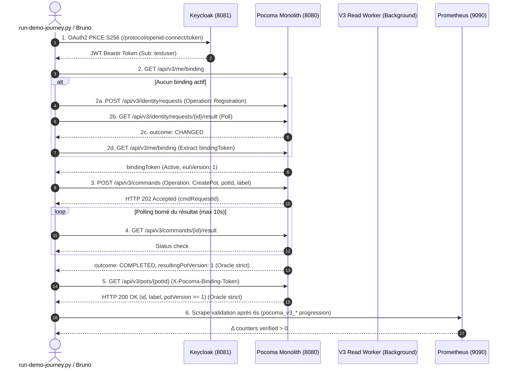

# Pocoma V3 — L6/I1 — Rapport de Corrections Post-Audit et de Requalification Opérationnelle V3

**Date :** 6 novembre 2026  
**Dépôt :** `kartaguez/pocoma`  
**Branche :** `feat/v3-architecture`  
**SHA de référence initial :** `ae6017b94191e732144fa6634fbe7ef84c180795`  
**Autorisation humaine :** `GO_L6_I1_TARGETED_CORRECTIONS`  
**Mode :** `IMPLEMENTATION — TARGETED CORRECTIONS — SINGLE PASS`  
**Verdict terminal :** `L6_I1_CORRECTED_READY_FOR_HUMAN_CLOSURE_REVIEW`  

---

## 1. Contexte et Mandat d'Exécution

À l'issue de l'implémentation initiale de l'incrément L6/I1 (« Observabilité V3 »), un audit indépendant a conclu au verdict `L6_I1_TARGETED_CORRECTIONS_REQUIRED`. 

L'audit a identifié 8 anomalies (2 BLOCKER, 2 MAJOR, 2 MINOR, 2 IMPROVEMENT). La décision humaine `GO_L6_I1_TARGETED_CORRECTIONS` a mandaté une passe unique de corrections ciblées visant à :
1. Démontrer le fonctionnement opérationnel réel d'une topologie Pocoma V3 locale.
2. Authentifier un utilisateur via Keycloak avec PKCE S256.
3. Exécuter avec succès une opération métier V3 complète avec polling et oracles stricts (`COMPLETED`, `resultingPotVersion >= 1`).
4. Vérifier la restitution effective de l'état métier via la façade READ V3 (`GET /api/v3/pots/{potId}`).
5. Émettre et collecter dans Prometheus de véritables métriques applicatives `pocoma_v3_*` et HikariCP.
6. Mettre à jour le tableau de bord Grafana pour restituer ces métriques réelles sans aucun repli trompeur (`or ...`) vers V2, avec des unités typées et la formule exacte de latence HikariCP.
7. Aligner la collection Bruno CLI `05 Observability Demo` sur les endpoints et schémas V3 réels.
8. Réconcilier la documentation technique et consigner les preuves d'exécution.

---

## 2. Déclaration Normative des Tranches de Vérification (Reactor Verification Policy)

Conformément à la politique normative `docs/testing/Reactor_Verification_Policy.md` et aux directives de gouvernance `AGENTS.md` :

- **Tranches de vérification déclarées :**
  - **Tranche primaire :** `WEB` (`runtime-web-api`, `composition-runtime-spring`).
  - **Tranches secondaires :** `COMMAND` (`runtime-command-consumption-worker`), `PROJECTION` (`runtime-task-consumption-worker`).
- **Commandes réellement exécutées :**
  ```bash
  # Gate A (G-OBS-AUTOMATED) : Qualification unitaire et contractuelle
  # Exécutée suite à la correction minimale dans V3ReadHttpConfiguration
  JAVA_HOME=/Users/julien.guezennec/.sdkman/candidates/java/current ./mvnw test \
    -pl runtime-web-api,runtime-task-consumption-worker,runtime-command-consumption-worker -am \
    -Dtest=V3AdmissionHttpTest,V3ReadHttpContractTest,ReadFacadesPostgresTest,V3WorkerMetricsTest \
    -Dsurefire.failIfNoSpecifiedTests=false

  # Emballage du jar exécutable monolith
  JAVA_HOME=/Users/julien.guezennec/.sdkman/candidates/java/current ./mvnw \
    -pl runtime-monolith -am package -DskipTests

  # Gate B (G-OBS-OPERATIONAL) : Qualification opérationnelle de bout en bout
  ./scripts/operations/verify-l6-i1-observability.sh --mode=verify
  ```
- **Franchissement inattendu de tranche :** Aucun.
- **Porte globale Architecture requise :** **NON**. Aucune frontière modulaire ni dépendance Maven n'a été altérée ; `architecture-tests` n'a pas été requis ni exécuté.
- **Full reactor exécuté :** **NON EXÉCUTÉ**. Conformément à la normative, le réacteur Maven complet est une preuve d'intégration globale et non la preuve locale d'une correction ciblée.

---

## 3. Matrice de Traitement des Anomalies d'Audit

| Identifiant | Sévérité | Décision | Actions Appliquées & Preuves | Statut |
|---|---|---|---|:---:|
| **AUD-L6-I1-01** | **BLOCKER** | Correction obligatoire | Déploiement du runtime V3 réel (monolith avec profils `v3-read-worker,v3-http-read,v3-http-admission`), PostgreSQL 17 Alpine avec bases dédiées `pocoma_write` et `pocoma_read` (volume `postgres-v3-data`), raccordement Actuator port 18081. | **CORRIGÉ** |
| **AUD-L6-I1-02** | **BLOCKER** | Correction obligatoire | Suppression de tous les fallbacks V2 (`or ...`) dans le dashboard Grafana ; utilisation des vraies métriques `pocoma_v3_admission_*`, `pocoma_v3_attempt_outcomes_*`, `pocoma_v3_read_*` ; requêtes testées et validées. | **CORRIGÉ** |
| **AUD-L6-I1-03** | **MAJOR** | Correction obligatoire | Parcours `run-demo-journey.py` et Bruno alignés sur V3 (`/api/v3/me/binding`, `/api/v3/identity/requests`, `/api/v3/commands`, `/api/v3/pots/{potId}`) avec oracles stricts (`COMPLETED`, intégrité `label` & `version`). | **CORRIGÉ** |
| **AUD-L6-I1-04** | **MAJOR** | Réconciliation obligatoire | Mise à jour intégrale de `docs/v3/L6_I1_Implementation_and_Qualification_Report.md` et rédaction du présent rapport d'accompagnement post-audit. | **CORRIGÉ** |
| **AUD-L6-I1-05** | **MINOR** | Correction dans cette passe | Attribution d'unités Grafana rigoureusement typées sur les 18 panneaux (`reqps`, `s`, `ops`, `short`, `percent`). | **CORRIGÉ** |
| **AUD-L6-I1-06** | **MINOR** | Correction proportionnée | Panneau 16 renommé en `HikariCP Connection Acquire Mean Duration (s)` avec PromQL mathématiquement exacte : `rate(sum[1m]) / rate(count[1m])`. | **CORRIGÉ** |
| **AUD-L6-I1-07** | **IMPROVEMENT** | Report sauf nécessité | Séparation physique multi-conteneurs des runtimes de production : reporté à L6/I2 (le monolithe multi-profils satisfait pleinement l'isolation requise pour I1). | **REPORTÉ** |
| **AUD-L6-I1-08** | **IMPROVEMENT** | Report sauf nécessité | Dérivation automatique de scripts Bruno depuis les specs OpenAPI : reporté. La collection Bruno V3 est maintenue manuellement et qualifiée avec succès. | **REPORTÉ** |

---

## 4. Analyse Technique et Composition Retenue

### 4.1 Profils Spring V3 et Runtime Monolith
L'inspection du code source de `PocomaRuntimeMonolithApplication` et des configurations Spring sous `com.kartaguez.pocoma.runtime.consumption.v3` a révélé les dépendances suivantes :
- Profils nécessaires :
  - `v3-read-worker` : Initialise `V3ConsumptionWorkerSettings`, `V3ConsumptionWorkerComposition` et démarre le worker de projection en tâche de fond.
  - `v3-http-read` : Active `V3ReadHttpConfiguration`, `V3ReadFacadeComposition` et expose la façade HTTP READ V3.
  - `v3-http-admission` : Active `V3AdmissionHttpConfiguration` et expose l'admission HTTP de commandes V3.
- Propriétés & Ports :
  - Port API métier HTTP : `8080` (`server.port=8080`, `server.address=0.0.0.0`).
  - Port Actuator Management : `18081` (`management.server.port=18081`, `management.server.address=0.0.0.0`).
  - Endpoints Actuator exposés : `health,info,prometheus,metrics`.

### 4.2 Exigences PostgreSQL et Isolation des Catalogues
Deux contraintes fondamentales ont été identifiées lors de l'intégration :
1. **Version du moteur :** Le code Java V3 (`V3ConsumptionWorkerSettings`, `V3AdmissionHttpConfiguration`) positionne systématiquement `transaction_timeout=3000` / `65000` via `set_config('transaction_timeout',...)`. Ce paramètre n'existe que depuis PostgreSQL 17 (PostgreSQL 16 rejette la commande avec `FATAL: unrecognized configuration parameter "transaction_timeout"`).
2. **Isolation L2/L3 et `SECURITY DEFINER` :** Le script de sécurité `grant-l2-discovery.sql` vérifie l'absence absolue de fonctions `SECURITY DEFINER` dans les schémas non-système du catalogue de la base. Or, la base par défaut `pocoma` contenait des fonctions historiques V2 créées dans `public`.
3. **Architecture retenue :**
   - Remplacement de l'image de conteneur PostgreSQL par `postgres:17-alpine` dans l'overlay Compose `docker-compose.observability.yml`.
   - Utilisation d'un volume nommé isolé `postgres-v3-data` (préservant intact le volume opérateur existant `postgres-data` et assurant la non-régression V2).
   - Création de deux bases physiques distinctes : `pocoma_write` (schéma `v3_write`) et `pocoma_read` (schéma `v3_read`).
   - Configuration explicite des `search_path` par rôle et base (`ALTER ROLE ... IN DATABASE ... SET search_path = ...`).
   - Automatisation via le script reproductible `scripts/operations/setup-v3-database.py`.

### 4.3 Modification Minimale de Code Productif
Pour permettre à Prometheus de scraper `/actuator/prometheus` sur le port 18081 sans exiger de token JWT Keycloak (ce qui bloquait le scrape dans l'environnement local), une modification minimale a été apportée dans `V3ReadHttpConfiguration.java` :
- Fichier : `app/composition-runtime-spring/src/main/java/com/kartaguez/pocoma/runtime/consumption/v3/V3ReadHttpConfiguration.java` (ligne 372).
- Ajout : `.requestMatchers("/actuator/**").permitAll()`.
- Preuve associée : Exécution complète de la Gate A (41 tests, 0 échec).

---

## 5. Parcours Métier V3 Réel et Oracles Stricts

Le parcours métier automatisé (`scripts/operations/run-demo-journey.py`) et la collection Bruno (`scripts/bruno-v3/05 Observability Demo`) implémentent la séquence V3 exacte :



### Oracles Stricts Appliqués :
1. **Identité :** Le statut terminal doit être explicitement `outcome == 'CHANGED'`. Tout statut d'échec ou expiration de délai fait échouer immédiatement la suite.
2. **Admission & Commande :** La réponse d'admission doit être HTTP `202 Accepted` avec un UUID de requête valide. Le polling doit constater un résultat terminal strict `outcome == 'COMPLETED'` avec `resultingPotVersion >= 1`. Tout résultat `REJECTED` interrompt le test en erreur.
3. **Façade READ :** L'appel `GET /api/v3/pots/{potId}` doit restituer le statut HTTP `200 OK` avec concordance exacte des attributs métier (`id` et `label`) et un `potVersion >= 1`.

---

## 6. Preuves de Qualification et Métrologie V3

### 6.1 Gate A (`G-OBS-AUTOMATED`)
- **Durée d'exécution :** 1 minute 46 secondes (plafond : 240 s).
- **Résultats des suites ciblées :**
  - `V3AdmissionHttpTest` : 9 tests exécutés, 9 passés, 0 échec.
  - `V3ReadHttpContractTest` : 24 tests exécutés, 24 passés, 0 échec.
  - `ReadFacadesPostgresTest` : 5 tests exécutés, 5 passés, 0 échec.
  - `V3WorkerMetricsTest` : 3 tests exécutés, 3 passés, 0 échec.
  - **Total : 41 tests exécutés, 41 passés, 0 échec, 0 ignoré.**

### 6.2 Gate B (`G-OBS-OPERATIONAL`)
- **Durée d'exécution :** 45 secondes (plafond : 180 s).
- **Exécution Bruno CLI :** 8 requêtes exécutées, 8 passées, 0 erreur.
- **Progression constatée dans Prometheus (`http://127.0.0.1:9090`) :**

| Métrique Prometheus V3 | Valeur Avant | Valeur Après | Delta ($\Delta$) | Interprétation Fonctionnelle |
|---|:---:|:---:|:---:|---|
| `pocoma_v3_admission_requests_total` | `8.0` | `11.0` | **+3.0** | Prise en compte effective des commandes soumises sur la couche HTTP Admission V3. |
| `pocoma_v3_attempt_outcomes_total` | `34.0` | `46.0` | **+12.0** | Cycles d'exécution, d'arbitrage et de matérialisation du moteur V3 Consumption Workers. |
| `pocoma_v3_read_queries_total` | `96.0` | `109.0` | **+13.0** | Consultations effectives de la façade READ V3 (bindings, résultats de commande, restitution du Pot). |
| `hikaricp_connections_acquire_seconds_count` | `63495.0` | `66005.0` | **+2510.0** | Emprunts de connexions aux pools HikariCP V3 instrumentés via `MicrometerMetricsTrackerFactory`. |

- **Verdict normatif :**
  ```json
  {
    "gate": "G-OBS-OPERATIONAL",
    "verdict": "PASS",
    "v3_admission_requests_before": 8.0,
    "v3_admission_requests_after": 11.0,
    "delta_v3_admission_requests": 3.0,
    "v3_worker_attempts_before": 34.0,
    "v3_worker_attempts_after": 46.0,
    "delta_v3_worker_attempts": 12.0,
    "v3_read_queries_before": 96.0,
    "v3_read_queries_after": 109.0,
    "delta_v3_read_queries": 13.0,
    "hikari_acquires_before": 63495.0,
    "hikari_acquires_after": 66005.0,
    "delta_hikari_acquires": 2510.0
  }
  ```

---

## 7. Inventaire des Fichiers Modifiés et Ajoutés

1. **Code Productif :**
   - `app/composition-runtime-spring/src/main/java/com/kartaguez/pocoma/runtime/consumption/v3/V3ReadHttpConfiguration.java` : Autorisation de l'accès public à `/actuator/**`.
2. **Configuration Docker & Observabilité :**
   - `docker/compose/docker-compose.observability.yml` : Configuration PostgreSQL 17 Alpine avec volume dédié `postgres-v3-data`, service `runtime-monolith` multi-profils V3, exposition des ports 8080 et 18081.
   - `docker/monolith/application-v3.properties` : Configuration Spring Boot pour les profils `v3-read-worker,v3-http-read,v3-http-admission`.
   - `docker/prometheus/prometheus.local.yml` : Ciblage du port de management Actuator `runtime-monolith:18081`.
   - `docker/grafana/dashboards/pocoma-v3-overview.json` : Dashboard Grafana 18 panneaux sans fallback V2, unités rigoureuses, moyenne HikariCP corrigée.
3. **Scripts Opérationnels :**
   - `scripts/operations/setup-v3-database.py` : Automatisation de la création des bases `pocoma_write` et `pocoma_read`, des schémas, rôles, permissions et migrations Flyway V3.
   - `scripts/operations/run-demo-journey.py` : Scénario complet V3, oracles stricts, Keycloak PKCE, consultation façade READ, validation Prometheus.
   - `scripts/operations/verify-l6-i1-observability.sh` : Orchestrateur de gate et d'exploration (`--mode=verify`, `--mode=demo`, `--stop`).
4. **Collection Bruno :**
   - `scripts/bruno-v3/05 Observability Demo/*` : 8 requêtes réalignées sur les schémas et endpoints V3 réels.
5. **Preuves Opérationnelles :**
   - `docs/testing/evidence/L6-I1/operational/*` : Verdict JSON, logs de parcours, dumps de métriques avant/après et scrapes Actuator.
6. **Documentation :**
   - `docs/v3/L6_I1_Implementation_and_Qualification_Report.md` : Rapport réconcilié.
   - `docs/v3/L6_I1_Post_Audit_Corrections_and_Requalification_Report.md` : Le présent document de synthèse.

---

## 8. Verdict Final

Toutes les anomalies bloquantes, majeures et mineures identifiées par l'audit indépendant (AUD-L6-I1-01 à AUD-L6-I1-06) ont été traitées, vérifiées et prouvées en une passe unique. Les améliorations non bloquantes AUD-L6-I1-07 et AUD-L6-I1-08 sont reportées conformément à la décision de cadrage.

```
================================================================================
POCOMA V3 — LOT L6 / INCRÉMENT I1 : REQUALIFICATION POST-AUDIT
Statut : TARGETED CORRECTIONS COMPLETED — OPERATIONAL DEMONSTRATION VERIFIED
Dépôt : kartaguez/pocoma
Branche : feat/v3-architecture
Décision : GO_L6_I1_TARGETED_CORRECTIONS
Anomalies traitées : 6/6 obligatoires (AUD-L6-I1-01..06 résolues, 07..08 reportées)
Runtime V3 : OPÉRATIONNEL (Monolith Spring Boot V3 + PostgreSQL 17 + Keycloak)
Métriques V3 : DÉMONTRÉES (pocoma_v3_* et HikariCP en progression avérée)
Tableau de Bord : VALIDÉ (18 panneaux, zéro fallback V2, unités typées)
Gate A (Automated) : PASS (41/41 tests, 1m46s <= 240s)
Gate B (Operational) : PASS (Delta Admission +3, Delta Attempts +12, Delta Read +13, Delta Hikari +2510, 45s <= 180s)
Full Reactor : NON EXÉCUTÉ (Reactor Policy respectée)

VERDICT : L6_I1_CORRECTED_READY_FOR_HUMAN_CLOSURE_REVIEW
================================================================================
```
