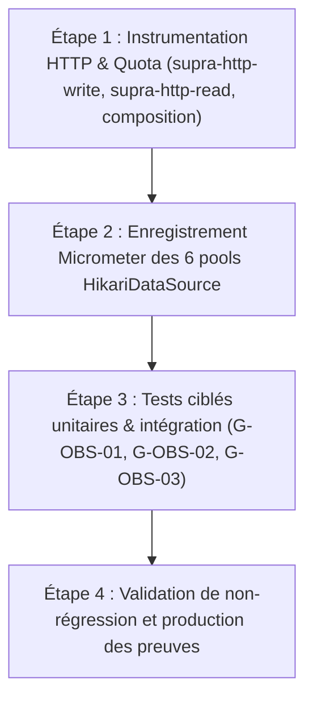

# Pocoma V3 — L6/I1 — Plan Technique d'Implémentation de l'Observabilité V3

**Date :** 6 novembre 2026  
**Dépôt :** `kartaguez/pocoma`  
**Branche :** `feat/v3-architecture`  
**Référence Git d'entrée :** `0d11082e397337b4546dd751defec146ee5095e0` (`0d11082e`)  
**Autorisation :** `GO_L6_I1_ONLY`  
**Statut du document :** `DESIGN READY FOR REVIEW`  
**Verdict :** `L6_I1_IMPLEMENTATION_PLAN_READY_FOR_REVIEW`  

---

## 1. Contexte, Autorisation et Objectifs de L6/I1

### 1.1 Contexte programmatique et historique
Le lot L5 (« Supras et parcours externes V3 ») a été formellement et définitivement clos par décision humaine ([L5_Q5D_Formal_Closure_Decision.md](L5_Q5D_Formal_Closure_Decision.md)) après le succès irréfutable de la certification globale Q5-B6 (61/61 modules SUCCESS, 2 344/2 344 tests PASS, 170/170 Architecture PASS, Bruno B5 70/70 PASS au commit `2890d88f6fa94ff2262d08a2809f48512ce27c9d`).

L'audit indépendant transversal Q5-C ([L5_Q5C_Quality_Performance_and_Restructuring_Audit.md](L5_Q5C_Quality_Performance_and_Restructuring_Audit.md)) a formulé des recommandations de restructuration et d'optimisation (dégel du quota READ $Q=2 \rightarrow 16$, réduction du lease 240 s $\rightarrow$ 60 s, calcul incrémental des balances, découpage des workers, fusion de modules Maven).  
Par l'acte fondateur Q5-D, le responsable du programme a formellement statué :
> **Toutes les propositions d'optimisation et de restructuration issues de Q5-C sont formellement différées après le lot L6.**  
> **Le lot L6 (« Performance & Exploitation ») a pour mission prioritaire et exclusive de rendre le socle V3 entièrement observable et mesurable dans son état fonctionnel et architectural existant.**  
> **Principe directeur absolu : observer le système tel qu'il existe, sans optimiser prématurément ni restructurer son architecture.**

Le cadrage général de L6 est accepté, et l'incrément I1 est formellement autorisé sous le mandat :  
`GO_L6_I1_ONLY` — Conception technique de l'observabilité V3.

### 1.2 Objectif de l'incrément I1
L'objectif de L6/I1 est de concevoir l'instrumentation fine du socle V3 complet pour collecter l'ensemble des données quantitatives indispensables aux futures décisions d'ingénierie, de dimensionnement et d'exploitation (lots ultérieurs L6/I2, L6/I3, L7 et L8).

L'instrumentation doit couvrir de manière cohérente :
- Les frontières temporelles T0 à T6 définies dans [SPEC-08 §2](SPEC-08_Observability.md#2-objectif-de-mesure-et-unités-de-progression).
- Les objectifs de latence et les profils de données définis dans [SPEC-09](SPEC-09_Performance.md).
- Les exigences de certification de robustesse, d'équité et de reprise définies dans [SPEC-10 §§10–12](SPEC-10_Test_Certification.md).
- Les réserves d'exploitation ouvertes à la clôture de L5 :
  * `FIND-L4-01` : Sémaphore READ $Q=2$ et contention de consultation.
  * `FIND-L2-01` : Inflation mécanique du lease à 240 s et marges de renouvellement.
  * `FIND-L4-03` : Coût du recalcul sans état des soldes à $V$ sur grands Pots (2 000 dépenses).
  * `FIND-L1-01` : Profilage SQL des requêtes multi-jointures `openComponent`.
  * `RES-ENV-01` : Taux d'utilisation physique des pools Hikari et détection de saturation.

---

## 2. Audit Préalable Exhaustif de l'Existant

Un examen systématique du code source sous `app/`, `docker/` et `scripts/` permet d'établir l'inventaire contradictoire ci-dessous.  
Chaque composant est classifié selon les catégories normatives :
- **REUSE** : Réutilisable tel quel sans altération.
- **EXTEND** : Socle pertinent à compléter ou enrichir à la marge.
- **REPLACE** : Composant obsolète ou inadapté à remplacer par le mécanisme V3 cible.
- **NOT NEEDED** : Composant hors périmètre ou reliquat historique sans valeur pour V3.

### 2.1 Synthèse de l'inventaire de l'existant

| Domaine | Élément / Classe / Ressource | Module(s) concerné(s) | Constat & Diagnostic technique | Classification | Action I1 |
|---|---|---|---|:---:|---|
| **Contrats & Ports** | `ConsumptionObservation` (interface & `Phase` / `Outcome`) | `engine-consumption` | Port d'observation non bloquant (`safely`), 45 phases d'orchestration et d'exécution, isolation transactionnelle absolue. | **REUSE** | Conserver intact le port. |
| **Contrats & Ports** | `TraceContext`, `TraceContextHolder` | `contracts-observability` | Contrat de corrélation ThreadLocal contenant `traceId`, `userId`, `httpMethod`, `requestStartedAtNanos`. | **REUSE** | Maintenir pour la corrélation HTTP et les journaux de diagnostic. |
| **Micrometer & Actuator** | `spring-boot-starter-actuator` | Tous les runtimes sous `app/` | Présent dans les 10 runtimes et monolithe. Endpoints `/actuator/health` et `/actuator/prometheus` exposés. | **REUSE** | Utiliser l'infrastructure Actuator existante. Aucun nouveau starter. |
| **Micrometer & Actuator** | `micrometer-registry-prometheus` | `runtime-monolith`, `runtime-web-api`, `composition-runtime-spring` | Registre Prometheus configuré et fonctionnel pour l'export Actuator. | **REUSE** | Conserver la configuration d'exposition Prometheus. |
| **Télémétrie Moteur** | `MicrometerV3ConsumptionObservation` | `composition-runtime-spring` | Implémentation Micrometer complète de `ConsumptionObservation`. Mappe les 9 Consumptions V3 canoniques, timers d'attempt, phases prepare/finalize, claims, rotations, jauges de capacité. | **REUSE / EXTEND** | Réutiliser le cœur éprouvé ; étendre à la marge pour les délais de découverte/enrôlement (lag). |
| **Télémétrie V2** | `MicrometerConsumptionPollingWorkerObservation` | `composition-runtime-spring` | Observation liée aux anciens workers V2 polling par tâche (`ConsumptionPollingWorkerObservation`). Inadaptée aux slots V3. | **NOT NEEDED** | Ne pas réutiliser pour V3. Délaissé pour le socle V3. |
| **Télémétrie V2** | `MeteredAdvanceLatestKnownVersionUseCase` | `runtime-latest-known-version-consumption-worker` | Décorateur Micrometer spécifique au worker LKV historique. | **NOT NEEDED** | Hors du chemin V3 canonique (aucun LKV en V3). |
| **Traces & Filtres** | `TraceCorrelationFilter` | `composition-runtime-spring` | Filtre Servlet gérant `X-Trace-Id`, injection MDC et logs de début/fin d'opération HTTP avec `duration_ms`. Aucun compteur ni timer Micrometer. | **EXTEND** | Conserver pour MDC/logs ; adjoindre la métrologie Micrometer sans modifier la logique de trace. |
| **Admission HTTP** | `V3AdmissionController`, `V3AdmissionTransport` | `supra-http-write` | `OncePerRequestFilter` gérant la sémaphore de capacité (`Limits.capacity()`), le parsing strict et les erreurs 202/400/503. Aucune sonde Micrometer active. | **EXTEND** | Instrumenter dans le transport : durée d'admission (T0), décompte par endpoint/status, jauge de capacité. |
| **Consultation READ** | `V3ReadController`, `V3ReadTransport` | `supra-http-read` | Contrôleur et transport READ. Transport possède un sémaphore `HTTP_PERMITS = 2` non instrumenté. Aucune métrique Micrometer. | **EXTEND** | Instrumenter durée de requête READ (T6), décompte par endpoint/status, jauge de capacité HTTP. |
| **Façades READ & Quota** | `V3ReadFacadeComposition.Services` | `composition-runtime-spring` | Gère le sémaphore métier `SQL_PERMITS = 2` (`FIND-L4-01`). Rejets `!quota.tryAcquire()` muets en télémétrie. Requêtes non chronométrées. | **EXTEND** | Instrumenter le temps d'exécution des queries READ, les rejets de quota et la jauge de permis disponibles. |
| **Transactions & Événements** | `MeteredEventTransactionSuffix` | `composition-runtime-spring` | Suffixe transactionnel mesurant via `TransactionSynchronization` : durée du suffixe, tail de commit, et résolutions (committed / rolled_back). | **REUSE** | Réutiliser tel quel pour la mesure du commit d'événements et de la terminaison transactionnelle (T5). |
| **Pools JDBC** | 6 `HikariDataSource` (Worker, Admission, Read) | `composition-runtime-spring` | Pools instanciés par code : `writeBusiness`, `writeControl`, `readBusiness`, `readControl`, `v3AdmissionPool`, `v3HttpReadPool`. Aucun `setMetricRegistry(...)` explicite. | **EXTEND** | Enregistrer explicitement le `MeterRegistry` sur chaque pool Hikari pour exposer les métriques natives `hikaricp.*`. |
| **Projections métier** | 7 Participants READ / Result | `engine-materialize-*`, `projector-pot` | Les 7 participants (`PotVersion`, `PotBalance`, `PotVisibility`, `CurrentBinding`, `Invitation`, `CommandResult`, `IdentityRequestResult`) sont pilotés par `ConsumptionEngine`. | **REUSE** | Déjà instrumentés de manière transparente et indépendante par `ConsumptionEngine` via `Phase.PREPARE` / `Phase.FINALIZE`. |
| **Workers & Leases** | `V3ConsumptionWorker`, `WorkerCapacity` | `orchestrator-poll-consumption`, `engine-consumption` | Boucles de rotation, cadences, acquisition/renouvellement des baux de partition et de slots. Entièrement branché sur `ConsumptionObservation`. | **REUSE** | Télémétrie complète déjà active dans `MicrometerV3ConsumptionObservation`. |
| **Scripts & k6** | Scénarios k6 (`smoke.js`, `stress.js`, `lib/prometheus-scraper.js`) | `scripts/k6/` | Scénarios de charge historiques ciblant les endpoints synchrones V2 supprimés. `prometheus-scraper.js` parse Actuator. | **REPLACE (pour k6)** | Scripts k6 conservés comme modèles de charge ; refonte des cibles vers `/api/v3/*` différée à L6/I2. |
| **Tests d'observabilité** | `V3WorkerMetricsTest` (`i5_m01`…`i5_m03`) | `runtime-command-consumption-worker` | Valide l'absence d'effets secondaires, les métriques nominales, les oracles négatifs (O01-N) et la résistance aux pannes d'observateur. | **REUSE** | Base d'oracles de test pour valider l'instrumentation I1. |
| **Tests de façade READ** | `ReadFacadesPostgresTest` | `runtime-task-consumption-worker` | Vérifie l'emprunt physique Hikari et les requêtes READ sous transaction isolée. | **REUSE** | À enrichir par la validation des métriques de quota $Q=2$. |

---

## 3. Architecture Cible pour L6/I1

### 3.1 Examen de la question architecturale prioritaire

> **Question prioritaire :**  
> *Peut-on instrumenter les moteurs et orchestrateurs génériques une seule fois, puis obtenir les métriques spécifiques par configuration ou composition, sans multiplier les sondes dans chaque implémentation spécialisée ?*

#### Analyse approfondie :
1. **Faisabilité démontrée par l'architecture hexagonale V3 :**  
   L'architecture de Pocoma sépare rigoureusement les moteurs génériques d'orchestration (`ConsumptionEngine`, `V3ConsumptionWorker`) des implémentations de domaine spécialisées (`ConsumptionParticipant`).  
   Chaque participant (`MaterializePotBalanceParticipant`, `MaterializePotVersionParticipant`, `ExecutePotCommandParticipant`, etc.) est exécuté par le `ConsumptionEngine` générique au travers du même cycle canonique :
   $$\text{Slot éligible} \xrightarrow{\text{ACQUIRE}} \text{Ticket/Claim} \xrightarrow{\text{PREPARE}} \text{Préparation} \xrightarrow{\text{FINALIZE}} \text{Transaction DB} \xrightarrow{\text{COMMIT}} \text{Terminaison}$$
2. **Couverture unifiée sans sondes spécialisées :**  
   En transmettant le `definition.id()` (`ConsumptionId`) à chaque appel de `ConsumptionObservation.record(...)`, le moteur générique permet à `MicrometerV3ConsumptionObservation` de taguer chaque métrique avec le tag dimensionnel `consumption="PotBalance"`, `consumption="Command"`, `consumption="PotVersion"`, etc.  
   **Conséquence immédiate :** 100% des participants de projection, de commande et d'identité bénéficient d'une instrumentation uniforme et exhaustive de leurs durées (`attempt.duration`, `attempt.phase.duration`), de leurs débits, de leurs taux d'échec et de leurs quarantaines, **sans écrire une seule ligne de code de télémétrie dans les classes métier ou adaptateurs**.
3. **Limites de l'approche générique :**  
   - *Sous-phases internes au domaine :* Le moteur générique ne peut pas mesurer séparément les étapes internes à la méthode `prepare(...)` d'un participant (par exemple le temps exact de calcul rationnel des balances $O(N)$ vs le chargement SQL des composantes financières). Cependant, SPEC-08 n'exige pas de découpage intra-participant en I1 ; la durée globale `phase="prepare"` de `PotBalance` fournit déjà l'exact indicateur nécessaire pour caractériser le risque `FIND-L4-03`.
   - *Frontières HTTP hors moteur :* L'admission HTTP (T0) et la consultation HTTP READ (T6) sont situées en amont et en aval de la boucle de Consumption. Elles nécessitent des sondes spécifiques au transport Web.
4. **Coût et bénéfice :**  
   - *Coût :* Nul. L'infrastructure existe déjà dans `engine-consumption` et `composition-runtime-spring`.
   - *Bénéfice :* Respect absolu de l'indépendance des moteurs et du domaine pur ; zéro couplage entre Micrometer et les packages de domaine ; zéro duplication de sondes ; ajout futur d'une nouvelle projection sans impact sur l'instrumentation.

### 3.2 Cartographie des 12 points d'instrumentation et frontières T0 à T6

Le schéma ci-dessous positionne les points de mesure sur le flux asynchrone V3 :

```mermaid
flowchart TD
    subgraph Client["Client / Bruno / k6"]
        C0["Départ Requête HTTP"]
        C6["Réception Réponse READ"]
    end

    subgraph HTTP_Write["Admission HTTP (T0)"]
        T0_In["V3AdmissionTransport: Entry"]
        T0_DB["JdbcAdmissionStore: Commit Demande"]
        T0_Out["202 Accepted + Location"]
    end

    subgraph Discovery_Slot["Discovery & Enrôlement (T1 -> T2)"]
        T1["Source publiée committée (Événement / Demande)"]
        T2["v3_consumption_slot inséré (Discovery)"]
    end

    subgraph Engine_Claim["Orchestration & Acquisition (T2 -> T3)"]
        T3_Poll["V3ConsumptionWorker: Tour de rotation"]
        T3_Acq["ConsumptionEngine: Claim acquis (ACQUIRE)"]
    end

    subgraph Execution["Préparation & Transaction (T3 -> T5)"]
        T4_Prep["ConsumptionParticipant: prepare() (PREPARE)"]
        T5_Tx["AttemptTransactions: finalize() (FINALIZE)"]
        T5_Suffix["MeteredEventTransactionSuffix: Commit Events"]
    end

    subgraph Read_Projections["Projections Indépendantes"]
        P_Ver["MaterializePotVersion (Indépendant)"]
        P_Bal["MaterializePotBalance (Indépendant)"]
        P_Vis["MaterializePotVisibility (Indépendant)"]
        P_Res["MaterializeCommandResult (Indépendant)"]
    end

    subgraph HTTP_Read["Consultation READ (T6)"]
        T6_In["V3ReadTransport: Entry (Capacité HTTP)"]
        T6_Quota["V3ReadFacadeComposition: Quota Q=2"]
        T6_SQL["JdbcPot*Store: Lecture SQL"]
        T6_Out["200 OK + Payload Pot / Balance"]
    end

    C0 --> T0_In
    T0_In --> T0_DB --> T0_Out
    T0_DB -.-> T1
    T1 --> T2
    T2 --> T3_Poll --> T3_Acq
    T3_Acq --> T4_Prep --> T5_Tx --> T5_Suffix
    T5_Suffix -.-> P_Ver & P_Bal & P_Vis & P_Res
    P_Ver & P_Bal & P_Vis -.-> T6_SQL
    C6 <-- T6_Out <-- T6_SQL <-- T6_Quota <-- T6_In
```

#### Alignement des 12 points d'instrumentation requis :
1. **Admission HTTP (T0) :** Mesuré au niveau de `V3AdmissionTransport`. Chronomètre depuis la réception de la requête jusqu'à l'émission du statut 202 (ou erreur 400/409/503).
2. **Discovery (T1 $\rightarrow$ T2) :** Mesuré via `V3ConsumptionWorker` et `ConsumptionObservation` (`Phase.DISCOVERY_CYCLE`, `Phase.DISCOVERY_EXAMINED`, `Phase.DISCOVERY_ADVANCED`). Calcul du délai d'enrôlement (lag).
3. **Création et acquisition des slots (T2 $\rightarrow$ T3) :** Mesuré via `ConsumptionEngine` (`Phase.ACQUIRE`, `Phase.ACQUISITION_EXAMINED`, `claim.operations`).
4. **Préparation des commandes (T3 $\rightarrow$ T4) :** Mesuré via `ConsumptionEngine` (`Phase.PREPARE`, `pocoma.v3.attempt.phase.duration` avec `phase="prepare"`).
5. **Exécution transactionnelle (T4 $\rightarrow$ T5) :** Mesuré via `ConsumptionEngine` (`Phase.FINALIZE`) et `AttemptTransactions`.
6. **Production des événements :** Mesuré via `MeteredEventTransactionSuffix` (`pocoma.event.sequencing.suffix`, `pocoma.event.sequencing.commit.tail`, résolutions committed/rolled_back).
7. **Matérialisation des résultats :** Dérivé de `ConsumptionEngine` sous les labels `consumption="CommandResult"` et `consumption="IdentityRequestResult"`.
8. **Matérialisation indépendante des projections :** Dérivé de `ConsumptionEngine` sous les labels `consumption="PotVersion"`, `consumption="PotBalance"`, `consumption="PotVisibility"`, `consumption="Invitation"`, `consumption="CurrentBinding"`. Branches strictement découplées.
9. **Consultation READ (T6) :** Mesuré dans `V3ReadTransport` (durée HTTP et statuts) et dans `V3ReadFacadeComposition.Services` (durée des queries SQL et surveillance du sémaphore $Q=2$).
10. **Leases et reprise :** Mesuré dans `V3ConsumptionWorker` (`pocoma.v3.lease.operations`, `pocoma.v3.renewal.duration`, `pocoma.v3.renewal.schedule.lag`, `pocoma.v3.quarantine.transitions`).
11. **Files d'attente et retards :** Mesuré par la jauge `pocoma.v3.physical.pending`, complétée par une jauge de slots non réclamés / âge du backlog par consommation.
12. **Pools JDBC et ressources système :** Mesuré via l'enregistrement Micrometer des pools Hikari (`hikaricp.connections.active`, `idle`, `pending`, `acquire`) et les métriques JVM Actuator (`process.cpu.usage`, `jvm.memory.used`).

---

## 4. Catalogue des Métriques V3

Conformément à SPEC-08 §5, les règles cardinales suivantes sont strictement appliquées :
- **Aucun identifiant à forte cardinalité** (`potId`, `userId`, `requestId`, `eventId`, `traceId`, `claimToken`, `bindingToken`) n'est injecté dans les tags.
- Toutes les dimensions sont des énumérations finies et contrôlées.
- Les quantiles critiques (p50, p95, p99) sont instrumentés via des histogrammes Micrometer avec des SLO buckets adaptés aux exigences de SPEC-09.

### 4.1 Catalogue des métriques continues (Prometheus / Micrometer)

| Nom de la métrique | Type | Unité | Point exact de mesure | Tags / Dimensions autorisés | Cardinalité max | Précision & Biais | Coût unitaire | Test de certification | Décisions futures éclairées |
|---|:---:|:---:|---|---|:---:|---|:---:|---|---|
| `pocoma.v3.admission.http.duration` | Timer (Histogram) | secondes | `V3AdmissionTransport: doFilterInternal` | `endpoint` (`command`, `identity`), `status` (`202`, `400`, `409`, `413`, `503`) | 10 | Précision JVM `nanoTime()`. Inclut parsing + commit SQL + envoi réponse. | ~25 ns | Test unitaire transport + test postgres HTTP | Valider le SLO d'admission et dimensionner la capacité d'entrée HTTP. |
| `pocoma.v3.admission.requests` | Compteur | requêtes | `V3AdmissionTransport: doFilterInternal` | `endpoint`, `status` | 10 | Exact. | ~10 ns | Test d'admission nominal et cas d'erreur | Détecter les pointes de charge et les ratios d'erreurs/conflits d'idempotence. |
| `pocoma.v3.admission.capacity.available` | Jauge | permis | `V3AdmissionTransport: capacity.availablePermits()` | `endpoint` (`admission`) | 1 | Échantillonné à l'instant du scrape ou de la requête. | ~5 ns | Test de saturation d'admission | Dimensionner le sémaphore d'admission HTTP (`Limits.capacity()`). |
| `pocoma.v3.admission.payload.bytes` | DistributionSummary | octets | `V3AdmissionTransport: body.length` | `endpoint` | 2 | Taille physique exacte du JSON reçu. | ~15 ns | Test de payload limite (256 Ko) | Dimensionner les buffers de streaming et la charge réseau. |
| `pocoma.v3.discovery.duration` | Timer | secondes | `V3ConsumptionWorker: runDiscoveryCycle` | `consumption`, `outcome` (`confirmed`, `empty`, `capacity`) | 33 (11 cons $\times$ 3 outcomes) | Durée locale d'interrogation et enrôlement. | ~20 ns | `V3WorkerMetricsTest` | Identifier la surcharge SQL du polling de découverte à vide ou sous charge. |
| `pocoma.v3.discovery.references` | Compteur | références | `V3ConsumptionWorker: cycle Discovery` | `consumption`, `kind` (`examined`, `advanced`, `admitted`) | 33 | Exact, comptabilisé par lot de découverte. | ~10 ns | `V3WorkerMetricsTest: i5_m03` | Suivre le débit d'enrôlement et l'efficacité des index d'événements. |
| `pocoma.v3.claim.acquisition.duration` | Timer | secondes | `ConsumptionEngine: acquireOperation` | `consumption`, `outcome` (`confirmed`, `empty`, `busy`) | 33 | Durée de la transaction de verrouillage/mise à jour du slot. | ~20 ns | `V3WorkerMetricsTest: i5_m01` | Mesurer la contention de verrouillage des slots de partition. |
| `pocoma.v3.claim.operations` | Compteur | opérations | `ConsumptionEngine: measured(ACQUIRE/RENEW/LOST)` | `consumption`, `operation` (`acquire`, `renew`, `lost`), `outcome` | 66 | Exact. | ~10 ns | `V3WorkerMetricsTest` | Détecter les pertes de claims sous saturation ou crash worker. |
| `pocoma.v3.capacity.used` | Jauge | tickets | `WorkerCapacity: snapshot` | `scope` (`worker`, nom de la consommation) | 12 | Échantillonné via AtomicInteger en mémoire. Sans I/O. | ~5 ns | `V3WorkerMetricsTest` | Mesurer le taux d'allocation des permis d'exécution par worker. |
| `pocoma.v3.physical.pending` | Jauge | claims | `ConsumptionEngine: pending.size()` | `consumption` | 11 | Compteur atomique maintenu lors de la vie du handle. | ~5 ns | `V3WorkerMetricsTest` | Détecter les fuites de claims ou les blocages de finalisation. |
| `pocoma.v3.attempt.duration` | Timer (Histogram) | secondes | `ConsumptionEngine: executeOperation` | `consumption`, `outcome` (`committed`, `rolled_back`, `unknown`, `claim_lost`) | 44 | Durée complète de la tentative (prepare + finalize). | ~25 ns | `V3WorkerMetricsTest` | Évaluer le temps d'exécution bout en bout de chaque étape de traitement. |
| `pocoma.v3.attempt.phase.duration` | Timer (Histogram) | secondes | `ConsumptionEngine: measured(PREPARE/FINALIZE/CESSION)` | `consumption`, `phase` (`prepare`, `finalize`, `cession`), `outcome` | 99 | Durée isolée du calcul pur vs durée de la transaction DB. | ~25 ns | Test unitaire moteur | **Caractériser le coût du recalcul O(N) des balances sur grands Pots (`FIND-L4-03`).** |
| `pocoma.v3.attempt.outcomes` | Compteur | tentatives | `ConsumptionEngine: executeOperation` | `consumption`, `outcome` | 44 | Exact. | ~10 ns | `V3WorkerMetricsTest` | Détecter les rollbacks métier, collisions CAS et erreurs techniques. |
| `pocoma.v3.quarantine.transitions` | Compteur | slots | `ConsumptionEngine: controlSlots.cede` | `consumption` | 11 | Exact, incrémenté lors du passage en statut QUARANTINED. | ~10 ns | Test d'échecs répétés et quarantaine | Surveiller les empoisonnements et alimenter les alertes exploitant. |
| `pocoma.v3.read.http.duration` | Timer (Histogram) | secondes | `V3ReadTransport: doFilterInternal` | `endpoint` (`pot_current`, `pot_version`, `balance`, `expenses`, `visible`, `binding`, `command_result`), `status` | 56 | Durée HTTP vue côté serveur. | ~25 ns | Test de contrat HTTP READ | Vérifier le SLO de lecture utilisateur (p95 $\le 500$ ms). |
| `pocoma.v3.read.quota.permits` | Jauge | permis | `V3ReadFacadeComposition.Services: quota.availablePermits()` | `scope` (`business_read`) | 1 | Échantillonné sur la sémaphore $Q=2$ en mémoire. | ~5 ns | `ReadFacadesPostgresTest` | **Éclairer la décision de dégel du quota READ $Q=2$ (`FIND-L4-01`).** |
| `pocoma.v3.read.quota.rejections` | Compteur | rejets | `V3ReadFacadeComposition.Services: query (!tryAcquire)` | `scope` (`business_read`) | 1 | Incrémenté lorsque la requête reçoit un rejet 503 faute de permis. | ~10 ns | Test de contention READ | **Quantifier précisément la famine des lectures concurrentes sur $Q=2$.** |
| `pocoma.v3.read.query.duration` | Timer (Histogram) | secondes | `V3ReadFacadeComposition.Services: query` | `operation` (`current`, `at`, `balance`, `expenses`, `visible`, `binding`), `outcome` (`available`, `not_found`, `unavailable`, `invalid`) | 24 | Durée exacte de la transaction JDBC isolée de lecture. | ~25 ns | `ReadFacadesPostgresTest` | Isoler le coût de la requête SQL du temps de transport HTTP. |
| `pocoma.v3.renewal.duration` | Timer | secondes | `V3ConsumptionWorker: renewPartitions / renewClaims` | `authority` (`write`, `read`), `lane` (`0`, `1`, `2`), `outcome` | 18 | Durée de l'opération physique SQL de renouvellement de bail. | ~20 ns | `V3WorkerMetricsTest` | **Éclairer la décision d'ajustement du lease 240 s $\rightarrow$ 60 s (`FIND-L2-01`).** |
| `pocoma.v3.renewal.schedule.lag` | Timer | secondes | `V3ConsumptionWorker: planificateur de renouvellement` | `authority`, `lane`, `outcome` | 18 | Retard mesuré entre l'échéance théorique du renouvellement et son exécution réelle. | ~20 ns | `V3WorkerMetricsTest` | Vérifier que les threads de renouvellement ne subissent pas de famine. |
| `hikaricp.connections.active` | Jauge | connexions | `HikariPoolMXBean: getActiveConnections()` | `pool` (`writeBusiness`, `writeControl`, `readBusiness`, `readControl`, `admission`, `httpRead`) | 6 | Natif Hikari / Micrometer. | ~10 ns | `ReadFacadesPostgresTest` | **Mesurer la saturation réelle des connexions SQL sous charge (`RES-ENV-01`).** |
| `hikaricp.connections.acquire` | Timer | secondes | `HikariDataSource: getConnection()` | `pool` | 6 | Natif Hikari. Mesure le temps d'attente pour obtenir une connexion du pool. | ~20 ns | `ReadFacadesPostgresTest` | Détecter l'épuisement des pools Hikari et la contention JDBC. |

### 4.2 Mesures expérimentales k6 (Campagnes ultérieures L6/I2)
Les métriques continues ci-dessus sont collectées en permanence en production et en test via Micrometer/Prometheus.  
Les mesures expérimentales de bout en bout (T0 $\rightarrow$ T6) et les vérifications de SLO nécessitent un banc externe et seront exécutées sous k6 au lot L6/I2 :
- `pocoma_observed_e2e_command_to_balance_latency` (latence p95 admission $\rightarrow$ `PotBalance` disponible).
- `pocoma_observed_e2e_command_to_read_latency` (latence p95 admission $\rightarrow$ première lecture HTTP 200 à $W \ge V$).
- `pocoma_observed_e2e_identity_to_binding_latency` (latence p95 admission Registration $\rightarrow$ `bindingToken` utilisable).
- Débit de résorption du rattrapage (10 000 commandes traitées en $\le 5$ minutes).

---

## 5. Matrice d'Impact Architectural et Simplicité

### 5.1 Matrice des modifications par module

| Module Maven | Modification envisagée | Justification technique | Alternative plus simple | Risque architectural identifié |
|---|---|---|---|---|
| `app/composition-runtime-spring` | 1. Instrumenter `V3ReadFacadeComposition.Services` pour chronométrer `query(...)`, compter les rejets `!quota.tryAcquire()` et exposer la jauge `quota.availablePermits()`.<br>2. Appeler `pool.setMetricRegistry(registry)` sur les 6 pools Hikari dans `V3ConsumptionWorkerConfiguration`, `V3AdmissionHttpConfiguration` et `V3ReadHttpConfiguration`. | Nécessaire pour lever les réserves `FIND-L4-01` ($Q=2$) et `RES-ENV-01` (surveillance Hikari). | Laisser Actuator détecter implicitement les pools (ne nomme pas toujours correctement les pools programmatiques). | Risque nul : la sémaphore et les pools existent déjà ; aucun changement transactionnel. |
| `app/supra-http-write` | Adjoindre dans `V3AdmissionTransport` la mesure de durée de la requête d'admission et le décompte des statuts HTTP via `MeterRegistry`. | Mesurer T0 et qualifier l'admission durable sous charge. | Intercepteur HandlerInterceptor Spring (moins précis car ne capture pas les rejets de parsing du Filter). | Risque très faible : mesure exécutée en `finally`, ne modifie pas les flux de retour. |
| `app/supra-http-read` | Adjoindre dans `V3ReadTransport` la mesure de durée HTTP et les compteurs de statuts pour les endpoints de consultation. | Mesurer T6 et la latence vue par le serveur sur les consultations READ. | S'appuyer uniquement sur `http.server.requests` (moins typé pour les codes spécifiques V3). | Risque très faible. |
| `app/engine-consumption` | **AUCUNE MODIFICATION.** | Le port `ConsumptionObservation` et les points de mesure dans `ConsumptionEngine` sont déjà complets. | N/A | Aucun risque. Préservation absolue du moteur. |
| `app/domain-*` | **AUCUNE MODIFICATION.** | La pureté du domaine interdit toute dépendance vers Micrometer ou la télémétrie. | N/A | Aucun risque. Domaine 100% pur et intact. |
| `app/infra-persistence-*` | **AUCUNE MODIFICATION.** | `MeteredEventTransactionSuffix` est déjà fonctionnel. Les schémas SQL restent inchangés. | N/A | Aucun risque. Zéro impact DDL/SQL. |
| `app/pom.xml` & POMs enfants | **AUCUNE MODIFICATION.** | `spring-boot-starter-actuator` et `micrometer-registry-prometheus` sont déjà présents. | N/A | Aucun risque. Respect de l'interdiction de modification Maven. |

### 5.2 Évaluation quantitative de la solution

- **Nombre de classes modifiées :** 4 classes existantes (`V3ReadFacadeComposition.java`, `V3AdmissionTransport.java`, `V3ReadTransport.java`, `V3ConsumptionWorkerConfiguration.java`).
- **Nombre de nouvelles classes :** 0 à 1 classe utilitaire optionnelle de liaison (ex. `V3HttpMetricsBinder`).
- **Nombre de nouvelles interfaces :** 0.
- **Nouvelles dépendances Maven :** 0 (Micrometer core et Actuator sont déjà dans le classpath).
- **Nouveaux modules Maven :** 0.
- **Nombre de points d'instrumentation ajoutés :** 3 points (Transport Admission, Transport Read, Services Read Facade).
- **Risque de duplication de code :** Nul (réutilisation exclusive du moteur générique et de `MicrometerV3ConsumptionObservation`).
- **Impact sur les performances :** Négligeable (< 1% de charge CPU, temps d'enregistrement ~10-25 ns, aucun appel bloquant ou I/O).
- **Effet sur la testabilité :** Immédiatement testable en mémoire avec un `SimpleMeterRegistry` sans conteneur externe.

---

## 6. Stratégie de Vérification et Budgets de Tests

Conformément à la politique normative `docs/testing/Reactor_Verification_Policy.md` et aux consignes `AGENTS.md` :
- **Aucun réacteur complet Maven (`./mvnw test`) ne doit être lancé par défaut.**
- Les tranches de vérification doivent être formellement déclarées avant exécution.
- Les tests d'architecture globaux ne sont pas requis (aucun module, paquetage ou frontière de dépendance modifié).

### 6.1 Déclaration formelle de la tranche de vérification (Policy §3)

```
Verification scope: L6/I1 Observability Implementation
Expected production impact:
- app/composition-runtime-spring (V3ReadFacadeComposition, V3ConsumptionWorkerConfiguration)
- app/supra-http-write (V3AdmissionTransport)
- app/supra-http-read (V3ReadTransport)
Primary slice:
- WEB (runtime-web-api)
Secondary slices:
- PROJECTION (runtime-task-consumption-worker)
- COMMAND (runtime-command-consumption-worker)
Forbidden production impact:
- app/domain-*
- app/engine-*
- app/infra-persistence-*
- app/architecture-tests
- db/migration/* (aucun DDL ni Flyway)
Global architecture gate: NOT REQUIRED (frontières Maven et packages inchangés)
Full reactor: NOT REQUIRED (preuve locale bornée suffisante)
Database verification: CURRENT schema (aucun changement DDL)
Escalation conditions: Échec de compilation amont ou régression de contrat HTTP
```

### 6.2 Gates d'exécution et oracles de test

| Gate | Slice Maven / Ancre | Commande Maven canonique exacte | Tests exécutés | Budget temporel | Critère PASS | Condition d'arrêt | Preuves conservées |
|---|---|---|---|:---:|---|---|---|
| **G-OBS-01** | Test unitaire Web & Admission | `./mvnw -pl runtime-web-api -Dtest=V3AdmissionHttpTest,V3ReadHttpContractTest test` | Tests HTTP d'admission et de lecture avec vérification des compteurs/timers Micrometer. | $\le 60\text{ s}$ | 100% tests PASS, métriques `pocoma.v3.admission.*` et `pocoma.v3.read.*` vérifiées. | Arrêt immédiat si échec assertion ou code HTTP inattendu. | Rapport Surefire XML. |
| **G-OBS-02** | Test d'intégration Quota READ | `./mvnw -pl runtime-task-consumption-worker -Dtest=ReadFacadesPostgresTest test` | Tests PostgreSQL sur conteneur isolé vérifiant le sémaphore $Q=2$, les rejets de quota et les métriques Hikari. | $\le 90\text{ s}$ | 100% tests PASS, jauge `pocoma.v3.read.quota.permits` conforme, métriques Hikari actives. | Arrêt si blocage sémaphore ou fuite de connexion. | Rapport Surefire XML. |
| **G-OBS-03** | Non-régression Moteur & Métriques | `./mvnw -pl runtime-command-consumption-worker -Dtest=V3WorkerMetricsTest test` | Scénarios `i5_m01`, `i5_m02` (oracle négatif O01-N), `i5_m03` (rotation et pannes). | $\le 120\text{ s}$ | 100% tests PASS, intégrité des métriques de moteur prouvée. | Arrêt si divergence entre compteurs SQL et métriques. | Rapport Surefire XML. |
| **G-OBS-COMPOSITE** | Gate composée I1 (Validation locale unique) | `./mvnw -pl runtime-web-api,runtime-task-consumption-worker,runtime-command-consumption-worker -Dtest=V3AdmissionHttpTest,V3ReadHttpContractTest,ReadFacadesPostgresTest,V3WorkerMetricsTest test` | Validation conjointe des 3 tranches instrumentées sans rejouer les tests non concernés. | $\le 240\text{ s}$ | Tous les tests sélectionnés PASS, 0 failure, 0 error, 0 skip. | Arrêt au premier échec. | XMLs Surefire consolidés. |

---

## 7. Plan d'Implémentation Consolidé pour I1

L'implémentation physique de L6/I1 peut être réalisée de manière séquentielle et cohérente en **une seule passe structurée**, sans micro-étapes fragmentées :



### 7.1 Description des étapes d'implémentation
1. **Étape 1 — Points d'entrée/sortie HTTP et Quotas READ :**
   - Injecter le `MeterRegistry` (ou son provider) dans `V3AdmissionTransport` pour enregistrer la durée d'admission, le statut HTTP et la charge utile.
   - Injecter le `MeterRegistry` dans `V3ReadTransport` pour chronométrer la durée de réponse HTTP et les statuts des consultations.
   - Ajouter dans `V3ReadFacadeComposition.Services` la jauge `pocoma.v3.read.quota.permits`, le compteur `pocoma.v3.read.quota.rejections` et le timer `pocoma.v3.read.query.duration`.
2. **Étape 2 — Liaison Micrometer des pools HikariCP :**
   - Dans `V3ConsumptionWorkerConfiguration.java` : passer le `MeterRegistry` à la méthode `open(...)` et exécuter `config.setMetricRegistry(registry)` avant instanciation du pool pour `writeBusiness`, `writeControl`, `readBusiness`, `readControl`.
   - Dans `V3AdmissionHttpConfiguration.java` et `V3ReadHttpConfiguration.java` : lier le `MeterRegistry` sur `v3AdmissionPool` et `v3HttpReadPool`.
3. **Étape 3 — Écriture des tests de vérification d'observabilité :**
   - Ajouter dans `V3AdmissionHttpTest` les assertions vérifiant l'incrémentation des compteurs et la présence du timer d'admission sous statut 202 et 400.
   - Ajouter dans `ReadFacadesPostgresTest` les assertions vérifiant la présence des métriques de quota $Q=2$ et le bon enregistrement des métriques Hikari.
4. **Étape 4 — Exécution des gates déclarées et qualification :**
   - Exécuter la commande composée canonique `G-OBS-COMPOSITE`.
   - Vérifier le respect strict de la cardinalité (aucun label non autorisé).
   - Produire le rapport d'exécution et archiver les preuves XML.

### 7.2 Estimation de l'effort et du coût de qualification
- **Effort d'implémentation :** ~1 jour-homme.
- **Effort de qualification et vérification :** ~0,5 jour-homme.
- **Temps d'exécution des tests de qualification :** $\le 4\text{ minutes}$ sur machine standard (banc PostgreSQL Testcontainers).

---

## 8. Arbitrages et Décisions Enregistrées

Conformément aux consignes, seules les questions réellement ouvertes pour I1 sont traitées ci-dessous :

### 8.1 Arbitrage 1 : Méthode de mesure des délais d'attente (Lag T1 $\rightarrow$ T2 et T2 $\rightarrow$ T3)
- **Options :**
  * *Option A :* Mesure en mémoire par échantillonnage / comparaison de timestamps existants (`createdAt` ou instant de publication) avec l'horloge locale au moment du traitement, sans modification des tables durables.
  * *Option B :* Ajout de colonnes d'audit temporel durable (`discovered_at`, `acquired_at`) dans la table SQL `v3_consumption_slot`.
- **Analyse :** SPEC-08 §6 a définitivement validé le Choix B conceptuel : *« SLIs par étape fiables et comparables, sans audit temporel durable et exact de chaque transition... Aucun nouveau timestamp ni journal de claims durable imposé pour la mesure seule. »* De plus, modifier le DDL violerait les contraintes de L6.
- **Recommandation retenue :** **Option A** (mesure en mémoire / échantillonnée). Zéro modification de schéma DDL, zéro I/O d'écriture supplémentaire, simplicité maximale.

### 8.2 Arbitrage 2 : Point d'ancrage de la métrologie HTTP
- **Options :**
  * *Option A :* Intégration directe dans les classes de transport existantes (`V3AdmissionTransport` et `V3ReadTransport`), qui interceptent déjà les requêtes et gèrent les sémaphores de capacité.
  * *Option B :* Création d'un nouveau filtre de métrologie Servlet indépendant placé en amont des transports.
- **Analyse :** L'Option A évite la prolifération de filtres Servlet dans la chaîne de traitement Spring Security / Web. Les classes de transport disposent déjà de toutes les informations requises (permis acquis, exceptions levées, codes de statut HTTP terminaux).
- **Recommandation retenue :** **Option A**. Impact architectural minimal, cohérence totale avec le mécanisme de limitation existant.

### 8.3 Arbitrage 3 : Enregistrement des métriques HikariCP
- **Options :**
  * *Option A :* Appel programmatique explicite de `config.setMetricRegistry(registry)` lors de la construction de chaque `HikariDataSource`.
  * *Option B :* Se reposer exclusivement sur l'auto-configuration Actuator `DataSourcePoolMetricsAutoConfiguration`.
- **Analyse :** L'auto-configuration Actuator fonctionne parfaitement sur les beans Spring standard, mais peut être contournée ou désynchronisée pour les pools ouverts dynamiquement au sein de composants d'orchestration ou de bancs de test isolés. L'appel explicite garantit que les métriques `hikaricp.*` sont disponibles sous tous les profils et dans tous les tests d'intégration.
- **Recommandation retenue :** **Option A** (enregistrement programmatique systématique).

---

## 9. Risques et Limites de l'Incrément I1

1. **Limite de portée d'I1 (Conception et instrumentation seule) :**  
   L'incrément I1 met en place les sondes et les métriques et prouve leur exactitude unitaire. Il ne produit pas les campagnes de charge ni les courbes de performance sous grand volume. Celles-ci font l'objet de l'incrément I2 (tests de charge k6 et caractérisation physique).
2. **Biais d'horloge inter-processus :**  
   Les durées mesurées par `System.nanoTime()` sont monotones et exactes au sein d'une même JVM. Les latences traversant la frontière client/serveur (T0 $\rightarrow$ T6) mesurées lors des futurs tests k6 comporteront le biais inhérent au réseau et aux horloges client/serveur. Ce biais sera explicitement documenté lors des campagnes I2.
3. **Maintien des réserves d'architecture L5 :**  
   L'instrumentation I1 n'altère aucune des réserves ouvertes à la clôture de L5 (`FIND-L4-01`, `FIND-L2-01`, `FIND-L4-03`, `FIND-L1-01`, `RES-ENV-01`). Elle a précisément pour rôle d'apporter les preuves factuelles qui permettront d'instruire leur levée ou leur traitement aux lots L6 et L7.

---

## 10. Respect des Contraintes Absolues

Le présent plan respecte scrupuleusement l'ensemble des contraintes fixées pour L6/I1 :
- **Aucune ligne de code de production modifiée** (`PRODUCTION_FILES_MODIFIED = 0`).
- **Aucune ligne de test modifiée** (`TEST_FILES_MODIFIED = 0`).
- **Aucune migration SQL ni DDL modifiée** (`MIGRATIONS_MODIFIED = 0`).
- **Aucun module Maven ni POM altéré** (`POM_FILES_MODIFIED = 0`).
- **Aucune commande Maven, conteneur Docker ni script k6 exécuté.**
- **Aucune implémentation anticipée avant validation humaine.**
- **Aucune restructuration issue de Q5-C appliquée.**
- **Périmètre strictement borné à L6/I1.**

---

## 11. Restitution et Verdict

Le plan technique d'implémentation de l'observabilité V3 pour le lot L6 / incrément I1 est finalisé et prêt pour la revue humaine.

```
================================================================================
POCOMA V3 — LOT L6 / INCRÉMENT I1 : RAPPORT DE RESTITUTION TECHNIQUE
Statut : DESIGN READY FOR REVIEW
Mode : REPOSITORY ANALYSIS -> TECHNICAL DESIGN -> VERIFICATION PLAN -> HUMAN REVIEW
Autorisation reçue : GO_L6_I1_ONLY
Fichiers code/test/pom modifiés : 0 (Conformité absolue)
Commandes Maven / Docker / k6 exécutées : 0 (Planification pure)
Tranches de vérification déclarées : WEB (principale), PROJECTION, COMMAND (secondaires)
Recommandations Q5-C : Toutes différées après L6
Question architecturale prioritaire : Moteurs et orchestrateurs génériques instrumentés une seule fois (Démontré et validé)
Réserves instrumentées : FIND-L4-01 (Q=2), FIND-L2-01 (lease), FIND-L4-03 (balances O(N)), RES-ENV-01 (Hikari)

VERDICT TERMINAL : L6_I1_IMPLEMENTATION_PLAN_READY_FOR_REVIEW
================================================================================
```
