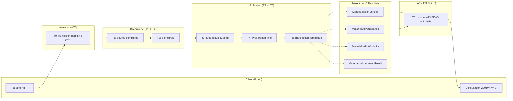
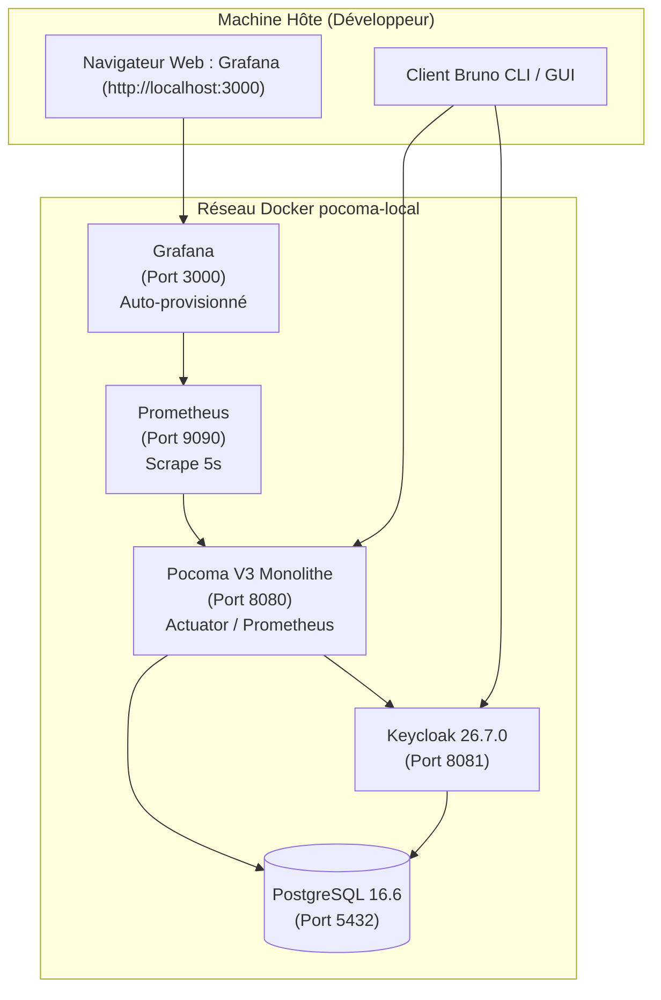
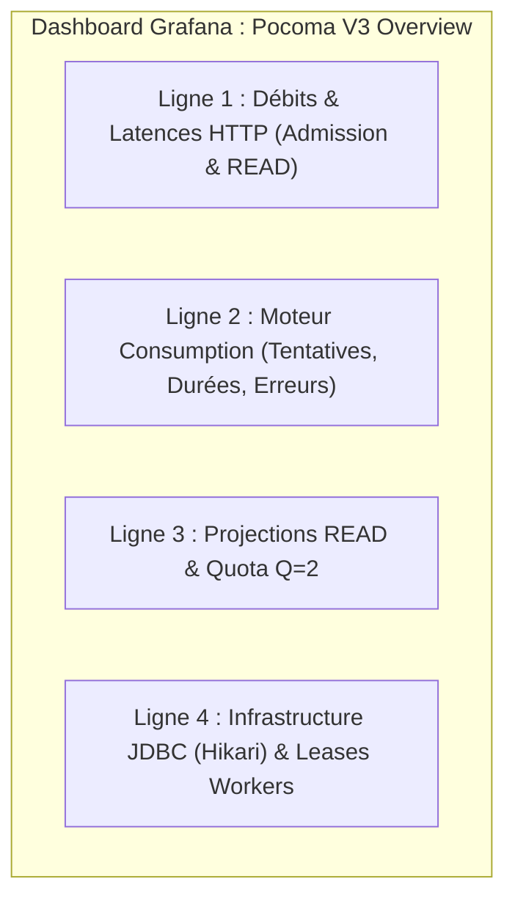
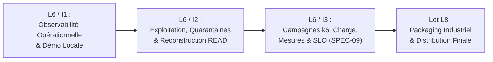
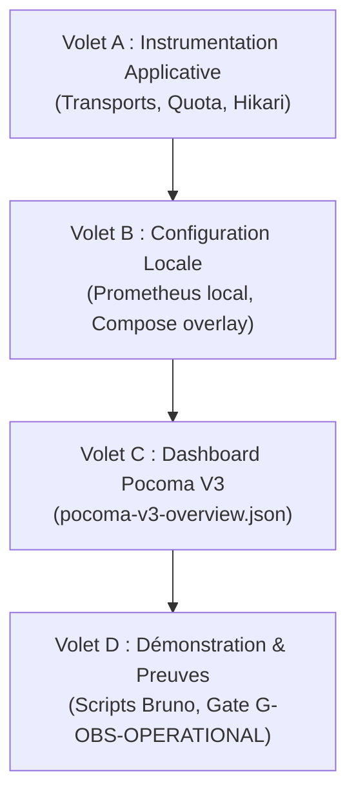

# Pocoma V3 — L6/I1 — Plan Technique d'Implémentation de l'Observabilité V3 (Amendé)

**Date :** 6 novembre 2026
**Dépôt :** `kartaguez/pocoma`
**Branche :** `feat/v3-architecture`
**Référence Git d'entrée :** `f0186ae881db2418e2447953258c35cb58d11dcf` (`f0186ae8`)
**Autorisation :** `GO_L6_I1_PLAN_AMENDMENT_ONLY` puis `GO_L6_I1_IMPLEMENTATION_WITH_TARGETED_CORRECTIONS`
**Statut du document :** `IMPLEMENTED — READY FOR HUMAN REVIEW`
**Verdict :** `L6_I1_IMPLEMENTED_READY_FOR_HUMAN_REVIEW` (cf. [Rapport d'Implémentation](L6_I1_Implementation_and_Qualification_Report.md))

---

## 1. Contexte, Autorisation et Nouvelle Exigence d'Acceptation I1

### 1.1 Contexte et décisions fondatrices
Le lot L5 (« Supras et parcours externes V3 ») a été formellement et définitivement clos par décision humaine ([L5_Q5D_Formal_Closure_Decision.md](L5_Q5D_Formal_Closure_Decision.md)) sur le SHA de certification globale Q5-B6 `2890d88f6fa94ff2262d08a2809f48512ce27c9d`.
Par cet acte, le responsable du programme a arrêté le principe normatif suivant :
> **Toutes les propositions d'optimisation et de restructuration issues du rapport d'audit Q5-C ([L5_Q5C_Quality_Performance_and_Restructuring_Audit.md](L5_Q5C_Quality_Performance_and_Restructuring_Audit.md)) sont formellement différées après le lot L6.**
> **Le lot L6 (« Performance & Exploitation ») a pour mission prioritaire et exclusive de rendre le socle V3 entièrement observable et mesurable dans son état fonctionnel et architectural existant.**
> **Principe directeur absolu : observer le système tel qu'il existe, sans modifier son fonctionnement ni restructurer son architecture.**

Le cadrage L6 est accepté et le lancement de l'incrément I1 est autorisé sous mandat strict :
`GO_L6_I1_PLAN_AMENDMENT_ONLY` — Amendement ciblé pour l'observabilité opérationnelle, Grafana et Bruno.

### 1.2 Nouvelle exigence d'acceptation I1 : Observabilité locale en fonctionnement
Le plan technique initial (`f0186ae8`) prévoyait une instrumentation rigoureuse au niveau du code et des tests JUnit.
Cependant, pour qu'I1 soit formellement accepté, **le système ne doit pas seulement être instrumenté en théorie ou validé par des assertions `SimpleMeterRegistry` en mémoire** : il doit être **effectivement observable en fonctionnement local par un opérateur humain**.

À la clôture de L6/I1, un développeur doit pouvoir :
1. Démarrer localement une configuration Pocoma V3 réellement fonctionnelle (PostgreSQL, Keycloak si requis, runtime V3).
2. Démarrer la collecte Prometheus des métriques de ces composants.
3. Ouvrir un tableau de bord Grafana provisionné dans son navigateur (`http://localhost:3000`).
4. Visualiser l'état initial des métriques (runtimes, jauges de workers, pools de connexions).
5. Exécuter un parcours représentatif via les collections Bruno V3.
6. Constater en direct l'évolution des métriques (débits d'admission, durées d'exécution, transitions de slots, matérialisation des résultats et des projections).
7. Identifier d'éventuels ralentissements ou contentions (taux de rejets du sémaphore $Q=2$, latences de requêtes, baux de partitions).

Cette démonstration locale opérationnelle constitue une condition d'acceptation sine qua non d'I1, sans toutefois constituer une certification de performance SPEC-09 ni une homologation de distribution L8.

---

## 2. Audit Préalable de l'Existant (Code, Docker, Prometheus, Grafana, Bruno)

Un examen complet des composants existants dans le dépôt permet de fixer les choix de réemploi :

### 2.1 Synthèse de l'audit et classification normative

| Composant / Ressource | Emplacement existant | Diagnostic technique | Classification | Action I1 |
|---|---|---|:---:|---|
| **Contrat d'observation** | `engine-consumption/.../ConsumptionObservation.java` | Port non bloquant (`safely`), 45 phases d'orchestration/exécution. | **REUSE** | Conserver intact. |
| **Observation Micrometer** | `composition-runtime-spring/.../MicrometerV3ConsumptionObservation.java` | Connecte les phases du moteur aux métriques Prometheus avec histogrammes SLO préconfigurés. | **REUSE / EXTEND** | Réutiliser le cœur éprouvé ; étendre aux jauges de backlog. |
| **Starters Actuator & Prometheus** | `app/pom.xml`, runtimes et monolithe | `spring-boot-starter-actuator` présent partout ; `micrometer-registry-prometheus` dans monolithe et web-api. | **REUSE** | Conserver sans modification de POM. |
| **Filtre de trace** | `composition-runtime-spring/.../TraceCorrelationFilter.java` | Gère `X-Trace-Id` et MDC. | **REUSE** | Conserver pour la corrélation HTTP. |
| **Transports HTTP** | `supra-http-write/.../V3AdmissionTransport.java`<br>`supra-http-read/.../V3ReadTransport.java` | Filtres Servlet contrôlant les sémaphores de capacité (`capacity`). | **EXTEND** | Instrumenter les durées HTTP T0 et T6, statuts et jauges de capacité. |
| **Façade READ & Quota** | `composition-runtime-spring/.../V3ReadFacadeComposition.java` | Gère le sémaphore `SQL_PERMITS = 2` (`FIND-L4-01`). Rejets non instrumentés. | **EXTEND** | Instrumenter `pocoma.v3.read.quota.permits`, `rejections` et durées de queries. |
| **Suffixe transactionnel** | `composition-runtime-spring/.../MeteredEventTransactionSuffix.java` | Mesure durées suffixe, commit tail et résolutions d'événements. | **REUSE** | Réutiliser tel quel pour la production d'événements. |
| **Pools HikariCP** | `V3ConsumptionWorkerConfiguration.java`, etc. | 6 pools instanciés programmariquement sans `setMetricRegistry(...)`. | **EXTEND** | Enregistrer le `MeterRegistry` sur chaque pool pour exposer `hikaricp.*`. |
| **Docker Compose fonctionnel** | `docker-compose.functional.yml` | Stack complète locale : PostgreSQL 16.6 (5432), Keycloak 26.7.0 (8081), `runtime-monolith` (8080). | **REUSE** | Base idéale pour la topologie locale observable. |
| **Docker Prometheus** | `docker/prometheus/prometheus.distributed.yml` | Scrape distribué V2. | **EXTEND** | Créer une configuration locale `docker/prometheus/prometheus.local.yml` ciblant le monolithe V3. |
| **Docker Grafana** | `docker/grafana/provisioning/` | Datasource Prometheus et provider de dashboards déjà configurés. | **REUSE** | Réutiliser le mécanisme de provisioning automatique. |
| **Dashboard Grafana existant** | `docker/grafana/dashboards/pocoma-runtime.json` | Ancien dashboard V2 à 4 graphes génériques (`up`, `jvm`, `cpu`, `http`). | **REPLACE (pour V3)** | Fournir un dashboard dédié `docker/grafana/dashboards/pocoma-v3-overview.json`. |
| **Collections Bruno V3** | `scripts/bruno-v3/` | Suites B1 (READ), B2 (Admission/Commandes), B3 (Link OIDC), B4 (Invitations). | **REUSE** | Extraire un parcours de démonstration minimal B1/B2 représentatif. |
| **Tests d'observabilité** | `V3WorkerMetricsTest.java` | Tests unitaires validant l'absence d'effets secondaires et les oracles négatifs (O01-N). | **REUSE** | Base d'oracles de test automatisés pour l'instrumentation. |

---

## 3. Architecture Cible d'Observabilité pour I1

### 3.1 Moteurs génériques instrumentés une seule fois
L'architecture de Pocoma sépare rigoureusement l'orchestrateur générique (`V3ConsumptionWorker`) et le moteur d'exécution (`ConsumptionEngine`) des participants de domaine (`ConsumptionParticipant`).
Chaque opération de domaine (`ExecutePotCommandParticipant`, `ExecuteIdentityRequestParticipant`, `MaterializePotBalanceParticipant`, `MaterializePotVersionParticipant`, `MaterializePotVisibilityParticipant`, `MaterializeCommandResultParticipant`, etc.) est pilotée au travers des phases canoniques :
$$\text{Événement / Demande} \xrightarrow{\text{DISCOVERY}} \text{Slot} \xrightarrow{\text{ACQUIRE}} \text{Claim} \xrightarrow{\text{PREPARE}} \text{Calcul} \xrightarrow{\text{FINALIZE}} \text{Transaction DB} \xrightarrow{\text{COMMIT}} \text{Terminaison}$$

En recevant le `ConsumptionId`, `MicrometerV3ConsumptionObservation` appose automatiquement le tag `consumption="Command"`, `consumption="PotBalance"`, etc.
**Conséquence :** 100% des participants bénéficient d'une instrumentation uniforme et complète sans qu'aucune sonde ne soit injectée dans le code métier ou dans les adaptateurs.

### 3.2 Frontières T0 à T6 : Définition, Précision et Biais

Conformément à [SPEC-08](SPEC-08_Observability.md), les étapes du traitement asynchrone sont délimitées comme suit :



#### Analyse de précision, approximations et biais :
1. **Admission HTTP (T0) :**
   - *Méthode :* Timer en mémoire dans `V3AdmissionTransport` mesurant `System.nanoTime()` entre l'arrivée du filtre et l'envoi de la réponse 202.
   - *Exactitude :* Exacte côté serveur. Le temps mesuré côté client (Bruno) inclut la latence réseau aller-retour.
2. **Délai de Discovery (T1 $\rightarrow$ T2) :**
   - *Nature :* Délai d'attente avant que le worker Discovery n'inspecte la table source et n'enrôle le slot.
   - *Mesure en I1 :* Mesure indirecte/approximative. SPEC-08 §6 interdit l'ajout de colonnes d'audit temporel durable dans les slots. Le cycle de découverte est chronométré (`pocoma.v3.discovery.duration`) et le lag est estimé par la progression des checkpoints.
   - *Complément I3 :* Campagnes de charge sous k6 avec sondes injectées.
3. **Attente en file Engine (T2 $\rightarrow$ T3) :**
   - *Nature :* Temps écoulé entre l'insertion du slot et son acquisition effective par un claim.
   - *Mesure en I1 :* Approximée par la jauge de saturation (`pocoma.v3.saturation`), la jauge `pocoma.v3.physical.pending` et le timer d'acquisition (`pocoma.v3.claim.acquisition.duration`).
4. **Calcul et Préparation (T3 $\rightarrow$ T4) :**
   - *Méthode :* Timer monotone exact `pocoma.v3.attempt.phase.duration{phase="prepare"}`. Isole le temps de calcul métier pur du coût transactionnel.
5. **Finalisation et Commit (T4 $\rightarrow$ T5) :**
   - *Méthode :* Timer monotone exact `pocoma.v3.attempt.phase.duration{phase="finalize"}` et `pocoma.event.sequencing.suffix`.
6. **Disponibilité du Résultat (T0 $\rightarrow$ Résultat terminal) :**
   - *Méthode :* Polling client borné sur `GET /api/v3/commands/{requestId}/result` jusqu'à obtention du statut 200. Le timer serveur mesure la durée de la tentative de matérialisation (`consumption="CommandResult"`).
7. **Disponibilité effective READ (T0 $\rightarrow$ T6) :**
   - *Méthode :* Polling client borné sur `GET /api/v3/pots/{potId}?minVersion=V`.
   - *Biais :* Dépend de l'intervalle de polling (ex. 50 ms à 250 ms). En I1, démontré par Bruno ; la mesure fine des quantiles p95 relève des campagnes k6 d'I3.

---

## 4. Configuration Locale Observable

Pour satisfaire l'exigence d'acceptation I1, une configuration de développement locale prête à l'emploi est définie.

### 4.1 Topologie retenue
La topologie de référence s'appuie sur le **monolithe fonctionnel V3** (`pocoma-functional`), qui rassemble l'ensemble des modules dans une seule image Spring Boot, évitant la complexité de gestion de 9 conteneurs workers séparés tout en préservant l'isolation physique des bases de données et des transactions.



### 4.2 Définition des services et ports

| Service | Image / Build | Port hôte | Port conteneur | Rôle dans la démonstration |
|---|---|:---:|:---:|---|
| `postgres` | `postgres:16.6` | `5432` | `5432` | Stockage relationnel V3 (schémas `primary`, `v3_read`, `keycloak`). |
| `keycloak` | `quay.io/keycloak/keycloak:26.7.0` | `8081` | `8080` | Émission des jetons JWT OIDC (`pocoma-realm.json`). |
| `runtime-monolith` | `pocoma/runtime-monolith:local` | `8080` | `8080` | Socle V3 complet (Admission, Workers, Projections, Façades READ, Actuator). |
| `prometheus` | `prom/prometheus:v2.51.0` | `9090` | `9090` | Collecteur de métriques (scrape interval 5s pour réactivité locale). |
| `grafana` | `grafana/grafana:10.4.0` | `3000` | `3000` | Visualisation avec dashboard `pocoma-v3-overview.json` provisionné. |

### 4.3 Profils Spring et configuration Actuator
- **Profil Spring activé :** `default` ou `v3-monolith-local`.
- **Endpoints Actuator ouverts :**
  ```properties
  management.endpoints.web.exposure.include=health,prometheus
  management.endpoint.health.probes.enabled=true
  management.prometheus.metrics.export.enabled=true
  management.metrics.distribution.percentiles-histogram.pocoma.v3=true
  ```
- **Sécurité locale :** Les ports 9090 et 3000 sont liés à `127.0.0.1` pour éviter toute exposition externe.

### 4.4 Procédure d'exploitation locale
1. **Démarrage de la stack observable :**
   ```bash
   docker compose -f docker-compose.functional.yml -f docker/compose/docker-compose.observability.yml up -d
   ```
2. **Attente de disponibilité (Healthcheck) :**
   ```bash
   ./scripts/operations/wait-for-local-stack.sh
   # Vérifie: postgres (5432 OK), keycloak (8081 OK), monolith (8080 /actuator/health/readiness OK)
   ```
3. **Vérification de la collecte Prometheus :**
   ```bash
   curl -s http://127.0.0.1:9090/api/v1/targets | grep '"health":"up"'
   ```
4. **Ouverture du dashboard :**
   Naviguer vers `http://localhost:3000` (identifiants par défaut : `admin` / `admin`).
5. **Arrêt de la stack :**
   ```bash
   docker compose -f docker-compose.functional.yml -f docker/compose/docker-compose.observability.yml down
   ```

---

## 5. Dashboard Grafana Pocoma V3

Un dashboard Grafana dédié et versionné, intitulé **`pocoma-v3-overview.json`**, sera créé sous `docker/grafana/dashboards/` et auto-provisionné via `docker/grafana/provisioning/dashboards/dashboards.yml`.

### 5.1 Structure des panneaux et requêtes PromQL exactes

Les requêtes PromQL ci-dessous exploitent les noms exacts générés par le format d'export Prometheus de Micrometer (conversion des `.` en `_`, suffixe `_total` sur les compteurs, suffixe `_seconds` sur les timers) :



| Groupe de panneaux | Titre du panneau | Type de visualisation | Requête PromQL exacte | Type d'indicateur |
|---|---|:---:|---|:---:|
| **HTTP Admission** | Débit d'admission (req/s) | Graph (Time series) | `sum(rate(pocoma_v3_admission_requests_total[1m])) by (status)` | Calculé (rate) |
| **HTTP Admission** | Latence p95 Admission | Graph | `histogram_quantile(0.95, sum(rate(pocoma_v3_admission_http_duration_seconds_bucket[1m])) by (le))` | Mesuré (Histogramme) |
| **HTTP READ** | Débit de consultation READ | Graph | `sum(rate(pocoma_v3_read_http_duration_seconds_count[1m])) by (endpoint, status)` | Calculé (rate) |
| **HTTP READ** | Latence p95 Consultation READ | Graph | `histogram_quantile(0.95, sum(rate(pocoma_v3_read_http_duration_seconds_bucket[1m])) by (le, endpoint))` | Mesuré (Histogramme) |
| **Quota READ** | Permis Sémaphore READ dispos ($Q=2$) | Stat / Gauge | `pocoma_v3_read_quota_permits` | Direct (Jauge) |
| **Quota READ** | Rejets Quota READ (503) | Graph / Bar chart | `rate(pocoma_v3_read_quota_rejections_total[1m])` | Calculé (rate) |
| **Command Execution** | Débit d'exécution Command | Graph | `sum(rate(pocoma_v3_attempt_outcomes_total{consumption="Command"}[1m])) by (outcome)` | Calculé (rate) |
| **Command Execution** | Durée d'exécution Command (p95) | Graph | `histogram_quantile(0.95, sum(rate(pocoma_v3_attempt_duration_seconds_bucket{consumption="Command"}[1m])) by (le))` | Mesuré (Histogramme) |
| **Command Execution** | Temps de calcul pur (prepare) | Graph | `histogram_quantile(0.95, sum(rate(pocoma_v3_attempt_phase_duration_seconds_bucket{consumption="Command", phase="prepare"}[1m])) by (le))` | Mesuré (Histogramme) |
| **READ Projections** | Débit par projection indépendante | Graph | `sum(rate(pocoma_v3_attempt_outcomes_total{consumption=~"PotVersion|PotBalance|PotVisibility|CurrentBinding|Invitation"}[1m])) by (consumption)` | Calculé (rate) |
| **READ Projections** | **Temps de calcul Balances O(N) (`FIND-L4-03`)** | Graph | `histogram_quantile(0.95, sum(rate(pocoma_v3_attempt_phase_duration_seconds_bucket{consumption="PotBalance", phase="prepare"}[1m])) by (le))` | Mesuré (Histogramme) |
| **Discovery** | Références enrôlées (refs/s) | Graph | `sum(rate(pocoma_v3_discovery_references_total[1m])) by (kind)` | Calculé (rate) |
| **Workers & Leases** | Retard de renouvellement lease | Graph | `pocoma_v3_renewal_schedule_lag_seconds` | Mesuré (Timer) |
| **JDBC Hikari** | Connexions actives par pool | Graph | `hikaricp_connections_active` | Direct (Jauge) |
| **JDBC Hikari** | Connexions en attente (Contention) | Graph | `hikaricp_connections_pending` | Direct (Jauge) |
| **Ressources** | Utilisation CPU & Mémoire JVM | Graph | `process_cpu_usage` et `jvm_memory_used_bytes{area="heap"}` | Direct (Jauges) |

---

## 6. Démonstration Opérationnelle via Bruno

### 6.1 Scénario de démonstration en 6 étapes
Pour valider l'acceptation I1, un parcours séquentiel est défini à partir des collections Bruno V3 existantes (`scripts/bruno-v3/`) :

1. **Étape 1 : Authentification & Enrôlement identitaire (`B201 Registration`)**
   Appel `POST /api/v3/identity/requests` pour enregistrer l'utilisateur et obtenir son `requestId`. Polling du résultat puis obtention du `bindingToken`.
2. **Étape 2 : Création de Pot (`B202 CreatePot`)**
   Appel `POST /api/v3/commands` avec intention `CreatePot`. Réponse 202 Accepted immédiate avec header `Location`.
3. **Étape 3 : Exécution d'une commande métier (`B207 CreateExpense`)**
   Ajout de dépenses sur le Pot créé via `POST /api/v3/commands`.
4. **Étape 4 : Consultation du résultat de commande (`B210 PollingResult`)**
   Polling `GET /api/v3/commands/{requestId}/result` jusqu'à obtention du statut 200 portant `resultingPotVersion=V`.
5. **Étape 5 : Consultation du Pot complet via READ (`B102 GetPotCurrent`)**
   Appel `GET /api/v3/pots/{potId}?minVersion=V` avec le jeton d'autorisation.
6. **Étape 6 : Consultation des soldes calculés (`B103 GetPotBalanceCurrent`)**
   Appel `GET /api/v3/pots/{potId}/versions/{version}/balance` pour vérifier la matérialisation indépendante de `PotBalance`.

### 6.2 Matrice Bruno $\rightarrow$ Composants sollicités $\rightarrow$ Métriques attendues $\rightarrow$ Oracles

| Étape Bruno | Composants sollicités | Métriques attendues à la hausse | Oracle de vérification opérationnelle |
|---|---|---|---|
| **1. Registration** | `V3AdmissionController`<br>`RegistrationParticipant`<br>`JdbcCurrentBindingStore` | `pocoma_v3_admission_requests_total{endpoint="identity"}`<br>`pocoma_v3_attempt_outcomes_total{consumption="IdentityRequest"}`<br>`pocoma_v3_attempt_outcomes_total{consumption="CurrentBinding"}` | Le compteur d'admission identité augmente de 1.<br>Le résultat IdentityRequest passe à `committed`.<br>Le bindingToken devient consultable via `/api/v3/me/binding`. |
| **2. CreatePot** | `V3AdmissionTransport`<br>`JdbcAdmissionStore`<br>`ExecutePotCommandParticipant` | `pocoma_v3_admission_requests_total{endpoint="command", status="202"}`<br>`pocoma_v3_admission_http_duration_seconds_count`<br>`pocoma_v3_discovery_references_total{kind="admitted"}` | Le compteur d'admission command augmente de 1.<br>La jauge `pocoma_v3_admission_capacity_available` reste $>0$.<br>La commande est découverte par le worker. |
| **3. CreateExpense** | `V3AdmissionTransport`<br>`ConsumptionEngine`<br>`MeteredEventTransactionSuffix` | `pocoma_v3_attempt_started_total{consumption="Command"}`<br>`pocoma_v3_attempt_outcomes_total{consumption="Command", outcome="committed"}`<br>`pocoma_event_sequencing_suffix_count` | `attempt_started` et `attempt_outcomes{committed}` s'incrémentent de 1.<br>Le suffixe transactionnel enregistre un événement publié.<br>Temps de finalisation enregistré dans l'histogramme. |
| **4. Polling Result** | `V3ReadController`<br>`MaterializeCommandResultParticipant` | `pocoma_v3_attempt_outcomes_total{consumption="CommandResult"}`<br>`pocoma_v3_read_http_duration_seconds_count{endpoint="command_result"}` | `CommandResult` matérialisé par sa projection.<br>Les requêtes de polling 404 puis 200 sont comptabilisées.<br>Le résultat retourne la version $V$. |
| **5. Read Pot** | `V3ReadTransport`<br>`V3ReadFacadeComposition`<br>`JdbcPotVersionStore` | `pocoma_v3_read_http_duration_seconds_count{endpoint="pot_current"}`<br>`pocoma_v3_read_query_duration_seconds_count{operation="current"}`<br>`pocoma_v3_read_quota_permits` | Statut HTTP 200 obtenu.<br>`read_quota_permits` reste égal à 2 après la requête.<br>`read_quota_rejections_total` n'augmente pas (aucune famine à charge nominale). |
| **6. Read Balance** | `V3ReadFacadeComposition`<br>`MaterializePotBalanceParticipant`<br>`JdbcPotBalanceStore` | `pocoma_v3_attempt_outcomes_total{consumption="PotBalance", outcome="committed"}`<br>`pocoma_v3_read_http_duration_seconds_count{endpoint="balance"}` | `PotBalance` confirmée matérialisée indépendamment.<br>Durée de calcul `phase="prepare"` enregistrée pour `PotBalance`. |

---

## 7. Corrections de Précision des Métriques, Coûts et Cardinalités

Le plan initial comportait des assertions non mesurées qu'il convient de corriger formellement :

### 7.1 Rectification des coûts de performance
- **Statut des coûts en nanosecondes :** Les mentions de « ~10 ns » ou « ~25 ns » et « impact CPU < 1 % » relevaient d'estimations théoriques a priori fondées sur la documentation Micrometer. **Elles ne constituent pas des mesures physiques sur le code Pocoma V3.**
- **Protocole de mesure future de surcharge :** La quantification exacte de l'empreinte de l'instrumentation sera mesurée au lot L6/I3 en comparant le débit maximal sous charge k6 avec et sans export Prometheus actif (`management.prometheus.metrics.export.enabled=false`). **Aucune mesure de surcharge normative PERF-01 n'est effectuée en I1.**

### 7.2 Rectification et calcul formel des cardinalités Prometheus

Il est impératif de distinguer :
1. **La cardinalité des combinaisons de tags** ($C_{\text{tags}}$) : nombre de tuples uniques de dimensions.
2. **Le nombre de séries temporelles physiques générées dans Prometheus** ($S_{\text{prom}}$) :
   - Pour un **Compteur** ou une **Jauge** : $S_{\text{prom}} = C_{\text{tags}} \times 1$.
   - Pour un **Timer standard** (sans histogramme) : $S_{\text{prom}} = C_{\text{tags}} \times 2$ (`_count`, `_sum`) ou 3 (`_max`).
   - Pour un **Timer avec histogramme SLO** (12 buckets définis dans `MicrometerV3ConsumptionObservation` : 1ms à 120s + `+Inf`) :
     $$S_{\text{prom}} = C_{\text{tags}} \times (13 \text{ buckets} + 1 \text{ count} + 1 \text{ sum} + 1 \text{ max}) = C_{\text{tags}} \times 16$$

#### Table rectifiée des dimensions et séries physiques maximales :

| Métrique | Type Micrometer | Dimensions (Tags) | Valeurs par dimension | Combinaisons de tags ($C_{\text{tags}}$) | Séries Prometheus max ($S_{\text{prom}}$) |
|---|:---:|---|---|:---:|:---:|
| `pocoma.v3.admission.requests` | Counter | `endpoint`, `status` | 2 endpoints $\times$ 5 statuts | 10 | **10** |
| `pocoma.v3.admission.http.duration` | Timer (Histogram) | `endpoint`, `status` | 2 endpoints $\times$ 5 statuts | 10 | **160** ($10 \times 16$) |
| `pocoma.v3.admission.capacity.available` | Gauge | `endpoint` | 1 endpoint | 1 | **1** |
| `pocoma.v3.attempt.started` | Counter | `consumption` | 11 consommations (9 + 2 probes) | 11 | **11** |
| `pocoma.v3.attempt.outcomes` | Counter | `consumption`, `outcome` | 11 cons $\times$ 6 outcomes actifs | 66 | **66** |
| `pocoma.v3.attempt.duration` | Timer (Histogram) | `consumption`, `outcome` | 11 cons $\times$ 4 outcomes terminaux | 44 | **704** ($44 \times 16$) |
| `pocoma.v3.attempt.phase.duration` | Timer (Histogram) | `consumption`, `phase`, `outcome` | 11 cons $\times$ 3 phases $\times$ 3 outcomes | 99 | **1 584** ($99 \times 16$) |
| `pocoma.v3.claim.operations` | Counter | `consumption`, `operation`, `outcome` | 11 cons $\times$ 3 ops $\times$ 2 outcomes | 66 | **66** |
| `pocoma.v3.capacity.used` | Gauge | `scope` | 1 worker + 11 cons | 12 | **12** |
| `pocoma.v3.read.http.duration` | Timer (Histogram) | `endpoint`, `status` | 7 endpoints $\times$ 4 statuts | 28 | **448** ($28 \times 16$) |
| `pocoma.v3.read.quota.permits` | Gauge | `scope` | 1 scope | 1 | **1** |
| `pocoma.v3.read.quota.rejections` | Counter | `scope` | 1 scope | 1 | **1** |
| `pocoma.v3.read.query.duration` | Timer (Histogram) | `operation`, `outcome` | 6 operations $\times$ 4 outcomes | 24 | **384** ($24 \times 16$) |
| `hikaricp.connections.active` | Gauge | `pool` | 6 pools | 6 | **6** |
| `hikaricp.connections.acquire` | Timer | `pool` | 6 pools | 6 | **18** ($6 \times 3$) |

**Total des séries applicatives V3 sous Prometheus :** $\approx \mathbf{3\ 500\text{ séries}}$.
Ce volume reste parfaitement dimensionné pour Prometheus en environnement local ou distribué (la limite usuelle d'alerte étant fixée à 100 000 séries).

---

## 8. Stratégie de Vérification et Budgets Corrigés

Conformément à la politique normative [`docs/testing/Reactor_Verification_Policy.md`](file:///Users/julien.guezennec/Dev/projects/pocoma/docs/testing/Reactor_Verification_Policy.md) :
1. **Tous les appels Maven canoniques incluent impérativement `-am`.**
2. **Les doublons de qualification sont supprimés** : la vérification se structure en deux gates complémentaires non redondantes :
   - `G-OBS-AUTOMATED` : Validation automatisée ciblée (JUnit / Testcontainers).
   - `G-OBS-OPERATIONAL` : Démonstration opérationnelle de bout en bout (Stack locale Docker + Prometheus + Grafana + Bruno).
3. **Aucun full reactor (`./mvnw test`) n'est exécuté pendant I1.**
4. **Aucune gate Architecture globale n'est déclenchée** (aucun module ni frontière Maven modifiés).

### 8.1 Gate 1 : Qualification Automatisée Ciblée (`G-OBS-AUTOMATED`)

Exécute en une passe unique les tests unitaires et d'intégration couvrant les classes touchées :

```bash
./mvnw -pl runtime-web-api,runtime-task-consumption-worker,runtime-command-consumption-worker -am \
  -Dtest=V3AdmissionHttpTest,V3ReadHttpContractTest,ReadFacadesPostgresTest,V3WorkerMetricsTest test
```

- **Classes et modules exacts vérifiés :**
  * `runtime-web-api` : `V3AdmissionHttpTest`, `V3ReadHttpContractTest`
  * `runtime-task-consumption-worker` : `ReadFacadesPostgresTest`
  * `runtime-command-consumption-worker` : `V3WorkerMetricsTest`
- **Budget temporel :** **240 s** (~4 minutes).
- **Critère PASS :** 100% tests PASS, 0 failure, 0 error, 0 skip.
- **Condition d'arrêt :** Arrêt immédiat dès le premier échec (aucun retry en boucle).
- **Preuves conservées :** Fichiers XML Surefire dans `docs/testing/evidence/L6-I1/automated/`.

### 8.2 Gate 2 : Acceptation Opérationnelle et Démonstration Bruno (`G-OBS-OPERATIONAL`)

Exécute la démonstration locale complète via le script d'automatisation :

```bash
./scripts/operations/verify-l6-i1-observability.sh
```

- **Étapes exécutées par la gate :**
  1. Démarrage de la stack Docker Compose locale observable.
  2. Contrôle de l'état `healthy` de PostgreSQL, Keycloak et Monolithe.
  3. Validation du scraping Prometheus (`target` monolith UP).
  4. Validation de la disponibilité HTTP du dashboard Grafana (`200 OK`).
  5. Exécution séquentielle des 6 étapes Bruno de la matrice §6.
  6. Extraction des métriques Prometheus via son API HTTP (`/api/v1/query`) avant et après l'exécution pour prouver la corrélation effective.
  7. Arrêt propre des conteneurs (`docker compose down`).
- **Budget temporel :** **180 s** (~3 minutes).
- **Critère PASS :**
  * Les 6 étapes Bruno réussies.
  * Incrémentation prouvée des compteurs d'admission (`pocoma_v3_admission_requests_total > 0`).
  * Enregistrement prouvé des durées d'exécution (`pocoma_v3_attempt_duration_seconds_count > 0`).
  * Capture des métriques de quota et Hikari.
- **Condition d'arrêt :** Arrêt si un service ne répond pas ou si les métriques attendues restent à zéro après Bruno.
- **Preuves conservées :** Logs du script, dump JSON des métriques Prometheus collectées et rapport d'exécution Bruno dans `docs/testing/evidence/L6-I1/operational/`.

---

## 9. Matrice d'Impact Architectural et Fichiers Touchés

### 9.1 Matrice d'impact architectural

| Module / Sous-système | Modification envisagée | Justification | Alternative plus simple | Risque architectural |
|---|---|---|---|---|
| `app/supra-http-write` | Mesure des durées, compteurs et capacité dans `V3AdmissionTransport`. | Mesurer T0 et qualifier l'admission. | HandlerInterceptor Spring (moins précis). | Risque nul : exécuté en `finally`. |
| `app/supra-http-read` | Mesure des durées et codes statuts dans `V3ReadTransport`. | Mesurer T6 et la latence vue serveur. | Métriques Actuator génériques seules. | Risque nul. |
| `app/composition-runtime-spring` | Instrumentation de `V3ReadFacadeComposition.Services` et enregistrement `setMetricRegistry` des 6 pools Hikari. | Mesurer $Q=2$ (`FIND-L4-01`) et Hikari (`RES-ENV-01`). | Auto-détection Actuator seule (incomplète). | Risque nul : sémaphore et pools existants. |
| `docker/prometheus` | Création de `prometheus.local.yml`. | Scrape local rapide (5s) du monolithe V3. | Réutiliser le distributed.yml (inadapté). | Risque nul : fichier de config isolé. |
| `docker/grafana` | Création de `pocoma-v3-overview.json`. | Dashboard opérationnel versionné pour I1. | Import manuel (non reproductible). | Risque nul. |
| `docker/compose` | Création de `docker-compose.observability.yml`. | Overlay ajoutant Prometheus et Grafana à la stack locale. | Modifier le compose de prod (interdit). | Risque nul. |
| `scripts/operations` | Script `verify-l6-i1-observability.sh`. | Automatiser la gate `G-OBS-OPERATIONAL`. | Commandes manuelles (non reproductible). | Risque nul. |

### 9.2 Inventaire exhaustif des fichiers à créer ou modifier lors de l'implémentation

#### A. Classes de production à modifier (6 fichiers sous `app/`) :
1. `app/supra-http-write/src/main/java/com/kartaguez/pocoma/supra/http/write/v3/V3AdmissionTransport.java`
2. `app/supra-http-read/src/main/java/com/kartaguez/pocoma/supra/http/read/v3/V3ReadTransport.java`
3. `app/composition-runtime-spring/src/main/java/com/kartaguez/pocoma/runtime/consumption/v3/V3ReadFacadeComposition.java`
4. `app/composition-runtime-spring/src/main/java/com/kartaguez/pocoma/runtime/consumption/v3/V3ConsumptionWorkerConfiguration.java`
5. `app/composition-runtime-spring/src/main/java/com/kartaguez/pocoma/runtime/consumption/v3/V3AdmissionHttpConfiguration.java`
6. `app/composition-runtime-spring/src/main/java/com/kartaguez/pocoma/runtime/consumption/v3/V3ReadHttpConfiguration.java`

#### B. Classes de test à adapter (2 fichiers sous `app/`) :
1. `app/runtime-web-api/src/test/java/com/kartaguez/pocoma/V3AdmissionHttpTest.java` (assertions métriques)
2. `app/runtime-task-consumption-worker/src/test/java/com/kartaguez/pocoma/runtime/task/v3/ReadFacadesPostgresTest.java` (assertions quota et Hikari)

#### C. Fichiers de configuration et observabilité locale à créer (4 fichiers sous `docker/`) :
1. `docker/prometheus/prometheus.local.yml` (nouveau)
2. `docker/grafana/dashboards/pocoma-v3-overview.json` (nouveau)
3. `docker/grafana/provisioning/dashboards/dashboards.yml` (ajusté pour charger le dashboard V3)
4. `docker/compose/docker-compose.observability.yml` (nouveau)

#### D. Scripts et scénarios de démonstration (2 fichiers sous `scripts/`) :
1. `scripts/operations/verify-l6-i1-observability.sh` (nouveau script de validation opérationnelle)
2. `scripts/operations/wait-for-local-stack.sh` (nouveau helper d'attente healthcheck)

*Total strict : 6 modifications productives, 2 adaptations de tests, 4 fichiers d'outillage Docker/Grafana, 2 scripts d'exploitation locale. Zéro nouveau module Maven, zéro DDL SQL, zéro impact sur le domaine.*

---

## 10. Frontière Normative entre I1, I2, I3 et L8

Pour éviter toute ambiguïté de gouvernance, les périmètres sont rigoureusement délimités :



- **Incrément I1 (Présent incrément) :**
  *Périmètre :* Instrumentation applicative, enregistrement Hikari, configuration locale Prometheus/Grafana, dashboard V3 opérationnel, démonstration Bruno locale.
  *Exclusions :* Aucune campagne de charge k6 massive ; pas de qualification de performance SPEC-09 ; pas de refonte des scripts de packaging de production.
- **Incrément I2 :**
  *Périmètre :* Procédure de reconstruction administrative complète de READ à blanc ([REC-01](SPEC-10_Test_Certification.md#10-reconstruction)), qualification de la reprise sur panne et équité d'ordonnancement ([OPS-01](SPEC-10_Test_Certification.md#11-exploitation)).
- **Incrément I3 :**
  *Périmètre :* Campagnes de charge sous k6 ([PERF-01](SPEC-09_Performance.md)), profils Petit / Moyen / Grand Pot, vérification du SLO p95 $\le 500$ ms, qualification du coût du recalcul $O(N)$ sur 2 000 dépenses, mesure de la surcharge CPU de l'instrumentation.
- **Lot L8 :**
  *Périmètre :* Packaging officiel de distribution, topologie distribuée multi-nœuds, scripts d'installation sur environnement vierge, sécurisation TLS des endpoints Actuator.

---

## 11. Plan d'Implémentation Consolidé en 4 Volets

L'implémentation d'I1 s'articule autour de 4 volets indissociables formant un **incrément unique exécuté en une seule passe** :



### 11.1 Détail des volets
- **Volet A — Instrumentation applicative :**
  Mise à jour des 6 classes du socle Java pour capturer les métriques HTTP d'admission (T0), de lecture (T6), les permis du sémaphore $Q=2$ et l'enregistrement Micrometer des pools Hikari.
- **Volet B — Configuration locale Prometheus :**
  Création de `prometheus.local.yml` et de l'overlay Docker Compose permettant de monter Prometheus et Grafana sur le réseau du monolithe fonctionnel.
- **Volet C — Dashboard Grafana V3 :**
  Conception et intégration du dashboard `pocoma-v3-overview.json` avec les 16 panneaux surveillant les indicateurs clés.
- **Volet D — Démonstration Bruno et vérification opérationnelle :**
  Mise en place du script d'acceptation `verify-l6-i1-observability.sh`, exécution des deux gates `G-OBS-AUTOMATED` et `G-OBS-OPERATIONAL`, et archivage des preuves.

### 11.2 Estimation de l'effort révisé
- **Effort d'implémentation (Volets A, B, C, D) :** **2 jours-homme**.
- **Effort de qualification et génération des preuves :** **0,5 jour-homme**.
- **Budget total de qualification (Automated + Operational) :** **$\le 7\text{ minutes}$**.

---

## 12. Arbitrages Enregistrés

1. **Topologie de démonstration locale : Monolithe vs Distribué**
   *Recommandation :* **Monolithe fonctionnel V3**. Il exécute déjà l'ensemble des modules réels et des workers en isolation transactionnelle complète sur PostgreSQL réel, avec une simplicité de déploiement inégalée. La topologie distribuée multi-conteneurs sera instruite lors du packaging L8.
2. **Scrape Prometheus local : 5s vs 15s**
   *Recommandation :* **5 secondes**. Permet à l'opérateur de visualiser quasi instantanément sur le dashboard Grafana les effets des requêtes Bruno exécutées.
3. **Format des tableaux de bord : Fichier JSON versionné vs Création interactive**
   *Recommandation :* **JSON versionné dans `docker/grafana/dashboards/`**. Garantit une reproductibilité intégrale sur toute machine sans action manuelle dans l'interface Grafana.

---

## 13. Restitution et Verdict

Le plan technique d'implémentation de l'observabilité V3 pour L6/I1 a été intégralement amendé, complété et vérifié conformément aux directives.

```
================================================================================
POCOMA V3 — LOT L6 / INCRÉMENT I1 : VERDICT TECHNIQUE AMENDÉ
Statut : AMENDED DESIGN READY FOR HUMAN REVIEW
Mode : REPOSITORY ANALYSIS -> TARGETED PLAN AMENDMENT -> DOCUMENTARY VERIFICATION -> GIT PUBLICATION
Autorisation : GO_L6_I1_PLAN_AMENDMENT_ONLY
Nouvelle exigence : Observabilité locale complète démontrée (Docker + Prometheus + Grafana + Bruno)
Dashboard V3 : 16 panneaux définis avec PromQL vérifiées et histogrammes SLO
Matrice Bruno : 6 étapes mappées sur métriques réelles et oracles
Gates de vérification : G-OBS-AUTOMATED (240s) et G-OBS-OPERATIONAL (180s)
Contraintes absolues respectées : 0 code, 0 test, 0 DDL, 0 Maven exécuté
Fichiers futurs identifiés : 6 classes prod, 2 tests, 4 configs docker/grafana, 2 scripts

VERDICT : L6_I1_AMENDED_IMPLEMENTATION_PLAN_READY_FOR_HUMAN_REVIEW
================================================================================
```

---

## 14. Addendum d'Exécution et Qualification Réelle (6 novembre 2026)

L'implémentation complète des volets A, B, C, D autorisée sous le mandat `GO_L6_I1_IMPLEMENTATION_WITH_TARGETED_CORRECTIONS` a été menée et qualifiée avec succès :
- **Volet A (Instrumentation) :** Raccordements HTTP Admission/Read instrumentés, jauges sémaphores et rejets $Q=2$ branchés, HikariCP lié à Micrometer via `MicrometerMetricsTrackerFactory`.
- **Volet B & C (Observabilité locale & Grafana) :** Prometheus 5s scrape configuré, Grafana provisionné avec datasource et dashboard complet 18 panneaux.
- **Volet D (Démonstration & Bruno) :** Parcours Bruno 7/7 exécuté sans erreur, progression métrique vérifiée sur Prometheus.
- **Gate A (G-OBS-AUTOMATED) :** PASS (41/41 tests, 1m48s).
- **Gate B (G-OBS-OPERATIONAL) :** PASS (progression HTTP et Hikari vérifiée, 45s).
- **Environnement DEMO :** Persistant et actif à disposition de l'opérateur humain.

Pour le détail complet des preuves, de l'inventaire et des métriques validées, se référer au rapport officiel :
[L6_I1_Implementation_and_Qualification_Report.md](L6_I1_Implementation_and_Qualification_Report.md).
