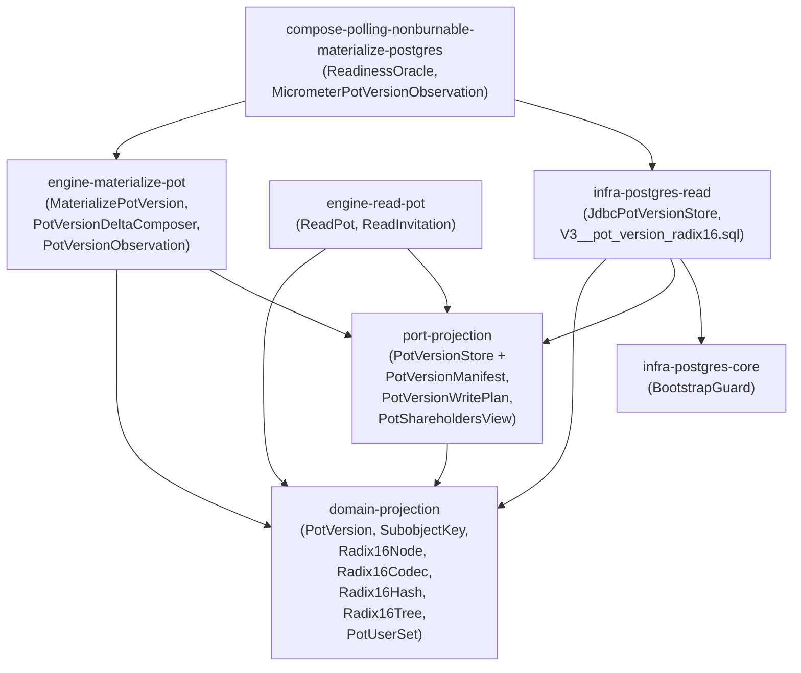

# Pocoma V3 — L7-C2-B1 — Plan d'implémentation du stockage persistant `PotVersion` (Radix-16 compressé, immuable, adressé par contenu)

- **Branche cible** : `feat/v3-l7` (aucun merge vers `main`, aucun chantier `PotBalance` ou RID engagé)
- **Statut** : **APPROUVÉ (`L7_C2_B1_PLAN_APPROVED`)** — arbitrages F1 à F5 arrêtés ; prêt pour exécution séquentielle sur mandats distincts B1.1 → B1.4
- **Bases normatives & preuves vérifiées** :
  - [`docs/testing/Reactor_Verification_Policy.md`](../testing/Reactor_Verification_Policy.md)
  - [`docs/v3/L7_4_A3_A4_Consolidated_Qualification_Report.md`](L7_4_A3_A4_Consolidated_Qualification_Report.md)
  - [`docs/v3/PotVersion_Incremental_Materialization_Design_Plan.md`](PotVersion_Incremental_Materialization_Design_Plan.md)
  - Prototype PostgreSQL 17 : `experiments/l7-c2-d10-radix-prototype/` (`sql/schema.sql`, `src/c2d10/{Model,Radix16Tree,Stores,DataGenerator,PrototypeRunner}.java`, `results/*.csv`)
  - Décisions C2-D1 à C2-D12, audit C2-A et étude C2-D7
- **Préservation impérative** :
  - `read_subobject_version` reste strictement inchangée.
  - Les optimisations L7.4-A3 (`MaterializePotVersion` incrémental `N−m` et ses fallbacks) et L7.4-A4 (`PotBalance`) sont intégralement préservées.
  - Les contrats HTTP publics et la sémantique de `ReadPot` / `ReadInvitation` / `ReadNavigation` restent strictement inchangés.
  - Aucune chaîne de deltas n'est autorisée à la lecture.

---

## 0. Analyse préalable du prototype (`experiments/l7-c2-d10-radix-prototype/`)

L'examen complet des sources et résultats CSV du prototype C2-D10 (`PostgreSQL 17.6`, `shared_buffers=128MB`, `work_mem=4MB`, `pglz`, `synchronous_commit=on`) établit les constats suivants.

### 0.1 Code algorithmique réutilisable (à ré-architecturer, ne pas copier tel quel)
- **Algorithme canonique Radix-16 compressé** (`Radix16Tree.java`, 832 lignes) :
  - Invariant canonique strict (`|S| <= 64` → feuille `'L'` avec `prefix=""` et entrées triées par UUID 128 bits non signé ; `|S| > 64` → nœud interne `'I'` avec `prefix = LCP(S)[d..]` et `2..16` enfants non vides).
  - Construction intégrale `buildFull` (`O(N)`) et construction incrémentale copy-on-write `applyIncremental` (`O(k log₁₆ N)` avec préfetch par niveau, gestion des splits de préfixe, fusions de feuilles sous seuil `64`, et re-compression de chemin lorsque `childCount == 1`).
  - Codec binaire compact fixe à **41 octets/entrée** (`16B` UUID big-endian + `3×8B` versions + `1B` flags) + payload interne (`2B` bitmask de nibbles + `k×4B` compteurs d'entrées par enfant).
  - Empreinte SHA-256 à séparation de domaine (`pocoma-r16-v1\0`), vérifiée bit-à-bit sur les 20 scénarios de `correctness_matrix.csv` (`C01`..`C20` tous `PASS`, y compris franchissements `63/64/65` et UUID corrélés).
  - Primitives d'extraction de nibble (`uuidNibble`), comparaison non signée (déjà existante en production dans `SubobjectKey.compareUuid`), et recherche dichotomique dans une feuille (`findExpenseInLeaf`).
- **Requêtes SQL démontrées** (`Stores.java`) :
  - **R1 (`WITH RECURSIVE`)** : lecture complète d'un `PotVersion` en **1 seul aller-retour SQL** (`manifest` + `tree` avec `LATERAL unnest(t.child_hashes)`).
  - **R3a** : lecture ciblée de l'arbre `shareholders` seul en 1 requête `WITH RECURSIVE` (sans jamais lire l'arbre `expenses`).
  - **R3b / R3c** : descente sélective unitaire et batch par niveau sur `expenses` via `WHERE node_hash = ANY(?)`.

### 0.2 Limites du prototype à corriger en production
1. **Ensembles d'autorisations non mutualisés** : `proto_r64_pot_version` stocke `authorized_user_ids uuid[]` et `attached_active_user_ids uuid[]` directement sur chaque ligne de version. Sur `XLARGE_1000V`, cela provoque **16,68 Mo de TOAST** sur `proto_r64_pot_version` (contre seulement 4,62 Mo pour tous les nœuds Radix-16 !). La mutualisation par empreinte SHA-256 (`read_pot_user_set`) élimine cette duplication sur >95 % des versions.
2. **Insertion des nœuds ligne par ligne** : `Stores.persistAtomic` boucle avec un `PreparedStatement.executeQuery()` par nœud (`for (Node n : newNodes.values())`), causant `init_ms = 91 ms` pour 290 nœuds sur `XLARGE`. En production, l'insertion multi-lignes groupée par niveau (bottom-up) réduit cela à `3..4` allers-retours.
3. **Absence de garantie DB d'intégrité référentielle et d'acyclicité des `child_hashes`** : PostgreSQL ne supporte pas les FK sur éléments de `bytea[]`. Le prototype vérifie la FK racine→nœud, mais pas `child_hashes` → `node_hash`, ni la cohérence `tree_kind` / `sum(entry_count)`, ni l'absence de cycle au niveau SQL.
4. **Codec non versionné au niveau des nœuds** : `proto_r64_node` n'a pas de colonne `schema_version` explicite, et le préfixe de domaine SHA-256 est codé en dur.
5. **Immuabilité incomplète face à `session_replication_role`** : le prototype omet `ENABLE ALWAYS TRIGGER` sur les triggers d'immuabilité (exigence normative de `V1__initial_schema.sql` et `V2__pot_balance_aggregate.sql`).
6. **Aucune intégration runtime Pocoma** : pas de `ReadJdbc`, pas de `SpringAttemptTransactions` (`READ_COMMITTED` écriture / `REPEATABLE_READ` lecture via `RecoveryReadContext`), pas de `BootstrapGuard`, pas de séparation de rôles (`pocoma_read`, `pocoma_read_http`, `pocoma_read_status`), pas de `SlotCompletion` ni de `requireCompletionReady()`.

### 0.3 Différences entre schéma expérimental et conventions de production Pocoma
| Dimension | Prototype `c2d10_proto` | Production Pocoma V3 (`v3_read`) |
|---|---|---|
| Schéma & Flyway | `DROP SCHEMA ... CREATE SCHEMA` | Migration `V3__pot_version_radix16.sql` avec garde-fous `${expectedDatabase}`, `${expectedSchema}`, `${expectedAdmin}`, `${expectedRuntime}` |
| Immuabilité | `CREATE TRIGGER` standard | Réutilisation de `read_subobject_immutable()` + `ALTER TABLE ... ENABLE ALWAYS TRIGGER` (`BEFORE UPDATE OR DELETE` + `BEFORE TRUNCATE`) |
| Privilèges | Rôle admin unique | `REVOKE ALL ... FROM public, "${expectedRuntime}"`, `GRANT SELECT, INSERT` au rôle runtime + bloc d'assertion `pg_class`/`aclexplode` + `grant-l7-http-read.sql` (`SELECT` pour `pocoma_read_http`) |
| Validation démarrage | Aucune | `BootstrapGuard.READ_UPDATES` + `L7ReactorArchitectureTest` (inventaire statique des migrations `infra-postgres-read`) |
| Intégrité post-rebuild | Aucune | `ReadinessOracle.checkRelationalIntegrity` + `v3-rebuild-read.py._evaluate_integrity()` |

### 0.4 Optimisations PostgreSQL démontrées (L=64 vs L=32 et JSONB)
Extraits vérifiés de `bench_writes.csv`, `bench_reads_warm.csv`, `bench_reads_cold_vs_warm.csv` et `bench_storage.csv` :
- **Stockage cumulatif (`XLARGE_1000V`)** : `471,5 Mo` (JSONB) → `21,7 Mo` (R64 prototype, dont `16,7 Mo` de TOAST `uuid[]`) → **~5,5 Mo estimés en production** après mutualisation `read_pot_user_set` (**~85× de réduction**).
- **WAL par version (`XLARGE_1000V`)** : `488 Ko/ver` (JSONB) → `22,3 Ko/ver` (R64 prototype) → **< 6 Ko/ver estimés** avec `read_pot_user_set` (**> 80× de réduction**).
- **Écriture incrémentale p50 (`XLARGE_1000V`)** : `29,98 ms` (JSONB) → **`2,93 ms`** (R64, **10,2× plus rapide**).
- **Lecture complète chaude p50 (`XLARGE_1000V`)** : `17,51 ms` (JSONB) → **`2,64 ms`** (R64 R1 `WITH RECURSIVE`, **6,6× plus rapide**, 290 nœuds contre 3 899 pour L=32).
- **Lecture froide (`XLARGE` v500, `COLD_PG_BUFFERS`)** : `55,02 ms` (JSONB) → **`8,04 ms`** (R64 R1, **6,8× plus rapide**).
- **Lectures ciblées (`XLARGE_1000V` warm)** :
  - `R3a` shareholders seuls : `17,87 ms` (JSONB) → **`0,41 ms`** (**43,6× plus rapide**, 17 nœuds).
  - `R3b` dépense unitaire : `17,11 ms` (JSONB) → **`0,64 ms`** (**26,8× plus rapide**, 3 nœuds).
  - `R3c` batch 50 dépenses : `17,41 ms` (JSONB) → **`1,07 ms`** (**16,3× plus rapide**, 67 nœuds).
- **Supériorité de R1 (`WITH RECURSIVE`) sur R2 (batch par niveau) à L=64** : R1 bat R2 sur tous les profils (`SMALL` 0,33 vs 0,65 ms ; `MEDIUM` 0,31 vs 0,59 ms ; `XLARGE_1000V` 2,64 vs 3,04 ms) en 1 seul aller-retour SQL.

### 0.5 Hypothèses restant à vérifier dans le runtime réel
1. Coût réel du trigger `BEFORE INSERT` de vérification des `child_hashes` et d'acyclicité sous écritures concurrentes multi-workers.
2. Impact réel de la mutualisation `read_pot_user_set` sur le WAL et le TOAST en conditions 5 runtimes (`restore-large-1`, `multibucket-realistic`).
3. Comportement de `WITH RECURSIVE` et des descentes ciblées `R3a`/`R3c` sous pool HikariCP + snapshot `REPEATABLE_READ` (`SpringReadTransactions` + `ReadExecution` avec `sqlPermits`).
4. Gain réel sur `PotVersion` p50 (`restore-large-1` baseline A3 : `29,94–34,96 ms`) et E2E `C-03` (`157,76 ms`) lorsque le chemin incrémental A3 évite la désérialisation complète de `P_K` et les `3×` décodages `PotVersionJson` en `finalizeIn`.
5. Débit et temps de convergence complet de `v3-rebuild-read.py` sur un jeu réaliste.

---

## Livrable A — Architecture physique cible

### A.1 Schéma SQL cible (`V3__pot_version_radix16.sql`)

Localisation : `app/infra-postgres-read/src/main/resources/db/read/migration/V3__pot_version_radix16.sql`.

> [!IMPORTANT]
> **Stratégie de migration du schéma (sans coexistence durable)** : Pocoma V3 n'est pas encore en production. `V3__pot_version_radix16.sql` impose que `read_pot_version` et `read_current_pot` soient **vides** avant transformation (garde-fou explicite `SELECT exists(SELECT 1 FROM read_pot_version)` → `RAISE EXCEPTION` si non vide), garantissant que toute base existante passe par une reconstruction complète READ (`v3-rebuild-read.py`) depuis WRITE. Sur base vierge (tests Testcontainers, `setup-v3-database.py`, `v3-rebuild-read.py`), `V1 → V2 → V3` s'exécute proprement sans aucune donnée à convertir ni lecture duale.

#### Tables introduites et modifiées

1. **`read_pot_user_set`** (ensembles d'autorisations mutualisés, immuables, adressés par SHA-256) :
```sql
CREATE TABLE read_pot_user_set (
  set_hash       bytea   PRIMARY KEY CHECK (octet_length(set_hash) = 32),
  schema_version integer NOT NULL    CHECK (schema_version = 1),
  user_count     integer NOT NULL    CHECK (user_count > 0),
  user_ids       uuid[]  NOT NULL    CHECK (array_ndims(user_ids) = 1
                                        AND array_length(user_ids, 1) = user_count)
);
```
- **Convention ensemble vide** : représenté par `NULL` dans `read_pot_version` (`authorized_users_hash` / `attached_active_users_hash`), cohérent avec `shareholders_root` / `expenses_root`. Aucun tableau vide n'est stocké dans `read_pot_user_set`.
- **Calcul canonique `set_hash`** : `SHA-256("pocoma-uset-v1\0" || uint8(schema_version=1) || int32_be(user_count) || uuid_be_0 || ... || uuid_be_{k-1})` où les UUID sont strictement triés en ordre 128-bit non signé (`SubobjectKey.compareUuid`) et dédupliqués.

2. **`read_pot_version_node`** (nœuds internes et feuilles de l'arbre Radix-16, `L = 64`, immuables, adressés par SHA-256) :
```sql
CREATE TABLE read_pot_version_node (
  node_hash      bytea   PRIMARY KEY CHECK (octet_length(node_hash) = 32),
  schema_version integer NOT NULL    CHECK (schema_version = 1),
  node_kind      char(1) NOT NULL    CHECK (node_kind IN ('I', 'L')),
  tree_kind      char(1) NOT NULL    CHECK (tree_kind IN ('S', 'E')),
  entry_count    integer NOT NULL    CHECK (entry_count > 0),
  prefix         text    NOT NULL    DEFAULT '' CHECK (prefix ~ '^[0-9a-f]{0,31}$'),
  child_hashes   bytea[] NULL,
  payload        bytea   NOT NULL,
  CHECK (
    (node_kind = 'L'
      AND prefix = ''
      AND child_hashes IS NULL
      AND entry_count BETWEEN 1 AND 64
      AND octet_length(payload) = entry_count * 41)
    OR
    (node_kind = 'I'
      AND child_hashes IS NOT NULL
      AND array_ndims(child_hashes) = 1
      AND array_length(child_hashes, 1) BETWEEN 2 AND 16
      AND entry_count > 64
      AND octet_length(payload) = 2 + array_length(child_hashes, 1) * 4)
  )
);
```

3. **`read_pot_version`** (remplacement de la table monolithique JSONB — 1 ligne logique immuable par `(pot_id, pot_version)`) :
```sql
DROP TABLE read_current_pot;
DROP TABLE read_pot_version;

CREATE TABLE read_pot_version (
  pot_id                     uuid    NOT NULL,
  pot_version                bigint  NOT NULL CHECK (pot_version > 0),
  schema_version             integer NOT NULL CHECK (schema_version = 1),
  header_version             bigint  NOT NULL CHECK (header_version > 0),
  details_version            bigint  NOT NULL CHECK (details_version > 0),
  deleted                    boolean NOT NULL,
  shareholders_count         integer NOT NULL CHECK (shareholders_count >= 0),
  expenses_count             integer NOT NULL CHECK (expenses_count >= 0),
  shareholders_root          bytea   NULL REFERENCES read_pot_version_node(node_hash),
  expenses_root              bytea   NULL REFERENCES read_pot_version_node(node_hash),
  authorized_users_hash      bytea   NULL REFERENCES read_pot_user_set(set_hash),
  attached_active_users_hash bytea   NULL REFERENCES read_pot_user_set(set_hash),
  PRIMARY KEY (pot_id, pot_version),
  CHECK ((shareholders_count = 0) = (shareholders_root IS NULL)),
  CHECK ((expenses_count = 0) = (expenses_root IS NULL)),
  CHECK (attached_active_users_hash IS NULL OR authorized_users_hash IS NOT NULL)
);

CREATE TABLE read_current_pot (
  pot_id      uuid   PRIMARY KEY,
  pot_version bigint NOT NULL CHECK (pot_version > 0),
  FOREIGN KEY (pot_id, pot_version) REFERENCES read_pot_version(pot_id, pot_version)
);
```
> **Remarque** : `shareholders_count` et `expenses_count` sur `read_pot_version` permettent à `MaterializePotVersion.isDeltaTooLarge(...)` et aux outils de diagnostic (`v3-seed.py`, `ReadinessOracle`) de connaître les cardinalités en **O(1)** sans parcourir l'arbre.

4. **Tables inchangées** : `read_subobject_version`, `read_pot_balance`, `read_pot_balance_aggregate`, `read_pot_visibility_state`, `read_user_pot`, `read_current_binding`, `read_command_result`, `read_identity_request_result`, `read_current_invitation`, et toutes les tables L2 (`consumption_*`, `discovery_checkpoint`, `partition_ownership`).

### A.2 Triggers d'intégrité, d'acyclicité et d'immuabilité

1. **Immuabilité effective PostgreSQL (`ENABLE ALWAYS TRIGGER`)** :
   - Sur `read_pot_user_set`, `read_pot_version_node`, `read_pot_version` :
     - `BEFORE UPDATE OR DELETE FOR EACH ROW EXECUTE FUNCTION read_subobject_immutable()` (`ERRCODE = '23514'`)
     - `BEFORE TRUNCATE FOR EACH STATEMENT EXECUTE FUNCTION read_subobject_immutable()` (`ERRCODE = '23514'`)
     - `ALTER TABLE ... ENABLE ALWAYS TRIGGER ...` pour les 6 triggers (résistant même à `session_replication_role = replica`).

2. **Intégrité des références internes, invariants structurels, sûreté concurrente et preuve d'acyclicité (arbitrage F2 validé)** :
   - **Trigger `BEFORE INSERT` sur `read_pot_version_node`** (`read_pot_version_node_guard()`, `SECURITY INVOKER SET search_path = pg_catalog, pg_temp`) :
     - Si `NEW.node_kind = 'I'` :
       - Vérifie qu'aucun élément de `NEW.child_hashes` n'est `NULL`, de longueur ≠ 32, ou égal à `NEW.node_hash` (zéro self-loop).
       - Vérifie l'unicité stricte des enfants au sein d'un nœud interne (`count(DISTINCT ch.h) = array_length(NEW.child_hashes, 1)` : les enfants partitionnant des nibbles disjoints ne peuvent jamais avoir le même hash).
       - Exécute un contrôle ensembliste unique sur les enfants :
         ```sql
         SELECT count(*), coalesce(sum(c.entry_count), 0)
         INTO v_found, v_sum
         FROM (SELECT DISTINCT h FROM unnest(NEW.child_hashes) AS ch(h)) d
         JOIN read_pot_version_node c
           ON c.node_hash = d.h AND c.tree_kind = NEW.tree_kind;
         ```
       - Vérifie `v_found = array_length(NEW.child_hashes, 1)` (tous les enfants distincts existent et portent le même `tree_kind`, sinon `ERRCODE = '23503'`) et `v_sum = NEW.entry_count` (somme exacte des cardinalités, sinon `ERRCODE = '23514'`).
     - **Preuve formelle d'acyclicité (DAG)** : `read_pot_version_node` est strictement append-only (immuable). Un nœud `u` inséré au temps logique `t(u)` ne peut référencer que des nœuds `v` déjà visibles avant l'instruction `INSERT` de `u`, donc `t(v) < t(u)`. Tout chemin est strictement décroissant selon `t`, rendant tout cycle mathématiquement impossible au niveau PostgreSQL.
     - **Contrainte MVCC PostgreSQL et sûreté concurrente** :
       - Dans une même instruction SQL `INSERT`, les lignes insérées plus tôt ne sont pas visibles d'un trigger `BEFORE INSERT` (même `CommandId`). L'adaptateur Java (`JdbcPotVersionStore`) insère donc les nouveaux nœuds **niveau par niveau bottom-up** (feuilles dans un premier `INSERT` multi-lignes, puis internes de niveau `h-1`, ..., jusqu'à la racine). Pour une hauteur max `3..4`, cela représente `2..4` instructions SQL par écriture (`CommandCounterIncrement()` entre niveaux).
       - **Absence de deadlock sous écritures concurrentes** : au sein de chaque niveau, les nœuds sont triés par **`node_hash` croissant (`ContentHash.compareTo`)** avant l'insertion multi-lignes. Deux transactions `READ_COMMITTED` concurrentes insérant des sous-arbres qui se chevauchent acquièrent donc les verrous spéculatifs `ON CONFLICT (node_hash) DO NOTHING` dans un ordre global strictement identique. Si `T1` committe un nœud enfant avant `T2`, `T2` résout le conflit, vérifie `exactContentEquals` sur une lecture fraîche RC, et son `BEFORE INSERT` au niveau parent voit immédiatement l'enfant committé par `T1`. Si `T1` rollback, `T2` insère l'enfant proprement et le voit au niveau parent.
   - **Trigger `BEFORE INSERT` sur `read_pot_version`** (`read_pot_version_root_guard()`) :
     - Vérifie si `NEW.shareholders_root IS NOT NULL` que le nœud cible existe avec `tree_kind = 'S'` et `entry_count = NEW.shareholders_count`.
     - Vérifie si `NEW.expenses_root IS NOT NULL` que le nœud cible existe avec `tree_kind = 'E'` et `entry_count = NEW.expenses_count`.

### A.3 Index et privilèges
- **Index** : les PK B-tree (`read_pot_version_node(node_hash)`, `read_pot_user_set(set_hash)`, `read_pot_version(pot_id, pot_version)`, `read_current_pot(pot_id)`) couvrent 100 % des accès (lookup exact, `ANY(?)`, `WITH RECURSIVE`, `readLatestBefore` via index scan backward sur `(pot_id, pot_version)`). **Aucun index secondaire superflu** (zéro surcoût WAL/écriture).
- **Privilèges runtime worker (`${expectedRuntime}` = `pocoma_read`)** :
  - `REVOKE ALL ON read_pot_user_set, read_pot_version_node, read_pot_version, read_current_pot FROM public, "${expectedRuntime}"`
  - `GRANT SELECT, INSERT ON read_pot_user_set, read_pot_version_node, read_pot_version, read_current_pot TO "${expectedRuntime}"`
  - `GRANT UPDATE(pot_version) ON read_current_pot TO "${expectedRuntime}"`
  - Bloc d'assertion post-grant vérifiant l'absence totale de `UPDATE, DELETE, TRUNCATE, REFERENCES, TRIGGER` et de tout ACL `PUBLIC` (`grantee = 0`).
- **Privilèges HTTP READ (`scripts/v3/grant-l7-http-read.sql`, rôle `pocoma_read_http`)** :
  - Ajout de `'read_pot_version_node'` et `'read_pot_user_set'` dans le tableau `unnest(ARRAY[...])` pour `GRANT SELECT`.
  - Aucun changement pour `pocoma_read_status` (qui ne lit que `public.read_maintenance_state`).

### A.4 Frontières transactionnelles
- **Écriture (worker `MaterializePotVersion`)** :
  - `prepare(event, reads)` : lectures uniquement dans les snapshots `REPEATABLE_READ` fournis par L2 (`reads.source(...)` sur WRITE, `reads.effects(...)` sur READ). Sur chemin incrémental, seuls le manifeste `K` et les `2..4` nœuds des chemins touchés sont lus depuis READ ; les nouveaux nœuds Radix-16 et empreintes SHA-256 sont calculés en mémoire **hors transaction d'écriture**.
  - `finalizeIn(completion)` : exécuté dans **une unique transaction `READ_COMMITTED`** ouverte et clôturée par L2 (`SpringAttemptTransactions.guarded`) :
    1. `subobjects.insertOrVerifyAll(loaded)`
    2. `versions.publishPrepared(...)` (ou `insertAndAdvance(value)` sur chemin complet) :
       - Insertion des nouveaux `read_pot_user_set` (`ON CONFLICT DO NOTHING RETURNING set_hash` + vérification d'égalité exacte sur conflit).
       - Insertion bottom-up par niveau des nouveaux `read_pot_version_node` (`ON CONFLICT DO NOTHING RETURNING node_hash` + vérification d'égalité exacte bit-à-bit sur conflit).
       - Insertion de `read_pot_version(pot_id, pot_version)` (`ON CONFLICT DO NOTHING RETURNING 1` + vérification d'égalité exacte du manifeste complet sur conflit).
       - Avancement monotone de `read_current_pot` (`WHERE read_current_pot.pot_version < EXCLUDED.pot_version`).
    3. `completion.complete()` (fencing et suppression atomique du slot L2).
    4. `versions.closePublication()`.
  - En cas de divergence, d'échec de fencing ou d'interruption transactionnelle : **rollback complet** de la transaction (aucun nœud, aucun ensemble d'utilisateurs, aucun manifeste ni complétion de slot n'est validé).
- **Lecture (`ReadPot`, `ReadInvitation`)** :
  - Toutes les lectures s'exécutent dans le **snapshot PostgreSQL `REPEATABLE_READ` unique** ouvert par `ReadExecution` / `SpringReadTransactions` et transmis via `RecoveryReadContext`.
  - Une requête complète (`R1`) s'exécute en 1 seule instruction SQL `WITH RECURSIVE` ; une requête ciblée (`R3a` en 1 instruction, `R3b`/`R3c` en `2..4` instructions dans le même snapshot RR) garantit une vue atomique et cohérente avec `read_subobject_version` et `read_pot_balance` (d'autant que les nœuds et ensembles d'utilisateurs sont strictement immuables).

---

## Livrable B — Architecture logicielle

### B.1 Placement modulaire (zéro nouvelle dépendance Maven)

Aucune dépendance entre modules Maven n'est ajoutée : la matrice de dépendances existante (`domain-projection` → `port-projection` → `engine-*` / `infra-postgres-read`) suffit intégralement.



### B.2 Inventaire des classes et responsabilités

| Module | Package | Classe / Interface | Statut | Responsabilité |
|---|---|---|---|---|
| `domain-projection` | `c.k.p.domain.projection.radix` | `ContentHash` | Nouveau | Value object immuable 32 octets SHA-256 (`Comparable`, `equals`/`hashCode`, `hex()`, copie défensive). |
| `domain-projection` | `c.k.p.domain.projection.radix` | `PotUserSet` | Nouveau | Représentation canonique d'un ensemble non vide trié/dédupliqué de `UUID` + calcul `ContentHash` (`pocoma-uset-v1\0`) + `exactEquals`. |
| `domain-projection` | `c.k.p.domain.projection.radix` | `Radix16Node` | Nouveau | Record immuable (`hash`, `schemaVersion`, `nodeKind`, `treeKind`, `entryCount`, `prefix`, `childHashes`, `payload`) + helpers `nibbleMask`, `childIndexForNibble`, `childEntryCounts`, `exactContentEquals`. |
| `domain-projection` | `c.k.p.domain.projection.radix` | `Radix16Codec` | Nouveau | Codec binaire versionné (`schemaVersion = 1`) : encodage/décodage 41B `PotVersion.Shareholder` / `PotVersion.Expense`, validation stricte de longueur/flags/versions positives/ordre UUID, calcul SHA-256 (`pocoma-r16-v1\0`), recherche dichotomique en feuille. |
| `domain-projection` | `c.k.p.domain.projection.radix` | `Radix16Tree` | Nouveau | Algorithmes purs (`L = 64`) : `buildFull`, `applyIncremental` (copy-on-write via `NodeLoader`), reconstruction ordonnée `reconstructShareholders` / `reconstructExpenses`, groupement topologique bottom-up par profondeur pour insertion DB. |
| `port-projection` | `c.k.p.port.projection` | `PotVersionStore` | Étendu | Conserve toutes les méthodes existantes (`insertAndAdvance`, `requireStored`, `currentVersion`, `read`, `readLatestBefore`, `evidence`, `closePublication`) et ajoute les méthodes ciblées & incrémentales : `readManifestLatestBefore(...)`, `loadNodes(...)`, `publishPrepared(PotVersionWritePlan)`, `requireManifestStored(PotVersionManifest)`, `readShareholders(pot, version, c)`, `readExpenses(pot, version, expenseIds, c)`. |
| `port-projection` | `c.k.p.port.projection` | `PotVersionManifest`, `PotVersionWritePlan`, `PotShareholdersView`, `PotExpensesView` | Nouveaux | Records de port compacts reliant `engine-materialize-pot` / `engine-read-pot` à `JdbcPotVersionStore` sans exposer SQL/JDBC. |
| `infra-postgres-read` | `c.k.p.infra.postgres.read` | `JdbcPotVersionStore` | Réécrit | Implémentation PostgreSQL 17 Radix-16 : écriture groupée bottom-up par niveau, vérifications d'égalité exacte sur conflit, lectures R1 (`WITH RECURSIVE`), R3a (shareholders seuls), R3b/R3c (expenses unitaires/batch), `readManifestLatestBefore`, `evidence`, `requireStored`. |
| `infra-postgres-read` | `c.k.p.infra.postgres.read` | `PotVersionJson` | Supprimé (en B1.4) | Retiré une fois la bascule complète terminée (plus aucun consommateur de production ni de lecture duale). |
| `engine-materialize-pot` | `c.k.p.engine.materialize.pot` | `MaterializePotVersion`, `PotVersionDeltaComposer` | Adaptés | Chemin incrémental A3 sans chargement complet de `P_K` : lit `PotVersionManifest(K)`, charge uniquement les shareholders/expenses affectés via `PotVersionStore`, compose le delta, exécute `Radix16Tree.applyIncremental` en `prepare()`, et publie le `PotVersionWritePlan` atomiquement en `finalizeIn()`. Fallback intégral A3 strictement préservé (`INCREMENTAL_DISABLED`, `INITIAL_VERSION`, `NO_REFERENCE`, `EMPTY_DELTA`, `DELTA_TOO_LARGE`, `GLOBAL_SHAREHOLDER_EFFECT`). |
| `engine-read-pot` | `c.k.p.engine.read.pot` | `ReadPot`, `ReadInvitation` | Adaptés | `ReadPot.main()` → lecture complète `read(...)` (R1). `ReadPot.balance()` & `ReadInvitation.places()` → `readShareholders(...)` (R3a, zéro lecture `expenses`). `ReadPot.expenses()` → `readExpenses(...)` (R3c, zéro lecture `shareholders` ni des autres dépenses). |
| `infra-postgres-core` | `c.k.p.infra.postgres.core.bootstrap` | `BootstrapGuard` | Étendu | Ajout de `read_pot_version_node` (`Set.of()`) et `read_pot_user_set` (`Set.of()`) dans `READ_UPDATES`. |
| `compose-polling-nonburnable-materialize-postgres` | `...maintenance` | `ReadinessOracle` | Adapté | Remplace `pv.payload->'deleted'` par `pv.deleted` et ajoute les contrôles d'intégrité sur `shareholders_root`, `expenses_root`, `authorized_users_hash`, `attached_active_users_hash`. |
| `compose-polling-nonburnable-materialize-postgres` | `...materialize` | `MicrometerPotVersionObservation` | Étendu | Ajoute métriques bornées basse cardinalité : `stage=tree_build` et distributions `nodes.inserted` / `nodes.loaded` / `nodes.reused`. |

---

## Livrable C — Séquence d'implémentation B1.1 à B1.4

### C.0 Garantie de continuité des gates du réacteur (B1.1 → B1.2 → B1.3 → B1.4)

Chaque lot laisse **100 % des slices et gates du réacteur compatibles et verts** sans aucun état intermédiaire cassé :

| Transition | État du schéma `v3_read` | État des consommateurs & fixtures | Gates verts à la sortie du lot |
|---|---|---|---|
| **Sortie B1.1** | `src/main/.../db/read/migration/` inchangé (`V1`+`V2`). Candidate `V3__pot_version_radix16.sql` validée en `src/test/resources/db/read-candidate/migration/` (arbitrage **F1**). | `JdbcPotVersionStore`, `ReadPot`, `ReadinessOracle`, `BootstrapGuard`, `ReadRuntimeI8Fixture`, `ReadHttpFixture` (qui migrent vers la dernière version de `classpath:db/read/migration`) restent 100 % intacts et verts. | `PROJECTION`, `WEB`, `COMMAND`, `FOUNDATION`, `architecture-tests` (**0** régression). |
| **Sortie B1.2** | `V3__pot_version_radix16.sql` promue dans `src/main/resources/db/read/migration/` **atomiquement** avec `JdbcPotVersionStore` (écriture + lecture complète R1 `WITH RECURSIVE`), `MaterializePotVersion`, `BootstrapGuard`, `ReadinessOracle` (`pv.deleted`), `ReadStoreFixture` (`target="3"`), `ReadReconstructionPostgresTest`, `ReadRuntimeI8Fixture`, `PotVersionAndBalanceJointIncrementalPostgresTest` et `L7ReactorArchitectureTest` (`V3`). | `ReadPot` et `ReadInvitation` continuent d'appeler `PotVersionStore.read(...)` et `currentVersion(...)` qui opèrent déjà sur `V3` via R1 ; `ReadHttpFixture` et `CompositionHttpFixture` exécutent déjà `grant select on all tables in schema`, accordant automatiquement `SELECT` sur `read_pot_version_node` et `read_pot_user_set`. | `PROJECTION`, `WEB`, `COMMAND`, `FOUNDATION`, `architecture-tests` (**aucun état intermédiaire incompatible entre B1.2 et B1.3**). |
| **Sortie B1.3** | Inchangé (`V1`+`V2`+`V3`). | `ReadPot.balance`, `ReadInvitation.places` basculent sur `R3a` (`readShareholders`), et `ReadPot.expenses` bascule sur `R3c` (`readExpenses`). Contrats HTTP publics strictement inchangés. | `WEB`, `PROJECTION`, `COMMAND`, `FOUNDATION`, `architecture-tests`. |
| **Sortie B1.4** | Inchangé (`V1`+`V2`+`V3`). | Retrait de `PotVersionJson` (**F3**), adaptation outillage (`v3-rebuild-read.py`, `setup-v3-database.py`, `grant-l7-http-read.sql`, `v3-seed.py`), diagnostic nœuds inaccessibles (**F4**), qualification vs A3+A4 depuis snapshots WRITE (**F5**). | `architecture-tests` + **Full Reactor (42 modules)** + qualification E2E. |

---

### C.1 Étape B1.1 — Fondations (modèle canonique, codec, SHA-256, DDL PostgreSQL candidat `V3`)

#### Verification scope (`Reactor_Verification_Policy.md` §29)
- **Expected production impact** : `domain-projection` (nouveau package `radix`). Le script DDL `V3__pot_version_radix16.sql` est livré et prouvé en zone candidate (`infra-postgres-read/src/test/resources/db/read-candidate/migration/V3__pot_version_radix16.sql`) afin qu'aucune fixture Flyway « latest » (`ReadRuntimeI8Fixture`, `ReadHttpFixture`, etc.) ne bascule prématurément avant B1.2 (arbitrage **F1**). Aucune modification de `JdbcPotVersionStore`, `MaterializePotVersion`, `ReadPot`, `BootstrapGuard` ou `WRITE`.
- **Primary slice** : `PROJECTION` (`./mvnw -pl runtime-worker-materialize -am test`)
- **Secondary slices** : `NONE` (boucle rapide sur `domain-projection,infra-postgres-read` avant clôture de slice)
- **Forbidden production impact** : `COMMAND`, `WEB`, `domain-pot`, `domain-identity`, `infra-postgres-write`, `read_subobject_version`, `PotBalance`, `src/main/resources/db/read/migration/`.
- **Required local proof** : `./mvnw -pl domain-projection,infra-postgres-read -am test` puis `./mvnw -pl runtime-worker-materialize -am test`.
- **Global architecture gate** : `NOT REQUIRED` (aucune migration ajoutée dans `src/main/resources` ni dépendance modulaire modifiée).
- **Full reactor** : `NOT REQUIRED` (différé à la clôture B1.4).
- **Database verification** : `CURRENT` (`V1 → V2 → V3` candidat sur PostgreSQL 17 Testcontainers).
- **Next mandatory global gate** : B1.2 (`architecture-tests` lors de la promotion `V3` dans `src/main/resources`) puis B1.4 (Full Reactor).
- **Escalation conditions** : Tout échec hors `domain-projection` / `infra-postgres-read`.

#### Travaux détaillés B1.1
1. Implémenter dans `app/domain-projection/src/main/java/com/kartaguez/pocoma/domain/projection/radix/` :
   - `ContentHash`, `PotUserSet`, `Radix16Node`, `Radix16Codec` (versionné `schema_version = 1`), `Radix16Tree` (`MAX_LEAF_SIZE = 64`, `buildFull`, `applyIncremental`, `reconstructShareholders`, `reconstructExpenses`, `groupBottomUpByDepth` avec tri déterministe par `ContentHash` croissant au sein de chaque niveau).
2. Créer et qualifier `app/infra-postgres-read/src/test/resources/db/read-candidate/migration/V3__pot_version_radix16.sql` avec :
   - Garde-fous Flyway standards + vérification tables `read_pot_version` / `read_current_pot` vides.
   - Tables `read_pot_user_set`, `read_pot_version_node`, nouvelles `read_pot_version` et `read_current_pot`.
   - Triggers `ENABLE ALWAYS` d'immuabilité + `read_pot_version_node_guard()` (références internes, unicité des enfants, `tree_kind`, `sum(entry_count)`, acyclicité — arbitrage **F2**) + `read_pot_version_root_guard()`.
   - Privilèges minimaux + bloc d'assertion ACL.
3. **Tests & preuves B1.1** :
   - `Radix16CodecTest` : round-trip binaire 41B, rejet longueur invalide, flags inconnus, versions ≤ 0, ordre non canonique, déterminisme SHA-256 (`pocoma-r16-v1\0` et `pocoma-uset-v1\0`).
   - `Radix16TreeTest` : construction intégrale vs incrémentale (`1..5000` entrées), franchissements `L = 63/64/65` (croissance & décroissance), UUIDv4 uniformes & UUID corrélés (préfixes communs 1..30 nibbles), ordre d'application permuté, multi-mutations, compression de chemin (`childCount == 1`), groupement bottom-up et tri par `ContentHash`.
   - `PotVersionRadixSchemaPostgresTest` (chargeant `classpath:db/read/migration` + `classpath:db/read-candidate/migration`) : exécution `V1 → V2 → V3`, garde-fou refusant `V3` sur table non vide, rejet `UPDATE`/`DELETE`/`TRUNCATE` (`23514`), rejet `child_hashes` manquant (`23503`), rejet doublon dans `child_hashes`, rejet `tree_kind` croisé (`S` pointant vers `E`), rejet somme `entry_count` fausse (`23514`), rejet self-loop (`23514`), privilèges minimaux `pocoma_read` et absence d'ACL `PUBLIC`.
4. **Critères de clôture B1.1** : 100 % des tests unitaires et PostgreSQL `V3` candidat verts ; 0 régression sur `runtime-worker-materialize -am`.

---

### C.2 Étape B1.2 — Activation `V3`, construction et persistance (`JdbcPotVersionStore` + `MaterializePotVersion`)

#### Verification scope (`Reactor_Verification_Policy.md` §29)
- **Expected production impact** : promotion de `V3__pot_version_radix16.sql` vers `infra-postgres-read/src/main/resources/db/read/migration/`, `port-projection`, `infra-postgres-read` (`JdbcPotVersionStore`), `engine-materialize-pot` (`MaterializePotVersion`, `PotVersionDeltaComposer`, `PotVersionObservation`), `infra-postgres-core` (`BootstrapGuard`), `compose-polling-nonburnable-materialize-postgres` (`ReadinessOracle` sur `pv.deleted`, `MicrometerPotVersionObservation`).
- **Primary slice** : `PROJECTION` (`./mvnw -pl runtime-worker-materialize -am test`)
- **Secondary slices** : `WEB` (`./mvnw -pl runtime-web-write,runtime-web-read -am test`) pour prouver que `ReadPot` / `ReadInvitation` restent 100 % verts sur `V3` via R1 avant même B1.3.
- **Forbidden production impact** : `COMMAND`, `infra-postgres-write`, `read_subobject_version`, `PotBalance`, contrats HTTP publics.
- **Required local proof** :
  - `./mvnw -pl runtime-worker-materialize,runtime-web-write,runtime-web-read -am test`
  - `./mvnw -pl architecture-tests -am test` (mise à jour de l'inventaire `V3__pot_version_radix16.sql` dans `L7ReactorArchitectureTest`).
- **Global architecture gate** : `REQUIRED` (ajout de `V3__pot_version_radix16.sql` dans `src/main/resources/db/read/migration/`).
- **Full reactor** : `NOT REQUIRED` (différé à la clôture B1.4).
- **Database verification** : `CURRENT` (`V1 → V2 → V3`, bascule de `ReadStoreFixture` vers cible `"3"`).
- **Escalation conditions** : Tout échec dans `runtime-web-read` ou `architecture-tests`.

#### Travaux détaillés B1.2
1. **Promouvoir `V3__pot_version_radix16.sql`** de `src/test/resources/db/read-candidate/migration/` vers `app/infra-postgres-read/src/main/resources/db/read/migration/V3__pot_version_radix16.sql` (et supprimer le fichier candidat). Mettre à jour l'inventaire statique dans `L7ReactorArchitectureTest.java`.
2. **Mettre à jour `BootstrapGuard` et `ReadinessOracle`** (indispensable dès B1.2 pour maintenir tous les gates du réacteur verts après promotion de `V3`) :
   - `BootstrapGuard.READ_UPDATES` : ajouter `read_pot_version_node` (`Set.of()`) et `read_pot_user_set` (`Set.of()`).
   - `ReadinessOracle.checkRelationalIntegrity` : remplacer `jsonb_typeof(pv.payload->'deleted') ...` par `WHERE (NOT pv.deleted AND pb.pot_id IS NULL) OR (pv.deleted AND pb.pot_id IS NOT NULL)` + contrôle d'intégrité des racines `shareholders_root` / `expenses_root` et de leurs `entry_count` (`ReadinessOracleTest` mis à jour).
3. **Étendre `PotVersionStore`** (`port-projection`) :
   - Conserver intactes les 7 méthodes existantes.
   - Ajouter :
     - `Optional<PotVersionManifest> readManifestLatestBefore(UUID pot, long beforeVersionExclusive, long minVersionInclusive, RecoveryReadContext context)`
     - `Map<UUID, PotVersion.Shareholder> readShareholdersByIds(UUID pot, long version, Collection<UUID> ids, RecoveryReadContext context)`
     - `Map<UUID, PotVersion.Expense> readExpensesByIds(UUID pot, long version, Collection<UUID> ids, RecoveryReadContext context)` *(utilisé à la fois par A3 et par B1.3)*
     - `Map<ContentHash, Radix16Node> loadNodes(Collection<ContentHash> hashes, RecoveryReadContext context)`
     - `void publishPrepared(PotVersionWritePlan plan)`
     - `void requireManifestStored(PotVersionManifest expected)`
4. **Réécrire `JdbcPotVersionStore`** (`infra-postgres-read`) :
   - **Écriture (`publishPrepared` et `insertAndAdvance`)** :
     - `insertAndAdvance(PotVersion)` délègue à `Radix16Tree.buildFull` + `PotUserSet.of(...)` + `publishPrepared(...)`.
     - Insertion des `PotUserSet` non nuls triés par `set_hash` croissant avec `ON CONFLICT (set_hash) DO NOTHING RETURNING set_hash` ; sur conflit, lecture et vérification d'égalité exacte (`ReadJdbc.same`).
     - Insertion des `Radix16Node` **groupés bottom-up par niveau et triés par `node_hash` croissant dans chaque niveau** (multi-row `VALUES` par chunks de 100) avec `ON CONFLICT (node_hash) DO NOTHING RETURNING node_hash` ; sur conflit, chargement batch `WHERE node_hash = ANY(?)` et vérification `expected.exactContentEquals(actual)` (sinon `IllegalStateException` → rollback).
     - Insertion de `read_pot_version` avec `ON CONFLICT (pot_id, pot_version) DO NOTHING RETURNING 1` ; sur conflit, relecture de la ligne manifeste et comparaison exacte de tous les champs (y compris les 4 hashes).
     - Avancement monotone de `read_current_pot` (`WHERE read_current_pot.pot_version < EXCLUDED.pot_version`).
   - **Lecture complète (`load` / `read` / `readLatestBefore`)** :
     - Requête unique R1 `WITH RECURSIVE` joignant `read_pot_version`, `read_pot_user_set` (`LEFT JOIN` auth & att) et `read_pot_version_node` (`LATERAL unnest(t.child_hashes)`), puis reconstruction canonique via `Radix16Tree.reconstructShareholders` / `reconstructExpenses` avec vérification de `entryCount` et de l'intégralité des nœuds attendus.
   - **Preuves et vérification de complétion (`requireStored`, `requireManifestStored`, `evidence`)** :
     - `requireManifestStored` vérifie en O(1) le manifeste stocké (les 4 hashes SHA-256 + métadonnées) et la validité de `read_current_pot >= version`.
     - `evidence(PotVersion expected, RecoveryReadContext c)` vérifie l'égalité complète (reconstruction R1 + `read_current_pot`).
5. **Adapter `MaterializePotVersion` et `PotVersionDeltaComposer`** (`engine-materialize-pot`) + `MicrometerPotVersionObservation` :
   - Sur le chemin incrémental `N−m` :
     - `lookupReference` lit `PotVersionManifest(K)` (1 ligne, zéro parcours d'arbre !).
     - `isDeltaTooLarge` utilise `manifest.shareholdersCount()` et `manifest.expensesCount()` en O(1).
     - Charge uniquement les shareholders touchés (si `delta` touche des shareholders → vérification D2 `hasGlobalShareholderEffect` sur ces seuls shareholders) et les expenses touchées via descente sélective dans `exRoot_K`.
     - Calcule `PotVersionDeltaComposer.composeDelta(...)` produisant uniquement `(shareholderUpserts, expenseUpserts, nextHeaderVersion, nextDetailsVersion, nextDeleted, nextAuthorizedUsers, nextAttachedUsers, changedKeys)`.
     - Exécute `Radix16Tree.applyIncremental` sur `shRoot_K` (si `shUpserts` non vide) et `exRoot_K` (si `exUpserts` non vide) en chargeant les `2..4` nœuds via `reads.effects(c -> versions.loadNodes(hashes, c))`.
     - Préserve 100 % des fallbacks A3 (`INCREMENTAL_DISABLED`, `INITIAL_VERSION`, `NO_REFERENCE`, `EMPTY_DELTA`, `DELTA_TOO_LARGE`, `GLOBAL_SHAREHOLDER_EFFECT`), qui basculent sur `prepareFull` → `Radix16Tree.buildFull`.
   - Dans `finalizeIn(SlotCompletion completion)` :
     - `subobjects.insertOrVerifyAll(loaded)`
     - `versions.publishPrepared(plan)`
     - `completion.complete()`
     - `versions.closePublication()`
   - Dans `requireCompletionReady()` :
     - `subobjects.requireStored(loaded)`
     - `subobjects.requireKeysPresent(presentKeysToVerify)`
     - `versions.requireManifestStored(plan.manifest())`
   - `prepareRecovery()` inchangé dans son contrat : compare toujours l'oracle intégral WRITE contre `versions.evidence(expected, c)` et `subobjects.evidence(contents, c)`.
6. **Mettre à jour les fixtures de tests impactées par le schéma `V3`** :
   - `ReadStoreFixture` (`target = "3"`), `ReadReconstructionPostgresTest` (notamment ligne 530 et liste de tables), `ReadRuntimeI8Fixture` et `PotVersionAndBalanceJointIncrementalPostgresTest` (liste des tables READ pour reset incluant `read_pot_version_node` et `read_pot_user_set`).
   - Enrichir `PotVersionReadStorePostgresTest` (y compris test de stress concurrent sur sous-arbres qui se chevauchent pour prouver l'absence de deadlock et la sûreté de `BEFORE INSERT` — arbitrage **F2**), `MaterializePotVersionIncrementalTest`, `PotVersionIncrementalPostgresTest`, `PotVersionAndBalanceJointIncrementalPostgresTest`.
7. **Critères de clôture B1.2** : `./mvnw -pl runtime-worker-materialize,runtime-web-write,runtime-web-read -am test` et `./mvnw -pl architecture-tests -am test` 100 % verts (transition B1.2 → B1.3 sans aucun état cassé).

---

### C.3 Étape B1.3 — Lecture complète, historique et ciblée (`ReadPot` + `ReadInvitation`)

#### Verification scope (`Reactor_Verification_Policy.md` §29)
- **Expected production impact** : `port-projection` (si méthodes ciblées non encore ajoutées en B1.2), `infra-postgres-read` (`JdbcPotVersionStore`), `engine-read-pot` (`ReadPot`, `ReadInvitation`).
- **Primary slice** : `WEB` (`./mvnw -pl runtime-web-write,runtime-web-read -am test`)
- **Secondary slices** : `PROJECTION` (`./mvnw -pl runtime-worker-materialize -am test`)
- **Forbidden production impact** : `COMMAND`, `infra-postgres-write`, contrats HTTP DTO (`supra-web-read`), `PotBalance`.
- **Required local proof** : `./mvnw -pl runtime-web-write,runtime-web-read,runtime-worker-materialize -am test`
- **Global architecture gate** : `NOT REQUIRED`.
- **Full reactor** : `NOT REQUIRED`.
- **Database verification** : `CURRENT`.
- **Escalation conditions** : Toute divergence de réponse HTTP publique (codes statut, payloads JSON, tri canonique, gestion `NotFound`/`NotReady`/`Unavailable`).

#### Travaux détaillés B1.3
1. **Lecture complète et historique arbitraire** (`ReadPot.current` / `ReadPot.at` → `ReadPot.main`) :
   - Utilise `pots.read(pot, version, c)` (R1 `WITH RECURSIVE`, 1 aller-retour SQL dans le snapshot RR).
   - Reconstruit `shareholders` et `expenses` dans l'ordre canonique UUID non signé strictement identique à l'implémentation JSONB.
   - Lecture historique arbitraire `at(pot, v)` : coût identique `O(nb_nodes(v))` quel que soit `v` (de `v=1` à `v=N`), zéro chaîne de deltas.
2. **Lecture ciblée shareholders sans chargement de `expenses`** (`R3a`) :
   - `PotVersionStore.readShareholders(UUID pot, long version, RecoveryReadContext c)` → `Optional<PotShareholdersView>` (`potId`, `version`, `deleted`, `authorizedUserIds`, `attachedActiveUserIds`, `shareholders`).
   - SQL R3a : 1 seule requête `WITH RECURSIVE` sur `shareholders_root` + `LEFT JOIN read_pot_user_set` (ne touche jamais `expenses_root`).
   - Branché dans :
     - `ReadPot.balance(...)` : vérifie `!deleted && authorizedUserIds.contains(user)` et `verifyBalanceKeys(balance, shareholders)` sans lire une seule dépense.
     - `ReadInvitation.places(...)` : vérifie `!deleted && !attachedActiveUserIds.contains(user)` et filtre les shareholders libres sans lire une seule dépense.
3. **Lecture ciblée expenses unitaire et batch sans chargement de `shareholders` ni des autres dépenses** (`R3b` / `R3c`) :
   - `PotVersionStore.readExpenses(UUID pot, long version, Collection<UUID> expenseIds, RecoveryReadContext c)` → `Optional<PotExpensesView>` (`potId`, `version`, `deleted`, `authorizedUserIds`, `Map<UUID, PotVersion.Expense> found`).
   - Implémentation :
     1. Lit 1 ligne manifeste + `authorized_users` (`LEFT JOIN read_pot_user_set`). Si absent ou `deleted`, retourne immédiatement (0 nœud parcouru !).
     2. Descente sélective par niveau (`WHERE node_hash = ANY(?)`) sur `expenses_root` pour les `expenseIds` demandés uniquement (pour 1 dépense : `1..3` nœuds ; pour 50 dépenses : `<= 67` nœuds sur 10 000 dépenses).
   - Branché dans `ReadPot.expenses(...)` :
     - Vérifie `!deleted && authorizedUserIds.contains(user)`.
     - Vérifie que chaque `ExpenseRef` demandé correspond exactement (toutes versions + flag `deleted`) à l'entrée retournée dans `found` (sinon `NotFound`).
4. **Cohérence dans un snapshot PostgreSQL unique** :
   - Toutes les requêtes SQL de `ReadPot` et `ReadInvitation` s'exécutent via `db.read(context, ...)` dans le snapshot `REPEATABLE_READ` unique ouvert par `ReadExecution` (`SpringReadTransactions`).
   - Les nœuds (`read_pot_version_node`) et ensembles (`read_pot_user_set`) étant immuables et leurs racines déjà committées dans `read_pot_version`, aucune anomalie de lecture fantôme ou de demi-arbre n'est possible entre les niveaux de `R3c`, ni entre `read_pot_version`, `read_subobject_version` et `read_pot_balance`.
5. **Tests & preuves B1.3** :
   - Tests PostgreSQL dédiés (`PotVersionTargetedReadPostgresTest`) vérifiant : équivalence exacte R1 vs R3a vs R3b vs R3c ; preuve instrumentée (compteur/EXPLAIN) que `R3a` ne lit aucun nœud `tree_kind='E'` et que `R3b`/`R3c` ne lit aucun nœud `tree_kind='S'` ni de feuille hors chemin ; contrôle des accès/autorisations (`NotFound` sur pot supprimé ou utilisateur non autorisé) ; lectures historiques `v=1..N`.
   - Non-régression complète de `runtime-web-read` (`42/42` tests) et des contrats HTTP publics.

---

### C.4 Étape B1.4 — Reconstruction, outillage opérationnel, qualification et gates finaux

#### Verification scope (`Reactor_Verification_Policy.md` §29)
- **Expected production impact** : `scripts/v3/grant-l7-http-read.sql`, `scripts/operations/v3-rebuild-read.py`, `scripts/operations/setup-v3-database.py`, scripts de performance (`v3-seed.py`, `run-l7-4a-baseline.py`, nouveau script de qualification C2-B1 avec diagnostic F4), suppression de `PotVersionJson` et `PotVersionJsonTest` (F3), et vérification finale `ReadRuntimeAssemblyPostgresTest`. (`ReadinessOracle`, `BootstrapGuard`, `L7ReactorArchitectureTest` et les fixtures `V3` sont déjà mis à jour dès B1.2 pour garantir 0 état intermédiaire cassé.)
- **Primary slice** : `PROJECTION` + `WEB`
- **Secondary slices** : `COMMAND` + `FOUNDATION` via **Full Reactor** (gate de clôture de Wave majeur, `Reactor_Verification_Policy.md` §§19 & 21.2).
- **Forbidden production impact** : `infra-postgres-write`, `domain-pot`, `domain-identity`, contrats HTTP publics, `PotBalance`.
- **Required local proof** :
  1. `./mvnw -pl architecture-tests -am test` (global architecture gate)
  2. `./mvnw --batch-mode --no-transfer-progress test` (full reactor 42 modules)
  3. Campagne de reconstruction `v3-rebuild-read.py` + qualification de performance comparée à la baseline A3.
- **Global architecture gate** : `REQUIRED` (`V3__pot_version_radix16.sql` dans `L7ReactorArchitectureTest`).
- **Full reactor** : `REQUIRED` (clôture du lot L7-C2-B1).
- **Database verification** : `CURRENT` + test de reconstruction complète READ depuis WRITE.

#### Travaux détaillés B1.4
1. **`scripts/operations/v3-rebuild-read.py`** :
   - Ajouter `"read_pot_user_set"`, `"read_pot_version_node"` à `CANONICAL_MIGRATION_TABLES`.
   - Ajouter `"app/infra-postgres-read/src/main/resources/db/read/migration/V3__pot_version_radix16.sql"` dans `_recreate_and_migrate_schema()`.
   - Synchroniser `_evaluate_integrity()` avec `ReadinessOracle` (remplacement de `pv.payload->'deleted'` par `pv.deleted` + vérification des racines `shareholders_root`/`expenses_root` et de leurs `entry_count`).
2. **`scripts/operations/setup-v3-database.py`** :
   - Ajouter `V3__pot_version_radix16.sql` à la liste des migrations READ lors du bootstrap frais, et détecter un schéma READ encore en `V2` pour demander un rebuild (`v3-rebuild-read.py`).
3. **`scripts/v3/grant-l7-http-read.sql`** :
   - Ajouter `'read_pot_version_node'` et `'read_pot_user_set'` dans `GRANT SELECT ON TABLE ... TO :query_role`.
4. **`scripts/performance/` & diagnostic d'inaccessibilité (arbitrages F4 & F5)** :
   - Mettre à jour `v3-seed.py:385` (`SELECT expenses_count FROM v3_read.read_pot_version ...` au lieu de `jsonb_array_length(payload->'expenses')`).
   - Mettre à jour `run-l7-4a-baseline.py` pour supporter `V3` via reconstruction READ depuis les snapshots WRITE (arbitrage **F5**), tout en préservant intactes les preuves historiques `docs/testing/evidence/L7-4A*`.
   - Créer `scripts/performance/run-l7-c2-b1-qualification.py` mesurant les métriques détaillées du Livrable E.2, comparant à la baseline A3+A4 qualifiée, et exécutant le **diagnostic en lecture seule des nœuds et ensembles d'utilisateurs inaccessibles** (arbitrage **F4**) :
     ```sql
     WITH RECURSIVE reachable_nodes(node_hash) AS (
       SELECT shareholders_root FROM v3_read.read_pot_version WHERE shareholders_root IS NOT NULL
       UNION
       SELECT expenses_root FROM v3_read.read_pot_version WHERE expenses_root IS NOT NULL
       UNION
       SELECT ch.h
       FROM reachable_nodes rn
       JOIN v3_read.read_pot_version_node n ON n.node_hash = rn.node_hash
       JOIN LATERAL unnest(n.child_hashes) AS ch(h) ON true
       WHERE n.node_kind = 'I'
     )
     SELECT count(*) AS unreachable_node_count,
            coalesce(sum(pg_column_size(n.*)), 0) AS unreachable_node_bytes,
            (SELECT count(*) FROM v3_read.read_pot_version_node) AS total_node_count
     FROM v3_read.read_pot_version_node n
     LEFT JOIN reachable_nodes r ON r.node_hash = n.node_hash
     WHERE r.node_hash IS NULL;
     ```
     (et requête homologue sur `read_pot_user_set` vs `authorized_users_hash` / `attached_active_users_hash`), afin de quantifier l'existence et la volumétrie éventuelles de nœuds inaccessibles sans introduire de GC dans C2-B1.
5. **Nettoyage & tests d'architecture / intégration (arbitrage F3)** :
   - Supprimer `PotVersionJson.java` et `PotVersionJsonTest.java` (aucune lecture duale résiduelle).
   - Vérifier `ReadRuntimeAssemblyPostgresTest.java` (privilèges + vérification atomique sur `read_pot_version_node` et `read_pot_user_set`).
   - Exécuter `ReadReconstructionPostgresTest`, `PotVersionAndBalanceJointIncrementalPostgresTest`, `architecture-tests`, le Full Reactor (42 modules) et la qualification E2E.

---

## Livrable D — Matrice des invariants de sûreté (12 exigences)

| # | Exigence de sûreté | Mécanisme PostgreSQL | Mécanisme applicatif Java | Preuve / Test dédié |
|---|---|---|---|---|
| **1** | **Intégrité de toutes les références internes** | FK `shareholders_root`/`expenses_root` → `read_pot_version_node` ; FK `authorized_users_hash`/`attached_active_users_hash` → `read_pot_user_set` ; trigger `BEFORE INSERT` `read_pot_version_node_guard()` vérifiant chaque élément de `child_hashes` (`23503`), `tree_kind`, et `sum(entry_count)` ; trigger `read_pot_version_root_guard()`. | Insertion bottom-up par profondeur ; vérification de complétude de tous les nœuds lors de la reconstruction R1/R3 (sinon `IllegalStateException`). | `PotVersionRadixSchemaPostgresTest` (dangling root, dangling child, cross-tree `S`↔`E`, `entry_count` mismatch) + `ReadinessOracle`. |
| **2** | **Détection des contenus manquants ou incohérents** | `CHECK` stricts de taille (`octet_length(payload)` = `entry_count*41` ou `2+k*4`), `prefix ~ '^[0-9a-f]{0,31}$'`, `entry_count` bornés. | `Radix16Codec` valide longueur, flags réservés, versions `> 0`, ordre UUID strictement croissant ; `Radix16Tree` vérifie `entryCount` et présence de chaque `childHash` ; `ReadPot` conserve ses contrôles `inconsistent Pot header` / `Shareholder` / `Expense` / `Balance`. | `Radix16CodecTest` (payloads corrompus) + `PotVersionReadStorePostgresTest` + `ReadPot` tests. |
| **3** | **Absence de cycles** | Preuve topologique par construction : `read_pot_version_node` est strictement immuable + `BEFORE INSERT` exige l'existence préalable de tous les enfants (`t(child) < t(parent)`) + interdiction de self-loop (`h <> NEW.node_hash`). | Construction bottom-up stricte + borne de profondeur maximale `<= 32` (32 nibbles d'un UUID) dans la descente. | `PotVersionRadixSchemaPostgresTest` (rejet self-loop et cycle impossible par immutabilité + ordre d'insertion). |
| **4** | **Résistance aux collisions d'empreintes** | PK `node_hash` / `set_hash` (32 octets) avec `ON CONFLICT DO NOTHING RETURNING`. | Sur tout conflit de hash (`not returned`), chargement immédiat de la ligne existante et comparaison **d'égalité exacte bit-à-bit** (`exactContentEquals` sur tous les champs : `schemaVersion`, `nodeKind`, `treeKind`, `entryCount`, `prefix`, `childHashes`, `payload` ; idem `PotUserSet` et `read_pot_version`). Toute divergence lève `IllegalStateException` et déclenche un **rollback transactionnel complet**. | `PotVersionReadStorePostgresTest` (test de collision simulée / contenu altéré → exception + rollback vérifié). |
| **5** | **Immuabilité effective PostgreSQL** | `BEFORE UPDATE OR DELETE` + `BEFORE TRUNCATE` (`read_subobject_immutable()`, `ERRCODE=23514`) avec **`ENABLE ALWAYS TRIGGER`** sur `read_pot_version_node`, `read_pot_user_set`, `read_pot_version`. Rôle `pocoma_read` limité à `SELECT, INSERT` (zéro `UPDATE/DELETE/TRUNCATE`). | `BootstrapGuard.READ_UPDATES` refuse le démarrage si un privilège `UPDATE`/`DELETE`/`TRUNCATE` ou `PUBLIC` existe. | `PotVersionRadixSchemaPostgresTest` (toutes mutations rejetées même en admin) + `BootstrapGuard` tests. |
| **6** | **Idempotence de publication** | `ON CONFLICT DO NOTHING RETURNING` sur nœuds, user sets et `read_pot_version` ; `ON CONFLICT (pot_id) DO UPDATE ... WHERE pot_version < EXCLUDED.pot_version` sur `read_current_pot`. | Rejeu d'une version identique : 0 nouvelle ligne écrite, égalité exacte vérifiée, aucun échec. Rejeu avec contenu différent : rejet + rollback. | `PotVersionReadStorePostgresTest.historyAndReplay` + `PotVersionAndBalanceJointIncrementalPostgresTest`. |
| **7** | **Matérialisations concurrentes et hors ordre** | `PK (pot_id, pot_version)` + `PK (node_hash)` + `ON CONFLICT` + clause `WHERE read_current_pot.pot_version < EXCLUDED.pot_version` (monotonie stricte). | `readManifestLatestBefore(pot, N, N - maxDeltaDistance)` ignore `read_current_pot` et sélectionne le plus grand `K < N` committé ; concurrents sur même `(pot, v)` sérialisés par PostgreSQL avec relecture RC fraîche après conflit. | `PotVersionReadStorePostgresTest.concurrentPublishers` + `PotVersionIncrementalPostgresTest` (hors ordre `v1, v5, v3, v4, v2`). |
| **8** | **Interruptions transactionnelles** | Toutes les écritures (sous-objets, user sets, nœuds, manifeste, `read_current_pot`, slot L2) dans **une unique transaction `READ_COMMITTED`**. | Rollback automatique sur toute exception avant `commit` ; 0 nœud orphelin, 0 manifeste partiel, slot intact et rejouable. Si des nœuds avaient été committés séparément par un autre chemin, ils sont réutilisés proprement via `ON CONFLICT` + égalité exacte. | `ReadRuntimeAssemblyPostgresTest` + `PotVersionReadStorePostgresTest` (rollback simulé entre insertion nœuds et manifeste). |
| **9** | **Fencing et propriété des slots** | Inchangé : `consumption_slot` + `claim_token` vérifié atomiquement dans `completion.complete()` au sein de la même transaction `READ_COMMITTED`. | `MaterializePotVersion.finalizeIn` appelle `completion.complete()` avant `versions.closePublication()` ; `requireCompletionReady()` vérifie `subobjects` + `versions.requireManifestStored(...)` en cas d'incertitude de commit. | `ReadRuntimeAssemblyPostgresTest` + `SubobjectAtomicityPostgresTest`. |
| **10** | **Égalité entre construction intégrale et incrémentale** | Invariant canonique unique : un ensemble `(S, E)` a **une et une seule** représentation Radix-16 et **un et un seul** `root_hash` SHA-256. | Tests systématiques comparant `root_hash` et nœuds de `applyIncremental` (N−1, N−m, hors ordre, permutations) vs `buildFull` bit-à-bit. | `Radix16TreeTest` + `PotVersionIncrementalPostgresTest` + `PotVersionAndBalanceJointIncrementalPostgresTest`. |
| **11** | **Reconstruction déterministe** | `v3-rebuild-read.py` efface `v3_read`, réapplique `V1→V2→V3`, rejoue 100 % des événements WRITE depuis position 0 jusqu'au préfixe cible `B`. | `ReadinessOracle` vérifie checkpoints (`28/28`), slots résiduels (`0`), quarantaine (`0`) et intégrité relationnelle complète ; rejeu produit les mêmes `root_hash` et `PotVersion` bit-à-bit. | `ReadReconstructionPostgresTest` + test E2E `v3-rebuild-read.py`. |
| **12** | **Compatibilité des contrats publics** | Aucun changement d'API HTTP ni de schéma WRITE. | `PotVersion`, `ReadPotResult`, `PotRead`, `InvitationRead` inchangés ; `ReadPot` / `ReadInvitation` produisent des réponses strictement identiques (ordre canonique, statuts, budgets). | `runtime-web-read` (`42/42`) + `runtime-monolith` (`40/40`) + tests comparatifs projection Radix vs baseline JSONB. |

---

## Livrable E — Plan de qualification et plan de migration

### E.1 Qualification fonctionnelle (13 familles obligatoires)

| Famille | Cible / Module | Couverture exacte |
|---|---|---|
| 1. Arbre canonique unitaire | `domain-projection` (`Radix16TreeTest`, `Radix16CodecTest`) | Feuilles, internes, `prefix` LCP, bitmask, encodage 41B, SHA-256, `PotUserSet`. |
| 2. Franchissement `L = 63 / 64 / 65` | `domain-projection` (`Radix16TreeTest`) | Croissance `63→64→65` (split feuille→interne) et décroissance `65→64→63` (collapse interne→feuille), vérification `incremental == full`. |
| 3. UUID uniformes et corrélés | `domain-projection` + `infra-postgres-read` | UUIDv4 aléatoires + UUID partageant 4, 8, 16, 28 nibbles communs (compression/split de préfixe profond). |
| 4. Modifications unitaires et multiples | `domain-projection` + `engine-materialize-pot` | Ajout/modif/suppression logique dépense, modif shareholder, modif pot seul (0 nœud créé, réutilisation 100 % des racines), multi-objets simultanés. |
| 5. Sauts `N−1` et `N−m` | `engine-materialize-pot` + `runtime-worker-materialize` | Sauts `N−K = 1, 2, 5, 32, 64` et dépassement `> 64` (fallback). |
| 6. Fallback intégral A3 | `engine-materialize-pot` + `runtime-worker-materialize` | Tous les motifs : `INCREMENTAL_DISABLED`, `INITIAL_VERSION`, `NO_REFERENCE`, `EMPTY_DELTA`, `DELTA_TOO_LARGE`, `GLOBAL_SHAREHOLDER_EFFECT` (avec A4 restant incrémental). |
| 7. Versions hors ordre | `infra-postgres-read` + `runtime-worker-materialize` | Séquence `v1, v5, v3, v4, v2` + monotonie `read_current_pot = 5`. |
| 8. Rejeu et conflits | `infra-postgres-read` | Rejeu idempotent (`0` nouvelle ligne), divergence manifeste, divergence nœud sur collision SHA-256 simulée, divergence `PotUserSet`. |
| 9. Reconstruction complète | `runtime-worker-materialize` (`ReadReconstructionPostgresTest`) + `v3-rebuild-read.py` | Wipe complet `v3_read` + replay intégral depuis WRITE + vérification bit-à-bit + `ReadinessOracle`. |
| 10. Lectures historiques arbitraires | `infra-postgres-read` + `runtime-web-read` | Lecture `v1`, `v(N/2)`, `vN` via `ReadPot.at`, `ReadPot.balance`, `ReadPot.expenses`. |
| 11. Intégrité PostgreSQL | `infra-postgres-read` (`PotVersionRadixSchemaPostgresTest`) | Triggers `ENABLE ALWAYS`, FK, `child_hashes` invalides/croisés/`entry_count`, self-loop, privilèges `pocoma_read` & `pocoma_read_http`, `BootstrapGuard`. |
| 12. Rollback et concurrence | `infra-postgres-read` + `runtime-worker-materialize` | Writers concurrents même `(pot, v)` et versions différentes, rollback post-insert nœuds, fencing `SlotCompletion`. |
| 13. Comparaison exacte vs implémentation existante | `runtime-worker-materialize` | Double exécution sur jeu de référence multi-buckets et pots variés : comparaison champ par champ de `PotVersion`, `PotRead.Pot`, `PotBalance`, `Expense`, `InvitationRead.Place` contre l'oracle intégral WRITE. |

### E.2 Qualification de performance (comparée à la baseline A3 qualifiée)

#### Profils repris des campagnes L7.4 + profils de montée en charge
1. **`med-1`** (`20` shareholders, `200` dépenses @ 1 cmd/s) — baseline A3+A4 : `PotVersion` **`8,69 ms` p50** (A3 seul : `9,95 ms`).
2. **`med-5`** (`20` shareholders, `200` dépenses @ 5 cmd/s) — baseline A3+A4 : `PotVersion` **`8,74 ms` p50** (A3 seul : `9,72 ms`).
3. **`restore-large-1`** (`100` shareholders, `2 000` dépenses) — baseline A3+A4 : `PotVersion` **`29,94 ms` p50 / `40,80 ms` p95** (A3 seul : `34,96 / 50,63 ms`), E2E `C-03` **`157,76 / 292,99 ms`**.
4. **`multibucket-realistic`** (`100` shareholders, `2 000` dépenses, `G = 60..62`, 60 cmds mixtes) — baseline A3+A4 : `PotVersion` **`29,42 ms` p50 / `39,52 ms` p95**, E2E `C-03` **`158,69 / 223,61 ms`**.
5. **`out-of-order-nm-large`** (`N−K = 2..5` sous rafale).
6. **`xlarge-cumulative`** (`200`–`500` shareholders, `10 000` dépenses, évolution cumulative sur `100` à `1 000` versions) pour mesurer le stockage cumulatif et le WAL sur longue histoire.
7. **Campagne `v3-rebuild-read.py`** : temps total de reconstruction READ complète sur `restore-large-1`.

#### Métriques mesurées séparément
1. Temps de préparation (`reference_lookup` + `delta_resolution` + `compose`, Micrometer).
2. Temps de construction de l'arbre Radix-16 (`stage=tree_build`, Micrometer).
3. Temps de persistance et publication (`stage=persist_publish`, Micrometer).
4. Latence de lecture complète (`ReadPot.current` / `ReadPot.at` — chaud & froid, p50/p95/p99 + `EXPLAIN (ANALYZE, BUFFERS)`).
5. Latence des lectures ciblées (`ReadPot.balance` / `ReadInvitation.places` R3a ; `ReadPot.expenses` unitaire R3b et batch 50 R3c — p50/p95/p99).
6. Volumes PostgreSQL (`pg_relation_size`, `pg_indexes_size`, TOAST, `pg_total_relation_size` pour `read_pot_version`, `read_pot_version_node`, `read_pot_user_set`).
7. WAL généré (`pg_wal_lsn_diff` total et par version).
8. Évolution cumulative du stockage (courbe `v=1, 100, 250, 500, 1000`).
9. Temps de reconstruction complète READ (`v3-rebuild-read.py`).

#### Critères d'acceptation et gates de non-régression (définis avant exécution)
| Métrique | Critère d'acceptation (Gate) |
|---|---|
| **Écriture `PotVersion` p50 (`restore-large-1`, `multibucket-realistic`)** | **≤ `15 ms` p50** (gain ≥ 50 % vs baseline A3+A4 `29,42–29,94 ms`) et p95 ≤ `25 ms`. |
| **Écriture `PotVersion` p50 (`med-1`, `med-5`)** | **≤ `9 ms` p50** (aucune régression vs baseline A3+A4 `8,69–8,74 ms`). |
| **Stockage total `read_pot_version*` (`restore-large-1` / `xlarge-cumulative`)** | Réduction **≥ 8×** sur `LARGE` (`2 000` dépenses, 100+ versions) et **≥ 25×** sur `XLARGE_1000V` vs JSONB. |
| **WAL par version (`restore-large-1` / `xlarge-cumulative`)** | Réduction **≥ 8×** sur `LARGE` et **≥ 20×** sur `XLARGE_1000V` vs JSONB. |
| **Lecture complète (`ReadPot.current` / `at`, warm)** | **Aucune régression significative** (p50 ≤ 1,05× baseline JSONB sur `SMALL`/`MEDIUM`, et **gain ≥ 2×** sur `LARGE`/`XLARGE`). |
| **Lectures ciblées (`ReadPot.balance`, `ReadInvitation.places`, `ReadPot.expenses`)** | **Gain ≥ 3×** sur `LARGE` (`2 000` dépenses) et **≥ 10×** sur `XLARGE` vs baseline JSONB ; zéro régression sur `SMALL`. |
| **Reconstruction READ (`v3-rebuild-read.py`)** | Convergence `100 %` (`P_READY(B) = true`, `0` erreur d'intégrité), temps ≤ 1,10× baseline A3+A4. |
| **Exactitude & Full Reactor** | `0` divergence fonctionnelle, `architecture-tests` 100 % PASS, Full Reactor 42 modules 100 % PASS. |

### E.3 Plan de migration et procédure de retour arrière

#### Ordre sûr de migration (reconstruction complète READ depuis WRITE)
Pocoma V3 n'est pas en production : **aucune coexistence durable de deux formats ni lecture duale n'est introduite**.
1. **Préparation** : vérifier que `pocoma_write` est sain et accessible en lecture seule (`pocoma_write_source_read`) ; aucune écriture ni migration sur `pocoma_write` (WRITE reste 100 % autoritatif).
2. **Déploiement des binaires & scripts V3-C2** (incluant `V3__pot_version_radix16.sql`, `v3-rebuild-read.py`, `grant-l7-http-read.sql`).
3. **Exécution de `v3-rebuild-read.py --confirm-destructive=RESET_READ_DATA`** :
   - Passage atomique de `public.read_maintenance_state` en `MAINTENANCE` (HTTP READ passe immédiatement en `503 Service Unavailable`, fail-closed).
   - Drain HTTP (3s) + arrêt et isolation des workers READ (`pocoma-results-worker`, `pocoma-business-read-worker`) + résiliation des sessions résiduelles sur `v3_read`.
   - `DROP SCHEMA v3_read CASCADE` → `CREATE SCHEMA v3_read`.
   - Application séquentielle `V1__initial_schema.sql` → `V2__pot_balance_aggregate.sql` → `V3__pot_version_radix16.sql` (sur tables vierges).
   - Bootstrap routage (`7` contrats, `28` checkpoints à `0`) + application des grants (`grant-l2-lifecycle.sql`, `grant-l2-discovery.sql`, `grant-l7-http-read.sql` incluant `read_pot_version_node` et `read_pot_user_set`).
   - Capture du préfixe cible `B` sur `v3_write.v3_event_counter` (connexion read-only).
   - Démarrage des workers READ (qui passent `BootstrapGuard` avec les nouvelles tables).
   - Attente de convergence via `ReadinessOracle` (`28/28` checkpoints ≥ `B`, `0` slot résiduel ≤ `B`, `0` quarantaine, `0` erreur d'intégrité relationnelle et Radix-16).
   - Transition atomique vers `READY/IDLE` + test smoke HTTP (`401` attendu sur `/api/v3/me/binding`, fin du `503`).

#### Procédure de retour arrière (Rollback)
`pocoma_write` n'ayant subi aucune modification, le rollback est entièrement sûr et déterministe :
1. Revenir à l'image / commit précédent (baseline A3+A4 `b8924f3d` sur `feat/v3-l7`, contenant `V1`+`V2` et le stockage JSONB).
2. Lancer `v3-rebuild-read.py --confirm-destructive=RESET_READ_DATA` (de la version précédente) :
   - Met HTTP READ en `503`, arrête les workers, détruit et recrée `v3_read` en `V1 + V2`, rejoue l'intégralité des événements depuis `pocoma_write`, vérifie `ReadinessOracle`, puis remet `READY`.
3. Aucune perte de données WRITE, aucune donnée corrompue résiduelle.

---

## Livrable F — Décisions arrêtées et risques suivis

Les cinq arbitrages ont été formellement arrêtés avant le démarrage de B1.1 :

| ID | Arbitrage | Décision définitive |
|---|---|---|
| **F1** | **Activation progressive de la migration `V3__pot_version_radix16.sql`** | **VALIDÉ** — En B1.1, `V3` est livrée et prouvée en zone candidate (`src/test/resources/db/read-candidate/migration/V3__pot_version_radix16.sql`) sans toucher `src/main/resources/db/read/migration/`, garantissant 0 casse des fixtures Flyway « latest ». En B1.2, `V3` est promue dans `src/main/resources/db/read/migration/` atomiquement avec `JdbcPotVersionStore`, `MaterializePotVersion`, `BootstrapGuard`, `ReadinessOracle`, les fixtures de tests et `L7ReactorArchitectureTest`. |
| **F2** | **Trigger `BEFORE INSERT` et insertion bottom-up** | **VALIDÉ** — Trigger `BEFORE INSERT` (`read_pot_version_node_guard()`) vérifiant explicitement les invariants structurels (non-nullité, longueur 32B, absence de self-loop, unicité des enfants, existence + concordance `tree_kind`, somme exacte `entry_count`) et prouvant formellement l'acyclicité par ordre temporel. Insertion Java bottom-up par niveau, triée par `ContentHash` croissant dans chaque niveau pour garantir l'absence de deadlock et la sûreté concurrente sous `READ_COMMITTED` + `ON CONFLICT DO NOTHING` (prouvée par test de stress concurrent en B1.2). |
| **F3** | **Suppression de `PotVersionJson`** | **VALIDÉ** — Retrait complet de `PotVersionJson` et `PotVersionJsonTest` en B1.4 (aucun code mort ni lecture duale durable). |
| **F4** | **Politique GC et diagnostic des nœuds inaccessibles** | **VALIDÉ** — **Aucun GC dans C2-B1** (immuabilité `ENABLE ALWAYS` strictement préservée). On ne suppose **pas** que l'atomicité transactionnelle exclut tous les nœuds ou ensembles d'utilisateurs inaccessibles : un **diagnostic SQL en lecture seule** (nombre et volumétrie en octets des nœuds `read_pot_version_node` et ensembles `read_pot_user_set` non atteignables depuis `read_pot_version`) est intégré à la qualification B1.4 et documenté pour l'exploitation. |
| **F5** | **Qualification sur snapshots WRITE** | **VALIDÉ** — Pour la qualification B1.4, `pocoma_read` est reconstruite intégralement en `V3` via `v3-rebuild-read.py` depuis les snapshots `pocoma_write` L7.4 (mesurant également le temps réel de reconstruction READ). |

---

## Livrable G — Mandats d'exécution autonomes (B1.1 à B1.4)

### Mandat B1.1 — Fondations Radix-16 & schéma PostgreSQL candidat `V3`
- **Objectif** : Implémenter le modèle canonique pur (`domain-projection`), le codec binaire versionné (`41B`, SHA-256 `pocoma-r16-v1\0` & `pocoma-uset-v1\0`), l'arbre Radix-16 (`L=64`, full + incremental + groupement bottom-up trié par `ContentHash`), le script DDL candidat `src/test/resources/db/read-candidate/migration/V3__pot_version_radix16.sql` (tables, contraintes, triggers `ENABLE ALWAYS`, `read_pot_version_node_guard()` F2, privilèges minimaux) et leurs tests complets.
- **Hors périmètre** : Ne pas modifier `src/main/resources/db/read/migration/`, `JdbcPotVersionStore`, `MaterializePotVersion`, `ReadPot`, `ReadInvitation`, `BootstrapGuard`, ni `ReadStoreFixture`.
- **Commandes de vérification** :
  - `./mvnw -pl domain-projection,infra-postgres-read -am test`
  - `./mvnw -pl runtime-worker-materialize -am test`
  - Tests dédiés : `Radix16CodecTest`, `Radix16TreeTest`, `PotVersionRadixSchemaPostgresTest`.
- **Critère de sortie** : 100 % des tests verts, 0 régression sur le slice `PROJECTION`, rapport conforme `Reactor_Verification_Policy.md` §30.

### Mandat B1.2 — Activation `V3`, persistance `JdbcPotVersionStore` & matérialisation incrémentale `MaterializePotVersion`
- **Objectif** : Promouvoir `V3__pot_version_radix16.sql` dans `src/main/resources/db/read/migration/` (F1) et mettre à jour `L7ReactorArchitectureTest` ; étendre `PotVersionStore` ; réécrire `JdbcPotVersionStore` sur `V3` (écriture bottom-up triée par `ContentHash` F2, égalité exacte sur conflit, lecture R1 `WITH RECURSIVE`, `readManifestLatestBefore`, `loadNodes`, `requireManifestStored`, `evidence`) ; adapter `MaterializePotVersion` + `PotVersionDeltaComposer` pour le copy-on-write `N−m` sans chargement complet de `P_K` (préservant 100 % des fallbacks A3) ; mettre à jour `BootstrapGuard`, `ReadinessOracle` (`pv.deleted` + intégrité racines), `MicrometerPotVersionObservation`, `ReadStoreFixture` (`target="3"`), `ReadReconstructionPostgresTest`, `ReadRuntimeI8Fixture` et `PotVersionAndBalanceJointIncrementalPostgresTest`.
- **Hors périmètre** : Ne pas modifier `ReadPot` / `ReadInvitation` (qui restent 100 % verts via `PotVersionStore.read` R1), ni `PotBalance`.
- **Commandes de vérification** :
  - `./mvnw -pl runtime-worker-materialize,runtime-web-write,runtime-web-read -am test`
  - `./mvnw -pl architecture-tests -am test`
- **Critère de sortie** : `PROJECTION`, `WEB` et `architecture-tests` 100 % verts (incluant test de stress concurrent F2) — **zéro état intermédiaire incompatible avant B1.3**.

### Mandat B1.3 — Lectures ciblées `ReadPot` & `ReadInvitation`
- **Objectif** : Implémenter `readShareholders` (R3a) et `readExpenses` (R3b/R3c) dans `JdbcPotVersionStore` / `PotVersionStore` ; brancher R3a dans `ReadPot.balance` et `ReadInvitation.places`, et R3c dans `ReadPot.expenses` ; conserver R1 dans `ReadPot.main` (`current` / `at`) ; prouver la cohérence dans le snapshot RR unique et l'absence de lecture inutile de l'arbre `expenses` / `shareholders`.
- **Hors périmètre** : Ne pas modifier les contrats HTTP publics ni `WRITE`.
- **Commandes de vérification** :
  - `./mvnw -pl runtime-web-write,runtime-web-read,runtime-worker-materialize -am test`
- **Critère de sortie** : `PotVersionTargetedReadPostgresTest` + `runtime-web-read` (`42/42`) + `PROJECTION` 100 % verts.

### Mandat B1.4 — Reconstruction, outillage, diagnostic F4, qualification F5 & gates finaux
- **Objectif** : Adapter `v3-rebuild-read.py`, `setup-v3-database.py`, `grant-l7-http-read.sql`, `v3-seed.py`, `run-l7-4a-baseline.py` ; supprimer `PotVersionJson` et `PotVersionJsonTest` (F3) ; intégrer le diagnostic SQL en lecture seule des nœuds et user sets inaccessibles (F4) ; exécuter la qualification fonctionnelle complète, la reconstruction READ depuis les snapshots WRITE (F5), la campagne de performance comparée à la baseline A3+A4 (Livrable E.2), le gate `architecture-tests` et le Full Reactor (42 modules).
- **Commandes de vérification** :
  - `./mvnw -pl architecture-tests -am test`
  - `./mvnw --batch-mode --no-transfer-progress test`
  - `python3 scripts/performance/run-l7-c2-b1-qualification.py`
  - Test E2E `scripts/operations/v3-rebuild-read.py`
- **Critère de sortie** : Tous les critères d'acceptation du Livrable E.2 satisfaits, rapport de qualification + diagnostic F4 archivés dans `docs/v3/`, 0 régression de lecture, Full Reactor 100 % PASS.

---

## Verdict

**`L7_C2_B1_PLAN_APPROVED`**

Le plan est finalisé avec l'ensemble des arbitrages F1 à F5 intégrés et la garantie de continuité des gates du réacteur vérifiée sur toutes les transitions B1.1 → B1.2 → B1.3 → B1.4. Aucune implémentation B1.1 n'est engagée sans mandat distinct.
