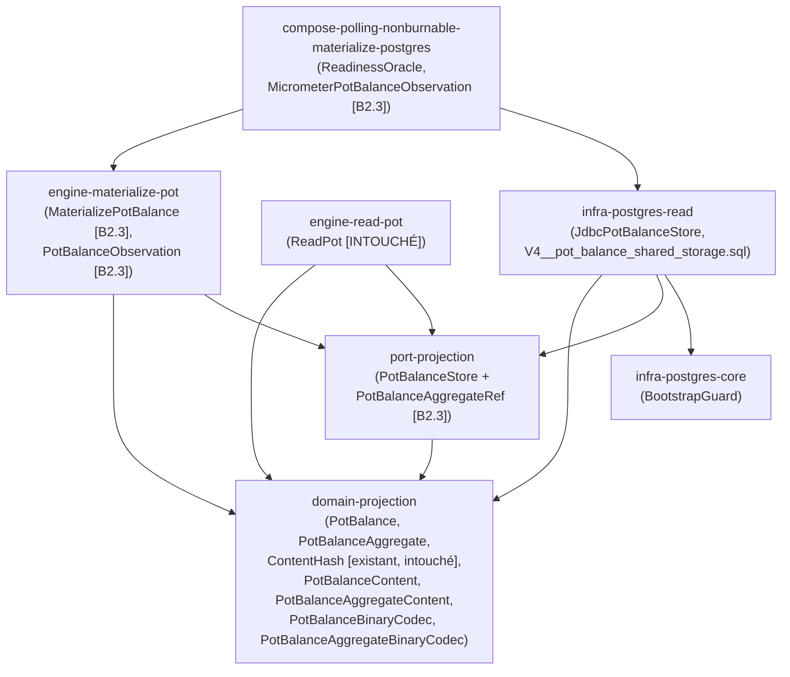

# Pocoma V3 — L7-C2-B2 — Plan d'implémentation du stockage mutualisé de `PotBalance` et de ses agrégats

- **Date** : 19 novembre 2026
- **Branche cible** : `feat/v3-l7` (aucun merge vers `main`, aucun engagement sur C2-B3/C3/C4)
- **Baseline A/B reproductible** : commit `e25cd84b` (`L7_C2_B1_CLOSED` — stockage persistant Radix-16 de `PotVersion` qualifié)
- **Documents normatifs de référence** :
  - [`docs/v3/L7_C2_B2_PotBalance_Storage_Design.md`](L7_C2_B2_PotBalance_Storage_Design.md) (audit & conception)
  - [`docs/v3/L7_C2_B1_PotVersion_Radix16_Implementation_Plan.md`](L7_C2_B1_PotVersion_Radix16_Implementation_Plan.md) (référence de structure et continuité des gates)
  - [`docs/v3/L7_C2_B1_4_PotVersion_Radix16_Qualification_Report.md`](L7_C2_B1_4_PotVersion_Radix16_Qualification_Report.md) (baseline C2-B1 `e25cd84b`)
  - [`docs/testing/Reactor_Verification_Policy.md`](../testing/Reactor_Verification_Policy.md) (politique normative de vérification)
- **Préservation impérative** :
  - `PotVersion` et l'ensemble des composants Radix-16 qualifiés en C2-B1 (`domain-projection/radix/*`, `JdbcPotVersionStore`, `MaterializePotVersion`, `V3__pot_version_radix16.sql`) ne subissent **aucune modification**.
  - `read_subobject_version`, `infra-postgres-write`, `domain-pot`, `domain-identity`, les règles de calcul de `PotBalance` / `PotBalanceAggregate` et tous les contrats HTTP publics (`supra-web-read`, `ReadPot`) restent strictement inchangés.
  - Les optimisations incrémentales `N−m` de L7.4-A4 et tous leurs fallbacks (`INITIAL_VERSION`, `INCREMENTAL_DISABLED`, `NO_REFERENCE`, `SHAREHOLDER_DELETED`, `DELTA_TOO_LARGE`, `BUCKET_CAP`) sont intégralement préservés.
- **Statut** : **APPROUVÉ (`L7_C2_B2_PLAN_APPROVED`)** — arbitrages ARB-1 à ARB-5 et découpage B2.1 à B2.4 approuvés ; prêt pour exécution séquentielle sur mandats distincts (aucun code de production ni migration active engagé à ce stade).

---

## 1. Décisions architecturales définitives (ARB-1 à ARB-5)

Les cinq arbitrages issus de l'audit sont figés comme exigences normatives de L7-C2-B2 :

| ID | Arbitrage | Décision définitive |
|---|---|---|
| **ARB-1** | **Encodage binaire canonique (`Option A-BIN`)** | Deux tables distinctes de contenus physiques immuables en `bytea` canonique : `read_pot_balance_content` et `read_pot_balance_aggregate_content`, adressées par SHA-256 à séparation de domaine (`pocoma-bal-v1\0` et `pocoma-bagg-v1\0`). Codec versionné (`schema_version = 1`), bijection exacte avec `Fraction` (`BigInteger`), ordre canonique strict, vérification d'égalité exacte sur tout conflit d'empreinte, FK natives depuis les tables de versions logiques, zéro chaîne de références historiques. |
| **ARB-2** | **Agrégat monolithique** | `PotBalanceAggregate` reste stocké comme un contenu physique monolithique unique par empreinte (pas d'arbre Radix ni de découpage par bucket dans C2-B2). Balances et agrégats sont mutualisés indépendamment. La qualification B2.4 mesurera le poids respectif des parties `shareholders` et `buckets` afin d'éclairer une éventuelle décision ultérieure (hors périmètre B2). |
| **ARB-3** | **Chemin rapide sur delta financier vide** | Autorisé **uniquement** lorsque l'identité exacte des contenus finaux `(PotBalance, PotBalanceAggregate)` est formellement prouvée sur `(K, N]` (cf. §3.3). Une commande non financière seule ne suffit pas ; toute incertitude ou mutation intermédiaire bascule vers le calcul incrémental A4 normal + déduplication physique à l'écriture. Tests d'équivalence stricte vs calcul intégral obligatoires. Reste désactivable/facultatif si B2.4 montre un gain insuffisant face à la complexité. |
| **ARB-4** | **Migration `V4` et reconstruction READ** | Migration `V4__pot_balance_shared_storage.sql` avec garde-fou refusant l'exécution si `read_pot_balance` ou `read_pot_balance_aggregate` est non vide. Migration des données historiques par **reconstruction complète READ depuis WRITE** (`v3-rebuild-read.py`). Zéro double lecture V3/V4 permanente. |
| **ARB-5** | **Absence de garbage collection & diagnostic F4** | Aucun GC dans C2-B2 (immuabilité `ENABLE ALWAYS` strictement préservée). Livraison d'un script SQL en lecture seule `scripts/v3/diagnose-pot-balance-unreachable.sql` (`BEGIN TRANSACTION READ ONLY`) quantifiant le nombre et la volumétrie des contenus `read_pot_balance_content` et `read_pot_balance_aggregate_content` non référencés par aucune version publiée. |

---

## 2. Architecture physique cible (Schéma `V4__pot_balance_shared_storage.sql`)

### 2.1 Portée des empreintes : globales (sans `pot_id`)

Les empreintes `content_hash` de `read_pot_balance_content` et `read_pot_balance_aggregate_content` sont **globales** (calculées uniquement sur le contenu canonique, sans `pot_id`), suivant exactement la convention déjà qualifiée en C2-B1 pour `read_pot_version_node` et `read_pot_user_set` :
- **Justification** :
  1. **Pureté de l'adressage par contenu** : `content_hash` identifie une valeur financière canonique immuable, indépendamment de `(pot_id, pot_version)`.
  2. **Isolation métier intacte** : les `ShareholderId` étant des UUID propres à chaque pot, deux pots non vides ont naturellement des contenus disjoints ; seuls les pots à `0` shareholder partagent une unique ligne canonique vide. Le contrôle d'accès et l'isolation par pot reposent sur `(pot_id, pot_version)` dans `read_pot_balance` et sur `ReadPot`, jamais sur `content_hash`.
  3. **Index PK minimal** : PK B-tree de `32 B` (`content_hash`) au lieu de `48 B` (`pot_id, content_hash`).
  4. **Uniformité opérationnelle** : diagnostic F4 et vérifications `ReadinessOracle` strictement alignés sur `read_pot_version_node` / `read_pot_user_set`.

### 2.2 Définition DDL cible (`V4__pot_balance_shared_storage.sql`)

Localisation finale (en B2.2) : `app/infra-postgres-read/src/main/resources/db/read/migration/V4__pot_balance_shared_storage.sql` *(livrée et prouvée d'abord en zone candidate `src/test/resources/db/read-candidate/migration/` en B2.1)*.

1. **Garde-fous préliminaires (`DO $$`)** :
   - Vérification `${expectedDatabase}`, `${expectedSchema}`, `${expectedAdmin}`, `${expectedRuntime}`, propriétaire du schéma, absence de schéma `public`.
   - Vérification de l'existence de `read_pot_balance`, `read_pot_balance_aggregate` et `read_subobject_immutable()`.
   - **Garde-fou ARB-4** : `IF exists(SELECT 1 FROM read_pot_balance) OR exists(SELECT 1 FROM read_pot_balance_aggregate) THEN RAISE EXCEPTION 'V4 PotBalance shared storage migration requires empty read_pot_balance and read_pot_balance_aggregate' USING ERRCODE = '23514'; END IF;`.

2. **Tables de contenus immuables et tables de versions logiques** :

```sql
create table read_pot_balance_content (
  content_hash       bytea   primary key check (octet_length(content_hash) = 32),
  schema_version     integer not null    check (schema_version = 1),
  shareholders_count integer not null    check (shareholders_count >= 0),
  payload            bytea   not null    check (octet_length(payload) >= 4)
);

create table read_pot_balance_aggregate_content (
  content_hash       bytea   primary key check (octet_length(content_hash) = 32),
  schema_version     integer not null    check (schema_version = 1),
  shareholders_count integer not null    check (shareholders_count >= 0),
  bucket_count       integer not null    check (bucket_count >= 0),
  payload            bytea   not null    check (octet_length(payload) >= 8)
);

drop table read_pot_balance_aggregate;
drop table read_pot_balance;

create table read_pot_balance (
  pot_id       uuid   not null,
  pot_version  bigint not null check (pot_version > 0),
  content_hash bytea  not null references read_pot_balance_content(content_hash),
  primary key (pot_id, pot_version)
);

create table read_pot_balance_aggregate (
  pot_id       uuid   not null,
  pot_version  bigint not null check (pot_version > 0),
  content_hash bytea  not null references read_pot_balance_aggregate_content(content_hash),
  primary key (pot_id, pot_version),
  foreign key (pot_id, pot_version) references read_pot_balance(pot_id, pot_version)
);
```

3. **Contraintes de cohérence & Index** :
   - `octet_length(content_hash) = 32` sur les deux tables de contenus.
   - `octet_length(payload) >= 4` (`int32_be(shareholdersCount)`) pour `read_pot_balance_content` et `>= 8` (`int32_be(shareholdersCount)` + `int32_be(bucketCount)`) pour `read_pot_balance_aggregate_content`.
   - FK natives :
     - `read_pot_balance.content_hash -> read_pot_balance_content(content_hash)`
     - `read_pot_balance_aggregate.content_hash -> read_pot_balance_aggregate_content(content_hash)`
     - `read_pot_balance_aggregate(pot_id, pot_version) -> read_pot_balance(pot_id, pot_version)` (aucune FK vers `read_pot_version` : isolation stricte des projections).
   - **Index** : uniquement les 4 PK B-tree (`read_pot_balance_content(content_hash)`, `read_pot_balance_aggregate_content(content_hash)`, `read_pot_balance(pot_id, pot_version)`, `read_pot_balance_aggregate(pot_id, pot_version)`). **0 index secondaire** (couvre 100 % des accès : lookup exact, `JOIN` PK, scan backward `ORDER BY pot_version DESC LIMIT 1`).

4. **Triggers d'immuabilité (`ENABLE ALWAYS TRIGGER`)** :
   - Sur chacune des **4 tables** (`read_pot_balance_content`, `read_pot_balance_aggregate_content`, `read_pot_balance`, `read_pot_balance_aggregate`) :
     - `BEFORE UPDATE OR DELETE FOR EACH ROW EXECUTE FUNCTION read_subobject_immutable()` (`ERRCODE = '23514'`)
     - `BEFORE TRUNCATE FOR EACH STATEMENT EXECUTE FUNCTION read_subobject_immutable()` (`ERRCODE = '23514'`)
     - `ALTER TABLE ... ENABLE ALWAYS TRIGGER ...` (8 triggers au total, actifs même sous `session_replication_role = replica`).

5. **Privilèges SQL minimaux & assertions ACL** :
   - Rôle worker `${expectedRuntime}` (`pocoma_read`) :
     - `REVOKE ALL` sur les 4 tables depuis `PUBLIC, "${expectedRuntime}"`.
     - `GRANT SELECT, INSERT` uniquement sur les 4 tables à `"${expectedRuntime}"`.
     - Bloc `DO $$` d'assertion vérifiant pour chacune des 4 tables l'absence totale de `UPDATE, DELETE, TRUNCATE, REFERENCES, TRIGGER`, de privilège colonne `UPDATE`/`REFERENCES`, et d'ACL `PUBLIC` (`grantee = 0`).
   - Rôle HTTP READ (`pocoma_read_http`, via `scripts/v3/grant-l7-http-read.sql`) :
     - `GRANT SELECT` sur `read_pot_balance` **et** `read_pot_balance_content`.
     - **Aucun privilège** sur `read_pot_balance_aggregate` ni `read_pot_balance_aggregate_content`.

### 2.3 Format binaire canonique et identité cryptographique

#### Encodage d'un `Fraction` (bijection stricte)
Un [`Fraction`](../../app/domain-pot/src/main/java/com/kartaguez/pocoma/domain/pot/value/Fraction.java) garantit par construction : `denominator > 0`, `numerator == 0 => denominator == 1`, `gcd(|numerator|, denominator) == 1`.
- Encodage : `varint32(numBytes.length)` || `numBytes` || `varint32(denBytes.length)` || `denBytes`, où `numBytes = numerator.toByteArray()` et `denBytes = denominator.toByteArray()` (représentation big-endian en complément à deux **minimale**), `varint32` étant un entier non signé LEB128 (`>= 1`).
- Décodage strict :
  - Refuse toute longueur `<= 0` ou dépassant les octets restants.
  - Refuse toute représentation non minimale (`bytes.length > 1` avec `(bytes[0] == 0x00 && (bytes[1] & 0x80) == 0)` ou `(bytes[0] == (byte) 0xFF && (bytes[1] & 0x80) != 0)`).
  - Construit `Fraction f = new Fraction(num, den)` et vérifie `f.numerator().equals(num) && f.denominator().equals(den)` (garantit `den > 0`, `0 => 0/1`, `gcd == 1`).

#### Encodage `PotBalanceContent` (`schema_version = 1`)
- `int32_be(shareholdersCount)` (`>= 0`).
- Pour chaque `(UUID id, Fraction value)` dans l'ordre strict `SubobjectKey.compareUuid` :
  - `int64_be(id.getMostSignificantBits())` || `int64_be(id.getLeastSignificantBits())` || `encodeFraction(value)`.
- **Empreinte SHA-256** :
  $$\text{content\_hash} = \text{SHA-256}\big(\texttt{"pocoma-bal-v1\textbackslash 0"} \;\|\; \text{uint8}(1) \;\|\; \text{payload}\big)$$
- **Validation au décodage** : aucun octet traînant (`remaining == 0`), `count == shareholdersCount`, UUID strictement croissants (`SubobjectKey.compareUuid`), somme exacte égale à `Fraction.ZERO`, et empreinte cohérente avec `content_hash` stocké.

#### Encodage `PotBalanceAggregateContent` (`schema_version = 1`)
- `int32_be(shareholdersCount)` (`>= 0`).
- Pour chaque `ShareholderEntry` dans l'ordre strict `SubobjectKey.compareUuid` :
  - `uuid(16 B)` || `uint8(deleted ? 1 : 0)` (tout octet `∉ {0, 1}` rejeté) || `encodeFraction(defaultWeight)` || `encodeFraction(fixedNet)`.
- `int32_be(bucketCount)` (`>= 0`).
- Pour chaque `(BucketKey, BucketValue)` dans l'ordre strict `BucketKey.compareTo` :
  - `int32_be(defaultIndices.size())` (`>= 1`) || `int32_be(idx_0) ...` (strictement croissants, dans `[0, shareholdersCount)`).
  - `encodeFraction(specificWeightTotal)` || `encodeFraction(totalAmount)`.
  - `int32_be(specWeightedAmounts.size())` (`>= 0`) || pour chaque `(idx, frac)` (indices strictement croissants) : `int32_be(idx)` || `encodeFraction(frac)`.
- **Empreinte SHA-256** :
  $$\text{content\_hash} = \text{SHA-256}\big(\texttt{"pocoma-bagg-v1\textbackslash 0"} \;\|\; \text{uint8}(1) \;\|\; \text{payload}\big)$$
- **Validation au décodage** : aucun octet traînant, compteurs cohérents, ordres stricts, conservation exacte vérifiée par le constructeur `PotBalanceAggregate` (`sum(fixedNet) == sum(bucketAmounts)` et `sum(Q) == T * W_spec`).

### 2.4 Publication transactionnelle, concurrence, replay et traitement des collisions

Dans l'unique transaction `READ_COMMITTED` de `MaterializePotBalance.finalizeIn(completion)` :
1. **Ordre fixe anti-deadlock** : `read_pot_balance_content` → `read_pot_balance` → `read_pot_balance_aggregate_content` → `read_pot_balance_aggregate` → `completion.complete()`.
2. **Trois cas distingués sur chaque table de contenu** :
   - **Contenu absent** : `INSERT INTO read_pot_balance[_aggregate]_content(...) VALUES (...) ON CONFLICT (content_hash) DO NOTHING RETURNING content_hash` renvoie 1 ligne → insertion neuve confirmée, aucune relecture superflue.
   - **Contenu identique déjà présent** : `RETURNING` renvoie 0 ligne → `SELECT schema_version, ..., payload FROM ... WHERE content_hash = ?` → comparaison exacte `schemaVersion == expected && counts == expected && Arrays.equals(actualPayload, expectedPayload)` → réutilisation validée sans écriture TOAST/heap.
   - **Collision d'empreinte ou contenu divergent** : la ligne lue pour `content_hash` diffère d'un seul octet ou métadonnée → levée immédiate d'`IllegalStateException("Divergent read_pot_balance[_aggregate]_content for hash " + hash)` → **rollback complet de la transaction** (aucune collision silencieuse).
3. **Table de version logique `(pot_id, pot_version)`** :
   - `INSERT INTO read_pot_balance(pot_id, pot_version, content_hash) VALUES (?,?,?) ON CONFLICT (pot_id, pot_version) DO NOTHING RETURNING 1`.
   - Si conflit (replay ou publication concurrente de la même version) : `SELECT content_hash FROM read_pot_balance WHERE pot_id=? AND pot_version=?` et vérification d'égalité exacte des 32 octets de `content_hash` (sinon `IllegalStateException` → rollback). Même logique sur `read_pot_balance_aggregate`.
4. **Concurrence** : deux workers `READ_COMMITTED` publiant simultanément le même contenu (sur des versions différentes ou identiques) sont sérialisés par le verrou spéculatif PostgreSQL `ON CONFLICT (content_hash) DO NOTHING` ; le second lit la ligne fraîchement committée par le premier et valide l'égalité exacte octet à octet.

---

## 3. Architecture logicielle

### 3.1 Placement modulaire (0 nouvelle dépendance Maven)

Aucune dépendance entre modules Maven n'est ajoutée :



### 3.2 Inventaire des évolutions par module

| Module | Composant | Statut | Évolution exacte |
|---|---|---|---|
| `domain-projection` | `c.k.p.domain.projection.balance` *(nouveau package)* : `PotBalanceContent`, `PotBalanceAggregateContent`, `PotBalanceBinaryCodec`, `PotBalanceAggregateBinaryCodec` | Nouveau (B2.1) | Encodage/décodage binaire canonique versionné (`schema_version = 1`), calcul SHA-256 (`pocoma-bal-v1\0` / `pocoma-bagg-v1\0`), `exactContentEquals` octet à octet. Réutilise `ContentHash` en lecture seule **sans modifier aucun fichier de `radix/`**. |
| `port-projection` | `PotBalanceStore` | Inchangé en B2.1/B2.2 ; étendu en B2.3 | Conserve intactes les 8 méthodes existantes. En B2.3 (pour ARB-3), ajout de `Optional<AggregateRef> readLatestAggregateRefBefore(...)`, `Optional<PotBalanceAggregate> readAggregateByHash(UUID pot, long version, ContentHash hash, RecoveryReadContext ctx)`, `void linkExistingVersion(UUID pot, long version, ContentHash balanceHash, ContentHash aggregateHash)` et `void requireVersionHashesStored(UUID pot, long version, ContentHash balanceHash, ContentHash aggregateHash)`. |
| `infra-postgres-read` | `V4__pot_balance_shared_storage.sql`, `JdbcPotBalanceStore`, `PotBalanceAggregateJson` | Nouveau / Réécrit / Supprimé | `V4` en zone candidate (B2.1) puis promue dans `src/main/resources/db/read/migration/` (B2.2) ; `JdbcPotBalanceStore` réécrit sur `V4` en B2.2 ; suppression de `PotBalanceAggregateJson` en B2.2 (zéro code mort dual). |
| `engine-materialize-pot` | `MaterializePotBalance`, `PotBalanceObservation` | Inchangés en B2.1/B2.2 ; adaptés en B2.3 | Intégration du chemin rapide ARB-3 formellement prouvé + métriques Micrometer (`Path.REUSE` / `Reason.EMPTY_DELTA_REUSE`, compteurs de réutilisation de contenu). |
| `engine-read-pot` | `ReadPot` | **Strictement inchangé** | Continue d'appeler `balances.read(pot, version, c)` ; zéro changement de contrat ou d'API publique. |
| `infra-postgres-core` | `BootstrapGuard` | Étendu (B2.2) | Ajout de `read_pot_balance_content` (`Set.of()`) et `read_pot_balance_aggregate_content` (`Set.of()`) dans `READ_UPDATES`. |
| `compose-polling-nonburnable-materialize-postgres` | `ReadinessOracle`, `MicrometerPotBalanceObservation` | Étendus (B2.2 / B2.3) | `ReadinessOracle.checkRelationalIntegrity` (B2.2) vérifie la cohérence des FK `content_hash` de `read_pot_balance` et `read_pot_balance_aggregate` ; `MicrometerPotBalanceObservation` (B2.3) expose les compteurs de réutilisation et le chemin rapide. |
| `architecture-tests` | `L7ReactorArchitectureTest` | Étendu (B2.2) | Ajout de `V4__pot_balance_shared_storage.sql` dans la liste statique des migrations actives de `infra-postgres-read`. |
| `scripts/` | `grant-l7-http-read.sql`, `diagnose-pot-balance-unreachable.sql`, `v3-rebuild-read.py`, `setup-v3-database.py`, `scripts/performance/*` | Adaptés / Nouveau (B2.4) | Privilège `SELECT` sur `read_pot_balance_content` pour `pocoma_read_http`, diagnostic F4 lecture seule, rebuild V4 et campagnes A/B. |

### 3.3 Preuve formelle du chemin rapide ARB-3 (B2.3)

Le chemin rapide `EMPTY_DELTA_REUSE` est exécuté dans `MaterializePotBalance.prepare(...)` **uniquement** lorsque **toutes** les conditions suivantes sont simultanément vraies dans le snapshot `REPEATABLE_READ` courant :
1. `!eventRef.potDeleted()` et `eventRef.version() > 1` et `settings.maxDeltaDistance() > 0`.
2. Il existe une référence `AggregateRef(K, balanceHash_K, aggregateHash_K)` retournée par `readLatestAggregateRefBefore(potId, N, Math.max(1L, N - maxDeltaDistance), c)` (ce qui prouve par FK native l'existence de `read_pot_balance(potId, K)` et `read_pot_balance_aggregate(potId, K)` et de leurs deux contenus immuables).
3. `FinancialDelta delta = source.financialDelta(potId, K, N, settings.maxChangedExpenses(), c)` satisfait **strictement** :
   - `!delta.shareholderDeleted()` *(aucun `v3_shareholder_header` avec `deleted = true` devenu actif dans `(K, N]`)*,
   - `delta.updatedOrAddedWeights().isEmpty()` *(aucun `v3_shareholder_weight` devenu actif dans `(K, N]`, ce qui prouve qu'aucun shareholder n'a été ajouté et qu'aucun `defaultWeight` n'a été révisé — même puis rétabli — dans `(K, N]`)*,
   - `delta.changedExpenseCount() == 0` *(aucun `v3_expense_header` ni `v3_expense_financials` devenu actif dans `(K, N]`, donc aucune dépense ajoutée, modifiée financièrement ou supprimée, même à montant nul ou annulée dans `(K, N]`)*.

**Exigence normative sur `EMPTY_DELTA_REUSE`** :
- La preuve d'identité doit couvrir **toutes les dépendances du calcul sur `(K, N]`**, y compris les changements intermédiaires, les annulations ou retours en arrière de mutations (ex. poids modifié puis rétabli, dépense créée puis supprimée), les poids, les shareholders (ajouts, suppressions logiques), `defaultWeight` et les buckets.
- **Si cette preuve ne peut pas être établie de manière complète** (par exemple : `weight` modifié puis rétabli, dépense `amount = 0` ajoutée, `DeleteShareholder`, `AddShareholders`, `N − K > maxDeltaDistance`, `bucket_cap` en `K`), l'implémentation **doit** exécuter le calcul incrémental A4 normal (ou le fallback intégral) et s'appuyer sur la déduplication physique à l'écriture via `content_hash`.
- **Règle absolue : ne jamais assouplir un invariant de calcul, de dépendance ou de sûreté pour activer le chemin rapide.**
- **Conséquence prouvée** : lorsque les conditions (1)–(3) sont réunies, l'état financier complet (`PotFinancialState`, hors numéro de version) sur `(K, N]` est identique à `K` (mêmes shareholders, mêmes flags `deleted`, mêmes `defaultWeight`, mêmes `fixedNet`, mêmes `buckets`), et par déterminisme pur de `PotBalanceAggregateCalculator`, `(PotBalance(N), PotBalanceAggregate(N))` ont exactement les contenus `(balanceHash_K, aggregateHash_K)`.
- **Sécurité de reprise** : `prepareRecovery()` continue de calculer l'oracle intégral `PotBalanceCalculator` depuis `WRITE` et de vérifier `store.evidence(pot, N, expected, c)` sur le contenu décodé de `read_pot_balance_content`.

---

## 4. Plan d'exécution et continuité des gates (B2.1 à B2.4)

### 4.1 Continuité des gates du réacteur

Aucun sous-lot qualifié ne laisse le réacteur dans un état incompatible :

| Sortie de sous-lot | État de `src/main/resources/db/read/migration/` | État du store, lecteurs, fixtures & bootstrap | Gates verts obligatoires |
|---|---|---|---|
| **Sortie B2.1** | Inchangé (`V1`, `V2`, `V3`). `V4` validée en `src/test/resources/db/read-candidate/migration/`. | `JdbcPotBalanceStore`, `ReadPot`, `BootstrapGuard`, `ReadinessOracle` et toutes les fixtures Flyway « latest » 100 % intacts. | `PROJECTION` (0 régression). |
| **Sortie B2.2** | `V4__pot_balance_shared_storage.sql` promue **atomiquement** dans `src/main/resources/db/read/migration/`. | `JdbcPotBalanceStore` V4, `BootstrapGuard`, `ReadinessOracle`, `L7ReactorArchitectureTest`, `ReadStoreFixture` (`target="4"`), toutes les fixtures READ adaptées ; `ReadPot` 100 % compatible via `PotBalanceStore.read(...)`. | `PROJECTION` + `WEB` + `architecture-tests`. |
| **Sortie B2.3** | Inchangé (`V1`..`V4`). | Chemin rapide ARB-3 actif dans `MaterializePotBalance` + observabilité Micrometer ; 100 % équivalent au calcul intégral. | `PROJECTION` + `WEB`. |
| **Sortie B2.4** | Inchangé (`V1`..`V4`). | Scripts `V4`, diagnostic F4, double rebuild READ depuis WRITE, qualification A/B vs `e25cd84b`, rapport final. | `architecture-tests` + **Full Reactor (42 modules)**. |

*Stratégie d'exécution* : **B2.1, B2.2 et B2.3** peuvent être enchaînés dans un mandat groupé (avec qualification et commit atomique à chaque étape) ; **B2.4** fait l'objet d'un **mandat séparé** dédié à la reconstruction, la qualification A/B et le Full Reactor.

---

### 4.2 Sous-lot B2.1 — Fondations binaires canoniques & schéma candidat `V4`

1. **Objectif et périmètre** : Livrer et prouver les codecs binaires canoniques `PotBalance` / `PotBalanceAggregate`, le calcul d'empreintes SHA-256 à séparation de domaine et le script DDL candidat `V4__pot_balance_shared_storage.sql` sans impacter les migrations actives ni le runtime.
2. **Fichiers et modules concernés** :
   - `app/domain-projection/src/main/java/com/kartaguez/pocoma/domain/projection/balance/` (`PotBalanceContent.java`, `PotBalanceAggregateContent.java`, `PotBalanceBinaryCodec.java`, `PotBalanceAggregateBinaryCodec.java`)
   - `app/domain-projection/src/test/java/com/kartaguez/pocoma/domain/projection/balance/` (`PotBalanceBinaryCodecTest.java`, `PotBalanceAggregateBinaryCodecTest.java`)
   - `app/infra-postgres-read/src/test/resources/db/read-candidate/migration/V4__pot_balance_shared_storage.sql`
   - `app/infra-postgres-read/src/test/java/com/kartaguez/pocoma/infra/postgres/read/PotBalanceSharedSchemaPostgresTest.java`
3. **Modifications précises** : implémentation des codecs (§2.3), validation stricte de minimalité `BigInteger` et d'ordre canonique, DDL candidat `V4` (§2.2) avec garde-fou tables vides, 8 triggers `ENABLE ALWAYS` et assertions ACL.
4. **Invariants préservés** : bijection exacte `Fraction ↔ bytes`, déterminisme SHA-256, immutabilité effective PostgreSQL, privilèges minimaux, zéro impact sur `V1..V3` et `radix/*`.
5. **Tests obligatoires** :
   - `PotBalanceBinaryCodecTest` : round-trip, `Fraction` géants (`10^40`), zéros, ordre UUID non signé, rejet troncature / octets traînants / `BigInteger` non minimal / fraction non réduite / somme non nulle / ordre inversé, déterminisme `pocoma-bal-v1\0`.
   - `PotBalanceAggregateBinaryCodecTest` : round-trip multi-buckets (défaut, mixtes, pur spécifique, `deleted=true`, `bucketCount=0`), rejet flags `deleted ∉ {0,1}`, rejet indices hors bornes / non croissants, rejet violation conservation, déterminisme `pocoma-bagg-v1\0`.
   - `PotBalanceSharedSchemaPostgresTest` : exécution `V1 → V2 → V3 → V4` candidat sur PostgreSQL 17, refus `V4` si `read_pot_balance` ou `read_pot_balance_aggregate` non vide (`23514`), rejet `UPDATE`/`DELETE`/`TRUNCATE` sur les 4 tables (`23514`), FK invalides (`23503`), vérification `aclexplode` et privilèges minimaux.
6. **Verification scope (`Reactor_Verification_Policy.md` §29)** :
   - Expected production impact : `domain-projection` (nouveau package `balance`). DDL `V4` en zone test candidate uniquement.
   - Primary slice : `PROJECTION` (`./mvnw -pl runtime-worker-materialize -am test`)
   - Secondary slices : `NONE` (boucle rapide `./mvnw -pl domain-projection,infra-postgres-read -am test`)
   - Forbidden production impact : `COMMAND`, `WEB`, `domain-pot`, `domain-identity`, `infra-postgres-write`, `domain-projection/radix/*`, `src/main/resources/db/read/migration/`, `JdbcPotBalanceStore`, `MaterializePotBalance`, `ReadPot`.
   - Required local proof : `./mvnw -pl domain-projection,infra-postgres-read -am test` puis `./mvnw -pl runtime-worker-materialize -am test`.
   - Global architecture gate : `NOT REQUIRED`.
   - Full reactor : `NOT REQUIRED`.
   - Database verification : `CURRENT` (`V1..V4` candidat PostgreSQL 17 Testcontainers).
   - Escalation conditions : tout échec hors `domain-projection` / `infra-postgres-read`.
7. **Gates de clôture** : 100 % PASS sur `domain-projection`, `infra-postgres-read` et `runtime-worker-materialize -am`.
8. **Preuves à archiver** : rapports Surefire + rapport conforme `Reactor_Verification_Policy.md` §30 + commit B2.1.
9. **Condition d'enchaînement vers B2.2** : B2.1 vert et committé sur `feat/v3-l7`.

---

### 4.3 Sous-lot B2.2 — Activation `V4`, persistance mutualisée & continuité des lecteurs

1. **Objectif et périmètre** : Promouvoir `V4` en migration active atomiquement avec la réécriture de `JdbcPotBalanceStore`, `BootstrapGuard`, `ReadinessOracle`, `L7ReactorArchitectureTest` et toutes les fixtures de tests READ.
2. **Fichiers et modules concernés** :
   - `app/infra-postgres-read/src/main/resources/db/read/migration/V4__pot_balance_shared_storage.sql` *(promu ; suppression du candidat)*
   - `app/infra-postgres-read/.../JdbcPotBalanceStore.java` *(réécrit sur V4)* ; suppression de `PotBalanceAggregateJson.java` et `PotBalanceAggregateJsonTest.java` (si existant)
   - `app/infra-postgres-core/.../BootstrapGuard.java` (`READ_UPDATES`)
   - `app/compose-polling-nonburnable-materialize-postgres/.../ReadinessOracle.java` + `ReadinessOracleTest.java`
   - `app/architecture-tests/.../L7ReactorArchitectureTest.java` (`V4` dans la liste statique)
   - Fixtures & tests à adapter : `ReadStoreFixture.java` (`target="4"`), `PotBalanceReadStorePostgresTest.java`, `ReadParticipantsFixture.java` (l. 51 & l. 148 : corruption ciblant `read_pot_balance_content`), `ReadParticipantsIntegrationPostgresTest.java` (l. 289), `ReadReconstructionPostgresTest.java` (l. 445), `PotVersionAndBalanceJointIncrementalPostgresTest.java` (l. 684), `ReadRuntimeI8Fixture.java` (l. 614), `ReadMonolithI8Fixture.java` (l. 613).
3. **Modifications précises** :
   - `JdbcPotBalanceStore` : `insertOrVerify`, `insertOrVerifyAggregate`, `read`, `evidence`, `requireStored`, `readLatestAggregateBefore`, `requireAggregateStored` opérant sur `V4` avec `ON CONFLICT DO NOTHING RETURNING` + vérification exacte octet à octet sur conflit + lecture directe par `JOIN` PK.
   - `ReadinessOracle.checkRelationalIntegrity` : ajout de la vérification que chaque `read_pot_balance.content_hash` existe dans `read_pot_balance_content` et chaque `read_pot_balance_aggregate.content_hash` existe dans `read_pot_balance_aggregate_content`.
4. **Invariants préservés** : les 12 invariants (§5), 0 modification de `ReadPot` ni des contrats HTTP, isolation stricte de `pocoma_read_http` (zéro accès aux agrégats), zéro modification de `PotVersion` Radix-16.
5. **Tests obligatoires** :
   - `PotBalanceReadStorePostgresTest` : déduplication indépendante Situations A, C et D (vérification `count(*)` sur tables de contenus vs tables de versions), collision SHA-256 simulée → `IllegalStateException` + rollback atomique, concurrence multi-threads sur même contenu et même version, `readLatestAggregateBefore`, `evidence` (SATISFIED / MISSING / DIVERGENT).
   - Non-régression complète : `PotBalanceIncrementalPostgresTest`, `PotVersionAndBalanceJointIncrementalPostgresTest`, `ReadParticipantsIntegrationPostgresTest`, `ReadReconstructionPostgresTest`, `ReadRuntimeAssemblyPostgresTest`, `runtime-web-read` (`42/42`), `architecture-tests` (`52/52`).
6. **Verification scope (`Reactor_Verification_Policy.md` §29)** :
   - Expected production impact : `infra-postgres-read`, `infra-postgres-core` (`BootstrapGuard`), `compose-polling-nonburnable-materialize-postgres` (`ReadinessOracle`).
   - Primary slice : `PROJECTION` (`./mvnw -pl runtime-worker-materialize -am test`)
   - Secondary slices : `WEB` (`./mvnw -pl runtime-web-write,runtime-web-read -am test`)
   - Forbidden production impact : `COMMAND`, `infra-postgres-write`, `domain-pot`, `domain-identity`, `supra-web-read`, `ReadPot`, `domain-projection/radix/*`, `JdbcPotVersionStore`, `MaterializePotVersion`.
   - Required local proof :
     - `./mvnw -pl runtime-worker-materialize,runtime-web-write,runtime-web-read -am test`
     - `./mvnw -pl architecture-tests -am test`
   - Global architecture gate : **REQUIRED** (ajout de `V4__pot_balance_shared_storage.sql` dans `src/main/resources/db/read/migration/`).
   - Full reactor : `NOT REQUIRED` (différé à B2.4).
   - Database verification : `CURRENT` (`V1 → V2 → V3 → V4` PostgreSQL 17).
   - Escalation conditions : tout échec dans `runtime-web-read`, `architecture-tests` ou `runtime-monolith`.
7. **Gates de clôture** : `PROJECTION` + `WEB` + `architecture-tests` 100 % PASS.
8. **Preuves à archiver** : sorties Surefire + rapport §30 + commit B2.2.
9. **Condition d'enchaînement vers B2.3** : B2.2 vert et committé sur `feat/v3-l7`.

---

### 4.4 Sous-lot B2.3 — Optimisation de matérialisation (Chemin rapide ARB-3 & observabilité)

1. **Objectif et périmètre** : Intégrer le chemin rapide formellement prouvé ARB-3 (§3.3) dans `MaterializePotBalance` et exposer les métriques Micrometer basse cardinalité de réutilisation des contenus et d'activation du chemin rapide.
2. **Fichiers et modules concernés** :
   - `app/port-projection/.../PotBalanceStore.java` (ajout `AggregateRef` + 4 méthodes additives ; 8 méthodes existantes inchangées)
   - `app/infra-postgres-read/.../JdbcPotBalanceStore.java` (implémentation des 4 méthodes + comptage/retour de réutilisation)
   - `app/engine-materialize-pot/.../MaterializePotBalance.java`, `PotBalanceObservation.java`
   - `app/compose-polling-nonburnable-materialize-postgres/.../MicrometerPotBalanceObservation.java`
   - Tests : `MaterializePotBalanceIncrementalTest.java`, `PotBalanceIncrementalPostgresTest.java`, `PotVersionAndBalanceJointIncrementalPostgresTest.java`
3. **Modifications précises** :
   - Lookup léger `readLatestAggregateRefBefore(pot, N, minVersion, c)` (1 ligne, 0 lecture TOAST/payload).
   - Évaluation de la preuve ARB-3 après `source.financialDelta(pot, K, N, ...)` : si `!shareholderDeleted && updatedOrAddedWeights.isEmpty() && changedExpenseCount == 0`, réutilisation directe de `(balanceHash_K, aggregateHash_K)` via `linkExistingVersion` + `requireVersionHashesStored` (0 `readAggregateByHash`, 0 `applyDelta`, 0 `Eval`, 0 encodage).
   - Sinon, chargement `readAggregateByHash(pot, K, aggregateHash_K, c)` et chemin A4 normal + déduplication physique en écriture.
   - Ajout de `Path.REUSE` / `Reason.EMPTY_DELTA_REUSE` et compteurs `pocoma.v3.potbalance.content.write{target=balance|aggregate, outcome=inserted|reused}` dans `MicrometerPotBalanceObservation`.
4. **Invariants préservés** : équivalence mathématique stricte avec le calcul intégral `PotBalanceCalculator`, préservation de tous les fallbacks A4, fencing `requireCompletionReady`, atomicité `finalizeIn`, `prepareRecovery` toujours sur oracle intégral.
5. **Tests obligatoires** :
   - Équivalence stricte chemin rapide vs calcul intégral sur : `UpdatePotDetails`, `UpdateShareholderDetails`, `AttachShareholderViaInvitation`, `UpdateExpenseDetails` (consécutifs et en saut `N−m` avec `m > 1`).
   - Preuve de **non-déclenchement** du chemin rapide (bascule propre vers A4 normal + déduplication physique) sur : changement de poids puis retour au poids initial dans `(K, N]`, création puis suppression d'une dépense dans `(K, N]`, dépense à `amount = 0`, `DeleteShareholder`, `AddShareholders`, `bucket_cap` sur `K`.
   - Tests `N−m`, hors ordre, replay idempotent, concurrence et fencing (`PotBalanceIncrementalPostgresTest`, `PotVersionAndBalanceJointIncrementalPostgresTest`).
6. **Verification scope (`Reactor_Verification_Policy.md` §29)** :
   - Expected production impact : `port-projection`, `infra-postgres-read`, `engine-materialize-pot`, `compose-polling-nonburnable-materialize-postgres`.
   - Primary slice : `PROJECTION` (`./mvnw -pl runtime-worker-materialize -am test`)
   - Secondary slices : `WEB` (`./mvnw -pl runtime-web-read -am test`)
   - Forbidden production impact : `COMMAND`, `infra-postgres-write`, `domain-pot`, `domain-identity`, `ReadPot`, `PotVersion` Radix-16.
   - Required local proof : `./mvnw -pl runtime-worker-materialize,runtime-web-read -am test`
   - Global architecture gate : `NOT REQUIRED` (aucune dépendance modulaire ni migration modifiée).
   - Full reactor : `NOT REQUIRED` (différé à B2.4).
   - Database verification : `CURRENT`.
7. **Gates de clôture** : `PROJECTION` + `WEB` 100 % PASS.
8. **Preuves à archiver** : sorties Surefire + rapport §30 + commit B2.3.
9. **Condition d'enchaînement vers B2.4** : B2.1, B2.2 et B2.3 committés et verts sur `feat/v3-l7`.

---

### 4.5 Sous-lot B2.4 — Outillage `V4`, reconstruction READ, qualification A/B & Full Reactor *(mandat séparé)*

1. **Objectif et périmètre** : Finaliser l'outillage opérationnel et de performance `V4`, livrer le diagnostic lecture seule ARB-5, exécuter la reconstruction READ depuis les snapshots WRITE L7.4, réaliser la qualification A/B complète contre la baseline C2-B1 `e25cd84b`, exécuter le Full Reactor et publier le rapport de qualification final.
2. **Fichiers et modules concernés** :
   - `scripts/v3/grant-l7-http-read.sql` (+ `'read_pot_balance_content'`, strictement sans `read_pot_balance_aggregate*`)
   - `scripts/v3/diagnose-pot-balance-unreachable.sql` *(nouveau, ARB-5)*
   - `scripts/operations/v3-rebuild-read.py` (`CANONICAL_MIGRATION_TABLES`, `V4`, `_evaluate_integrity` aligné sur `ReadinessOracle`)
   - `scripts/operations/setup-v3-database.py` (`V4` + garde-fou refusant une base `V3` non vide avec renvoi vers `v3-rebuild-read.py`)
   - `scripts/performance/run-l7-4-a3-a4-multibucket.py`, `run-l7-4a4-targeted.py`, `run-l7-4a-baseline.py`, nouveau `scripts/performance/run-l7-c2-b2-qualification.py`
   - `docs/v3/L7_C2_B2_PotBalance_Qualification_Report.md` + preuves `docs/testing/evidence/L7-C2-B2/`
3. **Diagnostic F4 en lecture seule (`scripts/v3/diagnose-pot-balance-unreachable.sql`)** :
   - Exécuté dans `BEGIN TRANSACTION READ ONLY;` (aucune mutation, aucun GC).
   - Quantifie pour `read_pot_balance_content` et `read_pot_balance_aggregate_content` : `total_content_count`, `reachable_content_count`, `unreachable_content_count`, `unreachable_content_bytes` (`coalesce(sum(pg_column_size(c.*)), 0)`), plus le ratio de mutualisation (`version_rows / distinct_content_rows`).
4. **Verification scope (`Reactor_Verification_Policy.md` §29 — Clôture de lot majeur §19)** :
   - Expected production impact : `NONE` sur le code Java (scripts opérationnels/performance uniquement ; si un correctif Java est nécessaire, ré-exécuter le slice impacté avant le Full Reactor).
   - Global architecture gate : **REQUIRED** (`./mvnw -pl architecture-tests -am test`).
   - Full reactor : **REQUIRED** (`./mvnw --batch-mode --no-transfer-progress test` — 42 modules enfants V3).
   - Tests Python : `python3 -m unittest scripts/performance/test_l7_4a_baseline.py scripts/testing/test_verification.py`.
   - Database verification : `CURRENT` + double reconstruction READ depuis WRITE (`medium` et `large`) + diagnostic F4.
5. **Gates de clôture** : 100 % des critères fonctionnels (§5) et de performance (§6) satisfaits, `0` contenu inaccessible F4, double rebuild déterministe `READY`, Full Reactor 100 % PASS.

---

## 5. Matrice des invariants et qualification fonctionnelle

| # | Scénario / Invariant | Comportement attendu & vérification exacte (`Fraction`) | Preuve / Test cible |
|---|---|---|---|
| **1** | **Versions identiques (Situation A)** | `UpdatePotDetails`, `UpdateShareholderDetails`, `AttachShareholderViaInvitation`, `UpdateExpenseDetails` : `0` nouvelle ligne dans `read_pot_balance_content` et `read_pot_balance_aggregate_content` ; 2 pointeurs `(pot_id, N)` vers les hashes existants ; égalité exacte balance. | `PotBalanceReadStorePostgresTest`, `PotBalanceIncrementalPostgresTest` |
| **2** | **Balance modifiée, agrégat modifié (Situation D)** | `CreateExpense`, `UpdateExpenseFinancials`, `DeleteExpense`, `AddShareholders`, `UpdateShareholderWeights` actif : 1 nouveau contenu balance + 1 nouveau contenu agrégat (hors réutilisation historique). | `PotBalanceReadStorePostgresTest`, `PotBalanceIncrementalPostgresTest` |
| **3** | **Balance inchangée, agrégat modifié (Situation C)** | `DeleteShareholder`, poids sans effet / homothétique, dépense auto-payée `A -> {A}`, compensation revenant à balance antérieure : `0` nouveau contenu balance (réutilisation), `1` nouveau contenu agrégat. | `PotBalanceIncrementalPostgresTest`, `PotVersionAndBalanceJointIncrementalPostgresTest` |
| **4** | **Changements de poids** | `0` dépense relue en `v3_write`, évaluation exacte en rationnels ; retour au poids initial dans `(K, N]` ne déclenche pas le fast path mais déduplique en écriture. | `PotBalanceIncrementalPostgresTest`, `weight-update-large` |
| **5** | **Modifications de shareholders** | `AddShareholders` (ré-indexation D1 + nouveau `0/1` dans balance), `DeleteShareholder` (fallback D4 + réutilisation balance), `UpdateShareholderDetails` (fast path ARB-3). | `PotVersionAndBalanceJointIncrementalPostgresTest` |
| **6** | **Modifications financières & dépenses à montant nul** | `amount = 0` (création, suppression, édition) : non pris en fast path (`changedExpenseCount > 0`), mais dédupliqué à 100 % en écriture (balance et agrégat). | `MaterializePotBalanceIncrementalTest`, `PotBalanceIncrementalPostgresTest` |
| **7** | **Suppressions logiques & pot terminal `D`** | `DeleteExpense` soustrait exactement le bucket ; `DeletePot` ne persiste aucune ligne dans `read_pot_balance` ni `read_pot_balance_aggregate`. | `PotBalanceIncrementalPostgresTest`, `ReadinessOracleTest` |
| **8** | **Buckets multiples & seuils D5** | `G = 1..256` (défaut, mixte, pur spécifique) et dépassement `G > 256` (`bucket_cap` → balance seule persistée, `0` ligne agrégat, `PotVersion` intact). | `PotVersionAndBalanceJointIncrementalPostgresTest`, `multibucket-realistic` |
| **9** | **Matérialisation `N−m` & fallback intégral** | Sauts `N−K = 1, 2, 5, 32, 64` et `> 64` ; tous les motifs de fallback A4 vérifiés contre `PotBalanceCalculator`. | `MaterializePotBalanceIncrementalTest`, `out-of-order-nm-large` |
| **10** | **Replay, hors ordre & accès historiques** | Rejeu idempotent (`0` erreur, `0` duplication) ; arrivée `v1, v5, v3, v4, v2` ; lecture directe `at(v1)`, `at(vMid)`, `at(vN)` en 1 jointure PK, 0 chaîne de deltas. | `PotBalanceReadStorePostgresTest`, `runtime-web-read` |
| **11** | **Concurrence, collisions & fencing** | Writers concurrents même contenu / même version (0 deadlock) ; collision SHA-256 simulée → `IllegalStateException` + rollback ; `requireCompletionReady()` + `SlotCompletion` atomiques. | `PotBalanceReadStorePostgresTest`, `ReadRuntimeAssemblyPostgresTest` |
| **12** | **Reconstruction déterministe & privilèges** | Double `v3-rebuild-read.py` depuis WRITE → mêmes empreintes `content_hash` bit-à-bit, `ReadinessOracle = READY`, `0` contenu inaccessible F4, `pocoma_read_http` sans accès aux agrégats. | `ReadReconstructionPostgresTest`, `PotBalanceSharedSchemaPostgresTest`, B2.4 |

---

## 6. Qualification de performance et critères d'acceptation (B2.4)

### 6.1 Baseline reproductible et protocole A/B

- **Baseline A** : commit `e25cd84b` (`L7-C2-B1.4` qualifié), compilé et packagé depuis un `git worktree` détaché sur la même machine, mêmes images Docker épinglées (`postgres@sha256:a77aa70e...`, `eclipse-temurin@sha256:66bb9006...`), mêmes snapshots WRITE L7.4 (`medium` `sha256=77dd5a95...`, `large` `sha256=2eb4567b...`).
- **Candidat B** : `feat/v3-l7` après B2.1–B2.4.
- **Profils couverts** : `MEDIUM` (`20/200`), `LARGE` (`100/2 000`), `XLARGE` (`500/10 000`, banc store PostgreSQL 17 dédié sur le modèle de `run-l7-c2-b1-xlarge-ab.py`), et `multibucket-realistic` (`100/2 000`, `G = 60..62`).
- **Séparation obligatoire des trois régimes de charge** :
  1. **Charge essentiellement financière** (Situation D dominante : `ab-large` 4 004 v, `restore-large-1`, `xlarge-ab` 100 v).
  2. **Charge mixte** (`ab-medium` / `ab-large` 20 mutations mixtes à `35 %` non financières ; `multibucket-realistic` avec `25 %` de changements de poids).
  3. **Charge majoritairement non financière** (campagne ciblée `ab-non-financial` : `50` mutations Situation A + `10` Situation C).
- **Mesures obligatoires** :
  - Volumes `heap`, `index`, `TOAST` et `total` séparés pour `read_pot_balance`, `read_pot_balance_content`, `read_pot_balance_aggregate`, `read_pot_balance_aggregate_content`.
  - WAL total et par version (`pg_wal_lsn_diff`), en isolant le WAL propre `PotBalance*` (banc store `XLARGE` + `LARGE`).
  - Nombre de contenus uniques et taux de réutilisation (`1 - distinct_contents / total_versions`) séparés pour balance et agrégat.
  - **Mesure ARB-2** : répartition exacte en octets entre partie `shareholders` et partie `buckets` dans `read_pot_balance_aggregate_content` (`G = 1`, `G = 61`, `G = 240`).
  - Latences : `MaterializePotBalance` (p50/p95/p99 + décomposition Micrometer lookup/delta/compose/eval/persist), lecture historique `GET .../balance` et `GET .../versions/{mid}` (p50/p95), E2E `C-03` / `Balance`.
  - **Mesure ARB-3** : comparaison dédiée avec et sans chemin rapide `EMPTY_DELTA_REUSE` sur la charge non financière (latence de matérialisation et coût CPU).

### 6.2 Critères d'acceptation de performance (figés avant exécution, basés sur la baseline `e25cd84b`)

*Les seuils ci-dessous constituent les gates de validation de B2.4 ; aucune estimation de l'audit n'est tenue pour acquise avant mesure effective.*

| # | Métrique | Baseline mesurée `e25cd84b` (C2-B1.4) | Critère d'acceptation B2.4 (Gate) |
|---|---|---|---|
| **P1** | **Stockage total `read_pot_balance*` — Charge financière (`ab-large`, 4 004 v)** | `48,23 Mo` (`22,82` bal + `25,41` agg) | **Réduction ≥ `1,8×`** (cible `≤ 26,8 Mo`) |
| **P2** | **Stockage delta — Charge mixte 35 % non fin. (`ab-large` 20 mixtes)** | `+245,8 Ko` (`12,3 Ko/ver`) | **Réduction ≥ `2,5×`** |
| **P3** | **Stockage & WAL — Charge non financière (`ab-non-financial`, Situation A)** | `~12,3 Ko/ver` | **Taux de réutilisation `100 %` (`0` nouveau contenu) et réduction volume/WAL propre ≥ `90 %`** |
| **P4** | **Stockage & WAL propre `PotBalance*` — `XLARGE` (`500/10 000`, 100 v)** | Mesuré en A/B sur `e25cd84b` | **Réduction stockage ≥ `1,8×` et WAL propre ≥ `1,8×`** en Situation D ; **≥ `90 %`** en Situation A |
| **P5** | **Latence écriture `MaterializePotBalance` (`restore-large-1`, `med-1`, `med-5`)** | `6,25 / 8,33 ms` (`restore-large-1` p50/p95) ; `4,26 ms` (`med-1` p50) | **Zéro régression** (`p50 ≤ 1,05×` baseline `e25cd84b`) |
| **P6** | **Latence écriture `multibucket-realistic` (`G = 60..62`)** | `~11 ms` p50 / `148,3 ms` E2E `C-03` p50 | **Zéro régression** (`p50 ≤ 1,05×` baseline) |
| **P7** | **Latence lecture historique `GET .../balance` (`ab-medium`, `ab-large`)** | `3,66 ms` (`MEDIUM`) / `3,96 ms` (`LARGE`) p50 | **Zéro régression** (`p50 ≤ 1,05×` baseline `e25cd84b`) |
| **P8** | **Reconstruction READ (`v3-rebuild-read.py`) & diagnostic F4** | `4,29 s` (`MEDIUM`) / `42,59–54,56 s` (`LARGE`) | Convergence `100 %` (`READY`), temps `≤ 1,10×` baseline, double rebuild **déterministe bit-à-bit**, **`0` contenu inaccessible F4** |
| **P9** | **Exactitude & Full Reactor** | `1 135 / 1 135` PASS (`43/43` modules) | **`0` divergence** HTTP A/B et oracle `Fraction`, `architecture-tests` + **Full Reactor 100 % PASS** |

---

## 7. Stratégie de migration `V4` et reconstruction READ (ARB-4)

### 7.1 Préconditions et effets d'une reconstruction complète READ

- **Préconditions** :
  1. `pocoma_write` (`v3_write`) intact et accessible via le rôle lecture seule `pocoma_write_source_read` (`default_transaction_read_only = on`).
  2. Verrou exclusif opérateur (`PostgresRebuildLock` advisory lock) et `public.read_maintenance_state` présent dans `pocoma_read`.
  3. Binaires et scripts `V4` déployés (`V4__pot_balance_shared_storage.sql`, `v3-rebuild-read.py`, `grant-l7-http-read.sql`).
- **Effets pendant l'opération** :
  1. `public.read_maintenance_state` passe en `MAINTENANCE` → HTTP READ répond immédiatement **`503 Service Unavailable`** (fail-closed) ; **HTTP WRITE et `command-worker` restent intacts** (aucune écriture WRITE bloquée ni perdue).
  2. Arrêt des workers READ, drain des sessions `pocoma_read`, `DROP SCHEMA v3_read CASCADE` → recréation propre `V1 → V2 → V3 → V4` → bootstrap routage (`7` contrats, `28` checkpoints à `0`) → application des grants (`grant-l7-http-read.sql` incluant `read_pot_balance_content`).
  3. Capture du préfixe cible `B` sur `v3_write.v3_event_counter` puis redémarrage des workers READ : **toutes les projections READ** (`PotVersion`, `PotBalance`, `PotVisibility`, `CurrentBinding`, `CommandResult`, `IdentityRequestResult`, `CurrentInvitation`) sont reconstruites intégralement depuis `pocoma_write` jusqu'à `P_READY(B) = true`.
  4. Retour atomique à `READY/IDLE` et smoke test HTTP (`401` attendu).
- **Effets en exploitation normale (hors rebuild)** : `V4` ne modifie ni ne perturbe aucune autre projection ni ses versions historiques.
- **Retour arrière (Rollback)** : redéployer `e25cd84b` (`V1..V3`) et exécuter `v3-rebuild-read.py --confirm-destructive=RESET_READ_DATA` (aucune modification sur `pocoma_write`).

---

## 8. Risques, limites et réserves suivies

1. **Gain limité en Situation D pure sans `bytea`** : levé par ARB-1 (`bytea` canonique), dont le ratio réel de compression `pglz`/`lz4` sera vérifié en B2.4.
2. **Coût vs bénéfice du chemin rapide ARB-3** : si B2.4 montre que `EMPTY_DELTA_REUSE` n'apporte qu'un gain marginal sur la latence globale face à sa surface de code, ARB-3 reste proprement réversible (la déduplication physique B2.2 assure déjà 100 % des gains stockage/WAL).
3. **Croissance multi-buckets sous `UpdateShareholderWeights` (ARB-2)** : l'agrégat monolithique ne réutilise pas `buckets` lors d'un changement de poids ; la mesure `shareholders` vs `buckets` en B2.4 objectivera si un lot ultérieur de scission (Option C1) est justifié.
4. **Absence volontaire de GC (ARB-5)** : compensée par l'atomicité transactionnelle `READ_COMMITTED` et surveillée par `diagnose-pot-balance-unreachable.sql`.
5. **Compatibilité des tests de corruption existants** : les tests injectant une corruption SQL directe sur `read_pot_balance.payload` (`ReadParticipantsFixture`, `ReadParticipantsIntegrationPostgresTest`) devront cibler `read_pot_balance_content.payload` dès B2.2.

---

## 9. Mandats d'exécution autonomes (B2.1 à B2.4)

### Mandat groupé B2.1 → B2.3 (qualification et commit à chaque étape)

#### Étape B2.1 — Fondations binaires canoniques & schéma candidat `V4`
- **Périmètre** : `domain-projection` (`balance/*`), `src/test/resources/db/read-candidate/migration/V4__pot_balance_shared_storage.sql`, `PotBalanceBinaryCodecTest`, `PotBalanceAggregateBinaryCodecTest`, `PotBalanceSharedSchemaPostgresTest`.
- **Interdit** : ne pas modifier `src/main/resources/db/read/migration/`, `JdbcPotBalanceStore`, `MaterializePotBalance`, `ReadPot`, `BootstrapGuard`, `ReadinessOracle`, `domain-projection/radix/*`.
- **Vérification** : `./mvnw -pl domain-projection,infra-postgres-read -am test` puis `./mvnw -pl runtime-worker-materialize -am test`. Commit atomique `feat(l7-c2-b2.1): ...`.

#### Étape B2.2 — Promotion `V4`, `JdbcPotBalanceStore` mutualisé & continuité des gates
- **Périmètre** : promouvoir `V4__pot_balance_shared_storage.sql` en `src/main/resources/db/read/migration/` ; réécrire `JdbcPotBalanceStore` sur `V4` ; supprimer `PotBalanceAggregateJson` ; mettre à jour `BootstrapGuard`, `ReadinessOracle`, `L7ReactorArchitectureTest`, `ReadStoreFixture` (`target="4"`) et les fixtures/tests READ impactés.
- **Interdit** : ne pas modifier `ReadPot`, `PotVersion` Radix-16, `infra-postgres-write` ni les contrats HTTP publics.
- **Vérification** : `./mvnw -pl runtime-worker-materialize,runtime-web-write,runtime-web-read -am test` et `./mvnw -pl architecture-tests -am test`. Commit atomique `feat(l7-c2-b2.2): ...`.

#### Étape B2.3 — Chemin rapide ARB-3 formellement prouvé & observabilité Micrometer
- **Périmètre** : extension additive de `PotBalanceStore`, implémentation dans `JdbcPotBalanceStore` et `MaterializePotBalance` (preuve stricte §3.3), `PotBalanceObservation`, `MicrometerPotBalanceObservation`, tests d'équivalence, `N−m`, hors ordre, replay et concurrence.
- **Interdit** : ne pas relâcher la preuve d'identité ARB-3 ni modifier `PotVersion` / `ReadPot` / `WRITE`.
- **Vérification** : `./mvnw -pl runtime-worker-materialize,runtime-web-read -am test`. Commit atomique `feat(l7-c2-b2.3): ...`.

### Mandat séparé B2.4 — Outillage `V4`, reconstruction READ, diagnostic F4, qualification A/B & Full Reactor
- **Périmètre** : `grant-l7-http-read.sql`, `diagnose-pot-balance-unreachable.sql` (ARB-5), `v3-rebuild-read.py`, `setup-v3-database.py`, scripts de performance + `run-l7-c2-b2-qualification.py`, double rebuild READ depuis WRITE (`medium`, `large`), qualification A/B vs baseline `e25cd84b` (3 régimes de charge + `XLARGE` + `multibucket` + mesure ARB-2 + mesure ARB-3), gate `architecture-tests`, Full Reactor (42 modules) et rapport `docs/v3/L7_C2_B2_PotBalance_Qualification_Report.md`.
- **Vérification** : `./mvnw -pl architecture-tests -am test`, `./mvnw --batch-mode --no-transfer-progress test`, tests Python, campagnes A/B et double rebuild `v3-rebuild-read.py`. Commit atomique `feat(l7-c2-b2.4): ...`.

---

## Verdict

**`L7_C2_B2_PLAN_APPROVED`**

Les cinq arbitrages **ARB-1 à ARB-5** et le découpage **B2.1 à B2.4** sont approuvés, l'exigence stricte sur `EMPTY_DELTA_REUSE` est figée sans aucun assouplissement d'invariant, et la continuité des gates du réacteur est garantie sur toutes les transitions **B2.1 → B2.2 → B2.3 → B2.4**. Aucune implémentation B2.1 n'est engagée sans mandat dédié.
