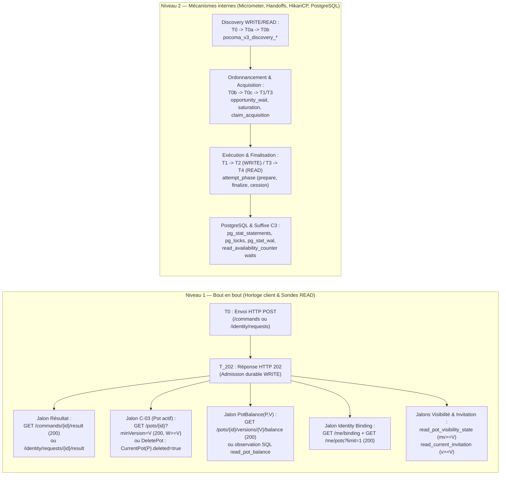

# L7-C4 — Protocole de diagnostic (Phase 1)

- **Date** : 21 novembre 2026
- **Branche** : `feat/v3-l7` @ `181904cd02ffb7e3b9b60cf754cf365b99c2a3fa`
- **Arbitrages couverts** : `C4-R1`, `C4-R2`, `C4-R3`, `C4-R7`, `C4-R8`, `C4-R10`, `C4-R11`, `C4-R12`
- **Références normatives** : [`SPEC-08_Observability.md`](../SPEC-08_Observability.md), [`SPEC-09_Performance.md`](../SPEC-09_Performance.md), [`L7_SPEC09_Local_Qualification_Protocol.md`](../L7_SPEC09_Local_Qualification_Protocol.md)

---

## 1. Architecture métrologique à deux niveaux (`C4-R2`, `C4-R11`)

Le protocole mesure simultanément, pour chaque campagne, **deux niveaux complémentaires** sans jamais additionner les percentiles de branches parallèles ni déduire un temps E2E d'une somme de timers internes (`SPEC-08 §2`, `SPEC-09 §3`).

### 1.1 Niveau 1 — Performances de bout en bout et oracles `SPEC-09`

Chaque opération admise est suivie individuellement depuis son émission client (`T0`) et son acceptation durable HTTP `202` (`T_202`) jusqu'à ses jalons terminaux :

| Jalon / Métrique Niveau 1 | Définition et Oracle exact (`SPEC-09`) | Source de mesure | Distinction obligatoire |
|---|---|---|---|
| **Débit d'admission** (`offeredRate`, `admittedRate`, `admissionMs`) | Requêtes émises/s vs réponses HTTP `202 Accepted`/s ; latence `T_202 − T0` (`p50/p95/p99/max`) ; dérive d'échéancier `offerLagMs = T0 − T_scheduled` ; taux de refus `503` (sémaphore `admission.capacity=4`). | Générateur de charge (`run-l7-4a-baseline.py` / `v3_observer.py`) + compteur Prometheus `http-write`. | Un débit d'admission élevé ne prouve aucune stabilité si le backlog croît (`SPEC-09 §2`). |
| **Débit de terminalisation WRITE** (`terminalizedRate`) | Nombre de demandes passant à `status = 'TERMINAL'` dans `v3_write.v3_command` (ou `v3_identity_request`) par seconde, ventilé par issue (`CHANGED`, `UNCHANGED`, `REJECTED`, `INVITATION_CREATED`). | Réconciliation SQL `v3_write` (`recorded_at`) + `StageHandoffTracker` (`T2`). | Séparer les mutations appliquées (`CHANGED`) des rejets métier (`REJECTED`, p. ex. collision CAS sous contention). |
| **Disponibilité des résultats** (`resultE2eMs`, `resultAfter202Ms`) | Première lecture `GET /api/v3/commands/{requestId}/result` (ou équivalent Identity) retournant `HTTP 200` (ou horodatage `T4` de `MaterializeCommandResult` / `MaterializeIdentityRequestResult`). | Sonde HTTP `poll_s = 25 ms` + `StageHandoffTracker` (`T4` `CommandResult`). | **Ne satisfait jamais le jalon `C-03`** : `CommandResult` permet seulement de connaître `resultingPotVersion = V` (`SPEC-09 §4`). |
| **Jalon `C-03` — Pot actif** (`c03E2eMs`, `c03After202Ms`) | Pour une commande appliquée produisant `resultingPotVersion = V` sur un Pot restant actif : **première réponse `HTTP 200` authentifiée et autorisée** de `GET /api/v3/pots/{potId}?minVersion=V`, retournant un Pot complet de version courante `W >= V`, avec ses sous-objets requis et la balance cohérente de `W`. | Sonde HTTP `http-read` (`25 ms`) + validation complète par `smoke_test_5_runtimes.validate_complete`. | Si `W > V`, `C-03` est satisfait par la lecture courante à `W`, mais `PotBalance(P,V)` reste exigible séparément (`SPEC-09 §4`). |
| **Jalon `C-03` — Exception `DeletePot(D)`** (`deletePotC03Ms`) | Pour une commande `DeletePot` appliquée à la version terminale `D` : `GET /pots/{id}` retourne `404` par contrat (ce qui ne prouve rien). Le jalon est la **première observation interne dans `v3_read`** de `read_current_pot(P)` pointant vers `read_pot_version(P,D)` avec `deleted = true` (et publication `CURRENT_POT_CHANGED` / `POT_VERSION_AVAILABLE` à `D`). | Sonde SQL `READ ONLY` sur `v3_read` (`read_current_pot JOIN read_pot_version`) + `StageHandoffTracker` (`T4` `PotVersion`). | `PotBalance(P,D)` et `POT_BALANCE_AVAILABLE(P,D)` sont **intentionnellement absents** ; toutes les balances actives `V < D` restent obligatoires (`SPEC-09 §5`). |
| **Disponibilité de `PotBalance(P,V)`** (`balanceE2eMs`, `balanceAfter202Ms`) | Présence durable et exacte de `PotBalance(P,V)` pour chaque version active `V`, vérifiée via `GET /api/v3/pots/{potId}/versions/{V}/balance` (`HTTP 200`, somme nulle et exactitude rationnelle `Fraction`) et/ou `T4` de `MaterializePotBalance`. | Sonde HTTP `/versions/{V}/balance` + oracle rationnel `Fraction` + `StageHandoffTracker` (`T4` `PotBalance`). | SLO technique distinct (`p95 ≤ 500 ms` sur Pot moyen à `1 cmd/s`), obligatoire même si `CurrentPot` a déjà avancé à `W > V`. |
| **Disponibilité du Binding d'identité** (`usableBindingE2eMs`) | Entre l'admission durable (`HTTP 202`) d'une `Registration` pour une EUI fraîche et la **première réponse `HTTP 200` autorisée** de `GET /api/v3/me/pots?limit=1` utilisant le nouveau `bindingToken` obtenu via `GET /api/v3/me/binding` (`euiVersion = 1`, `active = true`, `potIds = []`). | Runner `scripts/performance/run-l7-spec09-registration.py` (`observe_one`). | Atteste la chaîne complète `IdentityRequest → IDENTITY_EVENT → MaterializeCurrentBinding → Navigation READ autorisée` (`SPEC-09 §3`). |
| **Progression indépendante des projections** (`visibilityLagMs`, `invitationLagMs`) | Délai de matérialisation de `MaterializePotVisibility` (`read_pot_visibility_state.materialized_version >= V` et `POT_VISIBILITY_CHANGED`) et de `MaterializeInvitation` (`read_current_invitation.version >= V` et `CURRENT_INVITATION_CHANGED`). | `StageHandoffTracker` (`T3`, `T4` par `consumption`) + snapshots `v3_read.discovery_checkpoint` et `read_current_availability`. | `PotVisibilityState` ne bloque pas la lecture directe `GET /pots/{id}` (`C-03`), mais sa dérive ou son retard sous charge doit être mesuré. |
| **Backlog par consommation et âge des travaux** (`upstreamBacklog`, `slotBacklog`, `maxSlotAgeMs`) | **Axe 1 (Amont non découvert)** : nombre de demandes `PENDING` au-delà du checkpoint `K` en WRITE, ou écart `H_write − K_read` entre `v3_write.v3_event_counter` et `v3_read.discovery_checkpoint` pour chacune des 7 consommations READ. **Axe 2 (Slots enrôlés)** : nombre de lignes dans `consumption_slot` par `(consumption_id, state)` (`AVAILABLE`, `CLAIMED`, `QUARANTINED`). **Âge des travaux** : `clock_timestamp() − recorded_at` de la plus ancienne source `PENDING` ou du plus ancien événement ayant encore un slot `consumption_slot` non terminé. | Sonde SQL périodique (`2 s`) `BEGIN READ ONLY` sur `pocoma_write` et `pocoma_read`. | Distinguer un retard de **Discovery** (`H − K` grand, peu de slots ou `softCap = 64/partition` atteint) d'un retard d'**Engine** (slots `AVAILABLE` nombreux) ou d'exécution lente (slots `CLAIMED`). |

### 1.2 Niveau 2 — Facteurs limitants internes et attribution causale

Le tableau suivant répertorie les signaux internes collectés sur les 5 runtimes et PostgreSQL pour isoler la cause racine de tout ralentissement :

| Dimension interne | Métriques et instruments existants réutilisés (`C4-R11`) | Ce que la mesure permet de trancher |
|---|---|---|
| **1. Attente Discovery et enrôlement** | `StageHandoffTracker` : `waitBeforeDiscoveryMs` (`T0a − T0`), `discoveryToSlotMs` (`T0b − T0a`). Micrometer : `pocoma_v3_discovery_duration_seconds{consumption,outcome}`, `pocoma_v3_discovery_references_total{consumption,kind="examined\|advanced\|admitted"}`, `pocoma_v3_saturation_total{consumption,kind="softcap"}`. | Savoir si l'attente amont vient de la cadence `DiscoveryLoop`, de la requête SQL `window(K, 128)`, de l'insertion des slots, ou du blocage par `softCap = 64` slots vivants/partition. |
| **2. Répartition des opportunités et ordonnancement local** | Micrometer : `pocoma_v3_rotation_opportunities_total{consumption,loop="discovery\|consumption"}`, `pocoma_v3_rotation_tours_total{consumption,loop}`, `pocoma_v3_consumption_opportunity_wait_seconds{consumption}`, `pocoma_v3_consumption_opportunity_duration_seconds{consumption,outcome}`, `pocoma_v3_worker_cycles_total{loop,outcome}`, `pocoma_v3_worker_cycle_duration_seconds{loop,outcome}`. | Quantifier la part des cycles dépensés sur des consommations inactives (`Invitation`, `CurrentBinding`) et mesurer l'allongement de `opportunity_wait` lorsqu'une consommation fait des appels JDBC lents dans le thread de boucle. |
| **3. Distribution entre partitions (`0..3`)** | `StageHandoffTracker.snapshot()` (`partitionStats.partition_0..3`). SQL : distribution par `(consumption_id, RoutingV1.partition)` dans `consumption_slot` et `discovery_checkpoint`. | Distinguer un déséquilibre de hachage `sha256-v1` (sur un petit nombre de Pots) d'une contention sur un seul Pot ou d'une saturation globale du worker. |
| **4. Saturation des capacités et des exécuteurs** | Micrometer : `pocoma_v3_capacity_used{scope="worker\|<Consumption>"}`, `pocoma_v3_capacity_limit{scope}`, `pocoma_v3_capacity_changes_total{consumption,kind="reserved\|returned"}`, `pocoma_v3_saturation_total{consumption,kind="worker\|consumption\|executor\|softcap"}`, `pocoma_v3_dispatch_rejected_total{consumption,reason}`, `pocoma_v3_physical_pending{consumption}`. | **Crucial (`C4-R4`)** : `kind="worker"` prouve que le plafond global `M_W` du runtime bloque une consommation alors que son plafond propre `M_C` n'est pas atteint (interférence inter-familles). `kind="consumption"` prouve que `M_C` lui-même est le facteur limitant. |
| **5. Navigation, acquisition de claim et renouvellements** | `StageHandoffTracker` : `slotAcquisitionWaitMs` (`T0c − T0b`), `acquisitionToAttemptMs` (`T1 − T0c`). Micrometer : `pocoma_v3_slot_navigation_duration_seconds`, `pocoma_v3_slot_navigation_keys_total`, `pocoma_v3_claim_acquisition_duration_seconds`, `pocoma_v3_claim_operations_total{operation="acquire\|renew\|lost"}`, `pocoma_v3_lease_operations_total{authority,operation,outcome}`, `pocoma_v3_renewal_duration_seconds{authority,lane}`, `pocoma_v3_renewal_schedule_lag_seconds{authority,lane}`. | Vérifier si la navigation par pages de 32 clés ou l'acquisition par `quantum = 4` ralentit la prise en charge, et si la charge métier retarde les threads `RenewalService` (`lane 0, 1, 2`). |
| **6. Durées de traitement par famille et par phase** | Micrometer : `pocoma_v3_attempt_duration_seconds{consumption,outcome}`, `pocoma_v3_attempt_phase_duration_seconds{consumption,phase="prepare\|finalize\|observe\|cession"}`. Sous-étapes C1/C2 : `pocoma_v3_potversion_stage_duration_seconds{stage="reference_lookup\|delta_resolution\|compose\|tree_build\|persist_publish",path}`, `pocoma_v3_potbalance_evaluate_duration_seconds{path}`, `pocoma_v3_potbalance_persist_duration_seconds{target="balance\|aggregate"}`, `pocoma_v3_potbalance_encode_duration_seconds`. | Séparer la lecture préparatoire (`prepare`, hors transaction finale sur `write-source-read` et `read-business`) de la transaction finale d'écriture (`finalize`), et identifier les bascules en fallback intégral (`full:bucket_cap`, `full:max_delta_distance`). |
| **7. Coût des transactions de finalisation et suffixe C3** | PostgreSQL `pg_stat_statements` (filtré par `userid` : `pocoma_write`, `pocoma_read`, `pocoma_write_source_read`, `pocoma_read_http`) : `calls`, `total_exec_time`, `mean_exec_time`, `rows`, `shared_blks_hit`, `shared_blks_read`, `wal_bytes`, `wal_records`, `wal_fpi`. | Isoler le temps serveur SQL exact du CTE `update read_availability_counter ... insert into read_availability_event / read_current_availability`, du `DELETE FROM consumption_slot`, des écritures Radix-16/Balance et du `COMMIT` (triggers différés). |
| **8. Verrous et attentes PostgreSQL** | Échantillonnage haute fréquence (`pg_stat_activity` + `pg_locks` + `pg_blocking_pids(pid)`) et activation de `log_lock_waits = on` avec `deadlock_timeout = 5ms` dans le conteneur PostgreSQL de test. | Distinguer : `Lock:tuple` / `Lock:transactionid` sur `read_availability_counter` (contention C3 par famille), verrous sur `v3_event_counter` (publication WRITE), verrous sur `read_pot_visibility_state` ou `v3_pot` (contention même Pot), et `IO:WalSync` / `LWLock:WALWrite`. |
| **9. WAL, Stockage, Autovacuum, CPU, Mémoire, GC et Pools JDBC** | PostgreSQL : `pg_stat_wal`, `pg_wal_lsn_diff`, `pg_walinspect` (`pg_get_wal_stats`), `pg_stat_user_tables` (`n_tup_ins`, `n_tup_upd`, `n_tup_hot_upd`, `n_dead_tup`, `vacuum_count`, `autovacuum_count`), `pg_total_relation_size`. JVM / Docker : `process_cpu_usage`, `system_cpu_usage`, `jvm_memory_used_bytes{area="heap"}`, `jvm_gc_pause_seconds_count/_sum`, `/sys/fs/cgroup/cpu.stat` (`usage_usec`, `nr_throttled`, `throttled_usec`). HikariCP : `hikaricp_connections_active`, `hikaricp_connections_pending`, `hikaricp_connections_acquire_seconds`, `hikaricp_connections_usage_seconds`. | Vérifier l'efficacité HOT sur `read_availability_counter` (`fillfactor=80`), le taux de tuples morts sur `read_current_availability`, le throttling CPU Docker (`throttled_usec`), la pression GC (`UseSerialGC`) et toute attente sur les pools HikariCP (`pending > 0`). |

### 1.3 Grille de décision pour l'attribution causale

Pour répondre à l'exigence §5.2 du mandat (*« Distinguer les problèmes liés à PostgreSQL, aux partitions, à l'ordonnanceur et à la topologie des runtimes »*), chaque goulot observé sera classé selon la table de vérité suivante :

| Signature observée dans les métriques | Cause racine établie | Famille d'optimisation Phase 2 correspondante |
|---|---|---|
| `hikaricp_connections_pending == 0`, `capacity_used < workerLimit`, mais `opportunity_wait` élevé et `rotation_opportunities` dominé à `> 40 %` par des familles à `0` slot admis (`Invitation`, `CurrentBinding`). | **Ordonnanceur / Topologie** : couplage du backoff `LoopSchedule` et partage du thread de boucle entre familles actives et inactives. | **P2-O2** (Isolation topologique T3) ou **P2-O6** (Backoff par `Binding`). |
| `pocoma_v3_saturation_total{kind="worker"}` croît pour une famille critique (`PotBalance` ou `CurrentBinding`) alors que `capacity_used{scope="<Famille>"} < M_C` et que d'autres familles occupent les `M_W` tickets. | **Topologie / Capacité partagée** : famine de tickets dans `WorkerCapacity` (`M_W = 3 < \sum M_C = 10`). | **P2-O1** (Hausse `M_W` / ajustement `M_C`) ou **P2-O2** (Isolation dans un runtime dédié). |
| `pocoma_v3_saturation_total{kind="consumption"}` croît pour `PotVersion` ou `Command` alors que `capacity_used{scope="worker"} < M_W` et que le CPU du conteneur et de PostgreSQL est `< 70 %`. | **Dimensionnement vertical local** : plafond `M_C` trop bas par rapport aux 4 partitions de la consommation. | **P2-O1** (Hausse de `M_C` et `M_W`, avec pools associés). |
| `cgroup cpu.stat` d'un conteneur worker affiche `throttled_usec` élevé (`CPU ~ 100 %` du quota conteneur) ou `jvm_gc_pause_seconds_sum` élevé, tandis que PostgreSQL a de la marge CPU et peu de locks. | **Dimensionnement CPU/RAM/GC du conteneur worker** (ou opportunité de réplication horizontale si lié à une JVM). | **P2-O3** (Réallocation CPU/RAM/GC) ou **P2-O4** (Comparaison vertical vs horizontal). |
| `pg_stat_activity` / `log_lock_waits` montrent des attentes `Lock:transactionid` ou `Lock:tuple` sur `read_availability_counter` (ou `v3_event_counter`), et `attempt_phase_duration{phase="finalize"}` croît avec le nombre de threads/workers. | **Contention SQL de sérialisation par compteur de famille** (indépendante du nombre de partitions ou d'instances de workers !). | **P2-O5** (Réduction de la durée de transaction finale / fusion de la requête de vérification avant allocation). *Note : ajouter des instances de workers pour la même famille aggraverait ce goulot.* |
| `pg_stat_database` de `pocoma_read` affiche `> 5 000 commits/s` au repos ou à faible charge, avec CPU PostgreSQL dominé par `read-control` / `write-control` (`protectAcquisition`, `readPage`). | **Surcoût SQL du polling de contrôle** (`min-poll = 2 ms` sur 36 partitions). | **P2-O1b** (Ajustement `min-poll` / `max-poll`) + **P2-O2 / P2-O6** (Mise en sommeil des familles inactives). |
| Sur un petit nombre de Pots (`1` à `5`), `partitionStats` montre que `> 60 %` des événements tombent sur une seule partition `p`, ou sur `1` Pot unique les rejets CAS / verrous de ligne dominent. | **Effet de partitionnement / Contention métier par Pot** (normal pour `1` Pot ; artefact de taille d'échantillon pour `2–5` Pots). | Aucun changement de routage (`sha256-v1` est fixe) ; vérifier l'équilibre sur `10` à `250` Pots. |

---

## 2. Progression des 5 campagnes de diagnostic (`C4-P1-C1` à `C4-P1-C5`)

> [!IMPORTANT]
> **Règle d'ordre et d'attribution (`C4-R1`, `C4-R8`, `C4-R12`)** : On établit d'abord la référence nominale `WRITE → READ` (`C4-P1-C1`) sur l'état C3 final, puis les campagnes de charge/interférence/backlog (`C4-P1-C2..C4`) et les investigations SQL C3 (`C4-P1-C5`) dans l'ordre le plus pertinent pour le diagnostic. Un microbenchmark SQL ne remplace jamais la référence E2E. Les charges contractuelles `SPEC-09` (`1`, `10`, `50 cmd/s`, `Grand Pot 100/2000`, `Backlog 10 000`) et leurs seuils servent de repères d'analyse ; aucune exécution locale ne vaut certification `SPEC-09` Configuration A/B.

### 2.1 Campagne `C4-P1-C1` — Référence nominale et coût à vide

**Objectif** : Établir la ligne de base post-C3 en régime non saturé sur chaque parcours fonctionnel (`SPEC-09`) et quantifier exactement le bruit de fond du polling (`min-poll = 2 ms`) sur les 36 partitions.

| Scénario | Profil & Population | Charge offerte | Warmup / Échantillon | Répétitions | Mesures clés & Oracles |
|---|---|---|---|---:|---|
| **`C1-IDLE`** *(réf. `F01-J` / `LOC-IDLE`)* | `5` Pots moyens (`20/200`) pré-matérialisés | `0 cmd/s` pendant `120 s`, puis `10` commandes espacées de `5 s` | `30 s` / `120 s` + `10` réveils | `3` | TPS PostgreSQL à vide (`pocoma_write`, `pocoma_read`), acquisitions Hikari `*-control`, CPU % de chaque conteneur au repos, latence de premier réveil après repos. |
| **`C1-MED-1`** *(réf. `F01-A` / `LOC-MED-1`)* | `10` Pots moyens indépendants (`20/200`, `V_init = 202`) | `1 cmd/s` (mix réaliste `88/10/2` ou `CreateExpense` sérialisé par Pot) | `30` cmds / `120` cmds (`120 s`) | `3` | Latences E2E `C-03`, `PotBalance(P,V)`, `CommandResult` (`p50/p95/p99/max` vs repère `500 ms`) ; décomposition `T0 → T0a → T0b → T0c → T1 → T2 → T3 → T4` ; part CPU utile vs contrôle. |
| **`C1-LARGE-1`** *(réf. `F01-D` / `LOC-GRAND-1`)* | `2` à `5` Grands Pots indépendants (`100/2000`, `V_init = 2002`, snapshot restauré et reconstruit en V5) | `1 cmd/s` | `10` cmds / `60` cmds (`60 s`) | `3` | Latences E2E `C-03` (repère `2 000 ms`) et `PotBalance` ; durées internes `PotVersion` (Radix-16 `N−m`) et `PotBalance` (`N−m` binaire) ; WAL par commande. |
| **`C1-ID-1`** *(réf. `F01-E`)* | EUI fraîches sur cluster contenant déjà le stock `medium` | `1 Registration/s` | `15` req / `60` req (`60 s`) | `3` | Latence E2E `Registration → HTTP 200 /api/v3/me/pots?limit=1` avec nouveau `bindingToken` (repère `500 ms`) ; décomposition `IdentityRequest` (`command-worker`), `IdentityRequestResult` (`results-worker`) et `CurrentBinding` (`business-read-worker`). |
| **`C1-DELETE-1`** *(réf. `A11-L/M`)* | `10` Pots moyens actifs (`V = 202..210`) | `10` `CreateExpense` suivis de `10` `DeletePot(D)` à `1 cmd/s` | `2` / `20` cmds | `3` | Oracle `DeletePot` (`SPEC-09 §5`) : `CurrentPot(P) → PotVersion(P,D).deleted = true`, publication `POT_VERSION_AVAILABLE(P,D)` et `CURRENT_POT_CHANGED(P,D)`, absence de `PotBalance(P,D)` et conservation intégrale des balances `V < D`. |

### 2.2 Campagne `C4-P1-C2` — Charges soutenues, rampe de saturation et contention mono-Pot

**Objectif** : Déterminer la capacité maximale soutenable sans dérive de backlog de la topologie actuelle à 3 workers, identifier le premier composant qui sature entre `10` et `50 cmd/s`, et caractériser le comportement sous contention sur un même Pot.

| Scénario | Profil & Population | Charge offerte | Warmup / Échantillon | Répétitions | Mesures clés & Oracles |
|---|---|---|---|---:|---|
| **`C2-MED-10`** *(réf. `F01-B` / `LOC-MED-10`)* | `50` Pots moyens indépendants (`20/200`) | `10 cmd/s` soutenus (sérialisés par Pot) | `100` cmds (`10 s`) / `600` cmds (`60 s`) | `3` | Stationnarité du backlog par consommation (`H − K` et `consumption_slot`), latences `C-03` et `PotBalance` (repère `1 000 ms`), taux de saturation `M_W` et `M_C`, CPU PostgreSQL et workers. |
| **`C2-RAMP`** *(réf. `SATURATION`)* | `100` à `250` Pots moyens indépendants (`20/200`) | Paliers successifs de `30 s` chacun : `1 → 5 → 10 → 20 → 25 → 35 → 50 cmd/s` | `15 s` warmup initial / `7 × 30 s` | `3` | Courbe débit admis vs débit terminalisé WRITE vs débit matérialisé READ par famille (`PotVersion`, `PotBalance`, `PotVisibility`, `CommandResult`) ; identification du point d'inflexion exact $\lambda_{\max}$ par consommation. |
| **`C2-MED-50`** *(réf. `F01-C`)* | `250` Pots moyens indépendants (`20/200`) | Pointe à `50 cmd/s` pendant `30 s` (`1 500` cmds), suivie d'un retour à `1 cmd/s` jusqu'à résorption complète | `50` cmds / `1 500` cmds + drainage | `3` | Taux d'admission `202` vs `503`, pic de backlog sur les 2 axes (`v3_command` vs `consumption_slot` plafonné à `softCap = 256`/consommation), latence `C-03` en pointe (repère `3 000 ms`) et temps de retour à l'équilibre. |
| **`C2-CONTENTION-1POT`** *(réf. `F01-H`)* | `1` seul Pot moyen (`20/200`) | `4` à `8` producteurs concurrents émettant sans sérialisation client pendant `30 s`, puis retour à `1 cmd/s` | `10` cmds / `30 s` | `3` | Exactitude de conservation ($\text{Admis} = \text{Appliqués} + \text{Rejets CAS légitimes}$), `0` double effet, `0` erreur technique non classifiée, `0` quarantaine, distinction entre contention CAS WRITE et ordonnancement READ sur les versions gagnantes. |

### 2.3 Campagne `C4-P1-C3` — Charges déséquilibrées et interférences inter-familles (`C4-R3`, `C4-R5`)

**Objectif** : Mettre en évidence et quantifier les interférences entre familles de consommations co-hébergées dans un même runtime (`command-worker` et surtout `business-read-worker`).

| Scénario | Flux perturbateur ("Bruit lourd") | Flux sonde critique ("Victime potentielle") | Répétitions | Hypothèse d'interférence testée & Métriques |
|---|---|---|---:|---|
| **`C3-INT-D5-VS-MED`** *(Tâches longues Balance vs Pot Moyen)* | mutations continues à `2 cmd/s` sur `2` Grands Pots au-delà du plafond `D5` (`G = 258 > 256`, forçant le recalcul intégral `full:bucket_cap` à `~352 ms` par tentative dans `MaterializePotBalance`). | Flux nominal `1 cmd/s` sur `10` Pots moyens (`20/200`) + `0.5 Registration/s`. | `3` | Vérifier si les tentatives longues `PotBalance` (`~352 ms`) saturent `M_C(PotBalance) = 2` et consomment `2/3` des tickets `M_W = 3` de `business-read-worker`, dégradant le `p95` `C-03` des Pots moyens et le `p95` de `CurrentBinding` (`Registration`). |
| **`C3-INT-POT-VS-ID`** *(Rafale Pot vs SLO Registration)* | Charge soutenue / pointe `20 cmd/s` sur `100` Pots moyens (saturant les files `Command` dans `command-worker` et `PotVersion`/`PotBalance`/`PotVisibility` dans `business-read-worker`). | `1 Registration/s` sur EUI fraîches (`30` requêtes mesurées). | `3` | Mesurer l'allongement de `Registration → /me/pots` (`SLO ≤ 500 ms`) causé par : (1) le partage de `M_W = 2` entre `Command` et `IdentityRequest` dans `command-worker`, (2) le partage de `M_W = 2` dans `results-worker`, et (3) le partage de `M_W = 3` entre les 3 projections Pot et `CurrentBinding` dans `business-read-worker`. |
| **`C3-INT-INV-VS-POT`** *(Rafale Invitations vs C-03)* | Rafale d'opérations `CreateInvitation` / `ClaimInvitation` à `10 cmd/s` générant un flux intense sur `INVITATION_EVENT` (`MaterializeInvitation`). | Flux `5 cmd/s` de `CreateExpense` sur Pots moyens. | `3` | Quantifier la compétition pour les `M_W = 3` tickets de `business-read-worker` et les `5` connexions du pool `read-business` entre `MaterializeInvitation` et la paire critique `PotVersion` + `PotBalance`. |

### 2.4 Campagne `C4-P1-C4` — Backlog, reprise et arrivées concurrentes (`C4-R7`)

**Objectif** : Étudier le compromis entre vitesse de résorption d'un stock accumulé et réactivité vis-à-vis des nouvelles opérations entrantes, sans violer les contraintes d'ordre.

| Scénario | État initial du backlog | Charge concurrente pendant le rattrapage | Répétitions | Mesures clés & Oracles |
|---|---|---|---|---:|
| **`C4-BACKLOG-10K`** *(réf. `F01-G`)* | Stock vérifié de **`10 000` commandes `CreateExpense` `PENDING`** admises sur Pots moyens alors que les 3 workers sont arrêtés (`0` slot initial, `status = INITIAL_STOCK_VERIFIED` via `observe-l7-spec09-backlog.py`). | Redémarrage simultané des 3 workers sous un flux continu de **`1 nouvelle commande/s`** (et `0.2 Registration/s` sur EUI fraîches). | `3` *(+ 1 calibration à `1 000` cmds)* | Temps total de convergence des `10 000` commandes initiales ET de leurs 4 projections READ (`CommandResult`, `PotVersion`, `PotBalance`, `PotVisibility`, repère `≤ 300 s`) ; débit utile de résorption par consommation (courbe `H`, `K`, `slots`) ; **latence E2E `C-03` et `Registration` des nouvelles demandes émises à `1/s` pendant le rattrapage**. |
| **`C4-BACKLOG-READ-ONLY`** *(Reprise après arrêt READ)* | `business-read-worker` arrêté pendant l'admission et la terminalisation WRITE de `1 000` commandes (WRITE et `results-worker` à jour, `H_write − K_read = 1 000` sur `POT_EVENT`). | Redémarrage de `business-read-worker` sous `1 nouvelle commande/s`. | `3` | Vitesse de rattrapage respective de `PotVersion`, `PotBalance` et `PotVisibility` (taux de hit incrémental `N−m` lorsque `N − K > 1`) ; impact sur `http-read` et sur les nouvelles commandes. |

> [!NOTE]
> **Analyse attendue sur `C4-BACKLOG-10K` (`C4-R7`)** : Comme `DiscoveryEngine` parcourt `v3_request_position` dans l'ordre séquentiel dense `(K, H]` par fenêtres de `128` et s'arrête dès que `liveSlots == softCap` (`64` par partition, soit `256` slots sur les 4 partitions de `Command`), les nouvelles commandes admises à la position `10 001+` ne seront découvertes par `Command` qu'une fois le checkpoint `K` parvenu à `10 000` (sauf pour `IdentityRequest` qui possède sa propre séquence dense indépendante !). La campagne `C4-BACKLOG-10K` quantifiera précisément cet effet FIFO par séquence dense vs l'indépendance entre séquences (`COMMAND` vs `IDENTITY_REQUEST`).

### 2.5 Campagne `C4-P1-C5` — Investigations ciblées des facteurs limitants et Réserve de performance C3 (§5.4)

**Objectif** : Réexaminer sur le code C3 réellement livré (`HEAD 181904cd`, incluant le suffixe CTE unique par famille de `ReadAvailability.java:141-174` et les réglages physiques `fillfactor=80` / `autovacuum_vacuum_scale_factor=0.1` de `V5__projection_availability.sql`) les deux réserves chiffrées de C3 ainsi que la profondeur historique WRITE (`L1-F2`).

#### 2.5.1 Protocole dédié à la réserve de débit mixte C3 (`98.0 → 82.6 finalisations/s`, `−15.7 %`)

- **Contexte historique vérifié** : Le chiffre `98.0 → 82.6 finalisations/s` (`docs/testing/evidence/L7-C3/generalization/performance/concurrency.json`) provenait d'un seul passage (`n = 64` par famille, soit `192` finalisations et `256` publications en mode `MIXED` à 4 workers) sur le harnais in-process `C3Costs.java`, exécuté avant la consolidation finale et avec un suffixe expérimental dans `C3Costs.java:238-245` qui exécutait encore **deux instructions JDBC séparées** (`UPDATE ... RETURNING` puis `INSERT`) au lieu de la CTE unique livrée dans `ReadAvailability.publishMetadata()`.
- **Protocole de réexamen C4 (`C5-C3-CONCURRENCY`)** :
  1. **Alignement exact sur le code livré** : Exécuter le comparateur à `1` et `4` workers en utilisant exclusivement les **7 vrais participants et stores READ livrés en C3** (`ReadParticipants.create(..., publishAvailability = false)` pour le témoin **V4/OFF** vs `ReadParticipants.select(..., publishAvailability = true)` avec la `V5__projection_availability.sql` canonique pour **V5/ON**), sans le décorateur expérimental `c3_bench_counter` à 2 requêtes.
  2. **Échantillon et répétitions** :
     - Échauffement : `16` finalisations par famille hors fenêtre.
     - Échantillon mesuré : `n = 100` créations/mutations par famille (`300` finalisations et `400` publications en fenêtre `MIXED` : `100` `CommandResult`, `100` `PotVersion` + `100` `CurrentPot`, `100` `PotBalance`), plus une variante `MIXED_FULL_5` incluant `PotVisibility` (`500` publications).
     - Répétitions : **$R = 5$ exécutions appariées `OFF ↔ ON`** en alternant l'ordre (`OFF→ON`, `ON→OFF`, ...) hors de toute autre activité sur le Mac.
  3. **Attribution fine des attentes SQL** :
     - Collecter pour chaque fenêtre : `pg_stat_statements` (`calls`, `total_exec_time`, `wal_bytes`, `wal_records`, `wal_fpi` par requête exacte), échantillonnage `pg_stat_activity` à `2 ms` (`Lock:tuple`, `Lock:transactionid`, `IO:WalSync`, `LWLock:WALWrite`), `log_lock_waits` (`deadlock_timeout = 5ms`), CPU cgroup PostgreSQL et CPU threads workers.
     - Calculer la médiane, la moyenne, l'écart-type et l'intervalle `[min, max]` du débit (finalisations/s) et du `p50/p95/p99` `execute` pour `OFF` et `ON`.
  4. **Critère de conclusion** : Aucune régression ne sera affirmée sans que l'écart médian sur les $R = 5$ répétitions du code C3 final soit statistiquement établi et causalement relié aux temps mesurés dans `pg_stat_statements` et `pg_locks`.

#### 2.5.2 Protocole dédié au coût WAL `PotBalance` XLARGE (`690 → 1 245 B/ver` Sit. A, `4 443 → 4 982 B/ver` Sit. D)

- **Protocole (`C5-C3-XLARGE-WAL`)** :
  1. Réexécuter `scripts/performance/run-l7-c2-b2-xlarge-ab.py --compare-c3` ($R = 5$ répétitions) sur Grand Pot `XLARGE` (`500` shareholders, `100` versions financières Situation D puis `50` versions non-financières à contenu réutilisé Situation A) en isolant le code C3 final (`ReadAvailability` CTE).
  2. Activer `pg_walinspect` (`pg_get_wal_stats(start_lsn, end_lsn, true)`) et `pg_stat_statements` entre le début et la fin de Situation D et de Situation A pour décomposer octet par octet :
     - Le WAL des tables métier C2 (`read_pot_balance`, `read_pot_balance_content`, `read_pot_balance_aggregate`, `read_pot_balance_aggregate_content`) ;
     - Le WAL de `read_availability_counter` (mise à jour HOT avec `fillfactor = 80`) ;
     - Le WAL de `read_availability_event` (insertion heap + 3 index : PK `(family, position)`, `UNIQUE(event_id)` et `UNIQUE NULLS NOT DISTINCT (family, projection_key, logical_version)`) ;
     - Les éventuelles images complètes de pages (`wal_fpi`) après checkpoint PostgreSQL (en forçant un `CHECKPOINT` explicite *avant* l'échauffement pour éviter tout FPI parasite aléatoire au milieu de la fenêtre mesurée).

#### 2.5.3 Contrôle de profondeur historique WRITE (`C5-DEPTH-L1F2`)

- Rejouer le protocole `LOC-DEPTH` (`SPEC-09 §8`, `100 / 1 000 / 10 000` versions d'historique d'un Pot, `30` mutations mesurées par profondeur après `10` d'échauffement) avec `EXPLAIN (ANALYZE, BUFFERS)` et comptage des requêtes/lignes JDBC dans `command-worker` et `business-read-worker` afin de confirmer que la profondeur d'historique n'introduit aucune dérive linéaire en WRITE ni en matérialisation incrémentale `N−m` READ.

---

## 3. Protocole de maîtrise du laboratoire local (`C4-R12`)

Toutes les campagnes doivent être praticables sur le Mac local (Apple Silicon ARM64, 16 Go RAM) dans des conditions garantissant la reproductibilité et la comparabilité :

### 3.1 Contrôle de la charge parasite et garde-fous pré-vol (`Preflight`)

Avant chaque campagne, le script de pré-vol vérifie automatiquement (et refuse le départ en cas d'écart) :
1. **Absence de processus lourds concurrents** : aucun processus `mvnw`, `java` (hors conteneurs du banc), `node` (hors test-issuer), `k6` résiduel ou autre conteneur Docker actif (`docker ps -q` vide hors conteneurs labellisés du run).
2. **Charge CPU hôte au repos** : `loadavg` 1 minute `< 1.5` sur les 10 cœurs avant le lancement du conteneur PostgreSQL.
3. **Alimentation et mémoire** : Docker Desktop disposant d'au moins `6 GiB` de RAM allouée (`MemTotal`), espace disque libre `≥ 4 GiB`, aucun swap actif sur les conteneurs (`memswap_limit == mem_limit`).
4. **Invariance du code et des binaires** : `git status --porcelain` propre (ou diff d'expérimentation Phase 2 explicitement déclaré et hashé), empreintes SHA-256 des 4 `*-exec.jar` et des 5 `.properties` enregistrées avant et vérifiées identiques après la campagne (`spec09_bench.provenance()`).

### 3.2 Maîtrise explicite des quotas conteneurs, ressources réelles et budget matériel

Le suivi des ressources distingue explicitement :
1. **Les limites allouées aux conteneurs** (`--cpus`, `mem_limit`, `--memory-swap = mem_limit`, `-Xms`/`-Xmx`, `maximumPoolSize` HikariCP).
2. **La consommation réelle mesurée** (`usage_usec` et `throttled_usec` cgroup, `RSS` conteneur, heap JVM utilisé, connexions actives HikariCP).
3. **Les services auxiliaires et l'hôte physique** (émetteur JWT local sur l'hôte, collecteur Python, Docker Desktop VM, cœurs Apple Silicon, RAM unifiée, `tmpfs` vs SSD NVMe).

Chaque conteneur du banc est lancé avec des limites explicites :

| Profil de budget global constant | `postgres` | `http-write` | `http-read` | `command-worker` | `results-worker` | `business-read-worker` (ou workers READ redécoupés en Phase 2) | **Budget Total (PG + JVM)** |
|---|---|---|---|---|---|---|---|
| **Budget Banc C4 (`B-PERF`, réf. `l7-4a-profiles.json`)** | `2.0` CPU `2 048 MiB` RAM (`tmpfs 1536m`) | `0.5` CPU `512 MiB` RAM (`-Xmx384m`) | `0.5` CPU `768 MiB` RAM (`-Xmx512m`) | `0.5` CPU `512 MiB` RAM (`-Xmx384m`) | `0.5` CPU `512 MiB` RAM (`-Xmx384m`) | `2.0` CPU `1 024 MiB` RAM (`-Xmx512m`) | **`6.0` CPU** **`5 376 MiB` RAM** |
| **Budget Playground (`B-LOCAL`, réf. `pocoma-local`)** | `1.5` CPU `1 024 MiB` RAM (volume disque) | `1.0` CPU `640 MiB` RAM (`-Xmx384m`) | `1.0` CPU `640 MiB` RAM (`-Xmx384m`) | `1.0` CPU `640 MiB` RAM (`-Xmx384m`) | `1.0` CPU `640 MiB` RAM (`-Xmx384m`) | `1.0` CPU `640 MiB` RAM (`-Xmx384m`) | **`6.5` CPU** **`4 224 MiB` RAM** |

- **Connexions JDBC** : En profil `B-PERF` (5 runtimes), le total configuré des pools HikariCP est `4` (`http-write`) + `9` (`http-read`: 8+1) + `12` (`command-worker`: 4+8) + `16` (`results-worker`: 4+4+8) + `19` (`business-read-worker`: 5+5+9) = **`60` connexions** (`< 100` `max_connections` PostgreSQL). Toute variation en Phase 2 est documentée explicitement.

- **Note importante sur le stockage PostgreSQL local** : En profil `B-PERF` (`tmpfs`), les latences d'I/O disque sont éliminées pour maximiser la reproductibilité A/B des mesures CPU/SQL/verrous/ordonnancement. Un contrôle croisé sur volume disque Docker (`B-LOCAL`) sera effectué sur `C1-MED-1` et `C2-MED-10` pour mesurer l'impact réel de `fsync` (`IO:WalSync`) sur le SSD NVMe du Mac.

### 3.3 Répétitions, agrégation statistique et conservation des données brutes

1. **Répétitions obligatoires** :
   - Campagnes E2E (`C1`, `C2`, `C3`, `C4`) : **$R = 3$ runs indépendants** par scénario (avec recréation ou restauration propre du snapshot PostgreSQL avant chaque run).
   - Micro-benchmarks SQL / Contention / WAL (`C5`) : **$R = 5$ runs appariés**.
2. **Statistiques rapportées** :
   - Par run : taille d'échantillon `n`, nombre de succès/rejets/timeouts, `p50`, `p95`, `p99`, `max`, moyenne et écart-type.
   - Inter-runs (sur les $R$ répétitions) : **médiane des `p50`**, **médiane des `p95`**, **étendue `[min p95, max p95]`** (dispersion). Aucune conclusion d'amélioration en Phase 2 ne sera retenue si le gain est inférieur à la dispersion inter-runs de la référence.
3. **Structure d'archivage des preuves** :
   Chaque campagne produit un dossier immuable sous `docs/testing/evidence/L7-C4/<phase>/<campagne>/run-<k>/` contenant :
   - `receipt.json` (provenance Git/JAR/properties, topologie Docker, résumé E2E et réconciliation SQL) ;
   - `observations.jsonl` (toutes les requêtes individuelles horodatées `T0`, `T_202`, `result`, `c03`, `balance`) ;
   - `handoffs-command-worker.jsonl`, `handoffs-business-read-worker.jsonl`, `handoffs-results-worker.jsonl` (exports `StageHandoffTracker`) ;
   - `metrics-initial-<runtime>.prom` et `metrics-final-<runtime>.prom` (scrapes Prometheus complets de chaque runtime) ;
   - `db-snapshots.json` (compteurs WRITE/READ, 36 checkpoints, slots par état, `pg_stat_database`, `pg_stat_wal`, `pg_stat_statements` par rôle, `pg_stat_user_tables`, tailles des relations et échantillons `pg_stat_activity`/`pg_locks`) ;
   - `docker-stats.jsonl` et `cgroup-cpu.json` (CPU, throttling cgroup, RSS mémoire par conteneur) ;
   - `manifest.sha256` (empreintes SHA-256 de tous les artefacts).

---

## 4. Inventaire de l'existant vs Outillage complémentaire léger requis (`C4-R11`)

Conformément à la section 10 du mandat (*« Préciser les outils ou instruments manquants, sans les implémenter »*), le tableau ci-dessous distingue ce qui est **déjà disponible et immédiatement réutilisable** au HEAD `181904cd` de ce qui nécessite un **complément d'outillage léger** (en Python/SQL hors code de production, ou en configuration de banc) au démarrage de la Phase 1 :

### 4.1 Instruments et bancs déjà présents et réutilisables tels quels

1. **Télémétrie JVM & Micrometer (`app/infra-observability-micrometer`)** :
   - [`MicrometerConsumptionObservation.java`](../../../app/infra-observability-micrometer/src/main/java/com/kartaguez/pocoma/infra/observability/micrometer/MicrometerConsumptionObservation.java) : expose déjà les 9 consommations canoniques, les compteurs de capacité (`pocoma.v3.capacity.used/limit/changes`), les saturations (`worker`, `consumption`, `executor`, `softcap`), les rotations (`rotation.opportunities`, `rotation.tours`), les attentes (`consumption.opportunity.wait`), les durées par phase (`prepare`, `finalize`, `observe`, `cession`), la Discovery (`discovery.duration`, `discovery.references`), la navigation et les renouvellements (`renewal.duration`, `renewal.schedule.lag`).
   - [`StageHandoffTracker.java`](../../../app/infra-observability-micrometer/src/main/java/com/kartaguez/pocoma/infra/observability/micrometer/StageHandoffTracker.java) : trace en mémoire (anneau borné à `10 000` commandes) et dans `/tmp/pocoma-stage-handoffs.jsonl` les jalons `T0`, `T0a`, `T0b`, `T0c`, `T1`, `T2`, `T3`, `T4` ainsi que les statistiques par partition `0..3`.
   - [`MicrometerPotVersionObservation.java`](../../../app/compose-polling-nonburnable-materialize-postgres/src/main/java/com/kartaguez/pocoma/compose/polling/materialize/MicrometerPotVersionObservation.java) et [`MicrometerPotBalanceObservation.java`](../../../app/compose-polling-nonburnable-materialize-postgres/src/main/java/com/kartaguez/pocoma/compose/polling/materialize/MicrometerPotBalanceObservation.java) : exposent tous les timers et compteurs de matérialisation incrémentale `N−m` et de stockage C2.
2. **Bancs Python existants (`scripts/performance/`)** :
   - [`spec09_bench.py`](../../../scripts/performance/spec09_bench.py) et [`run-l7-4a-baseline.py`](../../../scripts/performance/run-l7-4a-baseline.py) : orchestration Docker jetable 5 runtimes, capture/restauration de snapshots avec reconstruction READ V5 automatique, sondes concurrentes `/result`, `/pots/{id}?minVersion=V` et `/balance`, extraction des logs `handoffs-*.jsonl` et réconciliation SQL.
   - [`run-l7-4-a3-a4-multibucket.py`](../../../scripts/performance/run-l7-4-a3-a4-multibucket.py) : génération de charges multi-buckets réalistes (`G = 60`) et franchissement du seuil `D5` (`G = 240..260`).
   - [`run-l7-c2-b2-xlarge-ab.py`](../../../scripts/performance/run-l7-c2-b2-xlarge-ab.py) : banc comparatif store `PotBalance` XLARGE (`500` shareholders, Situations D et A) avec support C3 (`--compare-c3`).
   - [`run-l7-spec09-registration.py`](../../../scripts/performance/run-l7-spec09-registration.py), [`stock-l7-spec09-backlog.py`](../../../scripts/performance/stock-l7-spec09-backlog.py) et [`observe-l7-spec09-backlog.py`](../../../scripts/performance/observe-l7-spec09-backlog.py) : sonde `Registration → /me/pots` et gestionnaire du stock de `10 000` commandes `F01-G`.

### 4.2 Écarts d'outillage identifiés à combler (sans modification des algorithmes métier)

| # | Instrument / Outil manquant ou incomplet | Pourquoi il est nécessaire en C4 | Solution légère préconisée (à réaliser en P1.0 / P2) | Impact `app/` |
|---:|---|---|---|---|
| **M1** | **Collecte automatique du throttling CPU cgroup (`/sys/fs/cgroup/cpu.stat`) et de `pg_stat_statements` / `pg_stat_user_tables` dans `run-l7-4a-baseline.py`** | `spec09_bench.py` collecte `docker stats` (échantillon ponctuel) et `pg_stat_database` / `pg_stat_wal`, mais ne lit pas les compteurs cumulés exacts `usage_usec` / `throttled_usec` du cgroup de chaque conteneur ni le détail `pg_stat_statements` par rôle et `n_tup_hot_upd` / `n_dead_tup` des tables C3 lors des campagnes E2E 5 runtimes. | Étendre le collecteur Python de banc (ou un script compagnon `c4_collect_diagnostics.py` appelé avant/après la fenêtre de mesure) pour capturer `cpu.stat` sur les 6 conteneurs, `pg_stat_statements` (avec extension activée dans le conteneur PG du banc) et `pg_stat_user_tables`. | **Aucun (`0`)** |
| **M2** | **Alignement de `C3Costs.java` sur le vrai suffixe CTE `ReadAvailability` livré pour les 7 participants** | Dans [`experiments/l7-c3-gate/C3Costs.java:86-90, 215-256`](../../../experiments/l7-c3-gate/C3Costs.java#L86-L90), seul `COMMAND_RESULT` utilisait la migration pilote, tandis que `IDENTITY_REQUEST_RESULT`, `POT_VERSION` et `POT_BALANCE` utilisaient une table expérimentale `c3_bench_counter` avec **2 requêtes SQL séparées** et sans double publication `CURRENT_POT_CHANGED`. Or la livraison C3 finale branche les 7 vrais participants sur `ReadAvailability.closeAndPublish()` (1 CTE par famille). | Mettre à jour le harnais de test [`experiments/l7-c3-gate/C3Costs.java`](../../../experiments/l7-c3-gate/C3Costs.java) (hors `app/`) pour comparer `ReadParticipants.create(..., false)` (V4) contre `ReadParticipants.select(..., true)` (V5 canonique) avec répétitions $R = 5$ et `CHECKPOINT` préalable. | **Aucun (`0`)** *(fichier sous `experiments/`)* |
| **M3** | **Orchestrateur d'interférences multi-flux (`C4-P1-C3`) et de rattrapage sous charge (`C4-P1-C4`) sur le banc 5 runtimes** | `run-l7-4a-baseline.py` exécute un seul profil de Pot à la fois (`medium` OU `large`), sans injecter en parallèle un flux de `Registration` (`run-l7-spec09-registration.py`), d'`Invitation` ou de `DeletePot` pendant qu'un Grand Pot franchit `D5`, ni mesurer un flux continu de `1 cmd/s` *pendant* la résorption d'un stock initial pré-admis. | Ajouter un script Python d'orchestration de campagne C4 (`scripts/performance/run-l7-c4-diagnostic.py`) réutilisant `spec09_bench.py`, `run-l7-4a-baseline.py` et `run-l7-spec09-registration.py` dans des `ThreadPoolExecutor` indépendants par famille de flux, avec mesure de l'âge des slots SQL. | **Aucun (`0`)** |
| **M4** | **Couverture de `IdentityRequest` par `StageHandoffTracker` (Optionnel)** | Dans [`StageHandoffTracker.java:309-313, 359-360, 458`](../../../app/infra-observability-micrometer/src/main/java/com/kartaguez/pocoma/infra/observability/micrometer/StageHandoffTracker.java#L309-L313), `T0a`, `T0b`, `T0c`, `T1`, `T2` filtrent uniquement `"Command"`, ignorant `"IdentityRequest"`. Toutefois, `MicrometerConsumptionObservation` expose déjà tous les timers Prometheus (`discovery.duration`, `claim.acquisition.duration`, `attempt.duration`, `attempt.phase.duration`, `consumption.opportunity.wait`) avec le tag `consumption="IdentityRequest"`. | **En Phase 1** : utiliser les histogrammes Prometheus `pocoma_v3_*_seconds{consumption="IdentityRequest"}` + la sonde E2E `run-l7-spec09-registration.py` + `v3_write.v3_identity_request_result.recorded_at` (zéro modification Java en Phase 1). | **Aucun en Phase 1** |
| **M5** | **Support multi-workers paramétrable (> 3 workers ou > 1 instance par worker) dans le générateur Docker Compose du banc (pour la Phase 2 uniquement)** | `l7-4a-profiles.json` et `run-l7-4a-baseline.py` supposent une liste fixe de 5 services (`http-write`, `http-read`, `command-worker`, `results-worker`, `business-read-worker`). De plus, `MaterializeSettings.validateMaterializeWorkerName` impose une liste fixe de participants lorsque `worker-name` vaut `results-worker` ou `business-read-worker`. | **En Phase 2 uniquement (si P2-O2 ou P2-O4 est autorisé à la Gate `G-C4-1`)** : permettre à `l7-4a-profiles.json` de définir $K$ services workers avec des `worker-name` dédiés (ex. `pot-read-worker`, `aux-read-worker`, `business-read-worker-1`, `business-read-worker-2`), ce que `MaterializeSettings` accepte déjà sans modifier le code Java tant que le nom respecte `[a-z][a-z0-9-]{1,31}` ! | **Aucun (`0`)** si usage de `worker-name` distincts ! |
