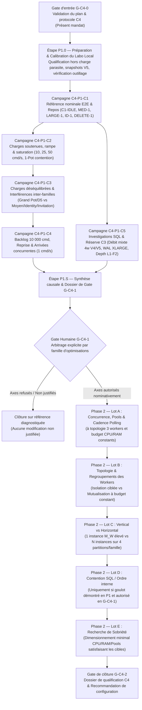

# L7-C4 — Plan directeur du chantier

- **Date** : 21 novembre 2026
- **Branche** : `feat/v3-l7` @ `181904cd02ffb7e3b9b60cf754cf365b99c2a3fa`
- **Références normatives** :
  - [`docs/testing/Reactor_Verification_Policy.md`](../../testing/Reactor_Verification_Policy.md) *(obligatoire pour toute intervention sous `app/`)*
  - [`docs/v3/SPEC-05_Consumption_Discovery.md`](../SPEC-05_Consumption_Discovery.md) · [`docs/v3/SPEC-08_Observability.md`](../SPEC-08_Observability.md) · [`docs/v3/SPEC-09_Performance.md`](../SPEC-09_Performance.md)
  - [`docs/v3/L7_C3/README.md`](../L7_C3/README.md) · [`docs/v3/L7_C2_B3_Storage_Consolidated_Qualification_Report.md`](../L7_C2_B3_Storage_Consolidated_Qualification_Report.md) · [`docs/v3/L7_4_A3_A4_Consolidated_Qualification_Report.md`](../L7_4_A3_A4_Consolidated_Qualification_Report.md)

---

## 1. Positionnement et obligations héritées de C1, C2 et C3

### 1.1 Filiation technique et état de départ

1. **L7-C1 (`L7.4-A3+A4`, clos)** a introduit le calcul incrémental opportuniste `N−m` de `PotVersion` (A3) et `PotBalance` (A4, migration additive `V2__pot_balance_aggregate.sql`), abaissant le temps de matérialisation sur Grand Pot (`100/2000`) de `~1 031 ms` à `~30 ms` pour `PotVersion` et de `~455 ms` à `~8.4 ms` pour `PotBalance`.
2. **L7-C2 (`C2-B1..B3`, clos @ `d2530925`)** a remplacé les manifestes JSONB par l'arbre Radix-16 adressé par contenu (`V3__pot_version_radix16.sql`) et les balances/agrégats JSONB par un stockage binaire mutualisé (`V4__pot_balance_shared_storage.sql`), réduisant l'empreinte READ des tables optimisées de `233.44 MB` à `22.95 MB` (`10.17×`) et le temps d'écriture `PotVersion` / `PotBalance` sur `restore-large-1` à `9.35 ms` / `4.33 ms` p50.
3. **L7-C3 (`V5 Availability`, clos avec réserves @ `2181bd21`)** a raccordé les 7 matérialiseurs READ aux 8 familles de disponibilité (`V5__projection_availability.sql`), avec 4 journaux historiques denses et 4 registres courants coalescés, publiés atomiquement dans la transaction finale L2 via un suffixe CTE modifiable (`ReadAvailability.closeAndPublish`).

### 1.2 Réserves et obligations transmises à L7-C4

| Source | Identifiant / Constat | Obligation pour L7-C4 |
|---|---|---|
| **C2-B3 (§8 & §10.3)** | Overhead de polling et contrôle : sur `restore-large-1` (`60 s`), le temps utile des 5 projections de `business-read-worker` vaut `1.081 s` (`4.2 %` du CPU process), contre `34.80 s` de Discovery cumulée (`~40 %` pour `Invitation` + `CurrentBinding` à vide), `96 549` acquisitions `read-control` et `519 224` commits PostgreSQL (`~8 650 TPS`). | Mesurer et attribuer séparément le coût du polling à vide, des rotations `LoopSchedule`, des pools `*-control` et de l'exécution métier utile sous différents régimes (`C4-R2`, `C4-R5`). |
| **C3 (`consolidation.md` §Écarts)** | **Débit mixte sous concurrence** : baisse observée de `98.0` à `82.6 finalisations/s` (`−15.7 %`, 4 workers, 192 finalisations, 256 publications, 5 attentes compteur) sur un état intermédiaire avant le suffixe CTE final de C3. | Établir une nouvelle référence A/B reproductible sur le code C3 réellement livré (`ReadAvailability` CTE 1 instruction/famille), avec répétitions ($R \ge 5$), contrôle expérimental et attribution fine des attentes SQL (`Lock:tuple`, `Lock:transactionid`, `IO:WalSync`). |
| **C3 (`consolidation.md` §Écarts)** | **WAL `PotBalance` XLARGE** : en Situation A (contenu réutilisé, 500 shareholders), le WAL propre passe de `690` à `1 245 B/version` (`+80.4 %`, p95 `3.01 → 4.11 ms`) ; en Situation D, de `4 443` à `4 982 B/version` (`+12.1 %`). | Remesurer et décomposer (`pg_stat_statements`, `pg_walinspect`) la part du WAL imputable au compteur C3, à la table `read_availability_event`, à ses 3 index et aux images complètes de pages (FPI) sur le suffixe final. |
| **C3 (`consolidation.md` §Écarts)** | **Paires uniques sous charge hôte concurrente** : les comparaisons E2E C2/C3 (`med-5`, `large-1`, `D5`) ont été exécutées en paire unique pendant qu'une gate Maven tournait sur le même hôte. | Exécuter toutes les campagnes C4 hors de toute charge parasite (zéro Maven/IDE concurrent), avec pré-vol de charge hôte et répétitions ($R \ge 3$ en E2E, $R \ge 5$ en micro-bench SQL). |
| **L7-LB (`RES-L7LB-S6-01`)** | Enveloppe locale nominale bornée à `25 cmd/s` ; la pointe `50 cmd/s` sature `business-read-worker` et PostgreSQL en mono-hôte. | Diagnostiquer le point exact de saturation (admission, `command-worker`, `business-read-worker`, verrous/CPU PostgreSQL) entre `1`, `10`, `25` et `50 cmd/s`. |

---

## 2. Cadre des arbitrages ratifiés (`C4-R1` à `C4-R13`)

Les 13 arbitrages ratifiés gouvernent l'intégralité du chantier :

| Code | Intitulé | Règle d'application dans le plan C4 |
|---|---|---|
| **C4-R1** | Finalité | Diagnostiquer le débit utile et ses facteurs limitants avant toute décision d'optimisation. Aucune solution n'est présupposée. |
| **C4-R2** | Deux niveaux de mesure | Coupler systématiquement les mesures E2E (`WRITE → READ` selon oracles `SPEC-09`) et les mesures internes (workers, moteurs, pools JDBC, PostgreSQL). |
| **C4-R3** | Priorités fonctionnelles | La hiérarchie de protection découle des objectifs de disponibilité utilisateur (`C-03`, `PotBalance`, `Binding`, `Result`), jamais de la durée unitaire d'une tâche. |
| **C4-R4** | Regroupements statiques avec capacités protégées | Étudier l'allocation statique par configuration (`.properties`) des consommations en runtimes et leurs plafonds `M_W` / `M_C`. Aucun pilotage dynamique. |
| **C4-R5** | Isolation ciblée et mutualisation | Privilégier la mutualisation par défaut ; n'isoler une famille dans un runtime dédié que si les mesures de Phase 1 prouvent une interférence ou un besoin de protection. |
| **C4-R6** | Efficacité et sobriété | Optimiser d'abord à budget matériel global constant ; rechercher ensuite le dimensionnement minimal satisfaisant les objectifs avec marge. |
| **C4-R7** | Rattrapage et réactivité | Équilibrer la vitesse de résorption d'un backlog (`10 000` commandes) et la latence des nouvelles arrivées concurrentes (`1 cmd/s`), sans violer les règles d'ordre. |
| **C4-R8** | Protection progressive | Protéger prioritairement les jalons contractuels `SPEC-09` ; mesurer les 9 consommations ; n'étendre les protections que sur preuve factuelle, sans inventer de nouveaux SLO. |
| **C4-R9** | Dimensionnement vertical et horizontal | Comparer quotas CPU/RAM, concurrence (`M_W`, `M_C`, pools) et réplication d'instances sur les 36 partitions logiques fixes et le mécanisme de lease existant. |
| **C4-R10** | Expérimentation progressive | Référence immuable → identification causale des goulots → expérimentation isolée (une variable par essai) des seules modifications autorisées. |
| **C4-R11** | Instrumentation légère | Réutiliser `MicrometerConsumptionObservation`, `StageHandoffTracker`, `MicrometerPotVersionObservation`, `MicrometerPotBalanceObservation`, `pg_stat_*` et les bancs Python existants. |
| **C4-R12** | Infrastructure locale | Exécution intégrale sur le Mac local ; conclusions attribuées à cet environnement ; distinction explicite avec la certification contractuelle `SPEC-09` Configuration A/B. |
| **C4-R13** | Deux phases avec gate | Séparation stricte Phase 1 (Diagnostic) / Phase 2 (Optimisation) par la Gate humaine `G-C4-1` autorisant ou refusant chaque famille d'interventions. |

---

## 3. Architecture des phases, dépendances et Gates



---

## 4. Phase 1 — Plan de diagnostic (Sans modification de production)

### 4.1 Objectifs et règles d'exécution de la Phase 1

- **Interdiction absolue** de modifier le code applicatif sous `app/`, les migrations SQL, les contrats de routage ou les configurations `.properties` de référence pendant la Phase 1.
- Établir la **vérité terrain** du HEAD post-C3 sur les deux niveaux exigés par `C4-R2` :
  1. **Niveau 1 (Bout-en-bout `WRITE → READ`)** : débit d'admission (`202` vs `503`), débit de terminalisation WRITE, disponibilité de `CommandResult` et `IdentityRequestResult`, jalon `C-03` (`GET /pots/{id}?minVersion=V` avec `W >= V` et `DeletePot` interne `deleted=true`), disponibilité technique de `PotBalance(P,V)`, disponibilité utilisable de `CurrentBinding` (`GET /me/pots?limit=1` HTTP 200), progression de `PotVisibility` et `Invitation`, backlog double axe (sources `PENDING` / événements non découverts vs `consumption_slot`) et âge des travaux.
  2. **Niveau 2 (Facteurs limitants internes)** : attente de Discovery (`T0 → T0a → T0b`), attente d'acquisition Engine (`T0b → T0c`), répartition des opportunités (`pocoma_v3_rotation_opportunities_total`) et temps d'attente entre opportunités (`pocoma_v3_consumption_opportunity_wait_seconds`), distribution entre les 4 partitions (`0..3`), saturations (`worker`, `consumption`, `executor`, `softcap`), durées `prepare` vs `finalize`, coût du suffixe C3 (`read_availability_counter`), attentes de verrous PostgreSQL (`pg_stat_activity`, `pg_locks`, `log_lock_waits`), WAL (`pg_stat_wal`, `pg_stat_statements`, `pg_walinspect`), CPU/RAM/GC des conteneurs et taux d'occupation/attente des pools HikariCP.

### 4.2 Déroulement ordonné des étapes de Phase 1

| Étape | Intitulé | Contenu résumé (détails dans [`diagnostic-protocol.md`](diagnostic-protocol.md)) | Dépendance | Livrable de preuve |
|---|---|---|---|---|
| **P1.0** | Préparation et calibration du laboratoire local | Vérification de l'absence de charge parasite, packaging unique des 4 JAR exécutables au SHA gelé, préparation/vérification des snapshots `medium`, `large`, `multibucket-d5` et du stock `10 000` commandes en schéma V5, calibration de l'impact de l'observateur (`L74-MET-02`). | Gate `G-C4-0` | `docs/testing/evidence/L7-C4/phase1/p1-0-calibration/` |
| **P1.1** | **Campagne `C4-P1-C1`** — Référence nominale E2E et coût à vide *(obligatoire en premier)* | Exécution ($R = 3$) de `C1-IDLE` (`0 cmd/s`), `C1-MED-1` (`1 cmd/s` Moyen), `C1-LARGE-1` (`1 cmd/s` Grand), `C1-ID-1` (`1 req/s` Registration) et `C1-DELETE-1` (oracle `DeletePot`) sur l'état C3 final. Établit la référence E2E `WRITE → READ` avant toute investigation SQL. | P1.0 | `docs/testing/evidence/L7-C4/phase1/c1-nominal/` |
| **P1.2** | **Campagne `C4-P1-C2`** — Charges soutenues, rampe et saturation | Exécution ($R = 3$) de `C2-MED-10` (`10 cmd/s` soutenu), `C2-RAMP` (`1, 5, 10, 20, 25, 35, 50 cmd/s`), `C2-MED-50` (`50 cmd/s` pointe + résorption) et `C2-CONTENTION-1POT` (contention CAS sur un même Pot). Identification du premier goulot saturant. | P1.1 | `docs/testing/evidence/L7-C4/phase1/c2-saturation/` |
| **P1.3** | **Campagne `C4-P1-C3`** — Charges déséquilibrées et interférences | Injection simultanée de travaux lourds (`PotVersion` / `PotBalance` sur Grand Pot ou franchissement `D5` `full:bucket_cap` à `~352 ms`) et de flux sensibles à la latence (`Pot Moyen`, `CurrentBinding` pour `Registration`, `Invitation`). Mesure de la famine de tickets `M_W` et du blocage des boucles de polling. | P1.2 | `docs/testing/evidence/L7-C4/phase1/c3-interference/` |
| **P1.4** | **Campagne `C4-P1-C4`** — Backlog, reprise et arrivées concurrentes | Rattrapage d'un stock de `10 000` commandes (`F01-G` local) et d'un backlog READ asymétrique (arrêt/redémarrage de `business-read-worker`) sous flux continu de `1 nouvelle commande/s`. Mesure de la vitesse de résorption par consommation et de la latence des nouvelles demandes (`C4-R7`). | P1.3 | `docs/testing/evidence/L7-C4/phase1/c4-backlog/` |
| **P1.5** | **Campagne `C4-P1-C5`** — Investigations ciblées et réserve C3 | Réexamen rigoureux ($R = 5$) sur bases/fixtures isolées et jetables de la réserve C3 de débit mixte (`98.0 → 82.6 final./s`) sur le suffixe CTE final (`2181bd21` / `181904cd`), décomposition du WAL `PotBalance` XLARGE (Situations A et D via `pg_walinspect`), vérification `L1-F2` (`100 / 1 000 / 10 000` versions). Un microbenchmark ne remplace jamais la référence E2E `C4-P1-C1`. | P1.1 | `docs/testing/evidence/L7-C4/phase1/c5-c3-reserve/` |
| **P1.S** | Rédaction du rapport de diagnostic et soumission à la Gate `G-C4-1` | Consolidation des preuves, classement des facteurs limitants établis vs écartés, chiffrage des optimisations candidates et rédaction du rapport selon [`gate-decision-template.md`](gate-decision-template.md). | P1.1 à P1.5 | `docs/v3/L7_C4/phase1-diagnostic-report.md` |

---

## 5. Gate formelle `G-C4-1` entre Diagnostic (Phase 1) et Optimisation (Phase 2)

Conformément à `C4-R13`, **aucune optimisation n'est automatiquement autorisée par l'achèvement de la Phase 1**.

### 5.1 Contenu obligatoire du dossier soumis à `G-C4-1`

Le rapport de décision soumis à l'arbitrage humain à la fin de la Phase 1 (structuré selon [`gate-decision-template.md`](gate-decision-template.md)) doit obligatoirement contenir :
1. **Inventaire et provenance des mesures** : SHA Git exact, empreintes SHA-256 des JAR et `.properties`, digests des images Docker, caractéristiques de l'hôte Mac, profils de quotas utilisés, graines des jeux de données et nombre de répétitions exécutées.
2. **Synthèse des performances E2E et de la réserve C3** : distributions `p50 / p95 / p99 / max` (médiane et dispersion inter-runs) pour chaque campagne `C4-P1-C1..C5`, verdict factuel sur la réserve C3 (`98.0 → 82.6 final./s` et WAL `XLARGE`).
3. **Attribution causale des facteurs limitants** : ventilation explicite entre :
   - **(a) PostgreSQL** (CPU, verrous compteur C3, verrous de slot/partition, I/O WAL, plans SQL) ;
   - **(b) Partitions logiques** (déséquilibre de hachage `sha256-v1`, contention par Pot vs par partition) ;
   - **(c) Ordonnanceur interne du worker** (cadence `LoopSchedule`, absence de backoff des familles inactives co-hébergées, contention `pairLock`, famine de tickets `M_W` dans `WorkerCapacity`) ;
   - **(d) Topologie et dimensionnement des runtimes** (regroupement des 5 projections dans `business-read-worker`, quotas CPU/RAM des conteneurs, taille des pools HikariCP).
4. **Incertitudes résiduelles** et limites propres au laboratoire mono-hôte.
5. **Catalogue des optimisations candidates** : pour chaque famille d'interventions (`O1` à `O7`), description précise, mécanisme causal ciblé, gain attendu, coût en ressources, risques sur les invariants et tranche de vérification Maven impactée.
6. **Alternatives écartées** avec justification factuelle (ex. modifications dont le facteur limitant supposé a été réfuté par la Phase 1).
7. **Recommandation de travaux priorisés** et **formulaire de décision humaine explicite** (`AUTORISÉ` / `REFUSÉ` / `DIFFÉRÉ` par famille d'optimisations).

### 5.2 Critères de passage de la Gate `G-C4-1`

- Toutes les campagnes `C4-P1-C1` à `C4-P1-C5` disposent de leurs reçus JSON, exports Prometheus `.prom`, snapshots PostgreSQL et manifestes SHA-256 complets.
- La réserve C3 de débit mixte et de WAL `XLARGE` est tranchée factuellement sur le code C3 final.
- Le responsable humain a signé explicitement les familles d'interventions autorisées pour la Phase 2. Si le diagnostic montre que la configuration actuelle satisfait déjà tous les objectifs sans goulot actionnable, le chantier C4 peut être clos directement à la Gate `G-C4-1`.

---

## 6. Phase 2 — Plan conditionnel d'optimisation et de sobriété

> [!NOTE]
> Conformément à `C4-R1`, `C4-R10` et `C4-R13`, les lots expérimentaux ci-dessous constituent un **catalogue neutre d'hypothèses conditionnelles à tester**, et en aucun cas des décisions d'implémentation déjà arrêtées. La Gate `G-C4-1` peut tout à fait conclure qu'aucune optimisation n'est nécessaire ou justifiée (`CLOSE_L7_C4_AFTER_PHASE_1_DIAGNOSTIC`). Seules les interventions répondant à un facteur limitant démontré en Phase 1 et explicitement autorisées par la décision humaine `G-C4-1` seront exécutées.

### 6.1 Règles méthodologiques strictes de la Phase 2

1. **Isolation des variables expérimentales (`C4-R10`)** : Ne jamais combiner dans un même essai une modification de paramètre de concurrence/pool, un changement de regroupement de runtimes et une modification de code SQL ou d'ordonnanceur. Chaque essai change **une seule variable** par rapport à la baseline validée de l'étape précédente.
2. **Périmètre explicite du budget matériel global constant (`C4-R6`, `C4-R9`)** : Lors des comparaisons de topologie ou de dimensionnement vertical vs horizontal, le périmètre complet des ressources prises en compte inclut :
   - Les runtimes HTTP (`http-write`, `http-read`), les workers (`command-worker`, `results-worker`, `business-read-worker` ou variantes redécoupées), le conteneur `postgres`, et les services auxiliaires du banc (émetteur JWT local sur l'hôte, collecteur Python, Docker Desktop VM).
   - La distinction systématique entre **limites allouées** (`--cpus`, `mem_limit`, `-Xms`/`-Xmx`, `maximumPoolSize`), **consommation réelle** (`usage_usec` et `throttled_usec` cgroup, `RSS`, heap utilisé, connexions actives HikariCP) et **ressources physiques hôtes** (cœurs Apple Silicon, RAM unifiée, stockage `tmpfs` vs NVMe).
   - **Enveloppe Banc Performance (`l7-4a-profiles.json`)** : `6.0` CPU (`2.0` PG + `4.0` Runtimes JVM) et `5 376 MiB` RAM (`2 048 MiB` PG + `3 328 MiB` Runtimes JVM), total connexions JDBC `< 100`. Toute différence inévitable (ex. surcoût RAM de base d'une JVM supplémentaire ou variation du total de connexions `*-control`) doit être explicitement documentée.
3. **Respect des lois de dimensionnement des pools JDBC** : Pour tout worker de capacité `M_W`, les pools HikariCP respectent `business = M_W + 2` et `control = M_W + 6` (`minimumIdle == maximumPoolSize`), et la vérification `verifyTimingBounds` (`leaseBound < leaseDuration`, `claimBound < claimDuration`) est satisfaite.

### 6.2 Familles d'expérimentations candidates (Lots P2-O1 à P2-O7)

#### Lot P2-O1 — Adaptation des limites de concurrence (`M_W`, `M_C`), de la cadence de polling et des pools JDBC (à topologie 3 workers constante)
- **Hypothèse ciblée** : Dans `business-read-worker`, `M_W = 3` pour 5 consommations (`M_C = 2` chacune, somme `10`) crée une contention de tickets entre `PotVersion`, `PotBalance` et `PotVisibility`, ou `min-poll = 2 ms` génère un surcoût CPU PostgreSQL de contrôle excessif au détriment des transactions métier.
- **Variables testées séparément** :
  - **O1a (Concurrence & Pools)** : Faire varier `worker-limit` (`M_W` de `3` à `4` ou `6`, avec ajustement automatique des pools `business = M_W + 2` et `control = M_W + 6`) et ajuster les plafonds relatifs `M_C` (ex. `MaterializePotVersion=2,MaterializePotBalance=2,MaterializePotVisibility=1,MaterializeCurrentBinding=1,MaterializeInvitation=1`) pour empêcher qu'une famille non critique ne monopolise `M_W`.
  - **O1b (Cadence de polling & quantum)** : Tester `min-poll` (`2 ms` vs `5 ms` vs `10 ms`), `max-poll` (`20 ms` vs `50 ms` vs `100 ms`) et `quantum` (`4` vs `8` vs `16`) pour mesurer le compromis exact entre CPU PostgreSQL de contrôle (`read-control` TPS) et latence de réveil E2E `C-03`.
- **Impact code** : Configurations `.properties` uniquement (`0` modification sous `app/`).

#### Lot P2-O2 — Regroupements alternatifs de consommations et isolation ciblée des familles critiques (`C4-R3`, `C4-R4`, `C4-R5`)
- **Hypothèse ciblée** : La cohabitation dans `business-read-worker` des 3 projections `POT_EVENT` à fort débit avec `CurrentBinding` (critique pour le SLO `Registration ≤ 500 ms`) et `Invitation` (faible fréquence, `~40 %` de Discovery à vide avec `CurrentBinding`) dégrade à la fois le CPU de contrôle et la protection de capacité des parcours critiques.
- **Topologies statiques candidates comparées à budget global constant (`4.0` CPU / `3 328 MiB` RAM sur l'ensemble des JVM)** :
  - **T0 (Référence 3 workers)** :
    - `command-worker` (`Command`, `IdentityRequest`)
    - `results-worker` (`MaterializeCommandResult`, `MaterializeIdentityRequestResult`)
    - `business-read-worker` (`PotVersion`, `PotBalance`, `PotVisibility`, `CurrentBinding`, `Invitation`)
  - **T1 (3 workers rééquilibrés — Rapprochement par domaine fonctionnel / criticité utilisateur)** :
    - `command-worker` (`Command`, `IdentityRequest`)
    - `fast-feedback-worker` (`MaterializeCommandResult`, `MaterializeIdentityRequestResult`, `MaterializeCurrentBinding` — regroupe les 3 projections courtes immédiatement attendues par l'utilisateur après une requête HTTP WRITE ou une `Registration`)
    - `pot-read-worker` (`MaterializePotVersion`, `MaterializePotBalance`, `MaterializePotVisibility`, `MaterializeInvitation` — dédié au domaine Pot).
    *(Note : nécessite d'utiliser un `worker-name` dédié ou d'assouplir la garde de nommage `validateResultsWorkerReads` dans `MaterializeSettings.java:348-355` si le nom `results-worker` est conservé).*
  - **T2 (4 workers — Isolation de la branche critique `C-03` vs projections secondaires)** :
    - `command-worker` (`Command`, `IdentityRequest`)
    - `results-worker` (`MaterializeCommandResult`, `MaterializeIdentityRequestResult`)
    - `pot-core-read-worker` (`MaterializePotVersion`, `MaterializePotBalance` — les deux seules projections requises par l'oracle `C-03` et le SLO `PotBalance`, protégées de toute interférence)
    - `auxiliary-read-worker` (`MaterializePotVisibility`, `MaterializeCurrentBinding`, `MaterializeInvitation` — projections de navigation, d'identité et d'invitation, dont le rythme de polling n'est plus réveillé par `PotVersion`/`PotBalance` si leurs familles sources ne bougent pas, à l'exception de `PotVisibility`).
  - **T3 (4 workers — Isolation par famille d'événements source WRITE)** :
    - `command-worker` (`Command`, `IdentityRequest`)
    - `results-worker` (`MaterializeCommandResult`, `MaterializeIdentityRequestResult`)
    - `pot-event-read-worker` (`MaterializePotVersion`, `MaterializePotBalance`, `MaterializePotVisibility` — toutes alimentées par `POT_EVENT`)
    - `identity-invitation-read-worker` (`MaterializeCurrentBinding`, `MaterializeInvitation` — alimentées par `IDENTITY_EVENT` et `INVITATION_EVENT`, qui restent en backoff `max-poll` complet lors des rafales de commandes Pot !).

> [!TIP]
> **Intérêt causal de la topologie T3** : Dans `ConsumptionWorker.LoopSchedule`, le backoff (`minPoll → maxPoll`) est partagé par toutes les consommations d'un même worker. En séparant `MaterializeCurrentBinding` (`IDENTITY_EVENT`) et `MaterializeInvitation` (`INVITATION_EVENT`) des trois consommations `POT_EVENT`, le worker `identity-invitation-read-worker` reste à `max-poll` (voire `50–100 ms`) pendant toute une campagne Pot, éliminant les `~13.84 s` (`40 %`) de Discovery à vide observés en C2-B3, tout en garantissant `100 %` de sa capacité `M_W` dès qu'une `Registration` arrive.

#### Lot P2-O3 — Dimensionnement CPU, mémoire et GC différencié par runtime (`C4-R6`, `C4-R9`)
- **Hypothèse ciblée** : À budget global constant (`4.0` CPU JVM + `2.0` CPU PostgreSQL), la répartition actuelle (`0.5` CPU pour `command-worker`, `2.0` CPU pour `business-read-worker`, `2.0` CPU pour `postgres`) ou l'usage de `-XX:+UseSerialGC` sous `-Xmx384m`/`512m` bride un runtime spécifique ou PostgreSQL.
- **Variables testées séparément** :
  - Réallocation des parts CPU entre `postgres`, `command-worker` et le(s) worker(s) READ à somme CPU constante (`6.0` CPU).
  - Réallocation des plafonds `-Xmx` et `mem_limit` à somme RAM constante.
  - Comparaison factuelle `-XX:+UseSerialGC` vs `-XX:+UseG1GC` sur les workers à forte allocation transitoire (`PotVersion` Radix-16 / `PotBalance` multi-buckets).

#### Lot P2-O4 — Comparaison dimensionnement vertical vs réplication horizontale (`C4-R9`)
- **Hypothèse ciblée** : Vérifier si `2` instances plus petites d'un même worker (se partageant les 4 partitions `0..3` par configuration statique `0|1` et `2|3`, ou en concurrence sur `0|1|2|3` via `partition_ownership`) apportent plus ou moins de débit utile qu'**une seule instance plus puissante** dotée du budget CPU/RAM/connexions cumulé.
- **Protocole de comparaison à budget strictement identique** :
  - **Cas Vertical (1 instance)** : `1 × pot-read-worker` avec `2.0` CPU, `1 024 MiB` RAM, `M_W = 4`, partitions `0|1|2|3`, pools Hikari `business = 6`, `control = 10` (`total = 21` connexions avec `source-read = 6`).
  - **Cas Horizontal Partitionné Statique (2 instances disjointes)** : `2 × pot-read-worker` avec chacun `1.0` CPU, `512 MiB` RAM, `M_W = 2`, instance A sur partitions `0|1` et instance B sur partitions `2|3`, pools Hikari `business = 4`, `control = 8`, `source-read = 4` (`total = 2 × 16 = 32` connexions).
  - **Cas Horizontal Compétitif (2 instances sur `0|1|2|3`)** : Même budget que le cas partitionné, mais chaque instance déclare `0|1|2|3` (mesure du surcoût des tentatives d'acquisition de baux déjà détenus `BUSY_OR_NOT_OWNER`).
- **Critères de comparaison** : débit de finalisation, latence E2E `C-03` p50/p95/p99, contention sur les compteurs C3 (`read_availability_counter` sérialisant par famille *indépendamment* de la partition !), nombre total de connexions et commits de contrôle PostgreSQL.

#### Lot P2-O5 — Réduction éventuelle des contentions SQL (`C4-R10`)
- **Condition stricte d'activation** : Uniquement si la Phase 1 (`C4-P1-C5` ou `C4-P1-C2`) démontre une contention SQL significative sur le code livré et si la Gate `G-C4-1` l'autorise explicitement.
- **Pistes bornées évaluables sans altérer les contrats** :
  - Fusion de la lecture de vérification `requireCompletionReady` et de la preuve de disponibilité C3 en une seule requête JDBC par jointure (piste §7.2 du [rapport complémentaire C3](../L7_C3_CommandResult_Complementary_Gate_Report.md#7-coût-estimé-et-possibilités-de-regroupement)).
  - Ajustement de paramètres physiques PostgreSQL non sémantiques (`fillfactor`, `commit_delay` / `synchronous_commit` reste **interdit** de relâchement car contraire aux garanties de durabilité L2/C3).

#### Lot P2-O6 — Améliorations ciblées de l'ordonnancement interne (`C4-R7`, `C4-R10`)
- **Condition stricte d'activation** : Uniquement si la Phase 1 (`C4-P1-C1`, `C4-P1-C3` ou `C4-P1-C4`) démontre que l'ordonnanceur local (`ConsumptionWorker` / `DiscoveryLoop` / `ConsumptionLoop`) est lui-même le goulot (p. ex. réveil mutuel permanent des consommations inactives dans `LoopSchedule`, ou famine de tickets `M_W` lors d'un backlog).
- **Interventions chirurgicales candidates (sans priorité globale ni coordinateur)** :
  - **Backoff par `Binding` (consommation)** dans `DiscoveryLoop` / `ConsumptionLoop` au lieu d'un unique booléen `tourProgressed` global au worker : une consommation dont les 4 partitions sont vides applique son propre backoff jusqu'à `maxPoll`, même si une autre consommation co-hébergée dans le même worker progresse.
  - **Garantie de réserve minimale de capacité** (`M_W` vs `M_C`) : s'assurer par configuration que $\sum M_C$ ou la répartition entre runtimes empêche une famille longue d'absorber la totalité des `M_W` tickets au détriment d'une famille critique co-hébergée.

#### Lot P2-O7 — Recherche finale du dimensionnement sobre (`C4-R6`)
- Une fois la topologie et les paramètres optimaux identifiés à budget constant, réduire progressivement par paliers les quotas CPU, `-Xmx` / `mem_limit` et la cadence de polling au repos jusqu'à identifier **l'enveloppe minimale** qui respecte l'ensemble des objectifs de débit et de latence avec une marge de sécurité explicite (`≥ 20 %` sur les latences p95 et la mémoire heap, `0` saturation de pool).

---

## 7. Invariants non négociables et garde-fous architecturaux

Toute expérimentation ou évolution en Phase 2 devra impérativement préserver les invariants suivants (tout écart entraîne le rejet immédiat de l'option) :

| Domaine | Invariant non négociable | Référence normative |
|---|---|---|
| **Transactions & Atomicité** | Une seule transaction physique finale par tentative couvrant verrou final du slot, validation métier, écriture des effets, preuve de complétion, suppression du slot et suffixe de publication (WRITE ou READ C3). Zéro transaction distribuée. | `SPEC-05` §3–4, `L2_R1_R10_Normative_Consolidation.md` (R1) |
| **Idempotence & Reprise** | Une acquisition = une tentative complète, sans retry interne au claim. Recovery en observation seule (`REPEATABLE READ READ ONLY`), sans réparation ni cession spéculative. | `SPEC-05` §5, `L2` (R5, R9) |
| **Fencing** | Propriété de partition (`ownerToken`, `owned_until`) protégeant Discovery et acquisition ; claim individuel (`claimToken`, `claimedUntil`) vérifié au verrou exclusif final avec horloge PostgreSQL fraîche. La perte d'un lease de partition ne révoque pas un claim individuel encore valide. | `SPEC-05` §4, `L7_I3_Closure_Report.md` |
| **Indépendance des projections** | Les 7 consommations READ progressent indépendamment avec leurs propres checkpoints, slots et transactions. Aucune barrière de synchronisation inter-projections, aucun coordinateur, aucune tâche intermédiaire. | `SPEC-04` §3, `SPEC-05` §8 (`AUD-V3-005`) |
| **Ordre & Partitions fixes** | Maintien des 9 `consumption_id` canoniques, des 36 partitions logiques fixes (`4` par consommation) et de la fonction de hachage `RoutingV1` (`sha256-v1`). Aucune redistribution dynamique de partitions. | `SPEC-05` §1, `ConsumptionCatalog.java`, `RoutingV1.java` |
| **Oracles `SPEC-09` & `DeletePot`** | Maintien de la distinction entre `CommandResult`, première lecture complète et autorisée `C-03` (`W >= V`), `PotBalance(P,V)` exacte, `CurrentBinding` utilisable et `PotVisibilityState`. Sur `DeletePot(D)`, absence intentionnelle de `PotBalance(P,D)` et jalon interne `CurrentPot(P) → PotVersion(P,D).deleted = true`. | `SPEC-09` §3–5, `SPEC-04` §10 |
| **Contrats de disponibilité C3** | Maintien des 8 familles `ReadAvailability`, de la densité `1..H` des 4 journaux historiques, de la pagination `STABLE` des 4 registres courants coalescés, des contraintes différées bilatérales effet ↔ publication et du protocole de reconstruction exclusive `C3-R2`. | `docs/architecture/read-availability.md`, `V5__projection_availability.sql` |
| **Sécurité & Autorisations** | Maintien de la validation pré-sémaphore HTTP, de l'isolation stricte des rôles PostgreSQL (`pocoma_admission`, `pocoma_write`, `pocoma_write_source_read`, `pocoma_read`, `pocoma_read_http`, `pocoma_read_status`) et des contrôles `BootstrapGuard`. | `SPEC-07` (`SEC-01/02`), `BootstrapGuard.java` |

---

## 8. Déclaration de périmètre de vérification (`Reactor_Verification_Policy.md`)

Conformément à [`docs/testing/Reactor_Verification_Policy.md`](../../testing/Reactor_Verification_Policy.md) (§3, §4, §29, §30) et `AGENTS.md` :

### 8.1 Périmètre du présent mandat (Cadrage et rédaction du plan C4)

```text
Verification scope (Mandat de cadrage L7-C4)
Expected production impact:
- NONE (rédaction documentaire exclusive sous docs/v3/L7_C4/)
Primary slice:
- NONE
Secondary slices:
- NONE
Forbidden production impact:
- app/**, scripts/**, docker/**, migrations SQL, configurations exécutables
Required local proof:
- Vérification Git (branche, HEAD, statut, diff --check) et intégrité des liens documentaires
Global architecture gate:
- NOT REQUIRED
Full reactor:
- NOT REQUIRED
Database verification:
- NONE
Next mandatory global gate:
- Clôture L7.5 (CERT-FULL + CERT-ARCH) après stabilisation finale de L7
Escalation conditions:
- Toute modification de fichier hors docs/v3/L7_C4/ est interdite dans ce mandat
```

### 8.2 Périmètre de vérification déclaré pour la future Phase 1 (Diagnostic)

- **Impact de production attendu** : `NONE` (`0` modification sous `app/`, `0` migration SQL, `0` modification des configurations de production).
- **Si un ajustement d'outillage Python de banc est requis sous `scripts/performance/`** : exécution des suites unitaires Python (`python3 -B -m unittest scripts/performance/test_l7_4a_baseline.py scripts/performance/test_spec09_bench.py scripts/operations/test_v3_operations.py`), tranche Maven `NONE`.
- **Gate globale d'architecture et Full Reactor** : `NOT REQUIRED` en Phase 1.

### 8.3 Périmètre de vérification déclaré par lot conditionnel de Phase 2 (Optimisation)

Chaque lot de Phase 2 autorisé à la Gate `G-C4-1` devra déclarer et exécuter sa tranche canonique avant toute campagne de performance :

| Lot conditionnel de Phase 2 | Fichiers / Modules susceptibles d'être touchés | Primary Slice & Secondary Slices | Commande Maven canonique (depuis `app/`) | `architecture-tests` | Full Reactor | Base de données |
|---|---|---|---|---|---|---|
| **P2-O1 / P2-O3 / P2-O4 / P2-O7** *(Configurations `.properties` / Docker Compose uniquement)* | `docker/v3-five-runtimes/*.properties`, profils de banc | `NONE` *(si `0` modif sous `app/`)* ; ou tests ciblés `ReadActivationSettingsTest` / `WorkerCompositionPostgresTest` | Si test de chargement config : `./mvnw -pl runtime-worker-materialize,runtime-worker-process -am test` | `NOT REQUIRED` | `NOT REQUIRED` | `CURRENT` |
| **P2-O2** *(Si assouplissement garde de nommage `MaterializeSettings` / `ProcessSettings`)* | `compose-polling-nonburnable-materialize-postgres`, `compose-polling-burnable-write-postgres` | Primary: `PROJECTION` ; Secondary: `COMMAND` (si `ProcessSettings` touché) | `./mvnw -pl runtime-worker-materialize -am test` *(+ `runtime-worker-process` si touché)* | `NOT REQUIRED` *(sauf changement de dépendance/frontière)* | `NOT REQUIRED` | `CURRENT` |
| **P2-O5** *(Si optimisation SQL dans `infra-postgres-read`)* | `infra-postgres-read` (`ReadAvailability`, stores READ) | Primary: `PROJECTION` ; Secondary: `WEB` (si lecture partagée affectée) + preuve `runtime-monolith` | `./mvnw -pl runtime-worker-materialize,runtime-web-read -am test` | `NOT REQUIRED` *(sauf nouvelle ressource SQL V6 → `REQUIRED`)* | `NOT REQUIRED` | `CURRENT` (PostgreSQL 17, V1–V5) |
| **P2-O6** *(Si ajustement de `LoopSchedule` dans `supra-polling-consumption`)* | `supra-polling-consumption` (partagé par COMMAND et PROJECTION) | Primary: `PROJECTION` ; Secondary: `COMMAND` | `./mvnw -pl runtime-worker-process,runtime-worker-materialize -am test` | `NOT REQUIRED` | `NOT REQUIRED` *(reporté au jalon L7.5)* | `CURRENT` |

---

## 9. Critères de sortie du chantier L7-C4

Le chantier L7-C4 sera proposé à la clôture (`Gate G-C4-2`, ou `Gate G-C4-1` si aucune optimisation n'est requise) lorsque :
1. Le dossier de diagnostic de Phase 1 est complet, reproductible et archivé avec toutes ses preuves et empreintes SHA-256.
2. La réserve de performance C3 (débit mixte à 4 workers et coût WAL `PotBalance` XLARGE) est résolue par des mesures répétées sur le code C3 final.
3. Les facteurs limitants du débit et de la latence E2E (`1`, `10`, `25`, `50 cmd/s`, `Grand Pot`, `Backlog 10 000`) sont causalement établis et attribués (PostgreSQL vs Partitions vs Ordonnanceur vs Topologie).
4. La Gate humaine `G-C4-1` a statué explicitement sur chaque famille d'optimisations.
5. Pour toute optimisation autorisée en Phase 2 :
   - Son gain propre a été mesuré à variable isolée et à budget matériel global constant ;
   - Tous les invariants de la section 7 et les tranches de vérification Maven de la section 8.3 sont `PASS` (`0` échec, `0` erreur, `0` skip) ;
   - Un profil de dimensionnement sobre et explicite est documenté pour l'environnement local, avec ses marges et ses limites clairement distinguées de la future qualification sur infrastructure cible Configuration A/B (`C4-R12`).
