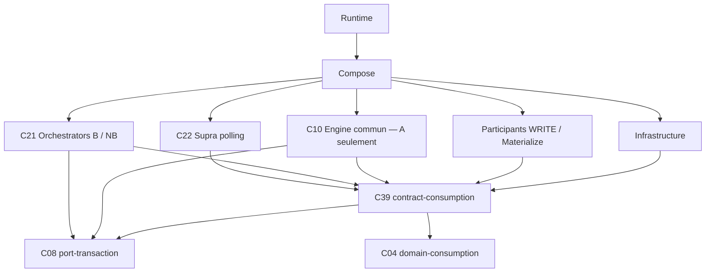

# Pocoma V3 — L7 — Audit de la frontière Consumption Engine / Orchestrator

Mandat : `AUDIT_L7_CONSUMPTION_ENGINE_ORCHESTRATOR_BOUNDARY`.

Date : 2026-11-10. Référence auditée : `0907fe13ce155561eae2107c7d675d91748e7883`, branche `feat/v3-architecture`, avec les modifications locales préexistantes décrites ci-dessous.

> Ce document restitue le rapport rendu dans la conversation. L'audit a été réalisé en lecture seule. Sa mise en fichier, son commit et son push ont ensuite été explicitement demandés par l'utilisateur (« Push ce rapport »). Les mentions d'absence de création de fichier, de commit et de push dans le corps décrivent la phase d'audit, antérieure à cette publication. Aucun changement d'implémentation n'est autorisé ou réalisé par cette publication. Les liens locaux ont été convertis en liens relatifs utilisables dans le dépôt ; le contenu analytique est conservé.

---

**Verdict : recommander le scénario B.** Réunir l’implémentation L2 dans `orchestrator-consumption`, derrière `contract-consumption`, avec deux parcours Burnable et NonBurnable explicitement distincts et un seul propriétaire des décisions de sûreté L2.

Le code démontre la réutilisation des mécanismes communs. Il ne démontre pas leur indépendance comme capacité autonome consommée séparément du protocole. Dans le scénario A, un Engine suffisamment protecteur conserverait presque tout le protocole actuel ; un Engine plus élémentaire obligerait les Orchestrators à partager des décisions transactionnelles délicates.

Cette recommandation conserve la cible de **42 modules enfants** fournie dans le second audit. À périmètre identique, A en demanderait **43**. Ce décompte est une conséquence de l’arbitrage, pas sa justification.

**Cadre, état du dépôt et qualifications**

| Élément | Constat |
|---|---|
| Mandat | `AUDIT_L7_CONSUMPTION_ENGINE_ORCHESTRATOR_BOUNDARY` |
| Branche réelle | `feat/v3-architecture` |
| HEAD initial et final | `0907fe13ce155561eae2107c7d675d91748e7883` |
| Worktree initial | 12 fichiers suivis modifiés ; fichiers et répertoires non suivis préexistants |
| Sources étudiées | HEAD, worktree courant et différences locales ; second audit fourni dans la conversation |
| Intervention | Aucun fichier créé ou modifié, aucun commit, aucun push |
| Exécution | Analyse statique uniquement ; aucun Maven, test, accès SQL ou processus applicatif |

Les fichiers suivis modifiés sont :

- `V3AdmissionHttpConfiguration`, `V3BootstrapGuard`, `V3ConsumptionWorkerConfiguration`, `V3ConsumptionWorkerSettings`, `V3ReadHttpConfiguration` ;
- `ConsumptionPilotIsolationTest`, `V3WorkerMonolithPostgresTest` ;
- le POM de `runtime-task-consumption-worker`, `ReadActivationSettingsTest`, `ReadParticipantsFixture` ;
- `PocomaWebApiApplication`, `V3ReadHttpContractTest`.

Les éléments non suivis comprennent `V3HttpSecurityConfiguration.java`, le déploiement cinq runtimes, ses configurations Docker, les preuves et le rapport L7/I1, ainsi que son script de smoke test.

**VERIFIED** — L7/I2 est déjà présent dans le HEAD : l’historique identifie notamment `fd5bfc89`, puis les corrections et optimisations ultérieures. Il ne faut donc pas assimiler L7/I2 aux seuls écarts locaux actuels.

L’état Git final correspond au relevé initial. L’empreinte des contenus modifiés et non suivis, calculée pendant l’inspection puis retrouvée à la fin, est :

`0e745a34b64445f2fe22631938ad5d0c5918fdf7dd411d0905e7e304c0f29dfc`

Dans tout le rapport :

| Qualification | Portée |
|---|---|
| **VERIFIED** | Présent directement dans le code, le POM, le SQL versionné ou les assertions inspectées |
| **INFERRED** | Conséquence architecturale déduite des sources |
| **PROPOSED** | Organisation ou obligation de migration recommandée |
| **UNVERIFIED** | Compilation, comportement physique ou qualification future non exécutée |

Une assertion de test inspectée est une preuve de l’oracle prévu, **pas un résultat de test exécuté pendant cet audit**.

**1. Verdict exécutif et justification contradictoire**

**VERIFIED** — `ConsumptionEngine` est décrit dans son propre commentaire comme une orchestration bornée du lifecycle. Ses méthodes ne se limitent pas à des primitives :

- `executeOperation()` décide quand classifier une défaillance et lancer une cession ;
- `executeAttempt()` pilote préparation, invalidation et observation ;
- `finalizeAttemptOperation()` impose l’ordre fencing, participant, complétion et publication ;
- `observeOperation()` combine référence source, checkpoint, slot et preuve métier ;
- `settlePendingOperation()` décide quand une réservation peut être restituée.

**VERIFIED** — `DiscoveryEngine` possède deux algorithmes de protocole : `discoverRequests()` et `discoverEvents()`. Ils partagent plusieurs mécanismes, mais leurs conditions de progression diffèrent.

**INFERRED** — La cohésion principale est donc celle d’un **protocole durable paramétré par des participants**, avec plusieurs transactions physiques successives et une seule transaction finale par tentative. Elle n’est pas celle d’une boîte de primitives indépendantes déjà utilisées par plusieurs protocoles autonomes.

**PROPOSED** — Dans B :

- `BurnableConsumptionProtocol` et `NonBurnableConsumptionProtocol` restent identifiables et testables dans C21 ;
- leurs mécanismes communs sont implémentés une seule fois, dans des collaborateurs internes ;
- C39 expose les capacités nécessaires au polling et aux participants ;
- le Compose choisit la variante et injecte les collaborateurs ;
- le Supra ignore la famille et toute implémentation concrète.

Le nom exact des classes internes reste secondaire. **Une seule implémentation Maven ne signifie ni une seule classe, ni une seule instance, ni une transaction partagée entre Consumptions.**

A reste techniquement possible. Sa meilleure version exigerait toutefois une API supplémentaire de primitives entre Orchestrators et Engine, même si cette API est cohébergée dans C39. Aucun usage actuel indépendant ne justifie de stabiliser cette seconde surface.

**2. Cartographie méthode par méthode**

Les références suivantes permettent de résoudre les identifiants utilisés dans les matrices.

| Réf. | Fichier |
|---|---|
| E | [ConsumptionEngine.java](../../app/engine-consumption/src/main/java/com/kartaguez/pocoma/engine/consumption/v3/ConsumptionEngine.java) |
| D | [DiscoveryEngine.java](../../app/engine-consumption/src/main/java/com/kartaguez/pocoma/engine/consumption/v3/DiscoveryEngine.java) |
| W | [V3ConsumptionWorker.java](../../app/orchestrator-poll-consumption/src/main/java/com/kartaguez/pocoma/orchestrator/poll/consumption/v3/V3ConsumptionWorker.java) |
| DL | [V3DiscoveryLoop.java](../../app/orchestrator-poll-consumption/src/main/java/com/kartaguez/pocoma/orchestrator/poll/consumption/v3/V3DiscoveryLoop.java) |
| CL | [V3ConsumptionLoop.java](../../app/orchestrator-poll-consumption/src/main/java/com/kartaguez/pocoma/orchestrator/poll/consumption/v3/V3ConsumptionLoop.java) |
| R | [V3RenewalService.java](../../app/orchestrator-poll-consumption/src/main/java/com/kartaguez/pocoma/orchestrator/poll/consumption/v3/V3RenewalService.java) |
| CAP | [WorkerCapacity.java](../../app/engine-consumption/src/main/java/com/kartaguez/pocoma/engine/consumption/v3/WorkerCapacity.java) |
| LC | [V3ConsumptionLifecycleComposition.java](../../app/composition-runtime-spring/src/main/java/com/kartaguez/pocoma/runtime/consumption/v3/V3ConsumptionLifecycleComposition.java) |
| DC | [V3ConsumptionDiscoveryComposition.java](../../app/composition-runtime-spring/src/main/java/com/kartaguez/pocoma/runtime/consumption/v3/V3ConsumptionDiscoveryComposition.java) |
| CFG | [V3ConsumptionWorkerConfiguration.java](../../app/composition-runtime-spring/src/main/java/com/kartaguez/pocoma/runtime/consumption/v3/V3ConsumptionWorkerConfiguration.java) |
| SET | [V3ConsumptionWorkerSettings.java](../../app/composition-runtime-spring/src/main/java/com/kartaguez/pocoma/runtime/consumption/v3/V3ConsumptionWorkerSettings.java) |
| G | [V3BootstrapGuard.java](../../app/composition-runtime-spring/src/main/java/com/kartaguez/pocoma/runtime/consumption/v3/V3BootstrapGuard.java) |
| TX | [SpringAttemptTransactions.java](../../app/infra-tx-spring/src/main/java/com/kartaguez/pocoma/infra/tx/spring/v3/SpringAttemptTransactions.java) |

Toutes les descriptions de comportement actuel des matrices sont **VERIFIED**. Les propriétaires cibles sont **PROPOSED**.

Catégories : **PT** primitive technique ; **RP** règle de protocole ; **B** spécialisation Burnable ; **NB** spécialisation NonBurnable ; **S** scheduling ; **I** infrastructure ; **C** composition ; **CN** contrat neutre.

Propriétaires :

- **K** : Engine commun du scénario A ;
- **OB/ON** : Orchestrators spécialisés du scénario A ;
- **L2** : implémentation commune et variantes internes de C21 dans B ;
- **Supra**, **Compose**, **Infra**, **Participant**, **C39** : propriétaires identiques dans les deux scénarios.

Les surcharges et délégations strictes sont regroupées lorsqu’elles n’ajoutent aucune responsabilité. Les aides de calcul métier sans incidence sur la frontière L2 restent chez leur Engine métier.

| Classe | Méthode | Responsabilité réelle | Invariants garantis ou contrôlés | Cible A | Cible B |
|---|---|---|---|---|---|
| E | Constructeurs, l.114–212 | RP : associer définition, participants, owners et sources | READ exige source exacte et admissions ; WRITE exige même owner source/effets ; capacité configurée | K, construction par Compose | L2, construction par Compose |
| E | `technical`, l.214 | PT : ouvrir unité technique bornée | Timeouts appliqués dans l’unité de contrôle | K | L2 commun |
| E | `retainsCapacity`, l.223 | PT : observation locale | Rejet d’un handle étranger ; aucune permission de libération | K | L2 commun |
| E | `hasUnresolvedRecovery`, l.230 | RP : signal d’incertitude monotone | Ne vaut ni résolution ni autorisation | K | L2 commun |
| E | `recoveryFailed`, l.234 | RP : retenir l’incertitude | Pas de règlement après issue physique non qualifiée | K | L2 commun |
| E | `navigate`, l.246 | PT/RP : lecture bornée des clés | Définition, partition, taille ; aucune acquisition implicite | K | L2 commun |
| E | `measured`, l.266 | PT : produire des observations | Conserve les distinctions d’issue ; instrumentation sans autorité durable | K + observation neutre | L2 + observation neutre |
| E | `acquirePartition` / `acquirePartitionOperation`, l.333 | PT : prise de propriété | Nouveau token ; aucune lease retournée sur ACK incertain | K | L2 commun |
| E | `renewPartitions` / opération, l.350 | PT : renouvellement borné | Définition et leases contrôlées ; résultat durable fourni par le port | K | L2 commun |
| E | `renewClaims` / opération, l.360 | PT : renouvellement des claims | Pas de mélange de Consumption ; bornes de lot | K | L2 commun |
| E | `acquire` / `acquireOperation`, l.374 | RP : réserver puis acquérir | Réservation avant acquisition ; handles seulement après résultat confirmé ; rétention sur incertitude | K | L2 commun |
| E | `abandon`, l.426 | RP : abandon avant exécution | Usage unique ; restitution locale ; claim durable laissé à expiration | K | L2 commun |
| E | `start`, l.432 | PT/RP : consommer le handle | Identité du propriétaire et CAS d’usage unique | K | L2 commun |
| E | `execute`, l.437 | CN/RP : point d’entrée borné | Une acquisition, une tentative | K, invoqué par OB/ON | L2 |
| E | `executeOperation`, l.441 | RP : exécution, classification et cession | Cession uniquement après rollback confirmé ; issue propre de la cession ; restitution conditionnelle | K, sans duplication OB/ON | L2 commun |
| E | `settlePending` / opération, l.517 | RP : régler les réservations | Sortie locale nécessaire ; inspection physique ; absence seule insuffisante après travail métier | K | L2 commun |
| E | `addPending`, l.564 | PT : enregistrer la rétention | Ensemble local borné par les tickets | K | L2 commun |
| E | `removePending`, l.575 | PT : retirer la rétention | Retrait unique ; ne résout pas seul une transaction | K | L2 commun |
| E | `checkPartition`, l.588 | PT | Partition dans la définition | K | L2 commun |
| E | `checkLease`, l.593 | PT | Consumption et partition compatibles | K | L2 commun |
| E | `bounded`, l.599 | PT | Lot borné, sans null ni doublon | K | L2 commun |
| E | `executeAttempt`, l.607 | RP : préparer puis finaliser ou observer | Expiration de la préparation ; poison conservé ; traitement distinct des issues physiques | K avec stratégie, sinon frontière partagée | L2 commun |
| E | `finalizeAttempt` / opération, l.638 | RP : unité finale complète | Fencing avant participant ; complétion obligatoire ; publication fermée ; résultat physique préservé | K exclusivement | L2 exclusivement |
| E | `observe` / `observeOperation`, l.688 | RP + NB : produire un verdict cohérent | Source exacte pour READ ; checkpoint ; slot ; preuve métier ; aucune réparation | K avec politique OB/ON explicite | L2, variantes internes |
| E | `observed`, l.863 | RP : traduire l’observation | `COMPLETED` ne réécrit pas l’ACK physique historique | K | L2 commun |
| E.AcquiredClaim | Constructeur, l.96 | PT : lier réservation et claim | Ticket du bon scope et de la bonne Consumption | K interne | L2 interne |
| E.AcquiredClaim | `claim`, l.109 | CN actuelle : exposer les données du claim | Ne donne pas directement accès à `execute(ClaimedSlot)` | Vue opaque C39 ; token interne K | Vue opaque C39 ; token interne L2 |
| E.Reads | `source`, l.785 | PT : lecture source préparatoire | Scope consécutif sous garde | K | L2 commun |
| E.Reads | `effects`, l.790 | PT : lecture des effets préparatoire | Scope consécutif sous garde | K | L2 commun |
| E.Reads | `invalidate`, l.795 | PT | Première cause conservée, invalidation monotone | K | L2 commun |
| E.Reads | `requireValid`, l.804 | PT | Interruption et poison interdisent la suite | K | L2 commun |
| E.Reads | `scope`, l.813 | RP : ouvrir une lecture autorisée | Thread, durée de vie, absence d’imbrication, résolution avant retour | K | L2 commun |
| E.Reads | `expire`, l.854 | PT | Interdit la réouverture | K | L2 commun |
| E.Reads | `physicallyUnresolved`, l.858 | RP | L’incertitude physique reste distincte d’un échec métier | K | L2 commun |
| E.Completion | `complete`, l.889 | RP : vérifier puis supprimer le slot | Un appel, bon thread, phase active, preuve prête, poisoning sur faute | K | L2 commun |
| E.Completion | `requireCompleted`, l.904 | RP | Appel absent ou raté interdit le commit | K | L2 commun |

Cette première matrice montre le problème central d’A : **l’exécution finale et la recovery ne peuvent pas être découpées en appels libres sans transporter leurs règles de protocole.**

| Classe | Méthode | Responsabilité réelle | Invariants garantis ou contrôlés | Cible A | Cible B |
|---|---|---|---|---|---|
| D.Settings | Constructeur, l.13 | PT : bornes | Fenêtres, lots et timeouts positifs et cohérents | C39/K | C39/L2 |
| D | Constructeurs événementiels, l.70–113 | NB/C | Source de famille exacte ; refus des Burnables | ON + K injecté | Variante NB |
| D | Constructeurs intentions, l.115–145 | B/C | Source de famille exacte ; même owner source/effets | OB + K injecté | Variante B |
| D | `burnable`, l.147 | B/NB : classifier la famille | Seulement Command et IdentityRequest | OB/ON ou factory typée | Factory/variantes L2 |
| D | `lease`, l.151 | PT | Lease de la bonne Consumption et partition | K | L2 commun |
| D | `protect`, l.158 | PT | Propriété protégée dans l’unité d’admission | K | L2 commun |
| D | `fence`, l.163 | RP | Propriété recontrôlée après attentes possibles | K, appelé dans opération atomique | L2 commun |
| D | `budget`, l.169 | RP | Stock non négatif ; admission limitée à la marge softCap | K | L2 commun |
| D | `local`, l.175 | PT | Routage canonique famille/UUID | Domaine + K | Domaine + L2 |
| D | `validate(Window événementielle)`, l.181 | NB/RP | Préfixe dense, ordonné, sans trou ni doublon | ON ou validation K typée | Variante NB |
| D | `validate(Window intention)`, l.194 | B/RP | Préfixe dense, ordonné, sans trou ni doublon | OB ou validation K typée | Variante B |
| D | `discoverEvents`, l.207 | NB/RP | Lecture source préalable ; checkpoint attendu ; slots et préfixe couvert atomiques ; refus de réenrôlement au-dessus de K | ON via admission atomique K | Variante NB |
| D | `discoverRequests`, l.271 | B/RP | Protection PENDING ; reconnaissance terminal/slot existant ; arrêt avant référence non couverte ; checkpoint atomique | OB via admission atomique K | Variante B |
| D.DiscoveryListener | `onCandidateDiscovered`, `onSlotAdmitted` | CN : télémétrie | Aucun droit durable | C39/Infra observation | C39/Infra observation |
| CAP | Constructeurs, l.17 | PT | Plafonds Worker et Consumption positifs | K, scope partagé injecté | L2, scope partagé injecté |
| CAP | `supports`, l.38 | PT | Admission uniquement pour une Consumption configurée | K | L2 |
| CAP | `reserve`, l.42 | PT | Réservation atomique sous `M_W` et `M_C` | K exclusivement | L2 exclusivement |
| CAP | `snapshot`, l.65 | CN/PT | Copie immuable, information diagnostique | C39, production par K | C39, production par L2 |
| CAP.Ticket | `belongsTo` | PT | Identité du scope et de la Consumption | K interne | L2 interne |
| CAP.Ticket | `retained` | PT | Observation synchronisée | K interne | L2 interne |
| CAP.Ticket | `release` | PT | Restitution idempotente, compteurs cohérents | K interne | L2 interne |
| LifecycleSettings | Constructeurs, `RetryPolicy` | CN/PT | Marges renewal/lease/claim et paramètres prospectifs | C39 | C39 |
| LifecycleSettings | `micros` | PT | Durée PostgreSQL représentable et exacte | Utilitaire neutre | Utilitaire neutre |

La capacité n’appartient donc pas au Supra. Celui-ci peut lire sa saturation ; il ne réserve ni ne libère les tickets.

| Classe | Méthode | Responsabilité réelle | Invariants garantis ou contrôlés | Cible A | Cible B |
|---|---|---|---|---|---|
| W.Binding | Constructeur, l.46 | C actuelle | Partitions valides ; transporte deux implémentations concrètes | Compose → binding C39 | Compose → binding C39 |
| W.Settings | Constructeur, l.63 | S | Bornes de polling et durées positives | Supra | Supra |
| W | Constructeurs, l.226–318 | S/C | Catalogue unique, limites exactes ; crée executor et boucles sans les démarrer | Supra, ressources injectées | Idem |
| W | `namedFactory`, l.321 | S | Threads explicitement nommés | Supra | Supra |
| W | `start`, l.325 | S | Démarrage unique et barrière d’activation | Supra | Supra |
| W | `awaitActivation`, l.373 | S | ACK startup hors verrou et hors SQL | Supra | Supra |
| W | `isRunning`, `running`, l.378 | S | États locaux distincts | Supra | Supra |
| W | `beginOperation`, l.390 | RP/S | Refuse après drain ; suit le transfert post-acquisition | Partie locale Supra + admission protocole | Idem |
| W | `endOperation`, l.398 | RP | Ne clôt pas une opportunité physiquement incertaine | Qualification K/OB/ON ; comptage Supra | Qualification L2 ; comptage Supra |
| W | `lease`, l.434 | RP/S | Cache d’incarnation locale ; ne publie pas une acquisition après arrêt | Autorité K ; sélection Supra | Autorité L2 ; sélection Supra |
| W | `pairLock`, l.450 | S/PT | Sérialisation locale discovery/acquisition pour un couple | Coordination neutre, portée explicite | Idem |
| W | `suspend`, l.454 | RP/S | Suspend uniquement l’incarnation observée ; déclenche recontrôle rapide | Décision K ; réveil Supra | Décision L2 ; réveil Supra |
| W | `dispatchAvailable`, l.478 | S | Capacité physique de l’executor seulement | Supra | Supra |
| W | `dispatch`, l.482 | S/RP | Prise en charge de chaque handle ; cleanup du suffixe non transféré | Supra + contrats K | Supra + contrats L2 |
| W | `submit`, l.521 | S | Soumission suivie ; refus traité ; travail hors monitor | Supra | Supra |
| W | `markAbandoned`, l.562 | S/RP | Un seul gagnant de cleanup avant démarrage | Supra ; validation K | Supra ; validation L2 |
| W | `abandonBeforeStart`, l.570 | S | Affecter le cleanup une fois | Supra | Supra |
| W | `cleanup`, l.578 | RP/S | Échec conservé comme non résolu ; aucun faux release | Abandon K ; suivi Supra | Abandon L2 ; suivi Supra |
| W.Envelope | `run`, l.140 | S/RP | Linéarisation démarrage/drain ; exécution unique ; arrêt sur issue dangereuse | Dispatch Supra ; verdict K/OB/ON | Dispatch Supra ; verdict L2 |
| W | `requestDrain`, l.598 | S/RP | Ferme les futurs démarrages ; abandonne les attentes ; ne prouve pas la résolution | Supra + clôture protocole | Idem |
| W | `prune`, l.624 | S/RP | Attend wrapper sorti, soumission décidée, cleanup et réservation libérée | Supra + vue K | Supra + vue L2 |
| W | `snapshot`, `renewalSnapshot`, `localLeases`, l.643 | CN/S | Diagnostics, pas autorité durable | Supra/C39 | Supra/C39 |
| W | `event`, l.683 | S | Publication de mesures sans décision durable | Supra/Infra observation | Idem |
| W | `signal`, l.692 | S | Réveil des attentes | Supra | Supra |
| W | `loop`, l.703 | S | Cadence, backoff par tour et erreurs isolées | Supra | Supra |
| W | `recoveryUncertain`, l.771 | RP | Agrégation d’incertitude, pas résolution | Verdicts protocole via C39 | Idem |
| W | `maintain`, l.775 | RP/S/C | Arrêt uniquement après quiescence locale et physique ; deadline seule insuffisante | Preuve K/OB/ON + hôte Supra + fermeture Compose | Preuve L2 + hôte Supra + fermeture Compose |
| DL | `hasReadyBinding` | S | Cooldown local | Supra | Supra |
| DL | `runOnePass`, l.29 : rotation/mesures/réveil | S | Une opportunité bornée par couple | Supra | Supra |
| DL | `runOnePass` : branche famille | B/NB | Choix explicite Requests/Events actuel | OB/ON, choisi par Compose | Variante L2, choisie par Compose |
| CL | `hasReadyBinding` | S | Cooldown local | Supra | Supra |
| CL | `runOnePass`, l.34 : rotation/dispatch | S | Opportunités bornées et équité locale | Supra | Supra |
| CL | `runOnePass` : curseur après acquisition | RP | Avance sur `examinedCount`, jamais sur simple lecture | K ou opération de progression protégée | L2 |
| CL | `walk`, `nextConsumption` | S/CN | Inspection locale de curseur et rotation | Curseur protocole ; rotation Supra | Idem |
| R | `start`, `signal`, `stopAndJoin` | S | Lanes indépendantes et arrêt joint | Supra | Supra |
| R | `renewClaimsOnce`, l.106 | RP/S | Exclusion des appels concurrents/incertains ; résultat non autorisant | Sûreté K ; cadence Supra | Sûreté L2 ; cadence Supra |
| R | `leaseDue`, l.164 | S | Échéance locale d’opportunité, distincte de l’heure DB | Supra | Supra |
| R | `renewLeasesOnce`, l.170 | RP/S | Incarnation exacte ; omission ≠ expiration ; pas de résurrection après retrait | Sûreté K ; sélection Supra | Sûreté L2 ; sélection Supra |
| R | `finish`, l.286 | RP/S | Un appel UNKNOWN reste exclu et provoque drain | Verdict K ; orchestration locale Supra | Verdict L2 ; orchestration locale Supra |
| R | `settleOnce`, l.320 | RP/S | Aucun nouveau règlement après recovery incertaine | Opération K ; déclenchement Supra | Opération L2 ; déclenchement Supra |
| R | `checkDeadlines` | S | Dépassement déclenche drain, sans conclure à un rollback | Supra | Supra |

**PROPOSED** — Les décisions de sûreté aujourd’hui contenues dans les boucles ne doivent pas être réimplémentées par chaque futur Supra. Leur extraction vers l’implémentation de protocole doit être distinguée de la simple extraction d’interface.

Les ports et participants complètent la cartographie :

| Classe/interface | Méthode | Responsabilité réelle | Invariants contractuels | Cible A | Cible B |
|---|---|---|---|---|---|
| ConsumptionParticipant | `prepare` | CN + spécialisation métier | Valeurs préparées ; aucun owner fourni | C39 / Participant | Idem |
| ConsumptionParticipant | `prepareRecovery` | CN + preuve métier | Préparation des preuves, pas réparation | C39 / Participant | Idem |
| Prepared | `finalizeIn` | B/NB métier | Participation à l’unité finale imposée | Participant sous K | Participant sous L2 |
| Prepared | `requireCompletionReady` | B/NB métier | Vérification du préfixe métier réel avant suppression | Participant sous K | Participant sous L2 |
| Recovery | `observe` | CN | Preuve métier dans le contexte actif | Participant | Participant |
| PreparationReads | `source`, `effects` | CN | Lectures bornées, consécutives ; aucun commit/rollback | C39, fournisseur K | C39, fournisseur L2 |
| SlotCompletion | `complete` | CN/RP | Capacité liée au slot protégé et à l’invocation | C39, fournisseur K | C39, fournisseur L2 |
| PartitionOwnershipStore | `acquire` | PT | Acquisition conditionnelle avec token neuf | C39 / Infra, appelé par K | C39 / Infra, appelé par L2 |
| PartitionOwnershipStore | `renew` | PT | Pas de renouvellement d’incarnation périmée | Idem | Idem |
| PartitionOwnershipStore | `protectAcquisition` | PT/RP | Même transaction que l’acquisition/admission | Idem | Idem |
| PartitionOwnershipStore | `bound` | I | Timeouts locaux à l’unité technique | Infra | Infra |
| ConsumptionSlotStore | `acquire` | PT | Éligibilité et claims conditionnels | C39 / Infra | C39 / Infra |
| ConsumptionSlotStore | `renew` | PT | Token exact et échéance encore valide | Idem | Idem |
| ConsumptionSlotStore | `cede` | RP/PT | Cession conditionnelle ; retry/quarantaine | Décision K, SQL Infra | Décision L2, SQL Infra |
| ConsumptionSlotStore | `inspectResolved` | PT | Inspection sans réparation métier | K / Infra | L2 / Infra |
| ConsumptionSlotStore | `protectFinal` | PT | Verrou final puis heure DB fraîche | K / Infra | L2 / Infra |
| ConsumptionSlotStore | `deleteProtected` | PT/RP | Suppression canonique exacte dans l’unité finale | K / Infra | L2 / Infra |
| ConsumptionSlotStore | `observe` | PT | Lecture dans le snapshot fourni | K / Infra | L2 / Infra |
| DiscoveryAdmissionStore | `checkpoint` | PT | Lecture cohérente du checkpoint | C39 / Infra | Idem |
| DiscoveryAdmissionStore | `currentCheckpoint` | RP | Contrôle du checkpoint attendu sous propriété protégée | K, piloté OB/ON | L2 |
| DiscoveryAdmissionStore | `liveSlots` | RP/PT | Stock hors quarantaine | K / Infra | L2 / Infra |
| DiscoveryAdmissionStore | `contains` | RP/PT | Présence incluant quarantaine ; identité de routage | Idem | Idem |
| DiscoveryAdmissionStore | `insertInitial` | PT | Création initiale dans l’unité d’admission | Idem | Idem |
| DiscoveryAdmissionStore | `advanceCheckpoint` | RP/PT | Avance monotone conditionnelle | Idem | Idem |
| BurnableReferences | `window` | B | Préfixe dense d’intentions publiées | C39 / Infra source | Idem |
| BurnableReferences | `tryProtectPending` | B | Verrou PENDING conservé dans l’unité d’admission | OB via K / Infra WRITE | Variante B / Infra WRITE |
| BurnableReferences | `isTerminal` | B | Reconnaissance d’une intention terminale | Idem | Idem |
| NonBurnableReferences | `window` | NB | Préfixe événementiel dense | C39 / Infra source | Idem |
| NonBurnableReferences | `find` | NB | Référence exacte publiée pour la recovery | ON/K / Infra source | L2 / Infra source |
| SlotKeyNavigation | `readPage` | PT | Clés brutes ordonnées, sans décision d’éligibilité | C39 / Infra | Idem |
| AttemptFailureClassifier | `classify` | CN/I | Cause qualifiée ; ne décide pas seul de la cession | Infra spécialisée, injectée | Idem |
| ConsumptionObservation | callbacks, `safely` | CN | Mesures sans autorité transactionnelle | C39 / Infra observation | Idem |

Les adaptateurs L2 ont été inspectés séparément des interfaces :

| Classe | Méthode | Responsabilité réelle | Invariants vérifiés dans l’implémentation | Cible A | Cible B |
|---|---|---|---|---|---|
| JdbcPartitionOwnershipStore | `route`, l.46 | I | Contrat durable famille/routage/partitions exact | C40 | C40 |
| Idem | `lock`, l.62 | I | Verrou partition `SKIP LOCKED` après contrôle du contrat | C40 | C40 |
| Idem | `now`, l.71 | I | Horloge PostgreSQL | C40 | C40 |
| Idem | `acquire`, l.85 | I | CAS sur propriété libre/expirée | C40 | C40 |
| Idem | `renew`, l.112 | I | Token exact, échéance valide, ordre des partitions | C40 | C40 |
| Idem | `protectAcquisition`, l.147 | I | Heure relue après verrou ; échéance du demandeur non autorisante | C40 | C40 |
| JdbcConsumptionSlotStore | `lockKeys`, l.33 | I | Ordre UUID PostgreSQL ; lot sans doublon ; partition optionnelle | C40 | C40 |
| Idem | `acquire`, l.63 | I | AVAILABLE, retry dû, claim libre/expiré, lease encore valide | C40 | C40 |
| Idem | `renew`, l.111 | I | Token exact, AVAILABLE et non expiré ; succès partiels | C40 | C40 |
| Idem | `cede`, l.181 | I | Verrou puis horloge ; incrément conditionnel ; effacement du claim | C40 | C40 |
| Idem | `inspectResolved`, l.225 | I | Distingue verrouillé, présent accessible et absent | C40 | C40 |
| Idem | `protectFinal`, l.280 | I | Verrou exclusif puis heure fraîche | C40 | C40 |
| Idem | `deleteProtected`, l.307 | I | Exactement une ligne ; pas de recontrôle tardif de deadline | C40 | C40 |
| Idem | `observe`, l.328 | I | Présence dans le contexte de lecture vérifié | C40 | C40 |
| JdbcDiscoveryAdmissionStore | `checkpoint`, l.29/45 | I | Zéro si absent ; non négatif ; snapshot et timeouts | C40 | C40 |
| Idem | `currentCheckpoint`, l.59 | I | Participation à l’unité technique active | C40 | C40 |
| Idem | `liveSlots`, l.64 | I | Exclut QUARANTINED | C40 | C40 |
| Idem | `hash`, l.76 | I | Partition cohérente avec le routage canonique | C40 | C40 |
| Idem | `contains`, l.83 | I | Vérifie également l’identité de routage du slot existant | C40 | C40 |
| Idem | `insertInitial`, l.103 | I | INSERT exact, aucune transaction autonome | C40 | C40 |
| Idem | `advanceCheckpoint`, l.122 | I | INSERT initial ou CAS ; aucune régression | C40 | C40 |
| JdbcSlotKeyNavigation | `readPage`, l.28 | I | U et première page dans le même RR ; quarantaine exclue ; ordre PostgreSQL | C40 | C40 |
| JdbcCommandDiscoveryReferences | `window`, l.31 | B/I | Compteur COMMAND, enveloppes présentes, préfixe dense | C27 | C27 |
| Idem | `tryProtectPending`, l.80 | B/I | Verrou source PENDING `SKIP LOCKED` | C27 | C27 |
| Idem | `isTerminal`, l.91 | B/I | Statut TERMINAL réel | C27 | C27 |
| JdbcIdentityRequestDiscoveryReferences | `window`, l.31 | B/I | Même mécanisme, famille IDENTITY_REQUEST | C27 | C27 |
| Idem | `tryProtectPending`, l.81 | B/I | Protection de l’intention Identity | C27 | C27 |
| Idem | `isTerminal`, l.93 | B/I | Statut terminal Identity | C27 | C27 |
| JdbcEventDiscoveryReferences | Constructeur, l.24 | NB/I | Mapping fermé des cinq familles et sujets | C41 | C41 |
| Idem | `find`, l.67 | NB/I | Identité, famille, enveloppe, sujet et position publiée exacts | C41 | C41 |
| Idem | `window`, l.118 | NB/I | Une photographie source ; enveloppes manquantes détectées ; densité | C41 | C41 |

Les fichiers sont dans `infra-persistence-primary-jpa/.../v3/consumption/` : [ownership](../../app/infra-persistence-primary-jpa/src/main/java/com/kartaguez/pocoma/infra/persistence/primary/jpa/v3/consumption/JdbcPartitionOwnershipStore.java), [slots](../../app/infra-persistence-primary-jpa/src/main/java/com/kartaguez/pocoma/infra/persistence/primary/jpa/v3/consumption/JdbcConsumptionSlotStore.java), [admissions](../../app/infra-persistence-primary-jpa/src/main/java/com/kartaguez/pocoma/infra/persistence/primary/jpa/v3/consumption/JdbcDiscoveryAdmissionStore.java), [navigation](../../app/infra-persistence-primary-jpa/src/main/java/com/kartaguez/pocoma/infra/persistence/primary/jpa/v3/consumption/JdbcSlotKeyNavigation.java), [Command](../../app/infra-persistence-primary-jpa/src/main/java/com/kartaguez/pocoma/infra/persistence/primary/jpa/v3/consumption/JdbcCommandDiscoveryReferences.java), [IdentityRequest](../../app/infra-persistence-primary-jpa/src/main/java/com/kartaguez/pocoma/infra/persistence/primary/jpa/v3/consumption/JdbcIdentityRequestDiscoveryReferences.java), [Events](../../app/infra-persistence-primary-jpa/src/main/java/com/kartaguez/pocoma/infra/persistence/primary/jpa/v3/consumption/JdbcEventDiscoveryReferences.java).

Le propriétaire physique des transactions reste distinct de leur pilotage logique :

| Classe | Méthode | Responsabilité réelle | Invariants garantis ou contrôlés | Cible A | Cible B |
|---|---|---|---|---|---|
| TX | Constructeur, `template`, l.157 | I | Manager/source identiques ; nesting interdit ; RR lecture, RC écriture | C25 | C25 |
| TX | `requireSource`, l.210 | I | Identité de datasource | C25 | C25 |
| TX | `read`, l.216 | I | Transaction physiquement read-only et contexte actif | C25 | C25 |
| TX | `write`, l.229 | I | Unité finale ou technique demandée par le protocole | C25 | C25 |
| TX | `run`, l.233 | I | Refus d’ambient ; résolution physique ; contexte expiré au retour du callback | C25 | C25 |
| TX.Unit | `requireCurrent` / `checkCurrent` | I | Thread, ressources, synchronisation, owner et poison exacts | C25 | C25 |
| TX.Unit | `requireActiveRead` | I | Snapshot RR read-only du propriétaire | C25 | C25 |
| TX.Unit | `invalidate` | I | Poison partagé ; pas de conduite du manager par thread étranger | C25 | C25 |
| PoisonedCommitGuard | `beforeCommit` | I | Poison tardif empêche le commit physique | C25 | C25 |
| TX | `poison`, l.324 | I | Invalidation de l’unité et de la connexion | C25 | C25 |
| TX | `guarded`, l.344 | I | Writer dans l’unité ouverte exacte | C25 | C25 |
| TX | `observed`, l.375 | I | Toute l’observation participe au poison | C25 | C25 |
| TX | `participating`, l.388 | I | Lecture existante sans changement d’autorité | C25 | C25 |
| TX | `requireRead`, l.403 | I | Identité du contexte ; refus d’évasion ou d’autorité étrangère | C25 | C25 |
| TX | `flushBeforePublication`, l.461 | I | Flush sous owner actif | C25 | C25 |
| TX | `closePublication`, l.473 | I | Fermeture monotone ; détachement JPA | C25 | C25 |
| TX | `requirePublicationClosed`, l.331 | I/RP | Le protocole ne peut confirmer une finalisation sans fermeture | C25, exigé par K | C25, exigé par L2 |
| TX | `causes`, `transportFailure`, `explicitServerRejection` | I | Distinction rejet serveur / transport / ACK incertain | C25 | C25 |

Enfin, les factories et configurations mélangent actuellement plusieurs catégories :

| Classe | Méthode | Responsabilité réelle | Invariants ou limites | Cible A | Cible B |
|---|---|---|---|---|---|
| LC | `assemble` simple, l.22/45 | C | Privilèges, owner/source et taille de pool | Compose | Compose |
| LC | `assemble` business/control, l.84 | C | Pools distincts ; réserves `M_W+2` et `M_W+6` | Compose instancie K et OB/ON | Compose instancie L2 |
| LC | `assemble` READ, l.121 | C | Source WRITE explicite, effets READ, recovery source exacte | Compose | Compose |
| LC | `classify`, l.171 | I | Parcours des causes ; exclusions dominantes ; qualification SQL/Spring | C25 via C39 | Idem |
| DC | `effects`, l.16 | C | Catalogue, profil combiné, owner/source | Compose | Compose |
| DC | `requests`, l.34 | C | Sélection Command/Identity et adaptateurs | Compose → OB | Compose → variante B |
| DC | `events`, l.66 | C | Source, famille et owners explicites | Compose → ON | Compose → variante NB |
| DC | `relevant`, l.58 | NB/RP | Filtre Identity sur `EXTERNAL_USER_IDENTITY` | Politique injectée ON | Politique injectée variante NB |
| V3PotCommandComposition | `assemble` | C | Participant Pot, stores, autorité Identity et owner explicites | Compose | Compose |
| Idem | `classify` | B/I | Collision Pot/Invitation et faits incohérents | Classification spécialisée injectée | Idem |
| V3IdentityRequestComposition | `assemble`, l.16 | C | Participant Identity et protections associées | Compose | Compose |
| V3ReadParticipants | `create` | C | WRITE/READ distincts ; construit les six participants | Factories sélectionnables Compose | Idem |
| Idem | `invitation`, `inert` | C | Définition canonique et source distincte | Compose | Compose |
| CFG.Preflight | `postProcessBeanFactory`, l.54 | C/I | Opt-in, refus Legacy/beans imprévus, contrôles avant allocation | Gardes locaux Compose | Idem |
| CFG | `guard`, l.231 | C | Sélection du profil de vérification | Compose | Compose |
| CFG.HasPairs | `matches` | C | Absence de worker pour catalogue vide | Compose | Compose |
| CFG.Active | `v3WorkerResources`, l.261 | C | Allocation et nettoyage sur échec | Compose/hôte explicite | Idem |
| CFG.Active | `writeBusiness`, `writeControl`, `readBusiness`, `readControl` | C | Exposition des ressources, sans ownership de fermeture individuel | Compose | Compose |
| CFG.Active | `v3WorkerCapacity`, l.309 | C | Une capacité partagée configurée | Scope injecté K | Scope injecté L2 |
| CFG.Active | `v3WorkerObservation` | C | Branche l’observabilité | Compose/C42 | Idem |
| CFG.Active | `v3ConsumptionWorker`, l.328 | C | Sélection, construction et bindings ; pas de démarrage direct | Factories logiques C30/C31 | Idem |
| CFG.Active | `v3ResourceValidation` | C/I | Valide l’assemblage effectif | Compose | Compose |
| CFG.Active | `v3WorkerLifecycle` | C | Adapte le worker à Spring | Compose/hôte | Idem |
| CFG.Active | `v3WorkerHealth` | S/CN | Santé issue des diagnostics, sans permission durable | Supra/observation | Idem |
| CFG.Resources | Constructeur, l.544 | C/I | Ouvre quatre pools et un owner JPA WRITE | Ressources demandées par les Compose | Idem |
| CFG.Resources | `owner`, `open`, l.614 | I/C | Manager, timeouts et initialisation des réserves | Infra/factory technique | Idem |
| CFG.Resources | `closeIfSafe`, l.664 | C/RP | Ne ferme pas un worker actif en drain | Propriétaire explicite des ressources | Idem |
| CFG.Resources | `close`, l.670 | C | Fermeture idempotente EMF/pools | Propriétaire explicite | Idem |
| CFG.Lifecycle | `validate`, l.701 | C/I | Inventaire exact beans/pools/capacité ; limite actuellement le multi-instance | Gardes locaux et scopes explicites | Idem |
| CFG.Lifecycle | `start`, l.696 | S/C | Validation puis démarrage | Hôte sélectionné par Runtime | Idem |
| CFG.Lifecycle | `stop`, l.838/842 | S | Demande de drain ; callback après arrêt | Hôte/Supra | Idem |
| CFG.Lifecycle | `isAutoStartup`, l.855 | C | Retourne actuellement `true` | Activation explicite au niveau Runtime | Idem |
| SET | `requested`, l.113 | C | Opt-in par profils et paramètres | Configuration Runtime/Compose | Idem |
| SET | `from`, l.157 | C | Catalogue, ressources, partitions, délais et restrictions de déploiement | Configuration de déploiement | Idem |
| SET | `pool`, l.371 | C/I | Réglages des pools ; règles locales modifiées | Factory de ressources | Idem |
| SET | `endpoint`, `sameAuthority` | C | Comparaison des cibles configurées | Compose | Compose |
| SET | `validateTarget`, l.423 | I | Vérifie réellement DB/schema/rôle/adresse autorisés | Infra de bootstrap | Idem |
| SET | `definition`, `catalog`, `capacityLimits` | C | Résolution des identités et plafonds | Catalogue injecté | Idem |
| G | `validate`, l.191 | I | Identités physiques et séparation WRITE/READ | Infra de bootstrap | Idem |
| G | `validateLifecyclePrivileges`, l.202 | I | Privilèges effectifs du profil | Infra de bootstrap | Idem |
| G | `validateLifecycleSource`, l.218 | I | Ressource effective conforme à l’autorité annoncée | Infra de bootstrap | Idem |
| G | `inspect`, l.237 | I | Rôles, DDL, routage, objets et droits | Infra de bootstrap | Idem |
| G | `inspectLifecycle`, l.403 | I | Matrice des privilèges lifecycle | Infra de bootstrap | Idem |
| G | `inspectReadBusiness`, l.128 | I | Droits de matérialisation READ | Infra de bootstrap | Idem |
| G | `validateIdentitySource`, `inspectIdentity`, l.508/589 | I | Droits et exposition de l’autorité Identity | Infra de bootstrap | Idem |
| G | `inspectDiscoveryWrite`, l.702 | I | Privilèges discovery/publication WRITE | Infra de bootstrap | Idem |
| G | `inspectDevelopment`, l.824 | I | Restrictions propres aux profils de qualification | Infra de bootstrap | Idem |
| G | `requireInertType`, l.932 | C | Refus de composants actifs dans le pilote inerte | Garde de composition, sans FQN Runtime imposé | Idem |

**3. Primitives communes et différences Burnable / NonBurnable**

La matrice suivante répond aux six questions sur les mécanismes partagés. « API » désigne une exposition contrôlée ; elle ne signifie pas un accès libre aux opérations internes.

| Mécanisme | Identique entre familles ? | Invariant autonome ? | Déjà réutilisable ? | Connaissance B/NB nécessaire ? | API neutre possible ? | Engine Maven autonome pertinent ? |
|---|---|---|---|---|---|---|
| Acquisition partition | Oui | Oui : propriété conditionnelle | E + port ownership | Non | Oui, avec handle opaque | Pas de consommateur séparé démontré |
| Acquisition slot | Oui | Oui : réservation puis claim confirmé | `acquireOperation` | Non | Oui, sans ticket/token public | Même conclusion |
| Claims et fencing | Oui | Oui : token, échéance, verrou final | Ports et SQL communs | Non | Invocation bornée seulement | Réutilisation de code certaine ; autonomie non démontrée |
| Renewal claims | Oui | Oui : pas de résurrection | E + SQL commun | Non | Oui ; préserver les issues partielles/incertaines | Ne justifie pas seul un module |
| Renewal partitions | Oui | Oui, avec traitement local d’incarnation | E + R + SQL | Non | Oui ; décisions sûres derrière API | Frontière actuelle encore dispersée |
| Transaction finale | Même squelette, effets différents | Oui : atomicité finale | `finalizeAttemptOperation` | Participant spécialisé | Oui, callback borné | Si isolée, l’Engine conserve déjà une règle de protocole majeure |
| Completion | Même mécanisme, preuves différentes | Oui | `Completion.complete` | Vérification métier déléguée | Oui, capacité d’invocation | À conserver interne au propriétaire L2 |
| Publication | Non dans son contenu | Oui : fermeture et suffixe | Participants/stores/TX | Oui pour les effets | Contrat d’ordre, pas publication universelle | Pas une primitive générique suffisante |
| Retry/cession | Oui dans L2 | Oui : rollback certain, cession unique | `executeOperation` + `cede` | Classification métier injectée | Oui, sans commande de cession libre | Cohérent dans le protocole |
| Recovery | Partiellement | Oui : observation ≠ résolution | `observeOperation` | Oui pour source et preuves | Oui, verdict riche | Découpage autonome coûteux |
| UNKNOWN | Oui dans la prudence | Oui | E, TX, W, R | Non pour les interdictions communes | Oui, avec état de phase et rétention | Doit rester sous une seule politique |
| Perte de partition | Oui | Oui : ne révoque pas un claim valide | Ownership, W, R, finalisation | Non | Oui | Pas de protocole alternatif démontré |
| Capacité locale | Oui | Oui : `M_W`, `M_C`, restitution sûre | CAP + handles | Non | Vue immuable seulement | Scope technique utile, module séparé non nécessaire |
| Checkpoints | Même stockage, règles différentes | Oui : préfixe intégralement couvert | D + admissions | Oui pour franchir une référence | Résultat neutre possible | Règles de protocole, pas simple compteur |

**INFERRED** — Il existe de vraies primitives autonomes au sens algorithmique. Cela ne suffit pas à établir une **capacité architecturale indépendante**. Leur utilisation actuelle forme un ensemble fortement lié : acquisition, tentative, complétion, publication, recovery et rétention de capacité.

Les différences sémantiques demeurent substantielles :

| Différence | Implémentation actuelle — VERIFIED | Propriétaire naturel — PROPOSED | Orchestrator distinct ? | Test indépendant |
|---|---|---|---|---|
| Source d’intentions | `BurnableReferences.window`, adaptateurs Command/Identity | Parcours B | Distinction logique oui ; module séparé non nécessaire | Discovery B |
| Statuts consommables | `tryProtectPending`, `isTerminal` | Parcours B + Infra WRITE | Oui comme politique B | Pending verrouillé, terminal, slot existant |
| Protection du pending | `discoverRequests` protège la source avant existence/INSERT | Parcours B dans unité atomique L2 | Ne doit pas être une étape libre entre commits | Tests de course source/slot |
| Checkpoint Burnable | `discoverRequests`, admissions et migration V11 | Parcours B | Oui comme règle explicite | Préfixe, saturation, restart |
| Terminalisation WRITE | `ExecutePotCommand.finalizeProposal`, `ExecuteIdentityRequest.Prepared.finalizeIn` | Participant WRITE | Aucun nouvel Orchestrator métier requis | Tests participants et atomicité |
| Événements terminaux | Stores `publish`, compteurs/positions | Participant + Infra WRITE, sous owner L2 | Pas dans le scheduler | Publication/rollback/ACK |
| Recovery intentions | `prepareRecovery` + observation finale source/slot | Participant B + L2 | Stratégie B explicite | Preuves terminales et slots incohérents |
| Source rejouable | `NonBurnableReferences.window/find` | Parcours NB + Infra source | Distinction logique oui | Fenêtres et références exactes |
| Séquences | Globales par famille ; K propre à `(Consumption, partition)` | Domaine source + parcours NB | Pas une séquence physique par consumer | Densité et checkpoints indépendants |
| Préparation WRITE → READ | `PreparationReads.source/effects` | Participant NB sous L2 | Pas de transaction englobante | Tests de scopes consécutifs |
| Finalisation READ | `Materialize*.Prepared.finalizeIn` | Participant NB sous L2 READ | Indépendante par Consumption | PID/XID effets + DELETE |
| Recovery projection | `prepareRecovery`, source exacte, K, slot et preuve complète | L2 NB + Participant | Politique distincte obligatoire | Conformité des six participants |
| Événements hors ordre | Stores/predicats monotones propres à chaque projection | Participant/projection | Stratégie métier, pas Engine L2 | Versions anciennes/récentes |
| Reconstruction | Reset coordonné effets/slots/K et arrêt des writers | Maintenance opérationnelle séparée | Pas une méthode de polling | Qualification REC-01 distincte |

Les participants WRITE ne sont pas interchangeables avec les matérialisations :

- **VERIFIED** — Pot prépare une proposition, revalide l’intention et l’autorité, protège la version, applique, terminalise, complète puis publie.
- **VERIFIED** — Identity décide sous protections EUI canoniques dans la transaction finale, terminalise, complète puis publie.
- **VERIFIED** — Les matérialisations préparent depuis WRITE puis écrivent en READ. Les résultats immuables utilisent insertion/vérification ; les projections courantes appliquent leurs règles monotones et leurs preuves propres.

Ces responsabilités figurent notamment dans [ExecutePotCommand](../../app/engine-write-pot/src/main/java/com/kartaguez/pocoma/engine/write/pot/v3/ExecutePotCommand.java#L66), [ExecuteIdentityRequest](../../app/engine-consume-registration/src/main/java/com/kartaguez/pocoma/engine/consume/registration/v3/ExecuteIdentityRequest.java#L33), [MaterializePotVersion](../../app/engine-consume-projection-task/src/main/java/com/kartaguez/pocoma/engine/consume/projectiontask/v3/MaterializePotVersion.java), [MaterializePotVisibility](../../app/engine-consume-projection-task/src/main/java/com/kartaguez/pocoma/engine/consume/projectiontask/v3/MaterializePotVisibility.java) et [MaterializeCurrentBinding](../../app/engine-materialize-current-binding/src/main/java/com/kartaguez/pocoma/engine/materialize/currentbinding/v3/MaterializeCurrentBinding.java).

**Divergence documentaire à traiter explicitement**

**VERIFIED** — [SPEC-05, §2](../../docs/v3/SPEC-05_Consumption_Discovery.md#L23) et [R4-01](../../docs/v3/L2_R1_R10_Normative_Consolidation.md) décrivent encore les Burnables sans checkpoint durable.

**VERIFIED** — Le code actuel fait autorité pour le comportement implémenté :

- publication dense des intentions ;
- checkpoint durable Burnable ;
- avance atomique avec admission des slots ;
- blocage avant PENDING non couvert ;
- reconnaissance d’une source terminale ou d’un slot existant.

La [migration V11](../../app/infra-persistence-primary-jpa/src/main/resources/db/v3-identity/migration/V11__sequential_request_publication.sql#L141) remplace notamment le garde historique qui interdisait les checkpoints Burnables. Lire V5 isolément donnerait une conclusion erronée.

Le rapport L7/I2 cite aussi une méthode `discoverBurnables` dans certaines explications ; le nom présent dans les sources est `discoverRequests`.

**PROPOSED** — Réconcilier ces textes avant migration. Ne réintroduire ni le parcours UUID historique des sources Burnables, ni un checkpoint de « traitements terminés ». Le checkpoint actuel prouve la couverture de découverte, pas l’exécution de chaque effet.

**4. API `contract-consumption` et frontière Supra / protocole**

**PROPOSED** — C39 doit distinguer trois surfaces cohérentes dans un même artefact :

| Surface | Contenu | Consommateurs |
|---|---|---|
| Invocation du protocole | Découverte, acquisition, exécution, renewal, maintenance, état de drain | Supra |
| Participation | `ConsumptionParticipant`, préparation, complétion, observations métier | Engines WRITE/Materialize |
| SPI L2 | Ports d’ownership, slots, admission, références, navigation et observation | Implémentation L2 et adaptateurs |

Cela n’impose pas trois modules. Les packages, signatures et règles d’architecture doivent empêcher les usages non autorisés.

Forme conceptuelle minimale :

| Opération conceptuelle | Résultat nécessaire | Ce qui reste derrière l’API |
|---|---|---|
| `discover(partition)` | Statut, préfixe confirmé, examinés, couverts, admis, progression utile | Choix B/NB, leases, transaction d’admission |
| `acquire(partition, bound)` | Lot de travaux opaques et progression d’examen confirmée | Réservation, navigation, tokens et fencing |
| `execute(work)` | Rapport de tentative | Préparation, finalisation, cession et recovery |
| `abandon(work)` | Abandon avant exécution qualifié | Usage unique et restitution |
| `renew(lane/opportunity)` | Rapport de service et instruction sûre | Candidats détenus, incarnation, appels UNKNOWN exclus |
| `maintain()` | Règlement borné, incertitudes et besoin de drain | Inspections et preuves de restitution |
| `requestDrain()` | Admission fermée, état monotone | Interdiction de nouveaux démarrages |
| Observation de quiescence | État justifiant la fermeture après barrières locales | Réservations et unités physiques encore inconnues |

Ces signatures sont conceptuelles. Elles ne constituent pas du code ni un contrat déjà compilé.

Le rapport d’exécution doit conserver au minimum :

- résultat de protocole : committed, claim perdu, rollback, recovery pending, incohérence ;
- résolution physique de la tentative ;
- observation durable éventuelle ;
- classification de défaillance ;
- résultat et résolution propres à la cession.

**PROPOSED** — Un simple `consume(): boolean` serait insuffisant. Une observation `COMPLETED` après ACK perdu ne transforme pas l’ACK physique historique en `COMMITTED`. De même, un rollback métier ne qualifie pas la transaction de cession suivante.

Les handles nécessitent une conception spécifique :

| Objet | État actuel — VERIFIED | Exigence cible — PROPOSED |
|---|---|---|
| `AcquiredClaim` | Référence privée à E, ticket privé, `used` atomique ; constructeur non public | Conserver l’implémentation et son registre chez L2 ; exposer seulement une abstraction opaque |
| `ClaimedSlot` | Record public, constructible ; ses données ne suffisent pas à appeler `execute` | Réserver token et représentation complète au SPI ; métadonnées diagnostiques séparées |
| `PartitionLease` | Record public avec token et deadline ; DB revalide | Handle opaque côté Supra ; deadline diagnostique jamais autorisante |
| Ticket de capacité | Construction et mutation internes au package L2 | Aucun ticket mutable dans C39 public d’invocation |
| `PreparationReads` | Deux ouvertures bornées ; garde non fournie au participant | Préserver thread, durée de vie, non-imbrication et poison partagé |
| `RecoveryReadContext` | Interface neutre ; identité concrète vérifiée par TX | Conserver la vérification d’identité physique, pas seulement `requireActiveRead()` |
| `Prepared` | Objet fourni par le participant | Jamais considéré comme preuve suffisante ; vérification métier et completion obligatoires |
| `SlotCompletion` | Fournie par E ; slot/thread/phase précis | Capacité non transférable et à usage unique ; aucune reconstruction depuis un UUID |
| `RecoveryObservation` | Verdict, sans autorité | Ne permet ni replay, ni release, ni réparation |

**INFERRED** — Rendre un handle opaque par une interface ne le rend pas automatiquement non forgeable. Une implémentation étrangère de cette interface doit être refusée par le fournisseur : identité d’émetteur, scope, registre et état d’usage restent contrôlés à l’exécution.

**PROPOSED** — Les appels entre deux instances distinctes, même configurées pour le même `consumptionId`, doivent refuser le transfert d’un handle acquis par l’autre instance.

L’API ne doit fournir au Supra aucun JDBC, datasource, pool, manager, `AttemptTransactions`, `Guard`, ticket ou méthode libre de suppression/cession.

C39 dépend de C08 dans le catalogue fourni, pour les capacités de lecture neutres. **Cette dépendance rend aussi les autres classes de C08 accessibles transitivement à la compilation.** La neutralité des signatures et une interdiction d’usage des owners dans les Supras restent donc nécessaires ; le POM seul ne constitue pas une barrière complète entre classes d’un même JAR.

La frontière cible est la suivante :

| Supra de polling | Protocole L2 |
|---|---|
| Cadence, attente, réveil, backoff | Découverte durable et préfixe couvert |
| Round-robin des Consumptions et partitions | Admission des slots |
| Dispatch local et suivi des wrappers | Acquisition, réservation et autorité des handles |
| Programmation des opportunités de renewal | Éligibilité, incarnation et résolution des renouvellements |
| Déclenchement périodique de maintenance | Recovery et règlement des réservations |
| Demande d’arrêt et coordination des threads | Interdiction sûre des nouveaux travaux après drain |
| Signalement de quiescence locale | Preuve que les opérations physiques ne restent pas indécidables |

**VERIFIED** — Le Supra actuel n’est pas entièrement indépendant : DL branche sur la famille et W transporte E/D.

**PROPOSED** — Le Supra cible peut être totalement indépendant de Burnable/NonBurnable. Aucune sélection de famille n’est nécessaire pour son scheduling. Le Compose lui donne une capacité déjà spécialisée.

L’autorité READ/WRITE peut demeurer une métadonnée de regroupement des lanes et ressources. Elle ne doit pas devenir un moyen de choisir l’algorithme métier ou de manipuler une transaction.

**5. Graphes Maven A et B**

Le catalogue C01–C43 ci-dessous reprend celui du second audit fourni. Les flèches représentent des dépendances de compilation, non le sens des appels à l’exécution.

Dans A, l’Orchestrator invoque l’Engine **via un contrat de primitives dans C39**. Une arête directe `Orchestrator → Engine concret` contredirait les règles proposées par le second audit.



Dans B, C10 disparaît ; C21 contient le noyau commun et les deux variantes de protocole.

Les dépendances de production du modèle B sont :

| ID / module | Dépendances directes |
|---|---|
| C01 `domain-pot` | ∅ |
| C02 `domain-identity` | ∅ |
| C03 `domain-projection` | 01, 02 |
| C04 `domain-consumption` | ∅ |
| C05 `contract-authentication` | 02 |
| C06 `contract-write-admission` | 01, 02, 05 |
| C07 `contract-read-query` | 01, 02, 03, 05, 08 |
| C08 `port-transaction` | ∅ |
| C09 `port-projection` | 01, 02, 03, 08 |
| C11 `engine-admit-command` | 01, 02, 05, 06, 08 |
| C12 `engine-admit-identity` | 02, 05, 06, 08 |
| C13 `engine-write-pot` | 01, 04, 06, 08, 39 |
| C14 `engine-write-identity` | 02, 04, 06, 08, 39 |
| C15 `engine-materialize-pot` | 01, 03, 04, 08, 09, 39 |
| C16 `engine-materialize-identity` | 02, 03, 04, 08, 09, 39 |
| C17 `engine-materialize-results` | 03, 04, 08, 09, 39 |
| C18 `engine-read-pot` | 01, 02, 03, 07, 08, 09 |
| C19 `engine-read-identity` | 02, 03, 07, 08, 09 |
| C20 `engine-read-results` | 02, 03, 07, 08, 09 |
| C21 `orchestrator-consumption` | 04, 08, 39 |
| C22 `supra-polling-consumption` | 04, 39 |
| C23 `supra-web-write` | 01, 02, 05, 06 |
| C24 `supra-web-read` | 01, 02, 03, 05, 07, 09 |
| C25 `infra-tx-spring` | 08, 39 |
| C26 `infra-security-spring` | 01, 02, 05 |
| C27 `infra-postgres-write` | 01, 02, 06, 08, 11, 12, 13, 14, 25, 26, 40 |
| C28 `infra-postgres-read` | 01, 02, 03, 08, 09, 25, 40 |
| C29 `compose-web-write-postgres` | 05, 06, 11, 12, 23, 25, 26, 27, 42 |
| C30 `compose-polling-burnable-write-postgres` | 04, 08, 13, 14, 21, 22, 25, 27, 40, 42 |
| C31 `compose-polling-nonburnable-materialize-postgres` | 04, 08, 09, 15, 16, 17, 21, 22, 25, 28, 40, 41, 42 |
| C32 `compose-web-read-postgres` | 05, 07, 09, 18, 19, 20, 24, 25, 26, 28, 42, 43 |
| C33 `runtime-web-write` | 29 |
| C34 `runtime-web-read` | 32 |
| C35 `runtime-worker-process` | 30 |
| C36 `runtime-worker-materialize` | 31 |
| C37 `runtime-monolith` | 29, 30, 31, 32 |
| C38 `architecture-tests` | Autres modules en scope test ; aucune arête de production ajoutée au modèle |
| C39 `contract-consumption` | 04, 08 |
| C40 `infra-postgres-core` | 01, 04, 08, 25, 39 |
| C41 `infra-postgres-write-source-read` | 01, 02, 03, 08, 15, 16, 17, 25, 39, 40 |
| C42 `infra-observability-micrometer` | 04, 07, 39 |
| C43 `engine-read-execution` | 02, 03, 07, 08, 09 |

Pour A, les seules différences de ce modèle sont :

| Élément | Modification |
|---|---|
| C10 `engine-consumption` | Conservé ; dépend de C04, C08, C39 |
| C21 | Contient OB/ON ; dépend de C39 pour invoquer le noyau |
| C30 | Ajoute une dépendance directe à C10 pour l’instanciation |
| C31 | Ajoute une dépendance directe à C10 pour l’instanciation |
| C39 | Ajoute la surface d’invocation du noyau commun |
| Autres modules | Inchangés pour cette comparaison ciblée |

**VERIFIED sur les modèles en mémoire**, par parcours des dépendances et détection de cycle :

| Propriété | A | B |
|---|---:|---:|
| Modules enfants | 43 | 42 |
| Arêtes internes de production | 187 | 182 |
| Cycle | Aucun | Aucun |
| Fermeture de C22 | C04, C08, C39 | C04, C08, C39 |
| Engine/Orchestrator dans la fermeture du Supra polling | Aucun | Aucun |
| C13/C14/C27 dans la fermeture de Materialize | Aucun | Aucun |

Un ordre topologique vérifié pour B est :

`01,02,03,04,05,06,08,07,09,11,12,39,13,14,15,16,17,18,19,20,21,22,23,24,25,26,40,27,28,42,29,30,41,31,43,32,33,34,35,36,37,38`

Pour A, C10 peut être placé avant C30/C31, après C04/C08/C39. Les cinq arêtes ajoutées respectent cet ordre.

**UNVERIFIED** — Ces contrôles ne prouvent ni compilation des futures signatures, ni résolution Maven effective, ni absence d’activation par ressources Spring. Aucun POM n’a été modifié ou exécuté.

Le coût de compilation ne peut pas être quantifié par le seul nombre de modules. Dans A, C10 ajoute un artefact, sa construction et ses tests ; dans B, une modification de C21 recompile son contenu commun et spécialisé. L’incidence effective dépendra surtout de la stabilité de C39 et des fermetures des consommateurs.

**6. Comparaison contradictoire**

| Critère | Scénario A | Scénario B |
|---|---|---|
| Cohésion des responsabilités | Bonne si le noyau possède une capacité autonome précise ; frontière difficile autour de recovery/admission | Correspond à la cohésion actuelle du protocole durable |
| Lisibilité architecturale | Taxonomie visible, mais risque d’Orchestrators relais | Exige des classes internes et packages explicites ; responsabilité globale claire |
| Réutilisation des primitives L2 | Réutilisation intermodules possible ; aucun usage séparé actuel démontré | Réutilisation interne complète, sans API de primitives à stabiliser |
| Distinction B/NB | Deux Orchestrators explicites | Deux parcours explicites dans C21 |
| Indépendance du Supra | Réalisable par C39 | Réalisable par C39 |
| Simplicité des Compose | Instancie noyau, variante et liaison entre eux | Instancie une capacité spécialisée et ses collaborateurs |
| Stabilité des contrats | API Supra + API noyau, avec interactions plus nombreuses | API Supra/participants ; mécanismes internes modifiables ensemble |
| Encapsulation des invariants | Forte si K conserve les opérations complètes ; sinon risque de division d’autorité | Favorable à une politique unique, à condition de déplacer aussi les règles sûres aujourd’hui dans W/R |
| Risque de duplication | Recovery ou progression dupliquées si OB/ON reprennent trop de logique | Faible avec collaborateurs communs ; possible si variantes copiées sans discipline |
| Risque de surarchitecture | Réel : couche d’assemblage sans décisions propres | Plus faible ; risque inverse d’une classe centrale trop large |
| Risque de migration | Extraction du contrat plus découpage noyau/protocoles | Extraction du contrat et regroupement physique ; découpage interne toujours nécessaire |
| Coût Maven | 43 modules ; 187 arêtes dans le modèle étudié | 42 modules ; 182 arêtes |
| Coût d’extension | Avantage si un nouveau protocole utilise réellement K indépendamment | Avantage pour une nouvelle Consumption ou famille compatible avec les invariants existants |

**INFERRED** — Le principal argument favorable à A serait un protocole futur ayant besoin des garanties techniques de K avec un assemblage durable sensiblement différent. Une nouvelle projection, une nouvelle intention ou un nouveau canal de déclenchement ne démontre pas ce besoin : ces extensions utilisent déjà le protocole commun ou changent seulement son participant.

**PROPOSED** — Ne pas retenir un scénario C supplémentaire. Des collaborateurs internes communs dans B suffisent ; les transformer aujourd’hui en troisième capacité publique ajouterait une responsabilité non démontrée.

**7. Conséquences sur les six Compose logiques**

Les six groupes demandés ne correspondent pas exactement à six instances de Consumption : **Pot Event contient trois Consumptions indépendantes** dans le code courant.

| Compose logique | Capacités et objets propres | Ports/Infras nécessaires | A | B |
|---|---|---|---|---|
| Command Consumption | Définition Command ; participant `ExecutePotCommand` ; découverte intentions ; lifecycle WRITE | Command source, ownership/slots/K WRITE, stores Pot, autorité Identity, publication, TX WRITE | OB + instance K ; C30 ajoute C10 | Variante B C21 ; C30 |
| Identity Request Consumption | Définition IdentityRequest ; `ExecuteIdentityRequest` ; découverte intentions | Source Identity, authority/store/observation Identity, tables L2 WRITE, publication, TX WRITE | OB + instance K ; C30 ajoute C10 | Variante B C21 ; C30 |
| Command Completed Consumption | Définition propre ; `MaterializeCommandResult` ; découverte completion | Source WRITE exacte, store résultat READ, tables L2 READ, TX source/effets/control | ON + K ; C31 ajoute C10 | Variante NB C21 ; C31 |
| Identity Request Completed Consumption | Définition propre ; `MaterializeIdentityRequestResult` | Source Identity completion WRITE, résultat READ, L2 READ | ON + K | Variante NB C21 |
| Pot Event Consumption | Trois participants : Version, Balance, Visibility ; trois définitions, checkpoints et ensembles de slots | Sources Pot WRITE ; stores READ propres ; L2 READ | Trois parcours ON/K, partage explicite du scope possible | Trois sessions NB ; noyau commun de code, progression séparée |
| Identity Event Consumption | `MaterializeCurrentBinding` ; filtre de sujets pertinent ; définition propre | Source Identity WRITE en lecture, store CurrentBinding READ, L2 READ | ON/K | Variante NB C21 |

`MaterializeInvitation` constitue en outre une Consumption NB réelle. Elle utilise le même patron ; elle ne doit pas être perdue lors d’une migration centrée sur les six groupes du mandat.

**VERIFIED** — Les identités durables figurent dans [V3ConsumptionCatalogConfiguration](../../app/composition-runtime-spring/src/main/java/com/kartaguez/pocoma/runtime/consumption/v3/V3ConsumptionCatalogConfiguration.java). Elles doivent être conservées pour une reprise du même parcours. Un nouvel ID correspond à un rejeu indépendant et exige une destination d’effets explicitement gérée.

Pour chacun de ces Compose, les conditions suivantes s’appliquent dans A et B :

| Propriété | État actuel | Cible proposée |
|---|---|---|
| Construction multiple | Constructeurs sans singleton L2 global ; W interdit les IDs dupliqués dans son propre catalogue | Plusieurs instances possibles, handles liés à leur instance et contrats durables compatibles |
| Sélection indépendante | SET sélectionne les parcours ; certaines factories construisent un catalogue entier | Construire uniquement les participants sélectionnés |
| Absence de démarrage implicite | Factories statiques inertes ; adaptation Spring `isAutoStartup=true` | Construction inerte ; activation explicitement possédée par le Runtime/hôte |
| Fermeture | `Resources` et callback worker ; fermeture après drain | Un propriétaire par scope de ressources ; fermeture après preuve complète de quiescence |
| Capacité partagée | Une CAP commune à tous les Engines d’un Worker | Partage injecté et déclaré ; jamais une nouvelle CAP cachée par Compose |
| Pools partagés | Quatre pools systématiques dans Resources | Allocation selon les autorités réellement nécessaires |
| Progression/recovery | Principalement E/D, mais règles locales aussi W/R | Exclusivement protocole ; aucun algorithme recopié dans Compose |
| Worker physique partagé | Plusieurs bindings possibles | Choix d’hébergement explicite, indépendant de l’identité des protocoles et participants |

Deux obstacles actuels empêchent de conclure à une composabilité multi-instance acquise :

1. **VERIFIED** — `Lifecycle.validate()` attend actuellement un inventaire précis et une seule capacité lorsqu’un worker existe.
2. **VERIFIED** — [StageHandoffTracker](../../app/composition-runtime-spring/src/main/java/com/kartaguez/pocoma/runtime/consumption/v3/StageHandoffTracker.java#L356) possède un singleton et un unique champ `wakeSignal` remplacé lors d’un nouvel enregistrement. Deux workers ne bénéficient donc pas automatiquement d’un branchement de réveil indépendant.

**PROPOSED** — Injecter les hooks et observations par scope, ou définir explicitement un multiplexage possédé. La mutualisation d’un Worker ne doit pas être obtenue par un registre global implicite.

La frontière source WRITE demande également une correction réelle :

- `JdbcCommandTerminalSource` construit un `JdbcPotCommandStore` ;
- `JdbcIdentityTerminalSource` construit `JdbcIdentityRequestStore` et `JdbcIdentityAuthority` ;
- `JdbcCurrentBindingSource` construit `JdbcIdentityAuthority`.

**VERIFIED** — Ces dépendances existent même si les méthodes utilisées sont des lectures. L’extraction C41 doit remplacer les collaborateurs mutateurs par des lecteurs/décodeurs appropriés. Déplacer les classes `*Source` seules ne donne pas l’isolation annoncée.

**8. Conséquences sur la cible à 42 modules**

| Module | Scénario A | Scénario B recommandé |
|---|---|---|
| C10 `engine-consumption` | Conservé, V3 seulement ; implémente un contrat de noyau | Absorbé dans C21 |
| C21 `orchestrator-consumption` | OB/ON ; code historique traité séparément | Protocole L2 V3, mécanismes communs et variantes B/NB |
| C22 `supra-polling-consumption` | Dépend de C39, jamais de C10/C21 | Idem |
| C39 `contract-consumption` | API d’invocation + participants/SPI + contrat noyau | API d’invocation + participants/SPI |
| C25 `infra-tx-spring` | Owner physique et classification technique | Idem |
| C40 `infra-postgres-core` | SQL L2 commun | Idem |
| C41 `infra-postgres-write-source-read` | Lectures WRITE séparées et leurs collaborateurs neutres | Idem |
| C30/C31 | Instancient C10 et C21 | Instancient C21 |
| Participants WRITE/Materialize | Dépendent de C39, pas des implémentations L2 | Idem |
| C42/C43 | Inchangés par cet arbitrage | Inchangés |

Calcul à partir des 38 modules du premier audit :

- **B :** `38 − C10 + C39 + C40 + C41 + C42 + C43 = 42` enfants, **43 projets** avec agrégateur.
- **A :** conservation de C10 et mêmes cinq ajouts : **43 enfants**, **44 projets**.

**PROPOSED** — Aucun module API additionnel n’est nécessaire pour B. A peut cohéberger son API noyau dans C39, mais augmente quand même sa surface publique. Deux modules séparés `orchestrator-burnable-*` et `orchestrator-nonburnable-*` n’apportent pas ici d’isolation supplémentaire démontrée.

**VERIFIED** — Le dépôt actuel déclare toujours **60 modules enfants**. Les 42/43 modules ci-dessus sont des modèles cibles, pas une description du reactor existant.

La suppression des classes historiques de C21 ou C10 reste conditionnée au support V2 : les racines Legacy sont sélectionnables. Leur absence des parcours V3 inspectés n’autorise pas à déclarer leur suppression sans conséquence.

**9. Registre des risques et qualification des garanties**

Les risques de migration ci-dessous sont **INFERRED**, fondés sur les mécanismes **VERIFIED** référencés. Les corrections sont **PROPOSED**. Leur efficacité après migration reste **UNVERIFIED**.

| ID | Scénario | Invariant | Mécanisme du risque | Preuve | Gravité | Correction |
|---|---|---|---|---|---|---|
| R01 | A surtout | Atomicité L2 | Séparer fencing, effets, completion et publication en plusieurs appels/transactions | E `finalizeAttemptOperation`; TX `run` | Critique | Opération finale indivisible possédée par K ; dans B par L2 |
| R02 | A/B | Autorité des claims | Interface opaque forgeable ou handle accepté par une autre instance | E `AcquiredClaim`, `start` | Critique | Vérification d’émetteur, scope, registre et usage unique |
| R03 | A/B | Fencing temporel | Vérifier l’heure avant attente ou utiliser une deadline locale | SQL `protectFinal`, `protectAcquisition` | Critique | Heure DB après verrou, sans substitution locale |
| R04 | A/B | Reprise après perte de partition | Révoquer les claims individuels avec la lease partition | SPEC-05 §4 ; finalisation sans lease partition | Majeure | Distinguer autorité partition et claim |
| R05 | A/B | UNKNOWN | Transformer timeout, absence de slot ou fin de thread en rollback | E `observed`, `settlePending`; TX `run` | Critique | Conserver les résolutions par phase et les exclusions |
| R06 | A/B | Capacité | Libérer au retour d’un callback alors qu’une unité demeure inconnue | E `unresolvedPreparation`, CAP | Critique | Rétention jusqu’à preuve admissible ; drain conservateur |
| R07 | A surtout | Recovery cohérente | OB/ON interprètent séparément des lectures sans snapshot/garde communs | E `observeOperation`; TX `requireRead` | Critique | Une opération de recovery propriétaire de la combinaison des preuves |
| R08 | A/B | Progression séquentielle | Faire avancer K ou le curseur sur une page lue mais non couverte | D discovery ; CL `examinedCount` | Critique | Résultat riche de progression et avance sur préfixe confirmé |
| R09 | A/B | Burnable durable | Restaurer l’ancien modèle sans checkpoint | SPEC-05/R4 opposés à D et V11 | Critique | Réconciliation normative explicite avant déplacement |
| R10 | A/B | Publication terminale | Supprimer le slot après suffixe, omettre completion ou rouvrir un writer | E.Completion ; stores `publish`; TX fermeture | Critique | Préserver ordre, vérifications et poison tardif |
| R11 | A/B | Unicité des effets | Exposer un replay/retry libre depuis le Supra | `executeOperation`, `cede` | Critique | Une acquisition = une tentative ; cession seulement après rollback certain |
| R12 | A/B | WRITE/READ, sans TX distribuée | Conserver une connexion source dans Prepared ou imbriquer les owners | E.Reads ; TX refus d’ambient | Critique | Lectures consécutives résolues ; valeurs détachées ; final READ séparé |
| R13 | A/B | Preuve de complétion | Assimiler K avancé ou effet présent à slot terminé | E `observeOperation`; conformité READ | Critique | Combinaison source/K/slot/preuve métier appropriée |
| R14 | A/B | Quarantaines | Exclure un slot du parcours puis le supprimer/réenrôler | D contains ; SQL cession/navigation | Majeure | Présence durable, pas de purge ; réactivation administrative distincte |
| R15 | A/B | Arrêt contrôlé | Fermer les pools après deadline ou callback local seulement | W `maintain`; R appels UNKNOWN | Critique | Barrières locales et preuve de quiescence physique ; deadline diagnostique |
| R16 | A/B | Renouvellement | Réutiliser une lane UNKNOWN ; omission traitée comme expiration | R `renew*`, `finish` | Critique | Exclusion persistante ; contrôle d’incarnation ; service borné |
| R17 | A/B | Réserves physiques | Configuration acceptée mais capacité de renewal non disponible | SET local `pool`; LC minima | Majeure | Réconcilier configuration/factories et requalifier les réserves |
| R18 | A/B | Multi-instance | Singleton de réveil, inventaire Spring unique ou fermeture partagée implicite | CFG validate ; StageHandoffTracker | Majeure | Scopes injectés, hooks possédés, fermeture explicite |
| R19 | A/B | Isolation Materialize | C41 conserve des collaborateurs WRITE mutateurs | Sources terminales et CurrentBinding | Majeure | Lecteurs autonomes ; fermeture Maven et principal SELECT |
| R20 | B surtout | Cohésion interne | Fusion Maven interprétée comme fusion de toutes les classes et états | Étendue actuelle E/D/W/R | Majeure | Variantes et collaborateurs internes explicites ; progression par Consumption |
| R21 | A surtout | Autorité unique | Orchestrators et K comptabilisent/recoverent chacun | E classification/cession/recovery | Critique | Un propriétaire unique ; aucune seconde interprétation |
| R22 | A/B | Sécurité des contextes | Simple copie d’interface sans identité physique, thread ou expiration | TX.Unit, `requireRead`; E.Reads | Critique | Préserver les contrôles d’identité et les tests négatifs |
| R23 | A/B | Compatibilité opérationnelle | Retrait mécanique de V2 ou JPA pendant le packaging | Legacy sélectionnable ; Resources construit EMF/JPA | Majeure | Décisions et qualification séparées |
| R24 | A/B | Reconstruction/rejeu | Restaurer K séparément des slots/effets, ou changer les IDs pour « migrer » | SPEC-05 §§5/9 | Critique | Aucun reset dans cette migration ; maintenance coordonnée séparée |

**Constat local particulier, VERIFIED** — Le worktree assouplit `SET.pool()` et l’attente d’initialisation vers `minimumIdle`. LC conserve les exigences business/control `M_W+2` et `M_W+6`. Une configuration réduite peut donc passer la lecture des settings puis être refusée à l’assemblage. Ce constat ne démontre pas une violation exécutée des bornes ; il interdit de considérer la configuration seule comme preuve de réserve physique.

**Preuves de tests inspectées**

| Source | Oracle significatif inspecté |
|---|---|
| [DiscoveryEngineTest](../../app/engine-consumption/src/test/java/com/kartaguez/pocoma/engine/consumption/v3/DiscoveryEngineTest.java#L191) | Arrêt avant référence non admise ; positions non locales ; PENDING verrouillé retient K ; terminal avance ; quarantaine déjà présente |
| [PreparationReadsTest](../../app/engine-consumption/src/test/java/com/kartaguez/pocoma/engine/consumption/v3/PreparationReadsTest.java#L229) | Lecture UNKNOWN interceptée : aucune finalisation/recovery, capacité retenue, settlement nul |
| [ConsumptionFailureClassificationTest](../../app/engine-consumption/src/test/java/com/kartaguez/pocoma/engine/consumption/v3/ConsumptionFailureClassificationTest.java) | Classification, sorties non qualifiées, usage unique et abandon |
| [WorkerCapacityTest](../../app/engine-consumption/src/test/java/com/kartaguez/pocoma/engine/consumption/v3/WorkerCapacityTest.java) | Limites simultanées, succès partiel, double restitution et observation non autorisante |
| [AttemptTransactionsPostgresTest](../../app/infra-tx-spring/src/test/java/com/kartaguez/pocoma/infra/tx/spring/v3/AttemptTransactionsPostgresTest.java#L49) | Même PID/XID JPA/JDBC ; refus `REQUIRES_NEW`, owner étranger, contexte expiré ; poison tardif |
| [ConsumptionLifecyclePostgresTest](../../app/infra-persistence-primary-jpa/src/test/java/com/kartaguez/pocoma/infra/persistence/primary/jpa/v3/ConsumptionLifecyclePostgresTest.java#L2496) | Slot absent après ACK perdu : capacité retenue jusqu’à preuve métier cohérente ; aucun replay |
| [DiscoveryPostgresTest](../../app/infra-persistence-primary-jpa/src/test/java/com/kartaguez/pocoma/infra/persistence/primary/jpa/v3/DiscoveryPostgresTest.java#L650) | K Burnable réel ; absence de mutation des slots existants ; reprise de claim expiré avec nouveau token |
| Même fichier, `i4_x05`, `i4_x06` | Même PID/XID pour slots/K READ ; source WRITE inchangée ; évasion d’owner refusée et poison conservé |
| [ReadParticipantsIntegrationPostgresTest](../../app/runtime-task-consumption-worker/src/test/java/com/kartaguez/pocoma/runtime/task/v3/ReadParticipantsIntegrationPostgresTest.java#L60) | Six participants ; aucun accès source pendant final ; rollback sans effet partiel ; même PID/XID effets/DELETE ; corruption détectée |
| Même fichier, `independentProgression` | Désactiver une Consumption ne bloque pas les autres ; trois checkpoints Pot distincts |
| [ConsumptionLifecycleCompositionPostgresTest](../../app/runtime-command-consumption-worker/src/test/java/com/kartaguez/pocoma/runtime/command/v3/ConsumptionLifecycleCompositionPostgresTest.java#L208) | Capacité commune WRITE/READ ; droits négatifs ; factories sans scheduler |
| [V3ConsumptionWorkerTest](../../app/orchestrator-poll-consumption/src/test/java/com/kartaguez/pocoma/orchestrator/poll/consumption/v3/V3ConsumptionWorkerTest.java) | Courses locales, dispatch, drain, discovery et états inconnus |
| [V3ConsumptionEngineArchitectureTest](../../app/architecture-tests/src/test/java/com/kartaguez/pocoma/architecture/v3/V3ConsumptionEngineArchitectureTest.java) | Pureté L2, absence d’owner/ticket chez Worker, négatifs, participants sans Guard, absence de `execute(ClaimedSlot)` |
| [V3ConsumptionFoundationArchitectureTest](../../app/architecture-tests/src/test/java/com/kartaguez/pocoma/architecture/v3/V3ConsumptionFoundationArchitectureTest.java) | Domaine pur, factories explicites, catalogue canonique et isolation du pilote |

Les suites Worker PostgreSQL, ressources et privilèges READ constituent aussi des campagnes nécessaires à une future migration. Leurs noms et leur existence ne valent pas qualification des nouvelles frontières.

**10. Plan de migration ciblé — aucune mise en œuvre autorisée**

Ce plan concerne l’arbitrage L2 et ses conséquences directes, sans rouvrir toute la modularisation.

| Étape | Travail proposé | Preuve attendue |
|---|---|---|
| 0 | Adopter B et réconcilier la terminologie normative Engine/Orchestrator ; corriger la description Burnable historique | Même propriétaire logique, aucun relâchement R1/R5/R9 ; comportement L7/I2 explicitement conservé |
| 1 | Figer la surface C39 et l’inventaire des états/autorités actuels | Signatures sans implémentation, ressource, owner, Guard ou ticket ; résultats suffisamment riches |
| 2 | Extraire les contrats participants, observations et SPI | Compilation indépendante des participants ; contrôles de contextes inchangés |
| 3 | Introduire les handles opaques sans déplacer leur autorité | Tests de forge, double usage, transfert entre instances, mauvais scope et appel hors phase |
| 4 | Faire invoquer C39 par le polling | Supra compilable sans C10/C21 ; aucun branchement famille ; doubles fondés seulement sur contrats |
| 5 | Regrouper l’implémentation dans C21 | Variantes B/NB explicites ; noyau commun unique ; pas de changement de SQL/ordre final |
| 6 | Replacer les décisions de sûreté actuellement dans W/R derrière les capacités appropriées | Courses drain/démarrage, UNKNOWN, renouvellements tardifs et fermeture conservés |
| 7 | Adapter C30/C31 aux factories logiques sélectionnables | Chaque parcours seul, puis plusieurs instances ; ressources et capacité explicitement partagées |
| 8 | Extraire C40/C41 avec leurs collaborateurs nécessaires | Fermeture Materialize sans mutation WRITE ; source SELECT ; droits effectifs qualifiés |
| 9 | Retirer les dépendances devenues inutiles et absorber C10 | DAG Maven, production/test/optional distingués ; pas de scan ou auto-configuration parasite |
| 10 | Clôturer la restructuration | Gates applicables, preuves physiques et réserves explicitement traitées |

**Périmètre de vérification futur proposé**

- Slice principale : **COMMAND**.
- Slice secondaire : **PROJECTION**.
- **WEB** seulement si les contrats partagés, le monolithe HTTP ou l’assemblage de consultation sont réellement modifiés.
- EVENT/BINDING/LKV historiques uniquement si leurs sources ou leur support sont effectivement changés.
- Impacts interdits pendant les étapes de frontière : algorithmes métier, IDs durables, routage, partitions, sémantique SQL, ordre de publication, budgets de retry et reset des données.
- Gate architecture global : **requis pour l’implémentation**, car les modules, dépendances et frontières changeraient.
- Full reactor : **requis à la clôture de la restructuration Maven étendue**, selon §19 ; pas comme boucle locale.
- Base : preuves PostgreSQL sur les autorités concernées, dans un mandat ultérieur ; aucun accès pendant cet audit.

Commandes canoniques actuelles, depuis `app/`, pour une future implémentation :

```bash
./mvnw -pl runtime-command-consumption-worker,runtime-task-consumption-worker -am test
./mvnw -pl architecture-tests -am test
```

Si WEB est réellement affecté :

```bash
./mvnw -pl runtime-web-api,runtime-command-consumption-worker,runtime-task-consumption-worker -am test
```

À la clôture étendue, sous autorisation distincte :

```bash
./mvnw test
```

**PROPOSED** — Préserver les campagnes L2 réelles : transaction finale, preuve de completion, fenêtres/checkpoints B et NB, takeover, perte de propriété, renouvellements indépendants, cession incertaine, quarantaines, contexte échappé et drain.

La politique conserve les quarantaines nominatives `V3WorkerResourcesPostgresTest#i5_r05` et `#i5_r12`. Elles ne deviennent pas exemptées lorsque leurs garanties sont affectées. Les campagnes lourdes applicables relèvent du mandat de qualification futur ; aucun test de charge n’a été exécuté ici.

La politique indique **Trusted baseline: NONE**. Cette migration ne doit ni certifier une baseline par présomption, ni rejouer l’histoire par défaut : le bootstrap exact de chaque campagne devra être déclaré, avec ses limites.

**11. Arbitrages humains restants et clôture**

Les décisions suivantes ne peuvent pas être déduites objectivement du code :

1. **Adoption de B et de la terminologie normative associée.** Les textes R1/R5/R9 nomment actuellement l’Engine comme propriétaire ; le renommage doit conserver les obligations, pas les effacer.
2. **Fin de support V2.** Elle conditionne le retrait des classes historiques des modules réutilisés.
3. **Gouvernance des ressources partagées.** Qui possède capacité, pools, activation et fermeture lorsque plusieurs Compose utilisent un même hôte ?
4. **Besoin d’une extension indépendante du protocole actuel.** Un cas concret futur pourrait justifier de réexaminer A ; aucun n’est démontré par les parcours inspectés.
5. **Acceptation opérationnelle des réserves et profils de source.** Les réglages locaux réduits et les principals de lecture exigent une qualification physique ; le code seul ne fixe pas le compromis de déploiement.

La séparation B/NB, la nécessité d’handles contrôlés, l’absence de transaction distribuée et l’insuffisance d’un simple booléen de progression ne nécessitent pas un nouvel arbitrage : elles découlent des mécanismes et invariants inspectés.

| Vérification réellement effectuée | Résultat |
|---|---|
| Politique normative lue | [Reactor_Verification_Policy.md](../../docs/testing/Reactor_Verification_Policy.md) |
| Slices déclarées | **NONE**, analyse statique ; périmètres COMMAND/PROJECTION examinés |
| Commandes Git exécutées | `git rev-parse HEAD`, `git branch --show-current`, `git status --short`, `git diff --stat`, `git diff -- <fichiers>`, `git log -3 --oneline` et variante avec chemins, `git ls-files -m -o --exclude-standard -z` |
| Autres commandes | `pwd`, `cat`, `sed`, `nl`, `rg`, `rg --files`, `head` ; scripts `python3 -B` en mémoire pour POM, empreintes et graphes |
| Commandes Maven | Aucune |
| Franchissement inattendu de slice | Aucun changement effectué ; sans objet |
| Gate architecture global | Non requis et non exécuté pour cet audit |
| Full reactor | Non exécuté, conformément au mandat |
| Base et migrations | Aucun accès ni exécution |
| Tests | Non exécutés ; assertions inspectées seulement |
| Fichiers, commit, push | Aucun |
| Modifications locales préexistantes | Conservées |

**Réponse finale à l’arbitrage : la séparation Engine/Orchestrator ne fournit pas aujourd’hui une indépendance et une réutilisabilité supplémentaires démontrées. Elle ajoute une frontière au milieu d’un protocole déjà cohérent. Retenir B : C39 pour les contrats, C21 pour l’autorité L2 commune et les deux parcours explicites, C22 pour le polling indépendant, C30/C31 pour le câblage. La cible reste à 42 modules enfants.**

---

## Publication documentaire autorisée

- Périmètre : ce fichier uniquement ; aucune modification applicative ou Maven.
- Slices de vérification : `NONE` (publication documentaire, politique §34).
- Vérification : restitution intégrale du rapport de conversation hors adaptation des liens ; existence des fichiers et lignes référencés ; contrôle de whitespace ; vérification du périmètre du commit ; contrôle de préservation des contenus locaux préexistants.
- Franchissement inattendu de slice : aucun.
- Gate architecture global : non requis pour cette publication.
- Full reactor : non exécuté, non requis pour cette publication.
- Base de données, migrations et charge : aucune exécution.
