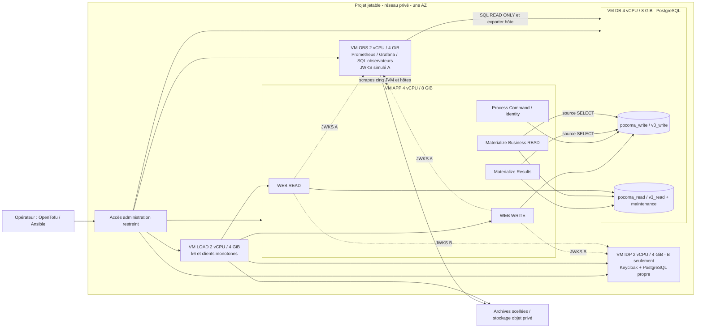

# L7.4 — Cadrage et conception de l'infrastructure A/B SPEC-09

13 novembre 2026 — `GO_L7_I4_AB_INFRASTRUCTURE_SCOPING`.
Référence : `bc562aeb`, `feat/v3-architecture`. Documentation uniquement.

## 1. Résultat et ordre de conception

**Verdict : `READY_WITH_EXPLICIT_DECISIONS`.** Construire un laboratoire
temporaire Scaleway en une AZ, avec **deux VM métier 4 vCPU/8 GiB**, une VM de
charge, une VM d'observation et une VM Keycloak uniquement en B. A et B passent
successivement sur les mêmes VM métier, restaurées entre chaque passage.
PostgreSQL WRITE et READ sont deux bases distinctes d'un même cluster sur la VM
DB. Les cinq processus Pocoma sont sur la VM APP. Ce choix respecte le socle
4/8+4/8 et évite les variations entre deux flottes simultanées.

La [reconstitution du contrat](L7_I4_AB_Infrastructure_Contract_Reconstruction.md)
est le préalable à ce choix : vingt exigences transversales et les treize
familles, seuils et modalités encore proposés y sont séparés.
L'[inventaire](L7_I4_AB_Infrastructure_Inventory.md) identifie les composants à
réutiliser et les écarts à corriger. Aucun contrat ni fichier applicatif n'est modifié.

Les décisions humaines indispensables sont : **autoriser la prochaine mission
et son budget**, puis **ratifier le protocole SPEC-10 §24.6 avant mesure**.
Ni compte cloud ni dépense ne sont autorisés par le présent cadrage. La création
des VM est faisable ; elle ne garantit pas que Pocoma tiendra ses SLO.
L7.3 reste NOT_CERTIFIED, L7.4 non certifié, L7.5 BLOCKED, L7 OPEN. Les treize
familles restent NOT_RUN. L8 reste hors exécution.

## 2. Comparaison des trois options

La machine locale de référence est le **Mac M4 ARM64/16 Go du mandat**. Les
10CPU/~7,75GiB Docker sont un constat historique L7.4, pas une nouvelle sonde.

| Critère | A — Docker local sur Mac | B — VM locales | C — VM Scaleway temporaires |
|---|---|---|---|
| Socle PostgreSQL4/8 + APP4/8 | Non : une seule VM Docker partagée, même avec quotas de conteneurs | Deux VM possibles techniquement, mais16GiB invités absorbent déjà toute la RAM physique, avant macOS/hyperviseur/auxiliaires | Deux VM de taille exacte disponibles au catalogue ; capacité de zone/quota à vérifier avant futur apply |
| CPU | Partage avec macOS et pile existante ; quota ≠ cœur isolé | vCPU invités sur mêmes cœurs M4, scheduling et éventuels cœurs hétérogènes ; pas de réservation physique déduite du nombre de vCPU | Famille dédiée proposée pour réduire l'overcommit ; conserver modèle CPU/steal/throttling et variabilité réelle |
| Mémoire | Réduire quotas pour démarrer changerait le contrat | Compression/swap de macOS invaliderait la comparabilité ; pas de surallocation acceptable comme preuve |8GiB par VM métier ; overhead noyau/agents explicité, pas de swap actif caché |
| Images et JVM | ARM64 natif faisable, E1 l'a démontré pour Java/PG ; toutes images exactes à vérifier | Ubuntu ARM64 + Docker Engine ; même obligation de digests natifs | linux/amd64 natif proposé ; images/JAR scellés ; pas de comparaison de chiffres ARM et x86 comme si matériel identique |
| Disque/réseau | Disque virtuel macOS partagé, caches et I/O des autres apps | Deux disques virtuels mais même SSD/contrôleur ; réseau virtuel partagé | Volumes PG, métriques et IdP distincts ; réseau privé même AZ ; stockage réseau et hyperviseur restent des variables à observer |
| Reproductibilité | Bonne pour qualification d'outillage, mauvaise pour allocation contractuelle sur cette machine | Meilleure séparation système, ressources physiques insuffisantes ici | Provisioning/versionnement possibles ; même flotte séquentielle et restauration réduisent les biais |
| Usage retenu | Préparation documentaire, tests offline et futurs contrôles de banc bornés | Répétition Ansible/Compose sur petites VM de développement, hors qualification SPEC | Qualification contractuelle sous gates de métrologie |
| Coût / effort indicatif | Aucun achat cloud ; temps de développement ; aucun PASS A/B | Aucun achat cloud ;1–2 jours pour un environnement de répétition, sans résoudre16Go |≈0,51€/h tout laboratoire B,≈85€ HT/semaine hors archives ; effort détaillé §10 |

**Conclusion sur le besoin cloud :** il résulte de l'insuffisance des moyens
disponibles pour le contrat, pas d'une exigence SPEC-09 d'utiliser un cloud.
Deux machines Linux réservées4/8 plus des auxiliaires, ou un hôte Linux plus
grand avec VM réellement réservées et I/O qualifiées, pourraient satisfaire le
contrat. Pour un achat local futur, viser au moins32GiB pour deux VM et l'hôte,
plutôt48–64GiB avec auxiliaires ; c'est une estimation de capacité, pas une
nouvelle exigence normative. Aucun achat de Mac n'est recommandé pour ce lot.

Multipass est une option de répétition : son backend macOS documenté utilise
QEMU/Hypervisor ; l'architecture native, les versions et ressources doivent être
fixées. OpenTofu n'apporte pas de capacité supplémentaire à Multipass. Pour
quelques VM locales, CLI Multipass/cloud-init puis inventaire Ansible sont plus
simples qu'un provider communautaire non qualifié. [Documentation Canonical](https://canonical.com/multipass/docs/latest/how-to-guides/install-multipass/).
Docker sait émuler une autre architecture, avec un coût potentiellement élevé :
exclure cette voie des mesures de certification. [Documentation Docker](https://docs.docker.com/build/building/multi-platform/).

## 3. Architecture cible et isolation des passages

Le schéma décrit une cible, aucun de ces nouveaux objets n'a été créé.
Docker Compose orchestre **sur chaque hôte** ; il ne fournit pas le réseau
multi-hôte. JDBC/HTTP/JWKS passent par les IP/DNS privés des VM, sans bridge
Docker étendu, Swarm ou Kubernetes. Un cluster PG avec deux bases conserve
les transactions/autorités séparées et partage l'enveloppe contractuelle DB.
Deux PG4/8 supplémentaires modifieraient le socle mesuré ; pas d'ajout implicite
de réplica, HA, cache, broker ou load balancer dans le chemin de mesure.

**Commun et réutilisé :** VM APP/DB/LOAD/OBS, AZ, modèle CPU, image OS,
réseau et disques de même classe/taille ; digests applicatifs et paramètres
métier identiques ; ordonnanceur, oracles et méthode de mesure identiques.
Le monitoring et la charge sont sur deux VM différentes.

**Isolé par répétition :** projet/namespace Compose, bases restaurées,
répertoires de données/mesures, clés d'idempotence, sujets synthétiques,
état des baux/checkpoints, état de cache/JVM et realm Keycloak. La VM IDP a
sa propre DB et son propre volume ; elle ne consomme jamais les4/8 de DB/APP.
En A, issuer RSA/JWKS sur OBS et jetons générés avant fenêtre ; en B,
issuer Keycloak. Les claims/audiences et permissions Pocoma restent cohérents.

**Ordre :** une seule campagne active ; paires Registration A/B alternées
A→B, B→A, A→B sur au moins trois paires avec restauration avant chaque membre.
Si les trois paires montrent une dérive d'ordre, ajouter une paire équilibrante
en la déclarant avant poursuite ; ne pas éliminer les runs défavorables.
B ciblée ne multiplie pas automatiquement les treize familles.
Pour la comparaison Registration, tokens réels B acquis avant la fenêtre,
scénario F01-E identique ; parcours login/code et Registration/Unlink intégrés
F01-F dans des runs B distincts. Pas de soustraction de p95 pour isoler OIDC.

## 4. Dimensionnement initial concret

Choix proposé : **COMPUTE3-X4C-8G pour DB et APP**, même AZ PAR-1 sous réserve de
capacité. Les caractéristiques publiées sont4vCPU dédiés/8GiB, x64 ; auxiliaires
COMPUTE3-X2C-4G. Une VM dédiée au rôle n'implique pas un serveur physique entier
réservé. [Fiche Scaleway](https://www.scaleway.com/en/docs/instances/reference-content/instances-datasheet/).
Ne pas substituer un BASIC partagé ou une VM16GiB limitée artificiellement sans
déclarer et qualifier la variante. Si capacité absente : attendre ou étudier une
autre AZ/offre homogène4/8 avant mesure ; aucun obstacle imposant un autre fournisseur
n'est identifié dans cette analyse publique.

| Hôte | Ressources proposées | Disque provisionné initial | Rôle et réserves |
|---|---|---|---|
| DB |4vCPU dédiés,8GiB |30GB OS +300GB données Block5K | Un PG17.11 WRITE+READ ; stockage persistant, WAL/fsync réels ;300GB capacité initiale à qualifier, pas promesse pour10M |
| APP |4vCPU dédiés,8GiB |30GB | Cinq processus, quatre images runtime ; pas de Maven/build pendant campagne |
| LOAD |2vCPU dédiés,4GiB |30GB | k6/clients, journaux ; augmenter cet auxiliaire si limité et requalifier la mesure, sans toucher DB/APP |
| OBS |2vCPU dédiés,4GiB |100GB | Prometheus/Grafana, réconciliation SQL, archives temporaires, issuer A ; coût de collecte mesuré |
| IDP, B |2vCPU dédiés,4GiB |30GB | Keycloak26.7.0 et PG propre ; ressources isolées initiales à valider par parcours ciblé |
| Archives | Objet privé,200GB moyens budgétés | Hors chemin métier | Manifeste, bruts compressés, snapshots sélectionnés ; consommation réelle comptabilisée |

A :4VM/12vCPU/24GiB,490GB de volumes. B :5VM/14vCPU/28GiB,520GB.
Les OS/agents consomment une partie de ces enveloppes ; ils ne sont pas un
prétexte pour augmenter les deux VM métier après un FAIL.

### 4.1 Répartition APP et paramètres conservés

Point de départ D : `Xms128m`, SerialGC et réglages de concurrence de la recette
actuelle conservés ; caps mémoire WEB WRITE768MiB/heap384MiB, WEB READ1GiB/heap512MiB,
Process1GiB/heap512MiB, Results1GiB/heap512MiB, Business2GiB/heap1GiB.
Total caps5,75GiB et heap2,875GiB ; environ2,25GiB pour OS/Docker/native/marge.
Ce sont des hypothèses de préqualification ; les max RSS/GC/native du grand profil
doivent confirmer leur viabilité avant de les sceller. Partage des4CPU par scheduler
hôte, sans quotas0,5CPU hérités d'E1 ni somme de réservations >4 ; budget CPU total
et poids relatifs figés dans le reçu. Pas de cinquième VM applicative cachée.

| Processus | Profil / module | Participants et limites de recette |
|---|---|---|
| WEB WRITE | `v3-http-admission` / runtime-web-write | Admission SQL principal dédié, maximum4/minimum-idle1 |
| WEB READ | `v3-http-read` / runtime-web-read | Principals query/status distincts ; limites READ existantes, pas relèvement opportuniste du sémaphore |
| Command/Identity | `v3-consumption-worker-dev` / runtime-worker-process | worker-limit2, Command2/IdentityRequest2 ; pools Business4/Control8 |
| Results | `v3-read-worker` / runtime-worker-materialize | worker-limit2 ; MaterializeCommandResult2/IdentityRequestResult2 ; Source4/Business4/Control8 |
| Business READ | même profil/module Materialize | worker-limit3 ; PotVersion/Balance/Visibility/CurrentBinding/Invitation2 chacun ; Source5/Business5/Control9 |

Trois Workers : quantum4, partitions0..3 par Consumption, batch32, polling2/20/50ms,
claim60000ms, lease240000ms, mêmes réglages retry/quarantaine/softCap effectifs.
Ne pas inventer d'override softCap à partir d'une métrique historique ; extraire
les valeurs effectives du build courant. Les propriétés DEV et les tuples
`host,port,database,schema,role,serverAddress,serverPort` sont une protection
d'identité physique à maintenir sur les adresses privées du laboratoire.

### 4.2 PostgreSQL et stockage

PG17.11 est la référence historique récente ; épingler l'image et vérifier
architecture native. Proposition de préqualification : `shared_buffers=2GB`,
`work_mem=4MB`, `maintenance_work_mem=256MB`, `max_connections=100`,
`fsync=on`, `synchronous_commit=on`, `full_page_writes=on`, autovacuum actif.
Les options non mentionnées restent explicites dans l'export complet.
Cette configuration D sera figée A/B ; elle n'est pas imposée par SPEC-09.

Les pools Workers déclarent47 connexions (12+16+19), admission4 ; ajouter
les maxima WEB READ/status **effectifs du build**, observateurs et réserve admin
avant validation de100 connexions. Refuser le démarrage du plan si le budget ne
tient pas ; ne pas prétendre que47 couvre toute l'application.
Mesurer RSS global, mémoire cache OS, mémoire des backends, I/O/WAL et pauses de
checkpoint ; une somme des heaps JVM ne dimensionne pas PostgreSQL.

Le PG géré n'est pas retenu pour ce banc : contrôle de version/config/ACL,
observations physiques et restauration complète plus simples sur VM dédiée.
Ce choix concerne la reproductibilité L7, sans préjuger L8. Le service géré
n'est pas déclaré impossible ou non sûr.

Les300GB ne sont pas une estimation démontrée du jeu10M. Prévoir une variable
de volume300–1000GB, gelée identiquement entre membres A/B d'une paire.
À partir d'un pilote de population, mesurer données WRITE/READ/index/TOAST,
WAL maximal et débit de génération. Dimensionner :

`capacité ≥ données + index + WAL haut observé + espace restauration locale + marge`.

Proposition opérationnelle D : au moins30% libres avant campagne et pendant
construction, arrêt conservateur à franchissement ; ce n'est pas un SLO.
Restaurer depuis objet sans doubler inutilement les données locales. Si une
taille doit changer, refaire le gel, la calibration et les paires affectées.
Block5K exprime un maximum de classe, pas5000IOPS garantis au workload ; relever
latences/throttling effectifs. Pas de tmpfs pour PG contractuel.

## 5. Populations, initialisation et remise à zéro

### 5.1 Catalogue à construire

| Snapshot / fixture | Contenu nécessaire | Contrôle de préparation |
|---|---|---|
| Petit de qualification |5/20, identités et fractions connues | HTTP complet, SQL, oracles négatifs ; aucune conclusion SLO sur petit |
| Moyen nominal/soutenu/pointe |10/100/250 Pots initiaux20/200 selon manifeste | Contenus/versions/grants, participations, bilan exact et distribution partitions ; compter croissance et mutations pendant fenêtre |
| Grand |10 Pots100/2000, jusqu'à200000 participations chacun | Matérialisation réelle et oracles AUD-V3-013, pas JSON seul |
| Identity A/B |1380 EUI fraîches F01-E,780 pour parcours composé F01-F par répétition, plus comparaison A/B séparée | Aucune EUI déjà liée ; mappings rang/EUI/routage scellés et credentials privés |
| Stock G |10000 moyens indépendants matérialisés, puis10000 Commands PENDING ; parc distinct pour nouvelles1/s | Inventaire202↔publication durable, Workers/Discovery effectivement stoppés, aucun effet initial fabriqué |
| Volumes globaux |100/10k,10k/1M,100k/10M Pots/événements | Nombre réel de Pots et événements par famille ; partitions/checkpoints/slots/READ cohérents, âge de l'histoire documenté |
| Profondeurs | Même mutation/composantes sur100/1000/10000 versions | Même harnais, égalité des lignes/histoire transférées selon contrat, plans et index relevés |
| Delete | Cohortes de victimes pour quatre profils, état actif initial connu | ≥300 observations valides par population SLO et répétition ; aucune réutilisation d'un Pot déjà supprimé |

**Delete change fortement la taille du seed.** Le parc10/100/250/10 ne fournit
pas300 suppressions indépendantes. Proposition : un run apparié par palier avec
300 victimes mesurées réparties dans sa fenêtre, en conservant l'offre totale
1/10/50/1s et le reste du stimulus sur des Pots actifs ; warm-up sur parc séparé.
Le nominal et Grand comportent25% de suppressions, B/C environ3,33% ; ces ratios
sont une recette D du run de suppression, pas un mix contractuel inventé.
Pour Grand :300×2000=600000 dépenses initiales ; remettre le même snapshot avant
chaque répétition. La campagne F01-D sans suppression conserve son propre parc.
Si moins de300 suppressions sont valides, pas de PASS de la population, pas de
fusion avec F01-D ni avec un autre palier. Les autres familles n'ont pas un
minimum300 artificiellement ajouté lorsqu'aucun SLO statistique ne leur est attaché.

Le mix D initial pour les runs Pot actifs est un cycle déterministe de100 opérations :
20CreateExpense,20DeleteExpense,20UpdateExpenseFinancials,15UpdatePotDetails,
15UpdateShareholderDetails,10UpdateShareholderWeights, avec variantes multi-cibles
et révisions non financières. Créations/suppressions de dépenses appariées,
préconditions vérifiées, fractions/poids/payers déterministes ; garder un profil
20/200 ou100/2000 initial exact et tracer les écarts en cours de fenêtre.
Ne pas diluer la population CHANGED avec no-op/rejets ; ceux-ci ont leurs propres
contrôles et dénominateurs. Cette proposition couvre la lacune du CreateExpense
seul ; elle doit entrer dans le paquet de protocole ratifié, sans question
humaine distincte sur chaque pourcentage.

Le générateur est ouvert au niveau global, avec au plus une mutation en vol
par Pot indépendant. Dimensionner le parc et les VU sur la durée en vol observée,
incluant sondage : `N ≥ débit × durée en vol + marge`. Une famine n'autorise
pas une baisse silencieuse d'offre ; conserver l'essai comme invalide pour la
charge et redéfinir le parc avant une nouvelle série. La contention F01-H
désactive volontairement cette sérialisation et publie sa concurrence réelle.

### 5.2 Procédure de reset proposée

1. Terminer/arrêter la campagne, conserver toutes les admissions encore suivies,
   drainer ou constater l'incomplétude. Sceller les preuves avant destruction.
2. Stopper les cinq processus de **ce seul laboratoire** ; vérifier absence de
   connexions applicatives et d'ancien orchestrateur. Ne pas agir sur la pile locale.
3. Restaurer ensemble WRITE+READ depuis un snapshot obtenu à l'arrêt de tous
   les writers, PG arrêté proprement pour snapshot physique, ou dumps cohérents
   après quiescence. Deux snapshots pris indépendamment sous écritures ne sont
   pas un état initial apparié. Restaurer le realm/DB IdP séparément en B.
4. Redémarrer depuis volumes restaurés neufs ou clone vérifié ; mêmes schémas,
   ACL, objets et statistiques ANALYZE. Garder le mécanisme CURRENT V3 ; aucun
   bootstrap V2 historique, ni prétendue baseline TRUSTED. Ne pas simplement
   sauter le bootstrap parce qu'une table existe.
5. Contrôler empreintes sémantiques des lignes/données, comptes exacts par
   famille/version/Consumption/partition, état READY, backlog attendu et
   checkpoints. Pour G, état spécifique PENDING10000 vérifié séparément.
6. Vérifier leases expirées naturellement si elles sont présentes dans l'image,
   ou snapshot créé après arrêt et expiration ; jamais modifier leurs échéances.
   Aucun DELETE de slot ni terminalisation administrative pour rendre le seed sain.
7. Redémarrer JVM neuves ; appliquer même warm-up et politique de cache aux
   deux membres. Créer nouveau run, namespace de métriques et répertoire neuf.
   Publier le reçu d'état initial ; le watchdog autorise ensuite la fenêtre.

Une restauration hashée physiquement prouve les octets conservés ; l'égalité
sémantique après démarrage exige les contrôles SQL/HTTP et les paramètres.
La disparition des slots au reset n'est recevable que parce qu'on remplace
tout un environnement synthétique déjà archivé, jamais comme une fin de traitement.

## 6. Provisioning simple et reproductible proposé

**OpenTofu + Ansible + SOPS/age + Compose** est retenu comme petite couche externe.
Le provider Scaleway prend en charge Terraform/OpenTofu et le réseau privé.
[Guide officiel](https://www.scaleway.com/en/docs/terraform/quickstart/).
Aucun module/playbook n'est créé pendant cette mission.

| Couche future | Responsabilité | Critère de simplicité / preuve |
|---|---|---|
| OpenTofu | Projet/labels, VM, réseau privé, interfaces/règles, volumes, gateway/IP et bucket de laboratoire | Petit module machine réutilisé par rôle ; état de ressources séparé des campagnes ; versions/provider lockés ; plan revu avant apply |
| cloud-init minimal | Compte SSH et Python nécessaires à Ansible | Pas de secrets métier, bootstrap application ou logique de benchmark cachés |
| Ansible | OS/chrony, Docker/Compose, mounts, pare-feu, config/permissions, images, bootstrap SQL, exporter, observabilité | Inventaire issu des outputs ; templates des cinq rôles existants ; second passage sans dérive ; handlers hors fenêtre |
| SOPS/age | Secrets de laboratoire chiffrés ; clé privée age hors Git | Déchiffrement sur contrôleur, transferts0600, `no_log`, fichiers temporaires privés ; rien dans stdout, state, image ou user-data |
| Compose par hôte | PG, cinq runtimes APP, observabilité OBS, Keycloak/PG IDP | Digests natifs, project unique, labels de propriété, healthchecks et restart policies déclarés ; réseau privé au niveau VM |
| Ordonnanceur externe | prepare/preflight/warm-up/run/drain/collect/reset/repeat | Réutiliser les adapters actuels et compléter les manques ; un fichier de campagne et un reçu par phase, pas un nouveau moteur métier |

SOPS prend en charge age. [Documentation SOPS](https://getsops.io/).
Les plans/state OpenTofu sont sensibles et doivent être chiffrés avec clé
sauvegardée ; le chiffrement ne protège ni du rejeu d'un ancien state ni de
l'opérateur autorisé. Pour un seul opérateur, state local chiffré sauvegardé
et verrou de campagne suffisent ; backend distant avec verrou qualifié seulement
si nécessaire. [Documentation OpenTofu](https://opentofu.org/docs/v1.13/language/state/encryption/).
Un `--check` Ansible est une simulation dépendant des modules ; il ne remplace
pas le second passage et la reconstruction réelle. [Documentation Ansible](https://docs.ansible.com/projects/ansible/latest/playbooks_checkmode.html).

Cycle de vie à implémenter sous prochain mandat : **plan → create → configure →
deploy → prepare → preflight → warm-up → run → drain → collect/seal → reset →
repeat → export → destroy → inventory-empty**. Les noms sont des opérations
attendues, pas des commandes CLI promises déjà disponibles. Pas de Kubernetes :
aucune exigence de scheduling dynamique/HA ne justifie son coût ici.

Après export vérifié, détruire VM, volumes de travail, gateway et IPv4, puis
inventorier les ressources restantes et coût résiduel. Préserver seulement les
archives désignées par la politique de conservation ; leur bucket/état ne doit
pas disparaître avec le destroy du calcul. Éteindre une VM ne prouve pas l'arrêt
de facturation des volumes/IP/snapshots. Étiquettes owner/mission/expiry,
budget et échéance contrôlés hors du système testé.

## 7. Réseau, secrets et preuves

Un réseau privé dans la même AZ, DNS privés stables ; seuls les flux nécessaires
entre rôles sont ouverts : LOAD→WEB/API et OIDC, APP→PG/JWKS, OBS→management/PG,
administration SSH depuis point d'entrée restreint. PG n'a pas d'IP publique.
Les WEB/Actuator/Grafana ne sont pas exposés au public ; administration par SSH
via gateway/bastion documenté. Le client de mesure est LOAD, pas le Mac sur WAN.
Recette proposée : une seule IPv4 sur la gateway, redirection SSH vers OBS
restreinte à l'IP de l'opérateur, puis `ProxyJump` OBS vers les IP privées des
autres VM. Aucun bastion VM supplémentaire dans le coût ; ne pas administrer
le laboratoire pendant une fenêtre évaluée. Vérifier cette connectivité et
ses refus effectifs en I1 avant de retirer toute voie de secours.
Le NAT100Mbps ne transporte pas le trafic métier privé ; imports/pulls/exports
passent hors fenêtre. Pas de proxy/TLS additionnel dans un seul membre A/B.

Prévoir filtrage stateful sur interfaces privées si supporté par le provider
épinglé, complété par pare-feu hôte ; tester les règles effectives, y compris
Docker publié. Les security groups publics seuls ne décrivent pas l'isolation
interne. [Règles privées Scaleway](https://www.scaleway.com/en/docs/instances/reference-content/understanding-security-groups-private-network-interfaces/).

Secrets séparés : admin bootstrap, rôles SQL runtime, observateurs SELECT bornés,
clés d'admission, issuer/JWT A, credentials/realm B, accès objet et SSH.
Les observateurs n'ont ni autorité de traitement ni rôle superuser ; seules
les vues statistiques nécessaires leur sont accordées. Le bootstrap révoque
les identifiants de développement en fin de préparation. Capturer la configuration
publique et l'empreinte d'une version de secret, jamais le secret ni son hash
faible entropie. Ne pas publier JWT, bindingToken, mots de passe ou état IdP brut.

Les archives sont indépendantes des résultats métier et du processus Worker :
LOAD écrit le journal des intentions/admissions ; OBS collecte les états SQL,
scrapes, ressources et diagnostics même si la campagne échoue. Dossiers immuables
par run, manifests SHA-256 des octets stockés/originaux, gzip déterministe,
statut d'arrêt et chaînes de provenance. Les gros dumps/séries restent dans
objet privé ; Git reçoit rapports/manifestes et extraits admissibles selon la
[rationalisation des preuves](../testing/Certification_Evidence_Rationalization.md).
Vérifier téléchargements et décompression avant destroy ; contrôler aussi le
rejet d'une copie altérée. Aucun hash ne prouve seul l'authenticité de l'exécution.

## 8. Métrologie, biais et critères de qualification du banc

### 8.1 Temps, populations et attribution

Même client et même domaine monotone pour envoi/admission/premier jalon.
Le commit durable est dans l'intervalle envoi–réception202 : pour observation O,
`O−réception202 ≤ latence réelle ≤ O−envoi`. Le premier sondage réussi donne
une borne supérieure d'observation du jalon, pas l'instant de son commit.
Pour sondes SQL/HTTP exécutées par des processus différents, utiliser des RPC
sur un client coordinateur monotone (bornes aller/retour conservées), ou un
domaine monotone commun qualifié ; ne jamais soustraire deux `nanoTime` distants.

Publier les deux distributions de bornes avec les non-succès ; PASS uniquement
si borne conservatrice du p95 ≤SLO et toutes conditions satisfaites ; FAIL si
dépassement prouvé par borne basse ; INCONCLUSIVE si l'incertitude chevauche le
seuil. Cette règle conservatrice de protocole, déjà utilisée F01-E, ne déplace
pas les seuils. Le sondage25ms reste initial/calibrable. Les4xx/503/incomplets,
retards injecteur et censures ne disparaissent pas ; les bornes connues des
censures peuvent démontrer FAIL, jamais être exclues pour afficher un PASS.
Adopter et sceller la méthode de percentile par rang supérieur ; publier p50/p95/p99,
effectifs, censures et incertitude par run et population. Ne pas additionner
les p95 et ne pas moyenner les runs pour effacer FAIL.

UTC synchronisé via chrony pour corrélation multi-hôtes, état de synchro et
offset enregistrés début/fin ; pas de SLO calculé par soustraction d'horloges
murales. Prometheus porte role/instance/experiment et les fenêtres de run ;
aucun token/Pot/EUI/requestId dans les labels. Les IDs synthétiques détaillés
restent dans les journaux privés de rapprochement.

### 8.2 Contrôles des biais

| Biais | Mesure et contrôle prévus | Conséquence |
|---|---|---|
| CPU contendu / cloud variable | Modèle/topologie CPU, steal, fréquence si exposée, run queue, cgroup throttled time, CPU hôte et processus ; mêmes VM pour paires | Bruit injecteur/collecteur invalide la charge ; saturation de APP/DB sur configuration admissible reste un résultat produit, pas un motif d'exclusion automatique |
| Pression mémoire | RSS/cgroup/PSI, faults, swap in/out, mémoire disponible, GC/heap/native par JVM et PG | Distinguer seuil de sécurité du SLO ; arrêt/OOM documenté, aucune mémoire ajoutée en cours de run |
| Disque / I/O | iostat/exporter, latence/queue/IOPS/débit, fsync/WAL/checkpoints, classe/volume PG constants | Pas d'export/restauration/build concurrent ; saturation PG valide reste mesurée |
| Cache PG/OS | Restauration identique, redémarrage PG et JVM selon même procédure, ANALYZE identique, warm-up documenté, buffers hit/read | Résultats régime chaud ratifié ; cold-start séparé exploratoire ; pas de cache vidé d'un seul côté |
| JIT et JVM | Même JDK/GC/options/heap ; CPU compilation/GC et courbes warm-up conservés | Pas de sélection après coup d'un plateau favorable ; warm-up supplémentaire impose nouveau protocole et série |
| Réseau | Même AZ/chemins, RTT/pertes/jitter, erreurs et temps HTTP/SQL, MTU ; horloges synchronisées | Aucun plafond inventé ; perturbation externe attribuée, fenêtre invalidée conservée si non interprétable |
| Générateur colocalisé ou limité | VM LOAD distincte, planned/started/offered/admitted, lag, dropped, VU, sockets, file d'intentions et famine par Pot | Toute offre manquante invalide la preuve de ce palier ; ne pas déduire plafond serveur |
| Observateur saturé | File de sondes, échéances prévues/réelles, temps SQL/scrape, couverture IDs, trous/timeout | Signal absent devient inconnu ; pas de zéros/faux PASS par défaut ; borner concurrence et ajuster hors run |
| Surcharge du monitoring | Préqualification appariée collecte minimale/collecte complète, mêmes données/offre, ordres alternés ; coûts CPU/IO/SQL/latence | Mesurer différence et incertitude ; aucune pénalité « négligeable » supposée sur simple `collectorMs` |
| Perturbation des oracles lourds | EXPLAIN/JDBC/allocations/JSON sur essais diagnostiques distincts, même build/profil ; sondes légères seulement en SLO | Plans AUD-V3-013 indispensables mais pas EXPLAIN ANALYZE de toutes écritures dans les runs SLO |
| Contamination entre runs | Restore cohérent, répertoires neufs, manifeste initial, absence process résiduels, namespace métriques | Refus avant injection si divergence ; quarantaines et non-terminaux archivés, jamais purgés pour conclure |
| AuthN/IdP | Tokens valides sur fenêtre+drain, JWKS et issuer corrects, acquisition hors ordinary Command ; état Keycloak neuf en B | Coût OIDC distinct, pas renouvellement/login implicite à chaque Command ni secret en preuve |

La calibration de collecte compare un observateur minimal nécessaire à la
mesure à l'observabilité complète ; « sans aucune mesure » ne permettrait pas
de comparer les latences. Pas de seuil d'overhead numérique inventé : documenter
les deltas et leur incertitude face aux SLO, ajuster avant ratification si la
précision ne suffit pas. Les garde-fous RAM92%, lag100ms et délai8s d'E1 ne sont
pas repris comme SLO globaux. Seuils d'arrêt D à calibrer et sceller au pilote.

### 8.3 Sûreté et stabilité indépendantes

Rapprocher offre planifiée→tentatives→admissions durables→résultats WRITE→résultats
READ→versions/effets attendus, par ID/version et non par totaux seulement.
Deux états orthogonaux : validité métrologique et exactitude métier ; un bon
p95 ne compense jamais une violation. Contrôler positions denses/compteurs,
checkpoints monotones, toutes balances actives exactes, visibilité indépendante,
slots drainés correspondant aux succès et quarantaines conservées.

Proposition de stabilité D à préenregistrer : séries5s source/slots/âge par
Consumption, régression sur la fenêtre évaluée entière après warm-up et sur
trois sous-fenêtres égales, intervalle d'incertitude et débits terminaux.
Une tendance positive persistante démontrée est FAIL stabilité ; une pente
non distinguable du bruit avec âge croissant reste INCONCLUSIVE. Étendre par
ENDURANCE déclarée si nécessaire ; aucun epsilon de pente ou seuil d'âge
« acceptable » n'est ajouté. Une file bornée de slots ne démontre pas la stabilité
de la source. F01-G requiert une observation de convergence incluse dans300s ;
observer simplement la fin à310s n'établit pas la fin avant300s.

La comparaison A/B publie deltas/ratios par paire, distributions et intervalle
d'incertitude calculé par unités de répétition, sans considérer toutes les
requêtes corrélées comme répétitions indépendantes. Trois paires donnent une
incertitude à signaler ; pas de marge d'équivalence contractuelle trouvée.

## 9. Coûts publics et modèle de budget

Tarifs consultés le **13 novembre 2026**, Paris/PAR-1 affiché, euros HT, sans
engagement/remise. Ce sont des prix publics et un calcul de conception, pas un
devis ni une disponibilité de compte attestée. Revalider au futur plan/apply.

| Poste | Quantité B | Prix unitaire HT | Sous-total horaire |
|---|---:|---:|---:|
| COMPUTE3-X4C-8G |2 |0,117€/h |0,234€ |
| COMPUTE3-X2C-4G |3 |0,0585€/h |0,1755€ |
| Block5K, OS/données/OBS inclus |520GB |0,000130€/GB/h |0,0676€ |
| Public Gateway S |1 |0,026€/h |0,026€ |
| IPv4 gateway |1 |0,005€/h |0,005€ |
| Réseau privé |1 |gratuit |0€ |
| **Total B** | | |**0,5081€/h** |
| **Total A**, sans IDP ni son volume30GB | | |**0,4457€/h** |

Sources : [calcul](https://www.scaleway.com/en/pricing/virtual-instances/),
[réseau](https://www.scaleway.com/en/pricing/network/),
[stockage](https://www.scaleway.com/en/pricing/storage/).
Le calcul n'inclut pas automatiquement stockage/IP ; ceux-ci sont ajoutés
explicitement. Pas de coût DB managée, Cockpit, registry ou load balancer dans
cette proposition ; images transférées avant campagne. Les maxima d'IOPS sont
conditionnels aux caractéristiques du volume et de l'instance.

| Durée allumée, B conservé par prudence |300GB PG données,520GB totaux |1000GB PG données,1220GB totaux |
|---|---:|---:|
|24h |12,19€ |14,38€ |
|72h |36,58€ |43,14€ |
|7jours/168h |85,36€ |100,65€ |
|21jours/504h |256,08€ |301,95€ |
|730h de comparaison budgétaire |370,91€ |437,34€ |

Formule : `heures×(0,4095+0,031+GB_volumes×0,000130)`.
Ajouter archives objet Multi-AZ :200GB moyens×0,000022×730≈**3,21€/mois** ;
snapshot bloc300GB×0,000049×72≈**1,06€** pour72h.
Snapshot1000GB conservé21jours≈24,70€ ; plusieurs copies multiplient ce poste.
Le débit sortant objet est budgété au-delà du quota public75GB/mois à0,01€/GB ;
transferts intra-région selon conditions du fournisseur. [Tarifs stockage](https://www.scaleway.com/en/pricing/storage/).
Conserver un catalogue borné de snapshots ; ne pas multiplier leur rétention
par trois sans l'ajouter au calcul. Coût humain, TVA et éventuels abonnements
préexistants exclus ; aucune dépense effectuée.

**Recommandation d'enveloppe future :** plafond **400€ HT /21jours calendaires**,
avec revues à72h puis7jours, destruction dès preuves consolidées. Le cas prudent
1000GB +un snapshot1000GB21jours +archives représente≈330€ ; marge≈70€ pour
volumes supplémentaires/auxiliaire redimensionné/exports. Si les seeds ou la
rétention dépassent ce modèle, arrêter la préparation et refaire le budget
avant tout dépassement.400€ est une autorisation proposée, pas un objectif de
consommation ni une promesse de couvrir un seed arbitrairement coûteux.

## 10. Durées : campagnes et préparation séparées

Les fenêtres existantes, trois répétitions, donnent un **plancher analytique**
sur une flotte séquentielle, sans seed/restauration/collecte/drain supplémentaire :

| Ensemble | Calcul de temps utile proposé | Total |
|---|---|---:|
| F01-A/B/C/D/E/H |3×(23+20+18+23+23+13)min |6h |
| F01-F parcours composé actuel |3×13min |39min |
| Registration B appariée à F01-E A |3×23min |1h09 |
| F01-G |3×5min au seuil, sans préstock |15min |
| F01-J |3×10min repos, hors commande/suivi |30min |
| ENDURANCE |3×60min, hors warm-up |3h |
| SATURATION |3×6×15min, hors warm-up |4h30 |
| A11-L/M distincts, appariés A/B/C/D |3×(23+20+18+23)min |4h12 |
| **Somme indicative** | Pas une preuve d'exécution |**20h15** |

F01-I n'a pas de durée contractuelle fixée. Réserver provisoirement6–12h pour
les strates globales/profondeurs/AUD-V3-013 et les répétitions diagnostiques,
après mesure du pilote. Compter **30–48h de flotte pour les campagnes** avec
restaurations, contrôles, collecte, warm-up complémentaires et drainage,
hors construction des seeds ; davantage si l'endurance/sondage exige prolongation.
Les anciens7–12h L7.4 ne couvrent pas cette enveloppe complète avec tous les
compléments. Chaque échec reste conservé ; pas de réserve de temps pour le
rejouer inchangé jusqu'à PASS.

**La préparation peut coûter des jours :**10000 moyens demandent au moins
10000×202=**2020000 commandes** structurelles par le préparateur courant,
avant stock10000 et vérification ; à10/50 commandes utiles/s hypothétiques,
cela prendrait56,1h/11,2h. À1/s :23,4jours. Ces débits sont des scénarios
arithmétiques de préparation, aucune capacité mesurée revendiquée.
Les300 Grands Delete demandent600600 commandes structurelles :16,7h à10/s
ou3,34h à50/s. Les snapshots peuvent être réutilisés entre répétitions après
restore validé ; ne pas reconstruire le seed à chaque tir.

Pour10M événements, mesurer le ratio effectif événements/commande du scénario
de construction : `temps=10M/(ratio×débit utile)`, plus matérialisation/contrôles.
À titre de sensibilité, ratio2 et10/50cmd/s donnent138,9h/27,8h.
Le ratio2 n'est pas un contrat : les familles/publications réelles doivent être
comptées et ne pas être complétées par faux événements administratifs.
Le générateur actuel historique80Expenses/Pot et ses estimations ne suffisent pas.
Avant le gros seed, pilote de taille intermédiaire, mesure du stockage, coût
du générateur, restore et oracles ; paralléliser entre Pots en respectant leurs
préconditions. Toute voie bulk future demande une preuve sémantique propre ;
pas de loader historique réactivé ou de contournement des moteurs dans ce plan.

**Effort d'ingénierie estimatif :8–13jours personne** pour provisioning et
compléments du banc, puis1–2jours de consolidation/audit documentaire. Délai
calendaire cible **2–3semaines après GO**, dépendant surtout des seeds et du
pilote ; pas d'engagement d'exécuter10M dans21jours sans débit préparateur connu.
Les arrêts de budget et inconnues de capacité restent explicites.

## 11. Plan d'implémentation incrémental et gates

Tout ce tableau est **prospectif et non exécuté**. Le GO de cadrage n'autorise
ni apply, ni seed, ni pilote. Les étapes techniques ne nécessitent pas chacune
une nouvelle décision humaine si le prochain mandat et son budget les couvrent.

| Étape | Travail / effort indicatif | Sortie reviewable et condition pour continuer |
|---|---|---|
| I0 — gel et protocole |0,5–1j ; comparer références au prochain HEAD, figer versions/digests et manifeste | Périmètre, budget et paquet SPEC-10 ratifié ; toute nouvelle modification applicative redéclare ses slices avant code |
| I1 — infrastructure minimale |1–2j ;2VM métier, LOAD/OBS, réseau/stockage, secrets, bootstrap, cinq processus ; IdP B ensuite | Inventaire ressources effectives, ACL/health/READY, absence exposition publique, hôtes natifs, plan de destruction ; pas de benchmark |
| I2 — qualification de l'infrastructure et du banc |3–5j ; reset/rebuild laboratoire, second passage Ansible, restore cohérent ; adapters distants/mix/sondes/metrics ; controles discriminants offline puis physiques bornés | Deux reconstructions identiques en état sémantique ; tests rejet wrong-host/mauvais seed/secret/missing metrics/dropped/censure ; Balance V≠W/Delete vrai ; calibration charge/observateur, pas encore de PASS SPEC |
| I3 — première campagne pilote |1–2j de travail, temps de préparation séparé ; petit puis moyens/grands et strates intermédiaires | Offre tenue, sondes/oracles sensibles, coûts/stockage/initial state confirmés ; protocole scellé avant pleine campagne ; pas extrapolation pilote→SLO |
| I4 — campagnes SPEC-09 complètes |2–3j de suivi +temps machine §10, snapshots réellement10M et10000moyens |13 familles, paires ciblées B, répétitions/populations ratifiées, chaque run PASS/FAIL/INCONCLUSIVE/NOT_RUN ; toute violation garde son statut |
| I5 — consolidation des preuves |1–2j ; réconciliation identités/familles et hashes, exports, rapport par campagne, destroy | Archives récupérables après destruction, manifeste final, aucun coût résiduel imprévu ; dossier présenté à la certification, pas certificat automatique |

Vérification future : si seuls scripts/infra externes sont modifiés, slices
applicatives NONE, contrôles outillage et preuves d'assemblage ciblées.
Si une sonde impose un changement de code, redéclarer avant implémentation :
WEB `./mvnw -pl runtime-web-write,runtime-web-read -am test`, COMMAND
`./mvnw -pl runtime-worker-process -am test`, PROJECTION
`./mvnw -pl runtime-worker-materialize -am test`, FOUNDATION
`./mvnw -pl infra-tx-spring -am test`, selon consommateurs réellement touchés,
depuis `app/`. Changement des dépendances/frontières/isolation : gate architecture
selon §17 de la [politique](../testing/Reactor_Verification_Policy.md).
Full reactor au gate de certification/clôture globale prévu, jamais par défaut
dans ce chantier de provisioning. Packaging et tests ne remplacent pas les oracles externes.

## 12. Risques et conditions d'arrêt

| Risque | Portée / traitement prévu | Résidu et propriétaire futur |
|---|---|---|
| VM4/8 conformes mais SLO échoués | Garder gel et FAIL ; analyser cause, corriger dans mandat séparé si nécessaire | Responsable performance ; infrastructure ne garantit aucun gain logiciel |
| Seeds10M/10000moyens trop coûteux | Pilote temps/espace et cap400€/21j ; catalogue restore ; pas de fausse population | Responsable banc ; replanifier avant dépassement, NOT_RUN si absent |
| Delete/Balance/âges/JDBC insuffisants | I2 bloquant pour profils concernés ; instrumentation minimale et observations indépendantes | Responsable métrologie ; pas de campagne déclarée complète avec métrique manquante |
| Comparaison A/B contaminée | Flotte séquentielle, restore complet, ordre alterné, tokens préacquis pour paire | Responsable campagne ; variabilité résiduelle et incertitude publiées |
| Cloud CPU/disque/réseau variable | Famille dédiée, même flotte/AZ, séries hôte/PG, gel ressources | Responsable infrastructure ; perturbations documentées sans exclure saturation produit légitime |
| Perte de preuve/dépense après arrêt | Scellement, miroir vérifié hors calcul, rétention explicite, destroy+inventaire | Responsable infrastructure ; bucket/snapshots retenus restent payants |
| Secret ou pouvoir administratif excessif | SOPS/age, `no_log`, séparation bootstrap/observe/runtime, test permissions | Responsable sécurité du laboratoire ; aucune homologation opérationnelle L8 |
| Héritage purge/terminalisation | Drivers désactivés conservés, remplacement environnement complet seulement | Responsable sûreté ; limites L7.3 toujours ouvertes |
| Écart code/hypothèses pendant préparation | Comparer SHA, SQL/config/JAR et redéclarer portée avant poursuivre | Responsable certification ; refaire les preuves effectivement invalidées |

Arrêt immédiat sur cible non possédée/identité incorrecte, invariant critique,
collecteur indispensable absent, générateur incontrôlé, provenance dérivée,
risque disque/mémoire ou plafond de dépense/temps. Préserver sortie et attribuer
FAIL/INCONCLUSIVE ; jamais retry automatique, purge ou hausse des ressources
métier pendant fenêtre.

## 13. Réemploi L8 sans engagement L8

| Réutilisable après qualification L7 | Limite L7 | Travail opérationnel L8 distinct |
|---|---|---|
| Module VM/réseau/volumes, inventaire Ansible | Laboratoire mono-AZ temporaire | Topologie release et disponibilité/quotas/scale-out à décider |
| Rôles Docker/OS et déploiement des quatre images/cinq processus | Gel reproductible pour mesures | Distribution Monolith prioritaire et distribuée si annoncée, parité/installation vierge |
| SOPS/age, SSH et ACL du laboratoire | Identités synthétiques, droits bornés | Rotation, cycle de vie accès, DNS/TLS/proxy, fournisseur AuthN exploitable |
| Prometheus/Grafana/exporters et sauvegarde des configs | Signaux/métrologie de qualification | Alerting, rétention production, astreinte/runbooks et sécurité d'exploitation |
| Snapshot/restore, inventaire/destroy/reconstruction | Reset synthétique, pas de migration V2 ni baseline TRUSTED | Backup/restauration opérationnels, migrations/upgrade et certification baseline si décidée |
| Manifestes et preuves scellées | Mesures attribuées à un gel précis | Provenance release et qualification installation réelle, nouvelle mesure si coût/topologie changent |

Le [plan directeur §7](V3_Implementation_Master_Plan.md) et le
[plan L7.1 §§10–11](L7_I1_Certification_Coverage_and_Execution_Plan.md)
gardent leur autorité. Préparer des briques portables ne vaut pas certifier L8
ni déplacer ses exigences dans le chemin de benchmark L7.

## 14. Vérification documentaire de cette mission

Portée déclarée **NONE / documentaire**, primaire/secondaires NONE ; impact
productif interdit et observé : aucun. Vérifications prévues puis consignées
dans le [reçu documentaire](L7_I4_AB_Infrastructure_Documentary_Verification.json) :
couverture des13 familles et31 exigences existantes, liens locaux du dossier,
coûts/durées arithmétiques, intégrité des405 artefacts historiques, absence de
diff sous `app/`, `scripts/`, `docker/` et les preuves historiques,
`git diff --check`, publication sans force et contrôle de synchronisation.
Le contrôle d'intégrité est une relecture d'octets, pas une nouvelle exécution E1/E3.

Aucune commande Maven, SQL, Docker, k6, OpenTofu, Ansible ou Multipass exécutée ;
aucun bootstrap/migration ni charge. Franchissement inattendu : NONE.
Gate globale architecture : NOT REQUIRED. Full reactor : NOT RUN / NOT REQUIRED,
mission documentaire sans clôture/intégration globale. Base : NONE.
Les commandes effectivement exécutées et résultats du reçu font foi.

## 15. Verdict et décisions indispensables

**`READY_WITH_EXPLICIT_DECISIONS`** : le contrat permet de construire une cible
concrète. Recommandation : Scaleway temporaire, deux COMPUTE3-X4C-8G métier,
LOAD/OBS séparés et Keycloak2/4 isolé en B, PG WRITE/READ dans la même VM dédiée,
OpenTofu/Ansible/SOPS-age/Compose, passage A/B séquentiel avec snapshots vérifiés.
Coût de flotte B initial≈0,51€/h,≈85€ HT/semaine ; enveloppe prudente proposée
400€ HT/21jours pour gros seeds/stockage et aléas. Mise en place du socle1–2jours,
banc et qualification8–13jours personne au total ; seeds à recalibrer au pilote.

Deux actes seulement sont attendus du responsable :

1. **GO du chantier suivant et plafond400€ HT/21jours**, sur un projet/compte
   Scaleway désigné ; aucune création ou dépense avant cette autorisation.
2. **Ratification explicite du paquet de protocole SPEC-10 §24.6**, avec les
   valeurs calibrées préenregistrées avant campagnes ; conserver les SLO,
   ≥3 répétitions et minimum300 valides par population SLO du plan courant.

Les CIDR, templates, versions épinglées, allocation des pools et détails de
collecte sont des choix d'ingénierie à qualifier sous ce mandat, sans solliciter
un arbitrage humain pour chacun. Si un futur demandeur veut un verdict formel
d'équivalence chiffrée A/B, il devra définir sa marge ; l'étude actuelle publiera
les écarts sans en inventer une. Aucune ambiguïté SPEC-09 ne bloque le socle,
aucun PASS de benchmark ou de certification n'est produit par ce cadrage.
