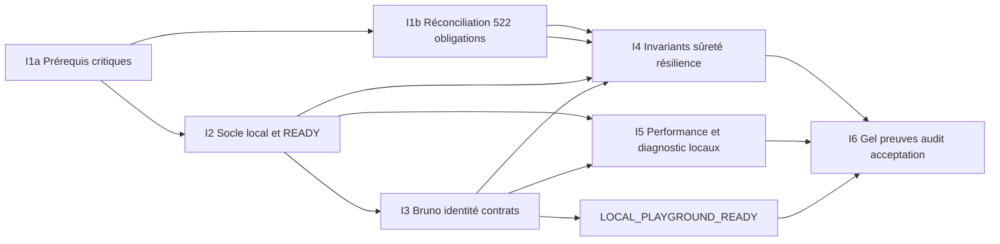

# L7-LB — Plan de convergence incrémental proposé

13 novembre 2026 · [cadrage](L7_Local_Baseline_Scoping_Report.md).
**GO I1a / I2 / I3** — mandat `GO_L7_LB_LOCAL_PLAYGROUND_IMPLEMENTATION`.
Le Jalon 1 est implémenté ; voir le [rapport](L7_Local_Playground_Implementation_Report.md)
et la [qualification](L7_Local_Playground_Qualification_Report.md). I1b/I4–I6 restent distincts.

## 1. Rattachement et chemin critique

Créer un sous-programme **L7-LB — convergence vers la Reference Baseline locale**,
avec identifiants **L7-LB-I1…I6**. Il réutilise les livraisons L7.1…L7.4 sans
les renommer ; ce n'est ni la suite numérique L7.5 ni une autorisation de la
débloquer. Le jalon local garde ses réserves contractuelles externes explicites.
Le mandat actuel déplace le socle local initialement prévu en L8 vers L7-LB,
sans modifier les contrats de sûreté/performance ni acter la clôture de L7.

Chemin Jalon 1 : **I1a → I2 → I3** ; chemin baseline : **I1b/I4/I5 → I6**, I5 rejoignant le gel.
Le risque principal de durée est l'audit writers/SQL indirect et des variantes
partielles, puis les crashs/reprises avec vrais baux. I5 peut devenir critique
si les seeds/sondes sont insuffisants. Premier parcours après I3 sans attendre
les campagnes exhaustives ; ce jalon possède sa propre publication de branche et son verdict humain ; il ne certifie pas la baseline I6.

## 2. Travaux, sorties et effort

Estimations **jours-personne**, non mesures : total **16,5–28 jours-personne**
(3,3–5,6 semaines à une personne, hors attente audit/GO, téléchargements et
campagnes). Premier parcours I1+I2+I3 : **6,5–11 jours-personne**. Les intervalles
incluent consolidation d'outillage et documentation ; défaut produit avéré ou
refonte imposée ferait l'objet d'une replanification, sans réserve acceptée
pour tenir le délai.

| Incrément / effort | Périmètre exact et prérequis | Code / tests prospectifs | Documentation et preuves attendues | Sortie / dépendances / décisions |
|---|---|---|---|---|
| **L7-LB-I1b — Réconciliation exhaustive (différée I4/I6)**, 1–2j, S | Référence de ce cadrage et actes contractuels disponibles ; allouer les 522 IDs, retraits séparés, et toutes réserves héritées ; examiner les 15 et candidate E02-J | Aucun code produit ; établir inventaire des sujets/variantes/autorités, comparer entrées aux SHA historiques et planifier méthodes/oracles ; pas de replay nécessaire pour décider l'allocation | Vue par ID liée à matrice unique, verdict brut + local séparés, priorité A/B/C proposée, propriétaire, action/critère et source ; hashes et anciennes→cible hypothèses | Aucun ID critique sans traitement ; retirer aucun invariant ; E02-J proposée à revue sans promotion automatique ; GO Jalon 1 acquis pour I1a/I2/I3 ; I1b ne bloque pas I2 sauf lacune critique de sûreté |
| **L7-LB-I2 — Runtime plug-and-play**, 3–5j, L | I1a prérequis critiques et profil cinq JVM fixés, sans attendre I1b ; Docker ARM64 disponible au futur essai | Façade start/status/stop/reset, instances/labels/lock, Compose paramétré, bootstrap complet/reprise, pinning/build, secrets locaux, smoke API réel et conservation D3 ; tests de refus cible étrangère, collision, bootstrap interrompu, health trompeur, arrêt/redémarrage et reset isolé | Guide prérequis/ports, manifeste instance, reçus READY/NOT_READY et logs ; installation neuve indépendante, second start sans duplication, volume étranger inchangé ; inventaire temps froid/chaud | start en une commande et code0 seulement après smoke ; status courant ; reset protégé ; aucune destruction autre environnement. I3 peut préparer doc en parallèle ; décisions D1/D2/D3 acquises, pas de nouveau débat |
| **L7-LB-I3 — Bruno, identité, parcours et contrats**, 2,5–4j, M | I2 socle accessible ; realm/API réels ; premiers helpers connus dès I1 | Environnement deux URLs ; PKCE GUI/helper privé et CLI ; supprimer fuite argv et succès Bruno vide/ignoré ; jeu demo déterministe, suite E2E publique distincte B1 ; exemples consommateurs ; vérifications négatives JWT/binding/idempotence/tiers | Guide GUI + CLI, paquet API équivalent OpenAPI, mapping DTO/routes/limites/erreurs ; scénario complet Registration/Pot/invitation/mutations/consultation/Delete/histoire, reçus bruts expurgés et inventaire attendu | Premier **start → READY → Bruno** obtenu par autre lecteur ; aucune connaissance tables/modules ; D4 acquise. Le choix de mécanisme GUI dépend de la version verrouillée à qualifier, sans affaiblissement PKCE |
| **L7-LB-I4 — Fonctionnel, sûreté et résilience**, 5–9j, XL | I1b allocation exhaustive ; I2 isolation/retention ; I3 scénarios utilisateur | Compléter les 15 stimuli et l'audit des autres variantes critiques ; inventaire writers/SQL/admin ; refus DELETE ; crash Command/READ pendant travail et reprise ; reset/rebuild exclusif. Corriger produit uniquement si défaut démontré, sans modifier contrat | Matrice preuves par ID, traces PG extérieures/locks/commit/rollback/claims/compteurs, XML frais et inventaire exact, comparaison de données ; rapport par réserve et derniers FAIL conservés | Zéro A ouverte sur invariants revendiqués ; pas d'exemption pour un test coûteux/quarantaine ; couverture consommateurs non filtrée selon changement. Audit indépendant des preuves ; revue de clôture E02-J et autres IDs explicite |
| **L7-LB-I5 — Performance/exploitabilité locale**, 3–5j, L | I2/I3 stables ; oracle sûr pour chaque mesure ; I4 harness partagé disponible sans campagne simultanée | Profil local §3 ; consolidation SPEC-09/k6/collecteur, Balance exacte indépendante/Delete interne/W>V, âge backlog et ressources ; étalonnage injecteur/observateur ; dashboard cinq rôles ; incidents et diagnostic | Paramètres préenregistrés, seed réel, ≥3 répétitions proposées, bruts/p50/p95/p99/comptages/ressources/limites ; état initial/final par campagne ; rapport séparant local de SPEC-09 | Mesures valides et reproductibles, aucune garantie locale contredite ; garde mémoire/charge sans purge ; tous A/B contractuels demeurent à part. Ratifier profil local avant mesure, aucun seuil nouveau imposé au contrat |
| **L7-LB-I6 — Publication**, 2–3j, M | I1–I5 sorties revues ; code/configuration/topologie/contrats gelés | Gates fraîches de stabilisation full/Architecture et protocoles applicables ; deux installations vierges, lifecycle/reset et parcours publics ; aucun ajout fonctionnel après gel sans requalification affectée | Manifeste candidate, rapport Q1–Q10, registre A/B/C, paquet API, archives vérifiables et audit ; procédure de récupération depuis Git indépendante du poste auteur | Aucun A ; B/C nommées et acceptées ; humain prononce V3_REFERENCE_BASELINE_ACCEPTED puis seulement tag. Pas de certificat production ni clôture automatique L7.5/L7/V3-7 |

Parallélisation **des travaux**, pas des campagnes à état partagé : I1 revue
writers peut préparer I4 pendant I2 ; I3 documentation/Bruno prépare I2 ; I5
collecteur/dashboard après endpoints stabilisés. Sur la machine 16 Go, un seul
propriétaire Maven/PG/bench à la fois ; les profils ne partagent ni cibles ni
rapports. Une équipe BFF peut commencer sur le paquet contractuel livré en I3,
avec limites explicites, sans attendre certification cloud ni construire le BFF
dans ce programme. L8 peut préparer ses choix hors exécution de ce mandat.

## 3. Profil de performance local proposé

Nom de travail **LOCAL-M4-16**, non contractuel, Keycloak réel mais jetons acquis
avant fenêtre hors scénario login. Un seul générateur et observateur déclaré ;
Mac/hyperviseur/Compose partagés, pas de simulation de machines A. Conserver
les quotas de départ avant calibration ; toute variante de quota/pool/polling
est un autre profil. Disque persistant pour mesurer durabilité/reprise, pas
tmpfs E1 substitué silencieusement au disque. Invariants métier inchangés.

| Profil proposé | Préparation / charge / fenêtre (estimation) | Oracle et livrable ; limite |
|---|---|---|
| **L-SMOKE**, start | Petit jeu, quelques opérations sans mesure de capacité ; 30–90s après services prêts, à calibrer | Readiness et cohérence exactes, code0/1 ; pas p95 de certification et pas benchmark systématique |
| **L-NOMINAL**, répétabilité | Petit puis moyen réel 20/200 sur assez de Pots indépendants pour limiter mutation du profil ; 60s warmup, 1/s pendant600s, drainage borné explicitement ; 3 répétitions séparées | Distribution et couverture sur chaque run ; comparer aux chiffres SPEC à titre informatif seulement, 600 offres ≠600 appliquées/valides. Rapporter évolution de taille et contrôles des 300 valides si revendiqués |
| **L-RAMP**, capacité diagnostique | Paliers locaux proposés1/2/5/10 offres/s de180s chacun, warmup60s, retour1/s et drainage ; 3 répétitions après remise en état | Tenue d'offre, débit utile, backlog/âge, saturation applicative ou générateur ; arrêter l'émission si garde prédéclarée atteinte, garder les données. Aucun 50/s/3s certifié |
| **L-RECOVERY**, incidents | Stock local proposé100 commandes sur Pots indépendants, claim et arrêt/reprise réels ; nouvelle offre1/s selon scénario ; suivi dérivé de lease SQL + marge explicite de60s du banc courant ; 3 répétitions | Nombre exact demandes/résultats/projections, attemptCount/positions, temps de convergence et ressources. 100 ne remplace pas10 000, fenêtre locale ne remplace pas300s SPEC |
| **L-CONTENTION/IDLE**, technique | Même Pot, commandes concurrentes avec barrières reproductibles, puis retour nominal ; repos proposé600s et première commande ; 3 répétitions | CAS/rejets légitimes, aucune perte/partiel, drainage ; consommation CPU/SQL à vide et réveil. Pas de seuil chiffré inventé |
| **L-COST**, moyen/grand/histoire | Moyen20/200 puis grand100/2000 réellement matérialisé et participations comptées ; mutations discriminantes AUD-V3-013, versions100/1000/10000 seulement si seed/harness valides et budget disque démontré | Lignes JDBC, requêtes/plans/buffers, références, fractions, RSS/GC/WAL et JSON ; aucune extrapolation de petite fixture. Si non préparé : NOT_RUN et réserve explicite, pas faux PASS Grand |

Proposition initiale d'objectif **local** : offre1/s effectivement tenue et
backlog qui rejoint la borne finie après arrêt d'offre sur le profil nominal ;
temps de reprise et latences publiés sans nouveau SLA chiffré. Les budgets
500ms/1s/3s/2s/300s restent exclusivement les critères contractuels dans leur
configuration A. La satisfaction locale et le budget de drainage doivent être
ratifiés avant campagne sur la base de calibration, sans déplacer un seuil
après résultat. Une violation d'invariant reste FAIL quel que soit le matériel.

### Métrologie et validité

1. Enregistrer seed/empreinte et **comptes réels** utilisateurs/Pots/Expenses/
   participations/événements/versions/checkpoints/slots avant chaque répétition.
   Le jeu demo n'est jamais le seed bench ; restore ou reconstruction du projet
   entier, pas DELETE de slots inachevés. Aucun driver R9/R10/R11 désactivé.
2. Offre ouverte k6, intentions déterminées et sérialisation par Pot déclarée ;
   conserver prévues, déclenchées, tentées, admises, appliquées, rejetées,
   observées, censurées, drops, retards injecteur et erreurs. Une itération sans
   nouvelle version n'alimente pas la population de mutations appliquées.
3. Horloge monotone côté observateur ; borne envoi/202 autour du commit durable.
   Pot W≥V et balanceW, Balance exacteV indépendante, DeleteD interne ; Visibility
   indépendante. Conserver toutes bornes d'observation, timeouts et latences de
   sondage. Ne pas soustraire des timestamps entre horloges non comparées ni
   additionner des percentiles de phases/branches.
4. CPU/RSS/container limit, mémoire/pression/swap hôte et Docker, GC, throttling,
   PG connexions/verrous/deadlocks/plans/IO/WAL, pools JDBC ; backlog source et
   slots/âge par Consumption, débit terminal, convergence. Ajouter coût et
   précision d'observation, valeurs absentes UNKNOWN/null ; pas de moyenne
   seule ni dernière valeur qui masque une pente.
5. Calibration préalable même profil avec/sans observateur sur répétitions
   appariées, et tests discriminants des sondes : Balance absente alors Pot
   avance, W>V, Delete404 trompeur, offre manquée, compteur manquant, cible
   étrangère. Une sonde non sensible/coûteuse invalide la mesure ; ne pas cacher
   une saturation produit réelle sous le terme « banc invalide ».
6. Un répertoire neuf par répétition et conservation de chaque PASS/FAIL/
   INCONCLUSIVE/NOT_RUN brut ; pas de retry inchangé pour fabriquer succès.
   Arrêt de charge sur invariant critique, collecteur obligatoire absent,
   perte de provenance ou risque mémoire/disque ; conserver les services et
   preuves pour analyse. Nettoyage ultérieur explicite par projet possédé.

### Ressources et durées à anticiper

Le [budget mémoire](L7_Local_Baseline_Scoping_Report.md#6-ressources-arm64-ports-et-construction)
part du Compose courant (4 992MiB de plafonds, 5,25CPU) ; Grafana proposé ajoute
256MiB. L'hôte16Go doit porter aussi macOS, VM Docker, k6/Node/Python et buffers ;
pas de deux stacks simultanées ni de builds pendant mesure. Évaluer l'espace
disque avec seed/export/WAL, sans minimum universel inventé. Les grands profils
ne doivent jamais déclencher une surallocation silencieuse.

Estimations, hors téléchargement/build et temps humain : L-NOMINAL ≈35–60min
pour trois répétitions et petits seeds/restores ; L-RAMP ≈45–75min ;
L-RECOVERY ≈20–45min selon lease/drainage ; contention/idle ≈35–60min.
L-COST peut demander des heures de préparation séquentielle : pilote temps/
espace obligatoire avant engagement, NOT_RUN tant que population non disponible.
Ces intervalles sont des hypothèses d'organisation, pas résultats ni plafonds
interrompant un gate normatif. À titre historique, les gates L7.2 rapportent
≈94min full et≈93min Architecture ; ne pas extrapoler le package chaud de2,5s
L7.4 en durée de construction vierge. Le gel I6 réserve une plage machine
séparée pour les gates complets sans masquer leur coût ni leurs quarantaines.

## 4. Vérification prospective par frontière

Déclarer avant **chaque** changement ses modules, risques, consommateurs,
interdictions et conditions d'escalade. Ancres actuelles depuis `app/` :

| Frontière matériellement affectée | Gate canonique |
|---|---|
| WEB admission/READ/sécurité/transport | `./mvnw -pl runtime-web-write,runtime-web-read -am test` |
| COMMAND / Identity / publication / reprise WRITE | `./mvnw -pl runtime-worker-process -am test` |
| PROJECTION / matérialisation / maintenance / READ | `./mvnw -pl runtime-worker-materialize -am test` |
| FOUNDATION / transactions physiques partagées | `./mvnw -pl infra-tx-spring -am test` |
| Architecture globale si déclencheur politique§17 | `./mvnw -pl architecture-tests -am test` |
| Stabilisation finale I6 (§19/§34) | `./mvnw test` et architecture globale applicable ; inventaires/variantes explicites |

I1 documentaire : NONE, aucune exécution applicative prévue pour la simple
allocation ; une clôture d'obligation exige toutefois preuve recevable/revue.
I2/I3 scripts/Compose seulement : NONE pour Maven si aucun comportement sous
`app/` ne change, mais preuves physiques d'assemblage/packaging/start/restart,
sécurité cible/reset et oracles d'outillage requis. Changement de composition,
contrat HTTP ou sécurité dans `app/` : déclarer les slices correspondantes.
I4 test-only : protocoles PG exacts et contrôles pertinents, slices selon
consommateurs ; choix filtré de feedback ne ferme jamais gate canonique.
I5 banc externe : NONE tant qu'app inchangée ; instrumentation productive
nécessaire → déclarer chaque consommateur réellement affecté, sans élargissement
par précaution. Monolith est une gate de composition explicite si touchée.

Une dépendance/module/frontière/isolation modifiée déclenche Architecture.
Un script d'orchestration seul ne déclenche pas systématiquement full. **I6
établit un nouveau socle stable : full frais requis**, sans filtre, avec
quarantaines et absence de skip selon conventions applicables ; le full vert
ne certifie pas les variantes SPEC-10/conditions externes absentes.
DB CURRENT pour installation V3 et SQL affecté ; baseline TRUSTED actuellement
NONE, aucune certification implicite ; pas de migrations V2 historiques
par défaut. Consigner toute exécution transitive et tout franchissement inattendu.

## 5. Mandat courant et suite

`GO_L7_LB_LOCAL_PLAYGROUND_IMPLEMENTATION` autorise I1a/I2/I3 en continu,
implémentation, vérification ciblée, documentation et publication de branche.
Il remplace les propositions historiques de GO séquentiels I1 puis I2.
Le [plan concret I1a](L7_Local_Playground_Implementation_Plan.md) précède le code.
I1b continue pour I4/I6 sans bloquer I2/I3, sauf lacune critique démontrée.
Après le verdict Jalon1, la suite est I1b/I4/I5 puis I6 sous leurs décisions
applicables. Ni certification globale, ni nouveau tag sous ce mandat.

## Décisions D6–D9 appliquées au mandat Jalon 1

- **D6** : `LOCAL_PLAYGROUND_READY` couvre installation, readiness réelle,
  authentification et parcours Bruno. `V3_REFERENCE_BASELINE_ACCEPTED` demande
  I4/I5/I6, preuves consolidées, performances, audit et acceptation humaine.
  Aucun tag de référence n'est créé sous ce mandat.
- **D7** : I1a est l'inventaire technique/sécurité ciblé consigné dans le
  [plan d'implémentation](L7_Local_Playground_Implementation_Plan.md). I1b alloue
  exhaustivement les 522 obligations pour I4/I6. Une lacune critique I1a bloque
  le parcours concerné ; aucun invariant n'est écarté.
- **D8** : métier/authentification, canari et outils de qualification ont des
  états distincts ; les codes 0/1/2/3/4/130 sont définis au
  [guide opérationnel](L7_Local_Playground_Quickstart.md). DEGRADED observabilité
  ne devient pas indisponibilité métier ni qualification complète.
- **D9** : les obligations non certifiées gardent leur verdict historique et
  restent ouvertes. Une contribution partielle n'est pas automatiquement un
  défaut produit. Un défaut connu de sécurité/intégrité/cohérence/perte de
  données sur un parcours annoncé demeure bloquant, sans réserve admissible.
