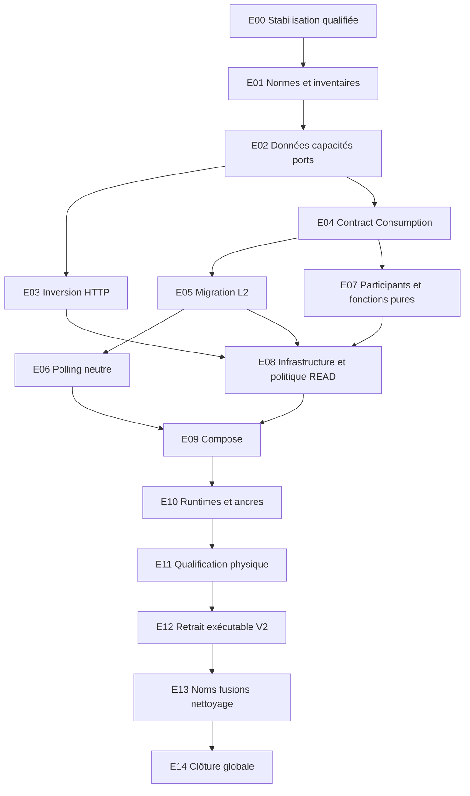

# Pocoma V3 — L7 — Plan d’exécution de la restructuration modulaire

Mandat : `GO_L7_MODULAR_REFACTORING_EXECUTION_PLANNING` · 2026-11-10.

**Plan historique du 10 novembre.** Le mandat ultérieur
`GO_L7_MODULAR_REFACTORING_FULL_EXECUTION` autorise la migration et la qualification intégrales.
Le [rapport d’exécution](L7_Modular_Refactoring_Implementation_and_Qualification_Report.md)
décrit l’état Git retenu, les corrections E00 et les preuves.

Dépôt : `kartaguez/pocoma` · branche : `feat/v3-architecture` · HEAD audité :
`3e8defeca282276f125fd9d37e561d7f71b4fdb4`.

## 1. Verdict de préparation et référence

**`BLOCKED_BY_UNQUALIFIED_CONSUMPTION_CHANGES`** : le plan est exploitable, mais
la migration productive ne doit pas commencer avant E00. Les 23 fichiers locaux
ne constituent pas une baseline qualifiée. Des contradictions reproductibles par
lecture existent dans le dimensionnement des pools, la composition monolithe et
les preuves annoncées. Aucun test exécuté ici ne permettrait de les lever : le
mandat interdit explicitement tests, Maven, benchmarks et accès DB.

Ce verdict n’identifie pas une incohérence de la cible à 42 modules. Les écarts
observés concernent l’état de départ et les preuves. La [référence consolidée](L7_Target_Modular_Architecture_and_Migration_Plan.md)
reste normative pour les décisions D01–D11, les conditions C1–C10, le catalogue
C01–C43 sauf C10 absorbé, les neuf identités de Consumption et les règles V01–V13.
Ses 60 sources A01–A60, 42 destinations, 64 relations de migration et 182 arêtes
de production de référence ne sont pas un graphe Maven déjà implémenté.

La décision humaine du présent mandat **retire intégralement le support
exécutable V2**. Elle lève O01 de la référence ; aucune nouvelle décision de
principe sur V2 n’est attendue. La rétention SQL et le transfert des garanties
des tests restent des obligations distinctes. Scénario Consumption B maintenu :
API dans C39, autorité L2 unique dans C21, aucun Engine Consumption autonome cible.

Sources confrontées : [AGENTS.md](../../AGENTS.md), [politique de vérification](../testing/Reactor_Verification_Policy.md),
[audit de frontière L2](L7_Consumption_Engine_Orchestrator_Boundary_Audit.md),
[audit initial](V3_Modular_Architecture_and_Composability_Audit.md), rapport L7/I2
versionné `L7_I2_Sequential_Burnable_Discovery_Implementation_and_Qualification_Report.md`,
rapport L7/I1 local non suivi, sources et POM lus sans exécution. Les références
aux deux fichiers L7/I1 locaux sont des constats d’audit, pas des liens de preuve
publiée : ils restent volontairement hors de ce commit.

## 2. Audit préalable du worktree

### 2.1. État et méthode

Au début de l’audit : branche et HEAD conformes au mandat ; `origin` désigne
`https://github.com/kartaguez/pocoma.git`. L’état local indique une branche alignée
sur sa référence de suivi ; seule la lecture distante de publication confirme
l’état du serveur. Index vide (`git diff --cached` vide), aucun conflit signalé,
**12 fichiers suivis modifiés + 11 fichiers non suivis = 23**. Diff suivi :
133 insertions / 231 suppressions. Aucun fichier supprimé ou renommé par ce diff.

Chaque fichier suivi a été comparé à HEAD ; chaque non-suivi a été lu comme un
ajout potentiel, sans lui inventer une version HEAD. Contenus, statuts, tailles et
SHA-256 initiaux sont consignés en annexe A. Le diff binaire et une empreinte du
manifeste initial ont été conservés temporairement hors dépôt pour comparaison
avant/après publication. Aucun stash, reset, restauration, déplacement ou
intégration des changements préexistants n’est effectué.

### 2.2. Provenance : faits et limites

L’hypothèse « principalement des corrections du moteur Consumption réalisées par
Gemini » n’est **pas démontrée pour les 23 fichiers**. Aucun de ces fichiers
n’est une modification locale de `engine-consumption` ou des classes du polling.
Leur ensemble correspond surtout au chantier de composition L7/I1 à cinq
processus, plus des adaptations de tests à L7/I2.

Les corrections du noyau sont déjà dans l’ascendance de HEAD :

| Commit | Contenu démontré par Git | Limite d’attribution/qualification |
|---|---|---|
| `fd5bfc89a4a951011aa9dfd4ac26bbbf27b965fc` | Publication séquentielle Burnable, checkpoint, SQL V11 et tests L7/I2. | Métadonnées Git : auteur humain Dude Kartaguez ; aucune attribution technique nominative à Gemini prouvée. |
| `39962f0568b1e3cf777197b353e881d11ad57a6d` | Correction de collision de leases intra-worker dans Loop/Worker/Discovery et rapport/campagnes. | Présence committée démontrée ; preuve au futur SHA non acquise. |
| `53999a05bc1aa368aad43b080b5975cbc5c747cc` | Pacing, isolation errorPoll, fast paths Discovery/JDBC, Fraction, observations de campagnes. | Ces changements fonctionnels ne sont pas à rejouer au milieu d’un déplacement structurel. |

L7/I2 §2 déclare les adaptations cinq runtimes préexistantes et exclues de ses
commits. Il cite cependant des chemins `runtime/read/v3`, `runtime/security/v3`
et des emplacements de tests qui ne sont pas ceux du worktree actuel. Le hunk
`Authority.READ` du BootstrapGuard est explicitement décrit. Les deux fixtures
monolithe, la fixture de participants et le profil Web ont une filiation
plausible avec I1/I2, mais ne disposent pas d’une attribution individuelle
authentifiée. **Aucun fichier n’est étiqueté « Gemini certain »** : correspondance
de chantier n’est pas preuve d’auteur. E00 doit conserver cette distinction.

### 2.3. Classification fichier par fichier

Préfixes de chemins : **C** = `app/composition-runtime-spring/src/main/java/com/kartaguez/pocoma/runtime/consumption/v3/` ;
**M** = `app/runtime-monolith/src/test/java/com/kartaguez/pocoma/` ;
**T** = `app/runtime-task-consumption-worker/src/test/java/com/kartaguez/pocoma/runtime/task/v3/` ;
**W** = `app/runtime-web-api/src/test/java/com/kartaguez/pocoma/` ;
**D** = `docker/v3-five-runtimes/`. L’annexe A restitue les chemins complets.

Qualification commune : **lecture statique seulement ; NOT RUN au SHA audité**.
« I1 déclaré » signifie une affirmation du rapport local, sans certification
rejouée ni chaîne de provenance suffisante pour qualifier ces octets.

| N° | Fichier / catégorie principale | Nature exacte, comparaison HEAD et dépendances | Qualification / risque / rattachement |
|---|---|---|---|
| 01 | C `V3AdmissionHttpConfiguration.java` — adaptation Runtime | Fonctionnel + structurel : importe la sécurité commune, retire l’exigence du profil READ, refuse Workers et beans READ en WRITE seul. Dépend 13 et 11. | I1 déclaré ; garde par nom de classe et effet monolithe à vérifier (R03). |
| 02 | C `V3BootstrapGuard.java` — adaptation Runtime | Fonctionnel de sécurité : autorise les tables READ_UPDATES sous Authority.READ même sans `readWorker`. Pas une correction d’algorithme L2. | Hunk explicitement décrit I2 ; tests de refus/autorité effective absents de la preuve locale (R04). |
| 03 | C `V3ConsumptionWorkerConfiguration.java` — adaptation Runtime | Allowlists sécurité ; références au filtre remplacées en partie par FQN ; attente physique du pool ramenée de maximum à minimumIdle. Dépend 04/13. | I1 déclaré ; réserve physique changée et quatre pools encore construits (R01/R05). |
| 04 | C `V3ConsumptionWorkerSettings.java` — configuration | Fonctionnel : restrictions selon nom worker, pools maximum/minIdle assouplis. Dépend 15/16/20 et 09. | I1 déclaré ; contradictions avec assemble ; nom non reconnu contourne la règle topologique spécialisée (R01/R06). |
| 05 | C `V3ReadHttpConfiguration.java` — adaptation Runtime | Structurel + fonctionnel : sécurité/transport déplacés dans 13, shim PrincipalResolver et principal ; nouvelles interdictions Worker/admission. | Dépendance indispensable au non-suivi 13 ; autorité monolithe et compatibilité des shims à prouver (R03). |
| 06 | M `ConsumptionPilotIsolationTest.java` — test | Fixture : ajoute `db/v3-identity/migration` au bootstrap WRITE. | Cohérent avec tables de publication I2 ; chaîne supplémentaire et garanties du pilot à réexaminer, sans PASS nouveau. |
| 07 | M `V3WorkerMonolithPostgresTest.java` — test | Même adaptation du bootstrap WRITE vers Identity. | Dépend SQL I2 ; ne constitue pas une qualification globale du monolithe HTTP. |
| 08 | `app/runtime-task-consumption-worker/pom.xml` — configuration | Structurel : Prometheus compile ; starter-web passe de test à compile. | I1 déclaré ; fermeture et surface servlet changent : G-A requis (§17), contrairement à I1. Aucun POM modifié par cette mission. |
| 09 | T `ReadActivationSettingsTest.java` — test | Ajoute cas business/results selon nom ; cas results positif avec deux résultats et négatif mixte. | Unitaires non rejoués ; ne couvre ni pools physiques, ni nom libre, ni composition réelle. |
| 10 | T `ReadParticipantsFixture.java` — test | Fonctionnel de fixture : insertions Command/Identity + counter + position via CTE pour publication dense. | Conséquence I2 plausible ; vérifier atomicité/oracle SQL indépendants et migrations chargées, pas auteur démontré. |
| 11 | `app/runtime-web-api/src/main/java/com/kartaguez/pocoma/PocomaWebApiApplication.java` — adaptation Runtime | Structurel/fonctionnel : exclut Legacy aussi sous admission seule. | Correspond à I1 ; correction équivalente absente de la racine monolithe (R03). |
| 12 | W `V3ReadHttpContractTest.java` — test | Oracle modifié : exclut toute requête contenant `read_maintenance_state` des compteurs SQL. | Changement de garantie, pas simple bruit technique ; limite SQL et absence de fuite à prouver séparément (R07). |
| 13 | C `V3HttpSecurityConfiguration.java` — adaptation Runtime, non suivi | Extraction sécurité JWT RS256, Tomcat, filtre V3ReadTransport, principal et métriques ; ObjectProvider remplace Optional. Référence les deux configurations et un transport READ. | I1 déclaré ; pas encore infrastructure neutre C26, ne pas déplacer tout ce fichier en C26 (R08). |
| 14 | `docker-compose.v3-five-runtimes.yml` — configuration, non suivi | Huit services, cinq processus applicatifs, JARs `target`, image applicative latest, volume DB nommé existant, healthchecks. | I1 déclaré ; ne provisionne pas à lui seul deux DB/grants V3 ; versions/digests et paramètres divergent du rapport (R09). Ne pas le lancer ici. |
| 15 | D `business-read-worker.properties` — configuration, non suivi | Cinq participants métier, M_W=3, minIdle=1, clés de pool `.maximum=5`, principal WRITE ordinaire. | Dépend 03/04 ; `.maximum` non lu par parser qui attend `.maximum-pool-size` ; source non SELECT dédiée (R02/R05). |
| 16 | D `command-worker.properties` — configuration, non suivi | Command + Identity, M_W=2 ; `.maximum=4`, minIdle=1 ; paramètres DEV. | Même mismatch ; bornes effectives par défaut business=4/control=8, pas tableau I1 (R02). |
| 17 | D `http-read.properties` — configuration, non suivi | Pool READ `.maximum=4`, sécurité et limites de consultation. | Pool HTTP créé avec limites codées dans configuration ; valeurs déclarées ne prouvent pas leur consommation ; principal partagé à séparer (R09/R05). |
| 18 | D `http-write.properties` — configuration, non suivi | Admission/OIDC, `.maximum=4`, clés cryptographiques de démonstration, compte admission. | Dépend 01/13 ; paramètres locaux codés en dur, pas externalisation complète annoncée. Requalification sécurité, aucun secret reproduit ici. |
| 19 | D `prometheus.yml` — configuration, non suivi | Scrape des cinq ports management + Prometheus, 5 s. | Pas une preuve des ressources/participants ; dépend réseau/services 14 et registre 08. |
| 20 | D `results-worker.properties` — configuration, non suivi | Deux participants résultats, M_W=2 ; `.maximum=4`, minIdle=1 ; WRITE source ordinaire. | Même mismatch et autorité source excessive à traiter comme écart cible connu (R02/R05). |
| 21 | `docs/testing/evidence/L7-I1/smoke_e2e_results.json` — documentation/preuve, non suivi | 30 observations, taux déclaré 100 %, latences/flags c03Valid, pas les soldes ni résultat détaillé. | Lisible mais SHA testé/config/artefacts non liés ; impossible de reconstruire l’oracle C-03 depuis ces données (R10). |
| 22 | `docs/v3/L7_I1_Five_Runtime_Single_Host_Qualification_Report.md` — documentation, non suivi | Affirmations Q1–Q6 et smoke ; pas de modification productive dans ce fichier. | Assertions contradictoires avec code/config, pas preuve globale qualifiée (R09/R10/R11). À conserver sans le publier par accident. |
| 23 | `scripts/performance/smoke_test_5_runtimes.py` — autre, outillage de qualification, non suivi | Programme mutateur HTTP ; fixtures L6/R11 et OIDC requis ; écrit 21. Aucun lancement ici. | Oracle incomplet : accepte REJECTED, fallback version, cardinalité de balances seulement, erreurs ignorées à certains polls, résumé stdout 100% littéral (R10). |

### 2.4. Écarts bloquants et risques concrets

| ID | Constat statique et preuve localisable | Traitement obligatoire avant migration |
|---|---|---|
| R01 | Settings lignes 391–394 acceptent maximum inférieur au défaut M_W+2/+6 et minIdle=1 ; `V3ConsumptionLifecycleComposition.assemble` lignes 97–98 et 139–140 exigent encore maximum ≥ M_W+2/+6. `open` lignes 651–661 attend seulement minimumIdle. | Choisir une enveloppe unique justifiée ; tests settings → construction → disponibilité, renewal et drain. Une réduction de réserve est une correction fonctionnelle distincte, jamais noyée dans E05/E08. |
| R02 | Les trois fichiers worker utilisent `.maximum`, alors que `pool()` lit `.maximum-pool-size` (Settings 377). Pour M_W=2, défauts 4/8 ; M_W=3, 5/9. Le tableau I1 6/6 ou 8/8 ne peut pas être inféré de ces octets. | Inventaire des clés réellement consommées, refus des clés inconnues pertinent, capture des tailles physiques. Ne pas conclure que les valeurs `.maximum=4/5` sont effectives. |
| R03 | Web Legacy exclut admission seule ; Monolith Legacy n’exclut pas `v3-http-admission`. Les préflights HTTP refusent tout Worker y compris sur racine monolithe. | Tester admission seule monolithe, READ seul, workers seuls et combinaison HTTP+worker ; rendre compatible la composition explicite attendue sans affaiblir l’isolation des racines spécialisées. |
| R04 | BootstrapGuard supprime la condition readWorker pour accepter READ_UPDATES ; changement de garde de privilèges. | Démontrer les refus SELECT/UPDATE/DML selon rôle et runtime ; distinguer garde d’objet attendu et autorisation réelle. Pas de présomption de faille ni de sûreté. |
| R05 | `Resources` ouvre writeBusiness/writeControl/readBusiness/readControl ; source WRITE utilise principal ordinaire ; l’assemble READ exige LIFECYCLE_AND_DISCOVERY sur source WRITE. | État actuel ≠ cible SELECT ; stabiliser les garanties présentes, puis E08/E11 suppriment cette exigence pour un profil source dédié. Ne pas certifier aujourd’hui isolation C36/C34. |
| R06 | Restrictions spéciales basées sur noms command/results/business ; un autre nom suit les validations générales. | Définir nom d’instance vs sélection de parcours ; tester noms libres et absence de dépendance sémantique au nom lors des Compose. |
| R07 | Filtre du compteur HTTP masque toutes les requêtes dont le SQL contient `read_maintenance_state`. | Répartir budget métier/statut explicitement et garder observation exhaustive ; les assertions ne doivent pas devenir vraies par filtrage large. |
| R08 | Sécurité commune importe `V3ReadTransport` et les classes de configurations HTTP. | Séparer ultérieurement adaptation sécurité C26 et branchement filtre/transport dans C29/C32 ; C26 ne dépend pas des Supra/Compose. |
| R09 | I1 annonce PG16/Keycloak26.0/Prometheus2.51 ; Compose contient PG17/26.7.0/latest. Profil décrit `v3-http-write` alors que code/Compose utilisent admission. Paramètres largement littéraux ; pool READ fixé à SQL_PERMITS, pool admission piloté par `admission.capacity` (défaut 1), pas par les clés HTTP `.maximum` présentes. | Nouveau reçu d’environnement et artefacts ; corriger uniquement les affirmations dans un lot ultérieur dédié. Pas de certification cloud déduite du smoke local. |
| R10 | Le smoke vérifie `len(balances)` uniquement, n’exige pas l’ensemble des IDs ni les fractions/somme nulle, accepte REJECTED comme disponibilité ; JSON n’archive pas les réponses. | Restaurer un oracle métier indépendant, succès/admission/rejet séparés, échecs explicites et traces complètes, puis qualification autorisée. Les 30 flags existants restent observations historiques limitées. |
| R11 | I1 déclare G-A non requis malgré arête Maven et règles d’isolation modifiées ; les classes `V3ConsumptionWorkerSettingsTest` et `V3BootstrapGuardTest` qu’il cite ne sont pas présentes dans les sources actuelles. I2 annonce `V3DiscoveryLoopTest` (66/66), également absent sous ce nom. I2 cite S1/S2/S3 non canoniques, gates ArchUnit filtrés et commandes `app/...` sans preuve de répertoire correspondant ; wrapper réel dans `app/`. | Conserver rapports historiques ; réconcilier les identités de tests avec les sources et les reçus originaux, puis publier une matrice de lacunes et reçus frais canoniques. Ne pas convertir les filtres passés en gate global non filtré. |

Les contradictions sont des résultats de lecture, pas des échecs d’exécution
inventés. Le verdict bloque la migration ; il ne disqualifie pas rétrospectivement
chaque observation des anciens rapports.

## 3. Stabilisation préalable des changements Consumption et Runtime

E00 est un lot de stabilisation, **antérieur à toute mutation du graphe Maven**.
Sa future mission doit partir du manifeste A, établir les octets réellement
testés et isoler au moins quatre ensembles de revue : composition/sécurité HTTP
(01/05/11/13), capacité/pools/privilèges (02/03/04/09), fixtures et oracles
(06/07/10/12/23), déploiement/preuves (08/14–22). Le POM 08 fait l’objet d’un
sous-lot de dépendance explicite avec G-A, sans toucher aux noms de modules.

Pour chaque ensemble : conserver le diff reçu ; décrire problème, avant/après,
contrats touchés et décision conserver/corriger/écarter proposée à l’humain ;
qualifier sur checkout d’intégration propre avec inventaire des apports. Un
checkout séparé doit être constitué depuis les octets exacts autorisés, sans
déplacer le worktree source ni confondre artefacts installés et sources.
L’acceptation future de ces changements doit être dédiée ; aucun commit de
déplacement ne les absorbe implicitement. Ce plan n’autorise ni cette copie
d’intégration ni ces futurs commits productifs.

La baseline recherchée est un **SHA de code/config qualifié**, pas une baseline
SQL supposée. Elle inclut les corrections déjà committées fd5bfc89/39962f05/53999a05
et les apports locaux explicitement acceptés ; compare leurs hypothèses aux
preuves I2. Conserver FAIL, SKIP, UNKNOWN et INCONCLUSIVE, notamment i5_r05/i5_r12.
Rejouer les protocoles affectés par pool/routing/renewal ; aucun changement
d’algorithme L2 dans les incréments structurels suivants. Si une correction du
noyau s’avère nécessaire, ouvrir E00-correction avec son mandat fonctionnel,
preuves adverses et nouvelle baseline avant E04/E05.

GO de sortie E00 : reçu de qualification traçable au SHA, résolution R01–R04,
R07 et R10–R11 pour les garanties revendiquées ; R05/R08 peuvent rester écarts
architecturaux explicitement affectés à E08/E11, sans revendication prématurée de
conformité cible. Paramètres réels et réserve opérationnelle doivent être connus.
Une réserve d’ancienne campagne n’est close que par son oracle applicable et sa
décision de réception, pas par une réussite isolée.

## 4. Suppression complète du support exécutable V2

### 4.1. Périmètre décidé et inventaire

Les **25 modules DELETE** de la référence sont inventoriés classe/test/ressource
en annexe B. Ils ne sont pas supprimés dans cette mission. Les six points
d’entrée dédiés à retirer sont `PocomaEventConsumptionWorkerApplication`,
`PocomaCommandResultConsumptionWorkerApplication`,
`PocomaRegistrationResultConsumptionWorkerApplication`,
`PocomaRegistrationConsumptionWorkerApplication`,
`PocomaLatestKnownVersionConsumptionWorkerApplication` et
`PocomaBindingConsumptionWorkerApplication`, avec leurs POM, packaging, propriétés
et tests (garanties à transférer d’abord).

La suppression des seuls 25 modules serait **incomplète**. Dans les artefacts
réutilisés, retirer les chemins exécutables historiques suivants après revue :

| Ensemble actuel | Éléments concernés / règle d’inventaire | Conservation V3 obligatoire |
|---|---|---|
| Racines monolith/web/command/task | Classes imbriquées `Legacy`, imports et ComponentScan globaux, configurations historiques par défaut, exclusions servant seulement à la coexistence V2. | Racines V3 et tests de refus d’activation étrangère ; plus de repli V2 sans profil. |
| composition-runtime-spring | Configurations CommandAdmission/RegistrationAdmission, *ResultRead, PotRead, ProjectionRead, PrimaryEventPublication, PocomaWebRuntime, WebAuthorization ; packages runtime/binding, command/consumption, event/consumption, registration, registrationresult, result, task/consumption et runtime/web/authentication historiques. | V3ReadFacade/HTTP, worker/catalog, maintenance et ressources transférés vers leurs propriétaires ; utilitaires Jackson/OpenAPI seulement après analyse de leurs consommateurs. |
| engine-consumption + orchestrator-consumption + orchestrator-poll-consumption | API/services non-v3 de Consumption, Sequential/AcquireThenFinalize, ancien ConsumptionPollingWorker et observations. | API C39 et noyau C21 ; `domain-consumption` comporte aussi des types historiques : ne pas prendre le nom d’artefact comme preuve d’usage V3. |
| engine-write-pot + engine-consume-registration | Services/UseCases historiques Pot et ExecuteRegistrationService, ports et décodage uniquement V2. | ExecutePotCommand / ExecuteIdentityRequest, ports V3 et valeurs partagées encore importées. |
| engine-read-pot / read-results / materialize / consume-projection-task | JSON projections, lectures historiques, ProjectionEngineService/Task orchestrator/loaders. | ReadPotV3/ReadInvitation/ReadNavigationV3 ; quatre Materialize Pot/Invitation, binding et deux résultats. |
| supra-http-write/read | Contrôleurs AsyncCommand/Registration et PotQuery/CurrentBinding/*Result historiques, DTO/filtres dédiés V2. | V3Admission/Link, V3Read/Invitation, leurs transports et toutes garanties HTTP V3. |
| infra-persistence-primary-jpa / infra-persistence-read-jdbc | Entities/repositories/adapters V2, auto-configs, JSON read-store et transactions historiques ; inventaire non-v3 en annexe C. | JDBC V3, migrations, décodeurs et owner physique encore nécessaires ; aucune suppression de JPA par simple association avec V2. |
| domain-pot / domain-user-identity / domain-projection / contracts / ports | Modèles V2 réellement sans consommateur après transfert ; API legacy dans modules KEEP/SPLIT. | Valeurs, invariants et données neutres partagés : garder ou reloger, jamais supprimer par motif de package. |

Profils et ressources : `application.properties` des anciens runtimes, tous
leurs `application-postgres.properties` et clefs historiques
`pocoma.command-admission`, `command-result-read`, `registration-admission`,
`registration-consumption`, `registration-result-consumption`,
`command-consumption`, `command-result-consumption`, `event-consumption`,
`binding-consumption`, `projection-task` et `latest-known-version` selon leurs
préfixes exacts dans sources/propriétés doivent perdre leur pouvoir d’activation.
Les profils V3 `v3-consumption-pilot`, `v3-consumption-worker-dev`, `v3-read-worker`,
`v3-http-read`, `v3-http-admission` restent des chemins V3 à requalifier/transposer,
pas des profils V2 à supprimer par ancienneté. `postgres` est transversal : retirer
son wiring V2, pas le concept d’adaptateur PostgreSQL.

Inspecter aussi `META-INF/spring/*.AutoConfiguration.imports`, `spring.factories`
éventuel, entity/repository scan, ServiceLoader, manifests Main-Class/Start-Class,
scripts de packaging/CI et docker-compose.functional/distributed, Dockerfiles et
`docker/monolith/application-v3.properties`. Les deux manifests d’auto-configuration
actuels dans infra-persistence-read-jdbc et infra-persistence-projection-jdbc
requièrent une décision de contenu avant retrait. Les fichiers externes à `app/`
ne sont pas exécutés ici. Ils doivent être classés entrée V2, entrée V3 ou mixte,
avec négatif démontrant que l’ancienne sélection ne relance aucun support V2.

Repérage concret des entrées externes déjà présentes, à traiter avec E10/E12 :

| Fichier/ensemble | Constat lu / destination de traitement |
|---|---|
| `docker-compose.distributed.yml` | Profil partagé `postgres`, builds WebAPI/Event/Task/Command/CommandResult/LKV ; Event est instancié deux fois, Task deux fois. Déploiement historique à retirer ou réécrire vers racines finales, pas à conserver comme chemin V2 caché. |
| `docker-compose.functional.yml` | Build monolithe sans sélection de profil V3 dans le fichier seul ; il laisse donc la racine Legacy sélectionnable aujourd’hui. Adapter le défaut ou retirer cette entrée lors de E12. |
| `docker/compose/docker-compose.observability.yml` | Overlay explicitement V3 `v3-read-worker,v3-http-read,v3-http-admission` avec JAR monolithe monté ; à préserver/transposer et requalifier, pas supprimer comme V2. La combinaison HTTP+worker croise R03. |
| `app/Dockerfile`, `.github/workflows/ci.yml` | Packaging/CI à réconcilier avec noms et sélections E10/E13 ; inventaire des références par lecture, aucun build CI lancé ici. |
| `scripts/v3/worker-dev.py`, `scripts/testing/verify-v3-l2-i2.py`, `verify-v3-l2-i3.py`, `verify-v3-l2-i4.py`, `verify-v3-l2-i5.py`, `run-i5-temporal-final.py` | Outils V3 qui citent les anciennes ancres/JARs ; préserver leur preuve et mettre à jour leur sélection active sans réécrire les reçus historiques. |
| `scripts/testing/verify-4c-previous-runtime.sh`, `verify-4d-previous-runtime.sh`, `verify-4e.sh` | Protocoles historiques de retour runtime/compatibilité et gates multi-ancres ; classifier comme preuves conservées ou outils actifs transférés, sans supprimer l’oracle par simple ancienneté. |
| `scripts/testing/verification-campaigns.json`, `verify.py`, `test_verification.py` | Contrat de collecte/ancres ; mise à jour cohérente E10, vérification significative des contrôles positifs/négatifs dans ce futur lot. |

### 4.2. Dépendances V3 historiques démontrées

Une analyse statique des imports explicites et wildcard des sources de
production dont le chemin contient `/v3/` n’a trouvé **aucun import vers les
classes des 25 modules DELETE**. Limite : ce n’est ni résolution Maven effective,
ni preuve contre scan, réflexion, ressources, signatures transitives ou test.
La suppression n’est donc pas validée par ce seul résultat.

Contre-exemples à « tout non-v3 est supprimable » :

- `IdentityRequest`, `LinkProposal`, `IdentityAuthority`, `ExecuteIdentityRequest`
  et `IdentityTransitions` importent `ExternalIdentity`, `PocomaUserId`, `User`
  historiques ; préserver en C02 avec validations égales.
- `CommandAdmissionInput`, `PotCommand`, `PotFacts` et transitions V3 utilisent
  `domain.pot.value.*` et `value.id.*` ; conserver C01 et leurs tests de valeurs.
- `Resources` crée encore EMF/JpaTransactionManager pour writeEffects ;
  `SpringAttemptTransactions` accepte/contrôle les ressources JPA. Le nom
  infra-persistence-primary-jpa peut changer sans supprimer cet owner. Le plan
  privilégie sa conservation à comportement égal ; tout remplacement exige
  un sous-lot TX séparé avec PID/XID, poison et commit incertain.

### 4.3. SQL, tests et gates de retrait

Préserver intégralement contenu/checksum/ordre des migrations `db/migration`,
`db/read-store` et toutes chaînes V3 de la référence §7.2. Inventaire annexe D
avec chemin/empreinte ; le futur transfert vers C27/C28/C40 a **un propriétaire
unique par ressource**. Retirer un module n’autorise pas à effacer son histoire
SQL ni à rejouer toute cette histoire par défaut. Trusted baseline courante :
**NONE**, selon la politique ; pas de baseline inventée, ni d’équivalence SQL
inférée de tests FOUNDATION. Les migrations restent accessibles à l’outillage de
reconstruction, avec chargeur explicite hors comptes applicatifs.

Avant tout retrait de test, produire une ligne `ancien test#méthode → invariant
→ oracle et environnement → test propriétaire cible ou preuve historique
retenue → justification signée`. Les annotations/paramétrages et scénarios de
crash font partie de la ligne. Si l’invariant reste V3, le test cible doit
exister et passer **avant** retrait. Si V2 seul, la décision humaine de retrait
du support permet de retirer son exécution après archivage ; aucune régression
V3 n’en est déduite. Les preuves historiques immuables restent attribuées à
leurs SHA ; ne pas réécrire un rapport pour donner l’illusion d’un nouveau PASS.

Gates : exécuter les ancres historiques concernées tant qu’elles existent,
transférer les garanties partagées, puis vérifier absence de modules/classes
V2 dans artefacts packagés, absence de beans et d’activation par ancien profil,
présence de l’histoire SQL et reconstruction autorisée. E12 n’est clos qu’avec
G-A ; E14 exige le full reactor final. Les six suppressions de runtimes dédiés
suivent E10/E11 ; la matrice des preuves V2 est préparée dès E01.

## 5. Ordre, dépendances et unités de livraison

Chaque E est une future mission distincte, à commit(s) cohérent(s), après GO
humain explicite. Un GO documentaire ne vaut pas GO d’implémentation. Le tableau
de correspondance M0–M10 de la référence est raffiné ici, sans changer sa cible.

Corrections de l’ordre indicatif : (1) inventaires des garanties V2 dès E01,
retrait effectif tardif ; (2) ports/capacités HTTP extraits avant inversion ;
(3) C39 précède la migration C21 puis le découplage complet C22, afin d’éviter
deux autorités L2 simultanées ; (4) C42 dépend de C39 et C43 de C07, donc leur
extraction complète rejoint E08 ; (5) règles d’architecture introduites au
premier changement de frontière, durcies à chaque incrément, jamais différées
intégralement à la fin ; (6) qualification physique explicite E11 précède DELETE.

Travaux indépendants après gel E02 : E03 et E04 ; après E04, préparation E07
indépendante du déplacement E05. Des sous-lots E08 WRITE/core et READ/source
peuvent être développés séparément **après gel des ports**, avec fichiers et
ressources SQL distincts, puis intégrés séquentiellement. Les sous-lots Compose
C29/C32 et C30/C31 peuvent être conçus indépendamment après leurs prérequis.
Pas d’exécutions Maven/PG concurrentes sur mêmes targets/fixtures/rapports.
L’intégration des POM/agrégateur, les changements d’ancres, E05→E06 et
E10→E11→E12→E13→E14 exigent une séquence stricte.

## 6. Fiches d’exécution

### 6.0. Obligations communes applicables à chaque fiche

Les codes de commandes et de tests du §7 sont une partie normative des fiches.
Avant chaque implémentation : relever nouveau HEAD/dirty state, lire la politique,
confirmer primaire/secondaires, impact interdit, DB et prochains gates. Les
fichiers cités désignent leur source actuelle ; leur répertoire `src/main/java`
et leurs tests/resources/POM suivent le transfert seulement quand la fiche
l’autorise. La table A01–A60 du document cible fixe exhaustivement les destinations.

**I0 strictement inchangé** pour E02–E13 : algorithmes et résultats métier/L2,
neuf UUID, familles/autorités, partitions/routage, formats sérialisés, valeurs
et précision, SQL/migrations/checksums, atomicité, ordre de finalisation,
recovery/UNKNOWN, quarantaines, budgets de quota/deadline/retry/renewal et capacité
qualifiés E00. Une correction fonctionnelle nouvelle arrête le lot structurel
et exige un lot séparé. E00 peut corriger le comportement dans son mandat
futur explicite ; E01 aligne les textes sans relâcher une garantie.

**Rollback R0** : dernier ensemble cohérent SHA/artefacts/config qualifiés
conservé ; demande de drain, quiescence et résolution physique établies avant
bascule ; retour par commit réversible ou redéploiement coordonné, sans reset
slots/K/IDs/effets, suppression de DB, élargissement de grants ou double exécution.
UNKNOWN non résolu interdit la bascule aveugle. Les handles en mémoire ne
traversent pas les versions. Compatibilité binaire/durable ancienne↔nouvelle
prouvée avant GO. Aucune commande de rollback n’est exécutée ici.

**Reçu commun** : SHA début/final, fichiers et arêtes, diff fonctionnel nul ou
explicitement séparé, commandes exactes/répertoire, versions/hashes/config/SQL,
inventaire attendu des tests puis résultats frais, zéro skip inexpliqué,
FAIL/UNKNOWN/INCONCLUSIVE visibles, traversées inattendues, G-A/full dus ou non,
DB/bootstraps, risques et décision de GO suivante. Le nom de livrable ci-dessous
est une proposition à créer dans la mission correspondante, pas un fichier
présumé existant.

### E00 — Stabiliser et qualifier la base reçue

- **Objectif/prérequis** : traiter §2–§3 ; mandat humain productif séparé et
  inventaire A inchangé ou réaudité. Aucune migration de module.
- **Modules/fichiers** : les 23 entrées A, engine-consumption et polling déjà
  committés pour comparaison ; LifecycleComposition et suites du registre §7.
- **Transformations exactes** : séparer les quatre ensembles §3 ; résoudre clés
  de pools/réserves, gardes HTTP/monolithe/privilèges, fixtures et oracle ; établir
  artefacts/config testés. Aucun tuning algorithmique opportuniste.
- **Inchangés** : identités, SQL de publication et contrats L2 de HEAD, sauf
  correction nominative autorisée et qualifiée séparément.
- **Dépendances** : racine de tout le graphe ; aucune autre fiche productive
  n’intègre implicitement ce dirty state.
- **Risques** : R01–R11 ; faux PASS par oracle modifié ou vieux JAR.
- **Tests/slices** : primaire COMMAND ; secondaires WEB et PROJECTION ; U-L2,
  U-settings, P-L2/P-READ, H, S, Q, D (§7), C-WCP ; complément C-M pour monolithe.
  DB CURRENT ; historique transitive enregistré. Niveau INTEGRATION.
- **Gates** : G-A requis pour 08 et règles d’isolation ; FULL requis à clôture
  de cette stabilisation globale explicite (§19), pas à chaque correction.
- **Acceptation** : chaque fichier a disposition et provenance/limite ; R01–R04,
  R07/R10/R11 traités ; garanties de base et capacité réelles qualifiées au SHA,
  R05/R08 alloués sans fausse conformité cible ; reçus traçables.
- **Rollback** : R0 vers ensemble préqualifié ; aucune restauration des 23
  fichiers source sans mandat ; correctifs fonctionnels réversibles séparément.
- **Livrable/GO suivant** : `L7_E00_Stabilization_Report.md`, manifeste des apports
  et réserves. GO humain E01 après acceptation explicite de la baseline.

### E01 — Réconciliation normative, contrats et retrait V2 préparé

- **Objectif/prérequis** : E00 reçu ; stabiliser textes et inventaires, aucun
  déplacement productif.
- **Fichiers** : SPEC-05, L2_R1_R10_Normative_Consolidation, référence L7,
  registre de tests/quarantaines, inventaires B–D et contrats HTTP/L2.
- **Transformations** : aligner publication Burnable dense et checkpoint K
  couvert avec code I2 ; documenter K ≠ terminaison ; noter décision V2 acquise ;
  lister signatures/types/consommateurs à geler, classe→propriétaire cible,
  test→invariant→destination, SQL→chargeur. Identifier exceptions temporaires
  nommées, propriétaire et échéance, sans exception globale Legacy.
- **Inchangés/dépendances** : I0 et toute source productive ; précède E02.
- **Risques** : transformer une divergence textuelle en affaiblissement L2 ou
  perdre un invariant lors du retrait V2.
- **Tests/slices** : NONE ; lecture croisée, liens, inventaires et hashes seuls.
  DB NONE ; aucun Maven ni test applicatif dans ce lot documentaire.
- **Gates/acceptation** : G-A/FULL non requis ; textes sans ambiguïté sur
  progression B/NB ; chaque type, test et chaîne SQL possède une destination ou
  un motif de rétention/retrait. Absence de signature conceptuelle réputée compilée.
- **Rollback** : révision documentaire seulement.
- **Livrable/GO** : `L7_E01_Contract_and_Proof_Inventory.md` ; approbation des
  contrats à concevoir et garanties transférées avant GO E02.

### E02 — Extraire données, capacités HTTP et ports partagés

- **Objectif/prérequis** : E01 ; libérer les contrats des implémentations.
- **Modules/fichiers** : contracts-command/registration/authentication →
  C06/C05 ; `PotCommand`, CommandAdmissionInput, IdentityAdmissionInput,
  LinkProposalInput et données d’association/admission → C06 ; résultats
  terminaux → C03 ; stores partagés/CurrentBindingStore et statut de maintenance
  → C09 ; vues/résultats READ, erreurs et interfaces de consultation → C07.
- **Transformations** : interfaces de capacités nommées C06/C07 ; fournisseurs
  existants les implémentent ; API publique sans Engine, JDBC, Spring ou owner.
  Maintenir decode/validation au propriétaire approprié ; geler allowlist
  RecoveryReadContext interne C4/C5 ; façade de statut sans ensureInitialized.
- **Inchangés** : I0, JSON, égalité/canonicalisation, précision temporelle et
  rejets ; aucune requête métier déplacée vers Supra/Compose.
- **Dépendances/risques** : ouvre E03/E04 ; consommateurs historiques encore
  présents à analyser avant de déplacer un type partagé ; cycles DC/CC.
- **Tests/slices** : WEB primaire, COMMAND/PROJECTION secondaires ; C-WCP,
  U-domain, U-contract, H, P-READ ; DB CURRENT si suites l’entraînent.
- **Gates/acceptation** : G-A/V01/V03/V04/V12 ; signatures compilables et graphe
  acyclique ; aucun contrat neutre n’expose une implémentation ; ancien contenu
  lisible. FULL non requis en boucle locale, dû E14, ou avant clôture si le
  sous-lot devient lui-même restructuration étendue.
- **Rollback/livrable/GO** : R0, remettre API et tous consommateurs ensemble ;
  `L7_E02_Contracts_Extraction_Report.md` + allowlists gelées. GO E03/E04 séparés.

### E03 — Inverser les dépendances des Supra HTTP

- **Objectif/prérequis** : E02 ; les transports invoquent C06/C07/C09 seulement.
- **Fichiers/modules** : supra-http-write/read (futurs C23/C24),
  V3AdmissionController, V3LinkProposalController, V3ReadController,
  V3InvitationController, transports, configurations HTTP et hooks.
- **Transformations** : injections de capacités ; retirer imports de
  AdmitCommandV3/AdmitIdentityRequestV3/Engines READ concrets ; hook ON_ADMITTED
  remplacé par collaborateur d’instance injecté. Statut de maintenance limité
  à consultation. Garder sécurité commune transitoirement au Compose existant.
- **Inchangés/dépendances** : I0, statuts HTTP, authentification, masquage,
  idempotence et admission seule ; E04 indépendant, E08 attend les deux branches.
- **Risques** : transport appelant exécution, fuite owner dans query, hook global
  conservé par compatibilité, dépendance Engine cachée en test.
- **Tests/slices** : WEB primaire C-W ; H/U-contract et doubles sans Engine ;
  COMMAND/PROJECTION ajoutés seulement si hook/observations partagés modifiés,
  redéclaration préalable. DB CURRENT pour HTTP réels.
- **Gates/acceptation** : G-A/V02/V03/V12 ; closure production sans Engine/O,
  tests de transport uniquement contrats ; aucune invocation d’exécution WRITE.
  FULL dû E14 (escalade §19 si lot étendu).
- **Rollback/livrable/GO** : R0, ancienne injection et hook scoped restaurés
  ensemble ; `L7_E03_HTTP_Inversion_Report.md`. GO E08 après validation HTTP.

### E04 — Extraire contract-consumption (C39)

- **Objectif/prérequis** : E02 ; contrat L2 riche et trois surfaces séparées.
- **Modules/fichiers** : engine-consumption/v3, ports `BurnableReferences`,
  `NonBurnableReferences`, `ConsumptionSlotStore`, `PartitionOwnershipStore`,
  `DiscoveryAdmissionStore`, `SlotKeyNavigation`, `AttemptFailureClassifier`,
  `ConsumptionObservation` ; ConsumptionParticipant/Prepared/Recovery,
  rapports/paramètres neutres ; port-transaction ; consommateurs/adaptateurs.
- **Transformations** : créer C39 packages invocation/participation/SPI,
  extraire types neutres sans publier WorkerCapacity.Ticket ou Guard ; capacité
  consultable, handles opaques liés émetteur/instance/scope/incarnation/usage.
  Préserver champs de rapports par phase et résolution physique ; fournisseur
  encore dans emplacement actuel, façade de délégation sans seconde autorité.
- **Inchangés/dépendances** : I0 ; pas de réécriture acquire/execute/recovery ;
  prérequis strict E05/E07, pas de booléen consume() remplaçant rapports.
- **Risques** : forgeabilité, double usage, UNKNOWN aplati, SPI accessible au canal.
- **Tests/slices** : COMMAND primaire + PROJECTION secondaire, C-CP ; U-L2,
  U-contract, P-L2/P-READ ciblés ; DB CURRENT.
- **Gates/acceptation** : G-A/V03/V09/V10 ; faux handle, autre instance/scope,
  usage double, contexte expiré/thread/poison refusés ; diff d’algorithme nul ;
  allowlists C4/C7 et consommateur de chaque type documentés. FULL dû E14,
  escalade explicite si ce sous-lot modifie largement le reactor.
- **Rollback/livrable/GO** : R0, C39 et consommateurs réversés ensemble ;
  `L7_E04_Consumption_API_Freeze.md` et mapping types. GO E05 et E07 distincts.

### E05 — Déplacer l’autorité L2 vers orchestrator-consumption

- **Objectif/prérequis** : E04 ; une seule implémentation protocolaire C21.
- **Modules/fichiers** : ConsumptionEngine, DiscoveryEngine, PreparationReads,
  WorkerCapacity, SlotCompletion et collaborateurs internes ; parties sûres
  V3ConsumptionLoop/Worker/RenewalService et Lifecycle/DiscoveryComposition.
- **Transformations** : transférer noyau et variantes explicites B/NB en C21 ;
  déplacer méthode par méthode la propriété de finalisation, settlement,
  réservation/capacité, recovery et décisions de renewal/drain ; remplacer les
  appels des anciennes factories par fournisseur C39. API/canal restent séparés.
  Ancien orchestrateur V2 garde package distinct jusqu’à E12.
- **Inchangés/dépendances** : I0 ; déplacement seul, aucune simplification ou
  optimisation ; E06 suit strictement, E07 peut avancer après gel E04.
- **Risques** : deux décideurs sur release/retry, ordre de publication changé,
  sortie de thread interprétée comme résolution de transaction.
- **Tests/slices** : COMMAND primaire + PROJECTION secondaire, C-CP ; U-L2,
  P-L2, P-READ, Q et interleavings adverses ; DB CURRENT, tests physiques requis.
- **Gates/acceptation** : G-A/V04/V09–V11 ; mapping méthodes source→destination
  et branches B/NB exhaustif ; mêmes rapports, PID/XID/effets/DELETE/terminal,
  UNKNOWN conservé ; aucun C13–C17/Infra dans C21. FULL dû E14 ; un déplacement
  étendu autonome impose sa propre clôture FULL §19.
- **Rollback/livrable/GO** : R0 avec zéro handle survivant ;
  `L7_E05_L2_Move_and_Invariants_Report.md`. GO E06 seulement après preuves L2.

### E06 — Découpler le Supra unique de polling

- **Objectif/prérequis** : E05 ; C22 agnostique de la famille.
- **Modules/fichiers** : orchestrator-poll-consumption/v3 → C22,
  V3DiscoveryLoop/V3ConsumptionLoop/V3ConsumptionWorker/V3RenewalService,
  leurs tests et factories courantes.
- **Transformations** : cadence/wait/fairness/round-robin/dispatch/coordination
  restent Supra ; le Compose fournit capacité spécialisée C39 ; supprimer choix
  Burnable/NonBurnable et imports noyau ; maintenance/drain demandés via contrat,
  résultats riches observés sans nouvelle décision de sûreté.
- **Inchangés/dépendances** : I0, pacing/errorPoll/quantum et opportunités de
  renewal qualifiés E00 ; E09 dépend de cette fermeture.
- **Risques** : famine de maintenance, renewal tardif, restitution prématurée,
  branche famille conservée indirectement par cast/réflexion.
- **Tests/slices** : COMMAND primaire + PROJECTION secondaire C-CP ; U-L2,
  Worker/Loop tests, P-L2 et Q pertinents, S drain ; DB CURRENT.
- **Gates/acceptation** : G-A/V02/V07/V09–V11 ; closure C22 limitée C04/C39
  (C08 transitif), doubles sans fournisseur ; pas de retry/settlement autonome ;
  traces de fairness/reprise identiques. FULL dû E14 sauf §19 propre au lot.
- **Rollback/livrable/GO** : R0, polling/factories cohérents ;
  `L7_E06_Polling_Decoupling_Report.md`. GO E09 après E08 aussi.

### E07 — Séparer participants, fonctions pures et Engines spécialisés

- **Objectif/prérequis** : E04 et données/ports E02 ; aucun effet classé pur.
- **Modules/fichiers** : ExecutePotCommand → C13 ; ExecuteIdentityRequest →
  C14 ; MaterializePotVersion/Balance/Visibility/Invitation et ports Source →
  C15 ; MaterializeCurrentBinding → C16 ; deux Materialize résultats → C17.
  PotVisibilityRules → C01 ; PotBalanceCalculator/transitions C01,
  réducteurs C03 ; CalculatePotBalances reste C13 car lecture de port.
- **Transformations** : participation C39, dépendances entre Engines remplacées
  par CC ou ports partagés ; extraire seulement les calculs déterministes ;
  neutraliser java.sql.Timestamp en préservant précision/rejets par adaptateur.
- **Inchangés/dépendances** : I0, ordre/autorité d’effets et sources, chaque
  progression Pot indépendante ; interfaces Source gelées avant E08.
- **Risques** : faux PF avec IO, perte de précision, fusion d’identités,
  validation déplacée au transport, propriété physique attribuée au participant.
- **Tests/slices** : PROJECTION primaire + COMMAND secondaire C-CP ; U-domain,
  U-contract, tests participants, P-READ et P-L2 atomicité ; DB CURRENT.
- **Gates/acceptation** : G-A/V03/V04/V09–V11 ; neuf associations UUID/participant
  inchangées, Prepared détaché sans connexion/owner ; ports locaux C7 exacts.
  FULL dû E14 ou clôture étendue spécifique.
- **Rollback/livrable/GO** : R0, participants et adaptateurs assortis ;
  `L7_E07_Participant_Ownership_Report.md`. GO E08 sur API Source figée.

### E08 — Isoler WRITE, READ, source SELECT et collaborateurs transversaux

- **Objectif/prérequis** : E03, E05, E07 ; contrats/fournisseurs stabilisés.
- **Modules/fichiers** : primary-jpa → C27/C40/C41 ; read-jdbc → C28/C40 ;
  JdbcCommandTerminalSource, JdbcCurrentBindingSource, JdbcIdentityTerminalSource,
  lectures d’historique ; maintenance SQL → C28 ; V3ReadFacadeComposition et
  politique → C43 ; sécurité → C26 ; observations → C42/C39 ; TX C25 conservée.
- **Transformations** : sous-lot 08a primitives communes sans datasource global ;
  08b lecteurs/décodeurs C41 sans construction de stores/IdentityAuthority WRITE ;
  08c adaptateurs WRITE/READ et manifests SQL D à propriétaire unique ;
  08d politique READ pure d’infrastructure, quota2/deadline5s/SQL2s/TX3s via
  ports, sécurité sans Supra/Compose, observations scoped. Nouveau profil source
  SELECT et principal maintenance séparé ; pas de migration DDL nouvelle.
- **Inchangés/dépendances** : I0, owner JPA existant conservé par défaut ; tout
  remplacement est un sous-lot TX autorisé séparément, préalable à E09.
- **Risques** : lecteur qui instancie un mutateur, grants indirects, duplicate
  migrations, transaction READ/WRITE englobante, SQL logé dans C43.
- **Tests/slices** : PROJECTION primaire, COMMAND + WEB secondaires C-WCP ;
  P-READ/P-L2, U-contract, H/S, D, privileges négatifs directs/indirects ;
  FOUNDATION seulement en complément si fixture/TX test change. DB CURRENT ;
  HISTORICAL seulement pour chargeur/upgrade touché, y compris transitivité.
- **Gates/acceptation** : G-A/V01/V03/V04/V08/V10/V12/V13 ; source SELECT refuse
  toute mutation et lifecycle WRITE ; effets READ+DELETE même PID/XID ;
  Prepared détaché et source fermée avant final READ ; manifeste SQL sans doublon.
  FULL requis à clôture E08, restructuration étendue multi-infrastructure §19.
- **Rollback/livrable/GO** : R0, anciens adaptateurs et principals compatibles
  préqualifiés, jamais compte plus puissant improvisé ;
  `L7_E08_Physical_Authorities_and_SQL_Report.md`. GO E09 après gate E08.

### E09 — Créer les quatre modules Compose et parcours sélectionnables

- **Objectif/prérequis** : E06/E08 ; tous fournisseurs derrière leurs contrats.
- **Modules/fichiers** : composition-runtime-spring résiduel → C29/C30/C31/C32,
  factories catalog/participants/lifecycle/discovery/HTTP ; `Resources`, settings,
  hooks, capacité, close et activation.
- **Transformations** : factories logiques inertes par parcours ; un Supra
  principal/Compose ; sélection avant construction ; injection explicite des
  ressources/scopes et propriétaire ; aucun arbitrage L2 ou requête dans Compose.
  C31 expose sept parcours, C30 deux, sans instancier les non sélectionnés.
- **Inchangés/dépendances** : I0 ; aucun changement des limites qualifiées ;
  E10 attend les quatre factories, pas seulement un monolithe qui démarre.
- **Risques** : thread au constructeur, quatre pools pour un parcours, close
  d’emprunteur fermant ressource d’autrui, capacité dupliquée, hook statique.
- **Tests/slices** : WEB primaire, COMMAND/PROJECTION secondaires C-WCP ; S
  chaque parcours seul puis deux instances et partage explicite ; P-L2/P-READ,
  H et Q sur ressources/drain ; DB CURRENT.
- **Gates/acceptation** : G-A/V05–V08/V10 ; zéro démarrage/DB au constructeur,
  zéro participant/pool étranger ; close exactement une fois après drain ;
  aucun Runtime importé ni Compose décidant le métier ; propriétaire de chaque
  capacité/pool/hook nommé. FULL dû E14, ou gate propre si restructuration étendue.
- **Rollback/livrable/GO** : R0 vers assemblage précédent ;
  `L7_E09_Compose_Selection_and_Lifecycle_Report.md`. GO E10 sur matrice seule/multiple.

### E10 — Recomposer les Runtimes et changer les ancres normatives

- **Objectif/prérequis** : E09 ; séparer racines selon autorités.
- **Modules/fichiers** : runtime-web-api → C33/C34 ; command worker → C35 ;
  task worker → C36 ; runtime-monolith C37 ; propriétés, Spring imports,
  packaging Docker/CI/scripts ; politique et registre de campagnes.
- **Transformations** : racines limitées à sélection/hébergement Compose ;
  quatre artefacts spécialisés, cinq processus possibles en lançant C36 deux
  fois (results/business) ; monolithe compose explicitement. Publier ancres §7
  dans politique/selector **avant** de retirer les anciennes ; traiter les tests
  d’ancres dans même commit cohérent. Pas de Runtime métier direct.
- **Inchangés/dépendances** : I0 et endpoints ; E11 suit les vrais binaires ;
  E12 attend les garanties des anciennes racines transférées.
- **Risques** : ancien nom POM/script persistant, Spring auto-config étrangère,
  politique qui vise une ancre disparue, JAR target d’un ancien SHA.
- **Tests/slices** : WEB, COMMAND, PROJECTION avec C-FINAL après adoption,
  C-M complément ; H/S/D, démarrage/arrêt et restart des packages attribués au SHA.
  DB CURRENT ; migrations applicatives automatiques interdites.
- **Gates/acceptation** : G-A/V01/V05–V08/V12/V13 ; racines ne dépendent que de
  Compose selon catalogue ; matrices de ressources/beans/classpaths exactes ;
  commandes et collecteurs opérationnels. FULL requis à clôture E10 : jalon
  majeur de recomposition multi-runtimes (§19).
- **Rollback/livrable/GO** : R0 avec ancien ensemble noms/config/artefacts/ancres
  conservé ; `L7_E10_Runtime_Recomposition_Report.md`. GO E11 après packages vérifiés.

### E11 — Qualifier les frontières physiques et les reprises

- **Objectif/prérequis** : E10 ; preuve réelle de la topologie, avant suppression.
- **Modules/fichiers** : C25–C43 concernés, scripts grants/source/maintenance,
  tests de consommation/reconstruction, cinq processus et monolithe.
- **Transformations** : qualification prioritaire sans changement de production ;
  compléter les tests manquants et leurs collecteurs. Toute correction de
  protocole/pool/SQL devient sous-lot fonctionnel avec retour au gate précédent.
- **Inchangés/dépendances** : I0 ; pas d’optimisation de budgets, ni de reset de K
  pour obtenir reprise ; E12 dépend de ce reçu.
- **Risques** : SELECT contournable par rôle/fonction/vue, reserve seulement
  déclarative, ACK inconnu masqué par résultat COMPLETED, reconstruction partielle.
- **Tests/slices** : C-FINAL/C-M ; P-L2/P-READ, Q, H/S/D ; source SELECT positive
  et négative, non-superuser, héritage/SET ROLE/fonctions/vues/droits colonnes ;
  contention/renewal/capacité/drain/crash/restart et reconstruction L6/I2.
- **Gates/acceptation** : V07–V13, trois preuves fermeture/beans/grants ; aucun
  owner entre bases, source close avant final READ, effets+DELETE+publication
  atomiques ; quarantaines durables et tests nominativement dus non masqués.
  G-A requis si isolation/tests de règles modifiés, sinon reçu E10 encore lié
  aux mêmes entrées ; FULL dû E14, pas relancé sans changement/contrat le requérant.
- **Rollback/livrable/GO** : R0 ; conserver état de maintenance jusqu’à sûreté
  établie ; `L7_E11_Physical_Qualification_Report.md`. GO E12 après acceptation des réserves.

### E12 — Retirer complètement les composants exécutables V2

- **Objectif/prérequis** : E11, décision V2 déjà acquise, matrice de transfert
  des tests et ressources E01 mise à jour. Aucune preuve utile sans propriétaire.
- **Modules/fichiers** : 25 DELETE annexe B, Legacy et ensembles §4/annexe C,
  profils/propriétés, manifests Spring, scripts/CI/Docker et tests historiques.
- **Transformations** : désactiver puis retirer code/entrées/configs V2 ; supprimer
  références Maven devenues inutiles ; retirer tests V2 seuls après classement ;
  reloger invariants partagés et migrations avant destruction des artefacts.
- **Inchangés/dépendances** : I0, valeurs historiques encore V3 et owner JPA
  maintenus ; aucun effacement de migrations/preuves ; précède nettoyage E13.
- **Risques** : test encore seul oracle, activation indirecte restante,
  dépendance de fixture vers classe supprimée, retrait Hibernate accidentel.
- **Tests/slices** : C-HIST avant retrait des ancres concernées, autres runtimes
  V2 via C-EXTRA, puis C-FINAL/C-M et H/S/P-L2/P-READ/D après transfert ;
  tests négatifs anciens profils/artefacts ; DB CURRENT et historique explicite
  si chargeur/upgrade touché, pas rejeu historique gratuit.
- **Gates/acceptation** : G-A/V01/V04–V06/V13 ; aucun module/code/entrypoint
  exécutable V2 packagé, aucune sélection V2 fonctionnelle ; migrations lisibles
  et tests partagés frais sur propriétaire cible ; matrice de retrait complète.
  FULL dû E14 ; si retrait est une clôture étendue autonome, FULL requis avant
  sa réception (§19), avec périmètre final déclaré, sans l’éviter par fractionnement.
- **Rollback/livrable/GO** : R0 avec anciens modules/ancres/artefacts archivés par
  Git, restauration de code coordonnée uniquement ; pas de rollback DB ;
  `L7_E12_V2_Removal_and_Proof_Transfer_Report.md`. GO E13 après audit négatif.

### E13 — Finaliser noms, fusions et nettoyage du reactor

- **Objectif/prérequis** : E12 ; finir correspondance 60→42 sans changement métier.
- **Modules/fichiers** : tous POM concernés, agrégateur, packages/resources et
  dépendances tests/outils ; A03/A04/A19, A14/A22, A15/A23 et sources SPLIT,
  ancien engine-consumption et composition-runtime-spring vidés.
- **Transformations** : achever RENAME/MERGE/SPLIT selon A→C ; retirer bridges
  temporaires et artefacts vides ; aligner artifactId/chemins/CI/docs ; les noms
  exigés par une extraction ont été créés dès son lot, pas retardés artificiellement.
- **Inchangés/dépendances** : I0 et tests/transfert E12 ; E14 attend inventaire final.
- **Risques** : classes périmées dans target, doublons d’artefacts/classes,
  dépendances optionnelles prises pour isolation, total obtenu par module vide.
- **Tests/slices** : C-FINAL/C-M ; tests de contrats/packaging/resources S/D/H,
  P-L2/P-READ selon déplacement ; checkout propre ou clean fermeture affectée
  déclaré pour supprimer sorties périmées ; DB CURRENT réel.
- **Gates/acceptation** : G-A/V01–V05/V13 ; exactement 42 enfants + agrégateur,
  chaque A traité et destination C présente ; graphe sous-ensemble autorisé des
  182 arêtes de référence, aucune extension non revue, 41 arêtes test C38,
  pas de cycle ni référence vers ancienne ancre. FULL requis avant clôture de
  ce nettoyage étendu ; peut être le même reçu E14 si SHA/entrées inchangés.
- **Rollback/livrable/GO** : R0, retour de l’ensemble noms/POM/outils assortis ;
  `L7_E13_Final_Module_and_Dependency_Manifest.md`. GO E14 après contrôle complet.

### E14 — Durcir les règles finales et clore la migration

- **Objectif/prérequis** : E11–E13 acceptés, règles activées progressivement
  depuis E02 ; aucune dette transitoire non décidée.
- **Modules/fichiers** : C38, Enforcer/ArchUnit, manifeste final, registre de
  campagnes, rapports et preuves des lots, 42 modules et packages distribués.
- **Transformations** : éteindre exceptions temporaires nominatives ; activer
  toutes règles V01–V13 sur graphes Maven ET packages ; consolider reçus et
  rapport de clôture, sans modification comportementale cachée.
- **Inchangés/dépendances** : I0 ; toute découverte productive réouvre la fiche
  propriétaire et ses gates ; E14 n’autorise pas correctif opportuniste.
- **Risques** : PASS filtré réputé global, vieux XML, test déplacé/exclu, preuve
  nominale réputée certification physique ou performance.
- **Tests/slices** : toutes slices finales matériellement affectées, C-FINAL,
  C-M et campagnes L2/PG/HTTP/composition/distribution/reconstruction applicables,
  Q inclus selon contrats ; D rétention et reconstruction ; DB CURRENT et
  HISTORICAL seulement selon upgrade/chargeur/release exigés. Niveau CERTIFICATION.
- **Gates/acceptation** : G-A non filtré et FULL non filtré **obligatoires** au
  SHA final ; critères §9 tous satisfaits ; SPEC-10/lot requis et limites
  opérationnelles explicitement reçues, aucune certification non exécutée.
- **Rollback/livrable/GO** : R0 vers dernier ensemble global qualifié ;
  `L7_E14_Modular_Migration_Closure_Report.md` + manifestes hashés. Réception
  humaine clôture ; intégration main/déploiement restent soumis à leur mandat.

## 7. Plan de tests, commandes et gates futurs

### 7.1. Déclaration pour cette mission

**Slices primaire/secondaires NONE/NONE ; impact productif NONE ; G-A NOT
REQUIRED/NOT RUN ; full NOT REQUIRED/NOT RUN ; DB NONE ; certification NOT RUN.**
La section suivante prescrit des commandes pour des mandats ultérieurs. Aucun
Maven, test, benchmark, packaging ni accès DB n’a été lancé ici, même pour lever
les blocages E00.

### 7.2. Registre des commandes canoniques

Toutes les commandes Maven de cette table se lancent **depuis `app/`**, où se
trouve `mvnw`. Les codes cités dans les fiches prescrivent ces argv exacts.
Sélectionner consommateurs réellement affectés, jamais `-amd` implicite.

| Code | Tranches / commande future |
|---|---|
| C-W | WEB : `./mvnw -pl runtime-web-api -am test` |
| C-C | COMMAND : `./mvnw -pl runtime-command-consumption-worker -am test` |
| C-P | PROJECTION : `./mvnw -pl runtime-task-consumption-worker -am test` |
| C-CP | COMMAND + PROJECTION : `./mvnw -pl runtime-command-consumption-worker,runtime-task-consumption-worker -am test` |
| C-WCP | WEB + COMMAND + PROJECTION : `./mvnw -pl runtime-web-api,runtime-command-consumption-worker,runtime-task-consumption-worker -am test` |
| C-HIST | EVENT/BINDING/LKV, seulement pour retrait/garantie concernés avant disparition : `./mvnw -pl runtime-event-consumption-worker,runtime-binding-consumption-worker,runtime-latest-known-version-consumption-worker -am test` ; si un seul concerné, utiliser son ancre seule avec `-am test`. |
| C-EXTRA | Ancres de tests des canaux historiques hors slices canoniques, avant retrait : `./mvnw -pl runtime-command-result-consumption-worker,runtime-registration-result-consumption-worker,runtime-registration-consumption-worker -am test` ; preuve complémentaire, pas nouvelle slice. |
| C-M | Monolithe complémentaire : `./mvnw -pl runtime-monolith -am test`. Le monolithe n’est pas une nouvelle slice normative. |
| C-F | FOUNDATION seulement : `./mvnw -pl infra-tx-spring -am test` ; jamais substitut à la preuve TX productive des consommateurs. |
| G-A | Gate global architecture : `./mvnw -pl architecture-tests -am test`, **non filtré**, requis pour module/dépendance/frontière/isolation/règle interdite. |
| FULL | `./mvnw test`, **non filtré**, obligatoire à clôture E00/E08/E10/E13–E14 et toute autre clôture devenue restructuration étendue/intégration §19 ; pas boucle de feedback par défaut. |
| C-FINAL | **Après adoption E10 seulement** : `./mvnw -pl runtime-web-write,runtime-web-read,runtime-worker-process,runtime-worker-materialize -am test` ; WEB possède deux ancres, COMMAND Process, PROJECTION Materialize. Politique et selector mis à jour ensemble. |

Après E10, chaque fiche utilise ces nouvelles ancres selon ses consommateurs ;
avant E10, C-W/C-C/C-P restent normatifs. Retirer EVENT/BINDING/LKV de la
politique comme canaux exécutables seulement après E12 et transfert des garanties
V3, sans inventer trois modules de remplacement pour maintenir d’anciens noms.

Une invocation composée évite de retester plusieurs fois l’amont, sauf contrat
imposant campagnes indépendantes. Les fermetures résultent du modèle Maven
effectif ; l’ajout d’un module partagé n’autorise pas à ajouter tous les consumers
par intuition. Les fiches interdisent tout impact hors I0, sauf E00 décrit.
Franchissement inattendu → arrêt, explication de capacité/contrat touché et
redéclaration **avant** poursuite ; G-A si couplage/frontière, FULL selon §19.

FAST ciblé et unitaires sont des retours locaux. Les commandes filtrées des
anciens rapports ou les recettes `scripts/testing/verify.py` ne remplacent pas
ces commandes non filtrées. Le selector ne sera utilisé qu’après revue de ses
inventaires et ancres déplacés. Pas de `skipTests`, annotation de contournement,
timeout accru ou rapport stale pour clore une obligation.

### 7.3. Matrice d’oracles à transférer et préserver

Les noms de tests ci-dessous existent dans les sources lues ; leur présence
n’est pas un PASS. Le manifeste E01 doit développer leurs méthodes/variantes,
fixtures, SQL externes et nouveaux propriétaires exacts. Les tests manquants
décrits en colonne droite sont des obligations futures, pas des tests prétendus
existants.

| Code / niveau | Preuves existantes à conserver | Compléments/gate et futurs lots concernés |
|---|---|---|
| U-domain — unitaires purs | PotTransitionsTest, PotAuthorizationTest, tests de valeurs/IdentityTransitions, calculs Pot. | Précision, canonicalisation, rejets et neutralisation Timestamp ; E02/E07/E12. |
| U-contract — unitaires API/structure locale | IdentityRequestContractTest, signatures des ports et données HTTP/READ. | Allowlists C4–C7, aucune implémentation/ressource ; faux handles/usage/instance/scope ; E02/E04. |
| U-settings — configuration locale | ReadActivationSettingsTest ; les deux classes de tests settings/guard nommées par I1 sont absentes (R11). | Ajouter ou retrouver les preuves unitaires exactes des clés inconnues/consommées, settings→assemble, sélection par nom/parcours ; compléter par ConsumptionBootstrapPostgresTest réel ; E00/E09. |
| U-L2 — unitaires protocolaires | DiscoveryEngineTest, WorkerCapacityTest, PreparationReadsTest, ConsumptionFailureClassificationTest, V3ConsumptionWorkerTest ; pas de V3DiscoveryLoopTest autonome dans les sources actuelles (R11). | Claims/leases/fencing, UNKNOWN par phase, quiescence/capacité, no-release-sur-observation ; attribuer les méthodes Loop/Discovery réellement couvertes et compléter les lacunes ; E04–E06. |
| P-L2 — PostgreSQL réel | AttemptTransactionsPostgresTest, ConsumptionLifecyclePostgresTest, DiscoveryPostgresTest, ConsumptionLifecycleCompositionPostgresTest, DiscoveryCompositionPostgresTest, V3WorkerPostgresTest, V3WorkerResourcesPostgresTest. | Horloge DB après lock, claims périmés, lease perdue ≠ claim révoqué, ACK perdu/commit incertain/poison ; effets + DELETE + terminal dans même PID/XID, réservations retenues ; E00/E04–E06/E08/E11. |
| P-READ — PostgreSQL inter-autorités | InterAuthorityPreparationPostgresTest, InterAuthorityRecoveryPostgresTest, ReadParticipantsIntegrationPostgresTest, ReadRuntimeAssemblyPostgresTest, ReadFacadesPostgresTest, V3ReadQuotaPostgresTest. | Source SELECT fermée, Prepared détaché, finalisation READ autonome, progression trois Pot + Invitation et deux résultats ; snapshots/quota2/deadline5s/SQL2s/TX3s ; E07–E11. |
| Publication — PostgreSQL réel | IdentityPublicationPostgresTest, CommandExecutionPostgresTest, IdentityRequestExecutionPostgresTest, tests d’admission/Link et DiscoveryPostgresTest. | Préfixe dense B, rollback/idempotence, checkpoint+admission atomiques, saturation/restart ; publication finale après effets/slot, pas d’effet après fermeture ; E00/E05/E07/E08. |
| H — HTTP | V3AdmissionHttpTest, V3LinkRequestHttpTest, V3ReadHttpContractTest, V3HttpCompositionPostgresTest, V3MonolithHttpCompositionPostgresTest, V3InvitationHttpTest. | JWT attesté/malformé, statuts/masquage/idempotence, pas d’exécution/fallback WRITE, 503 maintenance et budget SQL exhaustif ; E00/E02/E03/E08/E10/E11. |
| S — composition Spring et lifecycle | ConsumptionPilotIsolationTest, V3WorkerMonolithPostgresTest, ReadWorkerResourcesPostgresTest, tests de composition V3 Worker/Pot/Identity. | Aucun Legacy/bean/pool étranger, construction inerte, deux instances, scopes empruntés et close après résolution ; racines seules et combinées ; E00/E09/E10. |
| Q — capacité/renouvellement/quarantaines | V3WorkerResourcesPostgresTest et campagnes L2/I5, QuarantineDiscoveryFilterPostgresTest. | Rejouer variantes de réserve/drain/renewal/commit UNKNOWN affectées, y compris `#i5_r05` et `#i5_r12` quand dus ; ne pas exclure la classe entière ni purger quarantaines ; E00/E05/E06/E09/E11/E14. |
| D — reconstruction/ressources/distribution | V3ReadReconstructionPostgresTest ; protocole L6/I2 ; manifests migrations/chargeurs ; packages et données d’environnement I1/I2 à attribuer. | Reconstruction cohérente effets/slots/K, exclusion des writers et maintenance persistante fail-closed ; comparaison chemins/checksums ; cinq processus restart indépendants et monolithe ; E08–E14. |
| A — architecture global | V3ConsumptionFoundationArchitectureTest, V3ConsumptionEngineArchitectureTest, V3AdmissionArchitectureTest, V3IdentityAuthorityArchitectureTest, V3PotExecutionArchitectureTest et tests de frontières/publication historiques. | V01–V13 et fermeture réelle, package roles, manifests/scans/FQN, plus fixtures/classpath ; G-A non filtré dès changement §17, pas uniquement les classes listées. |

Les huit garanties demandées ne se réduisent pas à huit assertions : claims,
leases et fencing → U-L2/P-L2 ; atomicité → P-L2/Publication ; recovery/commit
incertain → P-L2/P-READ/Q ; progression B/NB → Discovery/Publication/P-READ ;
renewal/capacité → Q/S ; quarantaines → Q ; publication → Publication/A ;
WRITE/READ et reconstruction → P-READ/S/D avec privilèges effectifs.

### 7.4. Fraîcheur, DB et réception

Conserver provenance du producteur, inventaire exact des méthodes/paramétrages,
SHA/dirty state et empreintes des inputs, SQL et environnement ; sortie non zéro,
skip, identité manquante/dupliquée ou preuve périmée ne produit pas PASS. Après
suppression/déplacement, checkout propre ou nettoyage de la fermeture affectée
pour exclure anciennes classes ; pas de `clean install` systématique. Un même
reçu FULL E13/E14 est réutilisable seulement à entrées/hypothèses/SHA inchangés
et si aucun gate frais n’est contractuellement demandé.

La politique indique deux sections numérotées 34 : FOUNDATION et réutilisation
proportionnée ; appliquer les deux selon leur objet, ainsi que §35. Chaque
campagne déclare CURRENT/BASELINE/HISTORICAL et son chargement réel, y compris
l’histoire lancée transitivement par G-A/FULL non filtrés. Pas de replay
historique ajouté par précaution, ni de prétendue baseline fiable (NONE courant).
Déplacement de chargeur ou de ressources exige preuve de reconstruction/
équivalence pertinente ; suppression du support V2 ne supprime pas cette preuve.

Les campagnes de performance/SPEC-09/10 requises par le contrat de clôture
restent dues à leur gate ; pas de benchmark pour un simple rename par défaut.
Le smoke L7/I1, ses p95 et ses flags ne valent pas certification. Les réserves
de disponibilité i5_r12 et les qualifications L1–L6 ne disparaissent pas par
changement de packaging.

## 8. Risques résiduels et conditions d’arrêt

Arrêter l’incrément concerné avant tout élargissement dans les cas suivants :

1. Le manifeste des 23 fichiers ou HEAD a changé depuis l’audit sans réconciliation.
2. Une correction algorithmique, SQL, budget ou sérialisation est nécessaire au
   déplacement ; séparer la correction, refaire baseline et preuves affectées.
3. Faux handle, owner/Guard/ticket exposé, UNKNOWN réinterprété, release de capacité
   sans résolution admissible ou ordre de finalisation modifié.
4. Dépendance interdite nouvelle, cycle, C7 impossible ou infrastructure source
   requérant mutateur/grants WRITE. Réviser le contrat/port selon référence ;
   arbitrage cible uniquement si incompatibilité démontrée et documentée.
5. Test utile sans propriétaire, oracle affaibli, quarantine ignorée, preuve
   sans SHA/config/SQL vérifiables, FAIL/SKIP/INCONCLUSIVE à une gate obligatoire.
6. Migration dupliquée/checksum altéré, bootstrap historique implicite, ressource
   DB applicative administrative ou Prepared conservant connexion source.
7. Rollback exige reset d’effets/slots/K ou ne sait pas traiter un commit UNKNOWN.
8. Nouveau couplage hors slices : déclarer capacité touchée, motif et gate avant
   de modifier le module supplémentaire ; aucune escalade FULL aveugle.

Risques connus qui survivent à cette planification : provenance agent inconnue,
preuves locales I1 insuffisantes, baseline SQL NONE, noms/allowlists d’API encore
à compiler, propriétaire JPA à conserver/qualifier, principals source et
maintenance à installer, limites de ressources à prouver, disponibilité et
réserves historiques non closes. Le risque est explicite ; le plan n’accorde
aucune dérogation aux oracles requis.

## 9. Critères objectifs de clôture de la migration

- E00–E14 reçus, GO humains traçables, plus aucun changement local absorbé sans
  attribution et qualification ; aucune correction comportementale dans un move.
- 60 lignes A traitées vers exactement 42 modules enfants (+ parent), aucun
  module vide artificiel ; catalogue C01–C43 sans C10, DAG et dépendances
  contenues dans référence ; test scope C38 séparé. Toute nouvelle arête fait
  l’objet d’une révision normative préalable, pas d’un optional de camouflage.
- Supra sans implémentation, E/O sans implémentation étrangère, contrats neutres,
  rôles/logiques cohébergés contrôlés, Compose inertes, Runtime→Compose seulement
  selon exceptions réellement accordées ; aucune exception transitoire oubliée.
- Neuf UUID et progrès inchangés, protocole/SQL/publication/UNKNOWN/capacité
  conservés, preuves physiques actualisées et aucun reset de quarantaines.
- WRITE, READ et source SELECT prouvés par fermeture + beans + privilèges,
  reconstruction documentée, migrations accessibles et manifestes intègres.
- Aucun support V2 exécutable : plus de main/Legacy/scan/auto-config/ancien profil
  ou packaging le réactivant ; garanties historiques partagées transférées et
  tests V2 seuls retirés avec justification ; preuves et SQL retenus.
- Ancres/selector/politique à jour ; G-A et FULL finaux non filtrés, protocoles
  PG/HTTP/L2/composition et SPEC-10 requis satisfaits au SHA final ; fraîcheur
  et comptages exacts, zéro skip inexpliqué, limites reçues explicitement.
- Rollback compatible qualifié, packages/commandes d’exploitation/restart
  attribués au SHA ; réception humaine de clôture distincte d’un déploiement.

## 10. Décisions humaines encore nécessaires et premier incrément

| Décision | Moment / proposition exploitable |
|---|---|
| Mandat de stabilisation E00 et traitement de chaque apport local | **Premier incrément recommandé : E00.** Autoriser une mission dédiée, décider l’enveloppe réelle des pools et la portée des corrections/oracles ; ne pas démarrer par des POM. |
| Baseline de code/config et réserves reçues | À sortie E00 : accepter un SHA qualifié et les limites des anciennes preuves ; aucune attribution à Gemini sans source additionnelle. |
| Signatures exactes et allowlists C4–C7 | E02/E04 : revue des interfaces compilables, surfaces invocation/participation/SPI et handles contrôlés ; scénario B déjà décidé. |
| Owner physique TX | Avant E08 : conservation du propriétaire JPA existant recommandée dans le lot structurel ; si remplacement souhaité, mandat TX distinct et preuves physiques avant intégration. |
| Scopes, limites et principals | E08–E11 : noms/grants source SELECT, maintenance hors application, partage/capacité/pools/close et paramètres opérationnels réellement qualifiés. |
| Transfert/retrait d’oracles et rétention | E01/E12 : matrice des garanties et histoire SQL, plus version minimale de DB à reconstruire/upgrader pour outillage ; aucune nouvelle décision sur le retrait exécutable V2, déjà acquis. |
| Réception des réserves physiques et de clôture | E11/E14 : traiter chaque réserve/quarantine/obligation externe sur ses preuves, décider intégration main/déploiement dans leur mandat propre. |

Le prochain GO demandé par une future mission porte sur E00 et son périmètre
précis. Ce document ne demande pas de GO d’implémentation immédiat et ne le
présume pas.

## 11. Vérification et publication de cette mission documentaire

Périmètre déclaré : documentation seule, fichier présent uniquement. Les 23
apports préexistants restent hors index/commit. Vérifications permises :
lectures Git, sources/POM/rapports/configurations ; inventaires Python standard
(XML, imports, chemins et SHA-256), cohérence des tableaux/fiches/DAG, liens
versionnés, comparaison des empreintes et `git diff --check`. Aucun script
applicatif/performance/selector n’est importé ou exécuté.

Contrôle documentaire effectué : **PASS**, 15 fiches avec champs obligatoires,
10 tableaux rectangulaires, 5 liens locaux versionnés, DAG de 15 nœuds/17 arêtes,
60 sources/42 cibles, inventaires des 25 DELETE et 35 modules conservés,
64 empreintes de ressources SQL vérifiées ; les 23 contenus/statuts et le diff
binaire initial sont identiques, index initial toujours vide. `git diff --check`
et contrôle whitespace du nouveau fichier passent avant indexation. Ces
vérifications sont documentaires ; elles ne qualifient aucun comportement.

Commandes réellement utilisées pour l’analyse : `pwd`, `cat`, `sed`, `rg`,
`rg --files`, `head`, `wc` ; `git branch --show-current`, `rev-parse`, `status`,
`remote -v`, `log`, `show --stat`, `diff`/`diff --cached` ; scripts Python
d’inventaire documentaire. La publication autorisée utilise `git add` avec ce
seul chemin, contrôle `git diff --cached`, commit documentaire et
`git push origin HEAD:refs/heads/feat/v3-architecture` sans force, puis
`git ls-remote` et comparaison finale des 23 empreintes/statuts.

G-A **NOT REQUIRED/NOT RUN**, full reactor **NOT REQUIRED/NOT RUN** pour ce
mandat ; aucun franchissement inattendu de slice ; DB et certification
**NOT RUN**. Les gates requis des incréments futurs sont distincts.
Le reçu final de livraison fournit SHA du commit documentaire, SHA distant,
résultats du contrôle documentaire et préservation du worktree. Aucun SHA
autoréférentiel n’est inséré dans le document qu’il identifie.

## Annexe A — Manifeste des 23 fichiers locaux initiaux

Empreintes des octets du worktree, pas des blobs HEAD ; ` M` = suivi modifié,
`??` = non suivi. À comparer avant et après publication, et avant E00.

| N° | Statut | Chemin complet | Octets | SHA-256 |
|---|---|---|---|---|
| 01 | ` M` | `app/composition-runtime-spring/src/main/java/com/kartaguez/pocoma/runtime/consumption/v3/V3AdmissionHttpConfiguration.java` | 12410 | `c8da955b594c82ed2fe65e59e9a57b9f668d8452f688cfd2d393222827e349ed` |
| 02 | ` M` | `app/composition-runtime-spring/src/main/java/com/kartaguez/pocoma/runtime/consumption/v3/V3BootstrapGuard.java` | 51075 | `3b423da6a30d5f5eeaa0e73f8f94fc849ba4c4cf6f2e47c0568a386675f5797d` |
| 03 | ` M` | `app/composition-runtime-spring/src/main/java/com/kartaguez/pocoma/runtime/consumption/v3/V3ConsumptionWorkerConfiguration.java` | 48556 | `b321fec013364da56f7b5543d2bd3d49aeee003281d8902d3e46731893900ab8` |
| 04 | ` M` | `app/composition-runtime-spring/src/main/java/com/kartaguez/pocoma/runtime/consumption/v3/V3ConsumptionWorkerSettings.java` | 24253 | `dd37936774a51b462b4236e877800d5231d69f3b33eafabbd958c47cf2b5fc77` |
| 05 | ` M` | `app/composition-runtime-spring/src/main/java/com/kartaguez/pocoma/runtime/consumption/v3/V3ReadHttpConfiguration.java` | 14979 | `5e6980845ef020c8393794b0ef523ea54f2c3334839b933f0dfaff714c3b1eb1` |
| 06 | ` M` | `app/runtime-monolith/src/test/java/com/kartaguez/pocoma/ConsumptionPilotIsolationTest.java` | 11571 | `a0dc9b9731314087cefb9863f018d732505caddf7663c61ec1ad6c61e659ec9e` |
| 07 | ` M` | `app/runtime-monolith/src/test/java/com/kartaguez/pocoma/V3WorkerMonolithPostgresTest.java` | 29381 | `044843c32763cb4243dc79d5db37c1cbb82babbf2ab8743802d523008ef70f4d` |
| 08 | ` M` | `app/runtime-task-consumption-worker/pom.xml` | 5174 | `1743fafe1667a7e1ba1b9e077dfb0d49fb033aeaae061c65fedaa99a0db5980a` |
| 09 | ` M` | `app/runtime-task-consumption-worker/src/test/java/com/kartaguez/pocoma/runtime/task/v3/ReadActivationSettingsTest.java` | 8829 | `844366e4c7c024ca04dcbd2c87ae14aa7b390051240e8cf4acfb7b6f3f150540` |
| 10 | ` M` | `app/runtime-task-consumption-worker/src/test/java/com/kartaguez/pocoma/runtime/task/v3/ReadParticipantsFixture.java` | 13472 | `862b70f7777ddae05e15d949c0996a679f274ae1bf85b30f107de4d3e801c220` |
| 11 | ` M` | `app/runtime-web-api/src/main/java/com/kartaguez/pocoma/PocomaWebApiApplication.java` | 1204 | `65f29f74ec0567cd4a04ea7eb3e523e2b56750f72670339eea2e29dd97646425` |
| 12 | ` M` | `app/runtime-web-api/src/test/java/com/kartaguez/pocoma/V3ReadHttpContractTest.java` | 26464 | `0dfb44fb0151b256384e1682a84c57c963418dceda89101710553c65b3650e07` |
| 13 | `??` | `app/composition-runtime-spring/src/main/java/com/kartaguez/pocoma/runtime/consumption/v3/V3HttpSecurityConfiguration.java` | 11853 | `27f5f5375ce7c789c490c55bc277e211137511e9bf760e0c2c457f597891c267` |
| 14 | `??` | `docker-compose.v3-five-runtimes.yml` | 8122 | `3ff1a89755e5c3f8d7e3ba859d1b4f7721948972cc96fbfe6c550f2f63e77699` |
| 15 | `??` | `docker/v3-five-runtimes/business-read-worker.properties` | 3746 | `d2a6461dc5e33b3a32938104923846c5dfd0a470395c90dbb7595153a00bc1f3` |
| 16 | `??` | `docker/v3-five-runtimes/command-worker.properties` | 3175 | `c48cd7563f24e9562514f35a8d00dcf1c706a243a86637ba6a8e814a134d8ece` |
| 17 | `??` | `docker/v3-five-runtimes/http-read.properties` | 1055 | `a6eaf4c7f10c76961f136f537803c26ef119de686305ec7546551be555080d3f` |
| 18 | `??` | `docker/v3-five-runtimes/http-write.properties` | 1315 | `e105c7aefcf98d00e1fb1e42b39280707c9aaacb0c2aae9451356323f5d598e6` |
| 19 | `??` | `docker/v3-five-runtimes/prometheus.yml` | 873 | `23b787aa5f53e41fdb8b910ee3749d0309143e6a4c10364d1ddad5ffac70bb6f` |
| 20 | `??` | `docker/v3-five-runtimes/results-worker.properties` | 3521 | `10ca211ed47e6088e895f41e11d38744680d4cae9ef42b22448eb3913f9d6fb4` |
| 21 | `??` | `docs/testing/evidence/L7-I1/smoke_e2e_results.json` | 11139 | `0f8b3fc7ff162a6929878898efddda0265b45321d9725c155663f528e24338a9` |
| 22 | `??` | `docs/v3/L7_I1_Five_Runtime_Single_Host_Qualification_Report.md` | 17318 | `ef25de15ecf52568d825b737935ee72cb3996b1a4773eb8518e8beb74319b9ae` |
| 23 | `??` | `scripts/performance/smoke_test_5_runtimes.py` | 12825 | `f28e987fca1b319de9a84716ae5fd28588e91a60450db6e4997babdf72836558` |

## Annexe B — Inventaire nominatif des 25 modules V2 DELETE

Périmètre exact : `app/<module>/pom.xml` et fichiers `src` inventoriés ci-dessous. Les noms Java correspondent aux unités source (classes imbriquées incluses dans leur unité, `package-info` n’est pas une classe). Tests et helpers sont tous listés ; la revue E01 distingue leurs garanties avant retrait. Aucun target/generated ni preuve externe n’est traité comme source.

### B — domain-authorization

Production : 5 unités ; tests/helpers : 3 ; autres ressources : 0.

- `src/main/java/com/kartaguez/pocoma/domain/authorization/` : `ExternalAuthorityPermissionTranslator.java`, `Permission.java`, `PocomaPermissions.java`, `RequiredCurrentCapabilities.java`, `TokenCapabilities.java`.

Tests/helpers :

- `src/test/java/com/kartaguez/pocoma/domain/authorization/` : `CapabilitySetsTest.java`, `ExternalAuthorityPermissionTranslatorTest.java`, `PermissionTest.java`.

Ressources/configuration :

Aucun fichier dans cette catégorie.

### B — domain-event

Production : 2 unités ; tests/helpers : 1 ; autres ressources : 0.

- `src/main/java/com/kartaguez/pocoma/domain/event/` : `BusinessEvent.java`, `EventType.java`.

Tests/helpers :

- `src/test/java/com/kartaguez/pocoma/domain/event/` : `EventTypeTest.java`.

Ressources/configuration :

Aucun fichier dans cette catégorie.

### B — port-binding-authority

Production : 6 unités ; tests/helpers : 0 ; autres ressources : 0.

- `src/main/java/com/kartaguez/pocoma/port/binding/authority/` : `BindingAcquisitionAccepted.java`, `BindingDetachmentAccepted.java`, `ExternalIdentityBindingFactPort.java`, `ExternalIdentityBindingPort.java`, `ExternalIdentityBindingStreamPort.java`, `UserAuthorityPort.java`.

Tests/helpers :

Aucun fichier dans cette catégorie.

Ressources/configuration :

Aucun fichier dans cette catégorie.

### B — engine-consume-command

Production : 73 unités ; tests/helpers : 19 ; autres ressources : 0.

- `src/main/java/com/kartaguez/pocoma/engine/consume/command/consumption/` : `BindingFenceRecoveryExecuteUseCase.java`, `CommandConsumptionExecution.java`.
- `src/main/java/com/kartaguez/pocoma/engine/consume/command/decode/` : `CommandDecoder.java`, `CommandDecoderRegistry.java`, `CommandPayloadDecoder.java`, `InvalidCommandPayloadException.java`, `UnknownCommandTypeException.java`.
- `src/main/java/com/kartaguez/pocoma/engine/consume/command/discovery/` : `CommandConsumptionCandidate.java`, `CommandDiscoveryCursor.java`.
- `src/main/java/com/kartaguez/pocoma/engine/consume/command/dispatch/` : `CommandDispatcher.java`, `CommandUseCase.java`, `CommandUseCaseResult.java`, `MissingCommandUseCaseException.java`.
- `src/main/java/com/kartaguez/pocoma/engine/consume/command/execution/` : `BindingFenceConflictException.java`, `BindingFenceLostException.java`, `CommandExecutionInvariantViolationException.java`, `ExecuteRecordedCommandService.java`, `ExecuteRecordedCommandUseCase.java`, `RecordedCommandExecutionResult.java`, `RecordedCommandNotFoundException.java`.
- `src/main/java/com/kartaguez/pocoma/engine/consume/command/model/` : `BusinessEventsAccepted.java`, `Command.java`, `CommandAppliedResult.java`, `CommandExecutionArtifact.java`, `CommandExecutionAuthorization.java`, `CommandExecutionInput.java`, `CommandOutcome.java`, `CommandTerminalEventTypes.java`, `ResolvedCommandAuthorization.java`.
- `src/main/java/com/kartaguez/pocoma/engine/consume/command/port/out/` : `CommandConsumptionDiscoveryPort.java`, `CommandOutcomePublicationPort.java`, `CommandOutcomeQueryPort.java`, `EventAppendPort.java`, `RecordedCommandPort.java`.
- `src/main/java/com/kartaguez/pocoma/engine/consume/command/pot/decode/` : `AbstractJacksonCommandPayloadDecoder.java`, `AddPotShareholdersCommandDecoder.java`, `CreateExpenseCommandDecoder.java`, `CreatePotCommandDecoder.java`, `DeleteExpenseCommandDecoder.java`, `DeletePotCommandDecoder.java`, `PotCommandPayloadDecoders.java`, `PotCommandTypes.java`, `UpdateExpenseDetailsCommandDecoder.java`, `UpdateExpenseSharesCommandDecoder.java`, `UpdatePotDetailsCommandDecoder.java`, `UpdatePotShareholdersDetailsCommandDecoder.java`, `UpdatePotShareholdersWeightsCommandDecoder.java`.
- `src/main/java/com/kartaguez/pocoma/engine/consume/command/pot/dispatch/` : `AbstractPotCommandUseCaseAdapter.java`, `AddPotShareholdersCommandUseCaseAdapter.java`, `CreateExpenseCommandUseCaseAdapter.java`, `CreatePotCommandUseCaseAdapter.java`, `DeleteExpenseCommandUseCaseAdapter.java`, `DeletePotCommandUseCaseAdapter.java`, `PotCommandInputMapper.java`, `PotCommandInvocation.java`, `UpdateExpenseDetailsCommandUseCaseAdapter.java`, `UpdateExpenseSharesCommandUseCaseAdapter.java`, `UpdatePotDetailsCommandUseCaseAdapter.java`, `UpdatePotShareholdersDetailsCommandUseCaseAdapter.java`, `UpdatePotShareholdersWeightsCommandUseCaseAdapter.java`.
- `src/main/java/com/kartaguez/pocoma/engine/consume/command/pot/input/` : `package-info.java`.
- `src/main/java/com/kartaguez/pocoma/engine/consume/command/pot/intent/` : `AddPotShareholdersCommand.java`, `CreateExpenseCommand.java`, `CreatePotCommand.java`, `DeleteExpenseCommand.java`, `DeletePotCommand.java`, `UpdateExpenseDetailsCommand.java`, `UpdateExpenseSharesCommand.java`, `UpdatePotDetailsCommand.java`, `UpdatePotShareholdersDetailsCommand.java`, `UpdatePotShareholdersWeightsCommand.java`.
- `src/main/java/com/kartaguez/pocoma/engine/consume/command/pot/` : `package-info.java`.
- `src/main/java/com/kartaguez/pocoma/engine/consume/command/pot/publication/` : `AppendBusinessEventService.java`.

Tests/helpers :

- `src/test/java/com/kartaguez/pocoma/engine/consume/command/consumption/` : `CommandConsumptionExecutionTest.java`.
- `src/test/java/com/kartaguez/pocoma/engine/consume/command/decode/` : `CommandDecoderRegistryTest.java`.
- `src/test/java/com/kartaguez/pocoma/engine/consume/command/discovery/` : `CommandConsumptionDiscoveryModelTest.java`.
- `src/test/java/com/kartaguez/pocoma/engine/consume/command/dispatch/` : `CommandDispatcherTest.java`.
- `src/test/java/com/kartaguez/pocoma/engine/consume/command/execution/` : `ExecuteRecordedCommandServiceTest.java`.
- `src/test/java/com/kartaguez/pocoma/engine/consume/command/model/` : `CommandModelTest.java`, `PublicationAcceptanceContractTest.java`.
- `src/test/java/com/kartaguez/pocoma/engine/consume/command/pot/decode/` : `PotCommandPayloadDecodersTest.java`.
- `src/test/java/com/kartaguez/pocoma/engine/consume/command/pot/dispatch/` : `NonPersistentDispatchRelayTest.java`, `PotCommandUseCaseAdapterTest.java`.
- `src/test/java/com/kartaguez/pocoma/engine/consume/command/pot/intent/` : `AddPotShareholdersCommandTest.java`, `CreateExpenseCommandTest.java`, `DeleteExpenseCommandTest.java`, `DeletePotCommandTest.java`, `UpdateExpenseDetailsCommandTest.java`, `UpdateExpenseSharesCommandTest.java`, `UpdatePotDetailsCommandTest.java`, `UpdatePotShareholdersDetailsCommandTest.java`, `UpdatePotShareholdersWeightsCommandTest.java`.

Ressources/configuration :

Aucun fichier dans cette catégorie.

### B — supra-consume-command

Production : 5 unités ; tests/helpers : 4 ; autres ressources : 0.

- `src/main/java/com/kartaguez/pocoma/supra/consume/command/` : `CommandConsumptionKeys.java`, `CommandConsumptionLocator.java`.
- `src/main/java/com/kartaguez/pocoma/supra/consume/command/failure/` : `CommandConsumptionFailureCategory.java`, `CommandConsumptionFailurePolicy.java`, `CommandConsumptionTechnicalFailureClassifier.java`.

Tests/helpers :

- `src/test/java/com/kartaguez/pocoma/supra/consume/command/` : `CommandConsumptionKeysTest.java`, `CommandConsumptionLocatorTest.java`.
- `src/test/java/com/kartaguez/pocoma/supra/consume/command/failure/` : `CommandConsumptionFailurePolicyTest.java`, `CommandConsumptionTechnicalFailureClassifierTest.java`.

Ressources/configuration :

Aucun fichier dans cette catégorie.

### B — supra-consume-command-result

Production : 1 unités ; tests/helpers : 0 ; autres ressources : 0.

- `src/main/java/com/kartaguez/pocoma/supra/consume/commandresult/` : `CommandResultConsumptionLocator.java`.

Tests/helpers :

Aucun fichier dans cette catégorie.

Ressources/configuration :

Aucun fichier dans cette catégorie.

### B — supra-consume-registration

Production : 1 unités ; tests/helpers : 0 ; autres ressources : 0.

- `src/main/java/com/kartaguez/pocoma/supra/consume/registration/` : `RegistrationConsumptionLocator.java`.

Tests/helpers :

Aucun fichier dans cette catégorie.

Ressources/configuration :

Aucun fichier dans cette catégorie.

### B — supra-consume-registration-result

Production : 1 unités ; tests/helpers : 0 ; autres ressources : 0.

- `src/main/java/com/kartaguez/pocoma/supra/consume/registrationresult/` : `RegistrationResultConsumptionLocator.java`.

Tests/helpers :

Aucun fichier dans cette catégorie.

Ressources/configuration :

Aucun fichier dans cette catégorie.

### B — engine-produce-projection-task

Production : 6 unités ; tests/helpers : 2 ; autres ressources : 0.

- `src/main/java/com/kartaguez/pocoma/engine/produce/projectiontask/materialization/` : `PocomaProjectionMaterializationPolicy.java`, `ProduceProjectionTaskService.java`, `ProjectionMaterializationPolicy.java`.
- `src/main/java/com/kartaguez/pocoma/engine/produce/projectiontask/ordering/` : `ProjectionMaterializationOrderingKey.java`.
- `src/main/java/com/kartaguez/pocoma/engine/produce/projectiontask/port/` : `ProjectionMaterializationCandidate.java`, `ProjectionMaterializationDiscoveryPort.java`.

Tests/helpers :

- `src/test/java/com/kartaguez/pocoma/engine/produce/projectiontask/` : `ProjectionMaterializationDiscoveryModelTest.java`, `ProjectionMaterializationPolicyTest.java`.

Ressources/configuration :

Aucun fichier dans cette catégorie.

### B — engine-read-projection

Production : 5 unités ; tests/helpers : 1 ; autres ressources : 0.

- `src/main/java/com/kartaguez/pocoma/engine/read/projection/exception/` : `StoredProjectionInvariantViolationException.java`.
- `src/main/java/com/kartaguez/pocoma/engine/read/projection/port/` : `ExactProjectionReadUseCase.java`, `ProjectionReadResult.java`.
- `src/main/java/com/kartaguez/pocoma/engine/read/projection/service/` : `ExactProjectionReadService.java`, `ExactProjectionReads.java`.

Tests/helpers :

- `src/test/java/com/kartaguez/pocoma/engine/read/projection/service/` : `ExactProjectionReadServiceTest.java`.

Ressources/configuration :

Aucun fichier dans cette catégorie.

### B — supra-consume-projection-task

Production : 1 unités ; tests/helpers : 0 ; autres ressources : 0.

- `src/main/java/com/kartaguez/pocoma/supra/consume/projectiontask/` : `ProjectionTaskCandidateSource.java`.

Tests/helpers :

Aucun fichier dans cette catégorie.

Ressources/configuration :

Aucun fichier dans cette catégorie.

### B — projector-pot

Production : 5 unités ; tests/helpers : 1 ; autres ressources : 0.

- `src/main/java/com/kartaguez/pocoma/projector/pot/` : `AuthProjectionInput.java`, `AuthProjector.java`, `ReadPotProjectionInput.java`, `ReadPotProjector.java`.
- `src/main/java/com/kartaguez/pocoma/projector/pot/balance/` : `PotBalancesProjector.java`.

Tests/helpers :

- `src/test/java/com/kartaguez/pocoma/projector/pot/` : `ProjectorDeterminismTest.java`.

Ressources/configuration :

Aucun fichier dans cette catégorie.

### B — engine-materialize-latest-known-version

Production : 6 unités ; tests/helpers : 2 ; autres ressources : 0.

- `src/main/java/com/kartaguez/pocoma/engine/materialize/latestknownversion/` : `AdvanceLatestKnownVersionInput.java`, `AdvanceLatestKnownVersionService.java`, `AdvanceLatestKnownVersionUseCase.java`, `LatestKnownVersion.java`, `LatestKnownVersionPersistencePort.java`, `LatestKnownVersionUpdate.java`.

Tests/helpers :

- `src/test/java/com/kartaguez/pocoma/engine/materialize/latestknownversion/` : `AdvanceLatestKnownVersionServiceTest.java`, `LatestKnownVersionTest.java`.

Ressources/configuration :

Aucun fichier dans cette catégorie.

### B — contracts-observability

Production : 2 unités ; tests/helpers : 1 ; autres ressources : 0.

- `src/main/java/com/kartaguez/pocoma/contracts/observability/trace/` : `TraceContext.java`, `TraceContextHolder.java`.

Tests/helpers :

- `src/test/java/com/kartaguez/pocoma/contracts/observability/trace/` : `TraceContextHolderTest.java`.

Ressources/configuration :

Aucun fichier dans cette catégorie.

### B — infra-persistence-projection-jdbc

Production : 5 unités ; tests/helpers : 1 ; autres ressources : 1.

- `src/main/java/com/kartaguez/pocoma/infra/persistence/projection/jdbc/` : `JdbcProjectionStoreAdapter.java`, `JsonValueCodec.java`, `ProjectionFailureIdConflictException.java`, `ProjectionStoreAutoConfiguration.java`, `ProjectionStoreProperties.java`.

Tests/helpers :

- `src/test/java/com/kartaguez/pocoma/infra/persistence/projection/jdbc/` : `JsonValueCodecTest.java`.

Ressources/configuration :

- `src/main/resources/META-INF/spring/` : `org.springframework.boot.autoconfigure.AutoConfiguration.imports`.

### B — infra-projection-validation-networknt

Production : 1 unités ; tests/helpers : 1 ; autres ressources : 0.

- `src/main/java/com/kartaguez/pocoma/infra/projection/validation/networknt/` : `NetworkntJsonSchemaValidator.java`.

Tests/helpers :

- `src/test/java/com/kartaguez/pocoma/infra/projection/validation/networknt/` : `NetworkntJsonSchemaValidatorTest.java`.

Ressources/configuration :

Aucun fichier dans cette catégorie.

### B — supra-consume-event

Production : 3 unités ; tests/helpers : 2 ; autres ressources : 0.

- `src/main/java/com/kartaguez/pocoma/supra/consume/event/materialization/` : `ProjectionMaterializationConsumptionKeys.java`, `ProjectionMaterializationConsumptionService.java`, `ProjectionMaterializationConsumptionSource.java`.

Tests/helpers :

- `src/test/java/com/kartaguez/pocoma/supra/consume/event/materialization/` : `ProjectionMaterializationConsumptionServiceTest.java`, `ProjectionMaterializationConsumptionSourceTest.java`.

Ressources/configuration :

Aucun fichier dans cette catégorie.

### B — supra-consume-binding

Production : 4 unités ; tests/helpers : 0 ; autres ressources : 0.

- `src/main/java/com/kartaguez/pocoma/supra/consume/binding/` : `BindingFactConsumptionLocator.java`, `BindingFactFailureClassifier.java`, `BindingFactFailurePolicy.java`, `BindingFactNotFoundException.java`.

Tests/helpers :

Aucun fichier dans cette catégorie.

Ressources/configuration :

Aucun fichier dans cette catégorie.

### B — supra-consume-lkv

Production : 8 unités ; tests/helpers : 2 ; autres ressources : 0.

- `src/main/java/com/kartaguez/pocoma/supra/consume/lkv/` : `EventConsumptionCandidate.java`, `EventOrderingKey.java`, `EventPort.java`, `LatestKnownVersionConsumptionLocator.java`, `LatestKnownVersionEventDiscoveryPort.java`, `LatestKnownVersionFailureClassifier.java`, `LatestKnownVersionFailurePolicy.java`, `RecordedEventNotFoundException.java`.

Tests/helpers :

- `src/test/java/com/kartaguez/pocoma/supra/consume/lkv/` : `EventOrderingKeyTest.java`, `LatestKnownVersionConsumptionLocatorTest.java`.

Ressources/configuration :

Aucun fichier dans cette catégorie.

### B — runtime-event-consumption-worker

Production : 1 unités ; tests/helpers : 7 ; autres ressources : 1.

- `src/main/java/com/kartaguez/pocoma/` : `PocomaEventConsumptionWorkerApplication.java`.

Tests/helpers :

- `src/test/java/com/kartaguez/pocoma/runtime/event/consumption/` : `EventConsumptionRuntimeConfigurationTest.java`, `EventConsumptionRuntimePostgresTest.java`, `EventConsumptionRuntimeSpringBindingTest.java`, `EventConsumptionWorkerLifecycleTest.java`, `PocomaProjectionMaterializationPolicyTest.java`, `ProjectionMaterializationConsumptionPostgresTest.java`, `ProjectionTaskSchedulingMigrationPostgresTest.java`.

Ressources/configuration :

- `src/main/resources/` : `application.properties`.

### B — runtime-command-result-consumption-worker

Production : 1 unités ; tests/helpers : 1 ; autres ressources : 2.

- `src/main/java/com/kartaguez/pocoma/` : `PocomaCommandResultConsumptionWorkerApplication.java`.

Tests/helpers :

- `src/test/java/com/kartaguez/pocoma/runtime/result/` : `CommandResultRuntimePostgresTest.java`.

Ressources/configuration :

- `src/main/resources/` : `application-postgres.properties`, `application.properties`.

### B — runtime-registration-result-consumption-worker

Production : 1 unités ; tests/helpers : 1 ; autres ressources : 2.

- `src/main/java/com/kartaguez/pocoma/` : `PocomaRegistrationResultConsumptionWorkerApplication.java`.

Tests/helpers :

- `src/test/java/com/kartaguez/pocoma/runtime/registrationresult/` : `RegistrationResultRuntimePostgresTest.java`.

Ressources/configuration :

- `src/main/resources/` : `application-postgres.properties`, `application.properties`.

### B — runtime-registration-consumption-worker

Production : 1 unités ; tests/helpers : 1 ; autres ressources : 0.

- `src/main/java/com/kartaguez/pocoma/` : `PocomaRegistrationConsumptionWorkerApplication.java`.

Tests/helpers :

- `src/test/java/com/kartaguez/pocoma/runtime/registration/` : `RegistrationRuntimePostgresTest.java`.

Ressources/configuration :

Aucun fichier dans cette catégorie.

### B — runtime-latest-known-version-consumption-worker

Production : 6 unités ; tests/helpers : 2 ; autres ressources : 1.

- `src/main/java/com/kartaguez/pocoma/` : `PocomaLatestKnownVersionConsumptionWorkerApplication.java`.
- `src/main/java/com/kartaguez/pocoma/runtime/latestknownversion/` : `LatestKnownVersionConsumptionProperties.java`, `LatestKnownVersionOwnerTransactionRunner.java`, `LatestKnownVersionRuntimeConfiguration.java`, `LatestKnownVersionWorkerLifecycle.java`, `MeteredAdvanceLatestKnownVersionUseCase.java`.

Tests/helpers :

- `src/test/java/com/kartaguez/pocoma/runtime/latestknownversion/` : `LatestKnownVersionRuntimePostgresTest.java`, `MeteredAdvanceLatestKnownVersionUseCaseTest.java`.

Ressources/configuration :

- `src/main/resources/` : `application.properties`.

### B — runtime-binding-consumption-worker

Production : 1 unités ; tests/helpers : 1 ; autres ressources : 1.

- `src/main/java/com/kartaguez/pocoma/` : `PocomaBindingConsumptionWorkerApplication.java`.

Tests/helpers :

- `src/test/java/com/kartaguez/pocoma/runtime/binding/` : `BindingRuntimePostgresTest.java`.

Ressources/configuration :

- `src/main/resources/` : `application.properties`.

## Annexe C — Inventaire des ensembles historiques dans les modules conservés

Inventaire statique des unités hors chemin `/v3/` dans les 35 modules non DELETE, plus leurs ressources non SQL/non JSON-schema. **Candidats de revue, pas liste de suppressions autorisées** : les valeurs partagées, racines V3 et plusieurs tests V3 sont volontairement inclus lorsqu’ils ont un ancien emplacement. Les imports nominatifs du §4.2 et la matrice E01 décident conservation/transfert/retrait. La détection lexicale ne prouve pas l’absence d’usage par réflexion ou configuration. Les migrations SQL sont en D ; les données JSON/schema et scripts non Java d’un module réutilisé doivent suivre leur propriétaire et être vérifiés au gel E01.

### C — domain-user-identity

Unités à classifier : production 15, tests/helpers 1 ; ressources sélectionnées 0.

- `src/main/java/com/kartaguez/pocoma/domain/useridentity/` : `BindingAcquireResult.java`, `BindingDetachResult.java`, `BindingId.java`, `BindingRevision.java`, `ExternalIdentity.java`, `ExternalIdentityAttached.java`, `ExternalIdentityBindingFact.java`, `ExternalIdentityDetached.java`, `ObservedBinding.java`, `PocomaUserId.java`, `User.java`.
- `src/main/java/com/kartaguez/pocoma/domain/useridentity/currentbinding/` : `CurrentBinding.java`, `CurrentBindingApplyResult.java`, `CurrentBindingInvariantException.java`, `CurrentBindingStatus.java`.

Tests/helpers à classifier :

- `src/test/java/com/kartaguez/pocoma/domain/useridentity/` : `UserIdentityModelTest.java`.

Configuration à classifier :

Aucun fichier dans cette catégorie.

### C — contracts-authentication

Unités à classifier : production 1, tests/helpers 0 ; ressources sélectionnées 0.

- `src/main/java/com/kartaguez/pocoma/contracts/authentication/` : `AuthenticatedExternalPrincipal.java`.

Tests/helpers à classifier :

Aucun fichier dans cette catégorie.

Configuration à classifier :

Aucun fichier dans cette catégorie.

### C — domain-pot

Unités à classifier : production 63, tests/helpers 40 ; ressources sélectionnées 0.

- `src/main/java/com/kartaguez/pocoma/domain/pot/aggregate/` : `ExpenseHeader.java`, `ExpenseShares.java`, `PotHeader.java`, `PotShareholders.java`.
- `src/main/java/com/kartaguez/pocoma/domain/pot/association/` : `ExpenseShare.java`.
- `src/main/java/com/kartaguez/pocoma/domain/pot/authorization/` : `AuthorizationDecision.java`, `AuthorizationDenialReason.java`, `AuthorizationFact.java`, `AuthorizationFacts.java`, `AuthorizationKernel.java`, `AuthorizationTarget.java`, `AuthorizationTargetContract.java`, `AuthorizationTargetType.java`, `PotAction.java`, `PotActionRequirement.java`, `PotActionRequirements.java`, `PotAuthorizationFactResolver.java`, `PotAuthorizationRelations.java`, `PotBusinessAuthorizationPolicy.java`, `TokenCapabilityPolicy.java`.
- `src/main/java/com/kartaguez/pocoma/domain/pot/created/` : `ExpenseCreated.java`, `PotCreated.java`.
- `src/main/java/com/kartaguez/pocoma/domain/pot/draft/` : `ExpenseShareDraft.java`.
- `src/main/java/com/kartaguez/pocoma/domain/pot/entity/` : `Shareholder.java`.
- `src/main/java/com/kartaguez/pocoma/domain/pot/event/` : `BusinessEvent.java`, `EventTraceMetadata.java`, `ExpenseCreatedEvent.java`, `ExpenseDeletedEvent.java`, `ExpenseDetailsUpdatedEvent.java`, `ExpenseSharesUpdatedEvent.java`, `PocomaEventTypes.java`, `PotCreatedEvent.java`, `PotDeletedEvent.java`, `PotDetailsUpdatedEvent.java`, `PotShareholdersAddedEvent.java`, `PotShareholdersDetailsUpdatedEvent.java`, `PotShareholdersWeightsUpdatedEvent.java`, `RecordedEvent.java`, `package-info.java`.
- `src/main/java/com/kartaguez/pocoma/domain/pot/exception/` : `BusinessRuleViolationException.java`.
- `src/main/java/com/kartaguez/pocoma/domain/pot/factory/` : `ExpenseFactory.java`, `PotFactory.java`.
- `src/main/java/com/kartaguez/pocoma/domain/pot/` : `package-info.java`.
- `src/main/java/com/kartaguez/pocoma/domain/pot/policy/` : `CreatePotAuthorizationPolicy.java`, `package-info.java`.
- `src/main/java/com/kartaguez/pocoma/domain/pot/value/` : `Amount.java`, `Fraction.java`, `Label.java`, `Name.java`, `UserId.java`, `Weight.java`.
- `src/main/java/com/kartaguez/pocoma/domain/pot/value/id/` : `EntityId.java`, `ExpenseId.java`, `PotId.java`, `ShareholderId.java`.
- `src/main/java/com/kartaguez/pocoma/domain/pot/version/` : `PotGlobalVersion.java`, `PotVersionMetadata.java`.
- `src/main/java/com/kartaguez/pocoma/domain/projection/balance/` : `Balance.java`, `BalanceMapOperations.java`, `PotBalances.java`, `PotBalancesCalculator.java`, `ProjectedExpense.java`, `package-info.java`.

Tests/helpers à classifier :

- `src/test/java/com/kartaguez/pocoma/domain/pot/aggregate/` : `ExpenseHeaderTest.java`, `ExpenseSharesTest.java`, `PotHeaderTest.java`, `PotShareholdersTest.java`, `ShareholderIdentityCollisionTest.java`.
- `src/test/java/com/kartaguez/pocoma/domain/pot/association/` : `ExpenseShareTest.java`.
- `src/test/java/com/kartaguez/pocoma/domain/pot/authorization/` : `AuthorizationKernelTest.java`, `PotActionRequirementsTest.java`, `PotAuthorizationFactResolverTest.java`, `PotBusinessAuthorizationPolicyTest.java`, `TokenCapabilityPolicyTest.java`.
- `src/test/java/com/kartaguez/pocoma/domain/pot/created/` : `ExpenseCreatedTest.java`, `PotCreatedTest.java`.
- `src/test/java/com/kartaguez/pocoma/domain/pot/draft/` : `ExpenseShareDraftTest.java`.
- `src/test/java/com/kartaguez/pocoma/domain/pot/entity/` : `ShareholderTest.java`.
- `src/test/java/com/kartaguez/pocoma/domain/pot/event/` : `BusinessEventContractTest.java`, `PotCreatedEventTest.java`, `PotDeletedEventTest.java`, `PotDetailsUpdatedEventTest.java`, `PotShareholdersAddedEventTest.java`, `RecordedEventTest.java`.
- `src/test/java/com/kartaguez/pocoma/domain/pot/exception/` : `BusinessRuleViolationExceptionTest.java`.
- `src/test/java/com/kartaguez/pocoma/domain/pot/factory/` : `ExpenseFactoryTest.java`, `PotFactoryTest.java`.
- `src/test/java/com/kartaguez/pocoma/domain/pot/policy/` : `CreatePotAuthorizationPolicyTest.java`.
- `src/test/java/com/kartaguez/pocoma/domain/pot/value/` : `AmountTest.java`, `FractionTest.java`, `LabelTest.java`, `NameTest.java`, `UserIdTest.java`, `WeightTest.java`.
- `src/test/java/com/kartaguez/pocoma/domain/pot/value/id/` : `EntityIdTest.java`, `ExpenseIdTest.java`, `PotIdTest.java`, `ShareholderIdTest.java`.
- `src/test/java/com/kartaguez/pocoma/domain/pot/version/` : `PotGlobalVersionTest.java`.
- `src/test/java/com/kartaguez/pocoma/domain/projection/balance/` : `BalanceMapOperationsTest.java`, `BalanceTest.java`, `PotBalancesCalculatorTest.java`, `PotBalancesTest.java`.

Configuration à classifier :

Aucun fichier dans cette catégorie.

### C — domain-projection

Unités à classifier : production 29, tests/helpers 3 ; ressources sélectionnées 0.

- `src/main/java/com/kartaguez/pocoma/domain/projection/` : `ArtifactDefinition.java`, `ArtifactKey.java`, `ArtifactType.java`, `Cardinality.java`, `JsonArray.java`, `JsonBoolean.java`, `JsonNull.java`, `JsonNumber.java`, `JsonObject.java`, `JsonSchemaValidator.java`, `JsonString.java`, `JsonValue.java`, `Projection.java`, `ProjectionArtifact.java`, `ProjectionDefinition.java`, `ProjectionFailure.java`, `ProjectionFailureId.java`, `ProjectionKey.java`, `ProjectionType.java`, `ProjectionValidationException.java`, `ProjectionValidator.java`, `TargetObjectId.java`, `TargetObjectType.java`, `ValidatedProjection.java`.
- `src/main/java/com/kartaguez/pocoma/domain/projection/pot/definition/` : `AuthProjectionDefinition.java`, `PotBalancesProjectionDefinition.java`, `PotProjectionSchemas.java`, `ReadPotProjectionDefinition.java`.
- `src/main/java/com/kartaguez/pocoma/domain/projection/projector/` : `ProjectionProjector.java`.

Tests/helpers à classifier :

- `src/test/java/com/kartaguez/pocoma/domain/projection/` : `JsonAndDefinitionTest.java`, `ProjectionValidatorTest.java`, `ProjectionValueObjectsTest.java`.

Configuration à classifier :

Aucun fichier dans cette catégorie.

### C — domain-consumption

Unités à classifier : production 23, tests/helpers 11 ; ressources sélectionnées 0.

- `src/main/java/com/kartaguez/pocoma/domain/consumption/claim/` : `Claim.java`, `ClaimEndReason.java`, `ClaimId.java`, `ClaimLease.java`, `ConsumptionSlot.java`, `WorkerId.java`, `package-info.java`.
- `src/main/java/com/kartaguez/pocoma/domain/consumption/key/` : `ConsumableIdentity.java`, `ConsumerIdentity.java`, `ConsumptionKey.java`, `package-info.java`.
- `src/main/java/com/kartaguez/pocoma/domain/consumption/lifecycle/` : `ConsumptionOutcome.java`, `ConsumptionStatus.java`, `ProcessingFailure.java`, `ProcessingFailureCode.java`, `TerminalOutcome.java`, `TerminalReason.java`, `package-info.java`.
- `src/main/java/com/kartaguez/pocoma/domain/consumption/` : `package-info.java`.
- `src/main/java/com/kartaguez/pocoma/domain/consumption/provenance/` : `ConsumptionInput.java`, `ConsumptionResult.java`.
- `src/main/java/com/kartaguez/pocoma/domain/consumption/segmentation/` : `PartitionHash.java`, `WorkerSegment.java`.

Tests/helpers à classifier :

- `src/test/java/com/kartaguez/pocoma/domain/consumption/claim/` : `ClaimLeaseTest.java`, `ClaimTest.java`, `ConsumptionSlotTest.java`, `WorkerIdTest.java`.
- `src/test/java/com/kartaguez/pocoma/domain/consumption/key/` : `ConsumptionKeyTest.java`.
- `src/test/java/com/kartaguez/pocoma/domain/consumption/lifecycle/` : `ProcessingFailureCodeTest.java`, `ProcessingFailureTest.java`, `TerminalReasonTest.java`.
- `src/test/java/com/kartaguez/pocoma/domain/consumption/provenance/` : `ConsumptionProvenanceTest.java`.
- `src/test/java/com/kartaguez/pocoma/domain/consumption/segmentation/` : `PartitionHashTest.java`, `WorkerSegmentTest.java`.

Configuration à classifier :

Aucun fichier dans cette catégorie.

### C — port-transaction

Unités à classifier : production 5, tests/helpers 0 ; ressources sélectionnées 0.

- `src/main/java/com/kartaguez/pocoma/port/transaction/` : `EventFamily.java`, `EventRef.java`, `PublishedEvents.java`, `TransactionCommitUnknownException.java`, `TransactionRunner.java`.

Tests/helpers à classifier :

Aucun fichier dans cette catégorie.

Configuration à classifier :

Aucun fichier dans cette catégorie.

### C — engine-consumption

Unités à classifier : production 38, tests/helpers 5 ; ressources sélectionnées 0.

- `src/main/java/com/kartaguez/pocoma/engine/exception/consumption/` : `ConsumptionClaimClosureException.java`, `ConsumptionTransactionResolutionException.java`, `LostClaimException.java`.
- `src/main/java/com/kartaguez/pocoma/engine/port/in/consumption/contract/` : `BusinessConsumptionOutcome.java`, `ConsumptionAcquisitionPrecondition.java`, `ConsumptionExecution.java`, `ConsumptionExecutionContext.java`, `ConsumptionFinalization.java`, `FencedDurableEffect.java`.
- `src/main/java/com/kartaguez/pocoma/engine/port/in/consumption/failure/` : `ConsumptionFailurePolicy.java`, `FailureContext.java`, `FailureDecision.java`.
- `src/main/java/com/kartaguez/pocoma/engine/port/in/consumption/input/` : `AcquireConsumptionInput.java`, `ExecuteConsumptionInput.java`, `FinalizeConsumptionInput.java`, `HandleConsumptionFailureInput.java`.
- `src/main/java/com/kartaguez/pocoma/engine/port/in/consumption/result/` : `AcquireResult.java`, `ConsumptionExecutionResult.java`, `FencedMutationResult.java`.
- `src/main/java/com/kartaguez/pocoma/engine/port/in/consumption/usecase/` : `AcquireConsumptionUseCase.java`, `ExecuteConsumptionUseCase.java`, `FinalizeConsumptionUseCase.java`, `HandleConsumptionFailureUseCase.java`.
- `src/main/java/com/kartaguez/pocoma/engine/port/out/consumption/` : `ConsumptionLifecyclePersistencePort.java`, `ConsumptionProvenancePersistencePort.java`, `ConsumptionQueryPort.java`, `package-info.java`.
- `src/main/java/com/kartaguez/pocoma/engine/service/consumption/` : `AcquireConsumptionService.java`, `ConsumptionOwnership.java`, `DefaultConsumptionFailurePolicy.java`, `ExecuteConsumptionService.java`, `FinalizeConsumptionService.java`, `HandleConsumptionFailureService.java`.
- `src/main/java/com/kartaguez/pocoma/engine/service/transaction/consumption/` : `TransactionalAcquireConsumptionUseCase.java`, `TransactionalExecuteConsumptionUseCase.java`, `TransactionalFinalizeConsumptionUseCase.java`, `TransactionalHandleConsumptionFailureUseCase.java`.
- `src/main/java/com/kartaguez/pocoma/engine/write/pot/exception/` : `MissingTerminalConsumptionFailureException.java`.

Tests/helpers à classifier :

- `src/test/java/com/kartaguez/pocoma/engine/service/consumption/` : `AcquireConsumptionPreconditionTest.java`, `DefaultConsumptionFailurePolicyTest.java`, `ExecuteConsumptionServiceTest.java`, `FinalizeConsumptionServiceTest.java`.
- `src/test/java/com/kartaguez/pocoma/engine/service/transaction/consumption/` : `TransactionalConsumptionUseCaseTest.java`.

Configuration à classifier :

Aucun fichier dans cette catégorie.

### C — engine-read-command-result

Unités à classifier : production 6, tests/helpers 0 ; ressources sélectionnées 0.

- `src/main/java/com/kartaguez/pocoma/engine/read/commandresult/` : `CommandResultStore.java`, `GetCommandResult.java`, `GetCommandResultService.java`, `GetCommandResultUseCase.java`, `ImmutableCommandResult.java`, `PublishedCommandResult.java`.

Tests/helpers à classifier :

Aucun fichier dans cette catégorie.

Configuration à classifier :

Aucun fichier dans cette catégorie.

### C — engine-materialize-command-result

Unités à classifier : production 3, tests/helpers 1 ; ressources sélectionnées 0.

- `src/main/java/com/kartaguez/pocoma/engine/materialize/commandresult/` : `CommandResultDiscovery.java`, `CommandResultSource.java`, `MaterializeCommandResultService.java`.

Tests/helpers à classifier :

- `src/test/java/com/kartaguez/pocoma/engine/materialize/commandresult/` : `CommandResultTest.java`.

Configuration à classifier :

Aucun fichier dans cette catégorie.

### C — contracts-command

Unités à classifier : production 5, tests/helpers 0 ; ressources sélectionnées 0.

- `src/main/java/com/kartaguez/pocoma/contracts/command/` : `CommandAuthenticationEvidence.java`, `CommandId.java`, `CommandType.java`, `RecordedCommand.java`, `TargetCommandEnvelope.java`.

Tests/helpers à classifier :

Aucun fichier dans cette catégorie.

Configuration à classifier :

Aucun fichier dans cette catégorie.

### C — contracts-registration

Unités à classifier : production 1, tests/helpers 0 ; ressources sélectionnées 0.

- `src/main/java/com/kartaguez/pocoma/contracts/registration/` : `RegistrationRequest.java`.

Tests/helpers à classifier :

Aucun fichier dans cette catégorie.

Configuration à classifier :

Aucun fichier dans cette catégorie.

### C — engine-admit-registration

Unités à classifier : production 2, tests/helpers 0 ; ressources sélectionnées 0.

- `src/main/java/com/kartaguez/pocoma/engine/admit/registration/` : `AdmitRegistrationService.java`, `RegistrationRequestRecorder.java`.

Tests/helpers à classifier :

Aucun fichier dans cette catégorie.

Configuration à classifier :

Aucun fichier dans cette catégorie.

### C — engine-consume-registration

Unités à classifier : production 6, tests/helpers 1 ; ressources sélectionnées 0.

- `src/main/java/com/kartaguez/pocoma/engine/consume/registration/` : `ExecuteRegistrationService.java`, `RegistrationDiscoveryPort.java`, `RegistrationOutcome.java`, `RegistrationOutcomeRepository.java`, `RegistrationRequestReader.java`, `UserCreatedFactPort.java`.

Tests/helpers à classifier :

- `src/test/java/com/kartaguez/pocoma/engine/consume/registration/` : `RegistrationPublicationContractTest.java`.

Configuration à classifier :

Aucun fichier dans cette catégorie.

### C — engine-read-registration-result

Unités à classifier : production 4, tests/helpers 0 ; ressources sélectionnées 0.

- `src/main/java/com/kartaguez/pocoma/engine/read/registrationresult/` : `GetRegistrationResultService.java`, `ImmutableRegistrationResult.java`, `PublishedRegistrationResult.java`, `RegistrationResultStore.java`.

Tests/helpers à classifier :

Aucun fichier dans cette catégorie.

Configuration à classifier :

Aucun fichier dans cette catégorie.

### C — engine-materialize-registration-result

Unités à classifier : production 4, tests/helpers 1 ; ressources sélectionnées 0.

- `src/main/java/com/kartaguez/pocoma/engine/materialize/registrationresult/` : `MaterializeRegistrationResultService.java`, `RegistrationResultDiscovery.java`, `RegistrationResultSource.java`, `RegistrationResultSourcePort.java`.

Tests/helpers à classifier :

- `src/test/java/com/kartaguez/pocoma/engine/materialize/registrationresult/` : `RegistrationResultServiceTest.java`.

Configuration à classifier :

Aucun fichier dans cette catégorie.

### C — engine-write-pot

Unités à classifier : production 59, tests/helpers 22 ; ressources sélectionnées 0.

- `src/main/java/com/kartaguez/pocoma/engine/write/pot/context/` : `AddPotShareholdersContext.java`, `CreateExpenseContext.java`, `DeleteExpenseContext.java`, `DeletePotContext.java`, `UpdateExpenseDetailsContext.java`, `UpdateExpenseSharesContext.java`, `UpdatePotDetailsContext.java`, `UpdatePotShareholdersDetailsContext.java`, `UpdatePotShareholdersWeightsContext.java`.
- `src/main/java/com/kartaguez/pocoma/engine/write/pot/exception/` : `AggregateTransitionConsistencyException.java`, `BusinessEntityNotFoundException.java`, `PotVersionCasConflictException.java`.
- `src/main/java/com/kartaguez/pocoma/engine/write/pot/input/` : `AddPotShareholdersInput.java`, `CreateExpenseInput.java`, `CreatePotInput.java`, `DeleteExpenseInput.java`, `DeletePotInput.java`, `UpdateExpenseDetailsInput.java`, `UpdateExpenseSharesInput.java`, `UpdatePotDetailsInput.java`, `UpdatePotShareholdersDetailsInput.java`, `UpdatePotShareholdersWeightsInput.java`.
- `src/main/java/com/kartaguez/pocoma/engine/write/pot/port/event/` : `BusinessEventAppendPort.java`, `EventPublisherPort.java`.
- `src/main/java/com/kartaguez/pocoma/engine/write/pot/port/persistence/` : `ExpenseContextPort.java`, `ExpenseHeaderPort.java`, `ExpenseSharesPort.java`, `PotContextPort.java`, `PotGlobalVersionPort.java`, `PotHeaderPort.java`, `PotShareholdersPort.java`.
- `src/main/java/com/kartaguez/pocoma/engine/write/pot/security/` : `UserContext.java`.
- `src/main/java/com/kartaguez/pocoma/engine/write/pot/service/` : `AddPotShareholdersService.java`, `CreateExpenseService.java`, `CreatePotService.java`, `DeleteExpenseService.java`, `DeletePotService.java`, `ExistingExpenseAuthorizationContext.java`, `PotAuthorizationGuard.java`, `PotBusinessUseCaseFactory.java`, `UpdateExpenseDetailsService.java`, `UpdateExpenseSharesService.java`, `UpdatePotDetailsService.java`, `UpdatePotShareholdersDetailsService.java`, `UpdatePotShareholdersWeightsService.java`.
- `src/main/java/com/kartaguez/pocoma/engine/write/pot/snapshot/` : `ExpenseHeaderSnapshot.java`, `ExpenseSharesSnapshot.java`, `PotHeaderSnapshot.java`, `PotShareholdersSnapshot.java`.
- `src/main/java/com/kartaguez/pocoma/engine/write/pot/usecase/` : `AddPotShareholdersUseCase.java`, `CreateExpenseUseCase.java`, `CreatePotUseCase.java`, `DeleteExpenseUseCase.java`, `DeletePotUseCase.java`, `UpdateExpenseDetailsUseCase.java`, `UpdateExpenseSharesUseCase.java`, `UpdatePotDetailsUseCase.java`, `UpdatePotShareholdersDetailsUseCase.java`, `UpdatePotShareholdersWeightsUseCase.java`.

Tests/helpers à classifier :

- `src/test/java/com/kartaguez/pocoma/engine/write/pot/context/` : `AddPotShareholdersContextTest.java`, `CommandObsolescenceContextsTest.java`, `DeletePotContextTest.java`, `TerminalPotDeleteExpenseContextsTest.java`, `UpdateExpenseSharesContextTest.java`, `UpdatePotDetailsContextTest.java`.
- `src/test/java/com/kartaguez/pocoma/engine/write/pot/exception/` : `BusinessEntityNotFoundExceptionTest.java`.
- `src/test/java/com/kartaguez/pocoma/engine/write/pot/security/` : `UserContextTest.java`.
- `src/test/java/com/kartaguez/pocoma/engine/write/pot/service/` : `AddPotShareholdersServiceTest.java`, `CreateExpenseServiceTest.java`, `CreatePotServiceTest.java`, `DeleteExpenseServiceTest.java`, `DeletePotServiceTest.java`, `ExistingExpenseAuthorizationContextTest.java`, `NonPersistentEventPublicationTest.java`, `ServiceVisibilityTest.java`, `UpdateExpenseDetailsServiceTest.java`, `UpdateExpenseSharesServiceTest.java`, `UpdatePotDetailsServiceTest.java`, `UpdatePotShareholdersDetailsServiceTest.java`, `UpdatePotShareholdersWeightsServiceTest.java`.
- `src/test/java/com/kartaguez/pocoma/engine/write/pot/snapshot/` : `PotHeaderSnapshotTest.java`.

Configuration à classifier :

Aucun fichier dans cette catégorie.

### C — port-projection

Unités à classifier : production 6, tests/helpers 0 ; ressources sélectionnées 0.

- `src/main/java/com/kartaguez/pocoma/port/projection/` : `ProjectionPublicationResult.java`, `ProjectionReadPort.java`, `ProjectionWritePort.java`.
- `src/main/java/com/kartaguez/pocoma/port/projection/task/` : `ProjectionTask.java`, `ProjectionTaskCandidate.java`, `ProjectionTaskStorePort.java`.

Tests/helpers à classifier :

Aucun fichier dans cette catégorie.

Configuration à classifier :

Aucun fichier dans cette catégorie.

### C — engine-consume-projection-task

Unités à classifier : production 23, tests/helpers 5 ; ressources sélectionnées 0.

- `src/main/java/com/kartaguez/pocoma/engine/consume/projectiontask/` : `ProjectionPreparationInvariantViolationException.java`, `ProjectionPreparationOutcome.java`, `ProjectionTaskConsumptionOrchestrator.java`, `ProjectionTaskConsumptionService.java`, `ProjectionTaskExecutionResult.java`, `ProjectionTaskKeys.java`, `ProjectionTaskRetryPolicy.java`, `TemporaryProjectionPreparationException.java`, `TerminalProjectionPreparationException.java`.
- `src/main/java/com/kartaguez/pocoma/engine/consume/projectiontask/engine/` : `ExecuteProjectionTaskUseCase.java`, `ProjectionEngineService.java`, `ProjectionInputLoader.java`, `ProjectionProducerCatalog.java`, `ProjectionProducerDeclaration.java`.
- `src/main/java/com/kartaguez/pocoma/engine/consume/projectiontask/historical/` : `HistoricalPotReconstructionException.java`, `HistoricalPotSnapshotSource.java`.
- `src/main/java/com/kartaguez/pocoma/engine/consume/projectiontask/input/` : `AuthProjectionInputLoader.java`, `CalculatePotBalancesAtVersionService.java`, `CalculatePotBalancesAtVersionUseCase.java`, `HistoricalPotBalanceSource.java`, `HistoricalPotBalanceSourcePort.java`, `PotBalancesProjectionInputLoader.java`, `ReadPotProjectionInputLoader.java`.

Tests/helpers à classifier :

- `src/test/java/com/kartaguez/pocoma/engine/consume/projectiontask/` : `ProjectionTaskConsumptionServiceTest.java`.
- `src/test/java/com/kartaguez/pocoma/engine/consume/projectiontask/engine/` : `ProjectionEngineServiceTest.java`.
- `src/test/java/com/kartaguez/pocoma/engine/consume/projectiontask/input/` : `AuthProjectorTest.java`, `PotBalancesProjectorTest.java`, `ReadPotProjectorTest.java`.

Configuration à classifier :

Aucun fichier dans cette catégorie.

### C — engine-read-pot

Unités à classifier : production 15, tests/helpers 5 ; ressources sélectionnées 0.

- `src/main/java/com/kartaguez/pocoma/engine/read/pot/` : `AuthProjectionInterpreter.java`, `AuthProjectionInvariantViolationException.java`, `ExpenseShareView.java`, `ExpenseView.java`, `JsonValueReader.java`, `PotReads.java`, `PotView.java`, `ReadPotForExternalIdentityService.java`, `ReadPotForExternalIdentityUseCase.java`, `ReadPotInterpreter.java`, `ReadPotInvariantViolationException.java`, `ReadPotResult.java`, `ReadPotService.java`, `ReadPotUseCase.java`, `ShareholderView.java`.

Tests/helpers à classifier :

- `src/test/java/com/kartaguez/pocoma/engine/read/pot/` : `PotReadApiTest.java`, `ProjectionDefinitionsTest.java`, `ProjectionFixtures.java`, `ProjectionInterpretersTest.java`, `ReadPotServiceTest.java`.

Configuration à classifier :

Aucun fichier dans cette catégorie.

### C — engine-read-current-binding

Unités à classifier : production 3, tests/helpers 1 ; ressources sélectionnées 0.

- `src/main/java/com/kartaguez/pocoma/engine/read/currentbinding/` : `GetCurrentBindingService.java`, `GetCurrentBindingUseCase.java`.
- `src/main/java/com/kartaguez/pocoma/engine/read/currentbinding/port/` : `CurrentBindingReadPort.java`.

Tests/helpers à classifier :

- `src/test/java/com/kartaguez/pocoma/engine/read/currentbinding/` : `GetCurrentBindingServiceTest.java`.

Configuration à classifier :

Aucun fichier dans cette catégorie.

### C — engine-materialize-current-binding

Unités à classifier : production 6, tests/helpers 0 ; ressources sélectionnées 0.

- `src/main/java/com/kartaguez/pocoma/engine/materialize/currentbinding/` : `BindingFactCandidate.java`, `BindingFactCursor.java`, `BindingFactDiscoveryPort.java`, `BindingFactReadPort.java`, `MaterializeCurrentBindingService.java`.
- `src/main/java/com/kartaguez/pocoma/engine/materialize/currentbinding/port/` : `CurrentBindingWritePort.java`.

Tests/helpers à classifier :

Aucun fichier dans cette catégorie.

Configuration à classifier :

Aucun fichier dans cette catégorie.

### C — infra-persistence-read-jdbc

Unités à classifier : production 7, tests/helpers 6 ; ressources sélectionnées 1.

- `src/main/java/com/kartaguez/pocoma/infra/persistence/read/jdbc/` : `JdbcCurrentBindingAdapter.java`, `JdbcLatestKnownVersionAdapter.java`, `ReadStore.java`, `ReadStoreAccessAutoConfiguration.java`, `ReadStoreMigrationAutoConfiguration.java`, `ReadStoreMigrator.java`, `ReadStoreProperties.java`.

Tests/helpers à classifier :

- `src/test/java/com/kartaguez/pocoma/infra/persistence/read/jdbc/` : `CommandResultExactIdentityCutoverMigrationPostgresTest.java`, `CurrentBindingPersistencePostgresTest.java`, `CurrentBindingTerminalCutoverMigrationPostgresTest.java`, `JdbcProjectionStoreAdapterPostgresTest.java`, `LatestKnownVersionPersistencePostgresTest.java`, `ReadStorePersistencePostgresTest.java`.

Configuration à classifier :

- `src/main/resources/META-INF/spring/` : `org.springframework.boot.autoconfigure.AutoConfiguration.imports`.

### C — infra-tx-spring

Unités à classifier : production 2, tests/helpers 1 ; ressources sélectionnées 0.

- `src/main/java/com/kartaguez/pocoma/infra/tx/spring/` : `SpringTransactionRunner.java`, `SpringTransactionRunnerConfiguration.java`.

Tests/helpers à classifier :

- `src/test/java/com/kartaguez/pocoma/infra/tx/spring/` : `SpringTransactionRunnerTest.java`.

Configuration à classifier :

Aucun fichier dans cette catégorie.

### C — infra-persistence-primary-jpa

Unités à classifier : production 80, tests/helpers 35 ; ressources sélectionnées 0.

- `src/main/java/com/kartaguez/pocoma/infra/persistence/primary/jpa/adapter/` : `JpaPotGlobalVersionAdapter.java`.
- `src/main/java/com/kartaguez/pocoma/infra/persistence/primary/jpa/adapter/command/` : `JdbcCommandOutcomeAdapter.java`, `JdbcCommandResultSource.java`, `JdbcCommandResultStore.java`, `JpaCommandConsumptionDiscoveryAdapter.java`, `JpaRecordedCommandAdapter.java`, `RecordedCommandRecordMapper.java`.
- `src/main/java/com/kartaguez/pocoma/infra/persistence/primary/jpa/adapter/consumption/` : `JpaConsumptionLifecycleAdapter.java`, `JpaConsumptionProvenanceAdapter.java`.
- `src/main/java/com/kartaguez/pocoma/infra/persistence/primary/jpa/adapter/context/` : `JpaExpenseContextAdapter.java`, `JpaPotContextAdapter.java`.
- `src/main/java/com/kartaguez/pocoma/infra/persistence/primary/jpa/adapter/core/` : `JpaExpenseHeaderAdapter.java`, `JpaExpenseSharesAdapter.java`, `JpaPotHeaderAdapter.java`, `JpaPotShareholdersAdapter.java`.
- `src/main/java/com/kartaguez/pocoma/infra/persistence/primary/jpa/adapter/identity/` : `ExternalIdentityBindingFactRecordMapper.java`, `JdbcBindingFactDiscoveryAdapter.java`, `JpaExternalIdentityBindingAdapter.java`, `JpaExternalIdentityBindingFactAdapter.java`, `JpaExternalIdentityBindingStreamAdapter.java`, `JpaUserAuthorityAdapter.java`.
- `src/main/java/com/kartaguez/pocoma/infra/persistence/primary/jpa/adapter/outbox/` : `BusinessEventEnvelope.java`, `BusinessEventRecordMapper.java`, `JpaBusinessEventOutboxAdapter.java`, `JpaPotCommandEventAppendAdapter.java`.
- `src/main/java/com/kartaguez/pocoma/infra/persistence/primary/jpa/adapter/processing/event/` : `JdbcProjectionMaterializationDiscoveryAdapter.java`, `JpaEventPort.java`, `JpaLatestKnownVersionEventDiscoveryAdapter.java`.
- `src/main/java/com/kartaguez/pocoma/infra/persistence/primary/jpa/adapter/projection/` : `JdbcProjectionTaskStoreAdapter.java`, `JpaAuthProjectionInputLoader.java`, `JpaHistoricalPotBalanceSourceAdapter.java`, `JpaHistoricalPotSnapshotSourceAdapter.java`, `JpaProjectedExpenseAdapter.java`, `JpaReadPotProjectionInputLoader.java`.
- `src/main/java/com/kartaguez/pocoma/infra/persistence/primary/jpa/adapter/registration/` : `JdbcRegistrationDiscovery.java`, `JdbcRegistrationOutcomeStore.java`, `JdbcRegistrationRequestStore.java`, `JdbcRegistrationResultDiscovery.java`, `JdbcRegistrationResultSource.java`, `JdbcRegistrationResultStore.java`, `JdbcUserCreatedFactAdapter.java`.
- `src/main/java/com/kartaguez/pocoma/infra/persistence/primary/jpa/entity/` : `JpaPotGlobalVersionEntity.java`.
- `src/main/java/com/kartaguez/pocoma/infra/persistence/primary/jpa/entity/consumption/` : `JpaConsumptionClaimEntity.java`, `JpaConsumptionInputEntity.java`, `JpaConsumptionResultEntity.java`, `JpaConsumptionSlotEntity.java`.
- `src/main/java/com/kartaguez/pocoma/infra/persistence/primary/jpa/entity/core/` : `JpaExpenseHeaderEntity.java`, `JpaExpenseShareEntity.java`, `JpaPotHeaderEntity.java`, `JpaShareholderEntity.java`.
- `src/main/java/com/kartaguez/pocoma/infra/persistence/primary/jpa/entity/outbox/` : `BusinessEventOutboxStatus.java`, `JpaBusinessEventOutboxEntity.java`, `PotPartitioner.java`.
- `src/main/java/com/kartaguez/pocoma/infra/persistence/primary/jpa/repository/` : `JpaPotGlobalVersionRepository.java`.
- `src/main/java/com/kartaguez/pocoma/infra/persistence/primary/jpa/repository/command/` : `JpaCommandConsumptionDiscoveryRepository.java`, `JpaRecordedCommandRepository.java`, `RecordedCommandRow.java`.
- `src/main/java/com/kartaguez/pocoma/infra/persistence/primary/jpa/repository/consumption/` : `JpaConsumptionClaimRepository.java`, `JpaConsumptionInputRepository.java`, `JpaConsumptionResultRepository.java`, `JpaConsumptionSlotRepository.java`, `JpaLatestKnownVersionEventDiscoveryRepository.java`.
- `src/main/java/com/kartaguez/pocoma/infra/persistence/primary/jpa/repository/core/` : `JpaExpenseHeaderRepository.java`, `JpaExpenseShareRepository.java`, `JpaPotHeaderRepository.java`, `JpaShareholderRepository.java`.
- `src/main/java/com/kartaguez/pocoma/infra/persistence/primary/jpa/repository/identity/` : `ExternalIdentityBindingFactJdbcRepository.java`, `ExternalIdentityBindingFactRow.java`, `ExternalIdentityBindingOccurrenceJdbcRepository.java`, `ExternalIdentityBindingStreamJdbcRepository.java`, `ExternalIdentityBindingStreamRow.java`, `ExternalIdentityJdbcRepository.java`, `UserJdbcRepository.java`.
- `src/main/java/com/kartaguez/pocoma/infra/persistence/primary/jpa/repository/outbox/` : `JpaBusinessEventOutboxRepository.java`.
- `src/main/java/com/kartaguez/pocoma/infra/persistence/primary/jpa/transaction/` : `PrimaryWriteParticipation.java`.
- `src/main/java/com/kartaguez/pocoma/infra/persistence/primary/jpa/transaction/event/` : `ClosedPublishedEvents.java`, `JdbcEventTransactionSequencer.java`, `PrimaryEventInsert.java`, `PrimaryEventTransactionRunner.java`, `PrimaryEventTransactionSuffix.java`.

Tests/helpers à classifier :

- `src/test/java/com/kartaguez/pocoma/infra/persistence/primary/jpa/adapter/` : `JpaPotGlobalVersionAdapterTest.java`.
- `src/test/java/com/kartaguez/pocoma/infra/persistence/primary/jpa/adapter/command/` : `CommandConsumptionPostgresTest.java`, `JdbcCommandResultStorePostgresTest.java`, `JpaRecordedCommandAdapterPostgresTest.java`, `RecordedCommandRecordMapperTest.java`.
- `src/test/java/com/kartaguez/pocoma/infra/persistence/primary/jpa/adapter/consumption/` : `JpaConsumptionLifecycleAdapterPostgresTest.java`, `TransactionalConsumptionExecutionPostgresTest.java`.
- `src/test/java/com/kartaguez/pocoma/infra/persistence/primary/jpa/adapter/context/` : `CommandObsolescencePostgresTest.java`, `JpaExpenseContextAdapterTest.java`, `JpaPotContextAdapterTest.java`, `UpdateExpenseSharesConcurrencyPostgresTest.java`.
- `src/test/java/com/kartaguez/pocoma/infra/persistence/primary/jpa/adapter/core/` : `JpaExpenseHeaderAdapterTest.java`, `JpaExpenseSharesAdapterTest.java`, `JpaPotHeaderAdapterTest.java`, `JpaPotShareholdersAdapterTest.java`.
- `src/test/java/com/kartaguez/pocoma/infra/persistence/primary/jpa/adapter/identity/` : `BindingOptimisticCasSemanticsPostgresTest.java`, `ExternalIdentityBindingFactRecordMapperTest.java`, `JpaExternalIdentityBindingLifecycleAdapterPostgresTest.java`, `JpaUserIdentityAuthorityAdapterPostgresTest.java`.
- `src/test/java/com/kartaguez/pocoma/infra/persistence/primary/jpa/adapter/outbox/` : `BusinessEventRecordMapperTest.java`, `JpaPotCommandEventAppendAdapterTest.java`.
- `src/test/java/com/kartaguez/pocoma/infra/persistence/primary/jpa/adapter/processing/event/` : `JdbcProjectionMaterializationDiscoveryAdapterPostgresTest.java`, `JpaEventPortPostgresTest.java`.
- `src/test/java/com/kartaguez/pocoma/infra/persistence/primary/jpa/adapter/projection/` : `JdbcProjectionTaskStoreAdapterPostgresTest.java`, `JpaProjectedExpenseAdapterTest.java`.
- `src/test/java/com/kartaguez/pocoma/infra/persistence/primary/jpa/adapter/registration/` : `RegistrationAuthorityPostgresTest.java`.
- `src/test/java/com/kartaguez/pocoma/infra/persistence/primary/jpa/entity/outbox/` : `PotPartitionerTest.java`.
- `src/test/java/com/kartaguez/pocoma/infra/persistence/primary/jpa/migration/` : `CanonicalBusinessEventTypesMigrationPostgresTest.java`, `CommandResultBackfillMigrationPostgresTest.java`, `ExternalIdentityBindingCanonicalMigrationPostgresTest.java`, `ExternalIdentityBindingLifecycleMigrationPostgresTest.java`, `PrimaryMigrationsPostgresTest.java`, `RecordedCommandContractionMigrationPostgresTest.java`.
- `src/test/java/com/kartaguez/pocoma/infra/persistence/primary/jpa/repository/consumption/` : `JpaConsumptionSlotRepositoryFencingQueryTest.java`.
- `src/test/java/com/kartaguez/pocoma/infra/persistence/primary/jpa/v3commandfixture/` : `CommandProbe.java`.

Configuration à classifier :

Aucun fichier dans cette catégorie.

### C — orchestrator-consumption

Unités à classifier : production 15, tests/helpers 2 ; ressources sélectionnées 0.

- `src/main/java/com/kartaguez/pocoma/orchestrator/consumption/` : `AcquireThenFinalizeConsumptionOrchestrator.java`, `ConsumptionOrchestrator.java`, `SequentialConsumptionOrchestrator.java`.
- `src/main/java/com/kartaguez/pocoma/orchestrator/consumption/fenced/` : `FencedConsumptionCandidateSearch.java`, `FencedConsumptionCandidateSource.java`, `FencedConsumptionFinalizer.java`.
- `src/main/java/com/kartaguez/pocoma/orchestrator/consumption/locator/` : `ConsumptionLocator.java`, `ConsumptionSearch.java`, `ConsumptionTechnicalFailureClassifier.java`, `LocatedConsumption.java`.
- `src/main/java/com/kartaguez/pocoma/orchestrator/consumption/model/` : `ConsumptionBudgetLimit.java`, `ConsumptionOrchestrationBudget.java`, `ConsumptionOrchestrationCounters.java`, `ConsumptionOrchestrationInput.java`, `ConsumptionOrchestrationResult.java`.

Tests/helpers à classifier :

- `src/test/java/com/kartaguez/pocoma/orchestrator/consumption/` : `AcquireThenFinalizeConsumptionOrchestratorTest.java`, `SequentialConsumptionOrchestratorTest.java`.

Configuration à classifier :

Aucun fichier dans cette catégorie.

### C — engine-admit-command

Unités à classifier : production 11, tests/helpers 2 ; ressources sélectionnées 0.

- `src/main/java/com/kartaguez/pocoma/engine/admit/command/` : `CommandAuthenticationEvidenceFactory.java`, `ExpiredAuthenticatedPrincipalException.java`, `InvalidAuthenticatedExternalPrincipalException.java`, `SubmitRecordedCommandService.java`.
- `src/main/java/com/kartaguez/pocoma/engine/admit/command/model/` : `CommandAuthorizationTtl.java`, `SubmitRecordedCommandInput.java`, `SubmittedCommand.java`.
- `src/main/java/com/kartaguez/pocoma/engine/admit/command/port/in/` : `SubmitRecordedCommandUseCase.java`.
- `src/main/java/com/kartaguez/pocoma/engine/admit/command/port/out/` : `CommandIdGenerator.java`, `RecordedCommandAlreadyExistsException.java`, `RecordedCommandInsertionPort.java`.

Tests/helpers à classifier :

- `src/test/java/com/kartaguez/pocoma/engine/admit/command/` : `CommandAuthenticationEvidenceFactoryTest.java`, `SubmitRecordedCommandServiceTest.java`.

Configuration à classifier :

Aucun fichier dans cette catégorie.

### C — orchestrator-poll-consumption

Unités à classifier : production 6, tests/helpers 1 ; ressources sélectionnées 0.

- `src/main/java/com/kartaguez/pocoma/orchestrator/poll/consumption/` : `ConsumptionPollingWorker.java`, `ConsumptionPollingWorkerObservation.java`, `ConsumptionWorkerSettings.java`, `NoopConsumptionPollingWorkerObservation.java`.
- `src/main/java/com/kartaguez/pocoma/orchestrator/poll/consumption/wait/` : `ConditionConsumptionWaiter.java`, `ConsumptionWaiter.java`.

Tests/helpers à classifier :

- `src/test/java/com/kartaguez/pocoma/orchestrator/poll/consumption/` : `ConsumptionPollingWorkerTest.java`.

Configuration à classifier :

Aucun fichier dans cette catégorie.

### C — supra-http-write

Unités à classifier : production 8, tests/helpers 1 ; ressources sélectionnées 0.

- `src/main/java/com/kartaguez/pocoma/supra/http/write/` : `AcceptedCommandResponse.java`, `ApiErrorResponse.java`, `AsyncCommandController.java`, `CommandRequestSizeFilter.java`, `InvalidRequestException.java`, `RegistrationController.java`, `SubmitCommandRequest.java`, `WebApiExceptionHandler.java`.

Tests/helpers à classifier :

- `src/test/java/com/kartaguez/pocoma/supra/http/write/` : `AsyncCommandControllerTest.java`.

Configuration à classifier :

Aucun fichier dans cette catégorie.

### C — supra-http-read

Unités à classifier : production 8, tests/helpers 4 ; ressources sélectionnées 0.

- `src/main/java/com/kartaguez/pocoma/supra/http/read/` : `CommandResultController.java`, `CommandResultResponse.java`, `CurrentBindingController.java`, `CurrentBindingResponse.java`, `PotQueryController.java`, `PotResponse.java`, `ReadErrorResponse.java`, `RegistrationResultController.java`.

Tests/helpers à classifier :

- `src/test/java/com/kartaguez/pocoma/supra/http/read/` : `CommandResultControllerTest.java`, `CurrentBindingControllerTest.java`, `PotQueryControllerTest.java`, `RegistrationResultControllerTest.java`.

Configuration à classifier :

Aucun fichier dans cette catégorie.

### C — composition-runtime-spring

Unités à classifier : production 43, tests/helpers 0 ; ressources sélectionnées 0.

- `src/main/java/com/kartaguez/pocoma/` : `CommandAdmissionConfiguration.java`, `CommandResultReadConfiguration.java`, `OpenApiConfiguration.java`, `PocomaObjectMapperConfiguration.java`, `PocomaWebRuntimeConfiguration.java`, `PotReadConfiguration.java`, `PrimaryEventPublicationConfiguration.java`, `ProjectionReadConfiguration.java`, `RegistrationAdmissionConfiguration.java`, `RegistrationResultReadConfiguration.java`, `TraceCorrelationFilter.java`, `WebAuthorizationConfiguration.java`.
- `src/main/java/com/kartaguez/pocoma/runtime/binding/` : `BindingConsumptionProperties.java`, `BindingRuntimeConfiguration.java`, `BindingWorkerLifecycle.java`.
- `src/main/java/com/kartaguez/pocoma/runtime/command/consumption/` : `CommandConsumptionProperties.java`, `CommandConsumptionRuntimeConfiguration.java`, `CommandConsumptionWorkerLifecycle.java`, `MicrometerConsumptionPollingWorkerObservation.java`, `PotCommandBindingConfiguration.java`.
- `src/main/java/com/kartaguez/pocoma/runtime/consumption/` : `ConsumptionOwnerOrchestrator.java`, `ConsumptionOwnerTransactionRunner.java`, `ConsumptionTerminalParticipant.java`.
- `src/main/java/com/kartaguez/pocoma/runtime/event/consumption/` : `EventConsumptionProperties.java`, `EventConsumptionRuntimeConfiguration.java`, `EventConsumptionWorkerLifecycle.java`.
- `src/main/java/com/kartaguez/pocoma/runtime/publication/` : `MeteredEventTransactionSuffix.java`, `PrimaryEventProtocol.java`.
- `src/main/java/com/kartaguez/pocoma/runtime/registration/` : `RegistrationConsumptionProperties.java`, `RegistrationRuntimeConfiguration.java`, `RegistrationWorkerLifecycle.java`.
- `src/main/java/com/kartaguez/pocoma/runtime/registrationresult/` : `RegistrationResultConsumptionProperties.java`, `RegistrationResultRuntimeConfiguration.java`, `RegistrationResultWorkerLifecycle.java`.
- `src/main/java/com/kartaguez/pocoma/runtime/result/` : `CommandResultConsumptionProperties.java`, `CommandResultRuntimeConfiguration.java`, `CommandResultWorkerLifecycle.java`.
- `src/main/java/com/kartaguez/pocoma/runtime/task/consumption/` : `CanonicalProjectionTaskProperties.java`, `CanonicalProjectionTaskRuntimeConfiguration.java`, `ProjectionTaskWorkerLifecycle.java`.
- `src/main/java/com/kartaguez/pocoma/runtime/web/authentication/` : `AuthenticatedExternalPrincipalArgumentResolver.java`, `SpringSecurityExternalPrincipalAdapter.java`, `WebApiSecurityConfiguration.java`.

Tests/helpers à classifier :

Aucun fichier dans cette catégorie.

Configuration à classifier :

Aucun fichier dans cette catégorie.

### C — runtime-monolith

Unités à classifier : production 1, tests/helpers 17 ; ressources sélectionnées 4.

- `src/main/java/com/kartaguez/pocoma/` : `PocomaRuntimeMonolithApplication.java`.

Tests/helpers à classifier :

- `src/test/java/com/kartaguez/pocoma/` : `ConsumptionPilotIsolationTest.java`, `ReadI8Child.java`, `ReadMonolithI8Fixture.java`, `ReadRootsCoexistencePostgresTest.java`, `ReadWorkerResourcesPostgresTest.java`, `RuntimeMonolithPostgresTest.java`, `V3AdmissionFlowPostgresTest.java`, `V3CompositionHttpFixture.java`, `V3IdentityRequestMonolithPostgresTest.java`, `V3InvitationFixture.java`, `V3InvitationHttpTest.java`, `V3InvitationReadPostgresTest.java`, `V3InvitationTopologyPostgresTest.java`, `V3InvitationWritePostgresTest.java`, `V3LinkBrunoPostgresTest.java`, `V3MonolithHttpCompositionPostgresTest.java`, `V3WorkerMonolithPostgresTest.java`.

Configuration à classifier :

- `src/main/resources/` : `application-v3-consumption-pilot.properties`, `application-v3-consumption-worker-dev.properties`, `application-v3-read-worker.properties`, `application.properties`.

### C — runtime-web-api

Unités à classifier : production 1, tests/helpers 16 ; ressources sélectionnées 2.

- `src/main/java/com/kartaguez/pocoma/` : `PocomaWebApiApplication.java`.

Tests/helpers à classifier :

- `src/test/java/com/kartaguez/pocoma/` : `CommandAdmissionPostgresTest.java`, `PocomaWebApiApplicationTest.java`, `PotBindingConvergencePostgresTest.java`, `PreparedWebPostgresTest.java`, `RegistrationAdmissionPostgresTest.java`, `V3AdmissionHttpTest.java`, `V3HttpCompositionPostgresTest.java`, `V3InvitationStandaloneWebPostgresTest.java`, `V3LinkRequestHttpTest.java`, `V3ReadHttpContractTest.java`, `V3ReadHttpFixture.java`, `WriteSideClosurePostgresTest.java`, `WriteSideHttpClosureTest.java`, `WriteSidePotCommandBindingConfiguration.java`.
- `src/test/java/com/kartaguez/pocoma/runtime/web/authentication/` : `CommandAdmissionResourceServerTest.java`, `SpringSecurityExternalPrincipalAdapterTest.java`.

Configuration à classifier :

- `src/main/resources/` : `application-postgres.properties`, `application.properties`.

### C — runtime-task-consumption-worker

Unités à classifier : production 1, tests/helpers 4 ; ressources sélectionnées 3.

- `src/main/java/com/kartaguez/pocoma/` : `PocomaTaskConsumptionWorkerApplication.java`.

Tests/helpers à classifier :

- `src/test/java/com/kartaguez/pocoma/runtime/task/consumption/` : `CanonicalProjectionTaskRuntimePostgresTest.java`, `ProjectionTaskConsumptionOrchestratorTest.java`, `ProjectionTaskWorkerLifecycleTest.java`, `ProjectionTaskWorkerProcessTest.java`.

Configuration à classifier :

- `src/main/resources/` : `application-postgres.properties`, `application-v3-read-worker.properties`, `application.properties`.

### C — runtime-command-consumption-worker

Unités à classifier : production 1, tests/helpers 27 ; ressources sélectionnées 4.

- `src/main/java/com/kartaguez/pocoma/` : `PocomaCommandConsumptionWorkerApplication.java`.

Tests/helpers à classifier :

- `src/test/java/com/kartaguez/pocoma/runtime/command/consumption/` : `BindingSharedFencePostgresTest.java`, `CommandConsumptionActuatorTest.java`, `CommandConsumptionMultiWorkerPostgresTest.java`, `CommandConsumptionRuntimeContextTest.java`, `CommandConsumptionRuntimePostgresTest.java`, `CommandConsumptionWorkerLifecycleTest.java`, `ConsumptionOwnerTransactionRunnerTest.java`, `MicrometerConsumptionPollingWorkerObservationTest.java`, `PotCasConsumptionPostgresTest.java`, `PreparedCommandPostgresTest.java`.
- `src/test/java/com/kartaguez/pocoma/runtime/command/consumption/eventprotocol/` : `CommitAcknowledgementProxy.java`, `EventSequencingAdministrationPostgresTest.java`, `EventSequencingPostgresTest.java`, `EventSequencingQualificationPostgresTest.java`, `EventSequencingSchemaFixture.java`, `EventSequencingTransportPostgresTest.java`, `EventSequencingUpgradePostgresTest.java`, `EventSequencingWorkerCrashProbe.java`, `PrimaryEventProtocolDormancyPostgresTest.java`, `PrimaryEventProtocolStructureTest.java`, `PrimaryEventProtocolTestConfiguration.java`, `PrimaryEventTransactionPostgresTest.java`, `RealProducerEventProtocolPostgresTest.java`.
- `src/test/java/com/kartaguez/pocoma/runtime/command/consumption/sequencing/` : `JpaTerminalSequencingPostgresTest.java`, `TerminalSequencingContentionBenchmark.java`, `TerminalSequencingFixture.java`, `TerminalSequencingPostgresTest.java`.

Configuration à classifier :

- `src/main/resources/` : `application-postgres.properties`, `application-v3-consumption-pilot.properties`, `application-v3-consumption-worker-dev.properties`, `application.properties`.

### C — architecture-tests

Unités à classifier : production 0, tests/helpers 23 ; ressources sélectionnées 0.

Aucun fichier dans cette catégorie.

Tests/helpers à classifier :

- `src/test/java/com/kartaguez/pocoma/architecture/` : `BindingLockOwnershipTest.java`, `DistributedComposeConfigurationTest.java`, `EventPublicationContractArchitectureTest.java`, `HexagonalArchitectureTest.java`, `Pcl3LegacyAbsenceTest.java`, `Pcl4LegacyQueryReadAbsenceTest.java`, `Pcl5PipelineLifecycleAbsenceTest.java`, `Pcl6MonolithAbsenceTest.java`, `Pcl7ModuleDependencyCollapseTest.java`, `Pcl8DatabaseDemolitionPostgresTest.java`, `Pcl8DatabaseDemolitionTest.java`, `PostWp4OwnershipArchitectureTest.java`, `RegistrationModuleBoundaryTest.java`, `Wa67BindingArchitectureTest.java`, `Wp2BoundaryTest.java`, `Wp3BoundaryTest.java`, `Wp4BoundaryTest.java`, `Wp5TargetTopologyTest.java`.
- `src/test/java/com/kartaguez/pocoma/architecture/ccr/` : `CommandCompletionE2EPostgresTest.java`, `CommandResultConsumptionChainPostgresTest.java`, `CommandResultTakeoverRacePostgresTest.java`.
- `src/test/java/com/kartaguez/pocoma/architecture/ept/` : `DurableEventToProjectionPostgresTest.java`, `HistoricalEventRouteEvolutionPostgresTest.java`.

Configuration à classifier :

Aucun fichier dans cette catégorie.

## Annexe D — Ressources SQL conservées

Inventaire des **64 ressources** sous `app/*/src/main/resources/db/` (migrations et données de schéma associées) au worktree audité. Aucun de ces fichiers ne fait partie des 23 changements ; aucun n’est modifié ici. Les scripts externes `scripts/v3/*.sql` et chargeurs opérationnels restent à inventorier avec leurs dépendances par E01/E08 ; ils ne sont pas des migrations classpath à dupliquer.

| Chemin | SHA-256 |
|---|---|
| `app/infra-persistence-primary-jpa/src/main/resources/db/migration/V10__align_projection_task_scheduling.sql` | `a33a9c41e1d68e3fa27b7bac9bd0eeb9fccbd677827a303d647bfc79734ebfde` |
| `app/infra-persistence-primary-jpa/src/main/resources/db/migration/V11__pot_version_metadata.sql` | `d1b5cbd33d0c3d4cb5ff0d336e794ad5b4d81225736c0d3efa7deea0e76bc760` |
| `app/infra-persistence-primary-jpa/src/main/resources/db/migration/V12__pipeline_version_lifecycle.sql` | `b83cef2c00da4fde15e6a2c587ff7487ac05d924f12ddfb3135f52444bca6399` |
| `app/infra-persistence-primary-jpa/src/main/resources/db/migration/V13__canonical_projection_tasks.sql` | `f30f354b8aba453494b048e09515ed549e612820ab5ae24d6efdc543cbc8a5f8` |
| `app/infra-persistence-primary-jpa/src/main/resources/db/migration/V14__expense_business_date.sql` | `898806ceaf415bab032b110669b561c3070bfad85d5796333272635987adb212` |
| `app/infra-persistence-primary-jpa/src/main/resources/db/migration/V15__canonical_business_event_types.sql` | `3b3ab42acf93de6c32b9bee80332acc15fdc323f5428f5401bb63f1aac475f74` |
| `app/infra-persistence-primary-jpa/src/main/resources/db/migration/V16__drop_legacy_projection_runtime_structures.sql` | `a3f1bcc925d607f40eba2be2b000cdf259d9593824fde6996bde5ff344dff7e7` |
| `app/infra-persistence-primary-jpa/src/main/resources/db/migration/V17__command_outcomes_and_terminal_events.sql` | `522d3f73c2c59dc8f4df22bdc3d1f362ffc0a8a13f63b5038cadcf272ef02597` |
| `app/infra-persistence-primary-jpa/src/main/resources/db/migration/V18__user_identity_binding_authority.sql` | `495a3c072df28e4b7d3bd3edae1fb229c4a401fb3156246891a2559456181f38` |
| `app/infra-persistence-primary-jpa/src/main/resources/db/migration/V19__recorded_command_envelope_expand.sql` | `705a199bab87630e63b5bd013b895859934b65b1be6035117582ba8aa82993a5` |
| `app/infra-persistence-primary-jpa/src/main/resources/db/migration/V1__init_schema.sql` | `d35a440f7ac3d3722176844fc29c3ab9b515e864d77fb9788eb12639ad712ae4` |
| `app/infra-persistence-primary-jpa/src/main/resources/db/migration/V20__external_identity_binding_lifecycle.sql` | `dee2e66b5d631af9acf56fdf6988e226f66e4040fb26b63b5db5b12dc0f7e14c` |
| `app/infra-persistence-primary-jpa/src/main/resources/db/migration/V21__binding_occurrences_and_fact_expand.sql` | `9445b8d7c1ce2490cfaa6c856ef37c2e857b6e8509b33d3759e70509988feccd` |
| `app/infra-persistence-primary-jpa/src/main/resources/db/migration/V22__repair_binding_history_and_contract.sql` | `36951a325c52ff3e78670088eba90ea311d1aca7e2bdf8f2dd6ec224f5a2d1f4` |
| `app/infra-persistence-primary-jpa/src/main/resources/db/migration/V23__close_binding_fact_type_contract.sql` | `b1569a5366d0d16014415beec8c8fca0cb379132aaa54b3c842b42a084f5b8b7` |
| `app/infra-persistence-primary-jpa/src/main/resources/db/migration/V24__contract_recorded_commands.sql` | `bd6cf2210b71299a71b63f95d7d8d08a29d477d7c27936a17822be5d457ec4b1` |
| `app/infra-persistence-primary-jpa/src/main/resources/db/migration/V25__immutable_command_result.sql` | `cc7ee8696b8bd5817995a8712332ca1cb57c26ff3c7705f90c91626168780d2f` |
| `app/infra-persistence-primary-jpa/src/main/resources/db/migration/V26__retire_command_result_projection_data.sql` | `96bc275a710f0fce284b1d405e197bf8827ba2694b730a15e02e66efadc8824a` |
| `app/infra-persistence-primary-jpa/src/main/resources/db/migration/V27__registration_requests.sql` | `7fb9faffe9bc015a34c75052ae10d3c2f2a0c256bec59adea6f9a748226ac5b7` |
| `app/infra-persistence-primary-jpa/src/main/resources/db/migration/V28__registration_outcomes.sql` | `8dd0a2a97269d08419da02be2b2ed5a8dabbd38922e39fba85f82b7127779ebc` |
| `app/infra-persistence-primary-jpa/src/main/resources/db/migration/V29__registration_results.sql` | `a111eda3236bf51c5ddd5c6876743f85f1bf64753ea62aaa1dafc4715103f186` |
| `app/infra-persistence-primary-jpa/src/main/resources/db/migration/V2__projection_outbox_tasks.sql` | `998ac4c5c4a57eb4e074f8e905630395ec03a0b58f78c367c5c5fd45f5617150` |
| `app/infra-persistence-primary-jpa/src/main/resources/db/migration/V30__prepared_event_transactional_sequencing.sql` | `01a64bc55727089b62f3ac9234a01a311ad7ae6de961ac280255750f02d48679` |
| `app/infra-persistence-primary-jpa/src/main/resources/db/migration/V31__event_sequencing_administration.sql` | `9a207d4cb81a7bdc6004d57dda45796d1aa7f4033be1ad58a61d05b5ae09c4c6` |
| `app/infra-persistence-primary-jpa/src/main/resources/db/migration/V3__pipeline_materialization_tasks.sql` | `974a89b5e2abedb3fd1c6e353c7c47081a67ebf480206c0ec1a10b3897c964d0` |
| `app/infra-persistence-primary-jpa/src/main/resources/db/migration/V4__consumption_engine.sql` | `43c23185db61f14cbc22c6cbc116e25baf7a248a721451b919695aedfc441354` |
| `app/infra-persistence-primary-jpa/src/main/resources/db/migration/V5__transactional_task_consumption.sql` | `2cb5b706743858ffd77225f0b22cfc7a0e01a1f978bbf8b0cde27f6239a980cb` |
| `app/infra-persistence-primary-jpa/src/main/resources/db/migration/V6__consumption_terminal_reason.sql` | `974a32c0ac88955f9f298046c8bc1c309053d090a63c5a2deb018ec77fe6d228` |
| `app/infra-persistence-primary-jpa/src/main/resources/db/migration/V7__consumption_processing_failure_code.sql` | `e5d7e497898d395a4952d85db7d45c1fac57fbd1a8fe091998c7aa4fe800e3a5` |
| `app/infra-persistence-primary-jpa/src/main/resources/db/migration/V8__recorded_commands.sql` | `3dbe7ef9073da956d8be3eaf4d4d6a6cfb3c2bc160ad1c51ea19e6f41d8fdafe` |
| `app/infra-persistence-primary-jpa/src/main/resources/db/migration/V9__external_identities.sql` | `9988e95fcc7570f83a1c40dd5d3eb2cb82af88cf17abddb5fe65924b1a56a54b` |
| `app/infra-persistence-primary-jpa/src/main/resources/db/v3-admission/migration/V7__public_admission.sql` | `32de1f7317f0818d1d46f7b49e0cbc45925e25134838d655a511e6ebebe6f855` |
| `app/infra-persistence-primary-jpa/src/main/resources/db/v3-admission/migration/V8__admission_column_reads.sql` | `4beb30a26d7d365fdc71f8221f3559277d890517a4694d5c31a476f05b4e09d1` |
| `app/infra-persistence-primary-jpa/src/main/resources/db/v3-admission/migration/V9__link_proposal.sql` | `a5cd55a5c335eed45094a16e335a1ca2bbd9393487ca251f84c043b148319535` |
| `app/infra-persistence-primary-jpa/src/main/resources/db/v3-consumption-write/migration/V5__consumption_foundation.sql` | `6e003959336a68f9f5ad371f72e62f7af41e27e92dcf2b0d1443cd35cbc8d14f` |
| `app/infra-persistence-primary-jpa/src/main/resources/db/v3-identity/migration/V11__sequential_request_publication.sql` | `bf65598a7b10e80645fbde20449c17fcbc3204f98329ab378c1ed58bdca459c4` |
| `app/infra-persistence-primary-jpa/src/main/resources/db/v3-identity/migration/V6__identity_authority_and_requests.sql` | `f1d21844ff391a67bf693c9b21c92c9950a9d9e76cf43dabd50c445ab212293e` |
| `app/infra-persistence-primary-jpa/src/main/resources/db/v3-invitation/migration/V10__invitation_history.sql` | `521831c6dbc72dad9862d9d386ab1d7be22a9ffa34a75b0ed4ab8b7d6a8ff237` |
| `app/infra-persistence-primary-jpa/src/main/resources/db/v3-pot/migration/V1__pot_components.sql` | `48a2e451513f77becddc456b6525a7321de49a71cb4321c0f721a389240d6d18` |
| `app/infra-persistence-primary-jpa/src/main/resources/db/v3-pot/migration/V3__point_history_indexes.sql` | `616534170d04e69802527dc0c43ad0f6f3dde073de187e93a3b4450725f3ae86` |
| `app/infra-persistence-primary-jpa/src/main/resources/db/v3-pot/migration/V4__write_effect_indexes.sql` | `c20cf15c91d0b9f0c6268c976c214ac900adbc0d46dc5330dd8ef6e25242a6cf` |
| `app/infra-persistence-primary-jpa/src/main/resources/db/v3-pot-execution/migration/V2__command_execution.sql` | `f7719a4d7ec585af88761837528a7e244ee4736b73c8669889eb148806b7bc02` |
| `app/infra-persistence-read-jdbc/src/main/resources/db/read-store/migration/V10__current_binding_expand.sql` | `f9f2a651951cc666a27c18cd54d155ad5a4d739b3e44edf04bab2fdd659138bf` |
| `app/infra-persistence-read-jdbc/src/main/resources/db/read-store/migration/V11__current_binding_canonical_detached.sql` | `2a83afa1364ffec2cee11a37fcc7cb415d19f61d89561d79d41d6c4e17b2ac6f` |
| `app/infra-persistence-read-jdbc/src/main/resources/db/read-store/migration/V12__current_binding_fact_provenance.sql` | `fb5bd721296965cee096bd995b7bd63062f90eaa850192af0886c7129431b68b` |
| `app/infra-persistence-read-jdbc/src/main/resources/db/read-store/migration/V13__verify_terminal_binding_facts.sql` | `0ebaa7a744281719def665925e83e356912b18bad899ac5d2f23a8dc21ce262d` |
| `app/infra-persistence-read-jdbc/src/main/resources/db/read-store/migration/V14__gate_command_result_exact_identity.sql` | `8b51eaca00a1c6f4c0cbf32367cc6adf414d33ce0118efeda387fa74f2bb1728` |
| `app/infra-persistence-read-jdbc/src/main/resources/db/read-store/migration/V1__initialize_read_store.sql` | `5b17be9a75d1ef35ca2c3c511dadafbfe2bf1bda2b38b2d1214753c215d186e2` |
| `app/infra-persistence-read-jdbc/src/main/resources/db/read-store/migration/V2__generic_projection_foundation.sql` | `694a1decb3d180bc2accd96ae0c1753848f416423a69c87bf3d61c2441182f78` |
| `app/infra-persistence-read-jdbc/src/main/resources/db/read-store/migration/V3__remove_projection_coverage.sql` | `15781dd12400d860caba787363869fc309669ca7313a1991e983732dd17f2cc8` |
| `app/infra-persistence-read-jdbc/src/main/resources/db/read-store/migration/V4__add_source_version_watermarks.sql` | `5fbe10ce43eb0d24c6aa4e64a4272511949380a0fc5c3fbeef54c760370ad17e` |
| `app/infra-persistence-read-jdbc/src/main/resources/db/read-store/migration/V5__canonical_pot_projection.sql` | `4ffaba7276f7135825f0e22ac37d96d909aaf2b6a06e7fc425209a0de05df619` |
| `app/infra-persistence-read-jdbc/src/main/resources/db/read-store/migration/V6__pot_version_metadata_and_user_index.sql` | `9d2af4a62f93e83730f04e920c27cca02bf195cf0c8e40ae92636bdb4821d31f` |
| `app/infra-persistence-read-jdbc/src/main/resources/db/read-store/migration/V7__canonical_projection_store.sql` | `1b63a453b5d3aca7d4cc20b6ba02ede52ab948373bfed411a97a36c2edeb57c8` |
| `app/infra-persistence-read-jdbc/src/main/resources/db/read-store/migration/V8__drop_legacy_read_projection_structures.sql` | `44bd50ed884795534f8747f67a3cde8be9878e3c972f5be0ed5293eef0e28e34` |
| `app/infra-persistence-read-jdbc/src/main/resources/db/read-store/migration/V9__current_external_identity_binding.sql` | `083d1f0f83bfba657e77ce4929ab7d5a492f8047d89921fe8bd167fd40e399b5` |
| `app/infra-persistence-read-jdbc/src/main/resources/db/v3-consumption-read/migration/V1__consumption_foundation.sql` | `3579a121b1360273477e18c7d0d5d5ef080124a389c2939cdb22dfb77cc74e19` |
| `app/infra-persistence-read-jdbc/src/main/resources/db/v3-read-business/migration/V2__subobject_version.sql` | `43f85ccb97e2895cf769f6f091330c09c23496d982266dba9702473f4ca0811a` |
| `app/infra-persistence-read-jdbc/src/main/resources/db/v3-read-business/migration/V3__pot_version.sql` | `611bb59580dcbd398086981c8642b18a8735c424abe86cb0156a39f301cedeb3` |
| `app/infra-persistence-read-jdbc/src/main/resources/db/v3-read-business/migration/V4__pot_balance.sql` | `be1a828c8317e616999d652b58748aea7a7e0d20cd256de9d02812f94a36be02` |
| `app/infra-persistence-read-jdbc/src/main/resources/db/v3-read-business/migration/V5__pot_visibility.sql` | `59d74205fdf5be8ff6880869c8a097071ef339d1590db3787df23ee67076a990` |
| `app/infra-persistence-read-jdbc/src/main/resources/db/v3-read-business/migration/V6__current_binding.sql` | `3e660471778671e933efd0aa3eb9e24c4db9f279320ede07231a1208d6b8bbf5` |
| `app/infra-persistence-read-jdbc/src/main/resources/db/v3-read-business/migration/V7__terminal_results.sql` | `0c87c0b99ccf889aaf2f7fb1b0224602c28e26f868fbde6b4a4585d74e194a16` |
| `app/infra-persistence-read-jdbc/src/main/resources/db/v3-read-invitation/migration/V10__current_invitation.sql` | `0c0cf235794a4d321af6f07629a57197ce34811c5da25f97db3cd1fcc08fa95d` |
