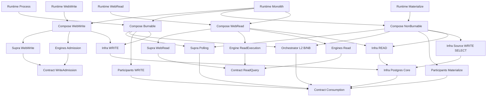

# Pocoma V3 — L7 — Architecture modulaire cible et plan de migration

Mandat : `GO_L7_MODULAR_ARCHITECTURE_CONSOLIDATION` · Date : 2026-11-10.

Statut : **NORMATIF POUR LA CIBLE**.

Dépôt : `kartaguez/pocoma` · Branche : `feat/v3-architecture`.

Référence initiale : `9823f88b57bfa312f2deb90d4a8eaf99ba8f28e2`.

La cible comprend **42 modules enfants Maven et un agrégateur, soit 43 projets**. Le présent document est la référence unique de la modularisation cible ; les audits restent des constats historiques. Les décisions et preuves d’exécution sont consignées dans le [rapport d’implémentation et de qualification](L7_Modular_Refactoring_Implementation_and_Qualification_Report.md).

## 1. Sources, précédence et décisions consolidées

### 1.1. Sources effectivement réconciliées

| Source | Référence et apport conservé |
|---|---|
| A1 — [Audit modularité et composabilité](V3_Modular_Architecture_and_Composability_Audit.md) | Inspection initiale à `53999a05` ; catalogue des 60 modules actuels, scénario compact à 38 modules, extractions HTTP et Compose. Ses dénombrements de classes et qualificatifs « morts » ne sont pas des autorisations de suppression. |
| A2 — `AUDIT_V3_MODULE_DEPENDENCY_RULES` | Rapport de conversation retrouvé et lu dans l'historique local du 2026-11-10, conversation `01a1c676-d630-7a53-b3ae-95706996843a`, référence auditée `0907fe13`. Matrice complète, conditions C1–C10, catalogue C01–C43 sauf C10, isolation source WRITE et politique READ transversale. Provenance détaillée au §12. |
| A3 — [Audit de frontière Consumption Engine / Orchestrator](L7_Consumption_Engine_Orchestrator_Boundary_Audit.md) | Audit à `0907fe13`, publié dans `9823f88b`. Scénario B, propriétaire unique L2, API riche, handles contrôlés, variantes et risques physiques ; graphe de 42 nœuds et 182 arêtes. |
| Code V3 de référence | [Agrégateur actuel](../../app/pom.xml), sources et écarts locaux préexistants consultés uniquement pour résoudre les contradictions ci-dessous. Aucun nouvel audit général. |
| Gouvernance | [AGENTS.md](../../AGENTS.md), [Reactor Verification Policy](../testing/Reactor_Verification_Policy.md), notamment §§17, 19, 34 et 35. |

Précédence : mandat courant pour les décisions adoptées ; code V3 courant pour le comportement réellement implémenté ; A3 puis A2 puis A1 pour les conclusions contradictoires. Les écarts locaux ne sont ni publiés ici ni réputés qualifiés. Les nouvelles frontières sont normatives pour la cible ; les signatures nouvelles restent conceptuelles jusqu'à leur conception et compilation dans un mandat ultérieur.

### 1.2. Décisions fermées

| ID | Décision normative | Justification et conséquence |
|---|---|---|
| D01 | Conserver Domain, Data Contract, Capability Contract, Port, Pure Function, Engine, Orchestrator, Supra, Infrastructure, Compose, Runtime. | Ce sont des responsabilités logiques, pas onze préfixes imposant chacun un artefact par classe. Les packages cohébergés respectent aussi la matrice. |
| D02 | Un Supra dépend des capacités neutres nécessaires à son canal ; aucune implémentation Engine/Orchestrator dans sa fermeture de production. | La substitution exige une indépendance Maven et une API sans types concrets. La visibilité transitive de ports neutres exige encore un contrôle de leurs usages. |
| D03 | Les Compose choisissent et instancient les implémentations, injectent ports, ressources et observations. | Ils ne décident ni protocole L2, ni autorisation métier, ni progression, retry, recovery ou politique de requête. |
| D04 | Un Supra principal par Compose logique ; plusieurs Compose logiques peuvent partager un module Maven et un hôte explicitement possédé. | Quatre modules Compose suffisent aux parcours sélectionnables. Le module n'est pas l'unité de sélection fonctionnelle. |
| D05 | Les Runtimes sélectionnent et hébergent les Compose ; construction inerte, activation explicite. | Aucun scan global ou registre singleton ne choisit implicitement les parcours. |
| D06 | Un seul `supra-polling-consumption`, agnostique de Burnable/NonBurnable. | Cadence, round-robin et dispatch sont communs. Le Compose fournit une capacité déjà spécialisée. |
| D07 | Consumption L2 : scénario **B**, `contract-consumption` + `orchestrator-consumption`. Absorber C10 dans C21. | Le code montre un protocole cohérent, sans consommateur autonome du seul noyau. Séparer aujourd'hui Engine et Orchestrator partagerait des décisions de sûreté sans indépendance démontrée. Deux variantes explicites et des collaborateurs communs internes, une seule autorité L2. |
| D08 | Les `Materialize*` et `Execute*` sont des participants avec effets, hébergés dans leurs Engines spécialisés. | Ils préparent, vérifient et produisent des effets ; ils ne sont pas des fonctions pures et ne possèdent pas la transaction physique. Les calculs déterministes restent dans le domaine propriétaire. |
| D09 | Séparer mutation WRITE, effets READ, sources WRITE en lecture et primitives PostgreSQL communes. | C41 ne dépend ni des Engines WRITE ni de C27. Principal source SELECT distinct ; aucun repli HTTP READ vers WRITE ni transaction distribuée. |
| D10 | Toute collaboration entre Engines autonomes passe par un Capability Contract ; Infrastructure → Engine n'est admissible que pour ses ports propriétaires. | Une donnée ou une interface placée dans un Engine ne justifie pas une dépendance durable entre implémentations. Les ports locaux restent permis sous C7 (§2). |
| D11 | Retenir les 42 modules du §3, sans découpage artificiel pour modifier ce total. | `38 − 1 + 5 = 42`. L'absence binaire de tout mutateur au sein d'une même autorité n'est pas promise par ce regroupement ; beans et privilèges restent obligatoires. |

### 1.3. Contradictions résolues et limites préservées

| Point | Arbitrage normatif et preuve ciblée |
|---|---|
| C10 + C21 dans A1 ; API L2 absente | D07 remplace ces deux emplacements par C21 derrière C39. A2 et A3 convergent ; le scénario A à 43 enfants n'est pas retenu. |
| Polling annoncé indépendant dans A1 | [V3DiscoveryLoop](../../app/orchestrator-poll-consumption/src/main/java/com/kartaguez/pocoma/orchestrator/poll/consumption/v3/V3DiscoveryLoop.java) choisit encore la famille. La cible retire cette sélection du Supra ; elle n'est pas déjà atteinte. |
| Burnables « sans checkpoint » dans [SPEC-05](SPEC-05_Consumption_Discovery.md) et [R1–R10](L2_R1_R10_Normative_Consolidation.md) | [DiscoveryEngine.discoverRequests](../../app/engine-consumption/src/main/java/com/kartaguez/pocoma/engine/consumption/v3/DiscoveryEngine.java) et [V11](../../app/infra-persistence-primary-jpa/src/main/resources/db/v3-identity/migration/V11__sequential_request_publication.sql) font autorité pour la migration : publication dense, checkpoint durable et admission atomique sur préfixe couvert. K prouve la découverte couverte, jamais la terminaison des effets. Le présent arbitrage consolide ce comportement ; M0 devra aligner les anciens textes avant déplacement. |
| « 25 modules morts » et suppression de JPA dans A1 | Les racines `Legacy` sont encore sélectionnables ; [Resources](../../app/composition-runtime-spring/src/main/java/com/kartaguez/pocoma/runtime/consumption/v3/V3ConsumptionWorkerConfiguration.java) construit EMF et `JpaTransactionManager`. DELETE est une destination V3 conditionnée à la fin de support V2. Le remplacement du propriétaire transactionnel JPA est un changement technique séparé, jamais un simple renommage. |
| 47 dépendances directes de composition dans A1 | A2 corrige en 32 déclarations internes directes, dont 31 optionnelles. Ne pas confondre déclarations, fermeture propre, propagation `optional` et activation Spring. Aucun chiffre ancien n'est utilisé comme preuve de résolution effective. |
| Dépendance WRITE Supra → exécution | L'arête vers `engine-write-pot` est transitive via admission ; l'import de `PotCommand` reste réel. Extraire la donnée vers C06, sans ajouter une invocation d'exécution. |
| CurrentBinding | Le code utilise `CurrentBindingStore` ; `GetCurrentBindingV3` reçoit une `Function`. `CurrentBindingReadStore` est un nom de cible possible, pas une interface existante à déplacer telle quelle. C09 accueillera les ports partagés étroits ; C07 la capacité de requête. |
| Politique READ dans Engine Pot | C43, et non C18, possède la politique commune à Pot, Identity et résultats. Quota, snapshot et deadlines restent des invariants ; le SQL correspondant appartient à l'Infrastructure. |
| Extraction physique des `*Source` | [JdbcCommandTerminalSource](../../app/infra-persistence-primary-jpa/src/main/java/com/kartaguez/pocoma/infra/persistence/primary/jpa/v3/JdbcCommandTerminalSource.java) construit un store WRITE ; [JdbcCurrentBindingSource](../../app/infra-persistence-primary-jpa/src/main/java/com/kartaguez/pocoma/infra/persistence/primary/jpa/v3/identity/JdbcCurrentBindingSource.java) et `JdbcIdentityTerminalSource` utilisent l'autorité Identity. C41 exige des lecteurs/décodeurs autonomes et des droits SELECT, au-delà du déplacement de fichiers. |
| « S0–S8 canoniques » dans A1 | Les slices normatives sont WEB, COMMAND, EVENT, PROJECTION, BINDING, LKV et FOUNDATION. Le §10 emploie ces ancres ; les lots M0–M10 sont des étapes, pas de nouvelles slices. |
| Six groupes Consumption | Pot Event comporte trois Consumptions ; Invitation est une septième matérialisation distincte. La cible conserve **2 Burnables + 7 NonBurnables = 9 identités durables**, sans les fusionner. |

## 2. Matrice normative des dépendances logiques

D = Domain ; DC = Data Contract ; CC = Capability Contract ; P = Port ; E = Engine ; O = Orchestrator ; S = Supra ; PF = Pure Function ; I = Infrastructure ; C = Compose ; R = Runtime. **A = ALLOW**, **C1…C10 = CONDITIONAL**, **F = FORBID**. Sens : source dépend de cible, en production.

| Source / Cible | D | DC | CC | P | E | O | S | PF | I | C | R |
|---|---|---|---|---|---|---|---|---|---|---|---|
| Domain | C1 | F | F | F | F | F | F | C2 | F | F | F |
| Data Contract | A | A | F | F | F | F | F | A | F | F | F |
| Capability Contract | A | A | C3 | C4 | F | F | F | F | F | F | F |
| Port | A | A | F | C5 | F | F | F | F | F | F | F |
| Engine | A | A | A | A | F | F | F | A | F | F | F |
| Orchestrator | A | A | A | A | F | F | F | A | F | F | F |
| Supra | A | A | A | C6 | F | F | F | A | F | F | F |
| Pure Function | A | A | F | F | F | F | F | A | F | F | F |
| Infrastructure | A | A | A | A | C7 | F | F | A | C8 | F | F |
| Compose | A | A | A | A | A | A | A | A | A | C9 | F |
| Runtime | F | F | F | F | F | F | F | F | C10 | A | F |

ALLOW ne dispense ni du DAG, ni de la propriété des invariants, ni des contrôles de ressources. Aucune inversion cachée par réflexion, FQN, `ServiceLoader`, scan Spring ou registre global. Aucun contrat neutre ne référence une implémentation, Spring, JDBC/SQL, ORM, pool ou credentials. Les bibliothèques du canal appartiennent au Supra ; les détails techniques à l'Infra. Une bibliothèque déterministe reste soumise à la pureté de son rôle.

| Condition | Limite normative et contrôle automatisable |
|---|---|
| C1 — D → D | Valeurs ou modèles d'un contexte explicitement identifié ; DAG des domaines. C03 → C01/C02 est l'ensemble intermodule admis ici. Aucune dépendance vers un processus applicatif. |
| C2 — D → PF | Fonction déterministe du même contexte, sans port, effet, horloge implicite ou contrat applicatif. Contrôle des packages et tests métier. |
| C3 — CC → CC | Agrégation cohérente de capacités, interfaces sans types concrets. Pas d'interface universelle ; graphe de signatures acyclique. |
| C4 — CC → P | Capacités bornées et types neutres, notamment `RecoveryReadContext`. C07/C39 → C08 n'autorise aucune exposition d'owner `AttemptTransactions`, `Guard`, connexion ou ticket dans l'API de canal/participant. Packages publics et internes séparés ; allowlist exacte de types au gel des API M2/M3. |
| C5 — P → P | Spécialisation fondée sur une abstraction neutre inférieure ; C09 → C08 uniquement pour les contextes bornés nécessaires. Aucun owner physique transféré. |
| C6 — S → P | Interface de statut de maintenance consultable seulement. C24 → C09 ne permet ni `ensureInitialized`, ni reconstruction, ni écriture, ni création de transaction. Le port de statut doit être distinct de l'autorité de maintenance. |
| C7 — I → E | Arête physique pour implémenter un port cohébergé : C27 → C11/C12/C13/C14 ; C41 → C15/C16/C17. Imports limités aux ports et types neutres nécessaires ; aucune construction/invocation d'Engine concret. Fermeture compatible avec l'autorité SQL. Extraire le port si la condition devient impossible. |
| C8 — I → I | Réutilisation technique sur les seules arêtes du §3 : TX, primitives PostgreSQL, codecs, cryptographie. Aucun accès READ → mutation WRITE, aucune propagation de credentials ou activation implicite. C40 est sans Engine et sans datasource globale. |
| C9 — C → C | Sous-composition inerte, même canal principal ou assemblage subordonné, aucune sélection globale ni démarrage. **Aucune arête C → C n'est nécessaire dans le graphe de référence.** |
| C10 — R → I | Exception de bootstrap opérationnel bornée, jamais de câblage métier. **Aucune arête directe R → I n'est accordée dans le catalogue actuel** ; toute introduction exige une justification et une mise à jour nominative du graphe. |

La matrice s'applique aux **classes et packages logiques** ; le §3 s'applique aux **artefacts Maven**. C06/C07/C39 cohébergent plusieurs rôles : une cellule favorable ne peut pas justifier l'import de tous leurs types. Pour C7, le module dépend de l'artefact Engine mais la classe d'adaptateur ne dépend que du port. Les arêtes de tests, dont C38, sont séparées et ne justifient jamais une dépendance de production interdite.

## 3. Catalogue exhaustif et graphe Maven de référence

Identifiants stables des audits : **C01–C43, sauf C10 absorbé**. Les identifiants ne sont donc pas une numérotation du nombre d'artefacts. Chaque ligne définit responsabilité, API/ports exposés et **ensemble fermé des dépendances internes directes autorisées**. Toute extension exige un motif et une révision de cette référence. Les dépendances externes seront contrôlées selon le rôle ; leurs versions ne sont pas fixées par ce document.

Les noms d'API nouveaux sont conceptuels. « Expose » signifie accessible à ses consommateurs autorisés, pas accessible au transport sans restriction. Les factories concrètes ne sont utilisées que par les Compose.

| ID | Module cible | Catégorie | Responsabilité | Contrats exposés / implémentés | Dépendances directes |
|---|---|---|---|---|---|
| C01 | `domain-pot` | D/PF | Valeurs, transitions et calculs Pot, Shareholder, Expense, Invitation et visibilité. | PotId, Amount, transitions, PotBalanceCalculator, PotVisibilityRules ; aucun effet. | ∅ |
| C02 | `domain-identity` | D/PF | Identité métier et transitions EUI/User. | ExternalIdentity, ExternalUserIdentity, BindingToken, IdentityTransitions ; valeurs partagées conservées. | ∅ |
| C03 | `domain-projection` | D/DC/PF | Modèles de projection et résultats terminaux détachés. | PotVersion, SubobjectVersion, PotBalance, PotVisibility, CommandTerminalResult, IdentityTerminalResult ; réducteurs purs. | C01, C02 |
| C04 | `domain-consumption` | D/DC | Identité et routage des Consumptions, familles et autorités. | ConsumptionId, ConsumptionDefinition, ConsumableFamily, RoutingV1 ; aucun état SQL. | ∅ |
| C05 | `contract-authentication` | DC | Identité externe authentifiée présentée aux capacités. | AuthenticatedExternalPrincipal ; aucune implémentation de sécurité. | C02 |
| C06 | `contract-write-admission` | DC/CC | Données et capacités de l’admission Command, Identity et Link. | PotCommand, IdentityRequest, LinkProposal, inputs, AdmissionFailure/Association ; AdmitCommand, AdmitIdentityRequest, IssueLinkProposal. | C01, C02, C05 |
| C07 | `contract-read-query` | DC/CC | Capacités de consultation, vues, erreurs et capacités internes de snapshot séparées. | ReadPot/InvitationQueries, ReadIdentityBindingQuery, ReadCommand/IdentityResultQuery ; API publique sans owner. | C01, C02, C03, C05, C08 |
| C08 | `port-transaction` | P | Abstractions de transaction et de lecture bornée ; aucun Spring/JDBC. | AttemptTransactions, RecoveryReadContext, résolution physique ; usage d’owner réservé au protocole/exécuteur. | ∅ |
| C09 | `port-projection` | P | Ports READ partagés, avec lecture, effet et maintenance distincts. | Stores Pot/Invitation, résultats, CurrentBindingStore ; statut consultable et autorité de maintenance séparés. | C01, C02, C03, C08 |
| C11 | `engine-admit-command` | E/P | Admission et idempotence des commandes Pot. | Fournit AdmitCommand ; port Store propriétaire. Les données communes quittent cet artefact. | C01, C02, C05, C06, C08 |
| C12 | `engine-admit-identity` | E/P | Admission IdentityRequest et émission LinkProposal. | Fournit AdmitIdentityRequest et IssueLinkProposal ; Store/ProposalStore locaux. | C02, C05, C06, C08 |
| C13 | `engine-write-pot` | E/P | Participant WRITE Pot, validation et application métier. | ExecutePotCommand fournit la participation C39 ; ports PotHistory/Revision/Actor/Command/publication ; CalculatePotBalances utilise un port. | C01, C04, C06, C08, C39 |
| C14 | `engine-write-identity` | E/P | Participant WRITE Identity ; décision sous autorité EUI. | ExecuteIdentityRequest fournit la participation C39 ; IdentityAuthority, IdentityRequestStore/Observation. | C02, C04, C06, C08, C39 |
| C15 | `engine-materialize-pot` | E/P | Participants de matérialisation Pot et Invitation avec effets READ. | MaterializePotVersion/Balance/Visibility/Invitation ; ports PotVersion/Balance/Visibility/InvitationSource. | C01, C03, C04, C08, C09, C39 |
| C16 | `engine-materialize-identity` | E/P | Participant de matérialisation CurrentBinding. | MaterializeCurrentBinding et CurrentBindingSource ; store partagé dans C09. | C02, C03, C04, C08, C09, C39 |
| C17 | `engine-materialize-results` | E/P | Deux participants de résultats terminaux immuables. | MaterializeCommandResult, MaterializeIdentityRequestResult ; CommandTerminalSource, IdentityTerminalSource. | C03, C04, C08, C09, C39 |
| C18 | `engine-read-pot` | E | Consultation Pot, navigation, visibilité et invitations. | Fournit les capacités Pot/Invitation C07 ; codecs de curseur ; aucune politique globale de quota. | C01, C02, C03, C07, C08, C09 |
| C19 | `engine-read-identity` | E | Consultation de l’identité/binding courant. | Fournit ReadIdentityBindingQuery via un lecteur neutre C09 ; aucune dépendance au participant C16. | C02, C03, C07, C08, C09 |
| C20 | `engine-read-results` | E | Consultation des résultats Command et Identity. | Fournit les deux capacités de résultat C07 ; aucune donnée/store partagé possédé ici. | C02, C03, C07, C08, C09 |
| C21 | `orchestrator-consumption` | O | Autorité unique du protocole L2, noyau commun et variantes Burnable/NonBurnable explicites. | Fournit les capacités C39 ; factories inertes. Claims, admission, progression, finalisation, recovery et capacité restent sous cette autorité. | C04, C08, C39 |
| C22 | `supra-polling-consumption` | S | Polling générique : cadence, attente, round-robin, dispatch et coordination des threads. | Canal de polling ; invoque C39, observe des rapports riches, ne connaît ni classe L2 ni choix de famille. | C04, C39 |
| C23 | `supra-web-write` | S | Transport HTTP WRITE, traduction requête/réponse et statuts. | Contrôleurs admission/Link, DTO et erreurs HTTP ; invoque C06. Hook d’admission injecté. | C01, C02, C05, C06 |
| C24 | `supra-web-read` | S | Transport HTTP READ, masquage et barrière de maintenance. | Contrôleurs Pot/Invitation/Identity/résultats ; invoque C07 et statut C09 limité par C6. | C01, C02, C03, C05, C07, C09 |
| C25 | `infra-tx-spring` | I | Transactions physiques Spring et classification technique des défaillances. | Implémente C08 et, si nécessaire, le SPI neutre de classification C39 ; aucune décision de retry/recovery. | C08, C39 |
| C26 | `infra-security-spring` | I | Adaptation sécurité Spring, principal authentifié et cryptographie. | Fournit C05 et collaborateurs de sécurité ; aucune factory Supra/Compose ni référence à une racine Runtime. | C01, C02, C05 |
| C27 | `infra-postgres-write` | I | Adaptateurs de mutation WRITE : admission, Pot, Identity, publication et découverte Burnable source. | Implémente les ports C11–C14 ; SQL métier WRITE et lecteurs de mutation associés ; C7 obligatoire. | C01, C02, C06, C08, C11, C12, C13, C14, C25, C26, C40 |
| C28 | `infra-postgres-read` | I | Adaptateurs READ : requêtes, effets de projection/résultats et maintenance SQL. | Implémente C09 ; migrations READ possédées ; consultation et maintenance ont des beans/principals séparés. | C01, C02, C03, C08, C09, C25, C40 |
| C29 | `compose-web-write-postgres` | C | Assemblages logiques HTTP admission Command, Identity et Link. | Factories inertes exposant le canal web WRITE et son lifecycle ; un Supra principal C23. | C05, C06, C11, C12, C23, C25, C26, C27, C42 |
| C30 | `compose-polling-burnable-write-postgres` | C | Assemblages logiques Burnable Command et IdentityRequest. | Factories de parcours sélectionnables, C21 spécialisé, C22, participants WRITE, ressources WRITE injectées. | C04, C08, C13, C14, C21, C22, C25, C27, C40, C42 |
| C31 | `compose-polling-nonburnable-materialize-postgres` | C | Assemblages logiques NonBurnable de matérialisation. | Factories indépendantes pour sept participants ; C21/C22, source WRITE SELECT et effets/control READ. | C04, C08, C09, C15, C16, C17, C21, C22, C25, C28, C40, C41, C42 |
| C32 | `compose-web-read-postgres` | C | Assemblages logiques HTTP READ et politique d’exécution commune. | Factories C24/C43, Engines de requêtes et infra READ ; aucune ressource WRITE. | C05, C07, C09, C18, C19, C20, C24, C25, C26, C28, C42, C43 |
| C33 | `runtime-web-write` | R | Hébergement de l’API admission WRITE. | Racine runtime-web-write ; sélectionne et active C29 uniquement. | C29 |
| C34 | `runtime-web-read` | R | Hébergement de l’API de consultation READ. | Racine runtime-web-read ; sélectionne et active C32 uniquement. | C32 |
| C35 | `runtime-worker-process` | R | Hébergement des parcours de traitement WRITE. | Racine runtime-worker-process ; sélectionne C30. | C30 |
| C36 | `runtime-worker-materialize` | R | Hébergement des parcours de matérialisation READ. | Racine runtime-worker-materialize ; sélectionne C31, sous-ensembles results/business-read configurables. | C31 |
| C37 | `runtime-monolith` | R | Hébergement monolithe de Compose explicitement sélectionnés. | Racine runtime-monolith ; héberge C29/C30/C31/C32 avec propriétaires de ressources distincts ou partagés explicitement. | C29, C30, C31, C32 |
| C38 | `architecture-tests` | Gate | Vérifications structurelles transversales et qualification des frontières. | Tests ArchUnit et contrôles de graphe ; aucun contrat ou classe de production. | ∅ en production ; les 41 autres modules en scope test |
| C39 | `contract-consumption` | CC/DC/P | Contrats L2 d’invocation, participation et SPI, séparés en packages. | Découverte/acquisition/exécution/renewal/maintenance/drain, handles opaques, rapports, Prepared/completion, observations, ports L2 et capacité consultable. | C04, C08 |
| C40 | `infra-postgres-core` | I | Primitives JDBC L2 communes WRITE/READ et helpers neutres. | Implémente ownership, slots, checkpoints, navigation, admissions L2 ; aucune sélection de base ou création de credential implicite. | C01, C04, C08, C25, C39 |
| C41 | `infra-postgres-write-source-read` | I | Lecture des références, historiques et résultats source WRITE pour Materialize. | Implémente les ports Source C15–C17 ; SQL SELECT et décodeurs neutres ; aucun store/authority mutateur WRITE. | C01, C02, C03, C08, C15, C16, C17, C25, C39, C40 |
| C42 | `infra-observability-micrometer` | I | Adaptateurs Micrometer et suivi observable des étapes. | Implémente observations neutres C07/C39 ; hooks scoped, aucun singleton global de réveil ; ponts de transport dans Compose. | C04, C07, C39 |
| C43 | `engine-read-execution` | E | Politique d’exécution READ commune, détachée de Spring/SQL. | Exécuteur/facade C07, quota, deadline, snapshot unique ; invoque les requêtes via capacités, jamais C18/C19/C20 concrets. | C02, C03, C07, C08, C09 |

Répartition par catégorie principale, sans compter deux fois les rôles cohébergés : **4 Domains + 4 contrats + 2 Ports + 11 Engines + 1 Orchestrator + 3 Supras + 7 Infras + 4 Compose + 5 Runtimes + 1 Gate = 42**. Les Pure Functions et Data Contracts présents dans des Domains n'ajoutent pas d'artefact.

C10 n'est pas un module vide à conserver : son API rejoint C39 et son implémentation V3 rejoint C21. C21 ne possède ni moteur métier concret ni adaptateur SQL. C38 est hors produit : aucun autre module ne peut en dépendre. Les 41 dépendances de test de C38 sont autorisées uniquement pour le contrôle transversal ; pas d'activation de toutes les racines Spring dans un même scan.

## 4. Graphe cible vérifié

Le tableau du §3 est la liste d'adjacence exhaustive du graphe de référence, et prime sur ce dessin condensé. Une flèche représente une dépendance Maven, y compris quand l'adaptateur n'importe que les ports de l'artefact cible.



### 4.1. Résultat statique reproductible

**Vérifié sur le modèle documentaire** : 42 nœuds, **182 arêtes internes directes de production**, aucune arête dupliquée, aucune cible absente, aucun cycle. C38 ajoute **41 arêtes de test**, soit **223 arêtes production + test** ; ce graphe combiné reste acyclique car personne ne dépend de C38. Agrégation Maven et héritage du parent ne sont pas des arêtes de production.

Contrôle de la matrice sur les rôles utilisés par ces arêtes : **161 ALLOW + 21 CONDITIONAL + 0 FORBID = 182**. Les conditions correspondent à C1 : 2, C4 : 2, C5 : 1, C6 : 1, C7 : 7, C8 : 8 ; chaque arête conditionnelle est nominativement couverte au §2. C2/C3 sont aussi des règles internes aux packages ; C9/C10 n'accordent ici aucune arête intermodule. Cette projection par rôle ne remplace pas les futurs contrôles ArchUnit des types réellement importés dans un artefact à rôles multiples.

Ordre topologique, dépendances avant consommateurs :

`C01,C02,C03,C04,C05,C06,C08,C07,C09,C11,C12,C39,C13,C14,C15,C16,C17,C18,C19,C20,C21,C22,C23,C24,C25,C26,C40,C27,C28,C42,C29,C30,C41,C31,C43,C32,C33,C34,C35,C36,C37,C38`.

| Fermeture contrôlée | Résultat normatif du modèle |
|---|---|
| C22 polling | C04, C08, C39 seulement ; aucun Engine/Orchestrator. |
| C23 WebWrite | C01, C02, C05, C06 seulement. |
| C24 WebRead | C01, C02, C03, C05, C07, C08, C09 ; aucun Engine/Orchestrator. |
| C31 et C36 Materialize | Aucun C11–C14, C27, C29, C30 ; C41 est la seule infrastructure de source WRITE. |
| C32 et C34 WebRead | Aucun C11–C17, C21, C22, C27, C30, C31, C41 ; uniquement l'autorité physique READ. |
| C30 et C35 Process | Aucun C15–C20, C28, C31, C32, C41, C43 ; uniquement l'autorité physique WRITE. |
| C29 et C33 WebWrite | C13/C14 présents transitivement via C27 mais non activés. Aucun accès READ requis. |

C40 contient du SQL L2 mutateur générique et C28 des mutateurs READ : leur présence transitive n'autorise pas leur utilisation depuis WebRead. C42 entraîne des modèles READ neutres dans des fermetures WRITE ; aucune ressource READ n'en découle. La cible promet l'isolation des autorités et l'absence de mutation métier WRITE dans Materialize, pas l'absence de toute classe techniquement mutatrice dans tous les binaires.

**Non vérifié par cette publication** : signatures compilables, résolution effective Maven des bibliothèques externes, classpath packagé, activation Spring, privilèges physiques et comportement transactionnel après déplacement. Les 182 arêtes sont le modèle normatif de référence, pas le reactor actuel. Une réduction aux seules arêtes réellement nécessaires reste admissible sans élargir les fermetures ; une arête nouvelle exige de réviser le modèle, sans la masquer par `optional`, une dépendance transitive ou une réflexion.

## 5. Correspondance exhaustive des 60 modules actuels

Les numéros A01–A60 suivent exactement l'ordre des modules de `app/pom.xml` au HEAD initial. Une ligne par source, toutes les destinations identifiées par Cxx. Convention exclusive de l'action : KEEP = un artefact principal de même nom ; RENAME = un artefact renommé ; MERGE = un artefact vers une destination commune ; SPLIT = plusieurs destinations ; DELETE = aucune destination V3. Des réceptions depuis d'autres lignes n'altèrent pas cette classification de la source.

**Condition V2 commune** : DELETE et retrait de classes historiques dans les modules réutilisés nécessitent la décision de fin de support M0/M9. Aucun retrait immédiat n'est autorisé. Les migrations historiques et les preuves utiles ont leur propre politique de rétention ; DELETE d'un module ne signifie pas DELETE des preuves ou de l'histoire SQL. Les contrats et tests V3 utiles suivent leur propriétaire de destination.

| Source | Module actuel | Action | Destinations cibles | Traitement et garde de migration |
|---|---|---|---|---|
| A01 | `domain-authorization` | DELETE | ∅ | Autorisation V2 ; invariants Pot V3 déjà dans C01. |
| A02 | `domain-event` | DELETE | ∅ | Enveloppes V2 ; préserver la sémantique des événements V3. |
| A03 | `domain-user-identity` | RENAME | C02 | Identité V3 et valeurs partagées ; historique sous condition V2. |
| A04 | `contracts-authentication` | RENAME | C05 | Principal authentifié neutre. |
| A05 | `domain-pot` | KEEP | C01 | Domaine Pot ; reçoit la fonction de visibilité A28. |
| A06 | `domain-projection` | KEEP | C03 | Modèles de projection ; reçoit les résultats terminaux A14/A22. |
| A07 | `domain-consumption` | KEEP | C04 | Définitions/routage ; aucun changement d’identité durable. |
| A08 | `port-transaction` | KEEP | C08 | Contrat transactionnel et contexte borné. |
| A09 | `port-binding-authority` | DELETE | ∅ | Autorité de binding V2 ; ne pas supprimer les autorités Identity V3 A19. |
| A10 | `engine-consumption` | SPLIT | C21, C39 | Implémentation L2/capacité interne → C21 ; API/participants/SPI → C39. Aucun C10 cible. |
| A11 | `engine-consume-command` | DELETE | ∅ | Consommation Command V2 ; exécution V3 A25 conservée. |
| A12 | `supra-consume-command` | DELETE | ∅ | Supra Command V2 ; remplacé au niveau V3 par C22/C30. |
| A13 | `supra-consume-command-result` | DELETE | ∅ | Supra résultats Command V2 ; contrat de parcours V3 C31. |
| A14 | `engine-read-command-result` | SPLIT | C20, C03, C09, C07 | Requête → C20 ; résultat → C03 ; store → C09 ; capacité/vues → C07. |
| A15 | `engine-materialize-command-result` | MERGE | C17 | Participant résultat Command et port source, fusion avec A23. |
| A16 | `contracts-command` | MERGE | C06 | Contrats d’admission Command, fusion avec A17. |
| A17 | `contracts-registration` | MERGE | C06 | IdentityRequest et LinkProposal, fusion avec A16. |
| A18 | `engine-admit-registration` | SPLIT | C12, C06 | Implémentations/ports locaux → C12 ; capacités et données d’opération communes → C06. |
| A19 | `engine-consume-registration` | RENAME | C14 | Participant WRITE Identity et ports locaux ; sans dépendance à l’implémentation C12. |
| A20 | `supra-consume-registration` | DELETE | ∅ | Supra IdentityRequest V2. |
| A21 | `supra-consume-registration-result` | DELETE | ∅ | Supra résultat Identity V2. |
| A22 | `engine-read-registration-result` | SPLIT | C20, C03, C09, C07 | Requête Identity → C20 ; résultat → C03 ; store → C09 ; capacité/vues → C07. |
| A23 | `engine-materialize-registration-result` | MERGE | C17 | Participant résultat Identity et port source, fusion avec A15. |
| A24 | `engine-produce-projection-task` | DELETE | ∅ | Producteur ProjectionTask V2 ; pas de recréation d’outbox V2. |
| A25 | `engine-write-pot` | SPLIT | C13, C06 | Participant/ports WRITE Pot → C13 ; PotCommand → C06. |
| A26 | `port-projection` | KEEP | C09 | Ports READ ; reçoit stores partagés et statut de maintenance étroit. |
| A27 | `engine-read-projection` | DELETE | ∅ | Lecture JSON Projection V2. |
| A28 | `engine-consume-projection-task` | SPLIT | C15, C01 | Quatre participants et ports Source → C15 ; PotVisibilityRules → C01. |
| A29 | `supra-consume-projection-task` | DELETE | ∅ | Supra ProjectionTask V2. |
| A30 | `engine-read-pot` | SPLIT | C18, C07 | Requêtes/curseurs → C18 ; capacités, vues et erreurs partagées → C07. |
| A31 | `projector-pot` | DELETE | ∅ | Projecteurs JSON V2 ; calculs purs V3 conservés dans C01/C03. |
| A32 | `engine-read-current-binding` | SPLIT | C19, C07 | Lecteur CurrentBinding → C19 ; capacité requête → C07 ; pas de store fictif à déplacer. |
| A33 | `engine-materialize-current-binding` | SPLIT | C16, C09 | Participant et Source → C16 ; CurrentBindingStore partagé → C09. |
| A34 | `engine-materialize-latest-known-version` | DELETE | ∅ | LKV V2 ; ne pas confondre avec les versions des projections V3. |
| A35 | `infra-persistence-read-jdbc` | SPLIT | C28, C40 | Adaptateurs et migrations READ → C28 ; primitives L2 communes → C40, sans doublon. |
| A36 | `contracts-observability` | DELETE | ∅ | TraceContext V2 ; observations V3 extraites d’A49 vers C39/C42. |
| A37 | `infra-tx-spring` | KEEP | C25 | Adaptateur TX physique ; remplacement de JPA traité séparément. |
| A38 | `infra-persistence-primary-jpa` | SPLIT | C27, C40, C41 | Mutation WRITE → C27 ; JDBC L2 commun → C40 ; lecteurs sources/décodeurs autonomes → C41. |
| A39 | `infra-persistence-projection-jdbc` | DELETE | ∅ | Persistance projection JSON V2. |
| A40 | `infra-projection-validation-networknt` | DELETE | ∅ | Validation JSON Schema V2 ; préserver les validations métier V3. |
| A41 | `orchestrator-consumption` | MERGE | C21 | Emplacement orchestrator réutilisé ; historique retiré sous condition, V3 reçu d’A10/A43/A49. |
| A42 | `engine-admit-command` | SPLIT | C11, C06 | Implémentation/Store → C11 ; capacité et données d’opération communes → C06. |
| A43 | `orchestrator-poll-consumption` | SPLIT | C22, C21, C39 | Scheduling → C22 ; décisions sûres renewal/drain → C21 ; types d’invocation neutres → C39. |
| A44 | `supra-consume-event` | DELETE | ∅ | Supra Event V2. |
| A45 | `supra-consume-binding` | DELETE | ∅ | Supra Binding V2. |
| A46 | `supra-consume-lkv` | DELETE | ∅ | Supra LKV V2. |
| A47 | `supra-http-write` | RENAME | C23 | Transport WRITE ; injection par C06 ; suppression du hook global. |
| A48 | `supra-http-read` | RENAME | C24 | Transport READ ; injection C07 et statut C09. |
| A49 | `composition-runtime-spring` | SPLIT | C29, C30, C31, C32, C26, C28, C42, C43, C21, C39 | Quatre Compose ; sécurité → C26 ; maintenance SQL → C28 ; observations → C42/C39 ; politique READ → C43 ; règles L2 → C21. Aucune logique métier résiduelle. |
| A50 | `runtime-monolith` | KEEP | C37 | Racine monolithe réduite à la sélection/hébergement des Compose. |
| A51 | `runtime-web-api` | SPLIT | C33, C34 | Deux racines HTTP par autorité ; conserver les contrats HTTP. |
| A52 | `runtime-event-consumption-worker` | DELETE | ∅ | Runtime Event V2, condition de support et gates historiques. |
| A53 | `runtime-command-result-consumption-worker` | DELETE | ∅ | Runtime résultat Command V2. |
| A54 | `runtime-registration-result-consumption-worker` | DELETE | ∅ | Runtime résultat Identity V2. |
| A55 | `runtime-registration-consumption-worker` | DELETE | ∅ | Runtime Registration V2. |
| A56 | `runtime-latest-known-version-consumption-worker` | DELETE | ∅ | Runtime LKV V2. |
| A57 | `runtime-binding-consumption-worker` | DELETE | ∅ | Runtime Binding V2. |
| A58 | `runtime-task-consumption-worker` | RENAME | C36 | Runtime Materialize ; conserve sélection results/business-read. |
| A59 | `runtime-command-consumption-worker` | RENAME | C35 | Runtime Process ; tests V3 L2/WRITE suivent ce propriétaire. |
| A60 | `architecture-tests` | KEEP | C38 | Gate architecture ; migrer ses oracles, supprimer seulement les obligations V2 retirées explicitement. |

Contrôle des actions exclusives : **8 KEEP + 7 RENAME + 5 MERGE + 15 SPLIT + 25 DELETE = 60 sources**. Les 35 sources non supprimées alimentent exactement **42 destinations distinctes**, par **64 relations source → destination**. Il ne faut pas additionner les destinations de chaque ligne : elles sont partagées, notamment C06, C07, C09, C20, C21, C39 et C40. Aucun module cible orphelin, aucune source oubliée.

Le calcul historique reste une vérification indépendante : 60 − 25 suppressions = 35 ; trois regroupements de deux artefacts en un = 32 ; éclatement A49 vers quatre Compose + sécurité (+4) et A51 vers deux racines (+1) = 37 ; extraction du contrat READ (+1) = 38. Puis absorption de C10 (−1) et extractions C39–C43 (+5) = **42**. Cette comptabilité d'artefacts est distincte du tableau ci-dessus qui explicite aussi les transferts de classes et de contrats, et requalifie donc davantage de sources en SPLIT.

Tout retrait historique dans un module KEEP/RENAME/SPLIT reste conditionné comme DELETE. Recevoir l'implémentation V3 dans C21 ne conserve pas l'ancien orchestrateur V2 par accident. Aucun changement d'UUID, de format durable, de schéma, de sémantique SQL ou de contenu de migration n'est requis par cette correspondance.

## 6. Composition, capacités et propriétaires d'invariants

### 6.1. Architecture d'un parcours

Le Runtime choisit une factory logique et lui fournit configuration et scope de ressources. Le Compose instancie les adaptateurs et les fournisseurs de capacités, câble leurs ports, puis expose un canal et son lifecycle. Le Supra invoque les Capability Contracts ; leurs fournisseurs sont les Engines d'admission/requête ou l'Orchestrator L2. Les participants WRITE/Materialize implémentent la participation C39 ; ils ne sont pas appelés librement par le transport.

Le sens des appels et celui des dépendances diffèrent : un port appartient à son consommateur et est implémenté par l'Infrastructure. Le Compose connaît ces deux côtés ; le protocole ne connaît jamais l'adaptateur concret. C43 invoque les requêtes via C07, sans dépendre de C18/C19/C20. C21 invoque le participant via C39, sans dépendre de C13–C17.

| Module Compose | Compose logiques et capacités | Supra principal | Fournisseurs / ressources |
|---|---|---|---|
| C29 | Admission HTTP Command, IdentityRequest et LinkProposal ; capacités C06 | C23 | C11/C12, C26, C27, TX et observations injectés ; aucune activation de participant WRITE. |
| C30 | Command Consumption ; IdentityRequest Consumption, chacun sélectionnable | C22 | Variante Burnable C21, participant C13 ou C14, source/lifecycle/effets WRITE, capacité explicite. |
| C31 | Sept parcours NonBurnable indépendants détaillés ci-dessous | C22 | Variante NonBurnable C21, participant C15/C16/C17, C41 source SELECT, C28 effets READ, C40 lifecycle READ. |
| C32 | Consultation HTTP Pot, Invitation, Identity, résultats Command/Identity ; capacités C07 | C24 | C43 encapsule la politique commune ; C18/C19/C20, C26, C28 et statut de maintenance consultable. |

Les factories C30/C31 doivent construire uniquement les participants sélectionnés. Construire tout le catalogue puis filtrer ses objets ne satisfait pas cette règle. Partager un Worker physique ou un pool est permis par injection explicite ; cela ne fusionne ni définition durable, ni checkpoint, ni état de recovery des parcours.

### 6.2. Identités et progression à conserver

Source : [V3ConsumptionCatalogConfiguration](../../app/composition-runtime-spring/src/main/java/com/kartaguez/pocoma/runtime/consumption/v3/V3ConsumptionCatalogConfiguration.java). Les noms logiques ci-dessous identifient les parcours ; leurs UUID sont les identités durables existantes, pas de nouveaux identifiants de migration.

| Parcours | UUID Consumption conservé | Variante / effets | Participant cible |
|---|---|---|---|
| Command | `98f7268d-d340-581c-b83d-010926223e14` | Burnable / WRITE | ExecutePotCommand, C13 |
| Identity Request | `2999e75c-272d-5afe-a966-c9364ef021fe` | Burnable / WRITE | ExecuteIdentityRequest, C14 |
| Pot Event — Version | `3dec1c8b-6e3e-57e1-82aa-aa0b5f297a4a` | NonBurnable / READ | MaterializePotVersion, C15 |
| Pot Event — Balance | `190a93c6-b8af-5ac7-8001-72e2ec53c2df` | NonBurnable / READ | MaterializePotBalance, C15 |
| Pot Event — Visibility | `b4d04cce-b5da-5d1b-9698-5ff9af9a46fa` | NonBurnable / READ | MaterializePotVisibility, C15 |
| Invitation Event | `924cd9e3-435d-5804-9d1e-c6aecadb9ab4` | NonBurnable / READ | MaterializeInvitation, C15 |
| Identity Event | `7b8d2838-bf7a-5117-868a-e5c14b4c0221` | NonBurnable / READ | MaterializeCurrentBinding, C16 |
| Command Completed | `63664303-d33e-5d42-8cce-c4dae8023311` | NonBurnable / READ | MaterializeCommandResult, C17 |
| Identity Request Completed | `1d8ff246-358f-5ddd-a7f5-416efcfd7445` | NonBurnable / READ | MaterializeIdentityRequestResult, C17 |

Les associations UUID/participant doivent aussi être vérifiées contre les factories courantes avant déplacement. Les trois Consumptions Pot conservent trois progressions indépendantes. Les cinq Runtimes Maven n'imposent pas cinq processus : C36 peut être lancé une fois pour les résultats et une fois pour le business READ. La topologie à cinq processus spécialisés réutilise alors quatre artefacts Runtime spécialisés ; C37 est l'alternative monolithe. Aucun sixième artefact Runtime n'est nécessaire pour cette topologie.

### 6.3. Contrat L2 et sûreté

C39 sépare trois surfaces : **invocation du protocole** pour le Supra ; **participation** pour les Engines spécialisés ; **SPI L2** pour C21 et les adaptateurs. Les packages et allowlists de types rendent ces surfaces distinctes dans un même JAR. Le protocole expose conceptuellement découverte, acquisition, exécution, abandon avant exécution, renouvellement, maintenance, demande de drain et état de quiescence.

Les résultats conservent statut, préfixe confirmé, compteurs examinés/couverts/admis, résultat de tentative, résolution physique par phase, observation durable, classification et résolution propre de cession. Une API `consume(): boolean` ou une deadline locale utilisée comme verdict physique est interdite.

| Propriétaire | Obligations indivisibles |
|---|---|
| C21 commun | Autorité des handles et de la capacité, acquisition, fencing, renouvellements autorisés, finalisation, classification de protocole, recovery et règlement des réservations. Les branches sûres aujourd'hui dans Worker/Renewal rejoignent cette autorité. |
| Variante Burnable | Intention PENDING protégée, reconnaissance terminal/slot existant, checkpoint de préfixe couvert, admission atomique ; aucune progression au-delà d'un PENDING non couvert. |
| Variante NonBurnable | Source rejouable exacte, progression par Consumption/partition, préparation par lectures bornées et finalisation READ distincte. Aucun verrou/source WRITE retenu dans Prepared. |
| Participant | Préparation et effets métier, observations/proofs de complétion spécifiques ; jamais acquisition, budget de retry, owner physique ou décision libre de suppression du slot. |
| C25/C40 et adaptateurs | Résolution physique, SQL et horloge DB après verrou, identité de contexte, durée de vie, thread, poison et atomicité réels ; aucun algorithme de recovery métier dans l'adaptateur. |
| C22 | Cadence, attente, fairness, dispatch, opportunités de renewal et coordination locale. Aucun choix B/NB, token autorisant, ticket mutable, owner TX ou verdict UNKNOWN réinterprété. |

Ordre final obligatoire : **protection/fencing → finalisation du participant → complétion métier vérifiée et suppression protégée du slot → fermeture/publication terminale → résolution physique**. Les effets, le DELETE et le suffixe de publication concernés restent atomiques dans l'autorité finale. Aucun effet métier supplémentaire après fermeture.

Un handle est lié à l'émetteur, l'instance, le scope, l'incarnation et l'usage unique ; une implémentation étrangère de son interface doit être refusée. Un UUID ou un record de claim n'est pas une autorisation d'exécuter. La perte de partition ne révoque pas automatiquement un claim encore valide. UNKNOWN conserve sa phase et ses exclusions : ni retry, ni restitution de capacité, ni réutilisation d'une lane incertaine sans preuve admissible. L'observation durable COMPLETED ne réécrit pas un ACK physique historiquement inconnu. La quarantaine demeure durable, sans purge/réenrôlement implicite.

### 6.4. Pureté et exécution READ

`PotBalanceCalculator`, transitions et `PotVisibilityRules` restent purs dans C01 ; réducteurs de projection dans C03. `CalculatePotBalances` lit un port et reste C13. Aucun `Materialize*` n'est classé PF. Les types métier/applicatifs purs ne doivent pas transporter `java.sql.Timestamp` : la validation actuelle doit conserver exactement sa précision et ses rejets lors de son déplacement vers une représentation neutre, avec adaptation SQL en Infra.

C43 possède quota, délai global et snapshot cohérent pour toutes les requêtes. Les valeurs actuelles (quota SQL 2, délai global 5 s, limites SQL 2 s / transaction 3 s) sont des comportements à préserver dans la migration, pas des réglages à optimiser. Les commandes SQL et le mécanisme physique du snapshot restent dans l'adaptateur transactionnel/READ ; C43 demande les garanties par ports neutres. La visibilité métier précède l'exposition des résultats ; navigation et tokens ne deviennent pas des autorités.

## 7. Frontières WRITE/READ et ressources des Runtimes

### 7.1. Trois preuves complémentaires

La conformité exige simultanément **fermeture Maven**, **graphe de beans/ressources activés**, et **privilèges SQL effectifs**. Aucun nom de module, flag `readOnly`, absence d'import ou profil Spring ne remplace ces trois preuves. C40 est réutilisable entre bases mais chaque instance reçoit explicitement son datasource et son owner ; aucun choix de base implicite dans l'adaptateur.

| Runtime | Compose sélectionnés | Ressources et autorité SQL autorisées | Ressources/actions refusées |
|---|---|---|---|
| C33 WebWrite | C29 | WRITE admission : principal limité à admission, association/idempotence et publication d'intentions nécessaire ; ressources réellement requises seulement. | READ, exécution de participant, ownership/claims de worker, mutation métier Pot/Identity, DDL et administration. C13/C14 présents dans le binaire via C27 ne deviennent pas des beans. |
| C35 Process | C30 | WRITE business et control ; participants Pot/Identity, lifecycle WRITE, intentions, résultats et publication selon ports. | READ productif, ressources de matérialisation, rôle superuser/owner, DDL/grants ou TX distribuée. |
| C36 Materialize | Sous-ensemble de C31 | WRITE **source SELECT seulement**, distinct de Process ; READ business pour effets et transaction finale ; READ control pour L2. Une ou plusieurs connexions/pools selon scopes qualifiés. | Toute mutation WRITE, y compris slots/K/ownership WRITE ; credentials Process ; construction de stores/autorités WRITE mutateurs ; transaction englobant WRITE et READ. |
| C34 WebRead | C32 | READ consultation seule, snapshots bornés et lecture du statut de maintenance. | WRITE et fallback synchrone, mutation READ ou lifecycle, création d'owner supplémentaire, initialisation/maintenance administrative, DDL. |
| C37 Monolith | Sélection explicite C29–C32 | Union des ressources des parcours sélectionnés, avec principals/scopes préservés ; partage uniquement s'il est déclaré et qualifié. | Compte administrateur commun, owner traversant les deux bases, ouverture automatique de quatre pools pour un seul parcours. Le monolithe ne peut offrir la séparation de processus des runtimes spécialisés. |

Un owner de scope explicite possède capacité, pools, hooks et fermeture ; le Runtime en est le propriétaire par défaut et les Compose empruntent les ressources injectées. Si plusieurs Compose partagent un scope, ils partagent la même capacité déclarée, avec comptabilité par Consumption. La destruction d'un Compose emprunteur ne ferme pas les ressources d'un autre. Aucun singleton `ON_ADMITTED`/`StageHandoffTracker` à wakeSignal global ne définit ce partage.

Allocation selon les autorités requises ; préserver les réserves de connexions business/control et renewal. Un `minimumIdle` accepté ne prouve pas la disponibilité physique : le worktree actuel peut accepter des settings ensuite refusés par les minima d'assemblage `M_W+2` / `M_W+6`. Qualification des pools, du drain et des réserves sous M8 ; aucune réduction budgétaire opportuniste.

### 7.2. Ownership SQL et ressources de migration

| Ensemble SQL | Autorité sémantique / artefact cible | Runtime et accès |
|---|---|---|
| Intentions Command/Identity, association d'admission, LinkProposal, séquences de publication d'intentions | Admission/WRITE, C27 ; invariants d'admission C11/C12, publication dense conservée. | C33 : admission limitée ; C35 : traitement autorisé ; C36 : lecture des sources publiées nécessaires seulement. |
| États/historiques Pot, EUI/User, résultats et événements terminaux | Métier WRITE C13/C14 via ports, adaptateurs C27. | Mutations C35 ; C36 SELECT via C41 ; C34 aucun accès. |
| `partition_ownership`, `discovery_checkpoint`, `consumption_slot`, contrat de routage | Autorité L2 C21/C39 ; primitives C40 instanciées dans la base des effets. | C35 dans WRITE ; C36 dans READ. WebRead/WebWrite n'acquièrent ni partition ni claim. |
| `read_*` business, invitations, binding et résultats | Projections/requêtes via C09 ; SQL C28. | C36 mutation READ ; C34 SELECT. Un effet READ ne produit pas d'événement WRITE. |
| `public.read_maintenance_state` et garde de reconstruction | Autorité SQL maintenance C28 ; port de statut distinct dans C09. | C34 lit uniquement le statut. Les commandes de reconstruction et DDL relèvent d'un outil/principal administratif distinct, hors Runtime applicatif ordinaire. |
| Migrations V3 WRITE/READ et histoire V2 | Responsabilité de schéma C27 pour WRITE et C28 pour READ ; SQL L2 commun peut être partagé comme ressource technique C40 sous ownership explicite. | Migrations exécutées par outillage provisionné, jamais découverte/initialisation automatique avec credentials applicatifs. C41 n'a aucun rôle de migration. |

Les chemins réels actuels comprennent `db/v3-consumption-write`, `db/v3-identity`, `db/v3-pot`, `db/v3-pot-execution`, `db/v3-admission`, `db/v3-invitation`, `db/v3-consumption-read`, `db/v3-read-business`, `db/v3-read-invitation`, ainsi que l'histoire `db/migration` et `db/read-store`. Les noms simplifiés `db/read_migration` du premier audit ne désignent pas les chemins à déplacer aveuglément. Toute relocalisation future conserve contenu, checksum, ordre et mécanisme de chargement ; un seul propriétaire de chaque ressource. Ne pas recopier une chaîne dans C27, C28 et C40 puis la lancer plusieurs fois.

C41 remplace les collaborations mutatrices cachées par des lecteurs/décodeurs neutres, y compris les lectures d'historique nécessaires aux balances. Son principal doit échouer sur INSERT/UPDATE/DELETE et sur le lifecycle WRITE, directement et via héritage, changement de rôle, vues, fonctions privilégiées ou droits de colonnes. Le garde de bootstrap doit disposer d'un profil source SELECT dédié, au lieu d'exiger les droits combinés de découverte/lifecycle WRITE actuels.

### 7.3. Transaction, recovery et reconstruction

Pour Materialize : photographie source WRITE en lecture seule, fermeture résolue de cette lecture, valeurs détachées, éventuelles lectures READ bornées consécutives, puis transaction finale READ. Aucun datasource/connexion retenu dans Prepared et aucun owner ambiant imbriqué. Même PID/XID pour les effets READ et le DELETE du slot ; recovery combine source exacte, K, slot et preuve métier appropriée.

La reconstruction reste un protocole opérationnel distinct : exclusion des writers READ, maintenance persistante fail-closed et remise en cohérence effets/slots/K. Ni changement d'ID pour contourner le rejeu, ni reset dans un refactoring de packaging, ni restauration isolée de K. Les règles de [reconstruction L6/I2](L6_I2_Technical_Implementation_Plan.md) sont conservées. Le compte HTTP n'obtient pas `ensureInitialized()` ou les commandes administratives.

## 8. Règles de conformité automatisables

Les mécanismes ci-dessous sont des obligations de la future migration, **pas des tests ajoutés ou exécutés ici**. Une règle nouvelle est d'abord confrontée aux exceptions héritées exactes, avec propriétaire et date d'extinction ; pas de regex globale invalidant arbitrairement tous les anciens packages, ni d'exclusion générale de Legacy pour fabriquer un PASS.

| ID | Règle et mécanisme | Oracle / limite à contrôler |
|---|---|---|
| V01 | Maven : inventaire des modules, manifeste des arêtes internes, DFS/Kahn ; séparer production, test, optional, profils et exclusions. | 42 enfants finaux, agrégateur distinct, graphe contenu dans §3 ; aucune cible absente/cycle. Résolution effective et classpaths packagés à comparer, pas seulement XML brut. |
| V02 | Maven Enforcer ciblé et ArchUnit : fermeture des Supras sans implémentation. | C22/C23/C24 compilent avec doubles fondés uniquement sur leurs contrats. Aucune dépendance test cachée à un Engine pour cette preuve. |
| V03 | ArchUnit : Domain/PF purs, contrats/ports neutres, contrôle des signatures, annotations, héritage, classes imbriquées et FQN. | Absence Spring/JDBC/JPA/owner ; contexte borné C4/C5 nominatif ; précision des inputs préservée. Pureté L2 ne devient pas une interdiction globale d'utiliser le domaine Pot dans ses propres Engines. |
| V04 | ArchUnit + graphe Maven : E/O sans implémentation E/O étrangère, Infra, Supra, Compose ou Runtime. | Collaborations par CC ; C21 sans métier concret. C7 autorise uniquement ports/types neutres exacts, jamais `new Engine` en Infra. |
| V05 | Maven/ArchUnit : Compose sans Runtime ; Runtime n'importe que ses Compose et bootstrap explicitement accordé. | Présence transitive normale d'Engines dans un Runtime n'est pas une violation ; construction directe d'un parcours par Runtime l'est. |
| V06 | Tests de composition, inventaire `META-INF`, imports, scans et auto-configurations. | Chaque factory seule : construction inerte, participants sélectionnés seuls, absence Legacy, pool étranger, migration implicite, owner additionnel ou bean Engine non sélectionné. Puis deux instances sans collision de beans/statique/hook. |
| V07 | Tests de composition et lifecycle : scopes empruntés/possédés, partage de capacité et activation. | Fermeture exactement une fois par propriétaire, jamais avant drain sûr ; pas de threads au constructeur ; capacité commune réellement injectée et pas recréée par parcours. |
| V08 | Maven + Spring négatif + PostgreSQL : fermeture et privilèges par Runtime. | Materialize sans mutation WRITE ; source SELECT seulement ; WebRead sans WRITE ni maintenance admin. Les trois preuves du §7 sont nécessaires. `dependencyConvergence` seul ne prouve aucune de ces propriétés. |
| V09 | Tests L2 de handles/contextes : faux handle, autre instance, autre scope, double usage, hors phase, thread/contexte expiré et poison tardif. | Aucun owner/Guard/ticket forgeable transféré au Supra ou au participant ; aucune libération sur observation seule. |
| V10 | PostgreSQL : finalisation, publication, ACK perdu, rollback, UNKNOWN, cession, renouvellements tardifs/partiels et drain. | Même transaction physique des effets et complétion, horloge DB après lock, rétention de capacité, exclusion des lanes indécidables et absence de replay indu. |
| V11 | Discovery B/NB, fenêtres séquentielles et tests participants. | Préfixe couvert, pending verrouillé bloquant, saturation/restart, quarantaines ; neuf IDs conservés, progression des trois Pot et Invitation ; aucune lecture source pendant final READ. |
| V12 | HTTP et requêtes READ : tests de contrat et composition. | Statuts, authentification/visibilité, idempotence, masquage, quotas/deadlines/snapshot, barrière maintenance 503, absence de fallback WRITE. |
| V13 | Ressources SQL : manifeste chemin/checksum/chargeur et ownership des migrations. | Aucun doublon, changement de checksum ou bootstrap historique implicite. Graphe de tests et fixtures réaffectés sans perdre les oracles nécessaires. |

Les tests existants cités par A3 (DiscoveryEngineTest, PreparationReadsTest, WorkerCapacityTest, AttemptTransactionsPostgresTest, DiscoveryPostgresTest, ConsumptionLifecyclePostgresTest, ReadParticipantsIntegrationPostgresTest et gardes V3) constituent des oracles à transférer et compléter, pas des résultats acquis au futur SHA. Les scénarios nominativement en quarantaine `V3WorkerResourcesPostgresTest#i5_r05` et `#i5_r12` restent dus lorsque leurs garanties sont affectées ; les renommer ou déplacer ne les exempte pas.

## 9. Invariants de migration, risques et rollback commun

La migration est **structurelle** : IDs, familles, partitions, routage, règles métier, données durables, sérialisation, ordre SQL/publication et budgets fonctionnels restent stables. Une nécessité de modifier l'une de ces hypothèses déclenche une étape distincte et une redéclaration des slices avant tout changement. Aucune double exécution de participants pour comparer des implémentations sur les mêmes effets.

| Risque | Prévention et gate bloquante |
|---|---|
| API opaque mais forgeable, résolution réduite à un booléen | M3/V09 ; registre d'émetteur/usage et rapports par phase conservés. |
| Sûreté répartie entre Supra et L2 après déplacement | M4/V10/V11 ; tableau d'ownership méthode par méthode, une seule décision de restitution/recovery. |
| Lecteur source conservant un mutateur ou des droits WRITE | M5/M8/V08 ; fermeture, test de bean absent, échecs SQL effectifs, décodeurs autonomes. |
| Perte d'atomicité par changement JPA/TX | M5/V10 ; conserver l'owner existant tant que le remplacement n'a pas sa preuve réelle ; aucun retrait Hibernate implicite. |
| Activation de parcours étrangers ou fermeture partagée implicite | M6/M7/V06/V07 ; factories sélectionnables, scopes possédés et hooks indépendants. |
| Suppression Legacy ou d'oracles encore requis | M0/M9 ; décision de support, inventaire de consommateurs et réaffectation des preuves avant retrait. |
| Régression temporelle liée au scheduling/pools | M4/M8 ; fairness, maintenance, renewal et drain testés avec leurs variantes ; aucune optimisation ou hausse de timeout pour obtenir PASS. Campagnes de capacité dues à leur gate propre, sans benchmark sous ce mandat. |
| Rollback binaire incompatible ou reset des progrès | Format/SQL/IDs inchangés ; sauvegarde d'observations durables et compatibilité ancienne/nouvelle explicite. Aucun rollback de base par suppression/rejeu. |

Rollback standard d'une étape future : conserver le dernier artefact/configuration qualifié et son SHA ; arrêter l'admission locale et demander le drain ; établir la quiescence et la résolution physique avant fermeture/changement d'hôte ; revenir au code/assemblage précédent par commit réversible ou redéploiement contrôlé, sans réinitialiser effets/slots/K. Une opération UNKNOWN non résolue interdit une bascule aveugle. Si des migrations ou formats deviennent nécessaires, arrêter ce plan structurel et concevoir séparément compatibilité, sauvegarde et rollback. Le retour au seul ancien binaire doit être démontré avant le GO de l'étape.

## 10. Plan incrémental, dépendances et gates

**Aucune étape d'implémentation n'est autorisée par cette publication.** Le prochain acte attendu est la revue du plan. Chaque futur lot doit déclarer impact, slices primaire/secondaires, commandes, base, critères et escalades selon la politique avant de toucher `app/`.

L'ordre partiel ci-dessous permet des lots revus séparément, sans changer leurs prérequis. G-A = gate global architecture §17 ; la présence de G-A n'impose pas un full en boucle locale. Toute modification réelle de module, arête ou frontière requiert G-A. **Le full est dû à M10 pour clôturer la restructuration étendue (§19)** ; si un sous-lot est lui-même une restructuration étendue ou un jalon d'intégration, son plan doit également le déclarer avant sa clôture.

| Lot / dépend de | Contenu borné | Slices pressenties à déclarer | Critères et gates d'acceptation | Rollback spécifique / risque |
|---|---|---|---|---|
| M0 / aucun | Ratifier cette référence ; aligner les anciennes mentions Engine/Burnable avec D07 et le préfixe L7/I2 ; inventorier support V2, ressources, API, exceptions et propriétaires. | NONE tant que documentaire ; aucun Maven. | Sources normatives alignées sans affaiblissement ; décision de support obtenue avant M9 ; inventaire exact des consommateurs et contrats. | Revenir au document précédent ; aucun effet durable. Le GO de revue n'est pas un GO d'exécution. |
| M1 / M0 | Extraire données partagées C06/C03, ports C09 et fonctions C01 ; préparer renommage Identity ; conserver formats/validations. | WEB + COMMAND + PROJECTION pour les contrats effectivement partagés. | V03/V11/V12, tests d'égalité/canonicalisation/précision et contrats ; G-A si graphe modifié. Aucune dépendance entre implémentations pour un simple type. | Réunir les types au packaging précédent par commit ; anciennes données toujours lisibles. Risque de compatibilité et de faux déplacement CurrentBinding. |
| M2 / M1 | Extraire capacités HTTP C06/C07, sécurité C26, observations C42, politique READ C43 ; hook d'admission injecté. | WEB principale ; COMMAND/PROJECTION si observations/contrats partagés affectés. | Supras HTTP sans Engine ; C43 utilise capacités, quota/snapshot/statuts inchangés ; V02/V03/V12 et G-A. | Revenir aux anciennes injections avec artefact précédent ; pas de modification métier. Risque de fuite JDBC dans C43 ou d'état global conservé. |
| M3 / M1 | Définir puis extraire C39, participation/SPI, handles opaques et rapports par phase ; autorité reste chez le fournisseur. | COMMAND principale, PROJECTION secondaire. | V03/V09 ; tests faux handle, autre instance, double usage, contexte expiré/poison ; G-A. Les packages et allowlists C4/C7 sont gelés avec les signatures compilables. | Retour API + consommateurs ensemble ; aucun handle interversion transporté. Risque principal : perte de l'autorité de capacité. |
| M4 / M3 | Faire invoquer C39 par C22 ; retirer branchement famille du polling ; regrouper l'implémentation dans C21 ; rapatrier les décisions sûres de renewal/drain. | COMMAND + PROJECTION ; WEB seulement si assemblage partagé réellement modifié. | V02/V09/V10/V11 ; variantes B/NB explicites, un noyau commun ; mêmes progrès/UNKNOWN/fairness/ordres ; G-A. | Arrêt/drain puis redéploiement précédent ; aucun reset. Risque de fin de thread prise pour résolution physique. |
| M5 / M1, M3 | Extraire C40/C41, sources et décodeurs sans mutateurs, restreindre C27/C28 ; répartir les ressources SQL. Traiter tout remplacement d'owner JPA en sous-lot explicite. | COMMAND + PROJECTION ; WEB si TX, stores ou bootstrap partagés affectés. FOUNDATION seule insuffisante pour TX productive. | V01/V04/V08/V10/V13 ; comparaison des lectures ; architecture sans C13/C14/C27 dans Materialize ; atomicité physique ; G-A. Aucune mutation SQL de protocole induite. | Revenir aux adaptateurs précédents avec principal compatible préqualifié ; aucun élargissement de droits improvisé pour contourner un échec. |
| M6 / M2, M4, M5 | Créer C29–C32, factories logiques, sélection avant construction, scopes et lifecycle ; déplacer le reste du câblage A49. | WEB + COMMAND + PROJECTION. | Chaque parcours seul puis multi-instance ; V05–V08 ; zéro pool/bean étranger ou migration automatique ; un propriétaire/close ; G-A. | Réactiver l'assemblage précédent après drain ; aucun worker concurrent sur les mêmes ressources par erreur. |
| M7 / M6 | Réduire/renommer les racines C33–C37, scinder WebAPI, héberger les sous-ensembles results/business ; adapter tests et ancres de politique dans le même lot. | WEB + COMMAND + PROJECTION ; preuve monolithe complémentaire. | V01/V05–V08/V12 ; démarrage/arrêt des binaires packagés et profils ; G-A. Nouvelles ancres normatives publiées avant de retirer les anciennes. | Redéployer les anciennes racines/configurations, profils et credentials conservés. Risque d'auto-config ou import Legacy réintroduit. |
| M8 / M7 | Qualifier les frontières physiques et profils SQL, ressources partagées, minima de pools, recovery/drain et maintenance en topologie sélectionnée. | WEB + COMMAND + PROJECTION ; consommateurs supplémentaires selon impact réel. | V07–V13, PostgreSQL positif/négatif, mêmes PID/XID, source SELECT, droits indirects, arrêt/reprise ; G-A si règles d'isolation modifiées. Réserves opérationnelles explicites et scénarios affectés en quarantaine inclus. | Revenir au déploiement qualifié précédent uniquement après résolution ; jamais un compte plus puissant comme rollback automatique. |
| M9 / M7, M8 et décision support V2 M0 | Retirer les 25 modules conditionnels et classes Legacy restantes ; absorber définitivement C10 ; nettoyer les dépendances de transition et aligner les oracles. | WEB/COMMAND/PROJECTION affectées ; EVENT/BINDING/LKV et autres canaux historiques seulement selon support effectivement retiré. | 60 sources traitées, 42 cibles, 182 arêtes de référence contrôlées ; aucun contrat/oracle utile perdu ; V01/V13 et G-A. Preuves historiques exécutées avant suppression des ancres ou réaffectées explicitement, jamais silencieusement perdues. | Restaurer modules/ancres et artefact antérieur par commit/redéploiement ; pas de suppression physique de l'histoire SQL pour rendre le retour impossible. |
| M10 / M8, M9 | Clôture de restructuration, intégration et réception des réserves. | Toutes les slices matériellement affectées, déclarées avec les ancres finales. | G-A non filtré, **full reactor non filtré requis**, preuves PostgreSQL pertinentes, composition/distribution et obligations de lot/SPEC-10 applicables. Inventaire exact des résultats et limites au SHA final. | Retour au dernier ensemble qualifié cohérent ; tout FAIL/UNKNOWN reste visible. Aucune clôture sur un sous-ensemble de tests ou anciennes preuves réputées fraîches. |

### 10.1. Commandes de vérification futures

**Aucune commande Maven ci-dessous n'a été exécutée dans cette mission.** Commandes canoniques actuelles depuis `app/`, avant renommage des ancres :

```sh
./mvnw -pl runtime-web-api -am test
./mvnw -pl runtime-command-consumption-worker -am test
./mvnw -pl runtime-task-consumption-worker -am test
./mvnw -pl runtime-web-api,runtime-command-consumption-worker,runtime-task-consumption-worker -am test
./mvnw -pl architecture-tests -am test
```

Une seule invocation composée lorsque ces trois slices sont toutes déclarées ; sinon sélectionner les seuls consommateurs affectés. Pour un retrait historique qui affecte effectivement ces canaux, leurs ancres actuelles sont :

```sh
./mvnw -pl runtime-event-consumption-worker -am test
./mvnw -pl runtime-binding-consumption-worker -am test
./mvnw -pl runtime-latest-known-version-consumption-worker -am test
```

FOUNDATION, pour infrastructure L0 de test seule : `./mvnw -pl infra-tx-spring -am test`. Ce n'est pas une preuve suffisante d'un changement de transaction productif. Les autres runtimes historiques ont leurs propres contrats de test, sans inventer de nouvelle slice canonique.

Après M7, la politique doit adopter explicitement les ancres C33/C34 pour WEB, C35 pour COMMAND et C36 pour PROJECTION. L'invocation composée correspondante ne sera canonique **qu'après cette mise à jour** :

```sh
./mvnw -pl runtime-web-write,runtime-web-read,runtime-worker-process,runtime-worker-materialize -am test
```

À M10, dans un mandat d'implémentation/qualification distinct :

```sh
./mvnw -pl architecture-tests -am test
./mvnw test
```

Ces gates restent non filtrés. FAST/CHANGE ciblés servent au feedback, sans remplacer leurs variantes et preuves obligatoires. Pas d'ajout automatique d'architecture-tests à une modification locale sans déclencheur, pas de `-amd` implicite, pas de `skipTests` ou d'anciens XML pour fabriquer une preuve. Après déplacements/suppressions, nettoyer la fermeture affectée si nécessaire pour éliminer les classes périmées, selon la politique, sans `clean install` systématique.

### 10.2. Base et escalades

La politique courante indique **Trusted baseline: NONE**. Chaque future campagne déclare CURRENT, BASELINE ou HISTORICAL et son bootstrap réel, y compris toute histoire entraînée transitivement par un gate canonique. Aucune baseline présumée, aucun rejeu historique par défaut, aucune dispense des migrations réellement nécessaires ; la certification d'une baseline est séparée.

Escalades : contrat partagé modifié → ajouter les consommateurs réellement affectés ; autorité/transaction/SQL touchés → leurs protocoles PostgreSQL et interleavings ; module/dépendance/isolation → G-A ; restructuration étendue/intégration → full à la clôture concernée. Une réserve ou un test lent ne justifie ni l'élargissement aveugle au full ni la réduction de ses oracles.

## 11. Réserves et arbitrages encore ouverts

Les décisions D01–D11, le scénario B, le polling unique, l'isolation WRITE/READ, le rôle des Compose et les 42 modules sont acquis pour cette cible. Les réserves suivantes conditionnent des étapes, sans rouvrir ces choix.

| Réserve | Responsable de décision / échéance | Effet bloquant et résolution attendue |
|---|---|---|
| O01 — Fin de support V2 | Mainteneurs / décision explicite avant M9. | Liste des déploiements et compatibilités encore supportés. Sans retrait autorisé, la cible reste définie mais le reactor transitoire peut dépasser 42 ; aucun DELETE ni déclaration de cible achevée. |
| O02 — JPA et owner transactionnel | Conception TX/qualification / M5. | Choisir conservation transitoire ou remplacement qualifié ; prouver mêmes frontières physiques, poison, résolution, PID/XID. Aucun retrait Hibernate déduit de l'usage JDBC. Le catalogue n'impose pas une nouvelle catégorie ou un module supplémentaire. |
| O03 — Signatures exactes et allowlists de types | Propriétaires des capacités / M2–M3. | Compiler API et consommateurs ; fixer interfaces internes/publics, handles et types C4/C7 ; aucune ressource dans les contrats neutres. Ce choix de signatures ne modifie pas le propriétaire des invariants. |
| O04 — Paramètres et partage opérationnels | Propriétaire du déploiement / M6–M8. | Nommer les scopes de ressources, capacité, fermetures, hooks et dimensionnements effectifs de chaque topologie. La règle d'ownership explicite du §7 est fermée ; les valeurs concrètes restent à qualifier. |
| O05 — Principals source et maintenance | Propriétaire de l'exploitation/SQL / M5–M8. | Définir noms et grants minimaux réellement installés, bootstrap SELECT et outil administratif ; tests des droits hérités/indirects. Aucun compte admin dans un Runtime applicatif. |
| O06 — Réserves physiques et preuves héritées | Revue de qualification / M8–M10. | Conserver réserves L1–L6, diagnostics UNKNOWN/disponibilité, quarantaines nominatives et obligations externes ; décider leur traitement sur hypothèses et preuves attribuées à leurs SHA. Cette publication n'en clôture aucune. |

Une demande future d'isolation binaire plus fine à l'intérieur d'une même autorité serait un changement de périmètre à justifier séparément. Elle n'est ni un prérequis caché ni une raison d'ajouter des micro-modules aujourd'hui. Aucune hypothétique réutilisation indépendante du noyau L2 ne rouvre le scénario B dans ce plan.

## 12. Traçabilité et contrôles de cette publication

### 12.1. Provenance du deuxième audit

`AUDIT_V3_MODULE_DEPENDENCY_RULES` n'était pas un fichier du dépôt initial. Le rapport intégral a été retrouvé dans le message final de la conversation locale du 2026-11-10 identifiée au §1.1 ; son texte extrait UTF-8 (sans ajout de saut de ligne) a pour SHA-256 :

`c6abfa0dcf58aff270e4488ffbdc656410c113278f390a64e977854ad654b6f0`.

Le présent document en consolide la matrice complète et ses dix conditions (§2), le catalogue et son graphe (§3–§4), la correction des lectures source et des autorités (§7), les contrôles (§8) et les restrictions de migration (§10–§11). Le catalogue est également reproduit dans A3, versionné au commit de référence. Les corrections factuelles d'A2 sont tracées au §1.3. Il ne s'agit pas d'une reconstruction supposée à partir du seul titre du rapport, ni d'un lien vers un fichier absent du dépôt.

### 12.2. Portée de la vérification réalisée

| Élément | Déclaration / résultat de la mission documentaire |
|---|---|
| Slices primaire / secondaires | **NONE / NONE**, documentation seule (§34 de la politique). |
| Impact applicatif prévu / réalisé | Aucun changement de code, POM, SQL, configuration ou test. Les changements locaux préexistants restent hors commit. |
| Vérifications statiques | Catalogue 42, matrice 11 × 11 et conditions, 182 arêtes production + 41 test, DAG/fermetures, 60 sources, 42 destinations, 64 relations de migration, neuf UUID ; liens locaux et whitespace. |
| Résultat du validateur documentaire | PASS : 18 tableaux de largeur cohérente, 121 cellules de matrice, 21 arêtes conditionnelles couvertes, 16 liens locaux existants ; comparaison du modèle avec A3 et des 60 sources avec l'agrégateur XML. Scripts de contrôle temporaires hors dépôt, aucun test applicatif créé. |
| Commandes réellement utilisées | `pwd`, `cat`, `sed`, `rg`, `rg --files`, `wc`, `head` ; lectures Git `status`, `branch`, `rev-parse`, `remote`, `log`, `diff` ; scripts Python standard pour XML POM, tableaux Markdown, DAG, correspondances et SHA-256. Contrôle final `git diff --check`. |
| Publication autorisée | `git add` limité aux deux fichiers documentaires, `git diff --cached` de contrôle, `git commit`, `git push origin HEAD:refs/heads/feat/v3-architecture` sans force ; contrôle distant `git ls-remote` et comparaison des empreintes du worktree. Le reçu de livraison fournit les SHA final et distant, sans auto-référence circulaire dans ce fichier. |
| Commandes Maven / benchmarks / tests applicatifs | **Aucune** ; aucune compilation ou preuve physique revendiquée. |
| Franchissement inattendu de slice | Aucun. |
| Gate architecture global | **NOT REQUIRED / NOT RUN** pour cette publication ; requis lors de l'implémentation des frontières décrites. |
| Full reactor | **NOT REQUIRED / NOT RUN** pour cette publication, conformément au mandat ; requis à la clôture de restructuration future. |
| Base, migrations et certification | Aucun accès/exécution ; aucune certification nouvelle. |
| Préservation locale | Inventaire initial de 12 fichiers suivis modifiés et 11 fichiers non suivis, index initial vide ; comparaison des contenus et statuts avant/après publication, sans stash, reset ou inclusion dans le commit. |

Critère de revue atteint lorsque le contrôle documentaire confirme simultanément le catalogue exhaustif, la matrice et ses exceptions, l'absence de cycles, les frontières de fermeture, la couverture 60 → 42 et les prérequis/gates de migration. Le verdict porte sur la cohérence du plan, pas sur une architecture déjà implémentée ou qualifiée.

**Verdict documentaire : `READY_FOR_L7_MODULAR_REFACTORING_PLAN_REVIEW`. Aucun GO d'implémentation.**
