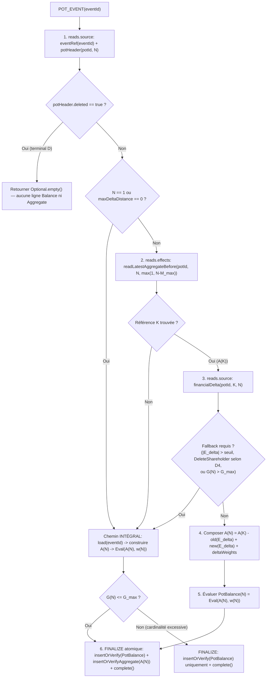

# Pocoma V3 — Plan de conception : Calcul incrémental `N−m` de `PotBalance`

- **Date** : 19 novembre 2026
- **Branche de référence analysée** : `feat/l7-4-a3-potversion-incremental-nm` @ `814fcb0b` (post-L7.4-A3)
- **Statut** : Document de conception (aucune modification de code, de schéma SQL ni de routage)
- **Documents de référence** :
  - [`PotVersion_Incremental_Materialization_Design_Plan.md`](PotVersion_Incremental_Materialization_Design_Plan.md)
  - [`L7_4_A3_PotVersion_Incremental_N_Minus_M_Report.md`](L7_4_A3_PotVersion_Incremental_N_Minus_M_Report.md)
  - [`SPEC-01_Pot_Domain.md`](SPEC-01_Pot_Domain.md) (§4 — Précision des rationnels et des poids)
  - [`SPEC-04_Read_Projections.md`](SPEC-04_Read_Projections.md) (§10 — `MaterializePotBalance` et suppression terminale `D`)
  - [`Reactor_Verification_Policy.md`](../testing/Reactor_Verification_Policy.md)
- **Modèle cible** : $\mathcal{A}(N) = \mathcal{A}(K) \ominus \Delta^{\text{old}}_{K \rightarrow N} \oplus \Delta^{\text{new}}_{K \rightarrow N}$, puis $\text{PotBalance}(N) = \text{Eval}(\mathcal{A}(N), w(N))$, avec $K = \max\{k \in [\max(1, N - M_{\max}), N) \mid \mathcal{A}(k) \text{ est commis et exploitable}\}$
- **Verdict du mandat** : **`READY_WITH_DECISIONS`**

---

## 0. Contexte et enjeu de performance

À l'issue de L7.4-A3 (`PotVersion` `N−m`), `MaterializePotVersion` est passé de `1 031.5 ms` à **`34.96 ms`** en p50 sur Grand Pot (`100` shareholders, `2 000` dépenses). **`MaterializePotBalance` est désormais le goulot d'étranglement dominant** :

- **Grand Pot (`restore-large-1-run2`)** : `PotBalance` p50 = **`381.61 ms`**, p95 = **`441.65 ms`** — soit **`~75 %`** de la latence E2E `C-03` (`511.03 ms`).
- **Cause racine** : à chaque événement `POT_EVENT(P, N)`, `JdbcPotBalanceSource.load()` recharge l'intégralité de `PotFinancialState(P, N)` depuis `v3_write` (`2 000` lignes `v3_expense_header`, `2 000` lignes `v3_expense_financials`, **`200 000` lignes `v3_expense_participant`**), puis `PotBalanceCalculator` effectue `~200 000` opérations `Fraction` (`BigInteger` + GCD) pour produire une seule ligne `read_pot_balance` de `100` entrées.

L'objectif est de concevoir un calcul incrémental opportuniste **`N−m`** pour `PotBalance`, sans modifier le routage ni l'ordonnancement, en préservant strictement l'exactitude rationnelle, l'immuabilité et le contrat public de `read_pot_balance`, **y compris lors des changements de poids par défaut des shareholders**.

---

## 1. Cartographie du code et audit du calcul métier réel

### 1.1 Chemin complet de calcul actuel (`WRITE` → `Domain` → `READ`)

| Couche / Module | Fichier & lignes | Rôle exact |
|---|---|---|
| **Domaine (calcul)** | [`PotBalanceCalculator.java`](../../app/domain-pot/src/main/java/com/kartaguez/pocoma/domain/pot/PotBalanceCalculator.java#L13-L61) | Calcul intégral exact en `Fraction` à partir de `PotFinancialState`. Retourne `Optional.empty()` si `state.header().value().deleted()`. |
| **Domaine (état financier)** | [`PotFinancialState.java`](../../app/domain-pot/src/main/java/com/kartaguez/pocoma/domain/pot/PotFinancialState.java#L15-L72) | Composition financière complète à $N$ : `PotHeader`, `Shareholder(Header, Weight)`, `Expense(Header, Financials)`. Exclut explicitement `PotDetails`, `ShareholderDetails` (noms, `userId`) et `ExpenseDetails`. Valide toutes les références (`InconsistentPotFactsException`). |
| **Domaine (valeurs)** | [`ExpenseFinancials.java`](../../app/domain-pot/src/main/java/com/kartaguez/pocoma/domain/pot/expense/ExpenseFinancials.java#L16-L39), [`Fraction.java`](../../app/domain-pot/src/main/java/com/kartaguez/pocoma/domain/pot/value/Fraction.java#L8-L58), [`Weight.java`](../../app/domain-pot/src/main/java/com/kartaguez/pocoma/domain/pot/value/Weight.java#L5-L10), [`Amount.java`](../../app/domain-pot/src/main/java/com/kartaguez/pocoma/domain/pot/value/Amount.java#L5-L10), [`ShareholderWeight.java`](../../app/domain-pot/src/main/java/com/kartaguez/pocoma/domain/pot/shareholder/ShareholderWeight.java#L10-L17) | Rationnels exacts normalisés (`BigInteger`, dénominateur $> 0$, GCD réduit, `0 → 0/1`) ; `Weight > 0` ; `Amount >= 0` ; `participants` non vide avec `Optional<Weight> specificWeight`. |
| **Domaine (transitions)** | [`PotTransitions.java`](../../app/domain-pot/src/main/java/com/kartaguez/pocoma/domain/pot/PotTransitions.java), [`ShareholderTransitions.java`](../../app/domain-pot/src/main/java/com/kartaguez/pocoma/domain/pot/ShareholderTransitions.java), [`ExpenseTransitions.java`](../../app/domain-pot/src/main/java/com/kartaguez/pocoma/domain/pot/ExpenseTransitions.java) | Suppressions strictement logiques (`deleted = true` dans les `Header`), réactivation interdite, suppression d'un shareholder interdite s'il est référencé par une dépense active (`ActiveShareholderUsage`). |
| **Projection publique** | [`PotBalance.java`](../../app/domain-projection/src/main/java/com/kartaguez/pocoma/domain/projection/PotBalance.java#L4-L12) | Record immuable `(potId, version, Map<UUID, Fraction>)`, trié par `SubobjectKey::compareUuid`, invariant somme nulle vérifié au constructeur. |
| **Engine (participant)** | [`MaterializePotBalance.java`](../../app/engine-materialize-pot/src/main/java/com/kartaguez/pocoma/engine/materialize/pot/MaterializePotBalance.java#L14-L34) | `ConsumptionParticipant` non-burnable (`consumption_id = 190a93c6-b8af-5ac7-8001-72e2ec53c2df`, famille `POT_EVENT`). `prepare()` lit `WRITE`, calcule, prépare `finalizeIn` / `requireCompletionReady`. `prepareRecovery()` recalcule l'oracle intégral et vérifie `store.evidence(...)`. |
| **Port source WRITE** | [`PotBalanceSource.java`](../../app/engine-materialize-pot/src/main/java/com/kartaguez/pocoma/engine/materialize/pot/PotBalanceSource.java#L5) | `PotFinancialState load(UUID eventId, RecoveryReadContext context)`. |
| **Adaptateur source WRITE** | [`JdbcPotBalanceSource.java`](../../app/infra-postgres-write-source-read/src/main/java/com/kartaguez/pocoma/infra/postgres/source/JdbcPotBalanceSource.java#L14-L24) → [`PostgresPotHistoryReader.java`](../../app/infra-postgres-core/src/main/java/com/kartaguez/pocoma/infra/postgres/core/history/PostgresPotHistoryReader.java#L101-L163) | Résout `(pot_id, subject_version)` depuis `v3_pot_event` + `v3_event_position` + `v3_event_counter`, puis appelle `history.financialAtVersion(potId, version)` sous snapshot `READ ONLY` + `REPEATABLE READ`. |
| **Port store READ** | [`PotBalanceStore.java`](../../app/port-projection/src/main/java/com/kartaguez/pocoma/port/projection/PotBalanceStore.java#L5-L12) | `insertOrVerify`, `requireStored`, `read`, `evidence`, `closePublication`. |
| **Adaptateur store READ** | [`JdbcPotBalanceStore.java`](../../app/infra-postgres-read/src/main/java/com/kartaguez/pocoma/infra/postgres/read/JdbcPotBalanceStore.java#L13-L62) | Persiste `read_pot_balance(pot_id, pot_version, schema_version=1, payload jsonb)` en `ON CONFLICT DO NOTHING` + relecture de vérification canonique (`ReadJdbc.same`). |
| **Schémas SQL** | `v3_write` [`V1__initial_schema.sql`](../../app/infra-postgres-write/src/main/resources/db/write/migration/V1__initial_schema.sql#L60-L233), `v3_read` [`V1__initial_schema.sql`](../../app/infra-postgres-read/src/main/resources/db/read/migration/V1__initial_schema.sql#L213-L225) | Tables intervalaires `[active_from, active_to)` indexées par `v3_<comp>_effect(pot_id, active_from)` et `v3_<comp>_at_version(pot_id, object_id, active_from, active_to)` en `v3_write` ; `read_pot_balance` strictement immuable (`ENABLE ALWAYS` triggers, `SELECT, INSERT` uniquement) en `v3_read`. |
| **Assemblage & maintenance** | [`ReadParticipants.java`](../../app/compose-polling-nonburnable-materialize-postgres/src/main/java/com/kartaguez/pocoma/compose/polling/materialize/ReadParticipants.java#L70-L78), [`ReadinessOracle.java`](../../app/compose-polling-nonburnable-materialize-postgres/src/main/java/com/kartaguez/pocoma/compose/polling/materialize/maintenance/ReadinessOracle.java#L362-L374), [`v3-rebuild-read.py`](../../scripts/operations/v3-rebuild-read.py#L76-L81), [`grant-l7-http-read.sql`](../../scripts/v3/grant-l7-http-read.sql#L18) | Câblage worker, contrôle d'intégrité (`deleted=false ⇔ row exists`), liste canonique des tables réinitialisées lors d'un rebuild, et privilèges `http-read`. |

### 1.2 Constat critique issu de l'audit du code

> [!IMPORTANT]
> **Un simple cumul par sous-ensemble de bénéficiaires ne suffit PAS.**
> Dans `PotBalanceCalculator.java` (`L40-L59`) et `SPEC-01_Pot_Domain.md` (§4), chaque participation d'une dépense porte un `Optional<Weight> specificWeight` :
> - Si `specificWeight` est absent (`Optional.empty()`), le participant utilise le **poids par défaut courant** du shareholder à $N$ (`ShareholderWeight.defaultWeight`).
> - Si `specificWeight` est présent (`Optional.of(w)`), ce poids **remplace** (ne multiplie pas) le poids par défaut pour cette dépense.
> - Une même dépense peut **mélanger** des participants à poids par défaut et des participants à poids spécifique (**dépense mixte**).

### 1.3 Invariants métier vérifiés

1. **Précision numérique** : arithmétique exacte dans $\mathbb{Q}$ (`Fraction(BigInteger, BigInteger)` canonique). Aucun arrondi, aucune troncature, aucune limite de précision.
2. **Montants et signes** : `Amount >= 0` (`Fraction.ZERO` autorisé). Le payeur reçoit $+A_e$ (qu'il soit ou non bénéficiaire) ; chaque participant $s \in B_e$ reçoit $-A_e \cdot \frac{w_{\text{eff}}(e,s,N)}{W_e(N)}$. La somme des soldes vaut exactement `0/1`.
3. **Poids et groupes vides** : `Weight > 0` strictement (en domaine Java et par `CHECK` SQL `^[1-9][0-9]*$`) ; `participants` non vide (en domaine Java et par validation `PostgresPotHistoryReader.L509`). Donc $W_e(N) > 0$ toujours : **ni groupe vide ni poids nul ne peuvent exister**.
4. **Shareholders historiques et supprimés** : `PotBalance(P, N)` inclut **tous** les shareholders créés à ou avant $N$, y compris ceux logiquement supprimés (`deleted = true`, qui portent nécessairement `0/1` car un shareholder supprimé ne peut être référencé par aucune dépense active).
5. **Suppression terminale du Pot (`D`)** : si `PotHeader(N).deleted == true`, `PotBalance(P, N)` est intentionnellement absente (`Optional.empty()`). Toutes les versions $V < D$ restent calculables même si elles sont matérialisées après $D$.
6. **Indépendance vis-à-vis des identités et détails** : `PotDetails`, `ShareholderDetails` (nom, rattachement/détachement `userId`), `ExpenseDetails` (libellé, date) et `CurrentBinding` n'ont **aucun effet** sur `PotBalance`.

---

## 2. Formalisation mathématique et preuve de suffisance

### 2.1 Expression exacte de `PotBalance(P, N)`

Pour un pot actif à la version $N$ ($h_{\text{pot}}(N) = \text{false}$) :
- $\mathcal{S}(N)$ : ensemble de tous les shareholders créés à $v \le N$ (actifs et supprimés).
- $w_s(N) \in \mathbb{Q}_{>0}$ : `defaultWeight` du shareholder $s \in \mathcal{S}(N)$ à la version $N$.
- $\mathcal{E}^+(N)$ : ensemble des dépenses actives (`ExpenseHeader.deleted == false`) à la version $N$.
- Pour chaque $e \in \mathcal{E}^+(N)$, de montant $A_e \in \mathbb{Q}_{\ge 0}$, payeur $p_e \in \mathcal{S}(N)$ et participants $B_e \neq \emptyset$, partitionnons $B_e$ en deux sous-ensembles disjoints :
  - $B_e^{\text{def}} = \{ u \in B_e \mid M_e(u) = \varnothing \}$ (participants au poids par défaut $w_u(N)$) ;
  - $B_e^{\text{spec}} = \{ (u, \omega_{e,u}) \mid u \in B_e,\, M_e(u) = \omega_{e,u} \in \mathbb{Q}_{>0} \}$ (participants à poids spécifique).

Posons $W_e^{\text{spec}} = \sum_{(u, \omega) \in B_e^{\text{spec}}} \omega \in \mathbb{Q}_{\ge 0}$. Le poids total effectif de la dépense $e$ à $N$ est :
$$W_e(N) = W_e^{\text{spec}} + \sum_{u \in B_e^{\text{def}}} w_u(N) > 0.$$

Le solde exact du shareholder $s \in \mathcal{S}(N)$ est :
$$B_s(N) = \sum_{\substack{e \in \mathcal{E}^+(N) \\ p_e = s}} A_e \;-\; \sum_{\substack{e \in \mathcal{E}^+(N) \\ s \in B_e^{\text{def}}}} A_e \frac{w_s(N)}{W_e(N)} \;-\; \sum_{\substack{e \in \mathcal{E}^+(N) \\ (s, \omega_{e,s}) \in B_e^{\text{spec}}}} A_e \frac{\omega_{e,s}}{W_e(N)}.$$

### 2.2 Décomposition en composantes additives exactes

Partitionnons $\mathcal{E}^+(N)$ (en ignorant trivialement les dépenses de montant $A_e = 0$, dont toute contribution est exactement `0/1`) selon que $B_e^{\text{def}}$ est vide ou non :

1. **Dépenses 100 % poids spécifiques ($B_e^{\text{def}} = \emptyset$)** :
   Pour une telle dépense, $W_e(N) = W_e^{\text{spec}}$ est **totalement indépendant de $w(N)$**. Sa contribution nette au solde de chaque shareholder $s$ est une constante rationnelle figée :
   $$\delta_e^{\text{fix}}(s) = \mathbf{1}_{s = p_e} A_e - \mathbf{1}_{(s,\omega_{e,s}) \in B_e^{\text{spec}}} A_e \frac{\omega_{e,s}}{W_e^{\text{spec}}}.$$
   Elle est donc **entièrement absorbable** dans un vecteur additif par shareholder, **sans créer aucun groupe** :
   $$F_s(N) = \underbrace{\sum_{\substack{e \in \mathcal{E}^+(N) \\ p_e = s}} A_e}_{\text{tous crédits payeur}} \;-\; \underbrace{\sum_{\substack{e \in \mathcal{E}^+(N) \\ B_e^{\text{def}} = \emptyset,\; (s, \omega_{e,s}) \in B_e^{\text{spec}}}} A_e \frac{\omega_{e,s}}{W_e^{\text{spec}}}}_{\text{débits figés (100\% spécifiques)}}.$$

2. **Dépenses dépendant des poids par défaut ($B_e^{\text{def}} \neq \emptyset$)** — couvrant **à la fois** les dépenses 100 % poids par défaut ($W_e^{\text{spec}} = 0$) et les dépenses mixtes ($W_e^{\text{spec}} > 0$) :
   Regroupons ces dépenses par la clé canonique de **bucket** :
   $$\kappa = \big(B^{\text{def}},\; W^{\text{spec}}\big) \quad \text{avec } B^{\text{def}} \neq \emptyset,\; W^{\text{spec}} \in \mathbb{Q}_{\ge 0}.$$
   Toutes les dépenses $e$ partageant la même clé $\kappa$ ont **strictement le même dénominateur** $W_\kappa(N) = W^{\text{spec}} + \sum_{u \in B^{\text{def}}} w_u(N)$ pour **tout** vecteur de poids $w(N) \in \mathbb{Q}_{>0}^{\mathcal{S}(N)}$.

   Définissons pour chaque bucket $\kappa$ les agrégats additifs :
   $$T_\kappa(N) = \sum_{e \in \kappa} A_e \in \mathbb{Q}_{>0}, \qquad Q_\kappa(s, N) = \sum_{\substack{e \in \kappa \\ (s, \omega_{e,s}) \in B_e^{\text{spec}}}} A_e \cdot \omega_{e,s} \in \mathbb{Q}_{>0} \quad (\text{vide si } W^{\text{spec}} = 0).$$

### 2.3 Théorème d'équivalence stricte

**Théorème.** Pour tout pot actif à la version $N$, le solde exact de chaque $s \in \mathcal{S}(N)$ est donné identiquement dans $\mathbb{Q}$ par :
$$B_s(N) = F_s(N) \;-\; \sum_{\substack{\kappa = (B^{\text{def}}, W^{\text{spec}}) \in \mathcal{B}(N) \\ s \in B^{\text{def}}}} \frac{T_\kappa(N)}{W_\kappa(N)} \cdot w_s(N) \;-\; \sum_{\substack{\kappa \in \mathcal{B}(N) \\ Q_\kappa(s, N) > 0}} \frac{Q_\kappa(s, N)}{W_\kappa(N)}$$
où $W_\kappa(N) = W^{\text{spec}} + \sum_{u \in B^{\text{def}}} w_u(N)$.

**Preuve.**
1. Par associativité, commutativité et distributivité exactes dans le corps $(\mathbb{Q}, +, \times)$ :
   - Les crédits payeur de toutes les dépenses actives et les débits des dépenses $B_e^{\text{def}} = \emptyset$ sont exactement regroupés dans $F_s(N)$.
   - Pour chaque bucket $\kappa = (B^{\text{def}}, W^{\text{spec}})$ et chaque $s \in B^{\text{def}}$ :
     $$\sum_{e \in \kappa} A_e \frac{w_s(N)}{W_e(N)} = \frac{w_s(N)}{W_\kappa(N)} \sum_{e \in \kappa} A_e = \frac{T_\kappa(N)}{W_\kappa(N)} \cdot w_s(N).$$
   - Pour chaque bucket $\kappa$ et chaque participant spécifique $s$ :
     $$\sum_{\substack{e \in \kappa \\ (s, \omega_{e,s}) \in B_e^{\text{spec}}}} A_e \frac{\omega_{e,s}}{W_e(N)} = \frac{1}{W_\kappa(N)} \sum_{\substack{e \in \kappa \\ (s, \omega_{e,s}) \in B_e^{\text{spec}}}} A_e \omega_{e,s} = \frac{Q_\kappa(s, N)}{W_\kappa(N)}.$$
2. **Additivité et réversibilité exactes** : $(\mathbb{Q}, +)$ étant un groupe abélien, retirer une ancienne dépense $e_{\text{old}}$ de $\mathcal{A}(K)$ revient exactement à soustraire ses termes dans $F$, $T_\kappa$ et $Q_\kappa$ (et supprimer le bucket lorsque $T_\kappa = 0$), et ajouter $e_{\text{new}}$ revient à les additionner.
3. **Invariant de somme nulle** : pour chaque bucket $\kappa$, $\sum_s Q_\kappa(s, N) = \sum_{e \in \kappa} A_e \sum_{(s,\omega) \in B_e^{\text{spec}}} \omega = T_\kappa(N) W^{\text{spec}}$, donc la somme des débits du bucket vaut $\frac{T_\kappa \sum_{B^{\text{def}}} w_u + T_\kappa W^{\text{spec}}}{W_\kappa} = T_\kappa = \sum_{e \in \kappa} A_e$, qui compense exactement les crédits payeur dans $F$. $\blacksquare$

> [!NOTE]
> **Aucune règle métier n'empêche l'agrégation exacte.** Les 3 cas (100 % poids par défaut, 100 % poids spécifiques, et dépenses mixtes) sont couverts **sans perte de précision et sans exception métier**. Seule la **cardinalité des buckets** (cas dégénéré où presque chaque dépense a une clé $(B^{\text{def}}, W^{\text{spec}})$ distincte) justifie un fallback de performance (cf. §7).

---

## 3. Modèle d'agrégats proposé

### 3.1 Structure logique `PotBalanceAggregate`

Pour une version active `(potId, version)` :

```java
public record PotBalanceAggregate(
        UUID potId,
        long version,
        Map<UUID, ShareholderEntry> shareholders,   // trié par SubobjectKey::compareUuid
        Map<BucketKey, BucketValue> buckets) {      // trié canoniquement
    public record ShareholderEntry(
            Fraction defaultWeight,                 // > 0
            boolean deleted,
            Fraction fixedNet) {}                   // payerCredits - pureSpecificDebits

    public record BucketKey(
            List<UUID> defaultParticipants,         // non vide, trié strictement par compareUuid
            Fraction specificWeightTotal) {}        // >= 0 (0/1 pour 100% poids par défaut)

    public record BucketValue(
            Fraction totalAmount,                   // > 0
            Map<UUID, Fraction> specWeightedAmounts) {} // trié par compareUuid, vide si specificWeightTotal == 0
}
```

### 3.2 Justification de chaque champ

- `shareholders` ($S$ entrées) :
  - Contient **tous** les shareholders $\mathcal{S}(N)$ (y compris supprimés), leur `defaultWeight` à $N$, leur indicateur `deleted`, et leur `fixedNet` $F_s(N)$.
  - Permet de reconstituer $\mathcal{S}(N)$ et $w(N)$ en ne lisant que les deltas `v3_shareholder_header` et `v3_shareholder_weight` sur $(K, N]$ (**zéro scan complet** de `v3_shareholder_*`).
- `buckets` ($G$ entrées) :
  - Chaque bucket ne porte que `totalAmount` $T_\kappa > 0$ (et `specWeightedAmounts` $Q_\kappa$, vide dans le cas courant $W^{\text{spec}} = 0$).
  - Les dépenses à $A_e = 0$ sont ignorées (no-op exact) et ne créent jamais de bucket vide.
  - Tout bucket dont $T_\kappa$ retombe à `0/1` après soustraction (par ex. suppression logique de toutes ses dépenses) est immédiatement retiré de `buckets` (avec assertion `specWeightedAmounts` vide).

### 3.3 Représentation JSONB canonique (avec arbitrage D1)

Deux encodages sont envisageables pour la sérialisation JSONB de `buckets` :

- **Option D1-A (recommandée) — Références par indices entiers `0..S-1`** : `shareholders` étant trié canoniquement par `SubobjectKey::compareUuid`, chaque shareholder possède un index déterministe `0..S-1` dans le tableau JSON. `p` et `sq` référencent cet entier :
  ```json
  {
    "s": [
      {"id": "00000000-...", "wn": "1", "wd": "1", "del": false, "fn": "100", "fd": "1"}
    ],
    "b": [
      {"p": [0, 1, 2], "swn": "0", "swd": "1", "an": "100", "ad": "1", "sq": []}
    ]
  }
  ```
  - **Avantage majeur** : sur Grand Pot ($S = 100$), un bucket de `100` participants pèse **`~350 B`** au lieu de **`~4 000 B`** (`11×` plus compact), et le décodage évite $G \times S$ appels `UUID.fromString()`.
- **Option D1-B — UUID explicites dans chaque bucket** : plus lisible lors d'inspections SQL manuelles, mais `10×` à `13×` plus volumineux dès que $G \ge 10$.

---

## 4. Algorithme incrémental `N−m` et gestion des changements de poids

### 4.1 Algorithme à deux chemins (`MaterializePotBalance.prepare`)



### 4.2 Résolution directe du delta financier sur $(K, N]$ (`JdbcPotBalanceSource.financialDelta`)

Dans une unique transaction `READ ONLY` + `REPEATABLE READ` sur `v3_write`, en exploitant exclusivement les index existants (`v3_*_effect` et `v3_*_at_version`) :

1. Vérifier que `(potId, N)` existe dans `v3_pot_version` et récupérer `latest`.
2. Lire les révisions finales à $N$ créées/modifiées sur $(K, N]$ via :
   ```sql
   WHERE pot_id = :potId
     AND active_from > :k
     AND active_from <= :n
     AND (active_to IS NULL OR active_to > :n)
   ```
   sur les **4 tables financières** uniquement :
   - `v3_shareholder_header` (`object_id, deleted`)
   - `v3_shareholder_weight` (`object_id, numerator, denominator`)
   - `v3_expense_header` (`object_id, deleted`)
   - `v3_expense_financials` (`revision_id, object_id, numerator, denominator, payer_id`)
   *(Ni `v3_pot_details`, ni `v3_shareholder_details`, ni `v3_expense_details` ne sont lues.)*
3. Soit $E_\Delta = \text{ids}(\Delta\text{exp\_header}) \cup \text{ids}(\Delta\text{exp\_financials})$.
   - **Si $E_\Delta = \emptyset$** : **0 requête** sur `v3_expense_participant` et **0 requête** d'état antérieur à $K$ !
     - Cas fréquents : `UpdateShareholderWeights`, `AddShareholders`, `UpdatePotDetails`, `UpdateShareholderDetails`, `UpdateExpenseDetails`, `AttachShareholderViaInvitation`.
     - **Attention** : un delta financier totalement vide sur $(K, N]$ est **normal** (mutation non financière) et **ne déclenche pas de fallback** — il produit $\mathcal{A}(N) = \mathcal{A}(K)$ (version $N$) instantanément.
   - **Si $E_\Delta \neq \emptyset$** et $|E_\Delta| \le \text{seuil}$ :
     - Charger l'état à $K$ des dépenses de $E_\Delta$ (`object_id = ANY(:changedIds) AND active_from <= :k AND (active_to IS NULL OR active_to > :k)`) sur `v3_expense_header` et `v3_expense_financials` (via les index `v3_*_at_version`).
     - Compléter `header(N)` ou `financials(N)` pour les dépenses dont une seule des deux composantes a changé sur $(K, N]$ (leur composante inchangée à $N$ est identique à celle chargée à $K$).
     - Charger `v3_expense_participant` en **une seule requête groupée** (`financial_revision_id = ANY(:revIds)`) uniquement pour les `revision_id` des dépenses actives à $K$ et/ou actives à $N$ dans $E_\Delta$.
4. **Traitement des changements successifs sur $(K, N]$** :
   - Toute révision intermédiaire avec `active_to <= N` et `active_from > K` est **automatiquement exclue** par les bornes SQL.
   - Une dépense créée à $K+1$ puis supprimée à $K+3 \le N$ est absente à $K$ et `deleted=true` à $N$ → effet net nul.
   - Une dépense active à $K$, modifiée à $K+1$ puis supprimée à $K+2 \le N$ : seule `financials(K)` est soustraite de $\mathcal{A}(K)$ ; rien n'est ajouté.
   - Une dépense active à $K$, modifiée à $K+1$ puis à $K+2 \le N$ : `financials(K)` est soustraite, `financials(N)` est ajoutée.

### 4.3 Étude dédiée aux changements de poids (`UpdateShareholderWeights`)

Lorsqu'un ou plusieurs shareholders changent de poids par défaut sur $(K, N]$ ($W_\Delta = \{s \mid w_s(N) \neq w_s(K)\}$), **aucune dépense n'est relue depuis `v3_write`**. Comparaison des trois stratégies d'évaluation :

| Stratégie | Mécanisme | Complexité RAM / SQL | Avantages & limites |
|---|---|---|---|
| **S1 — Recalcul de tous les buckets de $\mathcal{A}(N)$** *(recommandée — D3-A)* | Initialiser `balance[s] = fixedNet[s]`, puis évaluer chaque bucket $\kappa \in \mathcal{B}(N)$ avec $w(N)$. | $O(S + \sum_{\kappa \in \mathcal{B}(N)} (\|B_\kappa^{\text{def}}\| + \|Q_\kappa\|))$ RAM, **0 lecture** `read_pot_balance(K)`. | Autonome (ne dépend pas de `read_pot_balance(K)`), 1 seule passe, `< 0.1 ms` pour $G \le 10, S = 100$. |
| **S2 — Recalcul des seuls buckets contenant $W_\Delta$** *(D3-B)* | Lire `read_pot_balance(K)`, annuler les anciens débits (avec $w(K)$) et appliquer les nouveaux débits (avec $w(N)$) uniquement sur les buckets $\kappa$ tels que $B_\kappa^{\text{def}} \cap W_\Delta \neq \emptyset$ ou modifiés sur $(K, N]$. | $O(S + 2 \sum_{\kappa \in \mathcal{B}_{\text{aff}}} (\|B_\kappa^{\text{def}}\| + \|Q_\kappa\|))$ RAM + **1 lecture + décodage JSON** de `read_pot_balance(K)`. | Ne surpasse S1 que si $G$ est élevé (ex. $G > 100$) **et** $G_{\text{aff}} \ll G/2$. Ajoute une dépendance de lecture à `read_pot_balance(K)` et double les calculs par bucket affecté. |
| **S3 — Fallback intégral sur cardinalité excessive** | Si $G > G_{\max}$ (ou $\sum (\|B_\kappa^{\text{def}}\| + \|Q_\kappa\|) > E_{\text{entries,max}}$), ne pas persister $\mathcal{A}(N)$ et exécuter le calcul intégral. | $O(S + \sum_{e \in \mathcal{E}^+} \|B_e\|)$ SQL + RAM. | Indispensable comme garde-fou : évite de sérialiser/désérialiser des centaines de buckets quasi-uniques par dépense. |

**Effets des autres mutations de composition du pot :**
- **Ajout de shareholder (`AddShareholders`)** : nouveau shareholder ajouté dans $\mathcal{A}(N)$ avec `fixedNet = 0/1` et `defaultWeight = w(N)` ; apparaît dans `PotBalance(N)` à `0/1`. Aucun bucket impacté.
- **Rattachement / détachement (`ShareholderDetails.userId`, invitations)** : sans aucun effet financier ; $\mathcal{A}(N) = \mathcal{A}(K)$.
- **Suppression logique d'un shareholder (`DeleteShareholder`)** : le shareholder reste dans $\mathcal{S}(N)$ avec `deleted = true` et solde `0/1`. Par arbitrage **D4**, soit on déclenche un fallback intégral (simple, vérifie exhaustivement qu'aucune donnée WRITE corrompue ne le référence encore), soit on valide localement qu'il a `fixedNet == 0` et n'apparaît dans aucun bucket actif de $\mathcal{A}(N)$.

---

## 5. Schéma auxiliaire PostgreSQL envisagé (`v3_read`)

> [!NOTE]
> Aucune migration n'est introduite dans ce mandat. Le schéma ci-dessous est destiné à une future migration Flyway `V2__pot_balance_aggregate.sql` dans `app/infra-postgres-read/src/main/resources/db/read/migration/`. **Aucune modification de `v3_write` ni de `read_pot_balance` n'est requise.**

### 5.1 Définition DDL cible

```sql
create table read_pot_balance_aggregate (
  pot_id uuid not null,
  pot_version bigint not null check (pot_version > 0),
  schema_version integer not null check (schema_version = 1),
  bucket_count integer not null check (bucket_count >= 0),
  payload jsonb not null check (jsonb_typeof(payload) = 'object'),
  primary key (pot_id, pot_version),
  foreign key (pot_id, pot_version) references read_pot_balance(pot_id, pot_version)
);

create trigger read_pot_balance_aggregate_immutable
  before update or delete on read_pot_balance_aggregate
  for each row execute function read_subobject_immutable();
create trigger read_pot_balance_aggregate_no_truncate
  before truncate on read_pot_balance_aggregate
  for each statement execute function read_subobject_immutable();
alter table read_pot_balance_aggregate enable always trigger read_pot_balance_aggregate_immutable;
alter table read_pot_balance_aggregate enable always trigger read_pot_balance_aggregate_no_truncate;

revoke all on read_pot_balance_aggregate from public, "${expectedRuntime}";
grant select, insert on read_pot_balance_aggregate to "${expectedRuntime}";
```

### 5.2 Propriétés structurelles, index et volumétrie

1. **Recherche de $K$ sans index supplémentaire** : la clé primaire `(pot_id, pot_version)` sert directement un `Index Scan Backward` + `LIMIT 1` en $O(\log V)$ :
   ```sql
   SELECT pot_version, schema_version, payload::text
   FROM read_pot_balance_aggregate
   WHERE pot_id = ?
     AND pot_version < ?
     AND pot_version >= ?
   ORDER BY pot_version DESC
   LIMIT 1
   ```
2. **Intégrité intra-participant sans couplage inter-participant** :
   - La FK `(pot_id, pot_version) → read_pot_balance(pot_id, pot_version)` est strictement **interne** à `MaterializePotBalance` (aucune FK vers `read_pot_version`). Elle garantit au niveau SQL qu'un agrégat ne peut jamais exister sans sa balance publique correspondante ni pour une version terminale supprimée `D`.
3. **Isolation vis-à-vis de `http-read`** : `scripts/v3/grant-l7-http-read.sql` n'accorde aucun privilège sur `read_pot_balance_aggregate`.
4. **Coexistence avec les versions historiques déjà matérialisées** :
   - Les versions déjà présentes dans `read_pot_balance` sans ligne dans `read_pot_balance_aggregate` restent 100 % valides et lisibles.
   - La première version suivante $N$ ne trouve aucun $K$ dans `read_pot_balance_aggregate`, exécute le calcul intégral, puis persiste **à la fois** `read_pot_balance(P, N)` et `read_pot_balance_aggregate(P, N)` (si $G \le G_{\max}$). Dès $N+1$, le chemin incrémental s'active automatiquement sans backfill.
5. **Reconstruction historique (`v3-rebuild-read.py`)** :
   - Ajouter `"read_pot_balance_aggregate"` à `CANONICAL_MIGRATION_TABLES` dans `scripts/operations/v3-rebuild-read.py` (et aux fixtures de test `ReadParticipantsFixture`, `ReadReconstructionPostgresTest`). Lors d'un rebuild complet, la table est réinitialisée et repeuplée incrémentalement au fil du rejeu.
6. **Volumétrie estimée (encodage D1-A par indices entiers)** :

| Profil | $S$ | $G$ (buckets) | Taille brute / version | Sur `2 000` versions (brut) | Comparaison `read_pot_version` |
|---|---:|---:|---:|---:|---:|
| Moyen (`med`) | `20` | `1`–`5` | `~1.8`–`2.2 KB` | `~4 MB` (`~400 KB` sur 200 v) | `~20 KB` / version |
| Grand Pot (`large`, 1 groupe) | `100` | `1` | `~8.9 KB` | `~17.8 MB` (`~5 MB` TOAST/LZ4) | `~200 KB` / version |
| Grand Pot (20 sous-groupes × 50) | `100` | `20` | `~12.5 KB` | `~25 MB` | `~200 KB` / version |
| Grand Pot au plafond ($G_{\max} = 256$, moy. 50) | `100` | `256` | `~55 KB` | `~110 MB` (`~30 MB` compressé) | `~200 KB` / version |

---

## 6. Invariants transactionnels, concurrence, fencing et reprise

1. **Séparation `PREPARE` / `FINALIZE`** :
   - `prepare()` s'exécute exclusivement sous snapshots `READ ONLY` + `REPEATABLE READ` (`reads.source` sur `v3_write`, `reads.effects` sur `v3_read`). Aucune écriture ni verrou bloquant.
   - Une écriture concurrente de $\mathcal{A}(K)$ non encore commise est invisible (zéro dirty read) ; si elle a commis avant le snapshot, elle est complète et immuable.
2. **Atomicité totale en `FINALIZE`** :
   - Pour les participants READ, `read_pot_balance`, `read_pot_balance_aggregate` et `consumption_slot` résident dans la **même base `v3_read`** et sont modifiés dans la **même transaction `READ_COMMITTED`** protégée par `slots.protectFinal(claim)` :
     1. `store.insertOrVerify(balance)` (`INSERT ... ON CONFLICT DO NOTHING` + vérification canonique) ;
     2. si agrégat éligible ($G \le G_{\max}$) : `store.insertOrVerifyAggregate(aggregate)` (`INSERT ... ON CONFLICT DO NOTHING` + vérification canonique) ;
     3. `completion.complete()` (déclenche `requireCompletionReady()` vérifiant `requireStored` sur balance et agrégat, puis supprime le slot) ;
     4. `store.closePublication()`.
   - Conséquence : il est **impossible** qu'une balance commette sans son agrégat (lorsqu'éligible) ou qu'un agrégat commette sans sa balance ou son slot.
3. **Publications hors ordre et concurrence** :
   - Si deux workers matérialisent simultanément $N$ et $N-1$, les insertions ciblent des PK distinctes `(pot_id, N)` et `(pot_id, N-1)` (aucune contention sur verrou de ligne). $N$ utilise $K = N - 2$ sans attendre $N-1$.
   - Si un même événement est rejoué (ex. reprise après perte de bail), `ON CONFLICT DO NOTHING` + comparaison canonique garantit l'idempotence stricte et rejette toute divergence par `IllegalStateException`.
4. **Reprise après commit incertain (`prepareRecovery`)** :
   - `prepareRecovery()` reste **strictement l'oracle intégral** (`source.load` → `PotBalanceCalculator.calculate` → `store.evidence` sur `read_pot_balance`). Elle ne dépend jamais de `read_pot_balance_aggregate` (qui peut légitimement être absent si $G > G_{\max}$ ou sur versions pré-migration).
5. **Garde-fou d'erreur (pas de fallback silencieux sur corruption)** :
   - Toute `IllegalStateException("Corrupt PotBalanceAggregate")`, `InconsistentPotFactsException`, ou erreur SQL/transactionnelle remonte immédiatement à `ConsumptionEngine` (retry/quarantaine) et n'est **jamais** masquée par un fallback vers le calcul intégral.

---

## 7. Conditions de fallback et analyse des coûts

### 7.1 Matrice des conditions de fallback (sans attente ni retry)

| Condition | Comportement | Agrégat $\mathcal{A}(N)$ persisté après calcul intégral ? |
|---|---|---|
| `potHeader(N).deleted == true` (version terminale `D`) | Court-circuit immédiat (`Optional.empty()`) | Non (aucune balance ni agrégat) |
| `N == 1` ou `maxDeltaDistance == 0` | Calcul intégral | Oui, si $G(N) \le G_{\max}$ |
| Aucune référence $K \in [\max(1, N - M_{\max}), N)$ dans `read_pot_balance_aggregate` | Calcul intégral | Oui, si $G(N) \le G_{\max}$ |
| Volume de delta excessif : $\|E_\Delta\| > \text{maxChangedExpenses}$ (ex. `64`) ou $\|E_\Delta\| \cdot 2 > E_{\text{estimé}}$ | Calcul intégral | Oui, si $G(N) \le G_{\max}$ |
| Suppression logique d'un shareholder sur $(K, N]$ (si **D4-A**) | Calcul intégral | Oui, si $G(N) \le G_{\max}$ |
| Cardinalité des buckets excessive : $G(N) > G_{\max}$ (ex. `256`) ou $\sum_\kappa (\|B_\kappa^{\text{def}}\| + \|Q_\kappa\|) > E_{\text{entries,max}}$ (ex. `10 000`) | Calcul intégral (ou balance déjà calculée si déclenché en fin de composition) | **Non** (évite le gonflement de `read_pot_balance_aggregate`) |
| Corruption détectée (`Corrupt PotBalanceAggregate`, `InconsistentPotFactsException`, erreur SQL/TX) | **AUCUN fallback** — propagation immédiate | N/A |

### 7.2 Analyse comparative des coûts

Notations : $S$ = shareholders, $E$ = dépenses actives, $G$ = buckets distincts ($\le E$), $\bar{b}$ = taille moyenne d'un groupe ($\le S$), $\Delta E = |E_\Delta|$ = dépenses modifiées sur $(K, N]$, $m = N - K$.

| Poste de coût | Calcul intégral actuel | Incrémental **sans** agrégats *(non viable sur poids)* | Incrémental **avec** agrégats (`N−m`) |
|---|---|---|---|
| **Recherche & lecture de $K$ (`v3_read`)** | `0` | 1 lecture `read_pot_balance(K)` ($O(S)$) | 1 `Index Scan Backward` + lecture $\mathcal{A}(K)$ ($O(S + G \cdot \bar{b})$) |
| **Lecture `v3_write` (dépenses & participations)** | **$O(S + E \cdot \bar{b})$** (`200 000` lignes sur Grand Pot) | $O(\Delta E \cdot \bar{b})$ si poids inchangés ; **$O(S + E \cdot \bar{b})$** dès qu'un poids change | **$O(\Delta S + \Delta E \cdot \bar{b})$** (`100` lignes sur 1 `CreateExpense`, **`0`** sur `UpdateShareholderWeights` ou mutation non financière) |
| **Calcul `Fraction` en RAM** | $O(E \cdot \bar{b})$ (`~200 000` ops) | $O(\Delta E \cdot \bar{b})$ hors poids ; $O(E \cdot \bar{b})$ sur changement de poids | **$O(\Delta E \cdot \bar{b} + G \cdot \bar{b})$** (`~200` ops sur Grand Pot $G=1$) |
| **Écriture `v3_read` (agrégats + balance)** | 1 `INSERT` + 2 `SELECT` `read_pot_balance` ($O(S)$) | Idem ($O(S)$) | `read_pot_balance` ($O(S)$) + 1 `INSERT` + 2 `SELECT` `read_pot_balance_aggregate` ($O(S + G \cdot \bar{b})$) |
| **Latence estimée Grand Pot (`100/2000`, $G \le 10$)** | **`~382 ms` p50** | `~10 ms` hors poids, **`~382 ms`** sur changement de poids | **`~5–15 ms` p50** (toutes opérations, **y compris changement de poids**) |

### 7.3 Situations où l'optimisation peut être défavorable

1. **Très petit pot** ($E \le 10$) : la lecture/écriture supplémentaire de `read_pot_balance_aggregate` représente un surcoût fixe de `~1–2 ms` alors que le calcul intégral ne coûte déjà que `~2–3 ms`. *(Le surcoût reste négligeable en valeur absolue.)*
2. **Haute cardinalité de groupes ($G \approx E$, $\bar{b}$ grand)** : par ex. `2 000` dépenses ayant chacune un sous-ensemble distinct de `50` bénéficiaires (ou un `W_spec` unique). La sérialisation/désérialisation de $\mathcal{A}(K)$ et $\mathcal{A}(N)$ devient plus coûteuse que le calcul intégral → **mitigé par le plafond $G_{\max}$ / `maxAggregateBucketEntries`**.
3. **Distance $N - K$ importante avec nombreuses mutations ($\Delta E \approx E$)** : le chargement de l'état à $K$ et à $N$ des dépenses modifiées finit par lire autant de lignes que le chemin intégral, plus le coût de $\mathcal{A}(K)$ → **mitigé par `maxDeltaDistance` et `maxChangedExpenses`**.

---

## 8. Découpage en incréments et portée de vérification

### 8.1 Verification scope (`docs/testing/Reactor_Verification_Policy.md` §29)

- **Expected production impact** :
  - `domain-projection` (`PotBalanceAggregate`),
  - `port-projection` (`PotBalanceStore` ou `PotBalanceAggregateStore`),
  - `engine-materialize-pot` (`PotBalanceSource`, `PotBalanceDeltaComposer`, `PotBalanceObservation`, `MaterializePotBalance`),
  - `infra-postgres-write-source-read` (`JdbcPotBalanceSource`),
  - `infra-postgres-read` (`V2__pot_balance_aggregate.sql`, `PotBalanceAggregateJson`, `JdbcPotBalanceStore`),
  - `compose-polling-nonburnable-materialize-postgres` (`MaterializeSettings`, `ReadParticipants`, `MaterializeComposeConfiguration`, `MicrometerPotBalanceObservation`),
  - `scripts/operations/v3-rebuild-read.py` (`CANONICAL_MIGRATION_TABLES`).
- **Primary slice** : `PROJECTION` (`./mvnw -pl runtime-worker-materialize -am test`).
- **Secondary slices** : `NONE`.
- **Forbidden production impact** : `WEB` (`runtime-web-write`, `runtime-web-read`, `supra-web-read`), `COMMAND` (`runtime-worker-process`), `FOUNDATION` (`infra-tx-spring`), `v3_write` SQL schema, `RoutingV1`, `JdbcSlotKeyNavigation`.
- **Global architecture gate** : `NOT REQUIRED` par incrément ; **`REQUIRED`** à la clôture du lot (`./mvnw -pl architecture-tests -am test` ou `HexagonalArchitectureTest` + `ConsumptionEngineArchitectureTest`).
- **Full reactor** : `NOT REQUIRED` par incrément ; **`REQUIRED`** uniquement au gate d'intégration / qualification conjointe `PotVersion` + `PotBalance` avant merge sur `main`.
- **Database verification** : **`CURRENT`** (nouvelle migration `V2__pot_balance_aggregate.sql` dans `v3_read`, vérifiée sur PostgreSQL 17 via Testcontainers + privilèges/triggers + `ReadReconstructionPostgresTest`).
- **Escalation conditions** : toute modification nécessaire hors des modules listés ci-dessus (ex. `ReadController`, `v3_write`, `ConsumptionEngine`).

### 8.2 Plan d'incréments

1. **Incrément 1 — Modèle d'agrégat & algorithme pur (`domain-projection`, `engine-materialize-pot`)** :
   - Introduire `PotBalanceAggregate`, `PotBalanceAggregateBuilder` (depuis `PotFinancialState`), `PotBalanceDeltaComposer` ($\mathcal{A}(K) \to \mathcal{A}(N)$) et `PotBalanceAggregateEvaluator` ($\mathcal{A}(N) \to \text{PotBalance}(N)$).
   - Tests unitaires exhaustifs d'équivalence stricte contre `PotBalanceCalculator` (oracle).
2. **Incrément 2 — Stockage auxiliaire `v3_read` & delta `v3_write` (`infra-postgres-read`, `port-projection`, `infra-postgres-write-source-read`)** :
   - Migration `V2__pot_balance_aggregate.sql`, `PotBalanceAggregateJson`, `readLatestAggregateBefore` / `insertOrVerifyAggregate` / `requireAggregateStored`.
   - `JdbcPotBalanceSource.eventRef` et `financialDelta` sur les 4 tables financières + `v3_expense_participant` groupé.
   - Tests PostgreSQL 17 dédiés (privilèges, triggers d'immuabilité, FK vers `read_pot_balance`, coexistence pré-migration, intervalles $(K, N]$ avec remplacements multiples).
3. **Incrément 3 — Intégration deux chemins `N−m` dans `MaterializePotBalance` + instrumentation Micrometer + rebuild** :
   - Intégration dans `MaterializePotBalance`, conservation de `prepareRecovery()` sur oracle intégral.
   - Propriétés `pocoma.v3.worker.pot-balance.*` et métriques `pocoma.v3.potbalance.*`.
   - Mise à jour de `v3-rebuild-read.py` et des tests d'intégration `runtime-worker-materialize` (hors-ordre, concurrence, recovery, reconstruction complète).
4. **Incrément 4 — Qualification performance L7.4-A4 & qualification conjointe `PotVersion` + `PotBalance`** :
   - Campagnes `restore-large-1`, `med-1`, `med-5`, scénario dédié `UpdateShareholderWeights` sur Grand Pot, et vérification conjointe avant toute décision de merge/push.

---

## 9. Stratégie de tests (oracle = `PotBalanceCalculator` intégral)

### 9.1 Tests unitaires déterministes (`domain-projection`, `engine-materialize-pot`)

Tous comparés **rationnel pour rationnel** (`numerator` et `denominator` exacts) contre `PotBalanceCalculator.calculate(PotFinancialState)` :
- **Cycle de vie dépenses** : création, modification montant / payeur / bénéficiaires / `specificWeight`, suppression logique, création + modification + suppression dans le même intervalle $(K, N]$, dépense à montant `0/1`.
- **Typologie des poids** : 100 % poids par défaut, 100 % poids spécifiques, dépenses mixtes (même $(B^{\text{def}}, W^{\text{spec}})$ avec participants spécifiques différents ; $W^{\text{spec}}$ différents), rationnels arbitrairement grands (`> 64 bits`, dénominateurs premiers).
- **Changements de poids (`UpdateShareholderWeights`)** : modification d'un ou plusieurs poids par défaut affectant des buckets purs et mixtes, sans affecter les dépenses 100 % spécifiques ni les balances historiques $< N$.
- **Composition du pot & identités** : `AddShareholders` (nouveau shareholder à `0/1`), `DeleteShareholder` (solde `0/1` conservé), `UpdatePotDetails` / `UpdateShareholderDetails` / `UpdateExpenseDetails` (delta financier vide), `DeletePot` (version terminale `D` → `Optional.empty()`).
- **Écarts `N−m` & fallbacks** : `m = 1, 2, 5, 20`, absence de $K$, $N - K > M_{\max}$, $|E_\Delta| > \text{seuil}$, $G > G_{\max}$ (balance écrite, agrégat non persisté), propagation stricte sans fallback sur `Corrupt PotBalanceAggregate` et `InconsistentPotFactsException`.
- **Test de propriété randomisé (seeded)** : séquences aléatoires de `100` commandes mixtes (incluant sous-ensembles, poids spécifiques, changements de poids, suppressions) vérifiant l'équivalence stricte sur des sauts $K \to N$ aléatoires.

### 9.2 Tests d'intégration PostgreSQL 17 (`infra-postgres-read`, `runtime-worker-materialize`)

- **Hors-ordre et concurrence** : matérialisation dans l'ordre `V1, V6, V3, V9, V2, V4, V5` avec écritures concurrentes ; vérification que `read_pot_balance` est identique à l'oracle pour toutes les versions et que `read_pot_balance_aggregate` respecte la FK et l'immuabilité.
- **Coexistence pré-migration** : base peuplée de `read_pot_balance(V1..V5)` sans agrégats → `V6` bascule intégral et crée $\mathcal{A}(6)$ → `V7` s'exécute en incrémental depuis $K = 6$.
- **Idempotence, reprise & fencing** : double exécution d'un même événement, perte de bail, `prepareRecovery()` après commit incertain (y compris quand $G > G_{\max}$).
- **Reconstruction historique complète (`ReadReconstructionPostgresTest`)** : reset complet incluant `read_pot_balance_aggregate`, rejeu des 5 familles WRITE, comparaison du hash canonique final de `read_pot_balance`.
- **Sécurité SQL** : vérification que le rôle runtime n'a ni `UPDATE`, ni `DELETE`, ni `TRUNCATE` sur `read_pot_balance_aggregate`, et que `http-read` n'y a pas `SELECT`.

---

## 10. Protocole de benchmark et instrumentation

### 10.1 Instrumentation Micrometer (`pocoma.v3.potbalance.*`)

En miroir exact de `MicrometerPotVersionObservation`, permettant de mesurer **séparément** le coût des agrégats et celui de `PotBalance` :

| Métrique | Type | Tags / Mesure |
|---|---|---|
| `pocoma.v3.potbalance.aggregate.lookup` | `Counter` + `Timer` | `outcome=hit\|miss\|corrupt` (coût de recherche + lecture + décodage de $\mathcal{A}(K)$) |
| `pocoma.v3.potbalance.reference_distance` | `DistributionSummary` | Distribution de $N - K$ lors des `hit` |
| `pocoma.v3.potbalance.delta.expenses` | `DistributionSummary` + `Timer` | Nombre de dépenses modifiées $\|E_\Delta\|$ et durée SQL `financialDelta` |
| `pocoma.v3.potbalance.aggregate.buckets` | `DistributionSummary` | Nombre de buckets $G(N)$ dans $\mathcal{A}(N)$ |
| `pocoma.v3.potbalance.compose.duration` | `Timer` | Durée RAM de composition $\mathcal{A}(K) \to \mathcal{A}(N)$ |
| `pocoma.v3.potbalance.evaluate.duration` | `Timer` | Durée RAM d'évaluation $\mathcal{A}(N) \to \text{PotBalance}(N)$ |
| `pocoma.v3.potbalance.persist.duration` | `Timer` | `target=balance\|aggregate` (coût SQL séparé `read_pot_balance` vs `read_pot_balance_aggregate`) |
| `pocoma.v3.potbalance.materialize.path` | `Counter` | `path=incremental\|full`, `reason=terminal_deleted\|initial_version\|disabled\|no_reference\|delta_too_large\|shareholder_deleted\|bucket_cap\|incremental_hit` |

### 10.2 Campagnes de performance (L7.4-A4, comparables à L7.4-A3)

Même topologie 5 runtimes Docker (`postgres:17-alpine`, `eclipse-temurin:21.0.8_9-jre`) et mêmes snapshots SHA-256 que L7.4-A3 :
1. **`restore-large-1`** (`100/2000`, `2` pots, `1.0 cmd/s`, `n=60`) — objectif : réduire `PotBalance` p50 de `381.6 ms` vers **`< 30 ms`** et E2E `C-03` / `Balance` p50 de `~500 ms` vers **`< 150 ms`**.
2. **`med-1`** (`20/200`, `5` pots, `1.0 cmd/s`, `n=60`) et **`med-5`** (`20/200`, `5` pots, `5.0 cmd/s`, `n=150`) — vérifier l'absence de régression sur pots moyens et mesurer le taux d'utilisation `N−m` pendant le seeding parallèle hors-ordre.
3. **Scénario dédié `weight-update-large`** (nouveau scénario ciblé sur snapshot `large`) : série de `UpdateShareholderWeights` sur un pot de `100` shareholders / `2 000` dépenses (avec variantes $G = 1$, $G = 20$ sous-groupes, et dépenses mixtes) — prouver que le recalcul après changement de poids ne relit **0 dépense** et reste **`< 20 ms`** en p50.
4. **Scénario défavorable contrôlé (`high-cardinality-buckets`)** : pot où $G > G_{\max}$ — vérifier le déclenchement propre du plafond sans gonflement de `read_pot_balance_aggregate` ni régression vs calcul intégral.

---

## 11. Risques et décisions restant à arbitrer

### 11.1 Risques identifiés

| Risque | Impact | Mitigation prévue |
|---|---|---|
| **Explosion de cardinalité des buckets** (chaque dépense a un sous-ensemble ou $W^{\text{spec}}$ unique) | Gonflement JSONB de `read_pot_balance_aggregate` et surcoût de sérialisation | Plafonds `maxAggregateBuckets` (`256`) et `maxAggregateBucketEntries` (`10 000`) + encodage compact par indices entiers (D1-A). |
| **Oubli de `read_pot_balance_aggregate` dans les outils d'exploitation (`v3-rebuild-read.py`)** | Échec du rebuild ou résidus après reset | Mise à jour atomique de `CANONICAL_MIGRATION_TABLES` + test `ReadReconstructionPostgresTest` vérifiant le reset complet. |
| **Divergence silencieuse de précision ou de cas limite** (dépenses mixtes, `A=0`, suppressions multiples sur $(K,N]$) | Corruption de `read_pot_balance` (table immuable !) | Oracle intégral systématique sur tests unitaires + randomisés + Postgres 17 ; `PotBalance` compact constructor vérifie toujours somme = `0/1`. |
| **Cohérence entre `V2__pot_balance_aggregate.sql` et le schéma consolidé `V1`** | Échec sur tests de migration historique vs bootstrap courant | Vérification explicite dans `PotBalanceReadStorePostgresTest` (migration incrémentale V1 → V2) et `ReadRuntimeAssemblyPostgresTest`. |

### 11.2 Décisions à arbitrer avant implémentation

| ID | Décision à arbitrer | Options |
|---|---|---|
| **D1** | Encodage JSONB des participants dans `read_pot_balance_aggregate` | **A (recommandée)** : indices entiers `0..S-1` référençant le tableau canonique `shareholders` (`~11×` plus compact et rapide). **B** : UUID textuels complets dans chaque bucket. |
| **D2** | Granularité du port de persistance READ | **A (recommandée)** : étendre `PotBalanceStore` (un seul store `JdbcPotBalanceStore`, cohérence naturelle avec la FK intra-participant). **B** : créer un port séparé `PotBalanceAggregateStore`. |
| **D3** | Stratégie de recalcul sur `UpdateShareholderWeights` | **A (recommandée)** : Stratégie S1 (recalcul de tous les buckets de $\mathcal{A}(N)$, autonome, 0 lecture de `read_pot_balance(K)`). **B** : Stratégie S2 (delta sur les seuls buckets affectés depuis `read_pot_balance(K)`). |
| **D4** | Traitement de `DeleteShareholder` sur $(K, N]$ | **A (recommandée)** : fallback intégral (simple, identique à D2 de `PotVersion`, vérifie exhaustivement les références). **B** : validation locale sur $\mathcal{A}(N)$ sans fallback. |
| **D5** | Valeurs initiales des seuils configurables | **A (recommandée)** : `maxDeltaDistance = 64`, `maxChangedExpenses = 64` (et ratio `> 50 %`), `maxAggregateBuckets = 256`, `maxAggregateBucketEntries = 10 000` (calibrés en Incrément 4). **B** : autres bornes explicites. |
| **D6** | Rétention et immutabilité de `read_pot_balance_aggregate` | **A (recommandée)** : strictement append-only / immuable (`ENABLE ALWAYS` triggers, aucune purge automatique, aligné V3). **B** : autoriser une purge asynchrone des agrégats anciens (nécessiterait une dérogation aux triggers d'immuabilité READ). |

---

## Verdict final

**`READY_WITH_DECISIONS`**

La faisabilité mathématique et architecturale du calcul incrémental `N−m` de `PotBalance` est **intégralement démontrée** :
- Le modèle d'agrégats unifié `(shareholders[defaultWeight, deleted, fixedNet], buckets[(B_def, W_spec) → (totalAmount, specWeightedAmounts)])` reproduit **exactement dans $\mathbb{Q}$** le calcul intégral `PotBalanceCalculator` sur 100 % des règles métier — y compris sous-ensembles de bénéficiaires, poids spécifiques, dépenses mixtes et changements rétroactifs de poids par défaut — **sans aucune modification de `v3_write`, de `read_pot_balance`, du routage ni de l'ordonnancement**.
- L'implémentation peut démarrer dès validation des arbitrages **D1–D6** (en particulier le schéma de migration `V2__pot_balance_aggregate.sql` et l'encodage D1).
