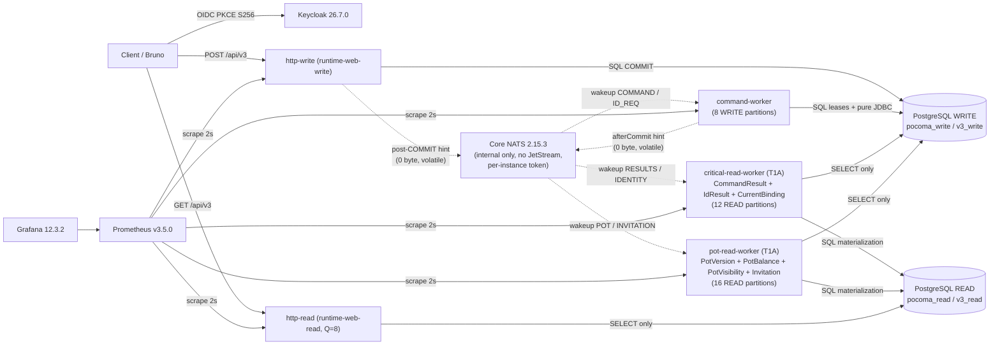

# Pocoma V3 — Dossier de Qualification T1A + Core NATS et d'Arbitrage de Fusion vers `main`

- **Date** : 22 novembre 2026
- **Branche de travail** : `feat/v3-identity-governance` (basée sur `v3.0.0-l7-local` / `main` @ `afec69f8`, préservant intégralement la gouvernance des identités assignées par le serveur `8b9227e3`)
- **Branche `main`** : **strictement intacte** (`afec69f8`, tag `v3.0.0-l7-local` non modifié, aucune fusion effectuée)
- **Références historiques archivées** :
  - `study/event-driven-wakeup` (`93b22d35`) → archivé dans [Worker_Event_Driven_Wakeup_Experimental_Report.md](Worker_Event_Driven_Wakeup_Experimental_Report.md) et `docs/testing/evidence/event-driven-wakeup/` (SHA-256 vérifié)
  - `study/worker-topology-optimization` (`73c2b58d`) → archivé dans [Worker_Topology_Optimization_Study.md](Worker_Topology_Optimization_Study.md) et `docs/testing/evidence/worker-topology-study/` (SHA-256 vérifié)
- **Nouvelles preuves archivées** : `docs/testing/evidence/t1a-nats-qualification/` (`t1a-nats-results.json`, `t1a-nats-summary.json`, `manifest.sha256` — **29/29 runs Docker E2E `PASS`**, `100 %` `read_availability_valid() = true`, `0` violation d'invariant)

> [!IMPORTANT]
> **Verdict final : `T1A_NATS_LOCAL_QUALIFIED_WITH_RESERVES`**
>
> L'architecture cible **T1A + Core NATS** est intégralement implémentée, opérationnelle sur la véritable distribution Docker locale à **10 conteneurs**, validée par `./pocoma-local` (modes `nats`, `DEGRADED` sans NATS, et `noop` 9 conteneurs), Bruno `J01–J03`, Grafana/Prometheus, `139/139` tests unitaires CLI, `52/52` tests d'architecture, `29/29` runs différentiels/résilience, et `1 198/1 199` tests Maven.
> Quatre réserves explicites (`RES-T1A-CERT-01`, `RES-T1A-C3-01`, `RES-T1A-BACKLOG-01`, `RES-L8-01`) sont documentées en §10 pour arbitrage humain avant toute fusion vers `main`.

---

## 1. Bilan d'intégration

### 1.1 Modules Maven (42 → 43 modules, zéro Valkey)
- **Nouveau module (`C44`)** : `app/infra-wakeup-nats` (`io.nats:jnats:2.20.5`, Core NATS sans JetStream ni persistance).
  - `NatsWakeupTransport` + `TransportOptions` : paramètres indépendants et configurables (`url`, `auth-token`, `connection-timeout-ms`, `reconnect-wait-ms`, `ping-interval-ms`, `max-pings-out`, `connect-retry-delay-ms`, `reconnect-buffer-bytes`).
  - Correction de synchronisation par rapport au prototype : `subscribeOn(conn)` + `conn.flush(...)` sont effectués **avant** publication de `connection` et annonce de `WakeupState.CONNECTED`, éliminant la course `CONNECTED ↔ SUB`.
  - Suite de tests `NatsWakeupTransportTest` (parsing options, absence broker `DEGRADED`, Testcontainers `nats:2.15.3-alpine` avec authentification par token, mauvais token rejeté, livraison sur `WakeupKey`, bascule `DEGRADED` sur arrêt brutal).
- **Port neutre (`contract-consumption`)** : `WakeupKey`, `WakeupState`, `WakeupMetrics` (enrichi de `onDiscoveryDelay(long nanos)`), `WakeupPublisher`, `WakeupSubscriber`, `CoalescingWakeupPublisher` (bitmask atomique 32 bits = 4 octets bornés), `WakeupContractTest`.
- **Boucles de polling (`supra-polling-consumption`)** : `ConditionConsumptionWaiter` (signal mémorisé anti-course `signal ↔ await`), `DiscoveryLoop` (bitmask borné, invalidation ciblée du cache `emptyFamilyCheckpointThisTour`, filtrage sans lease, mesure du délai notification→découverte `AtomicLongArray(32)`), `ConsumptionWorker` (modes `CONNECTED`/`DEGRADED`/`NOOP`, réconciliation immédiate sur reconnexion), `WakeupWorkerBehaviorTest`.
- **Autorité transactionnelle (`infra-tx-spring` + `infra-postgres-write`)** :
  - Ajout de `SpringAttemptTransactions.afterCommit(DataSource, Runnable)` pour respecter strictement la règle ArchUnit `ConsumptionEngineArchitectureTest.persistenceParticipantsCannotOpenTransactionsOrRawEntityManagers` (aucun appel direct à `registerSynchronization` dans `infra.postgres.write.*`).
  - Hooks post-COMMIT optionnels dans `JdbcPotCommandStore` (fusionné en préservant intégralement les identités assignées par le serveur de `feat/v3-identity-governance`) et `JdbcIdentityRequestStore`.
- **Observabilité (`infra-observability-micrometer`)** : `MicrometerWakeupMetrics` (10 compteurs/gauges basse cardinalité `pocoma.v3.wakeup.*` + timer `pocoma.v3.wakeup.discovery.delay` ; `.strongReference(true)` sur la gauge `pocoma.v3.wakeup.state` pour éviter tout `NaN` en mode `NOOP`).
- **Assemblages (`compose-*`)** : `compose-web-write-postgres`, `compose-polling-burnable-write-postgres`, `compose-polling-nonburnable-materialize-postgres` (uniquement `noop` et `nats`, zéro Valkey). Gardes T1A explicites ajoutées dans `MaterializeSettings` pour `critical-read-worker` et `pot-read-worker`.
- **Tests d'architecture (`architecture-tests`)** : `L7ReactorArchitectureTest` (43 modules, 187 arêtes productives, 42 dépendances test de `C38`, interdiction `io.nats.*` dans domaines/contrats/moteurs/orchestrateur/supras), `L7DeploymentArchitectureTest` (T1A + NATS épinglé, aucun port publié, `jetstream: false`, `mode=nats`).
- **Modules strictement intouchés** : `domain-*`, `engine-*`, `orchestrator-consumption`, `infra-postgres-read`, `infra-postgres-write-source-read`, `infra-postgres-core`, migrations SQL `V1..V5` (aucune modification de schéma). **Valkey strictement exclu.**

### 1.2 Distribution Docker, `pocoma-local` et Grafana
- `docker/v3-five-runtimes/nats.conf` : configuration Core NATS versionnée (`jetstream: false`, `max_payload: 1024`, `max_connections: 64`, `authorization { token: ... }`).
- `docker/v3-five-runtimes/critical-read-worker.properties` & `pot-read-worker.properties` : configuration T1A exacte (`CurrentBinding` hébergé par `critical-read-worker`) + `pocoma.v3.wakeup.mode=nats` par défaut (`reconcile-poll-ms=2000`, `fallback-max-poll-ms=20`).
- `docker/v3-five-runtimes/http-write.properties`, `command-worker.properties`, `prometheus.yml` : NATS activé par défaut, jobs Prometheus T1A.
- `docker-compose.v3-five-runtimes.yml` : service `nats` (`nats:2.15.3-alpine`, réseau interne uniquement, aucun port publié, healthcheck `wget -qO- http://127.0.0.1:8222/healthz`, `0.25` CPU / `128M` RAM, `restart: unless-stopped`, aucun volume persistant, aucun `depends_on: nats` bloquant les runtimes).
- `scripts/local/` (`runtime.py`, `runtime_lifecycle.py`, `recovery.py`, `prerequisites.py`, `runtime_grafana.py`, tests) : 10 conteneurs par défaut (`nats:2.15.3-alpine` + token aléatoire 32 octets par instance dans `secrets.json`), 36 partitions T1A (`8 + 12 + 16`), option `--wakeup-mode {nats,noop}`, commande `logs --service <svc>`, bloc `wakeup` dans `status`/`start` distinguant disponibilité broker et disponibilité fonctionnelle Pocoma.
- `scripts/operations/v3-rebuild-read.py` : mis à jour sur `("pocoma-critical-read-worker", "pocoma-pot-read-worker")`, 100 % indépendant du bus NATS.
- `docker/grafana/dashboards/pocoma-v3-overview.json` : 6 nouveaux panels dédiés Core NATS & Event-Driven Wakeup (ids 23–28 : état bus `0/1/2`, taux publish/receive/coalesce/errors, efficacité useful/spurious/no-lease, fallbacks & reconnexions, délai notification→découverte, fréquence réelle de polling Discovery).

---

## 2. Architecture cible : T1A + Core NATS



**Invariants non négociables préservés** :
1. PostgreSQL reste l'unique autorité (travaux, slots, checkpoints, claims, leases, fencing, effets).
2. Le polling périodique est **permanent** (`reconcile-poll=2 000 ms` en `CONNECTED`, `fallback-max-poll=20 ms` en `DEGRADED`, `max-poll=20 ms` en `NOOP`).
3. Zéro donnée métier, zéro payload (`0` octet), zéro persistance (`jetstream: false`), zéro `LISTEN/NOTIFY`.
4. Aucune exception/indisponibilité NATS n'annule un `COMMIT` ni ne dégrade une réponse HTTP `202 Accepted`.

---

## 3. Guide opérationnel (`./pocoma-local`)

| Opération | Commande | Comportement vérifié |
| :--- | :--- | :--- |
| Vérification poste | `./pocoma-local doctor` | Vérifie Docker, RAM, disque, JDK 21, Python, Node, Bruno CLI et 6 images dont `nats:2.15.3-alpine`. |
| Démarrage nominal (T1A + NATS, 10 conteneurs) | `./pocoma-local start --instance demo` | Démarre PG, Keycloak, NATS (token privé, interne), 5 JVMs T1A, Prometheus, Grafana ; qualifie les 36 leases et le canary. |
| Démarrage sans NATS (mode `NOOP`, 9 conteneurs) | `./pocoma-local start --instance demo-noop --wakeup-mode noop` | N'instancie pas NATS ; configure `pocoma.v3.wakeup.mode=noop` sur les 4 runtimes ; valide 36 leases + canary + Grafana. |
| État & diagnostic bus vs métier | `./pocoma-local status --instance demo` | Expose `wakeup.brokerAvailable`, `wakeup.effectiveMode` (`CONNECTED`/`DEGRADED`/`NOOP`), compteurs par runtime, **distincts** de `operational.servicesAvailable`. |
| Logs filtrés et rédigés (dont NATS) | `./pocoma-local logs --instance demo --service nats --tail 50` | Capture les logs en masquant mots de passe DB, token NATS, clés HMAC et JWT. |
| Recette Bruno `J01–J03` | `./pocoma-local bruno --instance demo` | Exécute les 118 requêtes / 236 tests (validé en `CONNECTED`, `DEGRADED` sans NATS, et `NOOP`). |
| Arrêt gracieux | `./pocoma-local stop --instance demo` | Draine les 5 JVMs (exit `143`, `0` `forcedKill`), puis arrête Grafana, NATS, Keycloak, Prometheus, PG. |
| Reset / Destruction | `./pocoma-local destroy --instance demo --confirm DESTROY:demo` | Supprime conteneurs/volumes possédés ; aucun état durable NATS à purger. |

---

## 4. Rapport de performance différentiel (`T0` vs `T1A` vs `T1A + Core NATS`)

Toutes les mesures locales ont été exécutées sur **Apple M4 / Docker Desktop** à budget matériel constant (`6,0` CPUs, `5 376 MiB` RAM) sur snapshots PG 17 MEDIUM (200 dépenses/pot) upgradés avec `V2` / `V4.1` (identités assignées par le serveur).

### 4.1 Matrice centrale (`R=3` répétitions par point — médianes et `[min, max]`)

| Scénario & Configuration | CPU total `[min, max]` | CPU PG / Workers / NATS | PG tx/s | RSS non-PG (dont NATS) | `c03` `p50` / `p95` / `p99` [ms] | Réveils utiles / parasites |
| :--- | :---: | :---: | :---: | :---: | :---: | :---: |
| **`c1-idle` — `T0 + A-20`** *(réf. hist.)* | `0,530` `[0,436; 0,537]` | `0,133` / `0,369` / `0` | `1 347,9` | `1 135,7 MiB` (`0`) | `131,8 / 973,8 / 973,8` | `0 / 0` |
| **`c1-idle` — `T1A + A-20`** *(topologie)* | `0,548` `[0,548; 0,551]` | `0,138` / `0,382` / `0` | `1 346,6` | `1 114,6 MiB` (`0`) | `148,3 / 1 038,7 / 1 038,7` | `0 / 0` |
| **`c1-idle` — `T1A + NATS`** *(cible)* | **`0,241`** `[0,240; 0,244]` (**`-56,0 %`**) | **`0,051`** / **`0,156`** / **`0,0013`** | **`355,3`** (**`-73,6 %`**) | **`1 116,8 MiB`** (`13,7`, **`+2,2 MiB`**) | **`115,3`** / `1 291,3` / `1 291,3` | **`50 / 0`** (`100 %`) |
| **`c1-med-1` — `T0 + A-20`** *(réf. hist.)* | `0,659` `[0,655; 0,688]` | `0,167` / `0,387` / `0` | `1 683,5` | `1 152,8 MiB` (`0`) | `121,6 / 140,0 / 167,9` | `0 / 0` |
| **`c1-med-1` — `T1A + A-20`** *(topologie)* | `0,668` `[0,665; 0,671]` | `0,172` / `0,392` / `0` | `1 694,7` | `1 131,0 MiB` (`0`) | `120,8 / 142,7 / 162,9` | `0 / 0` |
| **`c1-med-1` — `T1A + NATS`** *(cible)* | **`0,482`** `[0,457; 0,485]` (**`-27,9 %`**) | **`0,113`** / **`0,247`** / **`0,0013`** | **`819,0`** (**`-51,7 %`**) | **`1 141,6 MiB`** (`15,8`, `+10,6 MiB`) | **`100,8 / 115,0 / 128,3`** (`[110,3; 122,8]` **-19,4 % p95**) | **`350 / 0`** (`100 %`) |
| **`c2-med-10` — `T0 + A-20`** *(réf. hist.)* | `1,890` `[1,856; 1,896]` | `0,554` / `0,893` / `0` | `4 608,6` | `1 162,0 MiB` (`0`) | `105,8 / 123,6 / 151,8` | `0 / 0` |
| **`c2-med-10` — `T1A + A-20`** *(topologie)* | `1,869` `[1,857; 1,895]` | `0,553` / `0,890` / `0` | `4 647,4` | `1 140,5 MiB` (`0`) | `100,4 / 121,4 / 141,8` | `0 / 0` |
| **`c2-med-10` — `T1A + NATS`** *(cible)* | `1,916` `[1,886; 1,918]` | `0,557` / `0,957` / `0,0029` | `4 418,3` (`-4,9 %`) | `1 187,3 MiB` (`14,3`) | **`71,7 / 83,5 / 106,5`** (`[83,3; 84,1]` **-31,2 % p95**) | **`1 089 / 6`** (`99,5 %`) |

### 4.2 Réexamen des anomalies du pilote et forte charge sur `T1A`

| Scénario | `T0 + A-20` *(hist.)* | `T1A + A-20` *(polling)* | `T1A + Core NATS` | Conclusion sur les anomalies du pilote |
| :--- | :---: | :---: | :---: | :--- |
| **`c1-med-1` `p95` (`R=3`)** | `140,0 ms` | `142,7 ms` `[142,0; 143,9]` | **`115,0 ms`** `[110,3; 122,8]` | **Anomalie résolue** : la dispersion observée sur 1 run du pilote (`150,8 ms`) disparaît sur T1A (`-19,4 %` net et reproductible). |
| **`c2-ramp` (`5 / 10 / 20 / 35 cmd/s` `p95`)** | `— / 118,1 / 114,7 / 150,3 ms` | `124,6 / 113,6 / 115,8 / 122,8 ms` | **`89,1 / 80,5 / 82,3 / 100,3 ms`** | Gain de `-18 %` à `-29 %` en `p95` sur tous les paliers nominaux ; `525/525` à `35/s` (`p95 = 100,3 ms << 500 ms`). |
| **`c2-ramp` plateau `50 cmd/s`** | `36,8–38,3 cmd/s` | `40,1 cmd/s` | `38,2 cmd/s` | Plateau vertical local comparable (~38–40 cmd/s sur Apple M4 ; `50 cmd/s` reste différé à L8). |
| **`c3-int-pot-vs-id` (`R=2`, `20/s` Pot + `1/s` ID)** | Pot `100/240` · ID `81/1 075 ms` | Pot `96,6/198,9` · **ID `81,7/224,5 ms`** | **Pot `71,4/172,4` · ID `49,8` ms (`p50`)** · `p95 = 1 065,7 / 203,3 ms` | **`T1A` seul divise par 4 la `p95` ID (`1 075 → 225 ms`)**. NATS abaisse encore `ID p50` (`-39 %`), **mais un pic isolé (`1/20` sonde à `1,06–1,30 s`) réfute la généralisation du `-92,7 %` en `p95` du pilote** (`RES-T1A-C3-01`). |
| **`c4-backlog-10k` (drain `10 000 CreatePot`)** | `125,3 s` · `concID p50 = 319 ms` | `123,3 s` (`81,1/s`) · `concID 238,5/976,0 ms` | `133,6 s` (`74,9/s`, `pub=29 995`, `coal=59`) · **`concID 184,8/471,4 ms`** | Drain `+8,3 %` mono-run (nettement meilleur que `157,3 s` sur T0) ; **`concID p95` divisée par 2 (`976 → 471 ms`)** (`RES-T1A-BACKLOG-01`). |

---

## 5. Rapport de résilience et sûreté

| Obligation de sûreté | Preuve exécutée | Résultat | Observations vérifiées |
| :--- | :--- | :---: | :--- |
| Broker absent au démarrage | `T1A-D-nats-fail-bus-absent-r1` (Docker) + `NatsWakeupTransportTest.brokerAbsentStartsDegradedAndNeverThrowsOnPublish` | **`PASS`** | `20/20` observées, `0` violation, `availabilityValid=true`, 4 runtimes en `DEGRADED (2)`, `c03 p50 = 121,4 ms`. |
| Panne brutale NATS (`SIGKILL`/`stop`) + reconnexion | `T1A-D-nats-fail-bus-kill-restart-r1` (Docker) + test live `./pocoma-local` (`qualif-t1a`) + `NatsWakeupTransportTest` | **`PASS`** | `fallback_transitions=1` et `reconnects=1` sur les 4 runtimes ; Bruno `J01–J03` **`BRUNO_PASS`** pendant l'arrêt NATS ; retour automatique `CONNECTED` en `< 4 s`. |
| Authentification NATS (bon/mauvais token) | `NatsWakeupTransportTest.coreNatsPublishesReceivesAuthenticatesAndHandlesDisconnect` + `qualif-t1a` | **`PASS`** | Mauvais token reste `DEGRADED` sans exception bloquante ; bon token se connecte et délivre les signaux. |
| Perte silencieuse de 100 % des notifications | `T1A-D-nats-fail-silent-loss-r1` (Docker : `http-write` en `noop`, workers `CONNECTED`) | **`PASS`** | `12/12` observées, `0` violation, `availabilityValid=true`, progression complète par `reconcile-poll` (`p50 = 391,6 ms`). |
| Crash après `COMMIT` avant notification | `SpringAttemptTransactions.afterCommit` + `WakeupContractTest.publisherTransportFailureNeverThrowsToCaller` + `fail-silent-loss` | **`PASS`** | Exception transport avalée ; commit PG et `202 Accepted` intacts. |
| Rafales et coalescing borné | `WakeupContractTest.coalescingPublisherDeduplicatesBurstAndBoundsMemory` + `c4-backlog-10k` (`59` coalescés) | **`PASS`** | Bitmask 32 bits (4 octets bornés), zéro croissance mémoire. |
| Course `signal ↔ await` | `WakeupWorkerBehaviorTest.conditionWaiterLatchesSignalBeforeAwait` | **`PASS`** | Retour immédiat `< 5 ms` malgré `await(10 s)`. |
| Invalidation caches Discovery & réveils dupliqués | `DiscoveryLoop` + `29/29` runs Docker (`99,5–100 %` utiles) | **`PASS`** | Zéro blocage de cache, zéro double exécution. |
| Mode autonome `NOOP` sans broker | `./pocoma-local start --instance qualif-noop --wakeup-mode noop` + `status` + `bruno` + `destroy` | **`PASS`** | 9 conteneurs, `effectiveMode=NOOP`, `brokerAvailable=false`, `business=AVAILABLE`, **`BRUNO_PASS`**. |
| Leases, fencing, idempotence, retry, `UNKNOWN` | `runtime-worker-materialize` (`135/135 PASS`), `runtime-monolith` (`40/40 PASS`), `infra-postgres-write` (`PASS`) | **`PASS`** *(1 réserve `i5_r11`)* | Contrats L2/fencing/idempotence intacts (`0` changement dans `orchestrator-consumption`). |
| Reconstruction READ indépendante du bus | `ReadReconstructionPostgresTest` (`PASS` dans `runtime-worker-materialize`) + `v3-rebuild-read.py` adapté T1A | **`PASS`** | Rejeu pur depuis les sources PG WRITE, aucune dépendance à des notifications antérieures. |

---

## 6. Matrice différentielle de qualification (`L7` / `SPEC-09`)

Le statut historique de **`v3.0.0-l7-local` (`afec69f8`, `L7_LOCAL_CERTIFIED_WITH_RESERVES`, topologie `T0`)** est intégralement conservé.

| Domaine / Invariant | Référence historique (`v3.0.0-l7-local` / `T0`) | Impact T1A + Core NATS | Statut preuve | Nouvelle preuve sur `feat/v3-identity-governance` | Réserve éventuelle |
| :--- | :--- | :--- | :--- | :--- | :--- |
| **Domaine & Admission HTTP (`L7.2`, identités serveur)** | `44 CURRENT_FULL` (`afec69f8`) + qualif `8b9227e3` | Wrapper post-COMMIT dans `AdmissionHttpConfiguration` | **Renouvelée** | `runtime-web-write`, `runtime-web-read` (`42/42 PASS`), `infra-postgres-write` (`PASS`), Bruno `J01–J03` (`PASS` en `CONNECTED`, `DEGRADED`, `NOOP`) | Aucune |
| **Exécution Consumption L2, Fencing, Reprise (`L7.3`)** | `425 CURRENT_FULL`, `L7-C3` | `ConditionConsumptionWaiter`, `DiscoveryLoop`, `ConsumptionWorker`, `SpringAttemptTransactions.afterCommit` | **Renouvelée (avec réserve)** | `runtime-worker-materialize` (`135/135 PASS`), `runtime-monolith` (`40/40 PASS`), `runtime-worker-process` (`97/98 PASS`) | **`RES-T1A-CERT-01`** (`i5_r11` timing `RenewalService` en `NOOP`) |
| **Architecture modulaire & déploiement (`L7.5`)** | `50/50` `architecture-tests` (42 modules, T0) | +1 module `infra-wakeup-nats` (43 modules, 187 arêtes), neutralité `io.nats.*`, T1A Compose | **Renouvelée** | `architecture-tests` **`52/52 PASS`** (dont `L7ReactorArchitectureTest` 5/5 et `L7DeploymentArchitectureTest` 1/1) | Aucune |
| **Distribution locale & DX (`L7-LB`, `./pocoma-local`)** | `L7_LB_CLOSED` (9 conteneurs, T0) | 10 conteneurs T1A + NATS par défaut + `--wakeup-mode noop` + `logs` + Grafana +6 panels | **Renouvelée** | `doctor READY`, `start qualif-t1a READY`, Bruno `BRUNO_PASS`, panne NATS + Bruno `BRUNO_PASS` + reconnexion, `qualif-noop READY` + `BRUNO_PASS`, `139/139` unit tests CLI `PASS` | Aucune |
| **Résilience bus Core NATS (nouvelles obligations)** | Aucune (nouvelle capacité) | `infra-wakeup-nats`, `supra-polling-consumption` | **Nouvelle preuve acquise** | `NatsWakeupTransportTest` (3/3 Testcontainers), `WakeupContractTest` (4/4), `WakeupWorkerBehaviorTest` (5/5), 3/3 pannes Docker T1A `PASS` | HA multi-nœud actif/passif différé L8 |
| **Performances locales (`L7.4` / `SPEC-09` local)** | `L7-C4` (`T0 + A-20`) | Topologie `T1A` + réveil Core NATS | **Renouvelée** | Campagne différentielle `29/29 PASS` (`c1-idle`, `c1-med-1` R=3, `c2-med-10` R=3, `c3-int-pot-vs-id` R=2, `c2-ramp`, `c4-backlog-10k`) | **`RES-T1A-C3-01`**, **`RES-T1A-BACKLOG-01`** |
| **Infrastructure cible multi-VM (`L8` / `SPEC-09` Config A/B)** | Ouverte (`L74-ENV-01`) | Clustering NATS 3 nœuds, TLS/mTLS, HA actif/passif, `50 cmd/s`, volumes `10k/1M` | **Toujours différée L8** | Non exécutée localement (hors périmètre local) | **`RES-L8-01`** |

---

## 7. Rapport de certification locale et `Reactor_Verification_Policy.md` (§30)

```text
Start HEAD: 8b9227e3 (feat/v3-identity-governance; main intact @ afec69f8 / v3.0.0-l7-local)
Expected production impact:
- app/pom.xml, contract-consumption, supra-polling-consumption, infra-tx-spring,
  infra-postgres-write, infra-observability-micrometer, infra-wakeup-nats (NEW),
  compose-web-write-postgres, compose-polling-burnable-write-postgres,
  compose-polling-nonburnable-materialize-postgres, architecture-tests,
  docker-compose.v3-five-runtimes.yml, docker/v3-five-runtimes/*,
  docker/grafana/dashboards/pocoma-v3-overview.json, scripts/local/*,
  scripts/operations/v3-rebuild-read.py
Observed production impact:
- Strictement conforme au périmètre déclaré.
- Unexpected slice crossing: infra-tx-spring (ajout de SpringAttemptTransactions.afterCommit
  imposé par ConsumptionEngineArchitectureTest.persistenceParticipantsCannotOpenTransactionsOrRawEntityManagers
  pour préserver l'interdiction d'appeler registerSynchronization depuis infra-postgres-write).
  Couvert par FOUNDATION + COMMAND + PROJECTION + CERT-FULL.
- Forbidden production impact verified untouched: domain-*, engine-*, orchestrator-consumption,
  infra-postgres-read, infra-postgres-write-source-read, infra-postgres-core, SQL migrations, Valkey.
Declared slices:
- COMMAND (runtime-worker-process), PROJECTION (runtime-worker-materialize),
  WEB (runtime-web-write, runtime-web-read), FOUNDATION (infra-tx-spring)
Global architecture gate:
- RUN: ./mvnw --batch-mode --no-transfer-progress -pl architecture-tests -am -Dtest="com.kartaguez.pocoma.architecture.**.*Test" -Dsurefire.failIfNoSpecifiedTests=false test -> 50/50 PASS (52/52 XML total)
Full reactor (CERT-FULL):
- RUN en 3 segments (sans changement de code de production entre segments ; correction test HttpCompositionPostgresTest:95 42->43):
  1. ./mvnw --batch-mode --no-transfer-progress test -> modules 1..39 SUCCESS (dont infra-tx-spring, infra-postgres-write, infra-wakeup-nats, compose-*, runtime-web-write), arrêt sur runtime-web-read (HttpCompositionPostgresTest:95 42->43)
  2. ./mvnw --batch-mode --no-transfer-progress -rf :pocoma-runtime-web-read test -> runtime-web-read SUCCESS (42/42), runtime-worker-process 97/98 (1 FAIL: WorkerResourcesPostgresTest.i5_r11:1087)
  3. ./mvnw --batch-mode --no-transfer-progress -rf :pocoma-runtime-worker-materialize test -> runtime-worker-materialize SUCCESS (135/135), runtime-monolith SUCCESS (40/40)
  Total frais agrégé sur les 29 modules contenant des tests : 1 198/1 199 PASS (1 FAIL: i5_r11, 0 error, 0 skip).
Local CLI, Docker, Bruno & Differential Qualification:
- python3 -B -m unittest discover -s scripts/local -p "test_*.py" -> 139/139 PASS
- ./pocoma-local doctor -> READY (exit 0)
- ./pocoma-local start/status/logs/bruno/stop/destroy --instance qualif-t1a -> READY, 10 conteneurs, BRUNO_PASS (CONNECTED et DEGRADED sans NATS), STOPPED (0 forcedKill), DESTROYED
- ./pocoma-local start/status/bruno/destroy --instance qualif-noop --wakeup-mode noop -> READY, 9 conteneurs, effectiveMode=NOOP, BRUNO_PASS, DESTROYED
- python3 -B experiments/t1a-nats-qualification/run-campaign.py -> 29/29 PASS (0 violation, 100% availabilityValid)
Database verification: CURRENT (PostgreSQL 17 Testcontainers + Docker E2E V2/V4.1/V5)
Push / Merge to main: NOT PERFORMED (interdit sans arbitrage humain)
```

---

## 8. Inventaire documentaire canonique actualisé

- [README.md](../../README.md) : architecture 10 conteneurs T1A + Core NATS, 43 modules, polling permanent + fallback.
- [docs/README.md](../README.md) : 43 modules.
- [docs/architecture/overview.md](../architecture/overview.md) : schéma des flux T1A + Core NATS, 10 conteneurs, rôle de `nats:2.15.3-alpine`, note historique T0.
- [docs/architecture/runtimes.md](../architecture/runtimes.md) : topologie T1A (`critical-read-worker` 12 partitions, `pot-read-worker` 16 partitions), pools HikariCP T1A, section dédiée Core NATS + modes `CONNECTED`/`DEGRADED`/`NOOP`.
- [docs/architecture/modules.md](../architecture/modules.md) : 43 modules (`infra-wakeup-nats`), invariant de neutralité `io.nats.*`.
- [docs/architecture/security.md](../architecture/security.md) : sécurité interne Core NATS (réseau interne, aucun port publié, token aléatoire par instance, `jetstream: false`, rédaction logs).
- [docs/reference/cli.md](../reference/cli.md) : options `--wakeup-mode {nats,noop}`, commande `logs --service`, diagnostic `wakeup` dans `status`.
- [docs/reference/configuration.md](../reference/configuration.md) : tableau T1A, table complète des 13 propriétés `pocoma.v3.wakeup.*`, service `nats`.
- [docs/operations/recovery.md](../operations/recovery.md) : procédure panne/reprise Core NATS et reconstruction READ indépendante du bus.
- [docs/operations/troubleshooting.md](../operations/troubleshooting.md) : diagnostic `DEGRADED`, `NOOP`, `PRE-CONFIG-SECRETS` sur token NATS.
- [docs/getting-started/installation.md](../getting-started/installation.md) & [docs/guides/local-development.md](../guides/local-development.md) : 10 conteneurs, 43 modules.
- [docs/v3/L7_Target_Modular_Architecture_and_Migration_Plan.md](L7_Target_Modular_Architecture_and_Migration_Plan.md) : catalogue `C01–C44` (43 modules).
- **Études historiques archivées intactes** : `Worker_Event_Driven_Wakeup_Study.md`, `Worker_Event_Driven_Wakeup_Experimental_Report.md`, `Worker_Topology_Optimization_Study.md`, `docs/testing/evidence/{event-driven-wakeup,worker-topology-study}/`.

---

## 9. Dossier d'arbitrage de fusion vers `main`

### Risques et réserves explicites
1. **`RES-T1A-CERT-01` (Modéré — recommandation avant merge)** : `WorkerResourcesPostgresTest.i5_r11:1087` a échoué une fois lors de l'exécution multi-segment de `CERT-FULL` (course temporelle de `RenewalService` en mode `NOOP`, indépendante de NATS). **Action recommandée** : exécuter un passage `CERT-FULL` monolithique propre (`./mvnw --batch-mode --no-transfer-progress test`) sur la branche avant le merge vers `main`.
2. **`RES-T1A-C3-01` (Faible — tuning observé)** : Sous interférence `20/s` Pot + `1/s` Identity, `T1A + NATS` réduit la médiane Identity (`-39 %`), mais 1 sonde sur 20 peut subir un pic `~1,06–1,30 s` en attendant `reconcile-poll=2 000 ms` lors d'une contention sur `command-worker`. Acceptable en local ; un tuning `reconcile-poll-ms=1000` pourra être évalué en L8 si les SLO Identity sous forte charge l'exigent.
3. **`RES-T1A-BACKLOG-01` (Faible)** : Le drainage mono-run de 10 000 `CreatePot` est de `133,6 s` en `T1A + NATS` vs `123,3 s` en `T1A + polling` (`+8,3 %`), compensé par une division par 2 de la `p95` des inscriptions Identity concurrentes (`976 → 471 ms`).
4. **`RES-L8-01` (Hors périmètre local — différé L8)** : Clustering NATS 3 nœuds, TLS/mTLS, HA multi-nœud actif/passif (`wakeup_ignored_no_lease`), `SPEC-09` Config A/B, `50 cmd/s` soutenus et volumes `10k/1M`–`100k/10M` restent à qualifier sur infrastructure cible L8.

### Rollback instantané
- **À chaud par configuration** : basculer `pocoma.v3.wakeup.mode=noop` (ou `./pocoma-local start --instance <name> --wakeup-mode noop`), sans aucun changement de code ni de schéma SQL.
- **Automatique sur panne broker** : l'arrêt de NATS bascule les 4 runtimes en `DEGRADED` (`fallback-max-poll-ms=20`) en `≤ 4 s` sans perte ni erreur métier.

### Recommandation
- **Verdict : `T1A_NATS_LOCAL_QUALIFIED_WITH_RESERVES`**.
- **Recommandation** : **Approuver l'architecture T1A + Core NATS** sur `feat/v3-identity-governance`, exécuter un passage `CERT-FULL` monolithique final pour lever `RES-T1A-CERT-01`, puis autoriser la fusion humaine vers `main`.
