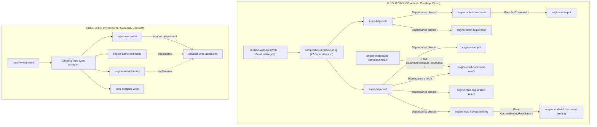
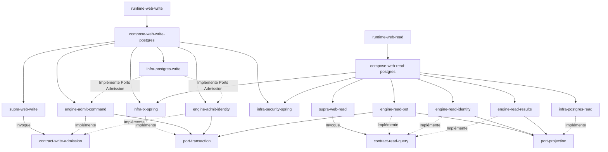

# Rapport d'Audit Architectural Contradictoire — Pocoma V3 (`AUDIT_V3_MODULAR_ARCHITECTURE_AND_COMPOSABILITY`)

- **Dépôt / Branche / HEAD relevé au démarrage** : `kartaguez/pocoma` | `feat/v3-architecture` | `53999a05bc1aa368aad43b080b5975cbc5c747cc`
- **Mode d'exécution de l'audit** : `READ-ONLY ANALYSIS — NO IMPLEMENTATION — NO MODIFICATION`
- **Conformité `AGENTS.md` & `docs/testing/Reactor_Verification_Policy.md`** :
  - *Tranches de vérification déclarées* : Aucune exécution Maven en phase d'audit lecture seule. Les tranches S0 à S8 définies par la politique normative structurent l'intégralité du **Plan de migration (§10)**.
  - *Commandes exécutées* : Inspection statique du dépôt uniquement ; aucune modification de code applicatif ni exécution du reactor Maven.
  - *Franchissement de tranche / Gate global / Reactor complet* : Documentés par étape dans le plan de migration (§10).

---

## 1. Verdict architectural

### 1.1. Résumé exécutif : ce que le code fait réellement aujourd'hui

L'analyse exhaustive des **60 modules enfants Maven** (+1 POM agrégateur `app/pom.xml` = **61 projets Maven**) et des **861 fichiers Java `src/main`** met en évidence un contraste majeur entre la **qualité intrinsèque du code V3** et la **dette structurelle de son découpage Maven** :

1. **73,9 % des classes `src/main` (636 fichiers sur 861) et 25 modules enfants entiers sont du code mort V2** (pipeline JPA/Hibernate, outbox `ProjectionTask`, `engine-consume-command`, `orchestrator-consumption`, les 8 modules `supra-consume-*`, et 6 runtimes workers V2 zombies). Seuls **225 fichiers `src/main`** (209 fichiers dans des packages `.v3` + 16 fichiers de valeurs partagées dans `domain-pot`, `domain-user-identity`, `contracts-authentication` et `orchestrator-poll-consumption`) constituent le système Pocoma V3 actif.
2. **Le cœur métier et protocole V3 est remarquablement propre** :
   - Les domaines V3 (`domain.pot.v3.*`, `domain.useridentity.v3.*`, `domain.projection.v3.*`, `domain.consumption.v3.*`) sont 100 % purs et exempts de Spring/JDBC/JPA.
   - Le protocole L2 V3 (`ConsumptionEngine` et `DiscoveryEngine` dans `engine-consumption`), consolidé par L7/I2, garantit un séquencement dense sur les deux familles (`BurnableReferences` et `NonBurnableReferences`) sans transaction distribuée.
3. **Quatre verrous architecturaux empêchent aujourd'hui l'assemblage « Lego »** :
   - **Couplage direct `Supra -> Engine` (absence de Capability Contracts autonomes)** : `supra-http-write` dépend directement de `engine-admit-command` et `engine-admit-registration` et injecte les classes concrètes `AdmitCommandV3`, `AdmitIdentityRequestV3` et `AdmitLinkProposal`. `supra-http-read` dépend directement des 4 modules `engine-read-*` car les interfaces `Queries`/`Query` sont imbriquées dans les classes d'Engine (`ReadPotV3.Queries`, `GetCommandTerminalResult.Query`, etc.).
   - **Fuite de Data Contracts dans des modules Engine** : `PotCommand` est logé dans `engine-write-pot`, ce qui force `engine-admit-command` (et transitivement `supra-http-write` !) à dépendre du moteur d'exécution `engine-write-pot`. De même, `CommandTerminalResult` et `CommandTerminalResultStore` sont dans `engine-read-command-result`, obligeant `engine-materialize-command-result` et `infra-persistence-read-jdbc` à dépendre du moteur de lecture HTTP !
   - **God-module `composition-runtime-spring` (47 dépendances Maven, 26 classes V3 + 43 classes V2)** : Ce module unique concentre tout le câblage WRITE, READ, HTTP, Sécurité, Maintenance READ (`JdbcReadMaintenanceAuthority`), ainsi qu'un véritable **Engine/Orchestrator de lecture déguisé** (`V3ReadFacadeComposition.Services`) qui porte les invariants de quota (`Semaphore`), de timeout wall-clock (5s), de timeouts SQL (`2s`/`3s`) et de snapshot `REPEATABLE READ` unique.
   - **Listes blanches FQN codées en dur** : `V3ConsumptionWorkerConfiguration.Preflight` et `V3BootstrapGuard` vérifient par réflexion les noms de classes exacts des `SpringBootApplication` et des beans autorisés, interdisant tout nouvel assemblage `Compose` ou `Runtime` sans modifier le code interne de validation.

### 1.2. Évaluation contradictoire des hypothèses (7 vs ~49 vs 60 modules)

| Hypothèse | Analyse contradictoire | Verdict |
| :--- | :--- | :--- |
| **Reactor actuel (60 modules enfants / 61 projets)** | Encombré par 25 modules V2 morts, viole l'inversion `Supra -> Capability Contract`, mélange WRITE et READ dans `composition-runtime-spring` et `runtime-web-api`. | **Rejeté.** |
| **Hypothèse L5/Q5-C (7 modules enfants)** | Regroupe tous les moteurs dans `pocoma-engines`, tous les adaptateurs JDBC (WRITE et READ !) dans `pocoma-infra-postgres`, tous les contrôleurs dans `pocoma-supra-http` et toute la composition dans `pocoma-runtime`. **Défaut rédhibitoire** : détruit l'étanchéité de compilation entre les autorités `WRITE` et `READ` et oblige à modifier les mêmes méga-modules à chaque nouveau parcours. | **Rejeté.** Incompatible avec une architecture Lego et avec l'isolation d'autorités V3. |
| **Hypothèse « Lego intégral » (~49 modules enfants)** | Valide sur le principe d'inversion (`Supra -> Capability Contract <- Engine`) et de découpage de `Compose`, mais crée une **sur-fragmentation artificielle** sur deux axes : (1) 6 modules Maven `supra-web-*` d'une seule classe chacun alors qu'ils partagent les mêmes filtres et handlers HTTP par autorité ; (2) 2 modules `supra-polling-sequential-burnable-*` et `non-burnable-*` alors que l'ordonnanceur de polling (`V3ConsumptionWorker`, `V3DiscoveryLoop`, `V3ConsumptionLoop`, `V3RenewalService`) est **100 % agnostique** du caractère Burnable ou NonBurnable. | **Corrigé et affiné.** Nous retenons intégralement le modèle Lego, mais nous recommandons sa forme **compactée sans micro-modules artificiels (Scénario C : 38 modules enfants / 39 projets)** face à sa forme **explicite unitaire (Scénario B : 48 modules enfants / 49 projets)**. |

### 1.3. Distinction fondamentale : Responsabilité architecturale vs Module physique Maven

Un module Maven ne doit exister que s'il protège un **axe d'indépendance de dépendances ou de déploiement** :
- **Axe 1 — Pureté technologique** : `Domain`, `Contract` (Data + Capability) et `Port` + `Engine` ne dépendent ni de Spring, ni de JDBC, ni de Jackson/Servlet.
- **Axe 2 — Séparation stricte des autorités `WRITE` et `READ`** : aucun artefact déployé dans `RuntimeWebRead` ou `RuntimeWorkerMaterialize` ne doit pouvoir compiler avec le port d'écriture d'autorité `WRITE`, et inversement pour `RuntimeWebWrite` et `RuntimeWorkerProcess`.
- **Axe 3 — Inversion de dépendance du canal (`Supra`)** : `Supra` dépend uniquement de `Contract` (Capability + Data). `Engine` implémente `Capability Contract` et dépend de `Port`. `Compose` assemble `Supra + Engine + Orchestrator + Infra`.
- **Axe 4 — Fonctions pures logées dans leur `Domain` propriétaire** : une fonction pure (`PotTransitions`, `PotBalanceCalculator`, `PotVisibilityRules`, `IdentityTransitions`, réductions de projections) n'a besoin d'aucun port et appartient naturellement au module `domain-*` correspondant, sans créer de micro-modules `function-*` supplémentaires.

---

## 2. Audit des contrats existants

### 2.1. Matrice exhaustive des contrats, interfaces et ports V3

| Contrat / Interface | Catégorie (§2) | Module actuel | Utilisateurs actuels (V3) | Implémentation actuelle (V3) | Propriétaire cible | Extraction nécessaire ? |
| :--- | :---: | :--- | :--- | :--- | :--- | :--- |
| `AuthenticatedExternalPrincipal` | **A. Data Contract** | `contracts-authentication` | `supra-http-write`, `supra-http-read`, `composition-runtime-spring` | Record pur | `contract-authentication` | **Non** (déjà propre et isolé) |
| `AdmissionAssociation`, `AdmissionFailure`, `AdmissionFields`, `AdmissionProtection` | **A. Data Contract** | `contracts-command` | `engine-admit-command`, `engine-admit-registration`, `supra-http-write`, `infra-persistence-primary-jpa` | Records/Enums/Exceptions purs | `contract-write-admission` | **Oui (nettoyage V2)** : supprimer les 5 classes V2 de `contracts-command` |
| `PotCommand` (+ `Intent`, `Eui`, `Attachment`) | **A. Data Contract** | `engine-write-pot` | `supra-http-write`, `engine-admit-command`, `engine-write-pot`, `infra-persistence-primary-jpa` | Record scellé pur | `contract-write-admission` | **OUI (CRITIQUE)** : l'extraire de `engine-write-pot` coupe la dépendance anormale `engine-admit-command -> engine-write-pot` |
| `IdentityRequest`, `LinkProposal` | **A. Data Contract** | `contracts-registration` | `supra-http-write`, `engine-admit-registration`, `engine-consume-registration`, `infra-persistence-primary-jpa` | Interfaces/Records scellés purs | `contract-write-admission` | **Oui** : regrouper dans `contract-write-admission` et supprimer `RegistrationRequest` V2 |
| `CommandAdmissionInput` & Capacité `AdmitCommand` *(actuellement classe concrète `AdmitCommandV3`)* | **B. Capability Contract** | `engine-admit-command` | `V3AdmissionController` | `AdmitCommandV3` | `contract-write-admission` | **OUI (CRITIQUE)** : extraire l'interface `AdmitCommand` + `CommandAdmissionInput` pour inverser `supra-http-write` |
| `IdentityAdmissionInput`, `LinkProposalInput` & Capacités `AdmitIdentityRequest`, `IssueLinkProposal` *(actuellement classes concrètes `AdmitIdentityRequestV3`, `AdmitLinkProposal`)* | **B. Capability Contract** | `engine-admit-registration` | `V3AdmissionController`, `V3LinkProposalController` | `AdmitIdentityRequestV3`, `AdmitLinkProposal` | `contract-write-admission` | **OUI (CRITIQUE)** : extraire les interfaces `AdmitIdentityRequest` et `IssueLinkProposal` dans `contract-write-admission` |
| `ReadPotV3.Queries` & `ReadInvitation.Queries` (+ records de vues & exceptions) | **B. Capability Contract** | `engine-read-pot` | `V3ReadController`, `V3InvitationController` | `V3ReadFacadeComposition.Services` -> `ReadPotV3`, `ReadNavigationV3`, `ReadInvitation` | `contract-read-query` | **OUI (CRITIQUE)** : extraire hors de `engine-read-pot` vers `contract-read-query` pour couper `supra-http-read -> engine-read-pot` |
| `GetCurrentBindingV3.Query` (+ `View`, `Status`) | **B. Capability Contract** | `engine-read-current-binding` | `V3ReadController` | `V3ReadFacadeComposition.Services` -> `GetCurrentBindingV3` | `contract-read-query` | **OUI (CRITIQUE)** : extraire dans `contract-read-query` |
| `GetCommandTerminalResult.Query` & `GetIdentityTerminalResult.Query` | **B. Capability Contract** | `engine-read-command-result`, `engine-read-registration-result` | `V3ReadController` | `V3ReadFacadeComposition.Services` -> `Get*TerminalResult` | `contract-read-query` | **OUI (CRITIQUE)** : extraire dans `contract-read-query` |
| `CommandTerminalResult`, `IdentityTerminalResult` | **A. Data Contract** | `engine-read-command-result`, `engine-read-registration-result` | `engine-materialize-*`, `engine-read-*`, `infra-persistence-read-jdbc`, `supra-http-read` | Records purs | `domain-projection` (et réexportés par `contract-read-query`) | **OUI (CRITIQUE)** : élimine la dépendance `engine-materialize-*-result -> engine-read-*-result` |
| `ConsumptionParticipant` (+ `PreparationReads`, `SlotCompletion`) | **B. Capability Contract** (Participant L2) | `engine-consumption` | `engine-write-pot`, `engine-consume-registration`, `engine-consume-projection-task`, `engine-materialize-*` | `ExecutePotCommand`, `ExecuteIdentityRequest`, 7 classes `Materialize*` | `engine-consumption` | **Non** (contrat natif du protocole L2) |
| `AttemptTransactions`, `RecoveryReadContext` | **C. Port** | `port-transaction` | Tous les Engines L2/WRITE/READ, `port-projection` | `SpringAttemptTransactions` | `port-transaction` | **Non** (purger uniquement les 5 classes V2) |
| `PotVersionStore`, `SubobjectVersionStore`, `PotBalanceStore`, `PotVisibilityStore`, `InvitationStore` (READ), `ReadEvidence` | **C. Port** | `port-projection` | `engine-consume-projection-task`, `engine-read-pot`, `infra-persistence-read-jdbc` | `Jdbc*Store` (`infra-persistence-read-jdbc`) | `port-projection` | **Non** (purger uniquement les 6 classes V2) |
| `CurrentBindingReadStore`, `CommandTerminalResultStore`, `IdentityTerminalResultStore` | **C. Port** | Dispersés dans `engine-materialize-current-binding` et `engine-read-*-result` | `engine-materialize-*`, `engine-read-*`, `infra-persistence-read-jdbc` | `Jdbc*Store` (`infra-persistence-read-jdbc`) | `port-projection` | **OUI (CRITIQUE)** : les regrouper dans `port-projection` supprime tout couplage croisé entre `engine-materialize-*` et `engine-read-*` |
| Ports L2 : `ConsumptionSlotStore`, `DiscoveryAdmissionStore`, `PartitionOwnershipStore`, `BurnableReferences`, `NonBurnableReferences`, `SlotKeyNavigation`, `ConsumptionObservation`, `AttemptFailureClassifier` | **C. Port** | `engine-consumption` (`...v3.port`) | `ConsumptionEngine`, `DiscoveryEngine` | `infra-persistence-primary-jpa`, `infra-persistence-read-jdbc`, `MicrometerV3ConsumptionObservation` | `engine-consumption` | **Non** (possédés par `engine-consumption`) |
| Ports WRITE d'admission et d'exécution : `AdmitCommandV3.Store`, `AdmitIdentityRequestV3.Store`, `AdmitLinkProposal.ProposalStore`, `PotCommandStore`, `PotActorAuthority`, `PotHistoryPort`, `PotRevisionPort`, `InvitationStore` (WRITE), `IdentityAuthority`, `IdentityRequestStore` | **C. Port** | `engine-admit-*`, `engine-write-pot`, `engine-consume-registration` | Les Engines propriétaires respectifs | `infra-persistence-primary-jpa` | Les modules `engine-admit-*` et `engine-write-*` respectifs | **Non** (déjà logés dans leurs Engines propriétaires) |
| Ports de lecture de source WRITE pour matérialisation : `PotVersionSource`, `PotBalanceSource`, `PotVisibilitySource`, `InvitationSource`, `CurrentBindingSource`, `CommandTerminalSource`, `IdentityTerminalSource` | **C. Port** | `engine-consume-projection-task`, `engine-materialize-*` | Les 7 classes `Materialize*` | `Jdbc*Source` dans `infra-persistence-primary-jpa` | Les modules `engine-materialize-*` respectifs | **Non** (possédés par les Engines de matérialisation) |
| `ReadMaintenanceAuthority` | **C. Port** / Contrat Maintenance | `composition-runtime-spring` | `ReadMaintenanceFilter`, `ReadinessOracle`, `V3ConsumptionWorkerConfiguration` | `JdbcReadMaintenanceAuthority` | `port-projection` (et `JdbcReadMaintenanceAuthority` dans `infra-postgres-read`) | **OUI** : sortir l'adaptateur SQL `JdbcReadMaintenanceAuthority` de `composition-runtime-spring` ! |

### 2.2. Évaluation des 4 modèles de placement Maven des Capability Contracts (§2.3)

| Modèle | Avantages | Inconvénients | Verdict |
| :--- | :--- | :--- | :--- |
| **1. Un module de contrat par capacité** (`contract-admit-command`, `contract-admit-identity`, `contract-read-pot`, etc. — 8 à 10 micro-modules) | Isolation maximale théorique par capacité unitaire. | Explosion de micro-modules contenant chacun 1 interface de 15 lignes ; gonflement artificiel des POMs. | **Écarté** (sur-ingénierie Maven). |
| **2. Deux modules de contrats groupés par frontière d'autorité et de canal** (`contract-write-admission` et `contract-read-query`) | Sépare hermétiquement le plan `WRITE` et le plan `READ`. Zéro couplage WRITE/READ, zéro prolifération de micro-modules. | Un Supra Web Write voit les deux contrats d'admission (ce qui correspond exactement à `V3AdmissionController`). | **RECOMMANDÉ** (équilibre idéal simplicité / isolation). |
| **3. Contrat porté par le module de domaine** | Évite des modules `contract-*` dédiés. | Pollue le domaine pur avec des préoccupations applicatives de transport/requêtage (pagination, curseurs, exceptions de quota). | **Écarté** pour les Capability Contracts (mais retenu pour les Data Contracts métier purs comme `PotVersion` ou `PotBalance`). |
| **4. Modèle hybride** | Data Contracts métier dans `domain-*` ; Capability Contracts groupés dans `contract-write-admission` et `contract-read-query` ; contrat `AuthenticatedExternalPrincipal` dans `contract-authentication`. | Aucun. | **RECOMMANDÉ (Modèle 2 + 4 combinés)**. |

---

## 3. Audit des 60 modules enfants Maven

Voici l'audit contradictoire exhaustif des **60 modules enfants exacts** déclarés dans `app/pom.xml` (numérotés de 1 à 60 dans l'ordre exact du `<modules>` de `app/pom.xml`).
- **Format `Main (V3/V2) [Tests]`** : Nombre total de classes `src/main` (`classes actives V3` / `classes mortes V2`) `[classes de test]`.
- **Format `Tech`** : `S` = Spring, `J` = JDBC, `P` = JPA/Hibernate, `-` = Pur JDK.

| # | Module enfant (`app/pom.xml`) | Main (V3/V2) [Tests] | Dépendances directes (`pocoma-*`) | Dépendances entrantes V3 actives | Tech | Responsabilité réelle & Couplages observés | Responsabilité cible | Risque | Action |
| :-: | :--- | :---: | :--- | :--- | :-: | :--- | :--- | :-: | :---: |
| 1 | `domain-authorization` | 5 (0/5) [3] | Aucune | Aucune en V3 | `-` | Permissions V2 (`Permission`, `TokenCapabilities`). Remplacé en V3 par `domain.pot.v3.AuthorizationFacts`. | Aucune (mort en V3) | Faible | **`DELETE`** |
| 2 | `domain-event` | 2 (0/2) [1] | Aucune | Aucune en V3 | `-` | Enveloppes d'événements V2. | Aucune (mort en V3) | Faible | **`DELETE`** |
| 3 | `domain-user-identity` | 20 (8/12) [3] | Aucune | `contracts-*`, `engine-*`, `infra-*` | `-` | 5 classes `.v3` (`IdentityTransitions`, `ExternalUserIdentity`, `BindingToken`, etc.) + 3 Value Objects (`User`, `PocomaUserId`, `ExternalIdentity`) + 12 classes V2. | **Domain + Pure Functions** (`domain-identity`) | Faible | **`RENAME`** (`domain-identity`) |
| 4 | `contracts-authentication` | 1 (1/0) [0] | `domain-user-identity` | `supra-http-*`, `engine-admit-command`, `composition-runtime-spring` | `-` | Record `AuthenticatedExternalPrincipal`. | **Data Contract** (`contract-authentication`) | Faible | **`RENAME`** (`contract-authentication`) |
| 5 | `domain-pot` | 93 (40/53) [45] | `domain-authorization` (V2) | `domain-projection`, `engine-*`, `infra-*`, `supra-http-*` | `-` | 30 classes `.v3` (`PotTransitions`, `ShareholderTransitions`, `ExpenseTransitions`, `PotBalanceCalculator`, `Invitation`, `AuthorizationFacts`) + 10 Value Objects (`Amount`, `PotId`, `UserId`, etc.) + 53 classes V2. | **Domain + Pure Functions** (`domain-pot`, incluant `PotVisibilityRules`) | Moyen | **`KEEP`** |
| 6 | `domain-projection` | 36 (7/29) [5] | `domain-pot` | `port-projection`, `engine-read-pot`, `engine-consume-projection-task`, `infra-persistence-read-jdbc` | `-` | 7 modèles de projection V3 (`PotVersion`, `SubobjectVersion`, `PotBalance`, `PotVisibility`, etc.) + 29 classes JSON V2. | **Domain Projection** (`domain-projection`, accueillant aussi `CommandTerminalResult`, `IdentityTerminalResult`) | Moyen | **`KEEP`** |
| 7 | `domain-consumption` | 27 (4/23) [12] | Aucune | `engine-consumption`, `orchestrator-poll-consumption`, `infra-*` | `-` | 4 classes `.v3` (`ConsumableFamily`, `ConsumptionDefinition`, `ConsumptionId`, `RoutingV1`) + 23 classes V2. | **Domain Consumption** (`domain-consumption`) | Faible | **`KEEP`** |
| 8 | `port-transaction` | 7 (2/5) [0] | Aucune | `engine-consumption`, `port-projection`, `engine-*`, `infra-tx-spring` | `-` | `AttemptTransactions` et `RecoveryReadContext` (V3) + 5 classes V2. | **Port Transaction** (`port-transaction`) | Faible | **`KEEP`** |
| 9 | `port-binding-authority` | 6 (0/6) [0] | `domain-user-identity` | Aucune en V3 | `-` | Ports V2 d'identité. Remplacés en V3 par `IdentityAuthority` et `PotActorAuthority`. | Aucune (mort en V3) | Faible | **`DELETE`** |
| 10 | `engine-consumption` | 56 (18/38) [9] | `domain-consumption`, `port-transaction` | `orchestrator-poll-consumption`, tous les `engine-write-*` et `engine-materialize-*`, `infra-*` | `-` | Cœur L2 V3 (`ConsumptionEngine`, `DiscoveryEngine`, `ConsumptionParticipant` + 8 ports L2) + 38 classes V2. | **Engine Consumption L2** (`engine-consumption`) | Moyen | **`KEEP`** |
| 11 | `engine-consume-command` | 73 (0/73) [19] | `domain-*`, `contracts-command`, `engine-consumption`, `engine-write-pot` | Aucune en V3 | `-` | Ancien moteur V2 (73 classes). Remplacé par `ExecutePotCommand` dans `engine-write-pot`. | Aucune (mort en V3) | Faible | **`DELETE`** |
| 12 | `supra-consume-command` | 5 (0/5) [4] | `engine-consume-command`, `orchestrator-poll-consumption` | Aucune en V3 | `-` | Adapteur worker V2 mort. | Aucune (mort en V3) | Faible | **`DELETE`** |
| 13 | `supra-consume-command-result` | 1 (0/1) [0] | `engine-materialize-command-result`, `orchestrator-poll-consumption` | Aucune en V3 | `-` | Adapteur worker V2 mort. | Aucune (mort en V3) | Faible | **`DELETE`** |
| 14 | `engine-read-command-result` | 9 (3/6) [0] | `contracts-command`, `port-transaction` | `engine-materialize-command-result`, `infra-persistence-read-jdbc`, `supra-http-read`, `composition-runtime-spring` | `-` | `GetCommandTerminalResult`, `CommandTerminalResult`, `CommandTerminalResultStore` (V3) + 6 classes V2. | **Engine Read Results** (`engine-read-results` en C ; `engine-read-command-result` en B) | Faible | **`MERGE` (C) / `KEEP` (B)** |
| 15 | `engine-materialize-command-result` | 5 (2/3) [2] | `domain-consumption`, `port-transaction`, `engine-consumption`, `engine-read-command-result` | `infra-persistence-primary-jpa`, `composition-runtime-spring` | `-` | `MaterializeCommandResult` + `CommandTerminalSource` (V3) + 3 classes V2. Dépend de `engine-read-command-result` pour le store ! | **Engine Materialize Results** (`engine-materialize-results` en C ; `engine-materialize-command-result` en B) | Faible | **`MERGE` (C) / `KEEP` (B)** |
| 16 | `contracts-command` | 9 (4/5) [0] | `domain-pot`, `domain-user-identity`, `contracts-authentication` | `engine-admit-*`, `supra-http-write`, `infra-persistence-primary-jpa` | `-` | `AdmissionAssociation`, `AdmissionFailure`, `AdmissionFields`, `AdmissionProtection` (V3) + 5 classes V2. | **Contract Write Admission** (`contract-write-admission`) | Moyen | **`MERGE`** (vers `contract-write-admission`) |
| 17 | `contracts-registration` | 3 (2/1) [0] | `domain-user-identity` | `engine-admit-registration`, `engine-consume-registration`, `supra-http-write`, `infra-persistence-primary-jpa` | `-` | `IdentityRequest`, `LinkProposal` (V3) + `RegistrationRequest` (V2). | **Contract Write Admission** (`contract-write-admission`) | Faible | **`MERGE`** (vers `contract-write-admission`) |
| 18 | `engine-admit-registration` | 6 (4/2) [2] | `domain-user-identity`, `contracts-command`, `contracts-registration`, `port-transaction` | `supra-http-write`, `infra-persistence-primary-jpa`, `composition-runtime-spring` | `-` | `AdmitIdentityRequestV3`, `AdmitLinkProposal`, `IdentityAdmissionInput`, `LinkProposalInput` (V3) + 2 classes V2. | **Engine Admit Identity** (`engine-admit-identity`) | Faible | **`RENAME`** (`engine-admit-identity`) |
| 19 | `engine-consume-registration` | 10 (4/6) [3] | `domain-consumption`, `domain-user-identity`, `contracts-registration`, `port-binding-authority`, `port-transaction`, `engine-consumption`, `engine-admit-registration` | `infra-persistence-primary-jpa`, `composition-runtime-spring` | `-` | `ExecuteIdentityRequest`, `IdentityAuthority`, `IdentityRequestStore`, `IdentityRequestObservation` (V3) + 6 classes V2. | **Engine Write Identity** (`engine-write-identity`) | Faible | **`RENAME`** (`engine-write-identity`) |
| 20 | `supra-consume-registration` | 1 (0/1) [0] | `engine-consume-registration`, `orchestrator-poll-consumption` | Aucune en V3 | `-` | Adapteur worker V2 mort. | Aucune (mort en V3) | Faible | **`DELETE`** |
| 21 | `supra-consume-registration-result` | 1 (0/1) [0] | `engine-materialize-registration-result`, `orchestrator-poll-consumption` | Aucune en V3 | `-` | Adapteur worker V2 mort. | Aucune (mort en V3) | Faible | **`DELETE`** |
| 22 | `engine-read-registration-result` | 7 (3/4) [0] | `domain-user-identity`, `contracts-registration`, `port-transaction` | `engine-materialize-registration-result`, `infra-persistence-read-jdbc`, `supra-http-read`, `composition-runtime-spring` | `-` | `GetIdentityTerminalResult`, `IdentityTerminalResult`, `IdentityTerminalResultStore` (V3) + 4 classes V2. | **Engine Read Results** (`engine-read-results` en C ; `engine-read-identity-result` en B) | Faible | **`MERGE` (C) / `RENAME` (B)** |
| 23 | `engine-materialize-registration-result` | 6 (2/4) [2] | `domain-consumption`, `port-transaction`, `engine-consumption`, `engine-read-registration-result` | `infra-persistence-primary-jpa`, `composition-runtime-spring` | `-` | `MaterializeIdentityRequestResult`, `IdentityTerminalSource` (V3) + 4 classes V2. | **Engine Materialize Results** (`engine-materialize-results` en C ; `engine-materialize-identity-result` en B) | Faible | **`MERGE` (C) / `RENAME` (B)** |
| 24 | `engine-produce-projection-task` | 6 (0/6) [2] | `domain-*`, `port-projection`, `engine-consumption` | Aucune en V3 | `-` | Producteur de tâches V2 mort. | Aucune (mort en V3) | Faible | **`DELETE`** |
| 25 | `engine-write-pot` | 69 (10/59) [24] | `domain-authorization`, `domain-pot`, `domain-consumption`, `port-transaction`, `engine-consumption` | `engine-admit-command`, `infra-persistence-primary-jpa`, `composition-runtime-spring` | `-` | `ExecutePotCommand`, `CalculatePotBalances`, 7 ports V3 + `PotCommand` + 59 classes V2. | **Engine Write Pot** (`engine-write-pot`, avec `PotCommand` extrait dans `contract-write-admission`) | Moyen | **`KEEP`** |
| 26 | `port-projection` | 14 (8/6) [0] | `domain-projection`, `domain-pot`, `port-transaction` | `engine-consume-projection-task`, `engine-read-pot`, `infra-persistence-read-jdbc` | `-` | 8 ports/types de projections READ V3 + 6 classes V2. | **Port Projection READ** (`port-projection`, consolidé avec les 3 stores READ manquants) | Faible | **`KEEP`** |
| 27 | `engine-read-projection` | 5 (0/5) [1] | `domain-projection`, `port-projection` | Aucune en V3 | `-` | Lecteur JSON V2 mort. | Aucune (mort en V3) | Faible | **`DELETE`** |
| 28 | `engine-consume-projection-task` | 32 (9/23) [6] | `domain-*`, `port-projection`, `port-transaction`, `engine-consumption`, `projector-pot`, `orchestrator-consumption` | `infra-persistence-primary-jpa`, `composition-runtime-spring` | `-` | Les 4 `Materialize*` Pot V3 + 4 `*Source` + `PotVisibilityRules` + 23 classes V2. | **Engine Materialize Pot** (`engine-materialize-pot`) | Moyen | **`RENAME`** (`engine-materialize-pot`) |
| 29 | `supra-consume-projection-task` | 1 (0/1) [0] | `engine-consume-projection-task`, `orchestrator-poll-consumption` | Aucune en V3 | `-` | Adapteur worker V2 mort. | Aucune (mort en V3) | Faible | **`DELETE`** |
| 30 | `engine-read-pot` | 20 (5/15) [5] | `domain-*`, `port-projection`, `port-transaction`, `engine-read-projection`, `engine-read-current-binding` | `supra-http-read`, `composition-runtime-spring` | `-` | `ReadPotV3`, `ReadNavigationV3`, `ReadInvitation`, `PotReadCursorCodec`, `InvitationTokenDigester` (V3) + 15 classes V2. | **Engine Read Pot** (`engine-read-pot`, incluant `ReadQueryExecutor`) | Moyen | **`KEEP`** |
| 31 | `projector-pot` | 5 (0/5) [1] | `domain-pot`, `domain-projection` | Aucune en V3 | `-` | Projecteurs JSON V2 morts. | Aucune (mort en V3) | Faible | **`DELETE`** |
| 32 | `engine-read-current-binding` | 4 (1/3) [2] | `domain-user-identity`, `port-transaction`, `engine-materialize-current-binding` | `supra-http-read`, `composition-runtime-spring` | `-` | `GetCurrentBindingV3` (1 classe V3) + 3 classes V2. | **Engine Read Identity** (`engine-read-identity`) | Faible | **`RENAME`** (`engine-read-identity`) |
| 33 | `engine-materialize-current-binding` | 9 (3/6) [0] | `domain-consumption`, `domain-user-identity`, `port-projection`, `port-transaction`, `engine-consumption` | `engine-read-current-binding`, `infra-persistence-*`, `composition-runtime-spring` | `-` | `MaterializeCurrentBinding`, `CurrentBindingSource`, `CurrentBindingReadStore` (V3) + 6 classes V2. | **Engine Materialize Identity** (`engine-materialize-identity`) | Faible | **`RENAME`** (`engine-materialize-identity`) |
| 34 | `engine-materialize-latest-known-version` | 6 (0/6) [2] | `domain-*`, `port-projection`, `engine-consumption` | Aucune en V3 | `-` | Ancien moteur LKV V2 mort. | Aucune (mort en V3) | Faible | **`DELETE`** |
| 35 | `infra-persistence-read-jdbc` | 18 (11/7) [17] | `domain-*`, `port-*`, `engine-consumption`, `engine-materialize-current-binding`, `engine-read-*-result`, `infra-tx-spring` | `composition-runtime-spring`, `runtime-*` | `S/J` | 11 adaptateurs JDBC READ V3 + migrations `db/read_migration` + 7 classes V2. | **Infra Postgres Read** (`infra-postgres-read`) | Moyen | **`RENAME`** (`infra-postgres-read`) |
| 36 | `contracts-observability` | 2 (0/2) [1] | Aucune | Aucune en V3 | `-` | `TraceContext` V2 mort. | Aucune (mort en V3) | Faible | **`DELETE`** |
| 37 | `infra-tx-spring` | 3 (1/2) [8] | `port-transaction` | `infra-persistence-*`, `composition-runtime-spring` | `S/J` | `SpringAttemptTransactions` (V3) + 2 classes V2. | **Infra Tx Spring** (`infra-tx-spring`) | Faible | **`KEEP`** |
| 38 | `infra-persistence-primary-jpa` | 111 (31/80) [76] | Tous les `domain-*`, `contracts-*`, `port-*`, `engine-consumption`, `engine-write-*`, `engine-admit-*`, `engine-materialize-*`, `infra-tx-spring` | `composition-runtime-spring`, `runtime-*` | `S/J/P` | 31 adaptateurs V3 **100 % JDBC** + migrations `db/migration` + 80 classes JPA/Hibernate V2 mortes. | **Infra Postgres Write** (`infra-postgres-write`, sans JPA) | Élevé | **`RENAME`** (`infra-postgres-write`) |
| 39 | `infra-persistence-projection-jdbc` | 5 (0/5) [1] | `domain-projection`, `port-projection` | Aucune en V3 | `S/J` | Adaptateurs JSON V2 morts. | Aucune (mort en V3) | Faible | **`DELETE`** |
| 40 | `infra-projection-validation-networknt` | 1 (0/1) [1] | `domain-projection` | Aucune en V3 | `-` | Validateur JSON Schema V2 mort. | Aucune (mort en V3) | Faible | **`DELETE`** |
| 41 | `orchestrator-consumption` | 15 (0/15) [2] | `domain-consumption`, `port-transaction`, `engine-consumption` | Aucune en V3 | `-` | Orchestrateur V2 (15 classes mortes). Le module est purgé et réutilisé pour l'Orchestrateur V3. | **Orchestrator Consumption V3** (`orchestrator-consumption` en C ; `orchestrator-burnable-*` & `non-burnable-*` en B) | Moyen | **`KEEP` (purgé et remplacé par V3) ou `SPLIT` (B)** |
| 42 | `engine-admit-command` | 13 (2/11) [4] | `domain-pot`, `domain-user-identity`, `contracts-*`, `port-transaction`, `engine-write-pot` | `supra-http-write`, `infra-persistence-primary-jpa`, `composition-runtime-spring` | `-` | `AdmitCommandV3`, `CommandAdmissionInput` (V3) + 11 classes V2. | **Engine Admit Command** (`engine-admit-command`) | Faible | **`KEEP`** |
| 43 | `orchestrator-poll-consumption` | 10 (6/4) [2] | `domain-consumption`, `engine-consumption`, `orchestrator-consumption` | `composition-runtime-spring`, `runtime-*` | `-` | `V3ConsumptionWorker`, `V3DiscoveryLoop`, `V3ConsumptionLoop`, `V3RenewalService` + `ConsumptionWaiter`/`ConditionConsumptionWaiter` (V3) + 4 classes V2. | **Supra Polling Consumption** (`supra-polling-consumption` + extraction des builders d'orchestration vers `orchestrator-consumption`) | Moyen | **`RENAME` / `SPLIT`** |
| 44 | `supra-consume-event` | 3 (0/3) [2] | `engine-produce-projection-task`, `orchestrator-poll-consumption` | Aucune en V3 | `-` | Adapteur worker V2 mort. | Aucune (mort en V3) | Faible | **`DELETE`** |
| 45 | `supra-consume-binding` | 4 (0/4) [0] | `engine-materialize-current-binding`, `orchestrator-poll-consumption` | Aucune en V3 | `-` | Adapteur worker V2 mort. | Aucune (mort en V3) | Faible | **`DELETE`** |
| 46 | `supra-consume-lkv` | 8 (0/8) [2] | `engine-materialize-latest-known-version`, `orchestrator-poll-consumption` | Aucune en V3 | `-` | Adapteur worker V2 mort. | Aucune (mort en V3) | Faible | **`DELETE`** |
| 47 | `supra-http-write` | 11 (3/8) [3] | `domain-*`, `contracts-*`, `engine-admit-command`, `engine-admit-registration`, `engine-write-pot` | `composition-runtime-spring`, `runtime-web-api`, `runtime-monolith` | `S` | `V3AdmissionController`, `V3LinkProposalController`, `V3AdmissionTransport` (V3) + 8 classes V2. | **Supra Web Write** (`supra-web-write` en C ; 2 modules `supra-web-admit-*` en B) | Moyen | **`RENAME` (C) / `SPLIT` (B)** |
| 48 | `supra-http-read` | 12 (4/8) [4] | `domain-*`, `contracts-authentication`, `engine-read-pot`, `engine-read-command-result`, `engine-read-registration-result`, `engine-read-current-binding` | `composition-runtime-spring`, `runtime-web-api`, `runtime-monolith` | `S` | `V3ReadController`, `V3InvitationController`, `V3ReadDtos`, `V3ReadTransport` (V3) + 8 classes V2. | **Supra Web Read** (`supra-web-read` en C ; 4 modules `supra-web-read-*` en B) | Moyen | **`RENAME` (C) / `SPLIT` (B)** |
| 49 | `composition-runtime-spring` | 69 (26/43) [3] | **47 modules du reactor** | Tous les `runtime-*` | `S/J/P` | God-module contenant les 26 classes V3 de composition, sécurité HTTP, maintenance READ, `V3ReadFacadeComposition` et `Preflight` + 43 classes V2. | **Découpage en modules `compose-*`** + `infra-security-spring` + `engine-read-pot` (`ReadQueryExecutor`) | Élevé | **`SPLIT`** |
| 50 | `runtime-monolith` | 1 (1/0) [17] | `composition-runtime-spring`, `supra-*`, `infra-*` | Qualification & IT bout-en-bout | `S` | `PocomaRuntimeMonolithApplication` + 17 tests d'intégration critiques. | **Runtime Monolith** (`runtime-monolith`) | Moyen | **`KEEP`** |
| 51 | `runtime-web-api` | 1 (1/0) [16] | `composition-runtime-spring`, `supra-http-write`, `supra-http-read` | Déploiements `http-write` et `http-read` | `S` | `PocomaWebApiApplication` (embarque WRITE et READ dans le même binaire). | **Scinder en `runtime-web-write` et `runtime-web-read`** | Moyen | **`SPLIT`** |
| 52 | `runtime-event-consumption-worker` | 1 (0/1) [7] | `composition-runtime-spring`, `supra-consume-event` | Aucune en V3 | `S` | Runtime worker V2 zombie. | Aucune (mort en V3) | Faible | **`DELETE`** |
| 53 | `runtime-command-result-consumption-worker` | 1 (0/1) [1] | `composition-runtime-spring`, `supra-consume-command-result` | Aucune en V3 | `S` | Runtime worker V2 zombie. | Aucune (mort en V3) | Faible | **`DELETE`** |
| 54 | `runtime-registration-result-consumption-worker` | 1 (0/1) [1] | `composition-runtime-spring`, `supra-consume-registration-result` | Aucune en V3 | `S` | Runtime worker V2 zombie. | Aucune (mort en V3) | Faible | **`DELETE`** |
| 55 | `runtime-registration-consumption-worker` | 1 (0/1) [1] | `composition-runtime-spring`, `supra-consume-registration` | Aucune en V3 | `S` | Runtime worker V2 zombie. | Aucune (mort en V3) | Faible | **`DELETE`** |
| 56 | `runtime-latest-known-version-consumption-worker` | 6 (0/6) [2] | `composition-runtime-spring`, `supra-consume-lkv` | Aucune en V3 | `S` | Runtime worker V2 zombie. | Aucune (mort en V3) | Faible | **`DELETE`** |
| 57 | `runtime-binding-consumption-worker` | 1 (0/1) [1] | `composition-runtime-spring`, `supra-consume-binding` | Aucune en V3 | `S` | Runtime worker V2 zombie. | Aucune (mort en V3) | Faible | **`DELETE`** |
| 58 | `runtime-task-consumption-worker` | 1 (1/0) [21] | `composition-runtime-spring`, `orchestrator-poll-consumption`, `infra-*` | Déploiements `results-worker` et `business-read-worker` | `S` | `PocomaTaskConsumptionWorkerApplication` + 21 tests d'intégration READ/Materialize. | **Runtime Worker Materialize** (`runtime-worker-materialize`) | Moyen | **`RENAME`** (`runtime-worker-materialize`) |
| 59 | `runtime-command-consumption-worker` | 2 (1/1) [46] | `composition-runtime-spring`, `orchestrator-poll-consumption`, `infra-*` | Déploiement `command-worker` | `S` | `PocomaCommandConsumptionWorkerApplication` + 46 tests d'intégration WRITE/L2. | **Runtime Worker Process** (`runtime-worker-process`) | Moyen | **`RENAME`** (`runtime-worker-process`) |
| 60 | `architecture-tests` | 0 (0/0) [45] | **50 modules du reactor** | Gate global d'architecture | `S/J/P` | 45 classes de tests ArchUnit et IT transverses. | **Gate Architecture** (`architecture-tests`) | Moyen | **`KEEP`** |

---

## 4. Audit des frontières Supra / Engine / Compose

### 4.1. Comparaison du graphe de dépendances réel vs modèle cible

### 4.2. Réponses contradictoires aux 10 questions essentielles (§3)

1. **Un Supra dépend-il aujourd'hui directement d'un Engine ?**
   - **OUI, systématiquement en HTTP.**
   - `supra-http-write/pom.xml` dépend directement de `engine-admit-command` et `engine-admit-registration`. `V3AdmissionController` injecte les classes concrètes `AdmitCommandV3` et `AdmitIdentityRequestV3`, et `V3LinkProposalController` injecte `AdmitLinkProposal`. De plus, `V3AdmissionController` importe `PotCommand.Eui` depuis `engine-write-pot` !
   - `supra-http-read/pom.xml` dépend directement de `engine-read-pot`, `engine-read-command-result`, `engine-read-registration-result` et `engine-read-current-binding` car les interfaces `Queries`/`Query` sont imbriquées dans les classes d'Engine concrètes.

2. **Les Capability Contracts existent-ils déjà ou sont-ils implicites ?**
   - **Côté READ HTTP** : ils **existent déjà** sous forme d'interfaces Java imbriquées (`ReadPotV3.Queries`, `ReadInvitation.Queries`, `GetCurrentBindingV3.Query`, `GetCommandTerminalResult.Query`, `GetIdentityTerminalResult.Query`). Il suffit de les extraire dans `contract-read-query`.
   - **Côté WRITE HTTP (Admission)** : ils sont **implicites** (classes `final` `AdmitCommandV3`, `AdmitIdentityRequestV3`, `AdmitLinkProposal`). Il faut extraire 3 interfaces (`AdmitCommand`, `AdmitIdentityRequest`, `IssueLinkProposal`) dans `contract-write-admission`.
   - **Côté Consumption (Polling -> Orchestrator -> Engine)** : le contrat entre un participant métier et l'Engine L2 est explicite (`ConsumptionParticipant`). En revanche, le contrat entre la boucle de polling (`V3DiscoveryLoop` / `V3ConsumptionLoop`) et les moteurs L2 passe par `DiscoveryBinding` et `ConsumptionBinding`.

3. **Où doivent vivre les Capability Contracts ?**
   - Dans deux modules légers sans dépendance framework :
     - **`contract-write-admission`** : `PotCommand` (extrait de `engine-write-pot`), `IdentityRequest`, `LinkProposal`, `AdmissionAssociation`, `AdmissionFailure`, `AdmissionFields`, `AdmissionProtection`, et les 3 Capability Contracts `AdmitCommand`, `AdmitIdentityRequest`, `IssueLinkProposal`.
     - **`contract-read-query`** : les 5 Capability Contracts `ReadPotQueries`, `ReadInvitationQueries`, `ReadIdentityBindingQuery`, `ReadCommandResultQuery`, `ReadIdentityResultQuery`, leurs records de vue et exceptions de requête.

4. **Où doivent vivre les Ports ?**
   - **Règle générale** : un Port qui n'est utilisé que par un seul Engine doit vivre dans le module de cet Engine (sous-package `.port`), car l'Infrastructure dépend légitimement de l'Engine ou du Port qu'elle adapte.
   - **Exception (Ports partagés entre plusieurs Engines)** : lorsqu'un port est requis par **plusieurs modules d'Engines distincts**, il doit vivre dans un module `port-*` dédié afin d'éviter qu'un Engine ne dépende d'un autre Engine :
     - **`port-transaction`** : `AttemptTransactions` et `RecoveryReadContext`.
     - **`port-projection`** : `PotVersionStore`, `SubobjectVersionStore`, `PotBalanceStore`, `PotVisibilityStore`, `InvitationStore`, **plus** `CurrentBindingReadStore`, `CommandTerminalResultStore`, `IdentityTerminalResultStore` et `ReadMaintenanceAuthority`.

5. **Les six Supra Web envisagés sont-ils justifiés ?**
   - **NON en tant que 6 modules Maven séparés ; OUI en tant que contrôleurs dissociés au sein de 2 modules `supra-web-write` et `supra-web-read`.**
   - Dans `supra-http-write`, `POST /api/v3/commands`, `POST /api/v3/identity-requests` et `POST /api/v3/identity-requests/link-proposals` partagent le même filtre de limite 64 KiB, la même extraction de principal JWT et la même traduction des erreurs `AdmissionFailure`.
   - Dans `supra-http-read`, les 4 capacités de lecture + `ReadInvitation` partagent la même politique HTTP (`Cache-Control: no-store`, mapping `503` sur saturation de quota, `504` sur timeout de 5s, `404` uniforme sur non-visibilité).

6. **Les deux Supra de polling envisagés (`SupraPollingSequentialBurnableConsumption` / `SupraPollingSequentialNonBurnableConsumption`) sont-ils justifiés ?**
   - **NON : le mécanisme de polling séquentiel (`V3ConsumptionWorker`, `V3DiscoveryLoop`, `V3ConsumptionLoop`, `V3RenewalService`) est 100 % agnostique du caractère Burnable ou NonBurnable.**
   - Dédoubler le Supra de polling consisterait à copier-coller deux fois le même scheduler de threads (`WorkerCapacity`, `V3RenewalService`). La distinction Burnable / NonBurnable appartient à l'**Orchestrator** et aux moteurs `DiscoveryEngine` / `ConsumptionEngine`, pas au Supra de déclenchement. Un unique module **`supra-polling-consumption`** suffit.

7. **La distinction `OrchestratorBurnableConsumption` / `OrchestratorNonBurnableConsumption` correspond-elle aux invariants réels de L2 ?**
   - **OUI sur le plan du protocole d'assemblage, de découverte et de récupération ; NON sur le plan de la duplication du moteur L2.**
   - **Ce qui est 100 % commun** dans `ConsumptionEngine` : `acquirePartition`, `renewPartitions`, `acquire`, `renewClaims`, `navigate`, `executeAttempt`, `cede`, `settlePending`.
   - **Ce qui diffère réellement entre Burnable et NonBurnable** :
     - **Topologie d'autorités** : Burnable (`Authority.WRITE`) utilise **1 seule autorité transactionnelle** (`writeTx`). NonBurnable (`Authority.READ`) utilise **2 autorités transactionnelles distinctes sans 2PC** (`sourceReads` en lecture seule `REPEATABLE READ` sur `WRITE`, et `effects` sur `READ`).
     - **Découverte (`DiscoveryEngine`)** : `discoverRequests` (Burnable) utilise `BurnableReferences` et verrouille l'état non-terminal via `burnable.tryProtectPending(id)` / `burnable.isTerminal(id)` avant d'insérer le slot et d'avancer le checkpoint ; `discoverEvents` (NonBurnable) lit `NonBurnableReferences` sur `sourceReads` (`WRITE`), filtre par prédicat `relevant` et insère le slot + avance le checkpoint sur `effects` (`READ`).
     - **Récupération après commit `UNKNOWN` (`ConsumptionEngine.observeOperation`)** : Burnable traite `SATISFIED + slot PRESENT` comme `Recovery.INCONSISTENT` (`QUARANTINED`), tandis que NonBurnable vérifie `recoverySource.find(id)` et `checkpoint >= position` et traite `SATISFIED + slot PRESENT` comme `Recovery.NOT_COMPLETED` (projection idempotente rejouable).
   - **Conclusion** : Conserver un unique `engine-consumption` L2, et exposer deux orchestrateurs typés (`BurnableConsumptionOrchestrator` et `NonBurnableConsumptionOrchestrator`) dans `orchestrator-consumption`.

8. **Quelles parties des matérialisations peuvent être extraites en fonctions pures ?**
   - Les classes `Materialize*` implémentent le protocole transactionnel à 2 phases (`prepare` / `finalizeIn` / `requireCompletionReady` / `prepareRecovery`) et ne sont donc pas elles-mêmes des fonctions pures.
   - En revanche, les calculs métier sous-jacents sont des **fonctions pures** : `PotBalanceCalculator` (déjà dans `domain-pot`), `PotVisibilityRules` (à déplacer de `engine-consume-projection-task` vers `domain-pot`), et la réduction/différentiel de `PotVersion` (`PotVersionReducer` dans `domain-projection`).

9. **Quels adaptateurs Infrastructure doivent rester séparés entre WRITE et READ ?**
   - **`infra-postgres-write`** : Adaptateurs `WRITE` + migrations `db/migration` (sans JPA/Hibernate).
   - **`infra-postgres-read`** : Adaptateurs `READ` + migrations `db/read_migration` (aucun accès à la base `WRITE`).
   - *Option d'isolation renforcée (Arbitrage Q4)* : Extraire les adaptateurs de lecture de source `WRITE` (`JdbcNonBurnableReferences` et les 7 `Jdbc*Source`) dans `infra-postgres-write-source-read` pour que `runtime-worker-materialize` n'embarque aucun adaptateur d'écriture `WRITE`.

10. **Comment organiser les modules Compose sans recréer un monolithe de configuration ?**
    - Remplacer `composition-runtime-spring` par 4 modules `compose-*` alignés sur les frontières de déploiement et d'autorité (`compose-web-write-postgres`, `compose-polling-burnable-write-postgres`, `compose-polling-nonburnable-materialize-postgres`, `compose-web-read-postgres`), où chaque parcours de consommation contribue un `ConsumptionRouteBundle` à l'unique `V3ConsumptionWorker` du Runtime.

---

## 5. Audit de compatibilité avec les invariants V3

1. **Consumption L2** : Le partage d'un unique `V3ConsumptionWorker`, d'un unique `WorkerCapacity` ($M_W$ / $M_R$) et d'un unique `V3RenewalService` (3 lanes de renouvellement) par Runtime via la collecte de `List<ConsumptionRouteBundle>` préserve 100 % des invariants L2 et du dimensionnement Hikari ($P \ge M + 7$).
2. **WRITE Pot (`ExecutePotCommand`)** : L'extraction du record `PotCommand` vers `contract-write-admission` ne modifie aucune ligne du protocole d'observation/protection de l'acteur (`PotActorAuthority`), du CAS Pot (`protectPot`) ni de la clôture de publication dense (`POT_EVENT` -> `COMMAND_COMPLETION_EVENT`).
3. **WRITE Identity (`ExecuteIdentityRequest`)** : `lockInCanonicalOrder`, l'unicité de `BindingToken` et la clôture de publication (`IDENTITY_EVENT` -> `IDENTITY_COMPLETION_EVENT`) restent intacts dans `engine-write-identity`.
4. **READ & Matérialisation** : L'extraction de `V3ReadFacadeComposition.Services` vers `ReadQueryExecutor` dans `engine-read-pot` garantit que le sémaphore de quota, le timeout wall-clock de 5s, les timeouts SQL `2s`/`3s` et le snapshot unique `REPEATABLE READ READ ONLY` sont portés par l'Engine de lecture et non par le module `Compose`.
5. **HTTP & Sécurité** : Le remplacement du champ statique mutable `V3AdmissionController.ON_ADMITTED` par une injection constructeur élimine le dernier état global implicite de la couche HTTP.

---

## 6. Trois scénarios de découpage

| Critère d'évaluation | Scénario A (Conservateur — 35 modules enfants) | Scénario B (Lego Explicite — 48 modules enfants) | Scénario C (Lego Pragmatique — 38 modules enfants — **RECOMMANDÉ**) |
| :--- | :--- | :--- | :--- |
| **1. Lisibilité de l'architecture** | Moyenne (`composition-runtime-spring` reste monolithique) | Bonne mais verbeuse (48 sous-dossiers) | **Excellente** (chaque module correspond à une frontière réelle) |
| **2. Fidélité à la philosophie Lego** | Partielle (`Compose` non découpé) | **Maximale** (1 module par brique unitaire) | **Très élevée** (briques par capacité, contrôleurs dissociés dans `supra-web-*`) |
| **3. Simplicité d'ajout d'un parcours** | Faible (doit modifier `composition-runtime-spring` et `Preflight`) | **Très élevée** | **Très élevée** |
| **4. Réutilisabilité des Engines** | Moyenne | **Maximale** (0 couplage vers Supra ou Infra) | **Maximale** (0 couplage vers Supra ou Infra) |
| **5. Réutilisabilité des Supra** | Bonne | **Maximale** (1 Supra par route) | **Excellente** (contrôleurs indépendants dans `supra-web-write` et `supra-web-read`) |
| **6. Réutilisabilité des Orchestrators** | Bonne | Risque de duplication entre `OrchestratorBurnable` et `OrchestratorNonBurnable` | **Maximale** (`BurnableConsumptionOrchestrator` et `NonBurnableConsumptionOrchestrator` dans `orchestrator-consumption`) |
| **7. Isolation des technologies** | Bonne | **Totale** | **Totale** |
| **8. Coût de maintenance Maven** | Moyen | Élevé (16 micro-modules de 1 à 2 classes) | **Faible** (aucun module de 1 classe sans valeur d'isolation) |
| **9. Temps de build et découpage des tests** | Bon | Moyen | **Optimal** (tranches S0 à S8 rapides et ciblées) |
| **10. Risque de migration** | Faible | Moyen à élevé | **Faible à moyen** (migration incrémentale en 10 étapes) |
| **11. Risque de régression sur les invariants V3** | Nul | Faible | **Nul** |

---

## 7. Architecture recommandée (Scénario C — 38 modules enfants + 1 POM agrégateur = 39 projets Maven)

### 7.1. Catalogue des 38 modules enfants cibles

1. **Domains & Fonctions Pures (4 modules)** : `domain-pot`, `domain-identity`, `domain-projection`, `domain-consumption`.
2. **Contracts — Data & Capability Contracts (3 modules)** : `contract-authentication`, `contract-write-admission`, `contract-read-query`.
3. **Ports partagés (2 modules)** : `port-transaction`, `port-projection`.
4. **Engines (11 modules)** : `engine-consumption`, `engine-admit-command`, `engine-admit-identity`, `engine-write-pot`, `engine-write-identity`, `engine-materialize-pot`, `engine-materialize-identity`, `engine-materialize-results`, `engine-read-pot`, `engine-read-identity`, `engine-read-results`.
5. **Orchestrator (1 module)** : `orchestrator-consumption` (`BurnableConsumptionOrchestrator`, `NonBurnableConsumptionOrchestrator`, `ConsumptionRouteBundle`).
6. **Supras (3 modules)** : `supra-polling-consumption`, `supra-web-write`, `supra-web-read`.
7. **Infrastructures (4 modules)** : `infra-tx-spring`, `infra-security-spring`, `infra-postgres-write`, `infra-postgres-read`.
8. **Composes (4 modules)** : `compose-web-write-postgres`, `compose-polling-burnable-write-postgres`, `compose-polling-nonburnable-materialize-postgres`, `compose-web-read-postgres`.
9. **Runtimes & Gate (6 modules)** : `runtime-web-write`, `runtime-worker-process`, `runtime-worker-materialize`, `runtime-web-read`, `runtime-monolith`, `architecture-tests`.

### 7.2. Diagrammes de dépendances cibles

---

## 8. Matrice de migration exhaustive

### 8.1. Tableau B — Les 38 modules enfants cibles et leurs origines

| # | Module cible | Catégorie | Origine (Modules actuels) | Statut | Interfaces exposées / Contrats implémentés | Dépendances internes autorisées |
| :-: | :--- | :---: | :--- | :---: | :--- | :--- |
| 1 | `domain-pot` | Domain + Pure Fn | `#5 domain-pot` (+ `PotVisibilityRules` de `#28`) | `KEEP` | `PotTransitions`, `ShareholderTransitions`, `ExpenseTransitions`, `PotBalanceCalculator`, `PotVisibilityRules`, `Invitation`, `PotId`, `UserId`, `Amount` | Aucune (JDK pur) |
| 2 | `domain-identity` | Domain + Pure Fn | `#3 domain-user-identity` | `RENAME` | `IdentityTransitions`, `ExternalUserIdentity`, `BindingToken`, `User`, `PocomaUserId`, `ExternalIdentity` | Aucune (JDK pur) |
| 3 | `domain-projection` | Domain + Pure Fn | `#6 domain-projection` (+ `CommandTerminalResult` de `#14`, `IdentityTerminalResult` de `#22`) | `KEEP` | `PotVersion`, `SubobjectVersion`, `PotBalance`, `PotVisibility`, `CommandTerminalResult`, `IdentityTerminalResult`, `PotVersionReducer` | `domain-pot`, `domain-identity` |
| 4 | `domain-consumption` | Domain | `#7 domain-consumption` | `KEEP` | `ConsumableFamily`, `ConsumptionDefinition`, `ConsumptionId`, `RoutingV1` | Aucune (JDK pur) |
| 5 | `contract-authentication` | Data Contract | `#4 contracts-authentication` | `RENAME` | `AuthenticatedExternalPrincipal` | `domain-identity` |
| 6 | `contract-write-admission` | Data + Capability Contract | `#16 contracts-command` + `#17 contracts-registration` + `PotCommand` (`#25`) + interfaces de `#42`, `#18` | `MERGE` | *Data* : `PotCommand`, `IdentityRequest`, `LinkProposal`, `AdmissionFailure`, `AdmissionAssociation`. *Capabilities* : `AdmitCommand`, `AdmitIdentityRequest`, `IssueLinkProposal` | `domain-pot`, `domain-identity`, `contract-authentication` |
| 7 | `contract-read-query` | Data + Capability Contract | Interfaces `Queries`/`Query` extraites de `#30`, `#32`, `#14`, `#22` | `NEW` | *Capabilities* : `ReadPotQueries`, `ReadInvitationQueries`, `ReadIdentityBindingQuery`, `ReadCommandResultQuery`, `ReadIdentityResultQuery` + vues & exceptions | `domain-pot`, `domain-identity`, `domain-projection`, `contract-authentication` |
| 8 | `port-transaction` | Port | `#8 port-transaction` | `KEEP` | `AttemptTransactions`, `RecoveryReadContext` | Aucune (JDK pur) |
| 9 | `port-projection` | Port | `#26 port-projection` (+ stores READ de `#33`, `#14`, `#22` + `ReadMaintenanceAuthority` de `#49`) | `KEEP` | `PotVersionStore`, `SubobjectVersionStore`, `PotBalanceStore`, `PotVisibilityStore`, `InvitationStore`, `CurrentBindingReadStore`, `CommandTerminalResultStore`, `IdentityTerminalResultStore`, `ReadMaintenanceAuthority` | `domain-pot`, `domain-identity`, `domain-projection`, `port-transaction` |
| 10 | `engine-consumption` | Engine + Ports L2 | `#10 engine-consumption` | `KEEP` | `ConsumptionEngine`, `DiscoveryEngine`, `ConsumptionParticipant` + les 8 ports L2 (`...v3.port.*`) | `domain-consumption`, `port-transaction` |
| 11 | `engine-admit-command` | Engine + Port | `#42 engine-admit-command` | `KEEP` | `AdmitCommandV3` (impl. `AdmitCommand`) + port `AdmitCommandV3.Store` | `domain-pot`, `domain-identity`, `contract-authentication`, `contract-write-admission`, `port-transaction` |
| 12 | `engine-admit-identity` | Engine + Port | `#18 engine-admit-registration` | `RENAME` | `AdmitIdentityRequestV3` (impl. `AdmitIdentityRequest`), `AdmitLinkProposal` (impl. `IssueLinkProposal`) + ports `Store` & `ProposalStore` | `domain-identity`, `contract-write-admission`, `port-transaction` |
| 13 | `engine-write-pot` | Engine + Ports WRITE | `#25 engine-write-pot` | `KEEP` | `ExecutePotCommand` (impl. `ConsumptionParticipant`), `CalculatePotBalances` + 6 ports WRITE Pot | `domain-pot`, `domain-consumption`, `contract-write-admission`, `port-transaction`, `engine-consumption` |
| 14 | `engine-write-identity` | Engine + Ports WRITE | `#19 engine-consume-registration` | `RENAME` | `ExecuteIdentityRequest` (impl. `ConsumptionParticipant`) + `IdentityAuthority`, `IdentityRequestStore`, `IdentityRequestObservation` | `domain-identity`, `domain-consumption`, `contract-write-admission`, `port-transaction`, `engine-consumption`, `engine-admit-identity` |
| 15 | `engine-materialize-pot` | Engine + Ports Source | `#28 engine-consume-projection-task` | `RENAME` | `MaterializePotVersion`, `MaterializePotBalance`, `MaterializePotVisibility`, `MaterializeInvitation` + 4 ports `*Source` | `domain-pot`, `domain-projection`, `domain-consumption`, `port-projection`, `port-transaction`, `engine-consumption` |
| 16 | `engine-materialize-identity` | Engine + Port Source | `#33 engine-materialize-current-binding` | `RENAME` | `MaterializeCurrentBinding` + port `CurrentBindingSource` | `domain-identity`, `domain-projection`, `domain-consumption`, `port-projection`, `port-transaction`, `engine-consumption` |
| 17 | `engine-materialize-results` | Engine + Ports Source | `#15 engine-materialize-command-result` + `#23 engine-materialize-registration-result` | `MERGE` | `MaterializeCommandResult`, `MaterializeIdentityRequestResult` + ports `CommandTerminalSource`, `IdentityTerminalSource` | `domain-projection`, `domain-consumption`, `port-projection`, `port-transaction`, `engine-consumption` |
| 18 | `engine-read-pot` | Engine Read | `#30 engine-read-pot` + `V3ReadFacadeComposition.Services` (`#49`) | `KEEP` | `ReadPotV3`, `ReadNavigationV3`, `ReadInvitation`, `PotReadCursorCodec`, `ReadQueryExecutor` (impl. `ReadPotQueries`, `ReadInvitationQueries`) | `domain-pot`, `domain-identity`, `domain-projection`, `contract-read-query`, `port-projection`, `port-transaction` |
| 19 | `engine-read-identity` | Engine Read | `#32 engine-read-current-binding` | `RENAME` | `GetCurrentBindingV3` (impl. `ReadIdentityBindingQuery`) | `domain-identity`, `domain-projection`, `contract-read-query`, `port-projection`, `port-transaction` |
| 20 | `engine-read-results` | Engine Read | `#14 engine-read-command-result` + `#22 engine-read-registration-result` | `MERGE` | `GetCommandTerminalResult` (impl. `ReadCommandResultQuery`), `GetIdentityTerminalResult` (impl. `ReadIdentityResultQuery`) | `domain-projection`, `contract-read-query`, `port-projection`, `port-transaction` |
| 21 | `orchestrator-consumption` | Orchestrator | `#41 orchestrator-consumption` (purgé) + `#49 V3ConsumptionDiscoveryComposition` / `V3ConsumptionLifecycleComposition` | `KEEP` (remplacé par V3) | `BurnableConsumptionOrchestrator`, `NonBurnableConsumptionOrchestrator`, `ConsumptionRouteBundle` | `domain-consumption`, `port-transaction`, `engine-consumption` |
| 22 | `supra-polling-consumption` | Supra Polling | `#43 orchestrator-poll-consumption` | `RENAME` | `V3ConsumptionWorker`, `V3DiscoveryLoop`, `V3ConsumptionLoop`, `V3RenewalService`, `WorkerCapacity` | `domain-consumption`, `engine-consumption`, `orchestrator-consumption` |
| 23 | `supra-web-write` | Supra Web | `#47 supra-http-write` | `RENAME` | `V3AdmissionController`, `V3LinkProposalController`, `V3AdmissionTransport` | `domain-pot`, `domain-identity`, `contract-authentication`, `contract-write-admission` (**Zéro Engine !**) |
| 24 | `supra-web-read` | Supra Web | `#48 supra-http-read` | `RENAME` | `V3ReadController`, `V3InvitationController`, `V3ReadDtos`, `V3ReadTransport` | `domain-pot`, `domain-identity`, `domain-projection`, `contract-authentication`, `contract-read-query` (**Zéro Engine !**) |
| 25 | `infra-tx-spring` | Infrastructure | `#37 infra-tx-spring` | `KEEP` | `SpringAttemptTransactions` | `port-transaction` |
| 26 | `infra-security-spring` | Infrastructure | Extrait de `#49 composition-runtime-spring` (`V3HttpSecurityConfiguration`) | `SPLIT` | `V3HttpSecurityConfiguration` | `domain-identity`, `contract-authentication` |
| 27 | `infra-postgres-write` | Infrastructure | `#38 infra-persistence-primary-jpa` | `RENAME` | 31 adaptateurs JDBC WRITE V3 + migrations `db/migration` | `domain-*`, `contract-write-admission`, `port-transaction`, `engine-consumption`, `engine-admit-*`, `engine-write-*`, `engine-materialize-*`, `infra-tx-spring` |
| 28 | `infra-postgres-read` | Infrastructure | `#35 infra-persistence-read-jdbc` (+ `JdbcReadMaintenanceAuthority` de `#49`) | `RENAME` | 12 adaptateurs JDBC READ V3 + migrations `db/read_migration` | `domain-*`, `port-transaction`, `port-projection`, `engine-consumption`, `infra-tx-spring` (**Zéro Engine Read/Materialize !**) |
| 29 | `compose-web-write-postgres` | Compose | Extrait de `#49 composition-runtime-spring` (`V3AdmissionHttpConfiguration`) | `SPLIT` | Assemblage Spring Web Admission WRITE | `supra-web-write`, `engine-admit-command`, `engine-admit-identity`, `infra-postgres-write`, `infra-tx-spring`, `infra-security-spring` |
| 30 | `compose-polling-burnable-write-postgres` | Compose | Extrait de `#49 composition-runtime-spring` (`V3PotCommandComposition`, `V3IdentityRequestComposition`) | `SPLIT` | Assemblage Spring Worker Burnable WRITE | `supra-polling-consumption`, `orchestrator-consumption`, `engine-write-pot`, `engine-write-identity`, `infra-postgres-write`, `infra-tx-spring` |
| 31 | `compose-polling-nonburnable-materialize-postgres` | Compose | Extrait de `#49 composition-runtime-spring` (`V3ReadParticipants`, `V3ConsumptionWorkerConfiguration`) | `SPLIT` | Assemblage Spring Worker NonBurnable Materialize (`results` & `business-read`) | `supra-polling-consumption`, `orchestrator-consumption`, `engine-materialize-pot`, `engine-materialize-identity`, `engine-materialize-results`, `infra-postgres-write`, `infra-postgres-read`, `infra-tx-spring` |
| 32 | `compose-web-read-postgres` | Compose | Extrait de `#49 composition-runtime-spring` (`V3ReadHttpConfiguration`, `V3ReadFacadeConfiguration`) | `SPLIT` | Assemblage Spring Web Query READ | `supra-web-read`, `engine-read-pot`, `engine-read-identity`, `engine-read-results`, `infra-postgres-read`, `infra-tx-spring`, `infra-security-spring` (**Zéro dépendance WRITE !**) |
| 33 | `runtime-web-write` | Runtime | Extrait de `#51 runtime-web-api` | `SPLIT` | `PocomaWebWriteApplication` | `compose-web-write-postgres` |
| 34 | `runtime-web-read` | Runtime | Extrait de `#51 runtime-web-api` | `SPLIT` | `PocomaWebReadApplication` | `compose-web-read-postgres` |
| 35 | `runtime-worker-process` | Runtime | `#59 runtime-command-consumption-worker` | `RENAME` | `PocomaWorkerProcessApplication` | `compose-polling-burnable-write-postgres` |
| 36 | `runtime-worker-materialize` | Runtime | `#58 runtime-task-consumption-worker` | `RENAME` | `PocomaWorkerMaterializeApplication` | `compose-polling-nonburnable-materialize-postgres` |
| 37 | `runtime-monolith` | Runtime | `#50 runtime-monolith` | `KEEP` | `PocomaRuntimeMonolithApplication` + IT E2E | Les 4 modules `compose-*` |
| 38 | `architecture-tests` | Gate | `#60 architecture-tests` | `KEEP` | Suites ArchUnit V3 & Lego | Ensemble des modules V3 |

### 8.2. Réconciliation arithmétique exacte (§9)

- **Modules enfants actuels** : **60** (+1 POM agrégateur = **61 projets Maven**).
- **Modules supprimés (`DELETE`)** : **25** (`#1, #2, #9, #11, #12, #13, #20, #21, #24, #27, #29, #31, #34, #36, #39, #40, #44, #45, #46, #52, #53, #54, #55, #56, #57`). Reste : $60 - 25 = 35$.
- **Modules conservés (`KEEP`)** : **13** (`domain-pot`, `domain-projection`, `domain-consumption`, `port-transaction`, `port-projection`, `engine-consumption`, `engine-admit-command`, `engine-write-pot`, `engine-read-pot`, `orchestrator-consumption` [purgé et remplacé], `infra-tx-spring`, `runtime-monolith`, `architecture-tests`).
- **Modules renommés (`RENAME`)** : **14** (`domain-identity`, `contract-authentication`, `engine-admit-identity`, `engine-write-identity`, `engine-materialize-pot`, `engine-materialize-identity`, `engine-read-identity`, `supra-polling-consumption`, `supra-web-write`, `supra-web-read`, `infra-postgres-write`, `infra-postgres-read`, `runtime-worker-process`, `runtime-worker-materialize`).
- **Modules fusionnés (`MERGE`)** : **6 modules actuels fusionnés en 3** (`#16+#17 -> contract-write-admission` ; `#15+#23 -> engine-materialize-results` ; `#14+#22 -> engine-read-results`), soit une variation de $-3$. Reste : $35 - 3 = 32$.
- **Modules scindés (`SPLIT`)** : **2 modules actuels scindés en 7** (`#49 composition-runtime-spring` -> 4 `compose-*` + `infra-security-spring`, soit $+4$ ; `#51 runtime-web-api` -> `runtime-web-write` + `runtime-web-read`, soit $+1$), soit une variation de $+5$. Reste : $32 + 5 = 37$.
- **Modules nouvellement créés (`NEW`)** : **1** (`contract-read-query`), soit $+1$.
- **Total des modules enfants cibles** : $37 + 1 =$ **38 modules enfants** (+1 POM agrégateur = **39 projets Maven**).

---

## 9. Démonstration de composabilité (Les 6 scénarios §7)

| Scénario de composabilité | Briques existantes réutilisées sans modification | Nouvelles briques à créer | Modules existants modifiés | Contraintes & Tests requis | Coût marginal |
| :--- | :--- | :--- | :--- | :--- | :--- |
| **Scénario 1 — Nouvelle projection READ à partir de `PotEvent`** | `domain-pot`, `domain-consumption`, `port-transaction`, `engine-consumption`, `orchestrator-consumption`, `supra-polling-consumption`, `infra-postgres-write`, `infra-tx-spring` | 1 modèle dans `domain-projection`, 1 port store dans `port-projection`, 1 participant `Materialize*` dans `engine-materialize-pot`, 1 adaptateur JDBC dans `infra-postgres-read` | `ConsumptionDefinition` + `compose-polling-nonburnable-materialize-postgres` | Contrat 2-phases (`prepare` RO -> `finalizeIn` -> `completion.complete()` -> `closePublication()`). Test unitaire + IT S6/S7. | **Très faible** (0 modification de `ConsumptionEngine`, `DiscoveryEngine` ou `V3ConsumptionWorker`). |
| **Scénario 2 — Nouveau point d'entrée HTTP** | `contract-authentication`, `infra-security-spring`, `port-transaction`, `infra-postgres-read`, `supra-web-read` | 1 méthode/interface dans `contract-read-query`, 1 méthode dans `engine-read-pot`, 1 endpoint dans `supra-web-read` | `compose-web-read-postgres` | Passer par `ReadQueryExecutor` (quota `Semaphore`, timeout 5s, snapshot `REPEATABLE READ`, `Cache-Control: no-store`). Test S5. | **Minimal** (aucun impact sur WRITE ou les workers). |
| **Scénario 3 — Nouveau mode de déclenchement (nouveau Supra)** | `domain-consumption`, `engine-consumption`, `orchestrator-consumption`, tous les `engine-write-*` et `engine-materialize-*`, tous les `infra-*` | 1 module `supra-event-triggered-consumption` + 1 module `compose-*` | **0 module existant modifié !** | Conserver le `V3RenewalService` et les bornes `WorkerCapacity` ($M_W$ / $M_R$). | **Faible**. |
| **Scénario 4 — Réutilisation d'un même Engine dans deux compositions** | `domain-pot`, `contract-write-admission`, `engine-consumption`, `engine-write-pot`, `infra-postgres-write` | 1 module `compose-*` assemblant une seconde instance de `ExecutePotCommand` | **0 modification dans `engine-write-pot` !** | Aucun singleton statique. | **Nul sur l'Engine.** |
| **Scénario 5 — Changement d'une dépendance Infrastructure** | Tous les `domain-*`, `contract-*`, `port-*`, `engine-*`, `orchestrator-*`, `supra-*` | 1 module `infra-read-custom` + 1 module `compose-*` | **0 modification dans les Domains, Contracts, Engines, Orchestrators et Supras !** | Sémantique atomique `protectFinal` / `deleteProtected` / `closePublication`. | **Isolé à 100 % dans `infra-*` et `compose-*`.** |
| **Scénario 6 — Recomposition des Runtimes sans toucher aux Engines** | Tous les `domain-*`, `contract-*`, `port-*`, `engine-*`, `orchestrator-*`, `supra-*`, `infra-*`, `compose-*` | 1 module `runtime-*` important les Compose souhaités | **0 modification des Engines, Supras ou Infras**. | Dimensionner les pools Hikari selon $P \ge M + 7$. | **Trivial**. |

---

## 10. Registre des incompatibilités et Plan de migration incrémental

### 10.1. Registre des incompatibilités et couplages cachés (§10)

| ID | Niveau | Localisation exacte | Description du problème | Action corrective recommandée |
| :--- | :---: | :--- | :--- | :--- |
| **`AUD-01`** | **BLOCKER** | `V3ConsumptionWorkerConfiguration.Preflight` & `Lifecycle.validate` | Liste blanche codée en dur des FQN des `@SpringBootApplication` et des beans autorisés. | Remplacer par des assertions structurelles modulaires propres à chaque module `compose-*`. |
| **`AUD-02`** | **BLOCKER** | `supra-http-write/pom.xml` & `V3AdmissionController` | `supra-http-write` dépend directement de `engine-admit-command`, `engine-admit-registration` et `engine-write-pot` (`PotCommand`). | Extraire `PotCommand`, `AdmitCommand`, `AdmitIdentityRequest`, `IssueLinkProposal` dans `contract-write-admission` et couper toute dépendance `engine-*`. |
| **`AUD-03`** | **BLOCKER** | `supra-http-read/pom.xml` & `V3ReadController` | `supra-http-read` dépend des 4 modules `engine-read-*` car les interfaces `Queries`/`Query` sont imbriquées dans les classes d'Engine. | Extraire les 5 interfaces de requête et leurs DTOs/exceptions dans `contract-read-query`. |
| **`AUD-04`** | **MAJOR** | `V3ReadFacadeComposition.Services` (`composition-runtime-spring`) | Logique critique de lecture (quota `Semaphore`, timeout 5s, `set local statement_timeout = '2s'`, snapshot `owner.read(...)`) codée dans le module de composition Spring. | Extraire `ReadQueryExecutor` dans `engine-read-pot` pour que `compose-web-read-postgres` ne contienne que du branchement. |
| **`AUD-05`** | **MAJOR** | `engine-materialize-command-result` & `engine-read-current-binding` | Couplages croisés entre Engines de matérialisation et Engines de lecture HTTP. | Déplacer `CommandTerminalResultStore`, `IdentityTerminalResultStore` et `CurrentBindingReadStore` dans `port-projection`, et `CommandTerminalResult` / `IdentityTerminalResult` dans `domain-projection`. |
| **`AUD-06`** | **MAJOR** | `V3AdmissionController.ON_ADMITTED` & `V3AdmissionHttpConfiguration` | Champ global mutable `static volatile Consumer<UUID> ON_ADMITTED` modifié dans un bloc `static {}`. | Injecter le callback par constructeur dans `V3AdmissionController`. |
| **`AUD-07`** | **MAJOR** | `HexagonalArchitectureTest` & `Pcl*Test` / `Wp*BoundaryTest` | Tests ArchUnit vérifiant la présence de classes V2 (`domain.pot.event.*`, `SubmitRecordedCommandInput`, `JpaExternalIdentityBindingAdapter`). | Purger les assertions ArchUnit V2 obsolètes lors de l'Étape 5 et les remplacer par les règles ArchUnit Lego V3. |
| **`AUD-08`** | **MINOR** | `PotVisibilityRules` (`engine-consume-projection-task`) | Fonction pure placée dans un module Engine. | Déplacer dans `domain-pot` (`com.kartaguez.pocoma.domain.pot.v3`). |
| **`AUD-09`** | **MINOR** | `infra-persistence-primary-jpa/pom.xml` | Tire `spring-boot-starter-data-jpa` et Hibernate uniquement pour les 80 classes V2 mortes. | Supprimer les 80 classes V2, remplacer par `spring-boot-starter-jdbc`, et renommer en `infra-postgres-write`. |
| **`AUD-10`** | **INFORMATION** | `db/migration` & `db/read_migration` | Migrations SQL packagées dans les JARs d'infrastructure. | Conserver les répertoires `src/main/resources/db/migration` et `src/main/resources/db/read_migration` intacts. |

### 10.2. Plan de migration incrémental en 10 étapes (§11)

| Étape | Modules concernés | Modifications exactes | Tranche de vérification & Commande canonique (`Reactor_Verification_Policy.md`) | Critère d'acceptation |
| :---: | :--- | :--- | :--- | :--- |
| **Étape 1 — Extraction des Data Contracts et des Ports READ partagés** | `domain-pot`, `domain-projection`, `port-projection`, `contracts-command`, `engine-write-pot`, `engine-read-*`, `engine-materialize-*` | 1. Déplacer `PotCommand` vers `contracts-command`. 2. Déplacer `CommandTerminalResult` & `IdentityTerminalResult` vers `domain-projection`. 3. Déplacer `CurrentBindingReadStore`, `CommandTerminalResultStore`, `IdentityTerminalResultStore` vers `port-projection`. 4. Déplacer `PotVisibilityRules` vers `domain-pot`. | **Tranches S0 + S3 + S5 + S6** : `./mvnw -f app/pom.xml test -pl domain-pot,domain-projection,port-projection,contracts-command,engine-write-pot,engine-admit-command,engine-read-pot,engine-read-command-result,engine-read-registration-result,engine-read-current-binding,engine-materialize-command-result,engine-materialize-registration-result,engine-materialize-current-binding,engine-consume-projection-task -am` | `engine-admit-command` ne dépend plus de `engine-write-pot`. Aucun couplage entre `engine-materialize-*` et `engine-read-*`. |
| **Étape 2 — Extraction des Capability Contracts et inversion des Supras HTTP** | `contracts-command`, `contract-read-query` (`NEW`), `engine-admit-*`, `engine-read-*`, `supra-http-write`, `supra-http-read` | 1. Créer `AdmitCommand`, `AdmitIdentityRequest`, `IssueLinkProposal` dans `contracts-command`. 2. Créer `contract-read-query` avec les 5 interfaces `Query`/`Queries`. 3. Retirer toutes les dépendances `engine-*` de `supra-http-write/pom.xml` et `supra-http-read/pom.xml`. 4. Remplacer `V3AdmissionController.ON_ADMITTED` par injection constructeur. | **Tranches S3 + S5 + Gate Architecture S8** : `./mvnw -f app/pom.xml test -pl supra-http-write,supra-http-read,architecture-tests -am` | `supra-http-write` et `supra-http-read` compilent et passent leurs tests **sans aucune dépendance vers un module `engine-*`**. |
| **Étape 3 — Extraction de `ReadQueryExecutor` hors de `composition-runtime-spring`** | `engine-read-pot`, `port-projection`, `infra-persistence-read-jdbc`, `composition-runtime-spring` | 1. Déplacer la logique de `V3ReadFacadeComposition.Services` vers `ReadQueryExecutor` dans `engine-read-pot`. 2. Déplacer `ReadMaintenanceAuthority` dans `port-projection` et `JdbcReadMaintenanceAuthority` dans `infra-persistence-read-jdbc`. | **Tranche S5 (HTTP READ)** : `./mvnw -f app/pom.xml test -pl engine-read-pot,supra-http-read,runtime-web-api -am -Dtest=ReadPotV3Test,V3ReadControllerTest,V3ReadHttpContractTest` | `V3ReadHttpContractTest` passe à 100 %. |
| **Étape 4 — Séparation explicite de `supra-polling-consumption` et `orchestrator-consumption`** | `orchestrator-poll-consumption`, `orchestrator-consumption`, `composition-runtime-spring` | 1. Purger les 15 classes V2 de `orchestrator-consumption`. 2. Y loger `BurnableConsumptionOrchestrator`, `NonBurnableConsumptionOrchestrator` et `ConsumptionRouteBundle`. 3. Garder dans `orchestrator-poll-consumption` uniquement l'ordonnanceur de polling. | **Tranche S1 (Consumption L2 Core)** : `./mvnw -f app/pom.xml test -pl domain-consumption,port-transaction,engine-consumption,orchestrator-consumption,orchestrator-poll-consumption,infra-tx-spring` | Tests unitaires L2 et boucles de polling 100 % verts sans dépendance Spring. |
| **Étape 5 — Suppression des 25 modules V2 morts et des 636 classes V2 résiduelles** | Les 25 modules `DELETE` + purge des classes V2 dans les modules survivants + `architecture-tests` | 1. Supprimer les 25 modules 100 % V2. 2. Supprimer les classes V2 résiduelles. 3. Retirer `spring-boot-starter-data-jpa` de `infra-persistence-primary-jpa`. 4. Mettre à jour `HexagonalArchitectureTest` et les tests `Pcl*`/`Wp*`. | **Tranche S8 (Gate Architecture Global)** : `./mvnw -f app/pom.xml test -pl architecture-tests -am` | 0 classe JPA/V2 dans le dépôt ; `architecture-tests` 100 % vert. |
| **Étape 6 — Découpage de `composition-runtime-spring` en 4 modules `compose-*` et suppression de `Preflight` FQN** | `infra-security-spring`, `compose-web-write-postgres`, `compose-polling-burnable-write-postgres`, `compose-polling-nonburnable-materialize-postgres`, `compose-web-read-postgres` | 1. Extraire `V3HttpSecurityConfiguration` dans `infra-security-spring`. 2. Scinder `composition-runtime-spring` en 4 modules `compose-*`. 3. Remplacer la liste blanche FQN par des gardes modulaires par Compose. | **Tranches S3 + S4 + S5 + S6** : `./mvnw -f app/pom.xml test -pl compose-web-write-postgres,compose-polling-burnable-write-postgres,compose-polling-nonburnable-materialize-postgres,compose-web-read-postgres -am` | Chaque module `compose-*` compile isolément avec uniquement ses dépendances d'autorité. |
| **Étape 7 — Scission de `runtime-web-api` en `runtime-web-write` et `runtime-web-read`** | `runtime-web-write`, `runtime-web-read`, `runtime-worker-process`, `runtime-worker-materialize`, `runtime-monolith` | 1. Scinder `runtime-web-api` en `runtime-web-write` et `runtime-web-read`. 2. Brancher chaque runtime sur son module `compose-*`. | **Tranches S3 + S5 + S6 + S7** : `./mvnw -f app/pom.xml test -pl runtime-web-write,runtime-web-read,runtime-command-consumption-worker,runtime-task-consumption-worker,runtime-monolith -am` | Les runtimes démarrent et passent leurs suites d'intégration PostgreSQL. |
| **Étape 8 — Renommages et fusions finaux des modules (`RENAME` / `MERGE` du Tableau B)** | Modules renommés et fusionnés (§8.1) | Aligner tous les noms de dossiers et `<artifactId>` sur le catalogue cible des 38 modules enfants. | **Tranche S8 (Gate Architecture Global)** : `./mvnw -f app/pom.xml test -pl architecture-tests -am` | Tous les `<artifactId>` correspondent au catalogue cible. |
| **Étape 9 — Ajout des nouvelles règles ArchUnit « Lego V3 »** | `architecture-tests` | Ajouter `V3LegoComposabilityArchitectureTest` (`supra.. -/-> engine..`, `engine.. -/-> spring/infra/supra`, `read -/-> write`). | **Tranche S8** : `./mvnw -f app/pom.xml test -pl architecture-tests` | `V3LegoComposabilityArchitectureTest` passe à 100 %. |
| **Étape 10 — Qualification finale globale (Reactor complet)** | Ensemble des 38 modules enfants + POM agrégateur (39 projets) | Preuve d'intégration globale de fin de refonte. | **Qualification globale Reactor** : `./mvnw -f app/pom.xml verify` | 100 % des tests unitaires, d'intégration PostgreSQL et d'architecture passent. |

---

## 11. Questions d'arbitrage humain (§12)

1. **Arbitrage Q1 — Granularité des modules `Supra Web`** : **2 modules par autorité** (`supra-web-write` / `supra-web-read` avec contrôleurs dissociés — *Recommandé, Scénario C*) ou **6 micro-modules par route** (*Scénario B*) ?
2. **Arbitrage Q2 — Granularité des modules `Compose`** : **4 modules par famille de déploiement** (*Recommandé, Scénario C*) ou **8 à 10 modules unitaires par parcours** (*Scénario B*) ?
3. **Arbitrage Q3 — Regroupement des Engines `CommandResult` et `IdentityRequestResult`** : **Regrouper** dans `engine-materialize-results` et `engine-read-results` (*Recommandé, Scénario C*) ou **garder 4 modules distincts** (*Scénario B*) ?
4. **Arbitrage Q4 — Isolation binaire des adaptateurs de lecture de source WRITE** : Extraire un module `infra-postgres-write-source-read` (`JdbcNonBurnableReferences` + `Jdbc*Source`) hors de `infra-postgres-write` pour que `runtime-worker-materialize` ne contienne aucun adaptateur d'écriture `WRITE` dans son JAR (*Fortement recommandé*) ?
