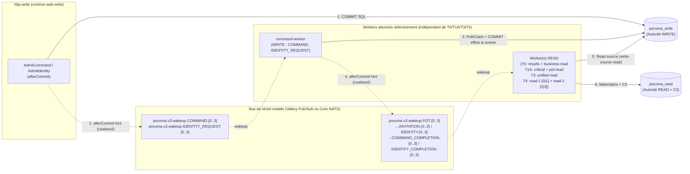
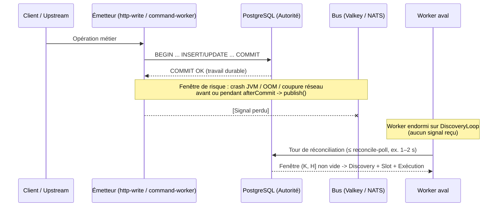

# Pocoma V3 — Étude du réveil événementiel des workers et dossier d'arbitrage

> [!IMPORTANT]
> **Statut décisionnel** : **Étude d'architecture et dossier d'arbitrage uniquement — aucune implémentation n'est autorisée ni engagée** sans décision humaine explicite. Aucun fichier de production ni aucune configuration déployée n'a été modifié.
>
> **Conventions épistémiques** : Conformément au mandat, ce dossier distingue systématiquement :
> - **Constat vérifié** : fait observé directement dans le code source, les configurations, les rapports ou preuves du dépôt (`HEAD` `2bd090ba` sur `feat/v3-identity-governance`, tag `v3.0.0-l7-local` `afec69f8`, et branche d'étude `study/worker-topology-optimization` `73c2b58d`).
> - **Hypothèse** : estimation, projection analytique ou comportement attendu non encore mesuré sur Pocoma.
> - **Proposition** : conception cible, protocole expérimental ou recommandation soumise à arbitrage.

---

## 0. Décisions architecturales acquises (invariants du mandat)

Les invariants suivants sont pris comme contraintes non négociables dans toute l'étude :
1. **PostgreSQL demeure l'unique autorité** sur les travaux, slots, checkpoints, leases, claims, effets et états (`pocoma_write` / `pocoma_read`).
2. **Le polling périodique reste permanent et indispensable**, avec une fréquence configurable.
3. **Les notifications sont des indications volatiles de travail potentiel** (*best-effort hints*), jamais des ordres faisant autorité ni des vecteurs de données métier.
4. **La perte d'une notification ne compromet jamais la progression** du système (sûreté et vivacité garanties par PostgreSQL + polling de réconciliation).
5. **PostgreSQL `LISTEN/NOTIFY` est exclu.**
6. **Le chantier est distinct de `RID` et de `SSE`**, tout en évaluant les perspectives raisonnables de mutualisation d'infrastructure.
7. **Les mécanismes existants de claim, lease, fencing et idempotence sont intégralement préservés.**

---

## 1. Inventaire de l'existant *(Constats vérifiés)*

### 1.1 Socle technique et runtimes concernés

- **Plateforme** ([app/pom.xml](file:///Users/julien.guezennec/Dev/projects/pocoma/app/pom.xml#L5-L79)) : **Java 21**, **Spring Boot `4.0.5`**, **42 modules Maven** actifs. Pure JDBC à l'exécution (aucun JPA/Hibernate en production).
- **Dépendances bus / temps réel actuelles** : **aucune** dépendance Redis, Valkey, Lettuce, Jedis, NATS, RabbitMQ, Kafka, WebFlux, WebSocket ou SSE dans les `pom.xml` ni dans `app/*/src/`.
- **Les 5 artefacts bootables** :

| Artefact runtime | Profil Spring | Rôle & autorité SQL | Héberge un `ConsumptionWorker` ? |
| :--- | :--- | :--- | :---: |
| `runtime-web-write` (`http-write`) | `v3-http-admission` | Admission HTTP `POST` → `pocoma_write` (`PENDING`), retourne `202 Accepted` | Non (émetteur amont `COMMAND`, `IDENTITY_REQUEST`) |
| `runtime-web-read` (`http-read`) | `v3-http-read` | Requêtes HTTP `GET` → `pocoma_read` (`Q=8`, pool Hikari `8+1`) | Non (consommateur HTTP final) |
| `runtime-worker-process` (`command-worker`) | `v3-consumption-worker-dev` | Exécution métier burnable (`Command`, `IdentityRequest`) sur `pocoma_write` (8 partitions) | **Oui** (récepteur + émetteur aval `*_EVENT`) |
| `runtime-worker-materialize` (`results-worker`, `business-read-worker`) | `v3-read-worker` | Matérialisation non-burnable READ (`pocoma_write_source_read` → `pocoma_read` + C3 `V5`, 28 partitions) | **Oui** (récepteur terminal dans V3) |
| `runtime-monolith` | Profils co-hébergés | Assemblage dev/test des 4 compositions (espaces de noms `pocoma.v3.process.*` / `pocoma.v3.materialize.*`) | **Oui** (dispose d'un signal intra-JVM `StageHandoffTracker`) |

> [!NOTE]
> **Constat vérifié sur le seul mécanisme de réveil existant** : [ProcessComposeConfiguration.java](file:///Users/julien.guezennec/Dev/projects/pocoma/app/compose-polling-burnable-write-postgres/src/main/java/com/kartaguez/pocoma/compose/polling/process/ProcessComposeConfiguration.java#L114) enregistre `tracker.registerWakeSignal(worker::signal)` déclenché lors d'une admission HTTP (`StageHandoffTracker`). Ce mécanisme ne fonctionne **qu'en intra-JVM** (`runtime-monolith` / tests) ; en déploiement distribué multi-conteneurs, aucun signal inter-processus n'existe.

### 1.2 Inventaire exhaustif des boucles de polling et de maintenance

**Constat vérifié** : il n'existe **aucun** `@Scheduled`, `ScheduledExecutorService`, `TaskScheduler` ni `Timer` dans `app/*/src/main/`. Toute l'exécution périodique des workers repose sur des threads plateforme explicites dans [ConsumptionWorker.java](file:///Users/julien.guezennec/Dev/projects/pocoma/app/supra-polling-consumption/src/main/java/com/kartaguez/pocoma/supra/polling/consumption/ConsumptionWorker.java#L339-L353) synchronisés par [ConditionConsumptionWaiter.java](file:///Users/julien.guezennec/Dev/projects/pocoma/app/supra-polling-consumption/src/main/java/com/kartaguez/pocoma/supra/polling/consumption/wait/ConditionConsumptionWaiter.java#L9-L28) (`ReentrantLock` + `Condition.awaitNanos`).

| # | Boucle / Classe | Threads par worker | Tables / sources interrogées | Cadence & backoff (ref. `docker/v3-five-runtimes/*.properties` vs défaut Java) | Déclencheurs & optimisations L7-C4 présentes |
| :-: | :--- | :--- | :--- | :--- | :--- |
| 1 | **`DiscoveryLoop`** ([DiscoveryLoop.java](file:///Users/julien.guezennec/Dev/projects/pocoma/app/supra-polling-consumption/src/main/java/com/kartaguez/pocoma/supra/polling/consumption/DiscoveryLoop.java#L43-L185)) + `DiscoveryEngine` | 1 (`v3-discovery-0`) | **WRITE** : `v3_request_counter`, `v3_request_position`, `v3_command`, `v3_identity_request`. **READ** : `v3_event_counter`, `v3_event_position`, `v3_*_event` (via `write-source-read`). **Contrôle** : `discovery_checkpoint`, `consumption_slot`, `partition_ownership`. | `min-poll = 2 ms` (défaut `10 ms`), `max-poll = 20 ms` (défaut `1000 ms`), `error-poll = 50 ms` (défaut `1000 ms`). `LoopSchedule` ([ConsumptionWorker.java](file:///Users/julien.guezennec/Dev/projects/pocoma/app/supra-polling-consumption/src/main/java/com/kartaguez/pocoma/supra/polling/consumption/ConsumptionWorker.java#L721-L761)) : pas intra-tour `stepPoll = minPoll / tour` (`100–250 µs`), backoff exponentiel `min → max` en fin de tour vide. `windowSize=128`, `softCap=64`, `batch-size=32`. | **B1** : saute `effects.write` sur fenêtre vide. **B2** : cache `discovery_checkpoint` par `ownerToken`. **B3** : `emptyFamilyCheckpointThisTour` déduplique les sondes vides d'une même `ConsumableFamily` dans un tour. Si `committedAdmissions > 0`, appelle `markPairDirty` + `consumptionWait.signal()`. |
| 2 | **`ConsumptionLoop`** ([ConsumptionLoop.java](file:///Users/julien.guezennec/Dev/projects/pocoma/app/supra-polling-consumption/src/main/java/com/kartaguez/pocoma/supra/polling/consumption/ConsumptionLoop.java#L44-L228)) + `ConsumptionEngine` | 1 (`v3-consumption-0`) + pool `v3-attempt-*` (`M_W=4`) | `consumption_slot` (navigation circulaire `ORDER BY consumable_id LIMIT 32`, puis `acquire` `FOR UPDATE SKIP LOCKED` par `quantum=4`). | Même `LoopSchedule` (`min-poll=2 ms`, `max-poll=20 ms`, `error-poll=50 ms`). **B1 clean-pair suppression** : une paire `(binding, p)` vide est marquée *clean* pendant `min(settleInterval, 500 ms)` (`500 ms`). | Réveillée par `DiscoveryLoop` (nouveaux slots), par fin d'enveloppe (`markPairDirty`), ou à l'échéance de la fenêtre *clean* (`500 ms`) pour retries / expirations de claim. |
| 3 | **`RenewalService`** ([RenewalService.java](file:///Users/julien.guezennec/Dev/projects/pocoma/app/supra-polling-consumption/src/main/java/com/kartaguez/pocoma/supra/polling/consumption/RenewalService.java#L54-L342)) | 3 par `Authority` (`v3-renew-{AUTH}-0,1,2`) | Lanes `0–1` : `consumption_slot` (renouvellement claims). Lane `2` : `partition_ownership` (`renewBatch` CTE jusqu'à 32 leases). | `renewal-interval-ms = 10 000 ms` (`10 s`), `lease-duration-ms = 30 000 ms` (`30 s`), `claim-duration-ms = 60 000 ms` (`60 s`), `renewalBudget = 5 000 ms`. Attente à vide : `clamp(renewalInterval/4, 1 ms, 1 000 ms)` = **`1 000 ms`**. | Purement temporelle/fencing. **Indépendante du bus de réveil.** |
| 4 | **Maintenance (`maintain`)** ([ConsumptionWorker.java](file:///Users/julien.guezennec/Dev/projects/pocoma/app/supra-polling-consumption/src/main/java/com/kartaguez/pocoma/supra/polling/consumption/ConsumptionWorker.java#L814-L896)) | 1 (`v3-maintenance-0`) | `settlePending()` (`consumption_slot`, `inspectResolved`), deadlines de renouvellement, drain d'arrêt (`drain-timeout = 90 s`). | `settleInterval = 1 000 ms` (hardcodé), aussi réveillé par `maintenanceWait.signal()`. | Résolution des issues `UNKNOWN` et surveillance du cycle de vie. **Indépendante du bus.** |

**Autres boucles bornées hors workers (constat vérifié, hors périmètre du bus)** :
- `AdmissionSqlTransactions.terminated(pid)` (`runtime-web-write`) : poll `pg_stat_activity` toutes les `25 ms` (max `4 s`) uniquement en cas d'erreur `UNKNOWN` lors d'une admission.
- `ProcessResources.awaitPoolReserve` / `MaterializeResources.awaitPoolReserve` : attente démarrage (`10 ms`, max `10 s`).
- `ReadMaintenanceFilter` (`runtime-web-read`) : cache paresseux `500 ms` sur requête HTTP (aucun thread de fond).

> [!WARNING]
> **Deux constats critiques dans le code actuel qui conditionnent tout réveil événementiel** :
> 1. **[ConditionConsumptionWaiter.java](file:///Users/julien.guezennec/Dev/projects/pocoma/app/supra-polling-consumption/src/main/java/com/kartaguez/pocoma/supra/polling/consumption/wait/ConditionConsumptionWaiter.java#L14-L27) ne mémorise PAS le signal** : `signalled.signalAll()` est perdu s'il survient entre la fin d'une itération et l'entrée dans `signalled.awaitNanos(delay)`. Avec `max-poll = 20 ms`, cette course est quasi invisible ; avec `max-poll = 1 000–2 000 ms`, elle provoquerait des pics de latence de `1–2 s`.
> 2. **[DiscoveryLoop.java](file:///Users/julien.guezennec/Dev/projects/pocoma/app/supra-polling-consumption/src/main/java/com/kartaguez/pocoma/supra/polling/consumption/DiscoveryLoop.java#L17-L102)** conserve `emptyFamilyCheckpointThisTour` jusqu'à `tourRemaining <= 0`. Un réveil externe arrivant en milieu de tour doit impérativement invalider la famille concernée (sinon la sonde serait court-circuitée).

### 1.3 Taxonomie des situations rendant un travail éligible *(Constats vérifiés)*

Toutes les transitions d'éligibilité dans Pocoma V3 (9 consommations, 7 familles sources, 36 partitions logiques `0..3` via `RoutingV1` `sha256-v1`) se répartissent en **deux classes distinctes** :

| Situation d'éligibilité | Origine / Émetteur | Table / Mécanisme PostgreSQL | Consommation(s) concernée(s) | Peut être notifiée par un bus ? | Couverture de sûreté sans bus |
| :--- | :--- | :--- | :--- | :---: | :--- |
| **1. Nouvelle admission HTTP** | `http-write` (`POST` command / identity) | `COMMIT` dans `v3_command` / `v3_identity_request` + `v3_request_position` + `v3_request_counter` | `Command` (`COMMAND`), `IdentityRequest` (`IDENTITY_REQUEST`) | **Oui** (post-COMMIT) | `DiscoveryLoop` (`reconcile-poll`) |
| **2. Publication d'événements WRITE** | `command-worker` (exécution métier réussie ou rejet terminal) | `COMMIT` atomique dans `v3_*_event` + `v3_event_position` + `v3_event_counter` (5 familles : `POT`, `INVITATION`, `IDENTITY`, `COMMAND_COMPLETION`, `IDENTITY_COMPLETION`) | Les 7 matérialisations READ (`PotVersion`, `PotBalance`, `PotVisibility`, `Invitation`, `CurrentBinding`, `CommandResult`, `IdentityRequestResult`) | **Oui** (post-COMMIT) | `DiscoveryLoop` (`reconcile-poll`) |
| **3. Admission de slot (Discovery → Consumption)** | Interne au même worker (`DiscoveryLoop`) | `INSERT` `consumption_slot` (`AVAILABLE`) + avance `discovery_checkpoint` | Même worker (`ConsumptionLoop`) | **Inutile** (déjà intra-JVM via `consumptionWait.signal()`) | `ConsumptionLoop` (`cleanUntilNanos ≤ 500 ms`) |
| **4. Retry après échec technique** | Interne (`JdbcConsumptionSlotStore.cede`) | `consumption_slot.retry_after = clock_timestamp() + 30 s` (`attempt_count < 3`, sinon `QUARANTINED`) | Même ou autre worker détenant le lease | **Non** (échéance temporelle sans nouveau commit externe) | `ConsumptionLoop` (polling périodique / échéance `retry_after`) |
| **5. Expiration de claim de slot** | Aucun émetteur (crash worker ou perte d'enveloppe) | `consumption_slot.claimed_until <= clock_timestamp()` (`claim-duration-ms = 60 s`) | Worker détenant le lease de la partition | **Non** (panne silencieuse) | `ConsumptionLoop` (polling périodique) |
| **6. Expiration de lease de partition (takeover HA)** | Aucun émetteur (crash ou partition réseau d'un worker) | `partition_ownership.owned_until <= clock_timestamp()` (`lease-duration-ms = 30 s`) | Réplique de secours / redémarrage | **Non** (panne silencieuse) | `DiscoveryLoop` + `RenewalService` |
| **7. Reprise après interruption / `UNKNOWN` COMMIT** | Redémarrage worker ou `settlePending()` | Observation `REPEATABLE READ READ ONLY` (`prepareRecovery`) + `DiscoveryLoop` | Worker redémarré / `maintain()` (`1 s`) | **Partiel** (réveil local immédiat `onStart` / `onConnected`) | `maintain()` + `DiscoveryLoop` + `ConsumptionLoop` |

### 1.4 Examen des configurations `T0`, `T1A`, `T3`, `T4` et configuration de référence actuelle

> [!NOTE]
> **Constat vérifié sur la localisation des configurations** :
> - La **configuration de référence actuelle** sur `main` (tag `v3.0.0-l7-local`, `afec69f8`) et `feat/v3-identity-governance` (`2bd090ba`) est **`T0` (`v3-five-runtimes` avec optimisations `L7-C4 B3 + A2`)**, déployée par [docker-compose.v3-five-runtimes.yml](file:///Users/julien.guezennec/Dev/projects/pocoma/docker-compose.v3-five-runtimes.yml), `docker/v3-five-runtimes/*.properties` et `./pocoma-local` ([runtime.py](file:///Users/julien.guezennec/Dev/projects/pocoma/scripts/local/runtime.py#L39-L45)).
> - Les topologies **`T1A` (`T1a`), `T3` et `T4`** (ainsi que `T1b` et `T2`) **ne sont pas sur `main`** : elles sont définies et mesurées (58/58 runs `PASS`, budget constant `6,0` CPUs / `5 376 MiB` RAM) sur la branche d'étude isolée `study/worker-topology-optimization` (`docs/v3/Worker_Topology_Optimization_Study.md`, commits `9b894ef5` et `73c2b58d`). Elles n'ont pas encore fait l'objet d'une décision d'adoption sur `main`.

| Topologie | Statut | Workers (Total runtimes JVM) | Répartition des workers & partitions | Conns PG | `c1-idle` PG tx/s | `c1-idle` CPU total (PG / workers) | `c1-idle` RSS workers | Plateau `c2-ramp` (`50/s`) | Interaction clé avec un réveil événementiel |
| :--- | :--- | :---: | :--- | :---: | :---: | :---: | :---: | :---: | :--- |
| **`T0`** *(Référence actuelle `B3+A2`)* | **Référence qualifiée `v3.0.0-l7-local`** | 3 (5) | `command-worker` (`Cmd`, `Id`, `0..3`) ; `results-worker` (`CmdRes`, `IdRes`, `0..3`) ; `business-read-worker` (`PotVer/Bal/Vis`, `CurBind`, `Inv`, `0..3`) | `75` | `1 339` | `0,55` (`0,14` / `0,38`) | `658,7 MiB` | `38,31 cmd/s` | 3 abonnés distincts ; 7 familles réparties sur 3 JVM (`POT_EVENT` colocalisé → `B3` actif). |
| **`T1A`** (`t1a-critical-read`) | Étude `study/worker-topology-optimization` (non fusionnée) | 3 (5) | `command-worker` (`0..3`) ; `critical-read-worker` (`CmdRes`, `IdRes`, `CurrentBinding`, `0..3`) ; `pot-read-worker` (`PotVer/Bal/Vis`, `Inv`, `0..3`) | `75` | `1 343` | `0,56` (`0,14` / `0,39`) | `667,5 MiB` | `37,33 cmd/s` | Même coût que `T0`, élimine la famine `CurrentBinding` (`cb_sat = 0`). **Même routage par famille** (`IDENTITY_EVENT` bascule sur `critical-read-worker`). |
| **`T3`** (`t3-unified-read`) | Étude `study/worker-topology-optimization` (recommandée local, non fusionnée) | **2 (4)** | `command-worker` (`0..3`) ; `unified-read-worker` (**7 READ**, `M_W=6`, `0..3`) | **`59`** | **`1 257`** | **`0,36`** (`0,10` / `0,24`) | **`463,7 MiB`** | **`39,04 cmd/s`** | **Réduit déjà CPU à vide de `-34,5 %` et RAM de `-195 MiB` sans aucun bus !** Un seul abonné READ pour les 5 familles d'événements. |
| **`T4`** (`t4-replicated-read`) | Étude `study/worker-topology-optimization` (multi-répliques shardées) | 3 (5) | `command-worker` (`0..3`) ; `read-worker-1` (7 READ, `0\|1`) ; `read-worker-2` (7 READ, `2\|3`) | `75` | `2 028` | `0,57` (`0,16` / `0,39`) | `671,1 MiB` | `29,93 cmd/s` *(contraint 6 CPU)* | **Le plus pénalisé par le polling à vide (`+61 %` tx/s vs `T3`)** car chaque réplique sonde les mêmes familles sur son sous-ensemble de partitions → **le routage par partition `(family, partition)` prend tout son sens ici.** |

---

## 2. Architecture cible du réveil événementiel *(Propositions)*

### 2.1 Placement des émetteurs et des abonnés

Dans Pocoma V3, le pipeline asynchrone forme un graphe acyclique à deux sauts ; **les workers READ ne produisent pas de travail pour d'autres workers V3** (la disponibilité C3 `V5` s'arrête à PostgreSQL `pocoma_read` ; SSE et les consommateurs niveau 2 relèvent de chantiers distincts).

- **Émetteurs (strictement côté WRITE, après `COMMIT` dans `pocoma_write`)** :
  1. `runtime-web-write` (`http-write`) : émet sur `(COMMAND, p)` et `(IDENTITY_REQUEST, p)` après commit durable de l'admission.
  2. `runtime-worker-process` (`command-worker`) : émet sur `(POT, p)`, `(INVITATION, p)`, `(IDENTITY, p)`, `(COMMAND_COMPLETION, p)` et `(IDENTITY_COMPLETION, p)` uniquement pour les familles effectivement publiées lors du commit d'exécution.
- **Abonnés** : chaque instance `ConsumptionWorker` dérive automatiquement ses abonnements de sa configuration statique de `Binding` (`(binding.definition().family(), partition)`). L'architecture est donc **totalement agnostique aux topologies `T0`, `T1A`, `T3` et `T4`**.
- **Cas `runtime-monolith`** : peut utiliser un adaptateur `InJvmWakeupBus` (généralisation propre du hook actuel de `StageHandoffTracker`) ou `NOOP` sans nécessiter de broker externe.

### 2.2 Routage par catégorie de travail et partition & mutualisation des signaux

- **Proposition de convention de canaux/sujets** :
  `pocoma.v3.wakeup.<ConsumableFamily>.<partition>` (exemple : `pocoma.v3.wakeup.POT.2`, `pocoma.v3.wakeup.COMMAND.0`).
- **Pourquoi par `ConsumableFamily` source (et NON par `ConsumptionDefinition`)** :
  - **Mutualisation naturelle** : un commit `POT` émet **1 seul signal** `pocoma.v3.wakeup.POT.
` au lieu de 3 (`PotVersion`, `PotBalance`, `PotVisibility`).
  - **Découplage architectural** : `command-worker` ne connaît jamais le nombre ni l'identité des projections READ aval (respect strict des frontières modulaires `domain-*`/`engine-*`).
- **Pourquoi inclure `<partition>` (`0..3`)** :
  - **Cardinalité minuscule et bornée** : `7 familles × 4 partitions = 28 canaux/sujets` au total (aucune dérive de cardinalité, zéro ID métier/utilisateur/pot dans le nom du canal ni dans le payload — payload vide ou versionné 1 octet).
  - **Prêt pour `T4` (sharding horizontal)** : en `T4`, `read-worker-1` ne s'abonne qu'aux partitions `0|1` et `read-worker-2` à `2|3`, évitant 50 % de réveils inutiles.
  - **Prêt pour `T0`/`T1A`/`T3`** : un worker hébergeant toutes les partitions d'une famille s'abonne aux 4 canaux explicites (ou `pocoma.v3.wakeup.<family>.*` sous NATS / `SUBSCRIBE` explicite de 4–20 canaux sous Valkey — préférer l'abonnement explicite sans wildcard pour éviter le surcoût `PSUBSCRIBE` de Valkey).

### 2.3 Gestion des réveils simultanés, anti-tempête et prérequis dans `supra-polling-consumption`

Quatre mécanismes complémentaires (propositions) évitent les tempêtes de réveil (*thundering herd*) et les courses :

1. **Coalescing côté émetteur par clé `(ConsumableFamily, partition)`** :
   - Un tableau/bitmap atomique `pending[7][4]` (28 bits) combiné à un envoi asynchrone hors thread métier avec fenêtre de regroupement de `1–2 ms` (ou *in-flight deduplication* : au plus 1 publication en cours par couple `(family, p)`).
   - Sous charge de `50 cmd/s` (ou rafale de `50` commits en `2 ms` sur la même partition), le bus ne reçoit **qu'un seul signal** par fenêtre ; sous forte charge soutenue, le coût réseau du bus devient négligeable.
2. **Mémorisation du signal (*latched wakeup*) dans `ConditionConsumptionWaiter`** *(corrige le constat §1.2)* :
   - Ajouter un booléen `boolean signaled` protégé par `lock` : `signal()` positionne `signaled = true` et appelle `signalled.signalAll()` ; `await(duration)` vérifie `if (signaled) { signaled = false; return; }` avant `awaitNanos(...)`. Élimine définitivement la fenêtre de perte de réveil intra-JVM.
3. **Invalidation ciblée et réveil prioritaire dans `DiscoveryLoop`** *(corrige le constat §1.2)* :
   - Lors de la réception d'un signal `(family, p)`, enregistrer `(family, p)` dans une file/bitset bornée (28 bits, sans allocation) + réveiller `discoveryWait`.
   - Au réveil, `DiscoveryLoop` retire `family` de `emptyFamilyCheckpointThisTour` et sonde en priorité les couples `(binding, p)` signalés **dont le worker détient actuellement un lease valide** (`worker.lease(binding, p) != null`).
   - **Effet sur les répliques passives HA (L8)** : une réplique passive qui ne détient pas de lease ignore localement le signal sans émettre aucune requête SQL (aucun *thundering herd* vers PostgreSQL).
4. **Absorption sous charge active** :
   - Si `DiscoveryLoop` est déjà en cours de traitement actif (`progressed == true`), les signaux redondants ne font que lever le bit `(family, p)` déjà en cours de consommation — zéro empilement de tâches ni de threads.

### 2.4 Comportement du polling périodique avec et sans bus disponible

Le polling reste **permanent** dans tous les modes, piloté par l'état de santé du bus (`WakeupHealth` : `CONNECTED` vs `DEGRADED/DISABLED`) :

| Boucle | Bus `CONNECTED` (mode nominal réveil actif) | Bus `DEGRADED` / déconnecté / mode `NOOP` | Comportement à la reconnexion (`onSubscribed`) |
| :--- | :--- | :--- | :--- |
| **`DiscoveryLoop`** | `max-poll` relevé à `reconcile-poll` (proposition : **`1 000–2 000 ms`**), `min-poll = 2 ms`. Réveil immédiat (`< 3 ms`) sur signal bus. | **Bascule automatique** sur `fallback-max-poll` (**`20–50 ms`**) dès la perte de connexion ou d'abonnement. `B1+B2+B3` reste actif. | Déclenche immédiatement un réveil global (`markAllFamiliesDirty` + `discoveryWait.signal()`) pour rattraper sans délai tout événement commité pendant la coupure. |
| **`ConsumptionLoop`** | **`cleanUntilNanos` et `max-poll` bornés séparément** (proposition : `500–1 000 ms`). Réveillée immédiatement en intra-JVM par `DiscoveryLoop` dès qu'un slot est admis. Les retries (`30 s`) et expirations de claim (`60 s`) sont détectés en `≤ 1 s` (`≤ 3 %` d'écart relatif). | Identique ou aligné sur `20–50 ms`. | `consumptionWait.signal()` par prudence. |
| **`RenewalService`** | **Inchangé** (`renewalInterval = 10 s`, idle `1 s`). | **Inchangé**. | **Inchangé**. |
| **`maintain()`** | **Inchangé** (`settleInterval = 1 s`). | **Inchangé**. | **Inchangé**. |

### 2.5 Analyse explicite du risque : crash après `COMMIT` PostgreSQL et avant publication du réveil

- **Règle d'ordre stricte** : la publication du signal doit **toujours** intervenir **après** le `COMMIT` physique PostgreSQL (`TransactionSynchronization.afterCommit()` ou après retour de `AttemptTransactions.write(...)`). Émettre *avant* le `COMMIT` provoquerait des réveils prématurés à vide (les lignes ne sont pas encore visibles sous `READ COMMITTED`/`REPEATABLE READ`), dégradant latence et charge SQL.
- **Analyse du risque `COMMIT` réussi → crash avant `publish`** :
  - **Sûreté / intégrité** : **impact nul**. L'état durable est déjà commité dans `pocoma_write`. Aucun slot ni événement n'est perdu, aucun doublon n'est créé.
  - **Vivacité / latence** : dans le pire cas (aucune autre opération sur la même `(family, partition)`), la détection est différée d'au plus `reconcile-poll` (`1–2 s`). Dès qu'une autre opération commite sur la même `(family, partition)` avant cette échéance, son signal réveille le worker et draine aussi l'élément manqué (car Discovery lit toute la fenêtre `(K, H]`).
  - **Pourquoi ne pas ajouter d'outbox** : un outbox PostgreSQL réintroduirait des écritures WAL dans la base d'autorité et un polling fréquent sur la table outbox, annulant l'objectif même du chantier. Le compromis *post-commit best-effort + polling de réconciliation `1–2 s`* est architecturalement optimal sous les invariants acquis.

---

## 3. Comparaison : Valkey Pub/Sub vs Core NATS vs Polling optimisé seul

### 3.1 Tableau comparatif détaillé

> **Distinction épistémique** : Les faits relatifs à Spring Boot `4.0.5`, à l'état du dépôt et aux mesures `B3+A2`/`T3` sont des **constats vérifiés** ; les empreintes RAM/CPU de Valkey/NATS en conditions Pocoma et leurs gains exacts sont des **hypothèses** à valider par l'expérimentation (§4).

| Critère | **Valkey Pub/Sub** (BSD-3, Linux Foundation) | **Core NATS** (Apache-2.0, CNCF) | **Option 0 : Optimisation du polling seul (sans nouveau bus)** |
| :--- | :--- | :--- | :--- |
| **Comportement de diffusion** | Pub/Sub volatile *at-most-once* (`PUBLISH` / `SUBSCRIBE`). Fan-out à tous les abonnés du canal. Si 0 abonné → message jeté sans erreur. Pas de queue groups natifs (inutile ici : 1 seul détenteur de lease par partition). `PSUBSCRIBE` coûteux en CPU (préférer abonnements explicites sur ≤ 20 canaux). | Pub/Sub volatile *at-most-once* sur sujets hiérarchiques (`pocoma.v3.wakeup.<family>.
`). Wildcards (`*`, `>`) natifs très efficaces (trie en mémoire). Fan-out natif + queue groups optionnels. Si 0 abonné → jeté côté serveur sans erreur. | Aucune diffusion : sondes périodiques PostgreSQL (`B1+B2+B3`). Variantes possibles sans bus : adopter `T3` (`-34,5 %` CPU à vide déjà prouvé) et/ou relever `max-poll` (`20 → 50/100 ms`) ou introduire un backoff adaptatif lent après longue inactivité (ex. `20 ms → 200 ms` après 10 s d'inactivité). |
| **Coût CPU / mémoire *(Hypothèse bus / Constat Option 0)*** | **Hypothèse** : serveur Valkey léger (`~20–40 MiB` RSS sans persistance RDB/AOF, `~0,02–0,05` CPU à faible trafic) + overhead client Lettuce + Netty dans **chaque JVM** émettrice/abonnée (**~15–30 MiB RAM/JVM** et threads event-loop Netty, soit `+60–120 MiB` sur 4–5 JVM). | **Hypothèse** : serveur `nats-server` binaire Go unique (`~15–25 MiB` RSS, `~0,01–0,03` CPU) + client `io.nats:jnats` pur Java sans Netty (**~5–10 MiB RAM/JVM**, 2–3 threads légers, soit `+20–40 MiB` sur 4–5 JVM). | **Constat vérifié** : **0 conteneur**, **0 MiB** de dépendance supplémentaire. `T3` seul économise déjà **`-195 MiB` RSS** et **`-0,19` CPU à vide** (`0,55 → 0,36 CPU`). En revanche, les requêtes PG à vide restent à `~1 257 tx/s` à `max-poll=20 ms` (divisibles par `~2,5–5×` si `max-poll=50–100 ms`, au prix d'une latence à froid augmentée). |
| **Intégration Java 21 / Spring Boot `4.0.5`** | **Point de vigilance vérifié** : Pocoma tourne sur **Spring Boot `4.0.5`** (`app/pom.xml`). `spring-boot-starter-data-redis` (Spring Data Redis 4.x / Lettuce) est géré directement par le BOM Spring Boot 4 (compatibilité garantie), mais tire un graphe de dépendances conséquent (Spring Data, Lettuce, Netty, Reactor). On peut aussi utiliser Lettuce seul sans Spring Data pour alléger. | `io.nats:jnats` est un client Java 17/21 autonome, sans couplage à Spring Boot (aucun risque d'incompatibilité Spring Boot 4.0.5, contrairement à `nats-spring` tiers qui peut accuser un retard de compatibilité Boot 4). Intégration manuelle très simple (~100–150 LoC) dans un module `infra-wakeup-nats` dédié. | **Zéro nouvelle dépendance**. Modification purement locale dans `supra-polling-consumption` si backoff adaptatif, ou purement configuration/topologie (`T3`). |
| **Complexité opérationnelle** | Faible en mono-nœud (`valkey:8-alpine --save "" --appendonly no`). En multi-VM HA (L8) : nécessite **Valkey Sentinel** (3 nœuds pour quorum) ou 2 instances indépendantes / Redis Cluster (plus lourd pour un simple bus volatile). | **Très faible** en mono-nœud (1 binaire `nats:2-alpine`, zéro persistance JetStream requise) **et** en multi-VM HA (clustering maillé natif en 3 nœuds sans quorum externe type Sentinel, reconnexion transparente sur liste d'URLs, support *leaf nodes*). | **Nulle** (aucun composant supplémentaire à déployer, sauvegarder, monitorer ou patcher). |
| **Sécurité** | ACL native (`ACL SETUSER` par rôle : `http-write` publish-only `COMMAND`/`IDENTITY_REQUEST`, workers subscribe-only par canal), TLS/mTLS natif. Pas de données métier dans les signaux (uniquement noms de familles/partitions). | NKeys / JWT / comptes isolés avec permissions fines `pub.allow` / `sub.allow` par sujet hiérarchique, TLS/mTLS natif. Même principe : zéro donnée métier dans les payloads. | Surface d'attaque inchangée (aucun nouveau port/service réseau). |
| **Comportement en panne** | Reconnexion auto Lettuce ; `onConnected` / `RedisPubSubListener` permet de déclencher le rattrapage. Risque de mémoire tampon si client lent (`client-output-buffer-limit pubsub` à configurer). Perte des messages pendant la coupure (acceptable). | Reconnexion auto `jnats` avec `ConnectionListener` (`RECONNECTED`/`DISCONNECTED`). Protection native *slow consumer* (drop côté client/serveur sans bloquer les producteurs). Perte pendant la coupure (acceptable). | Pas de mode dégradé de bus à gérer ni à tester ; seul le comportement PostgreSQL compte. |
| **Déploiement local (`./pocoma-local`) & Internet (L8)** | Local : +1 conteneur (10e conteneur dans `pocoma-local`), +RAM Valkey + Netty sur les 5 JVM (non négligeable sous le budget serré `5 376 MiB` local !). Internet/L8 : standard cloud largement disponible en service managé (AWS ElastiCache Valkey, GCP Memorystore, Scaleway/OVH Managed Valkey). | Local : +1 conteneur minuscule (~20 MiB), impact JVM minimal. Internet/L8 : très facile à auto-héberger en cluster ou *leaf-nodes* ; en revanche, moins souvent disponible en service managé « 1-clic » chez les clouds généralistes que Valkey/Redis (hors Synadia NGS / K8s). | Local et Internet : topologie minimale inchangée (PostgreSQL + Keycloak + runtimes Pocoma). |
| **Mutualisation avec SSE (et distinction RID)** | **Forte synergie potentielle avec SSE** : si le futur chantier SSE utilise un fan-out inter-instances `http-read` (ou un cache léger / rate-limiter), **Valkey** (Pub/Sub ou Streams) est un standard naturel et polyvalent. Note : C3 `V5` reste la source de vérité durable des curseurs SSE (`read_availability_event` / `read_current_availability`). | **Excellente synergie pour le fan-out SSE pur** (sujets hiérarchiques par `potId` ou `userId` avec wildcards natifs, gestion native de milliers de sujets sans pénalité `PSUBSCRIBE`), mais **ne couvre pas** d'éventuels besoins de cache applicatif ou rate-limiting partagé. | Aucune mutualisation (un futur chantier SSE devra introduire son propre mécanisme de fan-out s'il déploie plusieurs instances `http-read`). |

### 3.2 Synthèse comparative Valkey vs Core NATS

- **Core NATS** est **techniquement supérieur pour le cas d'usage pur « réveil événementiel + futur fan-out SSE »** : empreinte mémoire totale nettement plus faible (surtout côté JVM : pas de Netty/Reactor), routage hiérarchique natif, clustering multi-VM sans Sentinel, et zéro risque de couplage au cycle de version de Spring Boot 4.x via `io.nats:jnats`.
- **Valkey Pub/Sub** est **supérieur sur l'écosystème managé et la polyvalence** : disponible en service managé partout en production Internet, familier aux équipes Spring (`spring-boot-starter-data-redis` dans le BOM Boot 4), et réutilisable si Pocoma a ultérieurement besoin d'un cache ou d'un rate-limiter distribué.
- **Découplage clé** : l'interface interne Pocoma (`WakeupPublisher` / `WakeupSubscriber` sur `(ConsumableFamily, int partition)`) fait moins de ~150 lignes par adaptateur ; le choix technique entre Valkey et NATS est donc **réversible à faible coût** tant que le contrat reste strictement volatile et sans payload métier.

---

## 4. Analyse économique et protocole d'expérimentation *(Propositions — gains non présumés)*

> [!CAUTION]
> **Règle de rigueur** : Les chiffres de projection de `L7_C4/event-driven-wakeup-study.md` (`~15–30 tx/s`, `< 0,03 CPU` PG, `~1–3 ms` à froid) sont des **hypothèses analytiques**, **pas des mesures**. En particulier, elles n'incluent pas encore le coût mesuré du conteneur broker + client JVM (Netty pour Valkey, `jnats` pour NATS) ni son impact sur le budget mémoire/CPU global. **Aucun gain ne doit être tenu pour acquis avant exécution du protocole ci-dessous.**

### 4.1 Variantes à comparer (plan A / B / C / D)

Pour éviter de confondre le gain topologique (`T0 → T3`) avec le gain du bus, le banc doit comparer les **4 variantes sur une base topologique identique** (d'abord `T0` — référence qualifiée actuelle — puis idéalement un jeu de confirmation sur `T3` ou `T4` où le polling à vide coûte le plus cher) :

| Variante | Description | `max-poll` Discovery | `max-poll` / `clean` Consumption | Bus externe |
| :-: | :--- | :---: | :---: | :--- |
| **A** | **Polling actuel (référence `B3+A2`)** | `20 ms` | `20 ms` / `500 ms` | Aucun (`NOOP`) |
| **B** | **Polling ralenti sans bus** *(sous-paliers `B-50`, `B-100`, `B-250`, `B-1000`)* | `50` / `100` / `250` / `1 000 ms` | `50–500 ms` | Aucun (`NOOP`) |
| **C** | **Polling ralenti + Valkey Pub/Sub** | `2 000 ms` (fallback `20 ms`) | `500 ms` (réveil intra-JVM par Discovery) | `valkey:8-alpine` (`--save "" --appendonly no`) |
| **D** | **Polling ralenti + Core NATS** | `2 000 ms` (fallback `20 ms`) | `500 ms` (réveil intra-JVM par Discovery) | `nats:2-alpine` (Core NATS seul, sans JetStream) |

### 4.2 Métriques obligatoires à collecter

S'appuyer directement sur l'instrumentation existante de `scripts/performance/run-l7-c4-diagnostic.py` et `c4_metrics.py`, étendue au conteneur broker (C/D) :
1. **CPU total cluster** (`cgroup usage_usec` + `throttled_usec`) : détaillé par conteneur (`postgres`, `http-write`, `http-read`, workers **ET conteneur Valkey/NATS**).
2. **Mémoire totale cluster** (RSS médian & pic, JVM Heap + Non-Heap / Metaspace / Direct buffers Netty) : incluant le surcoût client dans chaque JVM et le conteneur broker.
3. **Charge PostgreSQL** : transactions/s (`pocoma_write` + `pocoma_read`), appels `pg_stat_statements` par famille de requête (`v3_event_counter`, `v3_request_counter`, `consumption_slot`), volume WAL (`pg_stat_wal`), connexions actives.
4. **Latences bout-en-bout (`p50`, `p95`, `p99`, `max`)** : `C-03` (Pot), `F01-A-BAL` (Balance), `F01-E` (Identity `Registration`), décomposées par étape (`admission → discovery → execution → materialization`) afin d'isoler exactement le gain de latence sur la détection.
5. **Débit** : débit plateau E2E (`c2-ramp` `50 cmd/s`) et débit de drainage sans HTTP (`c4-backlog-10k`).
6. **Coûts d'infrastructure et d'exploitation supplémentaires** :
   - Mono-VM / local : Delta RAM (MiB), Delta CPU, nombre de conteneurs.
   - Multi-VM / cloud (L8) : coût mensuel d'une instance managée Valkey HA (ou cluster NATS 3 nœuds), coût de supervision/mises à jour/rotation TLS, comparé au coût CPU/IOPS PostgreSQL économisé (ex. taille de VM RDS/Cloud SQL).

### 4.3 Matrice des scénarios expérimentaux (`R ≥ 3` répétitions par point clé)

| Catégorie | Scénario (réutilisant le corpus L7-C4 / SPEC-09) | Ce que le scénario tranche |
| :--- | :--- | :--- |
| **Sans charge & reprise à froid** | `c1-idle` (90 s à vide + 10 commandes isolées après stabilisation `F01-J`) | **Bilan net à vide** : l'économie CPU/tx PG compense-t-elle le coût fixe CPU/RAM du broker + client JVM ? Gain réel sur latence à froid (`p50`/`p95`/`p99`). |
| **Charge faible** | `c1-med-1` (`1 cmd/s` Pot moyen) + `a2-id1` (`1 req/s` Identity `F01-E`) | Vérifie si `B` (ex. `100 ms`) dégrade trop `p95` vs `≤ 500 ms` et mesure le gain réel de `C`/`D` sur la latence nominale. |
| **Charge modérée** | `c2-ramp` (`10` et `20 cmd/s`) + `c3-int-pot-vs-id` (`20/s` Pot + `1/s` Identity) | Vérifie que le coalescing empêche toute surcharge réseau/CPU du bus quand les workers sont actifs. |
| **Charge élevée & backlog** | `c2-ramp` (`35` et `50 cmd/s`) + `c4-backlog-10k` (`10 000` CreatePot) | Vérifie l'absence de régression sur le débit plateau (`36,8–39 cmd/s`) et sur le drainage (`112–130 s`) — ou mesure si le CPU libéré côté PG augmente le plateau ! |
| **Panne & reprise** | 1. **Kill brutal du broker (`SIGKILL`) en charge (`10/s`) puis redémarrage**. 2. **Coupure réseau broker ↔ workers** (détection + bascule fallback `20–50 ms` + reconnexion). 3. **Perte simulée de 100 % des signaux** (bus silencieux / drops) → progression par `reconcile-poll` seul. 4. **Crash émetteur après `COMMIT` avant `publish`** (faute injectée en test d'intégration) → détection `≤ reconcile-poll`. 5. **Kill worker (`SIGKILL`)** pendant exécution → reprise lease `30 s` / claim `60 s` sans corruption. | Valide les invariants de sûreté, le temps de bascule en fallback, l'absence de trou ou de doublon (`read_availability_valid() = true`), et l'absence de tempête à la reconnexion. |

### 4.4 Critères quantitatifs de rentabilité économique *(Proposition de seuils Go/No-Go)*

Pour justifier le coût d'un composant d'infrastructure supplémentaire (`C` ou `D`) face à `A` (`B3+A2`) et `B` (polling ralenti sans bus, éventuellement combiné à `T3`), l'expérimentation devrait démontrer **simultanément** :
1. **Bilan CPU net positif à vide et à faible charge** : `CPU_total(C ou D) < CPU_total(A)` d'au moins **`50 %`** à vide (soit `< 0,25 CPU` total sur `T0`, broker inclus) et réduction `PG tx/s` d'au moins **`90 %`** par rapport à `A` (`< 130 tx/s`).
2. **Surcoût RAM net maîtrisé** : `< +120 MiB` RSS total sur le cluster local (broker + surcoût clients JVM).
3. **Gain ou neutralité latence `p95`** : `p95(C/D) ≤ p95(A)` à `1/s` et `10/s`, et aucune régression `> 3 %` sur le plateau `50/s` et le drain `10k`.
4. **Avantage clair sur `B`** : `C/D` doit offrir une latence `p95` à faible charge nettement meilleure que la meilleure variante `B` à consommation PG équivalente.

---

## 5. Impact sur la qualification (L7 et SPEC-09)

### 5.1 Rappel strict : qualifications ACQUISES vs OUVERTES *(Constats vérifiés au 22 nov. 2026)*

> [!IMPORTANT]
> Il est essentiel de ne **pas confondre** ce qui est déjà certifié localement avec ce qui reste ouvert ou différé vers L8 ([L7_Final_Global_Qualification_Dossier.md](file:///Users/julien.guezennec/Dev/projects/pocoma/docs/v3/L7_Final_Global_Qualification_Dossier.md), [L7_Residual_Certification_Matrix.md](file:///Users/julien.guezennec/Dev/projects/pocoma/docs/v3/L7_Residual_Certification_Matrix.md), [L7_Reservations_Register_Updated.md](file:///Users/julien.guezennec/Dev/projects/pocoma/docs/v3/L7_Reservations_Register_Updated.md)).

- **Qualifications DÉJÀ ACQUISES (`L7_LOCAL_CERTIFIED_WITH_RESERVES`, SHA `f589d95c` / tag `v3.0.0-l7-local`)** :
  - `486 / 522` obligations **`CURRENT_FULL`** (`L7.2`: 44, `L7.3`: 425, `L7.4`: 1, `L7.5`: 16) + `3 HISTORICAL_REUSABLE` + `0 MISSING`.
  - **`CERT-FULL` (`L7.5`)** : réacteur complet 42 modules **`1 173 / 1 173` tests `PASS`**, **`50 / 50` `architecture-tests` `PASS`**.
  - **`L7-LB`** (`L7_LB_CLOSED`) : distribution locale `./pocoma-local` (9 conteneurs, Bruno CLI `J01–J03` 236 tests PASS, `DEBT-L7LB-01` clos).
  - **`L7-C1`..`L7-C4`** clos (`C2` Radix-16/PotBalance V3-V4, `C3` `V5 ReadAvailability`, `C4` `B1–B3` + `A2`).
  - **17 obligations `L7.4` (`SPEC-09`) qualifiées en laboratoire local (`LOCAL_ENV_BOUNDED`)** sur Apple M4 `6,0` CPUs (`F01-A`, `F01-A-BAL`, `F01-B`, `F01-D`, `F01-E`, `F01-G`, `F01-I` 3 tailles locales, `F01-J`, `A11-L/M`).
- **Qualifications ENCORE OUVERTES / RÉSERVÉES (non acquises à ce jour)** :
  - **Configuration A & B `SPEC-09`** (`2 × 4 vCPU / 8 GiB` + Keycloak isolé) : **toutes les 13 familles contractuelles SPEC-09 restent non certifiées sur cible** (`L74-ENV-01`, `17 LOCAL_ENV_BOUNDED` + `1 DEFERRED_TO_L8_INFRA` pour `F01-F` ; `RES-L7LB-S6-01` plateau local `36,83 cmd/s < 50 cmd/s`).
  - **13 obligations `CURRENT_PARTIAL` (`R2`)** : 7 en `L7.2` (`SEC-02`, `A10-F/H/I`, `A11-K`, `INV-F/G`), 3 en `L7.3` (`PG-REBUILD-EQ`, `RCV01-A/N` sans `Invitation`), 1 en `L7.4` (`F01-H` contention même Pot `RES-L74-CONTENTION`), 2 en `L7.5` (`CERT-SPEC10`, `CERT-AUDIT`).
  - **Réserves `R3` différées L8** : `RES-L7LB-S6-02` (HA multi-nœuds / failover actif), `RES-L8-PROD` (volumes `10k/1M` & `100k/10M`, TLS/mTLS, rotation secrets), `LB-J1-CLIENT` (CORS/SPA BFF).

### 5.2 Matrice de traçabilité et d'impact d'un réveil événementiel sur les qualifications

Si un mécanisme de réveil événementiel est introduit derrière un port optionnel (`NOOP` par défaut) sans toucher aux contrats SQL/métier :

| Domaine / Famille de qualification | Statut actuel | Impact du chantier réveil | Catégorie de preuve | Détail & justification |
| :--- | :--- | :--- | :--- | :--- |
| **Domaine métier (`domain-*`, `engine-write-*`, `engine-read-*`, `SPEC-01`, `SPEC-02`, `SPEC-04`)** | `CURRENT_FULL` | Nul | **1. Réutilisable sans modification** | Aucune modification des moteurs métier, projections C1/C2 ni autorisations READ. |
| **Publication ordonnée & C3 `V5 ReadAvailability` (`SPEC-03`, `L7-C3`)** | `CURRENT_FULL` | Nul | **1. Réutilisable sans modification** | Les séquences denses, triggers et tables C3 `V5` restent inchangés ; le signal est strictement post-COMMIT. |
| **Sécurité HTTP / OIDC / Binding / Idempotence (`SPEC-07`, `L7.2`)** | `CURRENT_FULL` (hors 7 `PARTIAL`) | Quasi nul | **1. Réutilisable** *(+ vérif. ponctuelle `afterCommit` admission)* | Aucun changement aux contrats HTTP/AuthN/AuthZ ; vérifier uniquement qu'une erreur du bus ne fait jamais échouer la réponse `202 Accepted` de `http-write`. |
| **Protocole L2 Consumption (`SPEC-05`, `orchestrator-consumption`, `L7.3` claim/lease/fencing/retry/quarantine)** | `CURRENT_FULL` | Modéré dans `supra-polling-consumption` (`ConditionConsumptionWaiter`, `DiscoveryLoop`, `ConsumptionLoop`) | **2. Confirmation ciblée requise** | Les invariants PostgreSQL (claim, lease, fencing, `SKIP LOCKED`, retry `30 s`, quarantaine `3`) sont inchangés, **mais** le réordonnancement/réveil de `DiscoveryLoop` et le latch de `ConditionConsumptionWaiter` imposent de rejouer les campagnes `worker-01`, `takeover-01`, `restart-01`, `read-reacquire-01` et `ConsumptionWorkerTest`. |
| **Architecture & dépendances (`architecture-tests` `50/50`, `L7DeploymentArchitectureTest`, `L7ReactorArchitectureTest`)** | `CURRENT_FULL` | Élevé (nouveau module `infra-wakeup-*` + éventuellement 10e conteneur) | **3. Preuves partiellement invalidées → à mettre à jour** | Les règles ArchUnit sur les modules `infra-*`, `compose-*` et `docker/v3-five-runtimes/` doivent être étendues et revalidées (global architecture gate obligatoire selon `Reactor_Verification_Policy.md`). |
| **Distribution locale `L7-LB` (`./pocoma-local`, `docker-compose.v3-five-runtimes.yml`, Grafana/Prometheus, Bruno)** | `L7_LB_CLOSED` | Élevé si activé par défaut en local ; nul si profil optionnel | **3. Invalidées si activé par défaut dans `pocoma-local`** | Ajouter un 10e conteneur (Valkey/NATS) invalide le constat `9/9 conteneurs`, les budgets mémoire/doctor, les dashboards Observabilité et impose une nouvelle recette `L7-LB` + Bruno `J01–J03`. |
| **Performances `SPEC-09` (`L7.4` `F01-A..J`, `A11-L/M`)** | `LOCAL_ENV_BOUNDED` (17) / `PARTIAL` (`F01-H`) / `DEFERRED` (`F01-F`, Config A/B) | Élevé (latence, CPU, RAM, tx/s) | **3. Preuves locales `L7-C4` à reconduire (nouvelle ligne de base)** | Toutes les mesures `L7-C4` (`a2-idle`, `a2-med1`, `a2-ramp`, `a2-pot-vs-id`, `a2-backlog-10k`) doivent être rejouées avec le bus actif. Les obligations Config A/B restent ouvertes pour L8 dans tous les cas. |
| **Gate globale `L7.5` (`CERT-FULL`)** | `CURRENT_FULL` (`1 173/1 173`) | Élevé (nouveau module + modification `supra-polling-consumption` & `compose-*`) | **2. Confirmation finale obligatoire** | Rejeu complet `./mvnw test` requis avant toute fusion sur `main` (`Reactor_Verification_Policy.md`). |

### 5.3 Nouvelles obligations de test à créer *(Proposition)*

Tout passage à l'implémentation exigerait d'ajouter un lot dédié de **8 familles de preuves nouvelles** :
1. **Perte totale ou partielle de notifications** : 0 % ou 50 % des signaux délivrés → convergence 100 % assurée par `reconcile-poll`, `read_availability_valid() = true`, `0` doublon.
2. **Crash émetteur entre `COMMIT` et `publish`** : simulation d'exception/arrêt dans `afterCommit` → travail découvert au plus tard à `reconcile-poll`, aucune erreur remontée au client HTTP (`202` préservé).
3. **Panne du bus et bascule automatique en fallback** : arrêt brutal Valkey/NATS en charge → passage automatique en `fallback-max-poll` (`20–50 ms`), respect continu des SLO `p95`, zéro blocage de thread métier ni saturation de pool Hikari.
4. **Reconnexion & rattrapage immédiat** : redémarrage du bus → callback `onSubscribed` déclenche un réveil unique immédiat (pas d'attente de `reconcile-poll` ni de tempête).
5. **Réveils multiples, rafales et course *signal ↔ await*** : rafale de 1 000 commits sur la même partition → coalescing vérifié (métrique de ratio `commits / publications`) ; test déterministe de concurrence sur `ConditionConsumptionWaiter` (signal juste avant `await` jamais perdu) et sur `emptyFamilyCheckpointThisTour`.
6. **Progression par polling seul (`NOOP`)** : exécution complète de la suite de qualification avec `wakeup.mode=noop` (prouve l'indépendance contractuelle du bus).
7. **Interactions avec claims, leases, fencing et retries** :
   - Réplique passive sans lease recevant un signal → **0 requête SQL** d'exécution/discovery émise.
   - Retryable slot (`retry_after = 30 s`) et expiration de claim (`60 s`) sous `reconcile-poll = 2 s` → reprise effective sans aucune notification externe.
   - Perte de lease en cours de réveil → fencing respecté (`BUSY_OR_NOT_OWNER`).
8. **Sécurité & observabilité (`SPEC-08`, ArchUnit)** : aucune donnée sensible/métier dans les noms de canaux ou payloads ; métriques Micrometer sans labels à haute cardinalité ; aucun import Valkey/NATS dans `domain-*`, `orchestrator-*`, `engine-*` ou `supra-polling-consumption`.

---

## 6. Dossier de décision et recommandation argumentée *(Propositions)*

### 6.1 Recommandation principale : **Ne PAS engager l'implémentation maintenant — différer jusqu'au jalon L8 / multi-VM (ou valider par un prototype expérimental strictement isolé après arbitrage topologique `T3`)**

**Argumentaire factuel** :
1. **Le problème critique de polling a déjà été résolu à 90 % sans dépendance externe** *(Constat vérifié)* : `L7-C4 (B1+B2+B3 + A2)` a déjà ramené le fonctionnement à vide de `14 034 tx/s` / `1,37 CPU` à **`1 340 tx/s` / `0,55 CPU`** (`-90,5 %` tx/s, `-59,9 %` CPU, `-87,0 %` WAL), et toutes les latences locales sont déjà très largement sous les seuils `SPEC-09` (`a2-med1 p95 = 146–160 ms` vs `500 ms`, `a2-id1 p95 = 128–141 ms` vs `500 ms`).
2. **Un levier sans bus, déjà mesuré, offre un gain supérieur à coût négatif** *(Constat vérifié)* : l'adoption de la topologie **`T3`** (`unified-read-worker`, 2 workers) économise déjà **`-34,5 %` CPU à vide (`0,55 → 0,36`)**, **`-195 MiB` RAM**, **`-16` connexions PG** et **`-1` conteneur**, alors qu'un bus de réveil **ajoute** `+1` conteneur, `+40 à +160 MiB` RAM (broker + clients JVM) et de la complexité opérationnelle.
3. **Rentabilité incertaine en déploiement local mono-hôte** *(Hypothèse à mesurer)* : sur un cluster déjà ramené à `0,36 CPU` à vide (`T3`, dont `0,10 CPU` PG), le plafond théorique d'économie CPU est de `~0,20–0,25 CPU` à vide — en partie grignoté par le broker et les clients réseau — tout en invalidant la distribution locale `L7-LB` tout juste close (`v3.0.0-l7-local`).
4. **Quand le réveil événementiel devient réellement rentable** :
   - **En déploiement multi-VM / cloud (L8)** où le coût d'une base PostgreSQL managée facturée à l'IOPS/vCPU rend `~1 300 tx/s` permanents à vide (ou `> 2 000 tx/s` en sharding `T4` multi-répliques) économiquement pénalisants ;
   - **Ou si le futur chantier SSE** impose de toute façon un bus de fan-out inter-instances `http-read`, amortissant ainsi le coût opérationnel du composant sur deux usages (SSE + réveil workers).

### 6.2 Arbitrage technique si le chantier est engagé : **Core NATS** vs **Valkey Pub/Sub** vs **Aucun**

| Horizon / Contexte | Choix recommandé | Justification |
| :--- | :--- | :--- |
| **Court terme (L7 local / mono-hôte)** | **Aucun bus** (privilégier d'abord l'arbitrage topologique `T3` / `T1A` et éventuellement un test rapide de **Variante B** `max-poll = 50–100 ms`) | Zéro nouvelle dépendance, zéro invalidation `L7-LB`, gain RAM/CPU immédiat et prouvé. |
| **Moyen terme — Si seul le réveil workers (et/ou fan-out SSE pur) est visé** | **Core NATS (`io.nats:jnats`)** | Empreinte minimale (serveur ~20 MiB + client sans Netty ~5–10 MiB/JVM), sujets hiérarchiques natifs idéaux pour `(family, partition)` et futur SSE, HA multi-VM sans Sentinel, aucune dépendance à l'écosystème Spring Boot 4.x. |
| **Moyen terme — Si déploiement cloud managé ou besoin mutualisé (SSE + cache / rate-limit)** | **Valkey Pub/Sub** | Disponible en service managé chez tous les hyperscalers (zéro gestion de cluster), BSD-3, BOM Spring Boot `4.0.5` natif, polyvalent. Coût mémoire client (Netty) supérieur à NATS, à vérifier par mesure. |

### 6.3 Gains espérés et incertitudes *(Hypothèses à valider avant toute décision Go)*

| Dimension | Gain espéré *(Hypothèse)* | Incertitudes majeures |
| :--- | :--- | :--- |
| **PG tx/s à vide** | `1 340` (`T0`) / `1 257` (`T3`) → **`~15–40 tx/s`** (`-97 %` vs `B3+A2`) | Impact exact des renouvellements de leases (`10 s`) et de `ConsumptionLoop` (`500 ms`–`1 s`). |
| **CPU total à vide** | `0,55` (`T0`) → **`~0,12–0,22 CPU`** (broker inclus) | Surcoût CPU réel du conteneur Valkey/NATS + threads Netty/`jnats` dans 4–5 JVM. |
| **Mémoire totale (RSS)** | **Négatif (surcoût)** : **`+40 à +70 MiB`** (NATS) ou **`+80 à +160 MiB`** (Valkey + Netty) | À mesurer impérativement sous le budget local `5 376 MiB`. |
| **Latence à froid / faible charge (`1/s`)** | Détection `0–20 ms` → `~1–3 ms` (gain E2E estimé **`~10–20 ms`** sur `p50`/`p95`) | Le temps d'exécution SQL + polling HTTP client (`25 ms`) représente déjà `~100–130 ms` sur `c1-med-1` : le gain relatif E2E pourrait n'être que de `~8–15 %`. |
| **Débit plateau (`50/s`) & drain `10k`** | Neutre à léger gain (`+0 à +5 %` si PG libère du CPU) | Risque de régression si le coalescing est mal réglé ou si le broker consomme du CPU dans le budget constant `6,0` CPUs. |

### 6.4 Impacts de déploiement et de maintenance

- **Déploiement local (`./pocoma-local` & `docker-compose.v3-five-runtimes.yml`)** : si le bus est optionnel (`wakeup.mode=noop` par défaut en local), **impact nul** sur `pocoma-local` ; s'il est activé en local, ajout d'un 10e conteneur, mise à jour de `scripts/local/runtime.py`, `doctor`, budgets mémoire et dashboards Grafana/Prometheus (`pocoma_v3_wakeup_*`).
- **Déploiement Internet / L8** : provisionnement HA (3 nœuds NATS ou Valkey managé/Sentinel), TLS/mTLS + ACL/NKeys, rotation des secrets, supervision de la santé du bus et alerte sur bascule en mode fallback (`wakeup_bus_connected == 0`).
- **Maintenance** : +1 dépendance runtime à suivre (`io.nats:jnats` ou `spring-boot-starter-data-redis`/Lettuce), +1 image conteneur à patcher (CVE), +8 familles de tests de résilience à maintenir en CI.

### 6.5 Périmètre minimal d'un éventuel prototype expérimental (si arbitrage « Prototyper »)

Afin de trancher sur mesures réelles (protocole §4) sans polluer `main` ni invalider `v3.0.0-l7-local` :
1. **Branche isolée dédiée** (ex. `study/event-driven-wakeup`), **sans modification de `main` ni de `pocoma-local`**.
2. **Périmètre code minimal (~300–450 LoC)** :
   - `contract-consumption` : interfaces `WakeupPublisher` et `WakeupSubscriber` (clé `(ConsumableFamily, int partition)`), implémentation `NoopWakeup` par défaut.
   - `supra-polling-consumption` : latch `signaled` dans `ConditionConsumptionWaiter`, file/bitset 28 bits + invalidation `emptyFamilyCheckpointThisTour` dans `DiscoveryLoop`, bascule `reconcile-poll` ↔ `fallback-max-poll` sur état de connexion, réveil immédiat `onSubscribed`.
   - `compose-web-write-postgres` & `compose-polling-burnable-write-postgres` : publication `afterCommit` avec coalescing `1–2 ms` sur `(family, partition)`.
   - Deux petits modules d'étude interchangeables : `infra-wakeup-valkey` (Lettuce/Spring Data) et `infra-wakeup-nats` (`io.nats:jnats`).
3. **Exécution du protocole A / B / C / D (§4)** sur le harnais existant `run-l7-c4-diagnostic.py`, puis arbitrage définitif chiffré.

### 6.6 Coût et stratégie de requalification (en cas d'adoption ultérieure sur `main`)

Conformément à [Reactor_Verification_Policy.md](file:///Users/julien.guezennec/Dev/projects/pocoma/docs/testing/Reactor_Verification_Policy.md) :
- **Tranches Maven ciblées** pendant le développement :
  1. `supra-polling-consumption` + `compose-polling-burnable-write-postgres` + `compose-polling-nonburnable-materialize-postgres` + `compose-web-write-postgres` (tests unitaires + Testcontainers PostgreSQL + Testcontainers Valkey/NATS pour les 8 nouvelles obligations §5.3).
  2. **Gate globale d'architecture obligatoire** : `./mvnw -pl architecture-tests -am test` (nouveau module `infra-wakeup-*` + vérifications d'isolation).
- **Validation E2E & performance** : campagne complète `run-l7-c4-diagnostic.py` (`c1-idle`, `c1-med-1`, `c2-ramp`, `c3-int-pot-vs-id`, `c4-backlog-10k`, + scénarios panne bus) avec `read_availability_valid() = true`.
- **Gate finale avant fusion sur `main`** : réacteur complet `CERT-FULL` (`./mvnw test`, `~80 min` sur poste local comme lors de `f589d95c`) + requalification `L7-LB` (`./pocoma-local` + Bruno `J01–J03`) **uniquement si** le bus est activé dans la distribution locale par défaut.
- **Coût estimé global** *(Hypothèse)* : **faible en code** (~2–3 jours pour le prototype + adaptateurs), **modéré en tests de résilience & requalification** (~3–5 jours incluant pannes réseau/bus, ArchUnit, E2E et `CERT-FULL`).

---

## 7. Synthèse des options soumises à arbitrage humain

| Option | Description | Recommandation |
| :--- | :--- | :--- |
| **Option 1 — Statu quo court terme + différer à L8 / SSE** | Conserver le polling optimisé `B3+A2` (et arbitrer d'abord la topologie `T3`/`T1A` sans bus). Réouvrir le réveil événementiel lors du dimensionnement multi-VM L8 (Config A/B, `T4`/HA) ou en synergie avec le chantier SSE. | **Recommandée par défaut** |
| **Option 2 — Prototype expérimental isolé (A / B / C / D)** | Exécuter le banc comparatif §4 sur une branche d'étude isolée (Valkey vs Core NATS vs `max-poll` ralenti) afin de lever les incertitudes mesurées avant tout engagement produit. | **Recommandée si besoin de décider avant L8** |
| **Option 3 — Implémentation directe sur `main`** | Introduire dès maintenant Valkey ou NATS dans la distribution de référence. | **Déconseillée** (gains nets non mesurés, coût de requalification immédiat sur `v3.0.0-l7-local` déjà conforme) |
